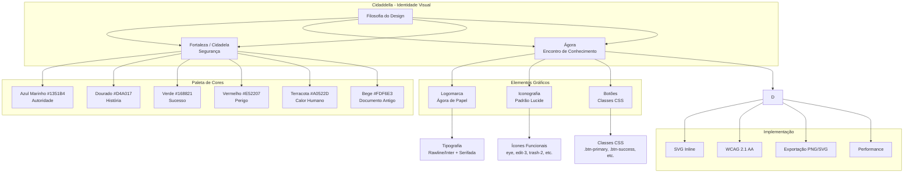
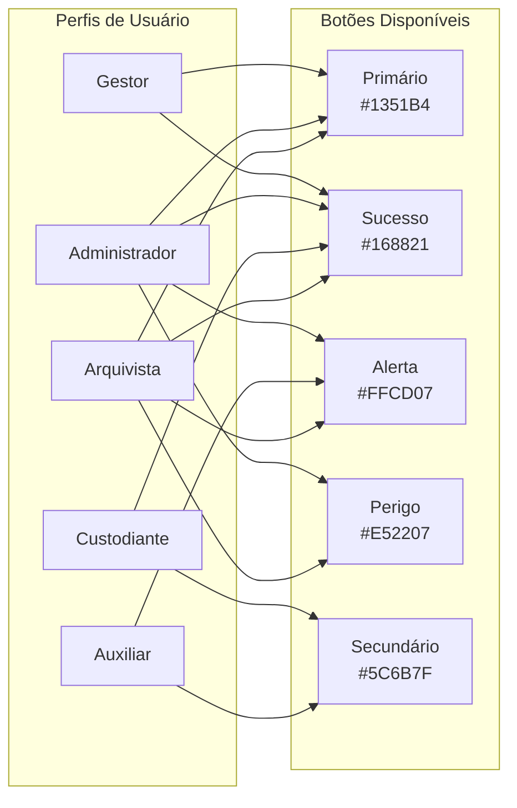
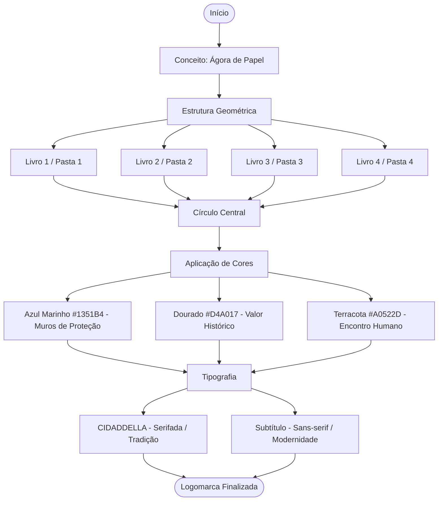

# 📦 Documentação Consolidada do Ecossistema Crepúsculo (Volume 1)
> **Base Unificada de Instruções e Documentação (.md) Fracionada**
> **Limite Otimizado por Volume:** 1500 KB

---

---


---
# 📁 ARQUIVO DE ORIGEM: `PlanoDesenvolvimentoDocumentacao.md`
## <PLANODESENVOLVIMENTODOCUMENTACAO_MD>

### 🧬 Mapeamento Estrutural para DFD, DRS e Modelagens (MER / UML)
- **Caminho Relativo no Servidor:** `PlanoDesenvolvimentoDocumentacao.md`
- **Tag Rastreável:** `PLANODESENVOLVIMENTODOCUMENTACAO_MD`

#### 📋 Estrutura de Requisitos & Regras (DRS / ERS):
```text
#### 1. Especialista em Governança de TI no Poder Judiciário e Engenheiro de Requisitos
#### 2. Engenheiro de Requisitos Sênior
#### 2. Dossiê do Produto e Rastreabilidade de Requisitos
```

#### 🗄️ Estrutura de Dados & Entidades (MER / UML):
```text
#### 4. Especialista em Draw.io e Mermaid.js
#### 6. Engenheiro de Dados e Modelador UML
### 7. Modelo Mestre de Instanciação de Prompt de Conclusão de Projeto (Aprimorado)
```

#### ⚙️ Fluxos de Trabalho & Processos (DFD):
```text
#### 3. Especialista em BPMN 2.0 e Modelagem de Processos
```

### 📖 Conteúdo Integral do Arquivo Markdown:
# Cria Artefatos de Documentação do Projeto

O **"Roteiro de Prompts por Papel"** revisado que incorpora o alinhamento normativo-patrimonial, os parâmetros temporais e de ciclo de vida contábil, e a inclusão da cláusula de **Governança Patrimonial** no papel de **Mensurador de Software (CFPS/IFPUG)**.

### Precisão Terminológica Normativa
Em observância à **NBC TSP 08 (Ativo Intangível)**, ao **MCASP (9ª ed.)** e à **Orientação SOF/TSE nº 15/2022**:
* **Ativos Intangíveis** (como softwares) estão sujeitos à **Amortização** (alocação sistemática do valor amortizável ao longo da vida útil econômica) e à **Redução ao Valor Recuperável (*Impairment*)**. 
* A **Depreciação** aplica-se formalmente aos bens materiais do Ativo Imobilizado (NBC TSP 07). Para assegurar estrita coerência normativa, o parâmetro `[indicador de depreciação]` é representado nos prompts em equivalência com a `[taxa/indicador de amortização acumulada e depreciação]`.


---

### Roteiro Reconstruído e Padronizado de Prompts por Papel

#### 1. Especialista em Governança de TI no Poder Judiciário e Engenheiro de Requisitos
* **Objetivo:** Elaborar o Documento de Formalização da Demanda (DFD), assegurando enquadramento nos Macrodesafios, parâmetros temporais de projeto e fundamentação para reconhecimento do Ativo Intangível.
* **Estrutura de Prompt:**
  > `"Atue como Especialista em Governança de TI no Poder Judiciário e Engenheiro de Requisitos. Com base na NBR ISO 21502:2021, PMBOK, Resolução CNJ nº 335/2020 (PDPJ-Br), NBR ISO/IEC/IEEE 12207, Orientação SOF/TSE nº 15/2022 e NBC TSP 08:`  
  > `1. Elabore o Documento de Formalização da Demanda (DFD) para a solução [Nome do Sistema / Solução OpenSource Archivemática e AtoM].`  
  > `2. PARÂMETROS TEMPORAIS E DE CICLO DE VIDA: Registre os marcos do projeto utilizando os parâmetros: [Data de início do projeto], [Data de fim do projeto], [perspectiva de tempo de vida útil] e [indicador de depreciação / taxa de amortização acumulada].`  
  > `3. ENQUADRAMENTO ESTRATÉGICO: Vincule o projeto aos Macrodesafios do Poder Judiciário (ex.: 'Aperfeiçoamento da Governança e da Gestão' e 'Desenvolvimento Ético de Soluções de Inovação Tecnológica e Segurança Cibernética').`  
  > `4. FUNÇÃO PARAMETRIZÁVEL DE IMPACTO: Modele a função I_impacto = f(Macrodesafio, Indicador_Alvo, Diretriz_Gestao), detalhando a contribuição esperada nos indicadores institucionais (ex.: iGovTIC-JUD, Índice de Maturidade em Gestão por Processos e Riscos, Índice de Transparência Ativa).`  
  > `5. FUNDAMENTAÇÃO PATRIMONIAL: Apresente a justificativa de governança para o reconhecimento futuro da solução como Ativo Intangível Gerado Internamente ou Adaptado (potencial de serviços e benefícios econômicos futuros).`  
  > `EXIGÊNCIA DE SAÍDA: Crie e exporte a resposta completa e estruturada em um arquivo no formato Markdown (.md)."`


---

#### 2. Engenheiro de Requisitos Sênior
* **Objetivo:** Especificar a ERS segregando entregas pelas fases contábeis formais (Pesquisa vs. Desenvolvimento) e alinhando requisitos a parâmetros temporais e indicadores estratégicos.
* **Estrutura de Prompt:**
  > `"Atue como Engenheiro de Requisitos Sênior. Elabore a Especificação de Requisitos de Software (ERS) fundamentada na NBR ISO/IEC/IEEE 12207, MCASP (9ª ed.), NBC TSP 08 e Orientação SOF/TSE nº 15/2022:`  
  > `1. Classifique estritamente os Requisitos Funcionais (RF), Não Funcionais (RNF) e Regras de Negócio (RN) em duas etapas patrimoniais: a) Fase de Pesquisa (estudos de viabilidade, prototipagem, tratados como Variação Patrimonial Diminutiva — VPD); e b) Fase de Desenvolvimento (requisitos cujos custos são ativáveis como valor original do ativo intangível).`  
  > `2. ESTRUTURAÇÃO TEMPORAL: Incorpore os parâmetros [Data de início do projeto], [Data de fim do projeto], [perspectiva de tempo de vida útil] do software e o [indicador de depreciação / taxa de amortização acumulada] esperada pós-ativação.`  
  > `3. ALINHAMENTO ESTRATÉGICO: Associe os requisitos ao Macrodesafio correspondente e configure a função I_requisito = f(Macrodesafio, Taxa_Congestionamento, Meta_Ciclo) para orientar a repriorização do backlog conforme novas diretrizes de gestão.`  
  > `EXIGÊNCIA DE SAÍDA: Crie e exporte a resposta completa e estruturada em um arquivo no formato Markdown (.md)."`


---

#### 3. Especialista em BPMN 2.0 e Modelagem de Processos
* **Objetivo:** Mapear o processo de trabalho TO-BE integrando as áreas de TI, Engenharia de Software, Contabilidade e Gestão Patrimonial, com pontos de controle de ciclo de vida do ativo.
* **Estrutura de Prompt:**
  > `"Atue como Especialista em BPMN 2.0. Mapeie e descreva o fluxo de processos TO-BE para especificação, desenvolvimento, homologação e ativação patrimonial da solução [Nome do Sistema]:`  
  > `1. Modele raias de responsabilidade (Pools/Lanes) para a Secretaria de TI, Coordenadoria de Finanças/Contabilidade, Setor Patrimonial e Unidades Demandantes.`  
  > `2. PONTOS DE CONTROLE PATRIMONIAL: Evidencie os marcos formais de transição entre a Fase de Pesquisa e a Fase de Desenvolvimento, o marco de disponibilidade operacional para início da amortização e a apuração dos parâmetros: [Data de início do projeto], [Data de fim do projeto], [perspectiva de tempo de vida útil] e [indicador de depreciação / taxa de amortização acumulada].`  
  > `3. ENQUADRAMENTO ESTRATÉGICO E MÁQUINA DE ESTADOS: Vincule o fluxo ao Macrodesafio 'Aperfeiçoamento da Governança e da Gestão' e defina gateways parametrizados pela função I_processo = f(Macrodesafio, Tempo_Execucao, Indice_Maturidade_Contratual).`  
  > `EXIGÊNCIA DE SAÍDA: Crie e exporte a resposta completa e estruturada em um arquivo no formato Markdown (.md)."`


---

#### 4. Especialista em Draw.io e Mermaid.js
* **Objetivo:** Gerar diagramas visuais em código Mermaid.js demonstrando a integração entre desenvolvimento de software, rastreabilidade temporal e contabilização patrimonial.
* **Estrutura de Prompt:**
  > `"Atue como Especialista em Draw.io e Mermaid.js. Escreva o código Mermaid.js completo para representar:`  
  > `1. O diagrama de sequência e fluxo de integração entre as ferramentas de desenvolvimento/gestão de demandas (Jira/SIGEPRO), o sistema automatizado de apuração de custos e os sistemas contábeis/patrimoniais (SIAFI/ASI).`  
  > `2. RASTREABILIDADE TEMPORAL E PATRIMONIAL: Ilustre os eventos de passagem dos parâmetros [Data de início do projeto], [Data de fim do projeto], ativação com [perspectiva de tempo de vida útil] e registro do [indicador de depreciação / taxa de amortização acumulada].`  
  > `3. ALINHAMENTO ESTRATÉGICO: Identifique nos nós do diagrama o vínculo com o Macrodesafio 'Desenvolvimento Ético de Soluções de Inovação Tecnológica e Segurança Cibernética' e a função parametrizável I_visual = f(Macrodesafio, Modulo_Software, Indicador_Alvo).`  
  > `EXIGÊNCIA DE SAÍDA: Crie e exporte a resposta completa e estruturada em um arquivo no formato Markdown (.md)."`


---

#### 5. Arquiteto de Software Principal
* **Objetivo:** Projetar a Documentação de Arquitetura de Software (DAS) em conformidade com a PDPJ-Br, prevendo mensuração modular de custo ativável e monitoramento de vida útil tecnológica.
* **Estrutura de Prompt:**
  > `"Atue como Arquiteto de Software Principal. Elabore a Documentação de Arquitetura de Software (DAS) em estrita conformidade com a Resolução CNJ nº 335/2020 (PDPJ-Br) e a NBR ISO/IEC/IEEE 12207:`  
  > `1. Projete a solução em microsserviços e módulos conteinerizados, permitindo a mensuração individualizada dos custos de desenvolvimento de cada componente para fins de ativação patrimonial (Custo Direto ou Valor Justo via APF).`  
  > `2. CICLO DE VIDA E PARÂMETROS CONTÁBEIS: Defina os requisitos arquiteturais para registro e acompanhamento dos parâmetros: [Data de início do projeto], [Data de fim do projeto], [perspectiva de tempo de vida útil] dos componentes e [indicador de depreciação / taxa de amortização acumulada].`  
  > `3. ENQUADRAMENTO ESTRATÉGICO: Alinhe a arquitetura ao Macrodesafio 'Desenvolvimento Ético de Soluções de Inovação Tecnológica e Segurança Cibernética' e modele a função I_arquitetura = f(Macrodesafio, Indice_Disponibilidade, iGovTIC-JUD).`  
  > `EXIGÊNCIA DE SAÍDA: Crie e exporte a resposta completa e estruturada em um arquivo no formato Markdown (.md)."`


---

#### 6. Engenheiro de Dados e Modelador UML
* **Objetivo:** Estruturar o modelo de dados e diagramas UML incorporando entidades de controle de versão, classificação da LGPD, amortização e baixa por obsolescência.
* **Estrutura de Prompt:**
  > `"Atue como Engenheiro de Dados e Modelador UML. Crie os Diagramas de Classe, Diagrama de Entidade-Relacionamento (DER) e o Dicionário de Dados do sistema:`  
  > `1. Inclua entidades e atributos específicos para controle de versão, histórico de alterações, LGPD, além de campos patrimoniais obrigatórios: [Data de início do projeto], [Data de fim do projeto], [perspectiva de tempo de vida útil], valor residual, [indicador de depreciação / taxa de amortização acumulada] e perdas por redução ao valor recuperável (*impairment*).`  
  > `2. ENQUADRAMENTO ESTRATÉGICO: Mapeie o modelo ao Macrodesafio 'Fortalecimento da Estratégia Nacional de TIC e de Proteção de Dados'.`  
  > `3. FUNÇÃO PARAMETRIZÁVEL DE DADOS: Formule a função I_dados = f(Macrodesafio, Indice_Adesao_LGPD, Taxa_Obsolescencia_Tecnologica) para sinalizar a necessidade de revisão da vida útil ou baixa do ativo por desuso.`  
  > `EXIGÊNCIA DE SAÍDA: Crie e exporte a resposta completa e estruturada em um arquivo no formato Markdown (.md)."`


---

#### 7. Engenheiro de Qualidade de Software (QA)
* **Objetivo:** Elaborar o Plano de Testes e estabelecer o Termo de Aceite Definitivo que marca o fim da fase de desenvolvimento e o início da alocação sistemática da amortização contábil.
* **Estrutura de Prompt:**
  > `"Atue como Engenheiro de Qualidade de Software (QA). Desenvolva o Plano de Testes de Software e a Matriz de Casos de Teste (funcionais, segurança, desempenho e interoperabilidade) alinhados à NBR ISO/IEC/IEEE 12207:`  
  > `1. Estabeleça os critérios formais do Termo de Aceite Definitivo que ateste que o software está em condições operacionais pretendidas pela administração, definindo o marco temporal exato para cessar a capitalização de custos e registrar a [Data de fim do projeto], iniciando a contagem da [perspectiva de tempo de vida útil] e do [indicador de depreciação / taxa de amortização acumulada].`  
  > `2. PARÂMETROS DE EXECUÇÃO: Registre explicitamente no plano os parâmetros [Data de início do projeto] e [Data de fim do projeto].`  
  > `3. ENQUADRAMENTO ESTRATÉGICO: Alinhe a estratégia ao Macrodesafio 'Agilidade, Efetividade e Qualidade na Prestação Jurisdicional' e configure a função I_qualidade = f(Macrodesafio, Cobertura_Testes, Satisfacao_Usuario).`  
  > `EXIGÊNCIA DE SAÍDA: Crie e exporte a resposta completa e estruturada em um arquivo no formato Markdown (.md)."`


---

#### 8. Agile Product Owner e Prompt Engineer para Desenvolvimento com IA
* **Objetivo:** Decompor o backlog em histórias de usuário etiquetadas por fase patrimonial e macrodesafio, gerando prompts de execução com parâmetros temporais do projeto.
* **Estrutura de Prompt:**
  > `"Atue como Agile Product Owner e Prompt Engineer para Desenvolvimento com IA (Claude/Codex/Cursor). Escreva o Product Backlog (Epics e User Stories em BDD/Given-When-Then):`  
  > `1. Etiquete cada História de Usuário com sua respectiva classificação: a) Etapa Patrimonial ('[Fase de Pesquisa - VPD]' ou '[Fase de Desenvolvimento - Custo Ativável]'); e b) Macrodesafio Institucional correspondente.`  
  > `2. CONTEXTUALIZAÇÃO TEMPORAL DO PROJETO: Insira no cabeçalho do backlog os parâmetros globais [Data de início do projeto], [Data de fim do projeto], [perspectiva de tempo de vida útil] e [indicador de depreciação / taxa de amortização acumulada].`  
  > `3. FUNÇÃO PARAMETRIZÁVEL: Implemente a função I_backlog = f(Macrodesafio, Prioridade_Story, Peso_Indicador_Estrategico) para recalcular automaticamente a priorização das entregas diante de mudanças no plano de gestão.`  
  > `4. PROMPTS DE EXECUÇÃO: Para cada história, elabore o prompt otimizado para assistentes de IA gerarem código aderente às normas da PDPJ-Br e NBR ISO/IEC/IEEE 12207.`  
  > `EXIGÊNCIA DE SAÍDA: Crie e exporte a resposta completa e estruturada em um arquivo no formato Markdown (.md)."`


---

#### 9. Mensurador de Software Certificado (CFPS/IFPUG) e Gestor Contratual
* **Objetivo:** Realizar a Análise de Pontos de Função (APF) para valoração do Ativo Intangível pelo Valor Justo, calcular a memória de custeio e incluir as diretrizes obrigatórias de Governança Patrimonial.
* **Estrutura de Prompt:**
  > `"Atue como Mensurador de Software Certificado (CFPS/IFPUG) e Gestor Contratual. Realize a contagem de Análise de Pontos de Função (APF) do projeto segundo o CPM/IFPUG, identificando ALI, AIE, EE, SE e CE:`  
  > `1. MENSURAÇÃO E VALORAÇÃO PATRIMONIAL: Apure o tamanho funcional em PF e calcule a memória de estimativa pelo Valor Justo do Ativo Intangível (Tamanho Funcional x Valor Unitário do PF praticado no mercado ou contrato), fornecendo o suporte para reconhecimento contábil conforme os itens 5.2 e 5.3 da Orientação SOF/TSE nº 15/2022 e a IN TCU nº 84/2020.`  
  > `2. GOVERNANÇA PATRIMONIAL: Inclua uma seção orientativa para a TI e o Setor Patrimonial diferenciando manutenção rotineira (despesa/VPD) de novas funcionalidades capitalizáveis, bem como procedimentos de notificação para baixa patrimonial por desuso, substituição ou obsolescência técnica (conforme apontado nas auditorias contábeis do Judiciário).`  
  > `3. PARÂMETROS TEMPORAIS E CONTÁBEIS: Incorpore à memória de cálculo os parâmetros [Data de início do projeto], [Data de fim do projeto], [perspectiva de tempo de vida útil] do software e o [indicador de depreciação / taxa de amortização acumulada].`  
  > `4. ENQUADRAMENTO ESTRATÉGICO: Vincule o orçamento e o dimensionamento aos Macrodesafios 'Aperfeiçoamento da Gestão Orçamentária e Financeira' e 'Aperfeiçoamento da Governança e da Gestão', definindo a função I_financeiro = f(Macrodesafio, Valor_Justo_Software, Indice_Perda_Orçamentaria).`  
  > `EXIGÊNCIA DE SAÍDA: Crie e exporte a resposta completa e estruturada em um arquivo no formato Markdown (.md)."`


---

#### 10. Analista de O&M e Designer de Manuais Técnicos
* **Objetivo:** Redigir manuais operacionais e guias técnicos em linguagem simples, orientando a governança patrimonial, o ciclo de uso e os procedimentos de baixa por desuso ou obsolescência.
* **Estrutura de Prompt:**
  > `"Atue como Analista de O&M e Designer de Manuais Técnicos. Desenvolva o Manual de Operação e Manutenção do Software e o Guia do Usuário alinhados à NBR ISO/IEC/IEEE 12207:`  
  > `1. Aplique técnicas de Linguagem Simples e Direito Visual para assegurar clareza aos magistrados, servidores e colaboradores.`  
  > `2. SEÇÃO DE GOVERNANÇA PATRIMONIAL DO SOFTWARE: Estabeleça orientações práticas para as unidades administrativas e de TI quanto aos registros dos parâmetros [Data de início do projeto], [Data de fim do projeto], acompanhamento da [perspectiva de tempo de vida útil] e apuração do [indicador de depreciação / taxa de amortização acumulada]. Detalhe os procedimentos formais de notificação à área patrimonial em caso de manutenção evolutiva (capitalizável) versus corretiva (despesa/VPD), bem como o fluxo de baixa patrimonial por desuso, substituição tecnológica ou obsolescência.`  
  > `3. ENQUADRAMENTO ESTRATÉGICO: Conecte a documentação aos Macrodesafios 'Aperfeiçoamento da Comunicação Institucional e Combate à Desinformação' e 'Aperfeiçoamento da Gestão de Pessoas', modelando a função I_adocao = f(Macrodesafio, Indice_Capacitacao, Satisfacao_Usuarios_TI).`  
  > `EXIGÊNCIA DE SAÍDA: Crie e exporte a resposta completa e estruturada em um arquivo no formato Markdown (.md)."`


---

### Estrutura Mestre de Instanciação Atualizada

```text
[PAPEL]: Atue como <Inserir Papel de 1 a 10>
[MARCO LEGAL E CONTÁBIL]: NBR ISO 21502:2021, PMBOK, NBR ISO/IEC/IEEE 12207, Lei nº 14.133/2021, Resolução CNJ nº 335/2020 (PDPJ-Br), Orientação SOF/TSE nº 15/2022, MCASP (9ª ed.), NBC TSP 08 e IN TCU nº 84/2020.
[PARÂMETROS TEMPORAIS E CONTÁBEIS]:
  - Data de início do projeto: [Data de início do projeto]
  - Data de fim do projeto: [Data de fim do projeto]
  - Perspectiva de tempo de vida útil: [perspectiva de tempo de vida útil]
  - Indicador de depreciação / Amortização: [indicador de depreciação]
[ENQUADRAMENTO ESTRATÉGICO]: Mapeamento no(s) Macrodesafio(s) Institucional(is) <Selecionar Macrodesafio 1 a 13>.
[FUNÇÃO PARAMETRIZÁVEL DE IMPACTO]: I_impacto = f(Macrodesafio, Indicador_Estratégico, Parâmetro_Gestão) para acolher mudanças de diretrizes e políticas públicas.
[CONTEXTO DE ENTRADA]: Projeto/Sistema [Nome da Solução] / Documento de Formalização da Demanda (DFD).
[ENTREGA REQUISITADA]: <Especificar o artefato técnico ou funcional pretendido>.
[FORMATO OBRIGATÓRIO DE SAÍDA]: Crie e exporte a resposta completa e estruturada em um arquivo no formato Markdown (.md).
```

---

# Cria Documentação de Conclusão do Projeto

Cria a documentação da **Fase de Conclusão, Aceite, Transição e Incorporação Patrimonial de Projetos de Software**.

Essa seção alinha os artefatos de encerramento às exigências da **Lei nº 14.133/2021** (art. 140), **Resolução CNJ nº 335/2020** (PDPJ-Br), **Resolução CNJ nº 363/2020** (LGPD), **NBR ISO/IEC/IEEE 12207**, **NBR ISO 21502 / PMBOK**, **NBC TSP 08**, **MCASP (9ª ed.)**, **Orientação SOF/TSE nº 15/2022**, **IN TCU nº 84/2020**, aos **Macrodesafios Institucionais** e às determinações de auditoria contábil-patrimonial do Poder Judiciário (prevenção do desuso indevido e da subavaliação de ativos gerados internamente).


---

### Nova Seção do Roteiro: Prompts de Conclusão, Aceite, Transição e Incorporação Patrimonial

#### 1. Declaração de Prontidão e Aceite Provisório (Disponibilização e Transição)
* **Objetivo:** Formalizar a conclusão das etapas de desenvolvimento e testes unitários/integrados, emitindo o Termo de Recebimento Provisório (TRP) e o Certificado de Prontidão para Implantação.
* **Estrutura de Prompt:**
  > `"Atue como Engenheiro de Qualidade de Software (QA) e Gestor do Projeto. Com base no art. 140 da Lei nº 14.133/2021, NBR ISO/IEC/IEEE 12207 (Processos de Transição e Aceitação) e NBR ISO 21502:`  
  > `1. Elabore a Declaração de Prontidão e o Termo de Recebimento Provisório (TRP) para a solução [Nome do Sistema / Solução OpenSource Archivemática e AtoM].`  
  > `2. EVIDÊNCIAS TÉCNICAS: Inclua o Relatório de Cobertura de Testes e Homologação Técnica (comprovando a ausência de defeitos críticos ou bloqueantes) e o Plano de Deploy/Rollout para o ambiente de homologação/produção.`  
  > `3. PARÂMETROS TEMPORAIS E CONTÁBEIS: Registre os parâmetros [Data de início do projeto] e [Data de fim do projeto] (marco de encerramento da fase de desenvolvimento), indicando a estimativa para [perspectiva de tempo de vida útil] e o início da apuração da [taxa de amortização acumulada e depreciação].`  
  > `4. ALINHAMENTO ESTRATÉGICO: Conecte o aceite provisório ao Macrodesafio 'Agilidade, Efetividade e Qualidade na Prestação Jurisdicional' e à função parametrizável I_aceite = f(Macrodesafio, Taxa_Cobertura_Testes, Tempo_Atendimento_Erros).`  
  > `EXIGÊNCIA DE SAÍDA: Crie e exporte a resposta completa e estruturada em um arquivo no formato Markdown (.md)."`


---

#### 2. Dossiê do Produto e Rastreabilidade de Requisitos
* **Objetivo:** Consolidação do Dossiê Técnico do Software (Baseline da Engenharia), garantindo a rastreabilidade integral entre requisitos de negócio, decisões arquiteturais, código-fonte e casos de teste.
* **Estrutura de Prompt:**
  > `"Atue como Engenheiro de Requisitos Sênior e Arquiteto de Software Principal. Com base na NBR ISO/IEC/IEEE 12207 (Processos de Definição de Requisitos e Arquitetura) e Resolução CNJ nº 335/2020:`  
  > `1. Elabore o Dossiê Técnico do Software (Baseline da Engenharia) da solução [Nome do Sistema].`  
  > `2. CONTEÚDO TÉCNICO: Consolide a Especificação de Requisitos de Software (ERS), Histórias de Usuário (BDD), Registros de Decisão Arquitetural (ADRs), Modelagem de Dados/APIs e a Matriz de Rastreabilidade de Requisitos (vinculando requisitos de negócio, componentes de código, microsserviços e casos de teste).`  
  > `3. SEGREGAÇÃO PATRIMONIAL: Destaque a separação formal entre os requisitos referentes à Fase de Pesquisa (VPD/despesa) e à Fase de Desenvolvimento (custo ativável do intangível), segundo a NBC TSP 08 e Orientação SOF/TSE nº 15/2022.`  
  > `4. PARÂMETROS DO ATIVO: Associe o dossiê aos parâmetros [Data de início do projeto], [Data de fim do projeto], [perspectiva de tempo de vida útil] e [taxa de amortização acumulada e depreciação].`  
  > `5. ALINHAMENTO ESTRATÉGICO: Configure a função I_dossie = f(Macrodesafio, Indice_Rastreabilidade, Complexidade_Arquitetural) vinculada ao Macrodesafio 'Aperfeiçoamento da Governança e da Gestão'.`  
  > `EXIGÊNCIA DE SAÍDA: Crie e exporte a resposta completa e estruturada em um arquivo no formato Markdown (.md)."`


---

#### 3. Parecer de Alinhamento Estratégico
* **Objetivo:** Emitir o relatório formal demonstrando a contribuição da entrega do software para os Objetivos Estratégicos, Macrodesafios e Indicadores Institucionais.
* **Estrutura de Prompt:**
  > `"Atue como Especialista em Governança de TI e Planejamento Estratégico. Com base na NBR ISO 21502, PMBOK, Resolução CNJ nº 325/2020 e no Plano Estratégico Institucional:`  
  > `1. Elabore o Parecer de Alinhamento Estratégico e Relatório de Benefícios do software [Nome do Sistema].`  
  > `2. MAPEAMENTO DE IMPACTO: Demonstre o impacto direto da solução nos Macrodesafios do Poder Judiciário (ex.: 'Aperfeiçoamento da Governança e da Gestão' e 'Desenvolvimento Ético de Soluções de Inovação Tecnológica e Segurança Cibernética').`  
  > `3. MÁQUINA DE PARAMETRIZAÇÃO: Modele a função I_impacto = f(Macrodesafio, Indicador_Alvo, Diretriz_Gestao), detalhando a fórmula de cálculo e a contribuição em indicadores reais (ex.: iGovTIC-JUD, Taxa de Congestionamento Líquida, Índice de Transparência Ativa), garantindo que a função aceite repriorizações do planejamento.`  
  > `4. CONTEXTO TEMPORAL: Incorpore os parâmetros globais [Data de início do projeto], [Data de fim do projeto], [perspectiva de tempo de vida útil] e [taxa de amortização acumulada e depreciação].`  
  > `EXIGÊNCIA DE SAÍDA: Crie e exporte a resposta completa e estruturada em um arquivo no formato Markdown (.md)."`


---

#### 4. Relação de Entregáveis / Inventário de Produtos
* **Objetivo:** Relacionar objetivamente todos os ativos de software, código-fonte, esquemas de banco de dados, repositórios e manuais incorporados ao ecossistema de TI.
* **Estrutura de Prompt:**
  > `"Atue como Agile Product Owner e Gerente de Configuração. Com base na NBR ISO/IEC/IEEE 12207 (Gestão de Configuração e Ativos de Software):`  
  > `1. Elabore a Relação de Entregáveis e Inventário de Ativos Gerados para o software [Nome do Sistema].`  
  > `2. DETALHAMENTO DO INVENTÁRIO: Liste os repositórios do código-fonte (commits, tags de versão release), microsserviços, esquemas/scripts de banco de dados, esteiras de DevOps/CI-CD, Manual do Usuário e Guia de Operação e Manutenção.`  
  > `3. PREVENÇÃO DE ACHADOS DE AUDITORIA: Registre a solução no inventário formal de TI para evitar a subavaliação do patrimônio (conforme auditoria contábil sobre sistemas sem registro contábil) e instrua a vinculação operacional.`  
  > `4. REGISTRO DE PARÂMETROS: Associe o inventário aos parâmetros [Data de início do projeto], [Data de fim do projeto], [perspectiva de tempo de vida útil] e [taxa de amortização acumulada e depreciação].`  
  > `5. ALINHAMENTO ESTRATÉGICO: Configure a função I_inventario = f(Macrodesafio, Qtd_Ativos_Gerados, Indice_Reuso_PDPJ) conectada ao Macrodesafio 'Desenvolvimento Ético de Soluções de Inovação Tecnológica e Segurança Cibernética'.`  
  > `EXIGÊNCIA DE SAÍDA: Crie e exporte a resposta completa e estruturada em um arquivo no formato Markdown (.md)."`


---

#### 5. Termo para Incorporação Patrimonial do Ativo Intangível
* **Objetivo:** Emitir a Nota de Apropriação e o Relatório Contábil de Mensuração para notificar os setores financeiro e patrimonial para tombamento do software no Ativo Não Circulante (Intangível).
* **Estrutura de Prompt:**
  > `"Atue como Mensurador de Software Certificado (CFPS/IFPUG) e Contador Público. Com base na NBC TSP 08, MCASP (9ª ed.), Orientação SOF/TSE nº 15/2022, Lei nº 14.133/2021 e IN TCU nº 84/2020:`  
  > `1. Elabore o Termo para Incorporação Patrimonial do Ativo Intangível e a Nota de Apropriação Contábil do software [Nome do Sistema].`  
  > `2. VALORAÇÃO E APF: Anexe o Extrato da Análise de Pontos de Função (APF/IFPUG) auditado e apresente a memória de cálculo do Valor Justo (Tamanho Funcional em PF x Valor Unitário do PF contratual/mercado) ou Custo Direto de Desenvolvimento para ativação inicial no Ativo Não Circulante.`  
  > `3. GOVERNANÇA PATRIMONIAL E AUDITORIA: Estabeleça orientações para a TI e o Setor Patrimonial quanto aos registros da [Data de início do projeto], [Data de fim do projeto] (marco de início da amortização), [perspectiva de tempo de vida útil] e [taxa de amortização acumulada e depreciação]. Inclua as regras para segregação de custos de manutenção (VPD) e o fluxo formal de notificação para baixa patrimonial por desuso, substituição ou obsolescência (prevenindo apontamentos de auditoria contábil).`  
  > `4. ALINHAMENTO ESTRATÉGICO: Vincule a incorporação ao Macrodesafio 'Aperfeiçoamento da Gestão Orçamentária e Financeira' e formule a função I_patrimonio = f(Macrodesafio, Valor_Ativo_Intangivel, Taxa_Amortizacao_Anual).`  
  > `EXIGÊNCIA DE SAÍDA: Crie e exporte a resposta completa e estruturada em um arquivo no formato Markdown (.md)."`


---

#### 6. Conformidade com a Resolução CNJ nº 335/2020 (PDPJ-Br) e Engenharia de Software
* **Objetivo:** Elaborar o Dossiê de Conformidade Regulatória (PDPJ-Br, LGPD, Segurança) e o Termo de Encerramento do Projeto (TEP) para transferência da solução à equipe de Sustentação.
* **Estrutura de Prompt:**
  > `"Atue como Arquiteto de Software Principal, Engenheiro de Segurança e Gestor do Projeto. Com base na Resolução CNJ nº 335/2020 (PDPJ-Br), Resolução CNJ nº 363/2020 (LGPD), ISO/IEC 25010 e NBR ISO 21502:`  
  > `1. Elabore o Dossiê de Conformidade Regulatória e Qualidade de Software do sistema [Nome do Sistema].`  
  > `2. REQUISITOS DE CONFORMIDADE: Inclua: a) Comprovação de integração ao Barramento do CNJ via APIs e microsserviços; b) Termo de Cessão de Direitos Autorais / Licenciamento Aberto para reuso na PDPJ-Br; c) Relatório de Impacto à Proteção de Dados Pessoais (RIPD/LGPD); d) Relatório de Varredura de Vulnerabilidades (Análise SAST/DAST - OWASP); e e) Termo de Encerramento do Projeto (TEP) consolidando custos, prazos, lições aprendidas e transferência para Sustentação.`  
  > `3. PARÂMETROS TEMPORAIS E DE REVISÃO: Registre no TEP os parâmetros [Data de início do projeto], [Data de fim do projeto], [perspectiva de tempo de vida útil] e a [taxa de amortização acumulada e depreciação] aplicável.`  
  > `4. ALINHAMENTO ESTRATÉGICO: Associe o dossiê ao Macrodesafio 'Desenvolvimento Ético de Soluções de Inovação Tecnológica e Segurança Cibernética' e defina a função I_conformidade = f(Macrodesafio, Nivel_Seguranca_OWASP, Aderencia_PDPJ).`  
  > `EXIGÊNCIA DE SAÍDA: Crie e exporte a resposta completa e estruturada em um arquivo no formato Markdown (.md)."`


---

### 7. Modelo Mestre de Instanciação de Prompt de Conclusão de Projeto (Aprimorado)

Este modelo padronizado deve ser utilizado para acionar o agente de IA na fase final de entrega e incorporação patrimonial do software:

```text
[PAPEL]: Atue como <Inserir Papel de Conclusão: Gestor de Projeto / QA / Arquiteto / PO / Contador Público>
[MARCO REGULATÓRIO E CONTÁBIL]: Lei nº 14.133/2021 (art. 140), Resolução CNJ nº 335/2020 (PDPJ-Br), Resolução CNJ nº 363/2020 (LGPD), NBR ISO/IEC/IEEE 12207, NBR ISO 21502 / PMBOK, NBC TSP 08, MCASP (9ª ed.), Orientação SOF/TSE nº 15/2022 e IN TCU nº 84/2020.
[PARÂMETROS TEMPORAIS E PATRIMONIAIS]:
  - Data de início do projeto: [Data de início do projeto]
  - Data de fim do projeto: [Data de fim do projeto]
  - Perspectiva de tempo de vida útil: [perspectiva de tempo de vida útil]
  - Taxa de amortização acumulada e depreciação: [indicador de depreciação]
[ENQUADRAMENTO ESTRATÉGICO]: Mapeamento no(s) Macrodesafio(s) Institucional(is) <Selecionar Macrodesafio 1 a 13>.
[FUNÇÃO PARAMETRIZÁVEL DE IMPACTO]: I_impacto = f(Macrodesafio, Indicador_Estratégico, Parâmetro_Gestão) para garantir aderência às diretrizes institucionais do Poder Judiciário.
[GOVERNANÇA PATRIMONIAL E AUDITORIA]: Instrução para reconhecimento inicial do Ativo Intangível (evitando subavaliação) e definição de rotinas de notificação para baixa patrimonial por desuso, substituição ou obsolescência técnica.
[CONTEXTO DE ENTRADA]: Projeto/Sistema [Nome da Solução OpenSource / Sistema Interno] / Documento de Formalização da Demanda (DFD).
[ARTEFATO DE CONCLUSÃO REQUISITADO]: <Selecionar um dos 6 itens da fase de conclusão>.
[FORMATO OBRIGATÓRIO DE SAÍDA]: Crie e exporte a resposta completa e estruturada em um arquivo no formato Markdown (.md).
```


---

</PLANODESENVOLVIMENTODOCUMENTACAO_MD>


---
# 📁 ARQUIVO DE ORIGEM: `Presença: Repositório Frequência/NormaRegimental_Presença_FrequenciaAssiduidade-REP.md`
## <PRESENçA: REPOSITóRIO FREQUêNCIA_NORMAREGIMENTAL_PRESENçA_FREQUENCIAASSIDUIDADE_REP_MD>

### 🧬 Mapeamento Estrutural para DFD, DRS e Modelagens (MER / UML)
- **Caminho Relativo no Servidor:** `Presença: Repositório Frequência/NormaRegimental_Presença_FrequenciaAssiduidade-REP.md`
- **Tag Rastreável:** `PRESENçA: REPOSITóRIO FREQUêNCIA_NORMAREGIMENTAL_PRESENçA_FREQUENCIAASSIDUIDADE_REP_MD`

#### 📋 Estrutura de Requisitos & Regras (DRS / ERS):
```text
Sem cabeçalhos diretos de requisitos identificados
```

#### 🗄️ Estrutura de Dados & Entidades (MER / UML):
```text
### **10\. MODELO DO DIAGRAMA SISTÊMICO**
```

#### ⚙️ Fluxos de Trabalho & Processos (DFD):
```text
### **10\. MODELO DO DIAGRAMA SISTÊMICO**
```

### 📖 Conteúdo Integral do Arquivo Markdown:
**PROPOSTA DE ALTERAÇÃO DA INSTRUÇÃO NORMATIVA Nº 36/2018**

Dispõe sobre a modernização do controle de frequência, institui o *Registro Digital de Frequência e Assiduidade \- Presença* e altera o Art. 14 da [Instrução Normativa nº 36/2018](https://www.tre-ac.jus.br/legislacao/instrucoes-normativas/2018-1/2018/instrucao-normativa-no-36/@@display-file/file/Instrucao_Normativa_36.pdf) (0244035).

#### **1\. INTRODUÇÃO**

O projeto **“*Registro Digital de Frequência \- Presença”*** visa a modernização administrativa do Tribunal Regional Eleitoral do Acre, superando limitações técnicas dos atuais relógios de ponto de parede (REP-C) e alinhando-se às metas de extinção do uso do papel. A ferramenta padroniza a coleta e o aferimento da jornada de trabalho de todos os serventuários da Justiça Eleitoral do Acre, assegurando conformidade com as [Resoluções TSE nº 22.901/2008](https://www.tse.jus.br/legislacao/compilada/res/2008/resolucao-no-22-901-de-12-de-agosto-de-2008) e [nº 23.386/2012](https://www.tse.jus.br/legislacao/compilada/res/2012/resolucao-no-23-386-de-21-de-agosto-de-2012), e a [Resolução CNJ nº 88/2009](https://atos.cnj.jus.br/atos/detalhar/87).

#### **2\. JUSTIFICATIVA**

A necessidade de alteração da norma vigente fundamenta-se nos seguintes pontos:

* **Incapacidade Técnica e Operacional:** O modelo atual de biometria física em equipamentos REP-C apresenta indisponibilidade por defeito na máquina, dificuldades de manutenção e complexidade na extração de dados, exigindo intervenção manual da equipe de RH.  
* **Limitação Geográfica:** A inexistência de equipamentos físicos em Postos de Alistamento no interior e em áreas externas penaliza o servidor e exige métodos de registro paralelos e manuais, desqualificando o normativo vigente.  
* **Segurança Jurídica e Garantia de Direitos:** A nova solução digital, baseada em *Autenticação Multifator (MFA) e Geolocalização*, garante a fidedignidade do registro sem dependência de hardware local, assegura a emissão de certidões de folgas e horas extras trabalhadas com plena validade probatória.  
* *Abrangência Institucional:* É imperativo estender o registro eletrônico a todas as categorias (magistrados, estagiários, voluntários e convocados), visando a segurança jurídica em eventuais litígios e a corresponsabilidade previdenciária.

#### **3\. FUNDAMENTAÇÃO LEGAL**

A proposta encontra amparo na [Lei nº 8.112/1990](https://www.planalto.gov.br/ccivil_03/leis/l8112cons.htm#art74) (assiduidade e pontualidade), no *Art. 74, § 2º da CLT* (anotação de entrada e saída), e na [Portaria MTP nº 671/2021](https://in.gov.br/en/web/dou/-/portaria-359094139), que permite modelos alternativos de controle de jornada. Complementarmente, baseia-se no poder regulamentar do Presidente do Tribunal para disciplinar o expediente institucional.

Além da gestão do quadro permanentes de servidores, o Tribunal possui o dever legal e constitucional de fiscalizar a execução dos contratos de prestação de serviços terceirizados, incluindo o rigoroso acompanhamento do cumprimento das obrigações trabalhistas e previdenciárias por parte das empresas contratadas.

A ausência de uma ferramenta sistêmica e auditável para a coleta de frequência desses trabalhadores expõe a Instituição ao risco de condenação judicial trabalhista, fundamentada no instituto da responsabilidade subsidiária, decorrente da *"culpa in vigilando"* (falha no dever de fiscalizar).

A implementação centralizada do Ponto Eletrônico Digital (REP) a todas as categorias funcionais da Justiça Eleitoral no Acre busca atender diretamente às seguintes exigências legais e jurisprudenciais:

> > I. Súmula nº 331 do Tribunal Superior do Trabalho (TST) \- Item V: A jurisprudência pacificada do TST determina que os entes integrantes da Administração Pública direta e indireta respondem subsidiariamente pelo inadimplemento das obrigações trabalhistas por parte do empregador (empresa terceirizada), caso evidenciada a sua conduta culposa no cumprimento das obrigações da Lei de Licitações, especialmente na fiscalização do cumprimento das obrigações contratuais e legais da prestadora de serviço.

> > > "V \- Os entes integrantes da Administração Pública direta e indireta respondem subsidiariamente (...) caso evidenciada a sua conduta culposa no cumprimento das obrigações da Lei de Licitações e Contratos Administrativos, especialmente na fiscalização do cumprimento das obrigações contratuais e legais da prestadora de serviço como empregadora."

> > II. Decisão com Repercussão Geral do Supremo Tribunal Federal (STF \- Tema 246): No julgamento do Recurso Extraordinário (RE) 760.931, o STF firmou tese de que a responsabilização da Administração Pública não é automática, mas depende da comprovação de ausência de fiscalização. Portanto, a ferramenta atua como o principal instrumento de produção de provas documentais de que o Tribunal exerce ativamente essa fiscalização, mitigando o risco de condenações em litígio.

> > III. Nova Lei de Licitações e Contratos ([Lei nº 14.133/2021](https://www.in.gov.br/en/web/dou/-/lei-n-14.133-de-1-de-abril-de-2021-311876884)) \- Artigo 121: A nova legislação exige expressamente que a Administração exija da contratada a comprovação do cumprimento das obrigações trabalhistas, sob pena de responsabilidade solidária ou subsidiária pelos encargos previdenciários e trabalhistas.

> > > "Art. 121, § 2º: Exclusivamente nas contratações de serviços contínuos com regime de dedicação exclusiva de mão de obra, a Administração responderá solidariamente pelos encargos previdenciários e subsidiariamente pelos encargos trabalhistas se comprovada falha na fiscalização do cumprimento da obrigação pelo contratado."

> > IV. Consolidação das Leis do Trabalho (CLT) \- Artigo 74, § 2º: A legislação trabalhista base exige a anotação da hora de entrada e saída em estabelecimentos com mais de 20 trabalhadores. Ao prover o recurso sistêmico, a Instituição garante que a base de dados de controle de jornada seja fidedigna, inalterável e compartilhada em tempo real com a gestão do contrato, impedindo que os registros fiquem sob posse exclusiva da empresa terceirizada, o que historicamente dificulta a defesa da União em litígios trabalhistas.

Diante do exposto, a coleta do registro eletrônico *(via proxy reverso e QRCode)* consolida-se, portanto, como uma medida de governança e compliance essencial. Ele fornece ao Tribunal os subsídios comprobatórios exatos *(Data, Hora, Geolocalização, CPF e Assinatura Digital)* necessários para atestar a regularidade da assiduidade ou fundamentar sanções contratuais, blindando o erário contra litígios derivados de contratos de terceirização e eventos com força de trabalho externa.

### **4\. SEGURANÇA NO ACESSO VIA SMARTPHONE**

O **Authelia** atua como o *"guardião do acesso"* externo ao sistema de Registro Digital de Frequência, garantindo a segurança através de um modelo de **Autenticação Multifator (MFA)** e integração com a infraestrutura de rede Institucional.

A segurança no acesso via smartphone é garantida pelos seguintes mecanismos:

* **Autenticação de Dois Fatores (2FA/MFA):** O Authelia gerencia o segundo fator de autenticação, que pode ser um **Token ou Push**, validando a identidade do usuário antes que o *Proxy Reverso* libere o acesso à rota da aplicação. Ele trabalha em conjunto com o serviço *Microsoft Windows Active Directory (AD)* para validar as credenciais institucionais.  
* **Vinculação de Dispositivo *(Device Binding)*:** Para garantir a validade jurídica e evitar fraudes, o smartphone deve ser previamente vinculado à identidade funcional do servidor. Esse *"elo de confiança"* é criado em um primeiro acesso *(onboarding)* realizado na rede interna ou via VPN, onde o Authelia registra o aparelho.  
* **Identificador Único e Assinatura:** Durante o uso, o sistema captura um identificador persistente do dispositivo *(como um UUID)* vinculado ao CPF. O pacote de frequência só é aceito se for assinado por uma chave gerada a partir do ***token MFA*** **ativo no dispositivo vinculado**.  
* **Camada de Proteção Externa:** Quando um usuário tenta acessar o sistema de fora da rede, o ***Proxy Reverso*** detecta a conexão externa e a redireciona obrigatoriamente para o Authelia. O acesso só prossegue se os dados de *geolocalização* e o *ID do dispositivo* coincidirem com o que foi cadastrado previamente.

Essa estrutura impede que um servidor registre o ponto para outro colega possuindo apenas login e senha, pois o sistema exige obrigatoriamente a presença do **aparelho físico vinculado**. Além disso, toda a comunicação entre o smartphone e o servidor de segurança é protegida por criptografia via protocolo **HTTPS com certificados TLS**.

### **5\. REGISTRO DA FREQUÊNCIA EM ATIVIDADES EXTERNAS**

Com a implementação do **Registro Digital de Frequência e Assiduidade**, o ponto para servidores em atividades externas deixa de depender de equipamentos físicos ou registros manuais, passando a ser realizado diretamente pelo serventuário via dispositivo móvel.

O funcionamento para atividades externas baseia-se nos seguintes pilares técnicos e de segurança:

> ### **1\. Registro via Smartphone (Mobile)**

> O servidor utiliza seu próprio aparelho celular para realizar a marcação em ambiente web ou mobile através da URL institucional (presenca.tre-ac.jus.br). Isso elimina a necessidade de deslocamento até uma sede com relógio de ponto físico (REP-C) ou o uso de listas de presença em papel.

> ### **2\. Geolocalização Obrigatória**

> Para garantir a validade jurídica do registro realizado fora das dependências do Tribunal, o sistema captura obrigatoriamente as **coordenadas geográficas** (latitude e longitude) no momento da marcação. Esses metadados são anexados ao pacote de frequência para comprovar que o servidor estava no local da atividade externa declarada.

> ### **3\. Segurança e Autenticidade (MFA e Device Binding)**

> Mesmo em ambiente externo (rua), a segurança é garantida por camadas que impedem fraudes:

> * **Autenticação Multifator (MFA):** O acesso externo é intermediado pela ferramenta **Authelia**, que exige uma segunda validação (Token ou Push) além do login e senha do Windows AD.  
> * **Vinculação de Dispositivo (*Device Binding*):** O ponto só é aceito se for realizado a partir de um smartphone previamente cadastrado e vinculado ao CPF do servidor (processo de *onboarding* feito na rede interna). Isso impede que um colega registre o ponto por outro, pois o sistema exige a presença do **aparelho físico vinculado**.

> ### **4\. Fluxo do Registro Externo**

> O fluxo técnico para o servidor na rua ocorre da seguinte forma:

> 1. **Acesso:** O usuário acessa o link do sistema via navegador do celular.  
> 2. **Identificação:** Insere o CPF e as credenciais de rede.  
> 3. **Validação Externa:** O **Proxy Reverso** detecta a conexão externa e solicita o segundo fator (MFA) via Authelia.  
> 4. **Assinatura Digital:** O sistema verifica o ID do dispositivo e a geolocalização. Se compatíveis, o pacote de dados (CPF \+ Geo \+ Data \+ Hora) é assinado digitalmente e postado na base de dados do Tribunal.  
> 5. **Comprovação:** Uma cópia do registro de frequência (backup local) é armazenada na memória do próprio smartphone do servidor.

> ### **Comparação com o Modelo Anterior**

> Na norma anterior (IN 36/2018), quando o servidor estava em atividade externa onde não havia biometria, o registro precisava ser lançado manualmente pela **chefia imediata**. O novo modelo digital dá autonomia ao servidor para realizar o registro em tempo real, independentemente da localização geográfica.

### **6\. COMPROVAÇÃO DO REGISTRO**

O **backup local** das marcações no smartphone funciona como uma camada de segurança e comprovação para o serventuário, operando de acordo com os seguintes critérios técnicos estabelecidos nos requisitos do sistema:

* **Geração Automática:** Ao finalizar o fluxo de registro de ponto via smartphone, após a postagem dos dados na base de dados do Tribunal, o sistema gera e armazena automaticamente uma cópia do "pacote de frequência" na memória do dispositivo móvel.  
* **Conteúdo do Pacote:** Essa cópia local contém os mesmos metadados obrigatórios enviados ao servidor: **CPF, geolocalização, data e hora**, além da assinatura digital que garante a integridade do registro.  
* **Gestão pelo Usuário:** O sistema prevê, como requisito de teste (TDD), que o próprio serventuário tenha a autonomia para **descartar a cópia local** armazenada em seu dispositivo quando desejar.

### **Objetivo:** Esse mecanismo serve como um comprovante imediato para o trabalhador, assegurando que ele possua uma evidência digital da marcação realizada, independente da consulta posterior ao espelho de ponto no sistema oficial.

### **7\. PROVA MATERIAL IDÔNEA**

De acordo com os documentos, em situações excepcionais de esquecimento ou falha técnica na captura, a norma permite a utilização de **meios materiais de prova idôneos** para comprovar o labor e suprir a falta do registro.

As provas materiais citadas especificamente são:

* **Horário de mensagem eletrônica (e-mail):** Enviada pelo próprio servidor a partir do seu local de trabalho. A fidedignidade reside no fato de o servidor não ter controle sobre o relógio do servidor de rede.  
* **Imagens de câmeras de segurança:** Registros do circuito interno que confirmam a presença física do servidor na unidade em horários específicos.  
* **Registros de rede:** Outros logs ou evidências de acesso aos sistemas institucionais que comprovem a atividade funcional.  
* **Atestados ou declarações médicas:** Para casos específicos de consultas, exames ou tratamentos, limitados a 48 horas anuais.

**Critérios de validação e consequências:**

1. **Avaliação da Chefia e Direção:** A avaliação da idoneidade dessas provas cabe ao **Diretor-Geral** ou, em casos previstos na Portaria, o lançamento das ocorrências é feito pela **chefia imediata** no sistema informatizado.  
2. **Serviço Extraordinário:** A aceitação dessas provas materiais é fundamental para garantir o pagamento de adicional noturno ou horas extras, uma vez que a regra geral exige o registro eletrônico para a retribuição de serviço extraordinário.  
3. **Falta de Prova Material:** Caso o servidor realize apenas o registro manual sem apresentar qualquer meio de prova material idônea, este registro servirá exclusivamente para a **complementação da jornada ordinária**, não sendo aceito para fins de banco de horas ou pagamento de extras.

Essa flexibilização visa evitar o enriquecimento ilícito da administração, assegurando que o servidor que efetivamente trabalhou seja retribuído, conforme previsto no Estatuto do Servidor (Lei nº 8.112/90).

### **8\. PROPOSTA DE ALTERAÇÃO DA NORMA ([IN TRE-AC Nº 36/2018](https://www.tre-ac.jus.br/legislacao/instrucoes-normativas/2018-1/2018/instrucao-normativa-no-36/@@display-file/file/Instrucao_Normativa_36.pdf))**

O Capítulo III da Instrução Normativa nº 36/2018 passa a vigorar com a seguinte redação para o seu Art. 14:

> "Art. 14\. O controle da frequência dos serventuários da Justiça Eleitoral do Acre dar-se-á pela marcação do **Registro Eletrônico de Ponto (REP)**, ao início e ao fim do expediente, mediante a utilização da ferramenta *'Registro Digital de Frequência e Assiduidade'*.

> > § 1º O método de registro eletrônico será estendido a magistrados, servidores, requisitados, colaboradores, estagiários e demais categorias sob responsabilidade previdenciária do Tribunal:

> > > > I \- A responsabilidade pelo cadastramento ou desvinculação Institucional do serventuário caberá à unidade responsável pelo vínculo;

a. Para o cadastramento de magistrados, servidores, requisitados, estagiários, e demais categorias com vínculo direto com o Tribunal, compete a Coordenadoria de Gestão de Pessoas e suas Seções processar a gestão da assiduidade;

b. Para o cadastramento de colaboradores cuja prestação de serviços está vinculada a contratos com o Tribunal, compete aos gestor e fiscal daqueles contratos processar a gestão da assiduidade;

c. Para os casos de convocação, voluntários e demais colaboradores vinculados a eventos promovidos pelo Tribunal, compete aos gestor e fiscal do evento processar a gestão da assiduidade;

> > § 2º O serventuário deverá realizar a marcação da frequência utilizando o seu CPF como identificador pessoal, através de dispositivo móvel previamente vinculado ou computador institucional na intranet.

> > § 3º Para garantir a autenticidade e a imutabilidade do registro, a aplicação exigirá obrigatoriamente:

> > > > I \- Vinculação de Dispositivo (Device Binding): identificação única do aparelho mobile à identidade funcional do usuário;

> > > > II \- Autenticação Multifator (MFA): validação por token dinâmico ou QRCode;

> > > > III \- Geolocalização: captura de coordenadas geográficas no momento da marcação.

> > § 4º Pendências no espelho de ponto eletrônico deverão ser sanadas pelas unidades vinculadas até o primeiro dia útil do mês subsequente, sob pena de processamento de descontos em banco de horas ou folha de pagamento.

> > § 5º A utilização de prova material idônea para suprir a falta de registro eletrônico em situações excepcionais será avaliada pela Diretoria-Geral.

> > § 6º A utilização indevida ou fraudulenta dos registros eletrônicos sujeitará o infrator a processo administrativo disciplinar."

Adicionar Artigo

"Art. XX. O registro de frequência em atividades fora das instalações do Tribunal poderão ser registrados, mediante a utilização da ferramenta *'Registro Digital de Frequência e Assiduidade'*.”

### **9\. CONFORMIDADE SISTÊMICA**

A proposta de sistematização está conformidade com os Requisitos do Negócios (RN01 a RN03) e Requisitos Funcionais (RF01 a RF08) detalhados no Termo Requisitos Coleta de Frequência (0868259), assegurando que a tecnologia implementada suporte integralmente a nova redação jurídica da norma.*'*.”

### **10\. MODELO DO DIAGRAMA SISTÊMICO**

[Diagrama do fluxo](https://app.diagrams.net/?src=about#G1sJQE1ei7lzIScIhOhhSsSstQBsLYrClq#%7B%22pageId%22%3A%22BjRE8f9qUu2LiLdMdI1j%22%7D) de processamento do registro da frequência

![][image1]

[image1]: <>

</PRESENçA: REPOSITóRIO FREQUêNCIA_NORMAREGIMENTAL_PRESENçA_FREQUENCIAASSIDUIDADE_REP_MD>


---
# 📁 ARQUIVO DE ORIGEM: `Presença: Repositório Frequência/Presenca_Manual-Modelagem.md`
## <PRESENçA: REPOSITóRIO FREQUêNCIA_PRESENCA_MANUAL_MODELAGEM_MD>

### 🧬 Mapeamento Estrutural para DFD, DRS e Modelagens (MER / UML)
- **Caminho Relativo no Servidor:** `Presença: Repositório Frequência/Presenca_Manual-Modelagem.md`
- **Tag Rastreável:** `PRESENçA: REPOSITóRIO FREQUêNCIA_PRESENCA_MANUAL_MODELAGEM_MD`

#### 📋 Estrutura de Requisitos & Regras (DRS / ERS):
```text
## **4.3. ESCOPOS\_CONSULTA**
```

#### 🗄️ Estrutura de Dados & Entidades (MER / UML):
```text
# **2\. Diagrama de entidade e relacionamento**
# **4\. As tabelas em detalhe**
```

#### ⚙️ Fluxos de Trabalho & Processos (DFD):
```text
# **2\. Diagrama de entidade e relacionamento**
# **3\. Como o sistema funciona — fluxos principais**
### **Fluxo 1 — Registro individual pelo PWA**
### **Fluxo 2 — Recebimento de lote via API**
### **Fluxo 3 — Correção de um registro**
### **Fluxo 4 — Sincronização com o SGRH**
### **Fluxo 5 — Emissão do comprovante AFD**
### **Fluxo 6 — Exportação de relatórios**
```

### 📖 Conteúdo Integral do Arquivo Markdown:
**Manual da Modelagem de Dados — Sistema Presença**

Tribunal Regional Eleitoral do Acre

*Guia de funcionamento, fluxos e estrutura das tabelas*

# **1\. Visão geral**

O Presença é o repositório central de frequência do Tribunal. Sua função é receber, armazenar de forma imutável e disponibilizar registros de presença para os demais sistemas que consomem esses dados — como o SGRH, além de estagiários e contratos.

Ele é, por decisão de projeto, um repositório passivo: apenas guarda o que aconteceu, sem interpretar. Não sabe se um dia é feriado e não decide se uma marcação é entrada ou saída. Essa interpretação é responsabilidade de quem consome a frequência.

A autenticação dos usuários é delegada ao Authelia (SSO) com segundo fator e o “Presença” guarda apenas uma projeção local da identidade já validada. Quando um servidor do quadro registra presença, o dado é enviado em tempo real à tabela de frequência do SGRH por uma função Oracle.

O modelo possui 10 tabelas, organizadas em cinco blocos funcionais. A legenda de cores abaixo é a mesma usada no diagrama.

| Identidade e acesso | Quem pode usar o sistema e o que cada um pode fazer. |
| :---- | :---- |
| **Clientes da API** | Sistemas externos que enviam ou consultam dados do Presença. |
| **Núcleo de frequência** | O fluxo central: lotes recebidos e os registros individuais. |
| **Saídas e integração** | Comprovantes, sincronização com o SGRH e exportações. |
| **Rastreabilidade** | Trilha de auditoria de todas as ações. |

# **2\. Diagrama de entidade e relacionamento**

O diagrama na página seguinte apresenta todas as tabelas, seus campos e os vínculos entre elas. As chaves estão sinalizadas como PK (primária), FK (estrangeira) e UK (única).

![Modelo atual do sistema Presença][image1]

# **3\. Como o sistema funciona — fluxos principais**

Esta seção descreve, em linguagem direta, o caminho que os dados percorrem nas situações mais comuns do sistema.

### **Fluxo 1 — Registro individual pelo PWA**

**1\.**  O servidor se autentica no Authelia, que exige um segundo fator (código do app autenticador).

**2\.**  Autenticado, ele abre o PWA (o próprio Presença no celular) e registra a presença.

**3\.**  Nasce uma linha em REGISTROS\_FREQUENCIA com origem \= PWA\_DIRETO (sem sistema externo nem lote associado).

**4\.**  Se a pessoa for servidor do quadro, cria-se uma SINCRONIZACOES\_SGRH com status PENDENTE.

**5\.**  Uma função Oracle empurra o registro para a tabela de frequência do SGRH; o status vira SINCRONIZADO.

**6\.**  Sob demanda, o servidor pode baixar o comprovante AFD, gerando uma linha em COMPROVANTES\_AFD.

### **Fluxo 2 — Recebimento de lote via API**

**1\.**  Um sistema externo se autentica (identificado em APLICACOES\_CONSUMIDORAS).

**2\.**  Ele envia um pacote com os CPFs já individualizados e marcados.

**3\.**  Nasce uma linha em LOTES\_FREQUENCIA; a chave de idempotência impede processar o mesmo pacote duas vezes.

**4\.**  Cada CPF do pacote vira um REGISTROS\_FREQUENCIA com origem \= LOTE\_API.

**5\.**  A sincronização com o SGRH e o comprovante seguem a mesma lógica do Fluxo 1, conforme o caso.

### **Fluxo 3 — Correção de um registro**

**1\.**  Nada é apagado ou alterado: a tabela de registros é imutável.

**2\.**  Cria-se um novo REGISTROS\_FREQUENCIA com tipo\_registro \= CORRECAO.

**3\.**  O campo registro\_origem\_id aponta para o registro original que está sendo corrigido.

**4\.**  O campo corrigido\_por\_usuario\_id guarda quem efetuou a correção.

### **Fluxo 4 — Sincronização com o SGRH**

**1\.**  A tabela SINCRONIZACOES\_SGRH controla o ciclo PENDENTE → SINCRONIZADO ou ERRO.

**2\.**  Como cada registro tem no máximo uma sincronização, o sistema nunca envia o mesmo dado duas vezes.

**3\.**  Registros de estagiários e terceirizados não geram sincronização — não vão para o SGRH.

### **Fluxo 5 — Emissão do comprovante AFD**

**1\.**  O comprovante é gerado sob demanda e não fica armazenado como arquivo.

**2\.**  Cada emissão recebe um NSR (Número Sequencial de Registro), que deve ser sequencial e sem furos.

**3\.**  A assinatura eletrônica é o que confere validade legal ao comprovante (Portaria 671).

### **Fluxo 6 — Exportação de relatórios**

**1\.**  Um pedido de extração pesada entra em EXPORTACOES\_ARQUIVOS com status PENDENTE.

**2\.**  Um processo em segundo plano gera o arquivo sem travar o usuário.

**3\.**  Ao concluir, o status vira CONCLUIDO; o usuário baixa pelo arquivo\_url (interface) ou o sistema busca via API.

# **4\. As tabelas em detalhe**

## **4.1. PERFIS**

**Identidade e acesso**

Define os papéis funcionais do sistema, organizados de forma hierárquica (cada nível herda as permissões do anterior). O código de cada perfil corresponde diretamente ao grupo entregue pelo Authelia — por exemplo, o grupo presenca\_gestor concede o perfil GESTOR —, o que dispensa qualquer tabela de mapeamento.

### **Campos**

| Campo | Tipo | Chave | Descrição |
| :---- | :---- | :---- | :---- |
| **id** | NUMBER | **PK** | Identificador interno do perfil. |
| codigo | VARCHAR |  | Código técnico: EMPREGADO, RESPONSAVEL\_LISTA, PREPOSTO, GESTOR. |
| nome | VARCHAR |  | Rótulo legível para exibição. |
| descricao | VARCHAR |  | Descrição do que o perfil representa. |
| ativo | NUMBER |  | Permite desativar um perfil sem removê-lo. |

### **Relacionamentos**

* Um perfil está associado a vários USUARIOS\_ACESSO.

## **4.2. USUARIOS\_ACESSO**

**Identidade e acesso**

Projeção local da identidade que o Authelia já autenticou. Não é um cadastro de pessoas: a linha é criada ou atualizada a cada login, a partir dos cabeçalhos do SSO. Existe para o sistema autenticar a sessão e para que as demais tabelas possam referenciar quem executou cada ação.

### **Campos**

| Campo | Tipo | Chave | Descrição |
| :---- | :---- | :---- | :---- |
| **id** | NUMBER | **PK** | Identificador interno do usuário. |
| cpf | CHAR |  | CPF do usuário. |
| remote\_user | VARCHAR | **UK** | Login recebido no cabeçalho Remote-User do Authelia. |
| email | VARCHAR | **UK** | E-mail recebido no cabeçalho Remote-Email. |
| nome\_exibicao | VARCHAR |  | Nome legível (Remote-Name). |
| perfil\_id | NUMBER | **FK** | Perfil hierárquico do usuário (referencia PERFIS). |
| origem | VARCHAR |  | Como o perfil foi atribuído: AD (automático) ou MANUAL. |
| atribuido\_em | TIMESTAMP |  | Momento em que o perfil foi vinculado. |
| ativo | NUMBER |  | Permite bloquear o usuário no Presença sem removê-lo do AD. |
| ultimo\_login\_em | TIMESTAMP |  | Data do último acesso. |
| created\_at | TIMESTAMP |  | Criação do registro. |
| updated\_at | TIMESTAMP |  | Última atualização (a cada login). |

### **Relacionamentos**

* Possui um PERFIS.

* Detém vários ESCOPOS\_CONSULTA.

* Solicita várias EXPORTACOES\_ARQUIVOS.

* Atua em vários AUDITORIA\_EVENTOS.

* Corrige vários REGISTROS\_FREQUENCIA (via corrigido\_por\_usuario\_id).

## **4.3. ESCOPOS\_CONSULTA**

**Identidade e acesso**

Define quais CPFs um preposto ou gestor tem permissão de consultar. É um controle de privacidade: sem ele, qualquer preposto poderia ver a frequência de qualquer pessoa. Funciona como projeção local de um vínculo cuja fonte mestre pode ser o SGRH.

### **Campos**

| Campo | Tipo | Chave | Descrição |
| :---- | :---- | :---- | :---- |
| **id** | NUMBER | **PK** | Identificador do vínculo de consulta. |
| gestor\_usuario\_id | NUMBER | **FK** | Usuário gestor/preposto (referencia USUARIOS\_ACESSO; opcional). |
| gestor\_cpf | CHAR |  | CPF do gestor — identificador estável mesmo antes do primeiro login. |
| cpf\_vinculado | CHAR |  | CPF que pode ser consultado por esse gestor. |
| origem\_dados | VARCHAR |  | Fonte do vínculo: LOCAL, SGRH ou AUTOCADASTRO. |
| ativo | NUMBER |  | Permite encerrar o vínculo sem apagar o histórico. |

### **Relacionamentos**

* Pertence a um USUARIOS\_ACESSO (o gestor/preposto).

## **4.4. APLICACOES\_CONSUMIDORAS**

**Clientes da API**

É o “crachá” dos sistemas externos que interagem com a API do Presença — tanto os que enviam pacotes de frequência (o módulo que monta as listas de treinamento, por exemplo) quanto os que consultam dados (SGRH, SEI, estagiários, contratos). Também identifica a origem de coleta de cada marcação. Serve para auditoria e controle de acesso de máquina.

### **Campos**

| Campo | Tipo | Chave | Descrição |
| :---- | :---- | :---- | :---- |
| **id** | NUMBER | **PK** | Identificador do sistema consumidor. |
| codigo | VARCHAR |  | Código do sistema: SGRH, SEI, CONTRATOS, etc. |
| nome | VARCHAR |  | Nome legível do sistema. |
| tipo | VARCHAR |  | Classificação do sistema integrado. |
| credencial\_tipo | VARCHAR |  | Forma de autenticação: TOKEN, MTLS ou PROXY\_HEADER. |
| token\_hash | VARCHAR |  | Hash do token de serviço (quando credencial\_tipo \= TOKEN). |
| ativo | NUMBER |  | Permite revogar o acesso do sistema sem apagar o histórico. |
| created\_at | TIMESTAMP |  | Criação do registro. |
| updated\_at | TIMESTAMP |  | Última atualização. |

### **Relacionamentos**

* Envia vários LOTES\_FREQUENCIA.

* Identifica vários REGISTROS\_FREQUENCIA (origem do dado).

* Solicita várias EXPORTACOES\_ARQUIVOS.

* Registra vários AUDITORIA\_EVENTOS.

## **4.5. LOTES\_FREQUENCIA**

**Núcleo de frequência**

Representa um pacote de frequência em lote recebido já pronto de um sistema externo, via API. A montagem e seleção da lista deixaram de ser feitas no Presença. Guarda os metadados do pacote e o controle de duplicidade da entrega. O status é mutável — o lote pode virar PARCIAL ou CANCELADO depois de processado.

### **Campos**

| Campo | Tipo | Chave | Descrição |
| :---- | :---- | :---- | :---- |
| **id** | NUMBER | **PK** | Identificador do lote. |
| uuid\_publico | CHAR | **UK** | Identificador público do lote. |
| aplicacao\_id | NUMBER | **FK** | Sistema que enviou o lote (obrigatório; lote sempre vem de fora). |
| chave\_idempotencia | VARCHAR | **UK** | Chave única do remetente; bloqueia reenvios duplicados. |
| hash\_payload | VARCHAR |  | Hash do pacote recebido (verificação de integridade). |
| grupo\_codigo\_externo | VARCHAR |  | Código da lista/treinamento no sistema de origem. |
| responsavel\_cpf | CHAR |  | CPF de quem submeteu na origem (texto informativo). |
| submetido\_em | TIMESTAMP |  | Momento da submissão na origem. |
| total\_marcados | NUMBER |  | Quantidade de pessoas presentes no pacote. |
| status | VARCHAR |  | Situação de negócio do lote (ex.: RECEBIDO, PROCESSADO, PARCIAL, CANCELADO). |
| created\_at | TIMESTAMP |  | Criação do registro. |
| updated\_at | TIMESTAMP |  | Última atualização (mudança de status). |

### **Relacionamentos**

* É enviado por uma APLICACOES\_CONSUMIDORAS.

* Registra vários REGISTROS\_FREQUENCIA.

## **4.6. REGISTROS\_FREQUENCIA**

**Núcleo de frequência**

É o coração do sistema: cada marcação individual de frequência. A tabela é append-only (imutável) — nada é alterado ou excluído. Uma correção entra como um novo registro que aponta para o original. O Presença captura o instante bruto da marcação e não interpreta se é entrada, saída ou intervalo — essa interpretação é responsabilidade de quem consome os dados.

### **Campos**

| Campo | Tipo | Chave | Descrição |
| :---- | :---- | :---- | :---- |
| **id** | NUMBER | **PK** | Identificador do registro. |
| uuid\_publico | CHAR | **UK** | Identificador público do registro. |
| aplicacao\_id | NUMBER | **FK** | Sistema de origem, quando veio de fora (opcional; nulo no registro feito pelo PWA). |
| lote\_id | NUMBER | **FK** | Lote de origem, quando aplicável (opcional). |
| cpf | CHAR |  | CPF da pessoa cuja presença foi registrada. |
| registrado\_em | TIMESTAMP |  | Data e hora da marcação. |
| latitude | NUMBER |  | Latitude da marcação. |
| longitude | NUMBER |  | Longitude da marcação. |
| origem | VARCHAR |  | PWA\_DIRETO, API\_EXTERNA ou LOTE\_API. |
| terminal\_origem | VARCHAR |  | Identificador do aparelho/terminal que coletou a marcação (metadado, análogo ao identificador do relógio no comprovante). |
| submetente\_cpf | CHAR |  | CPF de quem efetuou a submissão. |
| chave\_idempotencia | VARCHAR | **UK** | Evita duplicar um registro individual vindo de API externa. |
| hash\_payload | VARCHAR |  | Hash do conteúdo do registro (integridade). |
| tipo\_registro | VARCHAR |  | ORIGINAL ou CORRECAO. |
| registro\_origem\_id | NUMBER | **FK** | Em correções, aponta o registro corrigido (auto-relação). |
| corrigido\_por\_usuario\_id | NUMBER | **FK** | Usuário que efetuou a correção (referencia USUARIOS\_ACESSO). |
| nome\_snapshot | VARCHAR |  | Nome da pessoa no momento do envio (quando vem de lote). |
| categoria\_snapshot | VARCHAR |  | Categoria da pessoa no momento do envio (quando vem de lote). |
| created\_at | TIMESTAMP |  | Criação do registro. |

### **Relacionamentos**

* É identificado por uma APLICACOES\_CONSUMIDORAS (quando vem de fora).

* É registrado por um LOTES\_FREQUENCIA (quando vem de lote).

* Corrige a si mesmo (auto-relação para registros de correção).

* Gera (opcionalmente) um COMPROVANTES\_AFD.

* Gera (opcionalmente) uma SINCRONIZACOES\_SGRH.

## **4.7. COMPROVANTES\_AFD**

**Saídas e integração**

Comprovante formal gerado a partir de um registro, no padrão AFD (Arquivo-Fonte de Dados), regulado pela Portaria 671 do Ministério do Trabalho. É gerado sob demanda e não é persistido como arquivo — a tabela guarda os dados legais da emissão. Cada registro gera no máximo um comprovante.

### **Campos**

| Campo | Tipo | Chave | Descrição |
| :---- | :---- | :---- | :---- |
| **id** | NUMBER | **PK** | Identificador do comprovante. |
| registro\_id | NUMBER | **FK, UK** | Registro que originou a emissão (único: uma emissão por registro). |
| nsr | NUMBER | **UK** | Número Sequencial de Registro, sequencial e sem furos (exigência legal). |
| layout\_codigo | VARCHAR |  | Versão do layout AFD utilizada. |
| assinatura\_eletronica | VARCHAR |  | Assinatura criptográfica que valida o comprovante. |
| gerado\_em | TIMESTAMP |  | Momento da emissão/download. |

### **Relacionamentos**

* É gerado a partir de um REGISTROS\_FREQUENCIA.

## **4.8. SINCRONIZACOES\_SGRH**

**Saídas e integração**

Controla a entrega de cada registro para a tabela de frequência do SGRH (feita por uma função Oracle, em tempo real). Garante que um registro já sincronizado não seja enviado de novo — evitando a duplicidade, que é penosa de corrigir no SGRH. É uma tabela mutável por natureza: o status muda ao longo do tempo. Só existe uma linha para registros de servidores do quadro; estagiários e terceirizados não são sincronizados com o SGRH.

### **Campos**

| Campo | Tipo | Chave | Descrição |
| :---- | :---- | :---- | :---- |
| **id** | NUMBER | **PK** | Identificador da sincronização. |
| registro\_id | NUMBER | **FK, UK** | Registro sincronizado (único). |
| status | VARCHAR |  | PENDENTE, SINCRONIZADO ou ERRO. |
| sincronizado\_em | TIMESTAMP |  | Momento em que a função Oracle confirmou o envio. |
| created\_at | TIMESTAMP |  | Criação do registro. |
| updated\_at | TIMESTAMP |  | Última atualização (mudança de status). |

### **Relacionamentos**

* Pertence a um REGISTROS\_FREQUENCIA.

## **4.9. EXPORTACOES\_ARQUIVOS**

**Saídas e integração**

Fila de trabalho para extrações pesadas de dados (relatórios e CSV grandes), processadas de forma assíncrona para não travar o usuário enquanto o arquivo é gerado. Também funciona como registro de auditoria de quem pediu qual extração e quando.

### **Campos**

| Campo | Tipo | Chave | Descrição |
| :---- | :---- | :---- | :---- |
| **id** | NUMBER | **PK** | Identificador da exportação. |
| solicitado\_por\_usuario\_id | NUMBER | **FK** | Usuário solicitante, quando pedido pela interface (referencia USUARIOS\_ACESSO). |
| aplicacao\_id | NUMBER | **FK** | Sistema solicitante, quando pedido via API (referencia APLICACOES\_CONSUMIDORAS). |
| tipo | VARCHAR |  | Tipo de exportação. |
| status | VARCHAR |  | PENDENTE, PROCESSANDO, CONCLUIDO ou ERRO. |
| arquivo\_url | VARCHAR |  | Link de download, preenchido apenas quando solicitado por usuário via interface. |
| solicitado\_em | TIMESTAMP |  | Momento da solicitação. |
| concluido\_em | TIMESTAMP |  | Momento da conclusão. |

### **Relacionamentos**

* É solicitada por um USUARIOS\_ACESSO e/ou por uma APLICACOES\_CONSUMIDORAS.

## **4.10. AUDITORIA\_EVENTOS**

**Rastreabilidade**

Trilha de auditoria append-only de todas as ações relevantes: quem (usuário ou sistema) fez o quê, sobre qual entidade e quando. É a base da rastreabilidade exigida num órgão público.

### **Campos**

| Campo | Tipo | Chave | Descrição |
| :---- | :---- | :---- | :---- |
| **id** | NUMBER | **PK** | Identificador do evento. |
| entidade\_tipo | VARCHAR |  | Tipo de entidade afetada. |
| entidade\_id | NUMBER |  | Identificador da entidade afetada. |
| acao | VARCHAR |  | Ação executada. |
| ator\_usuario\_id | NUMBER | **FK** | Usuário que executou (opcional). |
| aplicacao\_id | NUMBER | **FK** | Sistema que executou (opcional). |
| created\_at | TIMESTAMP |  | Momento do evento. |

### **Relacionamentos**

* Registra ações de USUARIOS\_ACESSO e de APLICACOES\_CONSUMIDORAS.

# **5\. Resumo dos vínculos**

A tabela abaixo lista todos os relacionamentos do modelo em linguagem direta.

| Origem | Vínculo | Destino | Significado |
| :---- | :---- | :---- | :---- |
| PERFIS | *tem* | USUARIOS\_ACESSO | Um perfil é compartilhado por vários usuários. |
| USUARIOS\_ACESSO | *detém* | ESCOPOS\_CONSULTA | Quais CPFs o usuário pode consultar. |
| USUARIOS\_ACESSO | *solicita* | EXPORTACOES\_ARQUIVOS | Pedidos de exportação feitos pelo usuário. |
| USUARIOS\_ACESSO | *atua* | AUDITORIA\_EVENTOS | Ações do usuário registradas na auditoria. |
| USUARIOS\_ACESSO | *corrige* | REGISTROS\_FREQUENCIA | Usuário que efetuou uma correção. |
| APLICACOES\_CONSUMIDORAS | *envia* | LOTES\_FREQUENCIA | Lotes recebidos de cada sistema externo. |
| APLICACOES\_CONSUMIDORAS | *identifica* | REGISTROS\_FREQUENCIA | Sistema de origem de cada registro. |
| APLICACOES\_CONSUMIDORAS | *solicita* | EXPORTACOES\_ARQUIVOS | Exportações pedidas por sistemas. |
| APLICACOES\_CONSUMIDORAS | *registra* | AUDITORIA\_EVENTOS | Ações de sistemas na auditoria. |
| LOTES\_FREQUENCIA | *registra* | REGISTROS\_FREQUENCIA | Registros gerados a partir do lote. |
| REGISTROS\_FREQUENCIA | *corrige* | REGISTROS\_FREQUENCIA | Correções apontam para o registro original. |
| REGISTROS\_FREQUENCIA | *gera* | COMPROVANTES\_AFD | Comprovante AFD emitido do registro. |
| REGISTROS\_FREQUENCIA | *sincroniza* | SINCRONIZACOES\_SGRH | Controle de envio do registro ao SGRH. |

# **6\. Princípios e decisões de modelagem**

As escolhas a seguir orientam todo o modelo e explicam por que ele tem esta forma.

* Repositório passivo: o Presença apenas armazena e disponibiliza registros. Ele não interpreta os dados — não sabe se um dia é feriado e não valida se a marcação é entrada, saída ou intervalo. Essa interpretação cabe aos sistemas que consomem a frequência (como o SGRH).

* Imutabilidade (append-only): REGISTROS\_FREQUENCIA e AUDITORIA\_EVENTOS nunca são alterados nem excluídos. Uma correção é sempre um novo registro que aponta para o original, preservando todo o histórico.

* Autenticação delegada ao Authelia com 2FA: o Presença não armazena senhas. O segundo fator já garante que a pessoa é quem diz ser. O grupo entregue pelo SSO corresponde diretamente ao perfil (ex.: presenca\_gestor concede GESTOR), o que dispensou tabelas de mapeamento e de junção.

* Lote montado fora: a montagem da lista de frequência em lote passou a ser feita em outro sistema. O Presença apenas recebe os pacotes prontos via API, com os registros já individualizados por CPF.

* Alimentação do SGRH em tempo real: quando um servidor do quadro registra presença, uma função Oracle envia o dado diretamente à tabela de frequência do SGRH. A tabela SINCRONIZACOES\_SGRH controla o que já foi enviado, evitando duplicidade.

* Identificador de aparelho é só metadado: registra-se de qual terminal veio a marcação (terminal\_origem), mas isso não bloqueia ninguém. Não há vínculo obrigatório de dispositivo, porque o 2FA do Authelia já resolve a identidade e um identificador de PWA seria instável.

* Comprovante AFD conforme a Portaria 671: mantém NSR sequencial e assinatura eletrônica.

Prompt [compilar a modelagem de dados com o projeto... | Experimente no Copilot Chat](https://m365.cloud.microsoft/chat/entity1-d870f6cd-4aa5-4d42-9626-ab690c041429/eyJpZCI6IlZYTmxjbFl4ZkdoMGRIQnpPaTh2YzNWaWMzUnlZWFJsTFdsdWRDNXZabVpwWTJVdVkyOXRMM3hQU1VRNlpEUmtNVEJtTkdNdE0yTTROUzAwWkRFeExUazNOMk10WWpSbU0yVTJOelV3WlRJeWZEVTJNbUk0TUdZeUxXTXpZall0TkRrMU15MDRZamd5TFRVM1pqUmtNbVUzWmpBMFpId3lNREkyTFRBM0xUQTRWREU1T2pFek9qRTJMamMyTURneU5ETmEiLCJzY2VuYXJpbyI6InNoYXJlTGlua1ZpYVJpY2hDb3B5IiwicHJvcGVydGllcyI6eyJwcm9tcHRTb3VyY2UiOiJ1c2VyIiwiY2xpY2tUaW1lc3RhbXAiOiIyMDI2LTA3LTA4VDE5OjEzOjE2LjgxMloifSwiY2hhdFR5cGUiOiJ3ZWIiLCJ2ZXJzaW9uIjoxLjF9)

compilar a modelagem de dados com o projeto "Presença" e sugerir melhorias para a codificação da aplicação.

Resposta

Após analisar a modelagem apresentada, ela está bastante aderente ao reposicionamento arquitetural do **Presença como banco de depósito de registros**, especialmente nos pontos de:

* Imutabilidade dos registros;  
* Integração com aplicações consumidoras;  
* Registro em lote;  
* Auditoria;  
* Exportações;  
* Sincronização com SGRH;  
* Suporte a múltiplas categorias de usuários.

A modelagem demonstra maturidade arquitetural superior àquela inicialmente descrita nos requisitos. Entretanto, identifiquei alguns ajustes que podem simplificar a implementação em Laravel \+ Oracle e reduzir riscos futuros.


---

# **1\. Avaliação Geral da Modelagem**

A imagem apresenta as seguintes entidades principais:

* PERFIS  
* USUARIOS\_ACESSO  
* ESCOPOS\_CONSULTA  
* AUDITORIA\_EVENTOS  
* APLICACOES\_CONSUMIDORAS  
* LOTES\_FREQUENCIA  
* REGISTROS\_FREQUENCIA  
* COMPROVANTES\_AFD  
* EXPORTACOES\_ARQUIVOS  
* SINCRONIZACOES\_SGRH

A entidade central é claramente:

REGISTROS\_FREQUENCIA

o que está correto porque o documento consolidado define que o Presença é um repositório de pacotes de frequência.


---

# **2\. Ponto Forte da Modelagem**

A modelagem já contempla conceitos importantes:

## **Imutabilidade**

Campos:

registro\_origem\_id

corrigido\_por\_usuario\_id

permitem implementar:

Registro Original

        ↓

Correção 1

        ↓

Correção 2

        ↓

Correção 3

sem apagar histórico.

Isto atende diretamente:

RN02 \- Imutabilidade

TDD-IM-07


---

## **Registro em lote**

Tabela:

LOTES\_FREQUENCIA

permite:

Lote

    ↳ Registro CPF 1

    ↳ Registro CPF 2

    ↳ Registro CPF 3

aderente ao anexo funcional.

Ótimo desenho.


---

## **Integração multiaplicação**

Tabela:

APLICACOES\_CONSUMIDORAS

permite:

SGRH

Magistrados

Estagiários

Voluntários

Terceirizados

sem alterar estrutura do banco.

Excelente decisão.


---

# **3\. Melhorias Recomendadas**

## **3.1 Criar Nº Sequencial Jurídico (NSR)**

Atualmente existe:

id

uuid\_publico

Sugiro incluir:

NSR NUMBER

Exemplo:

1

2

3

4

5

...

Motivo:

A Portaria 671 trabalha fortemente com:

NSR

Número Sequencial de Registro

Isso facilitará:

* futura geração de AFD;  
* auditoria;  
* exportações.


---

# **3.2 Criar Hash da Assinatura Separado**

Hoje existe:

hash\_payload

Sugiro:

hash\_payload

hash\_assinatura

Porque são conceitos distintos.

Exemplo:

hash\_payload

\=

CPF+LAT+LONG+DATA

hash\_assinatura

\=

resultado criptográfico final

A auditoria ficará muito mais simples.


---

# **3.3 Geolocalização de Alta Precisão**

Hoje:

latitude NUMBER

longitude NUMBER

No Oracle recomendo:

NUMBER(11,8)

NUMBER(11,8)

Exemplo:

\-9.97538000

\-67.82492000

Permite precisão submétrica.


---

# **3.4 Criar Campo de Fonte de Autenticação**

Atualmente o sistema depende do Authelia.

Sugiro:

auth\_provider

Valores:

AUTHELIA

ACTIVE\_DIRECTORY

API\_TOKEN

Ajuda muito em auditoria.


---

# **4\. Campos Importantes que Faltam**

## **REGISTROS\_FREQUENCIA**

Sugiro incluir:

ip\_origem

user\_agent

fuso\_horario

Exemplo:

IP: 189.xxx.xxx.xxx

USER\_AGENT:

Chrome Android 138

TZ:

America/Rio\_Branco

Muito útil em processos administrativos.


---

# **5\. Melhoria na Auditoria**

Atualmente:

AUDITORIA\_EVENTOS

possui:

entidade\_tipo

entidade\_id

acao

Sugiro acrescentar:

valor\_anterior CLOB

valor\_novo CLOB

Exemplo:

{

 "status":"PENDENTE"

}

↓

{

 "status":"SINCRONIZADO"

}

Isso elimina a necessidade de reconstruir histórico.


---

# **6\. Melhoria para Integração com SGRH**

Hoje:

SINCRONIZACOES\_SGRH

possui apenas:

status

Sugiro:

tentativas

erro\_detalhado

ultima\_tentativa\_em

Exemplo:

erro:

ORA-12514

Facilita suporte.


---

# **7\. Melhoria para Compliance LGPD**

A tabela:

REGISTROS\_FREQUENCIA

guarda:

CPF

Latitude

Longitude

dados pessoais sensíveis.

Sugiro adicionar:

nivel\_sigilo

data\_expurgo

Exemplo:

NORMAL

RESTRITO

LEGAL\_HOLD

Facilita política de retenção.


---

# **8\. Melhoria Arquitetural para Laravel**

Hoje o desenho ficaria próximo de:

Controllers

    ↓

Services

    ↓

Repositories

    ↓

Models

    ↓

Oracle

Evitaria colocar regra nos controllers.


---

Exemplo:

RegistroController

↓

RegistroService

↓

AssinaturaService

↓

GeolocalizacaoService

↓

RegistroRepository


---

# **9\. Sugestão de Eventos de Domínio**

A aplicação tem perfil perfeito para Event Driven.

Exemplo:

RegistroCriado

dispara:

GerarAFD

RegistrarAuditoria

SincronizarSGRH

NotificarConsumidores

Sem acoplamento.

Laravel Events resolve isso muito bem.


---

# **10\. Ajuste Mais Importante**

Hoje o campo:

nome\_snapshot

categoria\_snapshot

está em:

REGISTROS\_FREQUENCIA

E eu manteria exatamente assim.

Foi uma excelente decisão.

Porque quando ocorrer:

Servidor

   ↓

Terceirizado

ou

Requisitado

   ↓

Servidor Efetivo

o registro histórico continuará representando a situação existente no momento da marcação.

Isso preserva o valor probatório do registro.


---

## **Veredito**

A modelagem já está entre **85% e 90% pronta para implementação** do Presença. A principal evolução que recomendo é reforçar o caráter de **REP-P com validade jurídica**, adicionando:

1. NSR sequencial.  
2. Hash de assinatura separado.  
3. IP, User-Agent e Fuso Horário.  
4. Auditoria com antes/depois.  
5. Controle robusto de sincronização.  
6. Campos de retenção LGPD.  
7. Arquitetura Laravel baseada em Services \+ Events.

Com esses ajustes, o modelo fica adequado para suportar auditoria, fiscalizações, integração com SGRH, geração futura de AFD e evolução do sistema sem refatorações estruturais relevantes.

[image1]: <>

</PRESENçA: REPOSITóRIO FREQUêNCIA_PRESENCA_MANUAL_MODELAGEM_MD>


---
# 📁 ARQUIVO DE ORIGEM: `Presença: Repositório Frequência/Presença_-_Diagrama_de_Sequência__Fluxo_Individual_.md`
## <PRESENçA: REPOSITóRIO FREQUêNCIA_PRESENçA___DIAGRAMA_DE_SEQUêNCIA__FLUXO_INDIVIDUAL__MD>

### 🧬 Mapeamento Estrutural para DFD, DRS e Modelagens (MER / UML)
- **Caminho Relativo no Servidor:** `Presença: Repositório Frequência/Presença_-_Diagrama_de_Sequência__Fluxo_Individual_.md`
- **Tag Rastreável:** `PRESENçA: REPOSITóRIO FREQUêNCIA_PRESENçA___DIAGRAMA_DE_SEQUêNCIA__FLUXO_INDIVIDUAL__MD`

#### 📋 Estrutura de Requisitos & Regras (DRS / ERS):
```text
Sem cabeçalhos diretos de requisitos identificados
```

#### 🗄️ Estrutura de Dados & Entidades (MER / UML):
```text
Sem cabeçalhos diretos de modelagem de dados identificados
```

#### ⚙️ Fluxos de Trabalho & Processos (DFD):
```text
Sem cabeçalhos diretos de processos/DFD identificados
```

### 📖 Conteúdo Integral do Arquivo Markdown:
Diagrama de Sequência (Fluxo Individual) 

1     ┌──────────┐   
2     │Usuário   │   
3     └────┬─────┘   
4      	│   
5      	│ Acessa https://presenca.tre-ac.jus.br   
6      	▼   
7     ┌───────────────┐   
8     │ Proxy Reverso │   
9     └──────┬────────┘   
10        	│   
11        	│ Redireciona para autenticação   
12        	▼   
13     ┌──────────┐   
14     │ Authelia │   
15     └────┬─────┘   
16      	│   
17      	│ Solicita login AD   
18      	▼   
19     ┌──────────────────┐   
20     │ Active Directory │   
21     └────┬─────────────┘   
22      	│   
23      	│ Credenciais válidas   
24      	▼   
25     ┌──────────┐   
26     │ Authelia │   
27     └────┬─────┘   
28      	│   
29      	│ Solicita código TOTP   
30      	▼   
31     ┌──────────┐   
32     │ Usuário  │   
33     └────┬─────┘   
34      	│   
35      	│ Informa código MFA   
36      	▼   
37     ┌──────────┐   
38     │ Authelia │   
39     └────┬─────┘   
40      	│   
41      	│ Token validado   
42      	▼   
43     ┌───────────────┐   
44     │ Proxy Reverso │   
45     └──────┬────────┘   
46        	│   
47        	│ Libera acesso   
48        	▼   
49     ┌─────────────────┐   
50     │ Aplicação   	│   
51     │ Presença    	│   
52     └──────┬──────────┘   
53        	│   
54        	│ Exibe tela principal   
55        	▼   
56     ┌──────────┐   
57     │ Usuário  │   
58     └────┬─────┘   
59      	│   
60      	│ Informa CPF   
61      	▼   
62     ┌─────────────────┐   
63     │ Presença    	│   
64     └──────┬──────────┘   
65        	│   
66        	│ Valida CPF   
67        	▼   
68     ┌──────────────┐   
69     │ Autocadastro │   
70     └────┬─────────┘   
71      	│   
72      	│ CPF encontrado   
73      	▼   
74     ┌─────────────────┐   
75     │ Presença    	│   
76     └──────┬──────────┘   
77        	│   
78        	│ Solicita geolocalização   
79        	▼   
80     ┌──────────┐   
81     │ Navegador│   
82     └────┬─────┘   
83      	│   
84      	│ Retorna latitude/longitude   
85      	▼   
86     ┌─────────────────┐   
87     │ Presença    	│   
88     └──────┬──────────┘   
89        	│   
90        	│ Obtém data/hora servidor   
91        	│   
92        	│ Monta pacote   
93        	│   
94        	│ CPF   
95        	│ Geolocalização   
96        	│ Data/Hora   
97        	│ Usuário autenticado   
98        	▼   
99     ┌─────────────────┐   
100     │ Serviço Assin.  │   
101     └──────┬──────────┘   
102        	│   
103        	│ Gera Hash   
104        	│ Gera Assinatura   
105        	▼   
106     ┌─────────────────┐   
107     │ Presença    	│   
108     └──────┬──────────┘   
109        	│   
110        	│ Persiste registro   
111        	▼   
112     ┌──────────────┐   
113     │ Oracle DB	│   
114     └────┬─────────┘   
115      	│   
116      	│ Registro gravado   
117      	▼   
118     ┌─────────────────┐   
119     │ Presença    	│   
120     └──────┬──────────┘   
121        	│   
122        	│ Gera AFD/Comprovante   
123        	▼   
124     ┌────────────┐   
125     │ Navegador  │   
126     └────┬───────┘   
127      	│   
128      	│ Download do comprovante   
129      	▼   
130     ┌──────────┐   
131     │ Usuário  │   
132     └──────────┘ 

 

Sequência UML (PlantUML) 

Esta versão pode ser utilizada diretamente pela equipe. 

1     @startuml   
2        
3     actor Usuario   
4        
5     participant "Proxy Reverso" as Proxy   
6     participant "Authelia" as Auth   
7     participant "Active Directory" as AD   
8     participant "Presença" as App   
9     participant "Autocadastro" as Cadastro   
10     participant "Serviço Assinatura" as Crypto   
11     database "Oracle" as DB   
12        
13     Usuario \-\> Proxy : Acessa URL   
14        
15     Proxy \-\> Auth : Redireciona autenticação   
16        
17     Auth \-\> AD : Validar login   
18     AD \--\> Auth : OK   
19        
20     Auth \-\> Usuario : Solicita MFA   
21     Usuario \-\> Auth : Código TOTP   
22        
23     Auth \--\> Proxy : Usuário autenticado   
24     Proxy \--\> App : Libera acesso   
25        
26     Usuario \-\> App : Informa CPF   
27        
28     App \-\> Cadastro : Validar CPF   
29     Cadastro \--\> App : CPF válido   
30        
31     App \-\> Usuario : Solicitar geolocalização   
32     Usuario \--\> App : Latitude/Longitude   
33        
34     App \-\> App : Obter data/hora   
35        
36     App \-\> Crypto : Gerar hash e assinatura   
37        
38     Crypto \--\> App : Assinatura válida   
39        
40     App \-\> DB : Salvar registro   
41        
42     DB \--\> App : Registro persistido   
43        
44     App \-\> App : Gerar comprovante AFD   
45        
46     App \--\> Usuario : Download comprovante   
47        
48     @enduml 

 

Fluxo Interno de Persistência (Arquitetura) 

Após o clique em **Registrar Presença**, a transação ideal seria: 

1     INÍCIO TRANSAÇÃO   
2        
3     1\. Validar autenticação ativa   
4        
5     2\. Validar CPF   
6        
7     3\. Validar existência do CPF   
8        na base Autocadastro   
9        
10     4\. Obter coordenadas GPS   
11        
12     5\. Obter DataHoraServidor   
13        
14     6\. Gerar NSR   
15        (Número Sequencial de Registro)   
16        
17     7\. Gerar Hash SHA-256   
18        
19     8\. Assinar registro   
20        
21     9\. Inserir tabela REGISTROS   
22        
23     10\. Inserir tabela AUDITORIA   
24        
25     11\. Confirmar transação   
26        
27     12\. Gerar Comprovante AFD   
28        
29     FIM TRANSAÇÃO 

 

Tabela principal sugerida (REGISTROS) 

1     REGISTROS   
2        
3     ID   
4     NSR   
5     CPF   
6     LATITUDE   
7     LONGITUDE   
8     DATA\_HORA\_REGISTRO   
9     HASH\_SHA256   
10     ASSINATURA\_DIGITAL   
11     USUARIO\_AD   
12     IP\_ORIGEM   
13     STATUS   
14     DATA\_CRIACAO 

 

Fluxo Completo até Consulta Posterior 

Depois que o registro é gravado, o ciclo fica: 

1     Usuário   
2        ↓   
3     Authelia   
4        ↓   
5     Presença   
6        ↓   
7     Oracle   
8        ↓   
9     Registro Persistido   
10        ↓   
11     Consulta REST   
12        ↓   
13     SGRH   
14     Magistrados   
15     Estagiários   
16     Terceirizados   
17     Relatórios   
18     SEI   
19     Certidões   
Essa modelagem reflete fielmente o escopo consolidado do documento e serve como base para implementação em Laravel, modelagem Oracle, APIs REST e elaboração dos diagramas UML de análise e projeto. 

</PRESENçA: REPOSITóRIO FREQUêNCIA_PRESENçA___DIAGRAMA_DE_SEQUêNCIA__FLUXO_INDIVIDUAL__MD>


---
# 📁 ARQUIVO DE ORIGEM: `Presença: Repositório Frequência/Presença_Cartões_de_Histórias_de_Usuários.md`
## <PRESENçA: REPOSITóRIO FREQUêNCIA_PRESENçA_CARTõES_DE_HISTóRIAS_DE_USUáRIOS_MD>

### 🧬 Mapeamento Estrutural para DFD, DRS e Modelagens (MER / UML)
- **Caminho Relativo no Servidor:** `Presença: Repositório Frequência/Presença_Cartões_de_Histórias_de_Usuários.md`
- **Tag Rastreável:** `PRESENçA: REPOSITóRIO FREQUêNCIA_PRESENçA_CARTõES_DE_HISTóRIAS_DE_USUáRIOS_MD`

#### 📋 Estrutura de Requisitos & Regras (DRS / ERS):
```text
# 📘 ÉPICO 7 — Pré-requisitos e Onboarding
```

#### 🗄️ Estrutura de Dados & Entidades (MER / UML):
```text
Sem cabeçalhos diretos de modelagem de dados identificados
```

#### ⚙️ Fluxos de Trabalho & Processos (DFD):
```text
Sem cabeçalhos diretos de processos/DFD identificados
```

### 📖 Conteúdo Integral do Arquivo Markdown:
A partir do documento de requisitos, a seguir estão os principais itens em **Histórias de Usuário** seguindo boas práticas de Engenharia de Software (formato ágil: *Como \[perfil\], quero \[objetivo\], para \[benefício\]*), incluindo **critérios de aceitação**.

Organizados por **épicos** para facilitar uso em backlog.


---

# 📘 ÉPICO 1 — Registro de Frequência (Core)

### 🟢 HU01 — Registro de ponto individual

**Como** serventuário (servidor, estagiário, colaborador, magistrado)  
**Quero** registrar minha frequência via aplicativo web/mobile  
**Para** comprovar minha presença com validade jurídica

✅ Critérios de aceitação:

* Deve permitir acesso via navegador (mobile/desktop)  
* Deve exigir autenticação via Authelia (AD \+ MFA)  
* Deve registrar CPF, geolocalização, data e hora  
* Deve persistir registro imutável  
* Deve rejeitar registros sem dados obrigatórios


---

### 🟢 HU02 — Assinatura digital do registro

**Como** sistema  
**Quero** assinar cada registro com base no token MFA  
**Para** garantir autenticidade e inviolabilidade

✅ Critérios:

* Assinatura deve usar token TOTP válido  
* Registro inválido se assinatura não corres  
* Chave vinculada ao usuário autenticado


---

### 🟢 HU03 — Imutabilidade dos registros

**Como** sistema  
**Quero** impedir exclusão de registros  
**Para** garantir conformidade legal e auditoria

✅ Critérios:

* Registro não pode ser deletado  
* Alterações geram novo registro  
* Registro original permanece auditável


---

### 🟢 HU04 — Geração de comprovante (AFD)

**Como** usuário  
**Quero** baixar comprovante do registro  
**Para** ter evidência de presença

✅ Critérios:

* Download automático após registro  
* Deve conter CPF, geo, data e hora  
* Permitir descarte pelo usuário


---

# 📘 ÉPICO 2 — Autenticação e Segurança

### 🟢 HU05 — Autenticação multifator

**Como** usuário  
**Quero** me autenticar com login institucional \+ token  
**Para** acessar o sistema com segurança

✅ Critérios:

* Integração com Active Directory  
* Uso obrigatório de TOTP (Google/Microsoft Authenticator)  
* Bloqueio sem MFA válido


---

### 🟢 HU06 — Controle de acesso por perfil

**Como** sistema  
**Quero** separar permissões por perfil  
**Para** restringir funcionalidades adequadas

✅ Perfis:

* Empregado → registrar e consultar próprio ponto  
* Preposto → consultar subordinados  
* Gestor → configurar e ajustar registros

✅ Critérios:

* Cada perfil acessa apenas suas funções  
* Controle baseado em AD


---

# 📘 ÉPICO 3 — Registro em Lote (Lista de Frequência)

### 🟢 HU07 — Registro em lote

**Como** servidor responsável  
**Quero** registrar frequência de várias pessoas  
**Para** facilitar controle em eventos ou treinamentos

✅ Critérios:

* Seleção de grupo  
* Marcação de presentes  
* Geração de múltiplos registros individuais  
* Mesmo timestamp e geolocalização


---

### 🟢 HU08 — Auditoria do registro em lote

**Como** sistema  
**Quero** registrar quem submeteu o lote  
**Para** garantir rastreabilidade

✅ Critérios:

* Registrar CPF do responsável  
* Armazenar lista de CPFs marcados  
* Registrar data, hora e grupo


---

# 📘 ÉPICO 4 — Consulta e Relatórios

### 🟢 HU09 — Consulta de frequência

**Como** usuário  
**Quero** consultar registros por período  
**Para** acompanhar minha assiduidade

✅ Critérios:

* Filtro por CPF e período  
* Exibição em tela


---

### 🟢 HU10 — Relatórios gerenciais

**Como** gestor/preposto  
**Quero** gerar relatórios  
**Para** análise administrativa

✅ Critérios:

* Exportação em CSV, HTML e SEI  
* Filtro por equipe/período


---

# 📘 ÉPICO 5 — Integração

### 🟢 HU11 — Integração com sistemas externos

**Como** sistema  
**Quero** sincronizar dados com outras aplicações  
**Para** permitir cálculo de frequência e folha

✅ Sistemas:

* SGRH  
* Aplicações de magistrados  
* Estagiários e terceirizados

✅ Critérios:

* API para envio (POST) e consulta (GET)  
* Integração ainda configurável (pendente no requisito)


---

# 📘 ÉPICO 6 — Infraestrutura e Segurança

### 🟢 HU12 — Acesso seguro via proxy reverso

**Como** sistema  
**Quero** filtrar requisições externas  
**Para** proteger a infraestrutura

✅ Critérios:

* Uso obrigatório de proxy reverso  
* Bloqueio de acesso direto à aplicação


---

### 🟢 HU13 — Comunicação criptografada

**Como** sistema  
**Quero** usar HTTPS com TLS  
**Para** proteger dados sensíveis

✅ Critérios:

* Certificado válido  
* Criptografia ponta a ponta


---

# 📘 ÉPICO 7 — Pré-requisitos e Onboarding

### 🟢 HU14 — Validação de usuário no Autocadastro

**Como** sistema  
**Quero** validar CPF em base externa  
**Para** garantir que apenas usuários válidos registrem ponto

✅ Critérios:

* Integração com Autocadastro  
* Bloqueio de CPFs inexistentes


---

### 🟢 HU15 — Credenciamento de dispositivo

**Como** usuário  
**Quero** configurar meu autenticador  
**Para** habilitar o acesso ao sistema

✅ Critérios:

* Processo via Authelia  
* Um dispositivo autenticador por usuário  
* Reconfiguração em caso de troca


---

# 📘 Observações importantes (derivadas do documento)

* ✅ QR Code foi **descartado** → não gerar histórias para RF07  
* ✅ Sistema funciona como **repositório de registros (banco de depósito)**  
* ✅ Regras de negócio de jornada ficam fora (SGRH etc.)  
* ✅ **Lista de frequência é requisito novo crítico**  
* ✅ **Imutabilidade e validade jurídica são pilares centrais**


---

# 📌 Resultado

Você agora tem um backlog estruturado com:

* ✔ Histórias alinhadas ao TDD do documento  
* ✔ Compatíveis com Scrum/Kanban  
* ✔ Prontas para ferramentas como Azure DevOps, Jira ou GitLab

</PRESENçA: REPOSITóRIO FREQUêNCIA_PRESENçA_CARTõES_DE_HISTóRIAS_DE_USUáRIOS_MD>


---
# 📁 ARQUIVO DE ORIGEM: `Presença: Repositório Frequência/Presença_DocumentoRequisitos-RegistroFrequência.md`
## <PRESENçA: REPOSITóRIO FREQUêNCIA_PRESENçA_DOCUMENTOREQUISITOS_REGISTROFREQUêNCIA_MD>

### 🧬 Mapeamento Estrutural para DFD, DRS e Modelagens (MER / UML)
- **Caminho Relativo no Servidor:** `Presença: Repositório Frequência/Presença_DocumentoRequisitos-RegistroFrequência.md`
- **Tag Rastreável:** `PRESENçA: REPOSITóRIO FREQUêNCIA_PRESENçA_DOCUMENTOREQUISITOS_REGISTROFREQUêNCIA_MD`

#### 📋 Estrutura de Requisitos & Regras (DRS / ERS):
```text
### **2\. Requisitos de Negócio e Legais (RN)**
### **3\. Requisitos Funcionais (RF)**
### **4\. Requisitos Não Funcionais (RNF)**
#### **4.2. Detalhamento dos Requisitos Não Funcionais (RNF)**
### **6\. Pré-requisitos de Implementação**
### **7\. Requisitos de Teste (TDD)**
## **2.3. Aplicação Autocadastro como pré-requisito**
```

#### 🗄️ Estrutura de Dados & Entidades (MER / UML):
```text
## **2.1. Presença como banco de depósito de registros**
# **3\. Modelo de autenticação consolidado**
# **7\. Comprovante local e Arquivo Fonte de Dados (AFD)**
```

#### ⚙️ Fluxos de Trabalho & Processos (DFD):
```text
### **5\. Descrição dos Fluxos de Processo**
#### **5.1 Fluxo de Coleta via Smartphone**
#### **5.2 Fluxo de Gestão (Web Intranet)**
### **6.2. Fluxo de Confiança: Do Credenciamento à Assinatura**
#### **7.2 Testes de Estrutura do Serviço e Interação**
## **4.2. Fluxo de registro em lote**
# **5\. Fluxo de credenciamento de colaboradores terceirizados**
```

### 📖 Conteúdo Integral do Arquivo Markdown:
#### **Presença: Registro Digital de Frequência \- Ponto Eletrônico Digital (REP)**

## **1\. Introdução**

O projeto do ***Registro Digital de Frequência***  busca superar as limitações técnicas e operacionais, atender às exigências regimentais: [Resolução TSE n. 22.901](https://www.tse.jus.br/legislacao/compilada/res/2008/resolucao-no-22-901-de-12-de-agosto-de-2008), [Resolução TSE n. 23.386](https://www.tse.jus.br/legislacao/compilada/res/2012/resolucao-no-23-386-de-21-de-agosto-de-2012), [Resolução CNJ n. 88](https://atos.cnj.jus.br/atos/detalhar/87), [IN nº 36/2018 TRE-AC](https://www.tre-ac.jus.br/legislacao/instrucoes-normativas/2018-1/2018/instrucao-normativa-no-36/@@display-file/file/Instrucao_Normativa_36.pdf), e alcançar as metas de modernização administrativa e extinção do uso do papel, [Decreto 1.590/95](https://www.planalto.gov.br/ccivil_03/decreto/d1590.htm) e normas locais.

A criação desta ferramenta padronizará o mecanismo de coleta, aferimento e comprovação da participação dos serventuários da Justiça Eleitoral em pleitos eleitorais, equacionando as demandas legais, técnicas e operacionais.

#### **1.1 Objetivo Geral**

Substituir os relógios eletrônicos de ponto de parede (REP-C) e os processos manuais de assinatura em papel por um serviço de coleta eletrônica em ambiente web/mobile utilizando CPF como identificador pessoal, abrangendo servidores, requisitados, estagiários, colaboradores, convocados e voluntários, a partir dos locais previamente identificados ou não.

#### **1.2 Justificativa**

A gestão da frequência  de funcionários no Tribunal está restrita a servidores do quadro permanente e requisitados, que estão vinculados à folha de pagamento institucional, sendo realizada por meio de relógios de ponto eletrônico (REP-C) com leitores biométricos instalados na Sede do Tribunal e nas Sedes de Cartórios do Estado.

Essa infraestrutura apresenta limitações que motivam a implementação de uma solução digital, que supere as limitações atuais e falhas de cobertura, como:

* **Cobertura Geográfica Deficiente:** Inexistência de equipamentos REP-C nos Postos de Alistamento Eleitoral do interior, LDAs e demais áreas externas, exigindo que a nova solução elimine essa limitação geográfica.  
* **Problemas Operacionais e de Manutenção:** O processo de aquisição, a manutenção corretiva e a substituição dos aparelhos são complexos e estão associados as limitações técnicas de intercomunicação que impedem a extração dos dados, exigindo intervenção e inserção manual pela equipe de RH em cada aparelho.  
* **Garantia de Direitos:** Assegurar a emissão de certidões de comparecimento para fins de folgas, horas extras e demais comprovações de labor no cotidiano ou em pleitos eleitorais, com a devida segurança jurídica.

**1.3 Requisitos Legais e a Necessidade de Conformidade**

O Tribunal possui corresponsabilidade previdenciária com seus contratos de prestação de serviços e é exigido legalmente o registro eletrônico de frequência não apenas de servidores, mas também das demais categorias de serventuários atuantes na Justiça Eleitoral, como magistrados, estagiários, voluntários e convocados e a falta de uma ferramenta sistematizada para essa coleta eletrônica dificulta a:

* **Comprovação de Direitos:** O Tribunal deve emitir a certidão de comparecimento que garante aos trabalhadores dois dias de folga para cada dia de trabalho em eventos eleitorais, o que é fundamental para a garantia de direitos.  
* **Segurança Jurídica:** A frequência é fator de comprovação em casos de litígio trabalhista (conforme Art. 74, § 2º da CLT), e os registros atuais nem sempre são compartilhados de forma eficiente com a Instituição.

| Considerando o avanço das tecnologias de segurança e a flexibilidade permitida pela [Portaria MTP nº 671/2021](https://in.gov.br/en/web/dou/-/portaria-359094139) e pelas [Resoluções CNJ nº 88/2009](https://atos.cnj.jus.br/atos/detalhar/87) e [TSE nº 23.386/2012](https://www.tse.jus.br/legislacao/compilada/res/2012/resolucao-no-23-386-de-21-de-agosto-de-2012), a ferramenta *substituirá o registro biométrico físico tradicional por um modelo de Autenticação Multifator (MFA)*.  Esta metodologia garante o rigor legal e a fidedignidade do registro através da combinação de fatores de identificação pessoal e intransferível — como o uso de credenciais institucionais, geolocalização e tokens dinâmicos — assegurando a inviolabilidade dos dados e a autenticidade da marcação sem a dependência de hardware biométrico local. |
| :---- |

#### **1.4 Fundamentação Legal**

O desenvolvimento e a implantação da aplicação de Registro Digital de Frequência   encontram amparo sob a observância estrita dos diplomas legais e regulamentares:

* [**Lei nº 8.112/1990 (Estatuto dos Servidores Públicos Civis da União)**](https://www.planalto.gov.br/ccivil_03/leis/l8112cons.htm#art74)**:** Dispõe sobre o regime jurídico dos servidores federais. O sistema deve garantir a aferição precisa da assiduidade e da pontualidade (previstos no art. 116, incisos X e XI, e art. 19), critérios essenciais para o cômputo da remuneração, descontos e direitos previdenciários dos servidores públicos vinculados à aplicação.  
* [**Consolidação das Leis do Trabalho (CLT**](https://www.planalto.gov.br/ccivil_03/decreto-lei/del5452.htm)**):** Conforme art. 74, § 2º, estabelece o dever legal de anotação da hora de entrada e de saída em estabelecimentos com mais de 20 trabalhadores. A aplicação deve assegurar a veracidade, a inviolabilidade e a integridade da extração de dados para empregados celetistas e terceirizados, permitindo plena defesa e segurança em possíveis litígios trabalhistas.  
* [**Resolução CNJ nº 88/2009**](https://atos.cnj.jus.br/atos/detalhar/87)**:** Dispõe sobre a jornada de trabalho no âmbito do Poder Judiciário nacional, impondo a adoção do controle eletrônico de frequência. A solução tecnológica deve permitir a emissão de relatórios íntegros e tempestivos sobre o cumprimento da jornada (incluindo sobreaviso, plantões e banco de horas) para submissão e controle dos órgãos correcionais.  
* [**Resolução TSE nº 22.901/2008**](https://www.tse.jus.br/legislacao/compilada/res/2008/resolucao-no-22-901-de-12-de-agosto-de-2008)**:** Dispõe sobre a prestação de serviço extraordinário na Justiça Eleitoral. O aplicativo de ponto coletará registros de horários em conformidade técnica com esta norma, parametrizando dados de entrada e saída, sobretudo em períodos eleitorais, de forma a garantir a segurança da mensuração dos limites de horas excedentes permitidas.  
* [**Resolução TSE nº 23.386/2012**](https://www.tse.jus.br/legislacao/compilada/res/2012/resolucao-no-23-386-de-21-de-agosto-de-2012)**:** Regulamenta a jornada de trabalho e o controle eletrônico de frequência no âmbito da Justiça Eleitoral. A aplicação deve atender às diretrizes por constituir um mecanismo sistêmico e antifraude (por meio de tokens/assinaturas) capaz de captar diariamente os acessos dos servidores e de outras categorias de colaboradores, refletindo os fluxos de compensações de horas e de faltas justificadas previstas na norma.

### **2\. Requisitos de Negócio e Legais (RN)**

* **RN01 \- Validade Jurídica:** O registro deve ser fundamentado na legislação federal, na CLT e nas resoluções regimentais (Lei nº 8.112, Resoluções TSE nº 22.901 e nº 23.386, Resolução CNJ nº 88), possuindo validade processual e probatória.  
* **RN02 \- Imutabilidade:** A aplicação é incapaz de eliminar registros. Alterações geram um novo registro com marcação de auditoria no original.  
* **RN03 \- Gestão de Acesso:** O sistema deve possuir três níveis: Empregado (registro), Preposto (relatórios) e Gestor (configuração e ajustes).

### **3\. Requisitos Funcionais (RF)**

| ID | Descrição |
| :---- | :---- |
| RF01 | Coleta Multiplataforma: Permitir registro via smartphone ou computador na intranet. |
| RF02 | Dados do Pacote: O registro deve conter obrigatoriamente: CPF, Geolocalização, Data e Hora. |
| RF03 | Assinatura Digital: Aplicar assinatura via combinação de chaves (Token/Aparelho credenciado). |
| RF04 | Backup Local: Gerar e armazenar cópia do pacote de frequência na memória do smartphone. |
| RF05 | Geração de AFD: Ser capaz de gerar o Arquivo de Fonte de Dados (fiscal). |
| RF06 | Exportação: Exportar dados para o sistema SEI e nos formatos CSV e HTML. |
| RF07 | Validação de QRCode: Gerar QRCode dinâmico (ciclos de 1 min) em computadores da intranet para leitura via mobile. |
| RF08 | Sincronização: Integrar dados com as bases de Magistrados, Servidores e Colaboradores. |

### **4\. Requisitos Não Funcionais (RNF)**

* **RNF01** \- Tecnologias: Backend em PHP (Laravel), Banco de Dados Oracle.  
* **RNF02** \- Segurança: Conexão via API em rota web definida por DNS reverso e proxy reverso.  
* **RNF03** \- Disponibilidade: Acesso mobile via navegador padrão (PWA/Web App) em [https://presenca.tre-ac.jus.br](https://ponto.tre-ac.jus.br).  
* **RNF04** \- Infraestrutura: Geração de QRCode permitida via VPN ou computadores previamente catalogados na unidade de segurança.

#### **4.1. Protocolos de Acesso e Credenciamento Externo**

A segurança na camada de borda e o acesso externo à aplicação presenca.tre-ac.jus.br são regidos pelos seguintes protocolos de TIC:

* **Proxy Reverso:** Toda requisição externa é intermediada por um servidor de Proxy Reverso, mascarando a infraestrutura interna e provendo uma camada adicional de proteção contra ataques diretos.  
* **Autenticação de Dois Fatores (2FA/MFA):** O acesso exige dupla validação, utilizando a ferramenta Authelia em conjunto com o Microsoft Windows Active Directory (AD).  
* **Fluxo de Credenciamento:**  
  1. O usuário provê as credenciais de rede (integradas ao AD).  
  2. A ferramenta Authelia: gerencia o segundo fator de autenticação (Token/Push), validando a identidade antes de liberar a rota no Proxy Reverso.  
* **Integração de Identidade:** A base de usuários para permissões de acesso é centralizada no Windows AD, garantindo a política de privilégio mínimo.

#### **4.2. Detalhamento dos Requisitos Não Funcionais (RNF)**

| ID | Categoria | Descrição |
| :---- | :---- | :---- |
| **RNF-SEC-01** | Autenticação | A aplicação deve utilizar autenticação centralizada via Windows Active Directory (AD) para validação de credenciais institucionais. |
| **RNF-SEC-02** | Multi-Fator | O acesso externo via smartphone deve ser obrigatoriamente validado por uma camada MFA (Multi-Factor Authentication) gerenciada pelo software Authelia. |
| **RNF-SEC-03** | Segurança de Borda | O tráfego de rede deve ser filtrado e direcionado por um Proxy Reverso, garantindo o isolamento da rede interna (intranet). |
| **RNF-SEC-04** | Criptografia | Toda comunicação entre o dispositivo móvel e o Proxy Reverso deve ser estabelecida via protocolo HTTPS com certificados TLS vigentes. |

#### **4.3. Representação Visual (Conceitual)**

Fluxo de Requisição Externa: Usuário (Smartphone) ➔ Internet ➔ Proxy Reverso ➔ Camada de Autenticação (Authelia \+ Windows AD) ➔ API da Aplicação (Laravel/Oracle).

### **5\. Descrição dos Fluxos de Processo**

#### **5.1 Fluxo de Coleta via Smartphone**

1. Acesso: Usuário acessa a URL via browser.  
2. Identificação: Inserção do CPF e validação na base institucional.  
3. Captura: Sistema habilita câmera e campo de Token.  
4. Autenticação: Leitura do QRCode (gerado no computador intranet) ou inserção do Token.  
5. Processamento: Reunião de Metadados (CPF+Geo+Data+Hora) \+ Assinatura Digital.  
6. Finalização: Postagem na base de dados e armazenamento de backup local no dispositivo.

![][image1]

![][image2]

![][image3]

![][image4]

![][image5]

#### **5.2 Fluxo de Gestão (Web Intranet)**

1. Acesso: Autenticação via credenciais institucionais.  
2. Seleção de Perfil:   
   1. Preposto: Consulta assiduidade de subordinados por período/CPF.  
   2. Gestor: Realiza ajustes de registros, configura feriados/datas e emite relatórios consolidados.  
3. Ação: Sistema gera visualização em tela ou exportação de arquivos.

![][image6]

![][image7]

![][image8]

### **6\. Pré-requisitos de Implementação**

* Cadastro prévio de todos os funcionários na base de dados.  
* Credenciamento de Tokens e dispositivos móveis junto à unidade de segurança.  
* Disponibilidade de GPS e Câmera nos aparelhos dos usuários.

### **6.1. Protocolo de Credenciamento**

Para descrever a exigência de vinculação (ou "binding") do dispositivo móvel ao serviço “Frequência” de forma técnica e segura, adota-se a **identidade única do dispositivo** como parte da chave privada de assinatura.

O manual [**KB06**](https://edite.tre-ac.jus.br/index.php/apps/richdocuments/public?fileId=8597&shareToken=2Bsb9ZJE1FZ4ZXm) , disponível na página da intranet, já estabelece que o Authelia é o guardião do acesso. No documento de requisitos, a "vinculação" deve ser tratada como um **pré-requisito de segurança (Onboarding)**.

A seguir o simulador visual para explicar o fluxo de confiança:

> **1\. Requisito de Vinculação de Dispositivo (Device Binding)**

> **Descrição:** Para garantir a validade jurídica e a autoria da assinatura digital do pacote de frequência, a aplicação presenca.tre-ac.jus.br exige que o smartphone utilizado tenha sido previamente vinculado à identidade funcional do servidor.

> **Critérios de Aceite:**

> 1. **Credenciamento Prévio (MFA):** O servidor deve realizar o "Primeiro Acesso" conforme o manual **KB06**, registrando seu dispositivo no serviço **Authelia** via rede interna ou VPN.  
> 2. **Identificador Único:** Durante o primeiro acesso ao sistema de frequência, a aplicação deve capturar e armazenar um identificador persistente do dispositivo (UUID ou Token de Segurança) vinculado ao CPF no banco de dados.  
> 3. **Assinatura de Pacote:** O pacote de frequência só será aceito se for assinado por uma chave gerada a partir do token MFA ativo no dispositivo vinculado.  
> 4. **Troca de Aparelho:** Caso o servidor troque de smartphone, deverá realizar o procedimento de "Lost Device" no Authelia e repetir o ciclo de vinculação na rede interna.

### **6.2. Fluxo de Confiança: Do Credenciamento à Assinatura**

É crucial demonstrar que existem dois momentos distintos: a **Criação do Elo de Confiança** (que ocorre na sede) e o **Uso Diário** (que ocorre em qualquer lugar).

Como o projeto envolve múltiplos sistemas (Authelia, AD, App Frequência), foi criado um simulador interativo para visualizar como esses componentes interagem para "confiar" no smartphone do servidor.

### **Explicação Técnica para a Camada Externa**

Ao acessar https://presenca.tre-ac.jus.br de fora da rede:

1. O **Proxy Reverso** detecta que a conexão é externa.  
2. Ele redireciona para o **Authelia**.  
3. O Authelia pede o 2FA (que o servidor configurou no manual KB06).  
4. Uma vez autenticado, a aplicação de ponto "sabe" quem é o usuário.  
5. A **vinculação** entra aqui: a aplicação verifica se o código de segurança (Token) enviado pelo navegador/browser do celular condiz com o dispositivo que foi "cadastrado" na sede. Se os dados de geolocalização e o ID do dispositivo baterem, o pacote é assinado e o ponto é aceito.

Dessa forma, será garantido que ninguém registre o ponto eletrônico por outro colega apenas tendo seu login e senha, pois o sistema exige o **aparelho físico vinculado**.

### **7\. Requisitos de Teste (TDD)**

Esta seção detalha os requisitos funcionais, legais e não funcionais na forma de Critérios de Aceitação ou Casos de Teste, seguindo a metodologia de Desenvolvimento Orientado por Testes (Test Driven Development \- TDD).

#### **7.1 Testes de Validade Legal e Integridade do Registro**

Estes testes validam se a aplicação cumpre os requisitos legais e de imutabilidade dos dados.

| ID do Teste | Requisito Fundamental | Critério de Aceitação / Test Case |
| :---- | :---- | :---- |
| TDD-LF-01 | Validade Jurídica e Legalidade | Verificar se o registro final armazena os metadados necessários para garantir a validade jurídica e a conformidade com a legislação federal, resoluções do Ministério do Trabalho, Justiça do Trabalho, TSE e acordos coletivos. |
| TDD-DT-02 | Coleta de Dados Mínimos | Garantir que o pacote de registro inclua obrigatoriamente: o número CPF, a geolocalização, a data e a hora. |
| TDD-AS-03 | Assinatura Digital | Testar a aplicação da assinatura digital, confirmando que ela utiliza a combinação de chaves (pública originada do token e privada do aparelho previamente credenciado/serventuário). |
| TDD-BK-04 | Cópia Local (Smartphone) | Simular um registro via smartphone e verificar se uma cópia do registro de frequência é gerada e armazenada na memória do dispositivo. |
| TDD-BK-05 | Descarte da Cópia Local | Confirmar que o autor (serventuário) consegue descartar a cópia armazenada em seu dispositivo. |
| TDD-FD-06 | Geração de Arquivo Fiscal | Testar a funcionalidade de exportação para garantir a geração do Arquivo de Fonte de Dados (AFD), em conformidade com as normas fiscais. |
| TDD-IM-07 | Imutabilidade e Auditoria | Simular a necessidade de alteração de um registro. Verificar se a aplicação é incapaz de eliminar o registro original e se, em vez disso, cria um novo registro de correção, marcando o original para auditoria. |
| TDD-EX-08 | Sincronização de Bases | Testar a capacidade da aplicação de sincronizar a frequência com as bases de dados de servidores, magistrados, estagiários e colaboradores. |

#### **7.2 Testes de Estrutura do Serviço e Interação**

Estes testes focam nas especificações técnicas, interfaces de usuário e perfis de acesso.

| ID do Teste | Requisito Estrutural | Critério de Aceitação / Test Case |
| :---- | :---- | :---- |
| TDD-DV-09 | Ambiente e Tecnologias | Verificar a correta inicialização do ambiente de desenvolvimento (PHP, Laravel, banco de dados Oracle) e a integração com o gestor de versionamento Git, a partir de computadores institucionais. |
| TDD-CN-10 | Conexão e API | Testar a conexão do dispositivo utilizando a rede padrão e a comunicação com a infraestrutura e o banco de dados via API, garantindo o uso de rota web definida em servidor DNS reverso. |
| TDD-UX-11 | Interface Web (Intranet) | Validar a interface da página web (aberta em computador institucional): presença e funcionamento dos campos de entrada (CPF com máscara, código token) e a exibição do QRCode, que deve ser atualizado a cada ciclo de minuto. |
| TDD-UX-12 | Interface Mobile (Smartphone) | Validar a interface da versão mobile: presença dos campos (CPF com máscara, código token) e o botão que aciona a câmera para captura do QRCode da tela do computador institucional. |
| TDD-AU-13 | Autenticação por Token | Testar se o registro de frequência pode ser processado utilizando o código gerado no token, após o credenciamento prévio entre o empregado e a unidade de segurança do Tribunal. |
| TDD-SE-14 | Restrição de Coleta | Tentar coletar a frequência de um computador fora da intranet e verificar se a aplicação somente permite a coleta quando conectado à intranet. |
| TDD-SE-15 | Geração de QRCode | Testar se a aplicação é capaz de gerar o QRCode através de conexão VPN. |
| TDD-AC-16 | Permissões de Início | Verificar se a aplicação pode ser iniciada por qualquer perfil de acesso em computadores ligados à intranet, seja para registro da frequência ou para coleta por QRCode. |
| TDD-AC-17 | Funções por Perfil | Testar detalhadamente as funções disponíveis por perfil: Empregado (registro e consulta da própria assiduidade), Preposto (consulta e emissão de relatório gerencial d de vinculados), Gestor (consulta, relatório gerencial, ajuste de registro de frequência, e configuração de ambiente/datas). |
| TDD-AS-18 | Convalidação por CPF | Testar a capacidade de convalidar um registro de frequência assinado, verificando se o processo utiliza a chave CPF e respeita o período definido. |
| TDD-EX-19 | Formatos de Exportação | Testar a exportação da frequência nos três formatos exigidos: para inserção no sistema SEI, no formato CSV, e no formato HTML. |

**ANEXO COMPLEMENTAR AO DOCUMENTO DE REQUISITOS**

**Presença: Registro Digital de Frequência e Assiduidade**

*Ponto Eletrônico Digital (REP) — TRE-AC*

# **1\. Sobre este anexo**

Este documento complementa o Documento de Requisitos original do projeto Presença — Registro Digital de Frequência e Assiduidade, registrando exclusivamente as decisões, esclarecimentos e ajustes de escopo discutidos em reuniões técnicas posteriores à publicação dos documentos originais.

O conteúdo aqui descrito não substitui o Documento de Requisitos nem a Proposta de Alteração da Instrução Normativa nº 36/2018; deve ser lido em conjunto com eles. Onde houver divergência entre o anexo e os documentos originais, prevalece o que está aqui registrado, por refletir o entendimento mais recente da equipe técnica.

Pontos ainda não definidos pela equipe estão sinalizados em caixas destacadas como “PENDENTE”, para que sejam tratados em reuniões futuras.

# **2\. Reposicionamento arquitetural do Presença**

## **2.1. Presença como banco de depósito de registros**

Foi consolidado o entendimento de que o sistema Presença não detém regras de negócio sobre o vínculo dos serventuários, nem é responsável por classificar os registros em entrada, saída, intervalo ou retorno. O sistema opera como um repositório central de registros (banco de depósito), responsável apenas por armazenar, com integridade e imutabilidade, os pacotes de frequência enviados pelas aplicações consumidoras.

Cada pacote de registro recebido pelo Presença contém obrigatoriamente:

* CPF do serventuário cuja frequência está sendo registrada;

* Geolocalização (latitude e longitude) capturada no momento do registro;

* Data e hora do registro;

* Assinatura digital do pacote, vinculada ao token de autenticação do dispositivo.

A interpretação semântica desses registros (definição de jornada, cálculo de horas trabalhadas, identificação de qual marcação corresponde à entrada ou à saída, regras de banco de horas, compensações e demais regras funcionais) é de responsabilidade das aplicações consumidoras, e não do Presença.

## **2.2. Aplicações consumidoras**

O Presença é consultado e alimentado por múltiplas aplicações do ecossistema do Tribunal, cada uma responsável por suas próprias regras de negócio. As aplicações identificadas até o momento são:

* **SGRH** — responsável pela frequência de servidores efetivos e requisitados. O SGRH possui hoje a tabela “frequência” que continuará sendo utilizada e que passará a ser alimentada pelos dados oriundos do Presença.

* **Aplicação de Magistrados** — consulta o Presença para obter os dias em que os magistrados estiveram em atividade. Atualmente, o registro é feito por portaria, com vinculação por período (data inicial e final); com o Presença, o registro passará a ser diário, permitindo emissão de certidões dia a dia.

* **Aplicação de Estagiários** — será alimentado pelos dados oriundos do Presença.

* **Aplicações de Voluntários e Convocados** — a frequência destas categorias é registrada por um responsável (servidor do Tribunal), por meio do fluxo de Lista de Frequência descrito na seção 4\.

* **Aplicações de Colaboradores Terceirizados** — os terceirizados realizam o registro individual, condicionado ao credenciamento prévio descrito na seção 5\.

Todas as aplicações consumidoras interagem com o Presença para uma das seguintes finalidades: (i) registrar a frequência de uma pessoa (POST de pacote individual *ou em lote*); ou (ii) consultar a frequência de um CPF em determinado período (GET).

| ⚠ PENDENTE — A forma de integração entre o Presença e o SGRH para popular a tabela de frequência (sincronização via job, escrita direta em banco Oracle ou exposição de API) ainda não foi definida. Decisão a ser tomada em reunião futura. |
| :---- |

## **2.3. Aplicação Autocadastro como pré-requisito**

Foi esclarecido que o cadastro de pessoas no ecossistema do Tribunal ocorre em uma aplicação externa denominada Autocadastro, que já se encontra implementada e em produção. O Presença não é responsável pelo cadastro de usuários e tampouco pela gestão da vigência de contratos: ele depende dos dados oriundos do Autocadastro para validar a existência do CPF cuja frequência está sendo registrada.

# **3\. Modelo de autenticação consolidado**

## **3.1. Authelia como guardião de acesso**

O Authelia permanece como camada obrigatória de autenticação para todo acesso externo ao Presença, conforme já previsto nos documentos originais. O fluxo de autenticação foi consolidado da seguinte forma:

* **1\.** O usuário acessa a URL do Presença pelo navegador do dispositivo;

* **2\.** É redirecionado pelo proxy reverso para o Authelia, onde informa suas credenciais institucionais (conta de e-mail) integradas ao Active Directory;

* **3\.** O Authelia solicita o segundo fator de autenticação, que consiste no código numérico de seis dígitos exibido pelo aplicativo autenticador (Google Authenticator ou Microsoft Authenticator) previamente vinculado ao usuário;

* **4\.** Após a validação dos dois fatores, o usuário é redirecionado para a interface do Presença, onde realiza efetivamente o registro de ponto.

## **3.2. Aplicativo autenticador como segundo fator**

O código TOTP gerado pelo Google Authenticator (ou equivalente) é o segundo fator de autenticação reconhecido pelo Authelia. Foi decidido que o usuário digitará manualmente o código de seis dígitos exibido pelo aplicativo autenticador no formulário do Authelia, não havendo integração programática direta entre o navegador e o aplicativo autenticador no dispositivo.

O vínculo entre o usuário e o aplicativo autenticador é estabelecido durante o procedimento de credenciamento inicial (onboarding), realizado uma única vez, conforme manual KB06.

## **3.3. Device Binding por meio do aplicativo autenticador**

Foi esclarecido que a “vinculação de dispositivo” mencionada nos documentos originais materializa-se, na prática, pela vinculação do aplicativo autenticador à conta institucional do usuário. Como o segredo TOTP é armazenado de forma específica em cada instalação do aplicativo, somente o dispositivo previamente configurado é capaz de gerar o código válido aceito pelo Authelia.

Em caso de troca, perda ou furto do dispositivo, o usuário deverá repetir o procedimento de credenciamento (Lost Device), conforme previsto no manual KB06.

| ⚠ PENDENTE — Considerando que não foi discutido nas últimas reuniões, o requisito original de capturar e persistir o UUID do dispositivo vinculado ao CPF no banco do Presença permanece válido, ou esse requisito foi descartado em favor da autenticação via aplicativo? |
| :---- |

## **3.4. Categorias com obrigatoriedade de MFA**

São obrigatoriamente sujeitos ao fluxo de autenticação descrito acima (Authelia \+ aplicativo autenticador):

* Servidores efetivos;

* Requisitados;

* Magistrados;

* Estagiários;

* Colaboradores terceirizados.

Para essas categorias, é também obrigatório o uso de dispositivo móvel próprio com acesso à internet.

Estão dispensados deste fluxo direto:

* Voluntários e convocados, cuja frequência é registrada por um servidor responsável, conforme descrito na seção 4\.

# **4\. Registro de frequência em lote (Lista de Frequência)**

## **4.1. Visão geral**

Foi consolidado um cenário novo, não previsto explicitamente nos documentos originais, denominado Registro de Frequência por Lista. Nele, um servidor do Tribunal devidamente autenticado realiza, em uma única operação, o registro de frequência de várias pessoas sob sua responsabilidade.

Casos de uso típicos:

* Treinamento de mesários, em que o servidor instrutor registra a presença dos participantes;

* Sessões de julgamento, em que o secretário da sessão registra a presença dos magistrados;

* Eventos e atividades com voluntários e convocados, em que o servidor supervisor registra a presença dos colaboradores temporários.

## **4.2. Fluxo de registro em lote**

* **1\.** O servidor responsável realiza o fluxo padrão de autenticação (Authelia \+ aplicativo autenticador) e acessa a interface do Presença;

* **2\.** Na interface, escolhe a opção “Lista de Frequência”;

* **3\.** O sistema apresenta os grupos para aquele servidor responsável;

* **4\.** O servidor seleciona o grupo desejado, e o sistema exibe a lista de pessoas vinculadas a ele;

* **5\.** O servidor marca as pessoas presentes;

* **6\.** O sistema gera um pacote único, submetido em um único POST ao Presença, contendo os CPFs marcados.

## **4.3. Modelagem do registro em lote**

Embora a operação seja realizada de forma agregada, cada CPF marcado na lista gera um registro individual na base do Presença, com os mesmos atributos:

* CPF — o CPF de cada pessoa marcada (um registro por CPF);

* Data e hora — comum a todos os registros do mesmo lote;

* Geolocalização — capturada do dispositivo do servidor responsável; todos os registros de um mesmo lote compartilham as mesmas coordenadas;

* Assinatura digital — gerada a partir do token MFA do dispositivo do responsável.

Paralelamente, em tabela de auditoria à parte, é registrado o log do submetente, contendo no mínimo: CPF do responsável, data e hora da submissão, identificador do grupo, e relação dos CPFs marcados. Esta tabela permite a rastreabilidade completa da operação.

Importante: o registro de frequência do próprio servidor responsável (caso ele também precise registrar sua presença pessoal) é feito separadamente, pelo fluxo individual padrão, sem se misturar ao pacote da lista.

## **4.4. Perfil “Responsável de Lista”**

Foi esclarecido que o responsável pela marcação em lote é, em regra, um servidor do Tribunal previamente autorizado. Trata-se de uma capacidade administrativa que se soma ao perfil ordinário do servidor, e não de um perfil isolado: o mesmo usuário registra normalmente sua própria frequência e, adicionalmente, pode operar a Lista de Frequência dos grupos sob sua responsabilidade.

| ⚠ PENDENTE — Implicações jurídicas e de auditoria do compartilhamento da mesma geolocalização entre todos os registros marcados em um lote (todos os participantes serão registrados como tendo estado nas coordenadas do dispositivo do responsável). Avaliar se este comportamento é aceitável ou se demanda observação específica em norma. |
| :---- |

# **5\. Fluxo de credenciamento de colaboradores terceirizados**

Foi detalhado o fluxo operacional para que colaboradores terceirizados consigam efetuar o registro de frequência. Este fluxo ocorre fora do escopo do Presença, mas é pré-requisito para o seu funcionamento.

* **1\.** A empresa contratada envia ao fiscal do contrato a relação nominal dos funcionários alocados ao Tribunal, contendo CPF e demais dados cadastrais necessários;

* **2\.** O fiscal do contrato encaminha esta lista à equipe de rede do Tribunal;

* **3\.** A equipe de rede cria, para cada colaborador, uma conta de e-mail institucional vinculada ao Active Directory, condição necessária para a operação do segundo fator de autenticação;

* **4\.** O fiscal recebe a confirmação da criação das contas e orienta os colaboradores a comparecer ao Tribunal para o credenciamento inicial (onboarding);

* **5\.** Durante o onboarding, o colaborador instala em seu smartphone o aplicativo Google Authenticator (ou equivalente), escaneia o QR Code de vinculação fornecido pelo Authelia e passa a dispor do segundo fator de autenticação em seu dispositivo;

* **6\.** A partir deste momento, o colaborador está apto a realizar o registro de frequência pelo fluxo individual padrão, em qualquer local com acesso à internet.

Esclarecimento sobre a vigência das contas: enquanto o vínculo contratual estiver ativo, a conta institucional do colaborador permanecerá habilitada no Authelia. Quando o vínculo se encerra, a desativação ocorrerá fora do Presença, na camada do Authelia/Active Directory. O Presença não gerencia contratos nem verifica vigência: colaboradores com vínculo encerrado simplesmente não conseguirão obter autenticação no Authelia e, portanto, não conseguirão acessar a aplicação.

# **6\. Interface do usuário (concepção inicial)**

Foi desenhada em alto nível, durante as reuniões, a tela principal do Presença no dispositivo móvel, contemplando as funcionalidades discutidas. A descrição abaixo é conceitual e deverá ser detalhada em documento de design posterior.

Após autenticação no Authelia, a interface deve apresentar:

* Campo para inserção do CPF do usuário (com máscara);

* Opção “Presença Externa” — registro de frequência individual padrão, utilizando os dados do dispositivo (geolocalização, data e hora) e a autenticação já estabelecida no Authelia;

* Opção “Lista de Frequência” — disponível apenas aos servidores com grupos sob sua responsabilidade, permite o registro de frequência em lote conforme seção 4\.

## **6.1. Sobre a leitura de QR Code**

Foi definido nas reuniões que o uso de QR Code dinâmico exibido em computadores da intranet, originalmente previsto como mecanismo de validação para registros realizados na sede, foi descartado. O raciocínio adotado é o de que a autenticação realizada pelo Authelia e pelo google Authenticator já estabelece, de forma suficiente, o vínculo entre o usuário e o seu dispositivo, tornando dispensável uma outra camada de validação visual.

Em consequência, o fluxo de registro é o mesmo independentemente de o usuário estar na sede ou em atividade externa: autenticação via Authelia, inserção do CPF, e acionamento da opção “Presença Externa”.

# **7\. Comprovante local e Arquivo Fonte de Dados (AFD)**

Foi consolidado o entendimento de que o comprovante local que o serventuário deve receber após cada marcação, exigido pela legislação trabalhista, materializa-se em um arquivo no formato de Arquivo Fonte de Dados (AFD).

O arquivo AFD gerado a cada marcação contém os seguintes dados:

* CPF do serventuário;

* Geolocalização (latitude e longitude);

* Data e hora;


Sobre a entrega ao usuário:

* Como o Presença é uma aplicação web (ou PWA), a entrega do AFD deve ocorrer por meio de download manual disparado pelo navegador, ao final do fluxo de registro;

* O usuário é livre para descartar o arquivo após o download, conforme já previsto no caso de teste TDD-BK-05;

* A geração e o oferecimento do AFD continuam atendendo aos requisitos RF04, RF05 e TDD-FD-06 do Documento de Requisitos original.

# **8\. Quadro consolidado de decisões**

A tabela a seguir sintetiza as principais decisões tomadas nas reuniões e seu impacto sobre os requisitos originais.

| Tema | Decisão consolidada | Impacto |
| :---- | :---- | :---- |
| Papel do Presença | Atua como banco de depósito de registros; não classifica entrada/saída/intervalo. | Reforça RN02 e simplifica o modelo de dados. |
| QR Code dinâmico | Descartado como mecanismo de validação de registro. | RF07 e TDD-UX-11, TDD-UX-12, TDD-SE-15 ficam superados. |
| Segundo fator | Código TOTP de seis dígitos digitado manualmente pelo usuário no Authelia. | Detalha RNF-SEC-02 e o item 4.1 do Documento de Requisitos. |
| Device Binding | Materializado pela vinculação do aplicativo autenticador à conta institucional, no procedimento KB06. | Esclarece o item 6.1 do Documento de Requisitos; ver pendência sobre captura de UUID. |
| Lista de Frequência | Novo fluxo de registro em lote por servidor responsável (mesários, magistrados, voluntários, convocados). | Novo requisito funcional — não presente nos documentos originais. |
| Autocadastro | Aplicação externa, já existente;  | Pré-requisito ao funcionamento do Presença. |
| Gestão de contratos | Fora do escopo do Presença;  | Delimita o escopo da aplicação. |
| AFD (comprovante local) | Entregue ao usuário via download manual pelo navegador. | Atende a RF04, RF05 e TDD-BK-04/05. |
| Integração com SGRH | Presença alimentará a tabela “frequência” do SGRH; forma de integração pendente. | Refina o requisito RF08. |

# **9\. Pendências consolidadas**

A relação a seguir reúne, em um único quadro, os pontos sinalizados como pendentes ao longo deste anexo, para acompanhamento em reuniões futuras.

* Forma de integração entre o Presença e o SGRH (sincronização via job, escrita direta em banco Oracle, exposição de API ou outra abordagem);

* Forma de obtenção, pelo Presença, da relação “responsável → pessoas sob sua responsabilidade”;

* Manutenção ou superação do requisito original de captura e persistência de identificador único do dispositivo (UUID) vinculado ao CPF;

* Implicações jurídicas e de auditoria do compartilhamento da geolocalização do responsável entre todos os registros marcados em um mesmo lote da Lista de Frequência;


ANEXO I \- cronograma de desenvolvimento orientado à Engenharia de Software e ao TDD (Test-Driven Development). 

O cronograma está organizado em sprints de 2 semanas (modelo ágil), com entregas incrementais.  

---

## **Cronograma de Desenvolvimento – Presença (Registro Digital de Frequência)**

| Sprint | Foco | Atividades principais | Critérios de aceite / Testes TDD correspondentes |
| :---- | :---- | :---- | :---- |
| Sprint 0 | Preparação e infraestrutura | \- Configurar ambiente de desenvolvimento (PHP/Laravel, Oracle local/dev) \- Estabelecer pipeline de CI/CD com testes automatizados \- Configurar proxy reverso de desenvolvimento e Authelia em laboratório \- Criar repositório Git com branches (main, develop, feature) \- Definir padrões de codificação e ferramentas de teste (PHPUnit, Behat, etc.) | \- Ambiente capaz de rodar os primeiros testes de unidade \- Proxy reverso funcional para acesso externo simulado \- Authelia integrado com AD de teste |
| Sprint 1 | Autenticação e núcleo do banco de depósito | \- Implementar API de recepção de pacotes (POST /api/registro) \- Implementar modelo de dados Oracle (tabela `registros` e tabela `auditoria_listas`) \- Escrever testes TDD para: \- TDD-LF-01 (validade jurídica: metadados obrigatórios) \- TDD-DT-02 (CPF, geo, data/hora) \- TDD-IM-07 (imutabilidade – não deletar, criar registro de correção) \- Implementar autenticação via Authelia (mock no início) | \- API aceita pacotes válidos e rejeita incompletos \- Registro original não é eliminado; correção gera novo registro com link de auditoria |
| Sprint 2 | Assinatura digital e backup local | \- Implementar geração e validação de assinatura digital (chave derivada do token MFA) \- Endpoint para download do comprovante AFD (por registro) \- Implementar geração de AFD em memória e oferta de download \- Testes TDD: \- TDD-AS-03 (assinatura digital com chave do token/dispositivo) \- TDD-BK-04 (backup local no smartphone – via PWA ou instrução de download) \- TDD-FD-06 (geração de AFD no formato fiscal) \- TDD-BK-05 (descarte da cópia local – responsabilidade do usuário, apenas verificar se o download é oferecido) | \- Pacote assinado é rejeitado se assinatura inválida \- Usuário pode baixar AFD após cada registro \- AFD contém CPF, geo, data/hora |
| Sprint 3 | Interface web (intranet) e primeiro fluxo completo | \- Desenvolver tela de registro para computadores da intranet (campos CPF \+ botão "Registrar") \- Integrar front-end com API de registro (via proxy reverso interno) \- Implementar validação de CPF contra base do Autocadastro (mock inicial) \- Testes TDD: \- TDD-UX-11 (interface web: campos CPF, token – mas token será substituído pelo Authelia, então adaptar) \- TDD-SE-14 (restrição de coleta – só permitir se rede interna ou via proxy autenticado) \- TDD-AC-16 (qualquer perfil pode iniciar) | \- Servidor na intranet consegue registrar própria frequência \- CPF inválido é rejeitado |
| Sprint 4 | Acesso mobile e Authelia (MFA real) | \- Implementar interface mobile responsiva (ou PWA) \- Integrar com Authelia real (redirecionamento, login AD \+ TOTP) \- Remover mocks: exigir autenticação MFA para todos os acessos externos \- Testar fluxo de onboarding (primeiro acesso) conforme manual KB06 \- Testes TDD: \- TDD-AU-13 (autenticação por token TOTP via Authelia) \- RNF-SEC-01/02/03/04 como critérios de aceite \- TDD-UX-12 (interface mobile: campo CPF, botão registrar) | \- Usuário com MFA configurado acessa e registra ponto de qualquer lugar \- Tentativa sem MFA é bloqueada pelo proxy reverso |
| Sprint 5 | Registro em lote (Lista de Frequência) | \- Criar tabelas de grupos e relacionamento responsável → pessoas \- Implementar serviço que retorna grupos de um responsável (via integração com Autocadastro ou base própria) \- Desenvolver tela "Lista de Frequência" (web/mobile) para responsável marcar CPFs \- Criar endpoint POST /api/registro/lote que aceita array de CPFs, gera pacote único e insere múltiplos registros com mesma geo/data/assinatura \- Registrar log de auditoria na tabela `auditoria_listas` \- Testes TDD para: \- Registro em lote (cada CPF vira um registro individual) \- Log de submissão (CPF responsável, data, grupo, CPFs marcados) \- Validação: responsável não pode incluir a si mesmo no lote (deve usar fluxo individual) | \- Responsável seleciona grupo, marca presentes, submete – todos registros criados \- Log de auditoria permite rastrear quem fez a marcação |
| Sprint 6 | Consultas, relatórios e perfis | \- Implementar endpoints de consulta (GET /api/registros?cpf=\&periodo=) \- Desenvolver interface para: \- Empregado: consultar próprio histórico \- Preposto: consultar frequência de subordinados \- Gestor: ajustar registros (gerar registro de correção), configurar feriados/datas especiais \- Gerar relatórios em CSV e HTML \- Integrar com SEI (exportação no formato exigido) \- Testes TDD: \- TDD-AC-17 (funções por perfil) \- TDD-EX-19 (exportação CSV, HTML, SEI) \- TDD-EX-08 (sincronização com bases – pode ser teste de integração) | \- Cada perfil vê apenas o que lhe compete \- Relatórios exportáveis em formatos corretos |
| Sprint 7 | Integração com SGRH e demais consumidores | \- Definir forma de integração (pendência) – ex.: API de consulta em lote ou job que envia dados para a tabela `frequencia` do SGRH \- Implementar serviço de sincronização (se for via job) ou expor webhook \- Testar com ambiente de homologação do SGRH \- Testes TDD de integração (TDD-LF-01 revisitado para garantir que os dados repassados mantêm validade jurídica) | \- SGRH passa a receber os registros do Presença e calcula jornada corretamente |
| Sprint 8 | Testes de segurança, performance e não funcionais | \- Teste de carga (simular muitos registros simultâneos) \- Teste de penetração no proxy reverso \+ Authelia \- Verificar conformidade com LGPD (dados de localização, CPF) \- Testar recuperação de falhas e backup local (TDD-BK-04 já coberto, mas validar em cenário real) \- Documentar os RNFs como critérios de aceite: \- Disponibilidade (RNF03) \- Criptografia TLS (RNF-SEC-04) \- Autenticação centralizada (RNF-SEC-01) | \- Relatório de testes de segurança sem achados críticos \- Sistema responde em menos de 2s por requisição (a definir SLA) |
| Sprint 9 | Homologação e treinamento | \- Deploy em ambiente de homologação (staging) \- Ciclo de testes com usuários reais (servidores, prepostos, gestores) \- Executar todos os casos de teste TDD documentados (TDD-LF-01 a TDD-EX-19) \- Ajustes finos de UI/UX \- Criar material de treinamento (manuais atualizados, inclusive fluxo de onboarding para terceirizados) \- Realizar treinamento com fiscais de contrato e equipe de suporte | \- Todos os testes críticos passam \- Usuários conseguem completar onboarding e registrar ponto sem assistência |
| Sprint 10 | Implantação e suporte inicial | \- Deploy em produção (em janela programada) \- Monitoramento de logs e erros \- Período de suporte intensivo (2 semanas) \- Coleta de métricas (número de registros, falhas de autenticação, etc.) \- Reunião de lições aprendidas e planejamento de melhorias futuras | \- Sistema em produção estável \- Certidões de comparecimento sendo emitidas com base nos dados do Presença |


---

## **Observações importantes sobre o cronograma**

* TDD como prática obrigatória: Em cada sprint, os testes são escritos antes da implementação correspondente. A tabela indica os testes TDD que devem guiar o desenvolvimento daquela sprint.  
* Dependências externas:  
  * O Autocadastro deve estar disponível para consulta de CPFs válidos (Sprint 3).  
  * O SGRH precisa definir como consumirá os dados (Sprint 7\) – é a principal pendência do anexo.  
  * O Authelia e Active Directory devem estar configurados e integrados antes da Sprint 4\.  
* QR Code descartado: As atividades relacionadas a RF07 e testes TDD-UX-11/12 que mencionavam QR code foram adaptadas; o cronograma não prevê implementação de QR code.  
* Device Binding: Conforme decisão do anexo, não será capturado UUID do dispositivo; confia-se no vínculo do TOTP. Portanto, não há atividades para captura de UUID.  
* Implicações jurídicas da Lista de Frequência: Antes da Sprint 5, a assessoria jurídica deve validar o compartilhamento de geolocalização. Caso seja necessária uma observação em norma, isso pode atrasar a sprint.


---

## **Estimativa de duração total**

* 10 sprints × 2 semanas \= 20 semanas (aproximadamente 5 meses), mais 2 semanas de suporte pós-implantação.  
* Equipe sugerida: 1 gerente de projeto, 1 arquiteto/tech lead, 2 desenvolvedores full-stack (PHP/Laravel/Oracle), 1 QA especializado em TDD, 1 analista de infraestrutura (proxy, Authelia, AD).

[image1]: <>

[image2]: <>

[image3]: <>

[image4]: <>

[image5]: <>

[image6]: <>

[image7]: <>

[image8]: <>

</PRESENçA: REPOSITóRIO FREQUêNCIA_PRESENçA_DOCUMENTOREQUISITOS_REGISTROFREQUêNCIA_MD>


---
# 📁 ARQUIVO DE ORIGEM: `Presença: Repositório Frequência/Presença_Minuta de Instrução Normativa.md`
## <PRESENçA: REPOSITóRIO FREQUêNCIA_PRESENçA_MINUTA DE INSTRUçãO NORMATIVA_MD>

### 🧬 Mapeamento Estrutural para DFD, DRS e Modelagens (MER / UML)
- **Caminho Relativo no Servidor:** `Presença: Repositório Frequência/Presença_Minuta de Instrução Normativa.md`
- **Tag Rastreável:** `PRESENçA: REPOSITóRIO FREQUêNCIA_PRESENçA_MINUTA DE INSTRUçãO NORMATIVA_MD`

#### 📋 Estrutura de Requisitos & Regras (DRS / ERS):
```text
Sem cabeçalhos diretos de requisitos identificados
```

#### 🗄️ Estrutura de Dados & Entidades (MER / UML):
```text
Sem cabeçalhos diretos de modelagem de dados identificados
```

#### ⚙️ Fluxos de Trabalho & Processos (DFD):
```text
Sem cabeçalhos diretos de processos/DFD identificados
```

### 📖 Conteúdo Integral do Arquivo Markdown:
Esta é uma proposta de alteração da **Instrução Normativa Institucional** nº 36/2018 (0244035), que consolida a legislação federal e as novas diretrizes tecnológicas para o controle de frequência de servidores no âmbito do Tribunal Regional Eleitoral do Acre.

---

**MINUTA INSTRUÇÃO NORMATIVA INSTITUCIONAL Nº XXX/202X**

*Dispõe sobre a jornada de trabalho, o horário de atendimento e institui o Registro Digital de Frequência e Assiduidade (Ponto Eletrônico Digital) no âmbito da Justiça Eleitoral do Acre.*

**A PRESIDENTE DO TRIBUNAL REGIONAL ELEITORAL DO ACRE**, no uso de suas atribuições regimentais e considerando:

A [**Lei nº 8.112/1990**](https://www.planalto.gov.br/ccivil_03/leis/l8112cons.htm), que exige o cumprimento da jornada e a observância da assiduidade e pontualidade (Arts. 19 e 116);

O [**Decreto nº 1.590/1995**](https://www.planalto.gov.br/ccivil_03/decreto/d1590.htm), que dispõe sobre a jornada de trabalho e o controle de frequência na Administração Pública Federal;

A [**CLT (Art. 74, § 2º)**](https://www.planalto.gov.br/ccivil_03/decreto-lei/del5452.htm), que estabelece o dever legal de anotação de entrada e saída;

As [**Resoluções TSE nº 22.901/2008**](https://www.tse.jus.br/legislacao/compilada/res/2008/resolucao-no-22-901-de-12-de-agosto-de-2008) e [**nº 23.386/2012**](https://www.tse.jus.br/legislacao/compilada/res/2012/resolucao-no-23-386-de-21-de-agosto-de-2012), e a [**Resolução CNJ nº 88/2009**](https://atos.cnj.jus.br/atos/detalhar/87), que regulamentam a jornada e o controle eletrônico no Poder Judiciário;

A [**Portaria MTP nº 671/2021**](https://in.gov.br/en/web/dou/-/portaria-359094139), que permite modelos alternativos de controle de jornada;

A necessidade de superar as limitações operacionais, tecnológicas e geográficas dos relógios biométricos físicos de parede (REP-C);

**RESOLVE:**

**CAPÍTULO I – DAS DISPOSIÇÕES GERAIS**

**Art. 1º** O horário de funcionamento da Secretaria e dos Fóruns Eleitorais, bem como o atendimento ao público, permanecem regidos pelas diretrizes fixadas pelo Tribunal, respeitadas as especificidades de cada unidade.

**CAPÍTULO II – DA JORNADA DE TRABALHO**

**Art. 2º** A jornada de trabalho ordinária dos servidores é de **6 horas diárias ininterruptas (30 horas semanais)**, salvo disposições legais específicas para determinadas categorias ou períodos eleitorais.

**§ 1º** A compensação de jornada (banco de horas transitório) é permitida, devendo o saldo positivo ser utilizado até o mês subsequente.

**§ 2º** Servidores em cargos de comissão ou funções comissionadas submetem-se ao regime de dedicação integral ao serviço.

**CAPÍTULO III – DO CONTROLE DE FREQUÊNCIA E ASSIDUIDADE**

**Art. 3º** O controle da frequência dar-se-á obrigatoriamente pela marcação do **Registro Eletrônico de Ponto (REP)** em ambiente **web ou mobile**, utilizando o CPF como identificador pessoal.

**§ 1º A responsabilidade pelo cadastramento ou desvinculação Institucional do serventuário caberá à unidade responsável pelo vínculo;**

> > I. Para o cadastramento de magistrados, servidores, requisitados, estagiários, e demais categorias com vínculo direto com o Tribunal, compete a Coordenadoria de Gestão de Pessoas e suas unidades processar a gestão da assiduidade;

> > II. Para o cadastramento de colaboradores cuja prestação de serviços está vinculada a contratos com o Tribunal, compete ao gestor e fiscal daqueles contratos processar a gestão da assiduidade;

> > III. Para os casos de convocação, voluntários e demais colaboradores vinculados a eventos promovidos pelo Tribunal, compete ao gestor e fiscal do evento processar a gestão da assiduidade;

**Art. 4º** A ferramenta de registro digital substitui integralmente os relógios de parede e os processos manuais em papel, sendo estendida a:

> > I. Magistrados e servidores;

> > II. Requisitados, estagiários e colaboradores;

> > III. Voluntários, convocados e demais categorias sob responsabilidade previdenciária do Tribunal.

**Art. 5º** Para garantir a **inviolabilidade dos dados** e a **autenticidade da marcação**, o sistema utilizará:

> > I. **Vinculação de Dispositivo (Device Binding)**: O aparelho mobile deve ser previamente credenciado e vinculado à identidade funcional do usuário;

> > II. **Autenticação Multifator (MFA)**: O acesso será validado por camada dupla de segurança (Token dinâmico/QRCode);

> > III. **Geolocalização**: Captura obrigatória das coordenadas geográficas no momento do registro para fins de validade jurídica.

**Art. 6º** O registro digital não dependerá de hardware biométrico local, eliminando as limitações geográficas em postos de alistamento no interior ou em atividades externas.

**CAPÍTULO IV – DAS UNIDADES RESPONSÁVEIS E GESTÃO**

**Art. 7º** A **Seção de Cadastro e Registros Funcionais** (ou unidade equivalente de Gestão de Pessoas) é responsável por:

> > I. Apurar a frequência mensal por meio do sistema.

> > II. Parametrizar feriados, afastamentos e eventos de capacitação autorizados.

> > III. Emitir certidões de comparecimento para fins de folgas eleitorais e prova em litígios.

**Art. 8º** Cabe ao gestor, fiscal e à Chefia Imediata:

> > I. Acompanhar o registro eletrônico através das marcações via espelho de ponto.

> > II. Sanar pendências até o primeiro dia útil do mês subsequente, sob pena de descontos automáticos.

> > III. Avaliar o uso de prova material idônea regulamentado para suprir ausências excepcionais de marcação, conforme parecer da ASJUR e Diretoria-Geral.

**CAPÍTULO V – DO REGISTRO EM VIAGENS, HORAS EXTRAS, ACESSO VPN OU TELETRABALHO**

**Art. 9º** Quando houver designação de atividades extraordinárias, o registro de início da jornada poderá ser realizado fora do perímetro da Sede do Tribunal ou Cartórios Eleitorais:

> > I. O horário a ser considerado para cômputo das horas de atividades será o deferido pela Administração.

**CAPÍTULO VI – DAS DISPOSIÇÕES FINAIS**

**Art. 10** A alteração ou exclusão de registros é vedada. Qualquer ajuste gerará uma marcação de auditoria, preservando a **imutabilidade** do dado original.

**Art. 11** A utilização indevida ou fraudulenta de registro sujeitará o infrator a processo administrativo disciplinar.

**Art. 12** Esta Instrução Normativa entra em vigor na data de sua publicação, revogando a IN nº 36/2018 e demais disposições em contrário.

</PRESENçA: REPOSITóRIO FREQUêNCIA_PRESENçA_MINUTA DE INSTRUçãO NORMATIVA_MD>


---
# 📁 ARQUIVO DE ORIGEM: `Presença: Repositório Frequência/Presença__Extrato_Pontos_Função.md`
## <PRESENçA: REPOSITóRIO FREQUêNCIA_PRESENçA__EXTRATO_PONTOS_FUNçãO_MD>

### 🧬 Mapeamento Estrutural para DFD, DRS e Modelagens (MER / UML)
- **Caminho Relativo no Servidor:** `Presença: Repositório Frequência/Presença__Extrato_Pontos_Função.md`
- **Tag Rastreável:** `PRESENçA: REPOSITóRIO FREQUêNCIA_PRESENçA__EXTRATO_PONTOS_FUNçãO_MD`

#### 📋 Estrutura de Requisitos & Regras (DRS / ERS):
```text
Sem cabeçalhos diretos de requisitos identificados
```

#### 🗄️ Estrutura de Dados & Entidades (MER / UML):
```text
Sem cabeçalhos diretos de modelagem de dados identificados
```

#### ⚙️ Fluxos de Trabalho & Processos (DFD):
```text
Sem cabeçalhos diretos de processos/DFD identificados
```

### 📖 Conteúdo Integral do Arquivo Markdown:
Considerando exclusivamente os requisitos do projeto **Presença** apresentados no documento e adotando uma abordagem de **Análise de Pontos de Função (APF/IFPUG)** para fins de estimativa preliminar, o sistema pode ser enquadrado como uma aplicação de complexidade média, com forte concentração em integração, auditoria, segurança e rastreabilidade.

> **Importante:** uma contagem oficial APF exige identificação detalhada dos ALIs, AIEs, EEs, CEs e SEs em oficina de requisitos. O resultado abaixo é uma **contagem indicativa (estimativa de viabilidade orçamentária)**.


---

# **Extrato de Pontos de Função – Sistema Presença \- SEI 0000466-09.2026.6.01.8000**

## **1\. Arquivos Lógicos Internos (ALI)**

| ALI | Complexidade | PF |
| ----- | ----- | ----- |
| Registros de Frequência | Alta | 15 |
| Lotes de Frequência | Média | 10 |
| Auditoria de Eventos | Média | 10 |
| Usuários e Perfis | Média | 10 |
| Escopos de Consulta | Baixa | 7 |
| Comprovantes AFD | Média | 10 |
| Exportações | Baixa | 7 |
| Sincronizações SGRH | Média | 10 |

**Subtotal ALI \= 79 PF**


---

## **2\. Arquivos de Interface Externa (AIE)**

| AIE | Complexidade | PF |
| ----- | ----- | ----- |
| Active Directory | Média | 7 |
| Authelia | Média | 7 |
| Autocadastro | Média | 7 |

**Subtotal AIE \= 21 PF**


---

## **3\. Entradas Externas (EE)**

| Entrada | PF |
| ----- | ----- |
| Registrar frequência individual | 6 |
| Registrar frequência em lote | 6 |
| Correção de registro | 6 |
| Configurar feriados | 4 |
| Configurar datas especiais | 4 |
| Configurar perfis | 4 |
| Sincronização SGRH | 4 |
| Credenciamento de colaborador | 4 |
| Importação de grupos | 4 |
| Registro de auditoria administrativa | 4 |
| Atualização de parâmetros | 4 |
| Exportação solicitada pelo usuário | 4 |

**Subtotal EE \= 54 PF**


---

## **4\. Consultas Externas (CE)**

| Consulta | PF |
| ----- | ----- |
| Consulta individual de frequência | 4 |
| Consulta por período | 4 |
| Consulta por CPF | 4 |
| Consulta de lotes | 4 |
| Consulta de auditoria | 6 |
| Consulta de sincronizações | 4 |
| Consulta gerencial | 6 |
| Consulta de exportações | 4 |

**Subtotal CE \= 36 PF**


---

## **5\. Saídas Externas (SE)**

| Saída | PF |
| ----- | ----- |
| Comprovante AFD | 7 |
| Relatório gerencial | 7 |
| Exportação CSV | 5 |
| Exportação HTML | 5 |
| Exportação SEI | 5 |
| Relatório de auditoria | 7 |
| Relatório para fiscalização | 7 |
| Consulta consolidada para SGRH | 5 |
| Certidão de comparecimento | 7 |
| Relatório de registros em lote | 5 |

**Subtotal SE \= 60 PF**


---

# **Resumo APF**

| Tipo | PF |
| ----- | ----- |
| ALI | 79 |
| AIE | 21 |
| EE | 54 |
| CE | 36 |
| SE | 60 |

### **Total Estimado**

**250 Pontos de Função Não Ajustados (PFNA)**


---

# **Classificação**

| Faixa | Porte |
| ----- | ----- |
| Até 100 PF | Pequeno |
| 101 a 300 PF | Médio |
| 301 a 700 PF | Grande |

O sistema **Presença** enquadra-se como:

## **Sistema de Porte Médio**

**≈ 250 PF**


---

# **Estimativa de Esforço**

Tomando como referência produtividade típica de órgãos públicos:

10 a 14 horas / PF

Adotando:

12 horas / PF

Temos:

250 PF × 12 h

\=

3.000 horas


---

# **Conversão para Homem-Mês**

Considerando:

160 horas/mês

Resultado:

3.000 / 160

\= 18,75 homem-mês

Arredondando:

**19 Homem-Mês**


---

# **Custo de Referência da Equipe**

Remunerações informadas:

| Cargo | Remuneração |
| ----- | ----- |
| Técnico Judiciário | R$ 9.776,74 |
| Analista Judiciário | R$ 16.041,21 |


---

## **Equipe de Referência**

| Função | Qtde |
| ----- | ----- |
| Analista/Arquiteto | 2 |
| Desenvolvedor Técnico | 2 |
| QA/Testes | 1 |

Custo mensal aproximado:

2 × 16.041,21

\+

3 × 9.776,74

\=

R$ 61.412,64/mês


---

## **Custo do Desenvolvimento**

19 homem-mês

×

R$ 12.282,53

(média da equipe)

≈ R$ 233.368,07

Aplicando encargos, férias, 13º, infraestrutura, gestão, homologação, treinamento e riscos (fator 2,0 normalmente utilizado para custo institucional):

≈ R$ 466.000,00


---

# **Extrato Executivo**

| Item | Valor |
| ----- | ----- |
| Pontos de Função estimados | **250 PF** |
| Complexidade | **Média** |
| Esforço estimado | **3.000 horas** |
| Homem-Mês | **19 HM** |
| Duração prevista (equipe de 5 pessoas) | **5 meses** |
| Custo direto estimado | **R$ 233 mil** |
| Custo total institucional estimado | **R$ 466 mil** |

Pela contagem indicativa, o **Presença** situa-se na faixa de **240 a 280 Pontos de Função**, sendo **250 PF** uma estimativa razoável para subsidiar planejamento orçamentário, ETP, TR ou estudo de viabilidade conforme práticas da APF adotadas no setor público.

</PRESENçA: REPOSITóRIO FREQUêNCIA_PRESENçA__EXTRATO_PONTOS_FUNçãO_MD>


---
# 📁 ARQUIVO DE ORIGEM: `RCAND - Painel de Gestão/ATA - Levantamento Requisitos_13072026.md`
## <RCAND _ PAINEL DE GESTãO_ATA _ LEVANTAMENTO REQUISITOS_13072026_MD>

### 🧬 Mapeamento Estrutural para DFD, DRS e Modelagens (MER / UML)
- **Caminho Relativo no Servidor:** `RCAND - Painel de Gestão/ATA - Levantamento Requisitos_13072026.md`
- **Tag Rastreável:** `RCAND _ PAINEL DE GESTãO_ATA _ LEVANTAMENTO REQUISITOS_13072026_MD`

#### 📋 Estrutura de Requisitos & Regras (DRS / ERS):
```text
Sem cabeçalhos diretos de requisitos identificados
```

#### 🗄️ Estrutura de Dados & Entidades (MER / UML):
```text
Sem cabeçalhos diretos de modelagem de dados identificados
```

#### ⚙️ Fluxos de Trabalho & Processos (DFD):
```text
Sem cabeçalhos diretos de processos/DFD identificados
```

### 📖 Conteúdo Integral do Arquivo Markdown:
## Pauta: Coleta de informações para Construir o Painel de Gestão do Registro de Candidaturas RCAND
* Data: 13/07/2026
* Sala: Coordenadoria Registros Processuais

### Participantes
> Aieza dos Santos - aieza@tre-ac.jus.br (CRIP)  
Andriu da Silva - andriu@tre-ac.jus.br  
Renata dos Santos - renatamaia@tre-ac.jus.br  
Rogério Ferreira - rsousa@tre-ac.jus.br  
Helton Santiago - helton@tre-ac.jus.br  
Lucir Rocio Vaz - lucir@tre-ac.jus.br (SDBD)

### Pauta da Reunião
* Apresentar a tela de acompanhamento do registro de candidaturas
* Coleta de informações

### Levantamento do ambiente
1. A equipe da CRIP trabalha na tramitação de processos de registro de candidaturas, seguindo os normativos: Calendário Eleitoral RESOLUÇÃO Nº 23.760/2026, RESOLUÇÃO Nº 23.609/2019 e RESOLUÇÃO TSE Nº 23.754/2026;
2. A STI disponibilizou uma tela no ecossistema "Crepúsculo" relativa ao monitoramento dos processos de registro de candidaturas da eleição de 2024;
2.1 Será necessário remodelar a visualização dos registros para refletir a realidade da eleição 2026;
3. A equipe da CRIP já trabalha no ambiente de homologação do TSE lançando registros e simulando as ocorrências nos processos nos ambientes "Registro de Candidaturas (RCAND)" e "Processos Judicial (PJe)" da eleição de 2026, nas diversas fases: Recebimento, Conferência, Parecer, Deferimento, Julgamento para Registro da Candidatura;
3.1 Será necessário vincular os registros da aplicação aos bancos de dados de Registro de Candidaturas (RCAND) e Processos Judicial (PJe) da eleição de 2026;
4. Através do ecossistema "Crepúsculo", foi criado o evento "Análise de Registro de Candidaturas" onde os servidores do Tribunal se voluntariaram para atuar nessa fase da eleição;
4.1 Viabilizar a distribuição dos processos aos voluntários deferidos da base de dados;
5. A equipe da CRIP criou uma planilha para fazer a Gestão da distribuição dos processos de Registro de Candidaturas;
5.1 Através do painel criado na Planilha de Acompanhamento, a equipe acompanha a evolução da análise dos registros de candidaturas e sua tramitação;

### Deliberações
* A equipe carece de uma ferramenta que lhes permita gerenciar a tramitação dos requerimentos, visando garantir a entrega de todos os processos para julgamento dentro do limite imposto pela Justiça Eleitoral, e diante da recepção dos processos:
  * Atribuir aos servidores os processos que devem ser analisados;
  * Conhecer as entregas de cada servidor;
  * Identificar o volume pendências de tratamento;
* Será necessário criar:
  * Um painel com informações compiladas: por órgão julgador; por partido, por registros de candidatos (RRC), por Demonstrativo de Regularidade (DRAP), por diligência, por parte interessada, por cargo;
  * Deverá ser acrescentado o tipo: RRCI;
  * Deverá ser criada a visão: Situação do Candidato: (deferido, indeferido) com ou sem recurso;
  * Uma ferramenta que possa criar a vinculação da distribuição dos processos: por servidor, por entrega, por pendência de análise; 

</RCAND _ PAINEL DE GESTãO_ATA _ LEVANTAMENTO REQUISITOS_13072026_MD>


---
# 📁 ARQUIVO DE ORIGEM: `RCAND - Painel de Gestão/Diagrama Componentes Painel Gestão RCAND.md`
## <RCAND _ PAINEL DE GESTãO_DIAGRAMA COMPONENTES PAINEL GESTãO RCAND_MD>

### 🧬 Mapeamento Estrutural para DFD, DRS e Modelagens (MER / UML)
- **Caminho Relativo no Servidor:** `RCAND - Painel de Gestão/Diagrama Componentes Painel Gestão RCAND.md`
- **Tag Rastreável:** `RCAND _ PAINEL DE GESTãO_DIAGRAMA COMPONENTES PAINEL GESTãO RCAND_MD`

#### 📋 Estrutura de Requisitos & Regras (DRS / ERS):
```text
Sem cabeçalhos diretos de requisitos identificados
```

#### 🗄️ Estrutura de Dados & Entidades (MER / UML):
```text
Sem cabeçalhos diretos de modelagem de dados identificados
```

#### ⚙️ Fluxos de Trabalho & Processos (DFD):
```text
# Diagrama Componentes Painel Gestão RCAND
## Diagrama de Componentes (UML)
## Diagrama de Componentes Detalhado para Desenvolvimento
```

### 📖 Conteúdo Integral do Arquivo Markdown:
# Diagrama Componentes Painel Gestão RCAND

Para compor o **TDD do Painel RCAND**, o diagrama de componentes deve representar a arquitetura lógica da aplicação dentro do ecossistema **Crepúsculo**, destacando os módulos internos, integrações corporativas e sistemas externos da Justiça Eleitoral.

## Diagrama de Componentes (UML)


## Visão em Camadas


## Diagrama de Componentes Detalhado para Desenvolvimento


## Componentes Principais

### Frontend

- Dashboard Executivo
- Painel do Gestor
- Painel do Analista
- Consultas Avançadas

### Backend

- API RCAND-Gestão
- Distribuição de Processos
- Controle de Atividades
- Indicadores Gerenciais
- Comunicação Interna
- Auditoria

### Integrações

- RCAND 2026
- PJe 1º Grau
- PJe 2º Grau
- Cadastro Institucional
- SSO/AD Corporativo

### Persistência

- Distribuições
- Histórico de Atividades
- Auditoria
- Configurações
- Metadados gerenciais

---

Este diagrama é adequado para inclusão na seção **Arquitetura da Solução** do TDD e serve de base para derivação dos diagramas de implantação, pacotes, classes e APIs da aplicação.

</RCAND _ PAINEL DE GESTãO_DIAGRAMA COMPONENTES PAINEL GESTãO RCAND_MD>


---
# 📁 ARQUIVO DE ORIGEM: `RCAND - Painel de Gestão/Diagrama Pacotes - Painel Gestão RCAND.md`
## <RCAND _ PAINEL DE GESTãO_DIAGRAMA PACOTES _ PAINEL GESTãO RCAND_MD>

### 🧬 Mapeamento Estrutural para DFD, DRS e Modelagens (MER / UML)
- **Caminho Relativo no Servidor:** `RCAND - Painel de Gestão/Diagrama Pacotes - Painel Gestão RCAND.md`
- **Tag Rastreável:** `RCAND _ PAINEL DE GESTãO_DIAGRAMA PACOTES _ PAINEL GESTãO RCAND_MD`

#### 📋 Estrutura de Requisitos & Regras (DRS / ERS):
```text
Sem cabeçalhos diretos de requisitos identificados
```

#### 🗄️ Estrutura de Dados & Entidades (MER / UML):
```text
## Pacotes de Negócio Recomendados
```

#### ⚙️ Fluxos de Trabalho & Processos (DFD):
```text
# Diagrama Pacotes - Painel Gestão RCAND
## Diagrama de Pacotes – Visão Arquitetural
## Diagrama de Pacotes UML – Dependências
## Diagrama de Pacotes Detalhado por Módulo
```

### 📖 Conteúdo Integral do Arquivo Markdown:
# Diagrama Pacotes - Painel Gestão RCAND

Para o **TDD do Painel RCAND**, o diagrama de pacotes deve refletir a separação arquitetural por domínios de negócio, facilitando a organização do código-fonte, a manutenção e a escalabilidade da solução dentro do ecossistema **Crepúsculo**, com integração ao RCAND, PJe e Cadastro Institucional.

## Diagrama de Pacotes – Visão Arquitetural


## Diagrama de Pacotes UML – Dependências


## Dependências

### apresentacao
- Controladores REST
- Telas
- Dashboard
- Componentes UI

### negocio
- Regras de negócio
- Distribuição
- Produtividade
- Indicadores
- Comunicação

### dominio
- Entidades
- Enumeradores
- Objetos de negócio

### persistencia
- Repositórios
- Consultas
- Auditoria

### integracao
- RCAND
- PJe
- Cadastro Institucional
- Serviços Corporativos

## Diagrama de Pacotes Detalhado por Módulo


## Estrutura de Diretórios Recomendada

```text
br.jus.treac.rcand
│
├── apresentacao
│   ├── controller
│   ├── dto
│   ├── request
│   └── response
│
├── negocio
│   ├── service
│   ├── regra
│   └── validator
│
├── dominio
│   ├── entidade
│   ├── enums
│   └── valueobject
│
├── persistencia
│   ├── repository
│   ├── specification
│   └── migration
│
├── integracao
│   ├── rcand
│   ├── pje
│   ├── cadastro
│   └── autenticacao
│
├── seguranca
│   ├── auth
│   ├── permission
│   └── audit
│
├── configuracao
├── scheduler
├── monitoramento
└── testes
    ├── unitario
    ├── integracao
    └── funcional
```

## Pacotes de Negócio Recomendados


## Responsabilidade de cada pacote

| Pacote | Responsabilidade |
|---------|------------------|
| rcand.core | Entidades e regras centrais |
| rcand.distribuicao | Distribuição e redistribuição |
| rcand.atividade | Controle das análises |
| rcand.indicadores | Dashboards e estatísticas |
| rcand.comunicacao | Comunicados e enquetes |
| rcand.auditoria | Trilhas de auditoria |
| rcand.integracao | RCAND, PJe e serviços corporativos |

---

Este modelo segue uma arquitetura em camadas alinhada às premissas do projeto, permitindo evolução para eleições futuras, desacoplamento das integrações e organização adequada do código para equipes paralelas de desenvolvimento.

</RCAND _ PAINEL DE GESTãO_DIAGRAMA PACOTES _ PAINEL GESTãO RCAND_MD>


---
# 📁 ARQUIVO DE ORIGEM: `RCAND - Painel de Gestão/Diagrama Sequencia - Painel Gestão RCAND.md`
## <RCAND _ PAINEL DE GESTãO_DIAGRAMA SEQUENCIA _ PAINEL GESTãO RCAND_MD>

### 🧬 Mapeamento Estrutural para DFD, DRS e Modelagens (MER / UML)
- **Caminho Relativo no Servidor:** `RCAND - Painel de Gestão/Diagrama Sequencia - Painel Gestão RCAND.md`
- **Tag Rastreável:** `RCAND _ PAINEL DE GESTãO_DIAGRAMA SEQUENCIA _ PAINEL GESTãO RCAND_MD`

#### 📋 Estrutura de Requisitos & Regras (DRS / ERS):
```text
Sem cabeçalhos diretos de requisitos identificados
```

#### 🗄️ Estrutura de Dados & Entidades (MER / UML):
```text
Sem cabeçalhos diretos de modelagem de dados identificados
```

#### ⚙️ Fluxos de Trabalho & Processos (DFD):
```text
# Diagrama de Sequência – Painel Gestão RCAND
## Diagrama de Sequência – Distribuição e Acompanhamento de Processos
## Diagrama de Sequência – Sincronização Automática com RCAND e PJe
## Diagrama de Sequência – Fluxo de Análise do Servidor
## Diagrama de Sequência – Visão Executiva (Arquitetura Corporativa)
```

### 📖 Conteúdo Integral do Arquivo Markdown:
# Diagrama de Sequência – Painel Gestão RCAND

Para o TDD do **Painel de Gestão do Registro de Candidaturas (RCAND)**, o diagrama de sequência principal deve representar o fluxo de **distribuição e acompanhamento da análise dos processos**, envolvendo as integrações com RCAND, PJe e Cadastro Institucional.

## Diagrama de Sequência – Distribuição e Acompanhamento de Processos


## Diagrama de Sequência – Sincronização Automática com RCAND e PJe


## Diagrama de Sequência – Fluxo de Análise do Servidor


## Diagrama de Sequência – Visão Executiva (Arquitetura Corporativa)


---

Esses quatro diagramas cobrem os fluxos essenciais do TDD: autenticação, distribuição, análise, sincronização e monitoramento gerencial, servindo como base para implementação, APIs, testes e refinamento do backlog.

</RCAND _ PAINEL DE GESTãO_DIAGRAMA SEQUENCIA _ PAINEL GESTãO RCAND_MD>


---
# 📁 ARQUIVO DE ORIGEM: `RCAND - Painel de Gestão/Documento de Requisitos de Software (DRS).md`
## <RCAND _ PAINEL DE GESTãO_DOCUMENTO DE REQUISITOS DE SOFTWARE (DRS)_MD>

### 🧬 Mapeamento Estrutural para DFD, DRS e Modelagens (MER / UML)
- **Caminho Relativo no Servidor:** `RCAND - Painel de Gestão/Documento de Requisitos de Software (DRS).md`
- **Tag Rastreável:** `RCAND _ PAINEL DE GESTãO_DOCUMENTO DE REQUISITOS DE SOFTWARE (DRS)_MD`

#### 📋 Estrutura de Requisitos & Regras (DRS / ERS):
```text
## 16. Requisitos Tecnológicos 
```

#### 🗄️ Estrutura de Dados & Entidades (MER / UML):
```text
#### Dados mínimos 
#### Dados mínimos 
### PS04 – Proteção de Dados 
## 13. Premissas de Dados e Atualização 
### PD03 – Dados Derivados 
```

#### ⚙️ Fluxos de Trabalho & Processos (DFD):
```text
Sem cabeçalhos diretos de processos/DFD identificados
```

### 📖 Conteúdo Integral do Arquivo Markdown:
# Painel Gestão RCAND — Versão Markdown 
 
**Documento de Especificação de Requisitos e Arquitetura da Solução**, incorporando não apenas as funcionalidades desejadas, mas também as premissas técnicas, arquiteturais, de integração, segurança, governança de dados e sustentação tecnológica da plataforma. 
 
A partir das informações constantes na Ata de Levantamento, Projeto RCAND e Planilha de Gestão, observa-se que a solução não será uma aplicação isolada, mas um componente integrante do ecossistema institucional “Crepúsculo”, consumindo serviços corporativos e integrando-se diretamente aos sistemas nacionais da Justiça Eleitoral. 

## 10. Premissas Técnicas da Solução 
 
### PT01 – Plataforma Corporativa 
 
A aplicação deverá ser desenvolvida como módulo integrante do ecossistema institucional **Crepúsculo**, observando os padrões arquiteturais, bibliotecas, componentes visuais, mecanismos de autenticação e protocolos de integração já adotados pelo Tribunal. 
 
### PT02 – Arquitetura da Aplicação 
 
A solução deverá ser baseada em arquitetura multicamadas composta por: 
 
#### Camada de Apresentação 
 
- Interface Web Responsiva; 
- Compatibilidade com navegadores corporativos; 
- Painéis gerenciais; 
- Dashboards analíticos; 
- Formulários administrativos. 
 
#### Camada de Negócio 
 
- Regras de distribuição; 
- Gestão de atividades; 
- Indicadores; 
- Regras de priorização; 
- Controle de prazos. 
 
#### Camada de Integração 
 
- Serviços REST; 
- APIs institucionais; 
- Conectores para bases externas. 
 
#### Camada de Persistência 
 
- Banco de dados próprio da aplicação; 
- Histórico das distribuições; 
- Auditoria; 
- Configurações operacionais. 

## 11. Premissas de Integração 
 
### PI01 – Integração com RCAND 
 
A aplicação deverá consumir informações oriundas da base de dados do sistema Registro de Candidaturas (RCAND) relativo às Eleições 2026. 
 
#### Dados mínimos 
 
- Número do processo; 
- Tipo do processo; 
- Cargo; 
- Partido; 
- Federação; 
- Relator; 
- Situação; 
- Datas de movimentação; 
- Julgamento; 
- Trânsito em julgado. 
 
### PI02 – Integração com PJe 
 
A aplicação deverá consultar informações processuais provenientes do Processo Judicial Eletrônico (PJe) de primeiro e segundo graus. 
 
#### Dados mínimos 
 
- Processo judicial; 
- Movimentações; 
- Recursos; 
- Julgamentos; 
- Órgão julgador; 
- Situação processual. 
 
### PI03 – Integração com Cadastro Institucional 
 
A aplicação deverá consumir a base corporativa de servidores para: 
 
- Identificação do usuário; 
- Lotação; 
- Unidade administrativa; 
- Perfil funcional. 

## 12. Premissas de Segurança 
 
### PS01 – Controle de Acesso 
 
A autenticação deverá ocorrer mediante credenciais institucionais. 
 
A autorização deverá ser controlada por papéis (RBAC): 
 
- Administrador; 
- Gestor; 
- Analista; 
- Consulta. 
 
### PS02 – Duplo Fator 
 
A solução deverá utilizar o mecanismo corporativo de duplo fator de autenticação disponibilizado pela instituição. 
 
### PS03 – Auditoria 
 
Todas as ações relevantes deverão ser registradas em trilha de auditoria contendo: 
 
- Usuário; 
- Data e hora; 
- Operação realizada; 
- Processo alterado; 
- IP do acesso. 
 
### PS04 – Proteção de Dados 
 
A aplicação deverá observar: 
 
- Lei Geral de Proteção de Dados (LGPD); 
- Política de Segurança da Informação do Tribunal; 
- Diretrizes do CNJ relativas ao tratamento de dados judiciais. 

## 13. Premissas de Dados e Atualização 
 
### PD01 – Atualização Automática 
 
As informações oriundas do RCAND e PJe deverão possuir mecanismo de sincronização automática. 
 
A estratégia poderá ocorrer por: 
 
- API; 
- Serviço de replicação; 
- Rotinas ETL programadas. 
 
### PD02 – Histórico 
 
A aplicação deverá manter histórico das alterações realizadas sobre: 
 
- Distribuições; 
- Redistribuições; 
- Alterações de prazo; 
- Alterações de prioridade; 
- Atualizações de status. 
 
### PD03 – Dados Derivados 
 
A aplicação deverá armazenar apenas os dados complementares necessários à gestão interna, preservando os sistemas RCAND e PJe como fontes oficiais dos dados processuais. 

## 14. Premissas de Infraestrutura 
 
### INF01 – Hospedagem 
 
A solução deverá ser hospedada na infraestrutura computacional institucional disponibilizada pela STI. 
 
### INF02 – Ambiente 
 
Deverão existir ambientes segregados: 
 
- Desenvolvimento; 
- Homologação; 
- Produção. 
 
### INF03 – Backup 
 
A aplicação deverá seguir as políticas institucionais de: 
 
- Backup; 
- Recuperação de desastres; 
- Continuidade de negócio. 

## 15. Premissas Analíticas e Gerenciais 
 
Conforme identificado na planilha de referência utilizada pela CRIP, os dashboards deverão apresentar indicadores consolidados da eleição, permitindo a visualização da capacidade máxima de registros, quantidade protocolada e situação processual. 
 
### Indicadores obrigatórios 
 
#### Candidaturas 
 
- Total de RRC; 
- Total de RRCI; 
- Total de DRAP; 
- Percentual protocolado; 
- Quantidade máxima possível por cargo. 
 
#### Partidos e Federações 
 
- Quantidade de partidos aptos; 
- Federações vigentes; 
- Candidaturas lançadas; 
- DRAP protocolados. 
 
#### Equipe 
 
- Distribuições realizadas; 
- Processos pendentes; 
- Entregas concluídas; 
- Entregas em atraso; 
- Produtividade por servidor. 

## 16. Requisitos Tecnológicos 
 
### RT01 – Interface 
 
A aplicação deverá possuir: 
 
- Layout responsivo; 
- Dashboards interativos; 
- Gráficos dinâmicos; 
- Exportação para Excel e PDF; 
- Pesquisa avançada. 
 
### RT02 – APIs 
 
Todos os componentes de integração deverão utilizar APIs padronizadas REST/JSON. 
 
### RT03 – Observabilidade 
 
A aplicação deverá disponibilizar: 
 
- Logs de aplicação; 
- Logs de integração; 
- Logs de autenticação; 
- Monitoramento de falhas; 
- Métricas de desempenho. 
 
### RT04 – Escalabilidade 
 
A arquitetura deverá permitir ampliação futura para utilização em eleições subsequentes sem necessidade de remodelagem estrutural da solução. 

## 17. Restrições do Projeto 
 
- A solução deverá utilizar exclusivamente recursos tecnológicos homologados pela STI; 
- Não haverá duplicação das funcionalidades nativas do RCAND e do PJe; 
- Os dados processuais oficiais permanecerão nos sistemas nacionais da Justiça Eleitoral; 
- O Painel RCAND possuirá caráter gerencial e operacional, atuando como ferramenta de acompanhamento, distribuição e monitoramento das atividades. 
 
### Recomendação 
 
Sugere-se que o documento seja reorganizado conforme o padrão de requisitos utilizado pelo SISP/MP e pelas equipes de desenvolvimento do Poder Judiciário, contendo os capítulos: 
 
1. Visão do Produto; 
2. Regras de Negócio; 
3. Requisitos Funcionais; 
4. Requisitos Não Funcionais; 
5. Requisitos de Integração; 
6. Modelo de Dados Conceitual; 
7. Casos de Uso; 
8. Perfis de Acesso; 
9. Arquitetura de Referência; 
10. Critérios de Aceite. 
 
Essa estrutura facilita a transformação do documento diretamente em backlog de desenvolvimento e artefatos de arquitetura. 

</RCAND _ PAINEL DE GESTãO_DOCUMENTO DE REQUISITOS DE SOFTWARE (DRS)_MD>


---
# 📁 ARQUIVO DE ORIGEM: `RCAND - Painel de Gestão/Historia Usuarios.md`
## <RCAND _ PAINEL DE GESTãO_HISTORIA USUARIOS_MD>

### 🧬 Mapeamento Estrutural para DFD, DRS e Modelagens (MER / UML)
- **Caminho Relativo no Servidor:** `RCAND - Painel de Gestão/Historia Usuarios.md`
- **Tag Rastreável:** `RCAND _ PAINEL DE GESTãO_HISTORIA USUARIOS_MD`

#### 📋 Estrutura de Requisitos & Regras (DRS / ERS):
```text
# Documento de Requisitos Baseado em Histórias de Usuário
```

#### 🗄️ Estrutura de Dados & Entidades (MER / UML):
```text
### RCAND-US031 – Exportação de Dados
```

#### ⚙️ Fluxos de Trabalho & Processos (DFD):
```text
### RCAND-US009 – Distribuir Processo
### RCAND-US011 – Redistribuir Processo
### RCAND-US022 – Pesquisa de Processos
```

### 📖 Conteúdo Integral do Arquivo Markdown:
# Documento de Requisitos Baseado em Histórias de Usuário
# Painel de Gestão do Registro de Candidaturas (RCAND)

**Versão:** 1.0  
**Metodologia:** Scrum / Agile  
**Produto:** Painel de Gestão do Registro de Candidaturas (RCAND)  
**Plataforma:** Ecossistema Crepúsculo  
**Objetivo:** Transformar os requisitos de negócio em backlog inicial do produto para orientar o desenvolvimento da solução. O sistema atuará como ferramenta de gestão operacional, distribuição, acompanhamento e monitoramento dos processos de registro de candidaturas, integrando-se ao RCAND, PJe e serviços corporativos do Tribunal.

---

## RCAND-ÉPICO 01 – Autenticação e Controle de Acesso

### RCAND-US001 – Autenticação Institucional
**Como** servidor do Tribunal  
**Quero** acessar o Painel RCAND utilizando minhas credenciais institucionais  
**Para que** eu possa utilizar a aplicação de acordo com meu perfil de acesso.

**Critérios de Aceitação:**
* **CA001:** Dado que o usuário possua credenciais válidas, Quando realizar login, Então o sistema deverá autenticá-lo utilizando o mecanismo corporativo.
* **CA002:** Dado que o usuário esteja inativo no cadastro institucional, Quando tentar acessar o sistema, Então o acesso deverá ser negado.
* **CA003:** Dado que o login seja realizado com sucesso, Quando o usuário acessar o sistema, Então o evento deverá ser registrado na trilha de auditoria.

### RCAND-US002 – Perfis de Acesso
**Como** administrador  
**Quero** definir perfis de acesso aos usuários  
**Para que** cada servidor visualize apenas as funcionalidades compatíveis com sua atribuição.

**Perfis:**
* Administrador;
* Gestor;
* Analista;
* Consulta.

**Critérios de Aceitação:**
* Administrador possui acesso total.
* Gestor possui acesso às distribuições e indicadores.
* Analista possui acesso apenas às atividades atribuídas.
* Consulta possui acesso somente leitura.
* O sistema deve impedir acesso a funcionalidades sem permissão.

---

## RCAND-ÉPICO 02 – Integração com Sistemas Corporativos (RCAND e PJe)

### RCAND-US003 – Sincronização com RCAND
**Como** gestor da CRIP  
**Quero** visualizar os processos do RCAND na aplicação  
**Para que** eu possa acompanhar o andamento dos registros sem consultar múltiplos sistemas.

**Critérios de Aceitação:**
* Importar RRC;
* Importar RRCI;
* Importar DRAP;
* Atualizar informações automaticamente.
* O sistema deve recuperar novos processos do RCAND.
* O sistema deve atualizar alterações de situação processual.
* O sistema deve identificar registros RRC.
* O sistema deve identificar registros RRCI.
* O sistema deve identificar registros DRAP.
* O sistema deve registrar falhas de sincronização.

### RCAND-US004 – Sincronização com PJe
**Como** analista  
**Quero** visualizar informações processuais oriundas do PJe  
**Para que** eu acompanhe recursos, julgamentos e movimentações processuais.

**Critérios de Aceitação:**
* Recuperar movimentações processuais.
* Identificar julgamentos.
* Identificar recursos.
* Atualizar situação processual.
* Registrar horário da sincronização.

### RCAND-US005 – Integração com Cadastro Institucional
**Como** administrador  
**Quero** recuperar os dados dos servidores automaticamente  
**Para que** não seja necessário realizar cadastro manual.

---

## RCAND-ÉPICO 03 – Dashboard Executivo

### RCAND-US006 – Dashboard Geral
**Como** gestor  
**Quero** visualizar indicadores gerais do período eleitoral  
**Para que** eu acompanhe a evolução dos trabalhos da equipe.

**Indicadores:**
* Processos recebidos;
* Processos distribuídos;
* Processos concluídos;
* Processos pendentes;
* Processos em diligência;
* Percentual concluído.

**Critérios de Aceitação:** O dashboard deverá apresentar:
* Total de processos.
* Total distribuído.
* Total concluído.
* Total pendente.
* Total em diligência.
* Percentual de conclusão.
* Data e hora da última atualização.

### RCAND-US007 – Dashboard por Cargo
**Como** gestor  
**Quero** acompanhar os registros por cargo eletivo  
**Para que** eu possa monitorar o quantitativo de candidaturas protocoladas.

**Indicadores:**
* Deputado Estadual;
* Deputado Federal;
* Senador;
* Governador;
* Vice-Governador.

**Critérios de Aceitação:** Exibir:
* Deputado Estadual.
* Deputado Federal.
* Senador.
* Governador.
* Vice-Governador.
* Quantidade máxima permitida.
* Quantidade lançada.
* Percentual ocupado.

### RCAND-US008 – Dashboard por Partido e Federação
**Como** gestor  
**Quero** visualizar indicadores por partido e federação  
**Para que** eu possa acompanhar o cumprimento dos registros partidários.

**Critérios de Aceitação:**
* Listar partidos aptos.
* Identificar federações vigentes.
* Exibir DRAP protocolados.
* Exibir quantidade de candidaturas lançadas.
* Exibir percentual de preenchimento das candidaturas.

---

## RCAND-ÉPICO 04 – Gestão de Distribuição

### RCAND-US009 – Distribuir Processo
**Como** gestor  
**Quero** atribuir processos a um servidor  
**Para que** ele realize a análise do registro de candidatura.

**Critérios de Aceitação:**
* Distribuição individual;
* Registro da data;
* Registro do responsável;
* Definição de prioridade;
* Definição de prazo.
* Permitir seleção individual do processo.
* Permitir seleção múltipla.
* Registrar gestor responsável.
* Registrar data e hora.
* Registrar prazo.
* Registrar prioridade.
* Registrar histórico da operação.

### RCAND-US010 – Distribuição em Lote
**Como** gestor  
**Quero** distribuir vários processos simultaneamente  
**Para que** eu reduza o esforço operacional da equipe.

**Critérios de Aceitação:**
* Permitir seleção de múltiplos processos.
* Permitir atribuição para um único servidor.
* Permitir atribuição por grupo.
* Confirmar quantidade distribuída.
* Registrar operação em auditoria.

### RCAND-US011 – Redistribuir Processo
**Como** gestor  
**Quero** redistribuir um processo já atribuído  
**Para que** seja possível adequar a carga de trabalho da equipe.

**Critérios de Aceitação:**
* Manter histórico;
* Registrar justificativa;
* Registrar gestor responsável.
* Permitir selecionar novo responsável.
* Exigir justificativa.
* Preservar histórico anterior.
* Registrar gestor responsável.
* Registrar data e hora da redistribuição.

---

## RCAND-ÉPICO 05 – Gestão da Atividade do Analista

### RCAND-US012 – Consultar Minhas Atividades
**Como** analista  
**Quero** visualizar os processos distribuídos para mim  
**Para que** eu organize minhas entregas.

**Critérios de Aceitação:** Apresentar:
* Número do processo.
* Tipo do processo.
* Partido.
* Cargo.
* Prazo.
* Prioridade.
* Status atual.

### RCAND-US013 – Atualizar Status da Análise
**Como** analista  
**Quero** informar o estágio da atividade  
**Para que** o gestor acompanhe a evolução do trabalho.

**Status:**
* Estudo Inicial;
* Elaboração da Análise;
* Revisão;
* Em Diligência;
* Concluído.

**Critérios de Aceitação:**
* Permitir os estados: Estudo Inicial, Elaboração da Análise, Revisão, Em Diligência, Concluído.
* O sistema deverá: Registrar usuário, Registrar data e hora, Registrar histórico completo.

### RCAND-US014 – Registrar Observações
**Como** analista  
**Quero** inserir observações na atividade  
**Para que** eu registre informações relevantes da análise.

**Critérios de Aceitação:**
* Permitir observação livre.
* Manter histórico de alterações.
* Registrar autor da observação.
* Permitir consulta posterior.

### RCAND-US015 – Finalizar Atividade
**Como** analista  
**Quero** marcar minha atividade como concluída  
**Para que** o sistema atualize os indicadores de produtividade.

**Critérios de Aceitação:**
* Permitir conclusão apenas de atividades atribuídas ao usuário.
* Atualizar produtividade automaticamente.
* Registrar data de entrega.
* Registrar responsável.

---

## RCAND-ÉPICO 06 – Controle de Prazos

### RCAND-US016 – Definir Prazo
**Como** gestor  
**Quero** estabelecer prazo para análise  
**Para que** seja possível controlar o cumprimento do calendário eleitoral.

**Critérios de Aceitação:**
* Gestor pode definir prazo.
* Gestor pode alterar prazo.
* Gestor pode definir prioridade.
* Alterações devem gerar auditoria.

### RCAND-US017 – Alertar Vencimentos
**Como** gestor  
**Quero** receber alertas sobre processos próximos do vencimento  
**Para que** eu possa agir preventivamente.

**Critérios de Aceitação:** O sistema deverá destacar:
* Prazo vencendo em 72 horas.
* Prazo vencendo em 48 horas.
* Prazo vencendo em 24 horas.
* Utilizar cores: Amarelo, Laranja, Vermelho.

### RCAND-US018 – Destacar Atrasos
**Como** gestor  
**Quero** visualizar processos vencidos  
**Para que** eu possa adotar medidas corretivas.

**Critérios de Aceitação:**
* Identificar processos vencidos.
* Exibir quantidade de dias em atraso.
* Permitir filtro por servidor.
* Permitir filtro por unidade.

---

## RCAND-ÉPICO 07 – Produtividade e Indicadores

### RCAND-US019 – Produtividade Individual
**Como** gestor  
**Quero** acompanhar a produtividade de cada servidor  
**Para que** eu monitore o desempenho da equipe.

**Indicadores:**
* Distribuídos;
* Concluídos;
* Pendentes;
* Atrasados.

**Critérios de Aceitação:** Apresentar:
* Processos distribuídos.
* Processos concluídos.
* Pendências.
* Em diligência.
* Atrasados.

### RCAND-US020 – Ranking de Entregas
**Como** gestor  
**Quero** visualizar ranking de produtividade  
**Para que** eu identifique a capacidade operacional da equipe.

**Critérios de Aceitação:**
* Exibir ranking dos servidores.
* Ordenação por entregas concluídas.
* Possibilidade de filtro por período.
* Possibilidade de filtro por unidade.

### RCAND-US021 – Indicador de Cumprimento de Prazo
**Como** gestor  
**Quero** visualizar o percentual de entregas dentro do prazo  
**Para que** eu acompanhe a eficiência operacional.

**Critérios de Aceitação:** Calcular:
* Percentual entregue no prazo.
* Percentual entregue em atraso.
* Tempo médio de conclusão.
* Tempo médio por tipo de processo.

---

## RCAND-ÉPICO 08 – Consulta Processual

### RCAND-US022 – Pesquisa de Processos
**Como** usuário  
**Quero** pesquisar processos através de filtros  
**Para que** localize rapidamente as informações desejadas.

**Filtros:**
* Número do processo;
* Partido;
* Federação;
* Cargo;
* Relator;
* Tipo;
* Situação;
* Data.

**Critérios de Aceitação:** Permitir filtros por:
* Processo.
* Partido.
* Federação.
* Cargo.
* Relator.
* Situação.
* Tipo.
* Data.

### RCAND-US023 – Consulta por Situação do Candidato
**Como** gestor  
**Quero** consultar os processos por situação do candidato  
**Para que** eu acompanhe os resultados dos registros.

**Situações:**
* Deferido;
* Indeferido;
* Com recurso;
* Trânsito em julgado.

**Critérios de Aceitação:** Permitir consulta por:
* Deferido.
* Indeferido.
* Com recurso.
* Sem recurso.
* Trânsito em julgado.

---

## RCAND-ÉPICO 09 – Comunicação Interna

### RCAND-US024 – Publicar Comunicados
**Como** gestor  
**Quero** publicar orientações operacionais  
**Para que** todos os analistas tenham acesso às informações atualizadas.

**Critérios de Aceitação:**
* Apenas Gestor ou Administrador.
* Definição de período de vigência.
* Possibilidade de anexos.
* Possibilidade de destaque.

### RCAND-US025 – Criar Alertas
**Como** gestor  
**Quero** emitir alertas operacionais  
**Para que** situações críticas sejam rapidamente comunicadas.

**Critérios de Aceitação:**
* Definição de prioridade.
* Exibição em tela inicial.
* Notificação aos usuários ativos.

### RCAND-US026 – Criar Enquetes
**Como** gestor  
**Quero** criar enquetes para a equipe  
**Para que** eu acompanhe o andamento dos trabalhos.

**Critérios de Aceitação:**
* Questões objetivas.
* Questões discursivas.
* Data de encerramento.
* Consolidação automática dos resultados.

### RCAND-US027 – Responder Enquetes
**Como** analista  
**Quero** responder enquetes da coordenação  
**Para que** eu informe meu progresso ou dificuldades.

**Critérios de Aceitação:**
* Registrar participante.
* Impedir múltiplas respostas.
* Registrar data e hora.

---

## RCAND-ÉPICO 10 – Auditoria e Conformidade

### RCAND-US028 – Auditoria de Distribuições
**Como** administrador  
**Quero** registrar todas as distribuições e redistribuições  
**Para que** seja possível rastrear a responsabilidade das ações.

**Critérios de Aceitação:** Auditar:
* Distribuição.
* Redistribuição.
* Alteração de servidor.

### RCAND-US029 – Auditoria de Alterações
**Como** administrador  
**Quero** registrar alterações de prazo, prioridade e status  
**Para que** exista rastreabilidade das atividades.

**Critérios de Aceitação:** Registrar:
* Alteração de status.
* Alteração de prazo.
* Alteração de prioridade.
* Inclusão de observações.
* Exclusão de registros administrativos.

### RCAND-US030 – Consulta de Auditoria
**Como** administrador  
**Quero** consultar o histórico das operações  
**Para que** sejam realizadas verificações e inspeções.

**Critérios de Aceitação:** Permitir filtro por:
* Usuário.
* Processo.
* Tipo de operação.
* Período.

---

## RCAND-ÉPICO 11 – Relatórios

### RCAND-US031 – Exportação de Dados
**Como** gestor  
**Quero** exportar dados das consultas  
**Para que** eu possa produzir relatórios externos.

**Critérios de Aceitação:** Exportar para:
* XLSX.
* CSV.
* PDF.

### RCAND-US032 – Relatório de Produtividade
**Como** gestor  
**Quero** gerar relatório de desempenho da equipe  
**Para que** eu acompanhe o cumprimento das metas.

**Critérios de Aceitação:** Apresentar:
* Servidor.
* Distribuições.
* Entregas.
* Pendências.
* Atrasados.
* Percentual de conclusão.

### RCAND-US033 – Relatório Gerencial Eleitoral
**Como** administração do Tribunal  
**Quero** emitir relatórios consolidados das candidaturas  
**Para que** eu acompanhe a evolução do processo eleitoral.

**Critérios de Aceitação:** Consolidar:
* RRC.
* RRCI.
* DRAP.
* Partidos.
* Federações.
* Situação dos candidatos.
* Julgamentos concluídos.
* Recursos.
* Trânsito em julgado.

---

## Critérios Globais de Aceitação do Produto

### CGA01 – Segurança
* Autenticação institucional obrigatória.
* Controle de acesso baseado em perfis.
* Registro de auditoria completo.

### CGA02 – Integrações
* Integração funcional com RCAND.
* Integração funcional com PJe.
* Integração funcional com Cadastro Institucional.

### CGA03 – Desempenho
* Consultas até 5 segundos.
* Dashboards até 10 segundos.
* Sincronização automática periódica.

### CGA04 – Conformidade
* LGPD.
* Política de Segurança da Informação do Tribunal.
* Normativos eleitorais vigentes para Eleições 2026.

---

## MVP (Primeira Entrega)

### Sprint 1
* RCAND-US001 a RCAND-US005
* RCAND-US006

### Sprint 2
* RCAND-US009 a RCAND-US015
* RCAND-US016

### Sprint 3
* RCAND-US017 a RCAND-US023

### Sprint 4
* RCAND-US024 a RCAND-US033

---

## Resumo do Backlog Inicial

| RCAND-ÉPICO | Histórias |
|---|---|
| Autenticação e Acesso | 2 |
| Integrações | 3 |
| Dashboard | 3 |
| Distribuição | 3 |
| Gestão de Atividades | 4 |
| Controle de Prazos | 3 |
| Indicadores | 3 |
| Consultas | 2 |
| Comunicação | 4 |
| Auditoria | 3 |
| Relatórios | 3 |
| **Total:** | **33 Histórias de Usuário.** |

</RCAND _ PAINEL DE GESTãO_HISTORIA USUARIOS_MD>


---
# 📁 ARQUIVO DE ORIGEM: `RCAND - Painel de Gestão/Painel Gestão RCAND - Extrato Ponto de Função.md`
## <RCAND _ PAINEL DE GESTãO_PAINEL GESTãO RCAND _ EXTRATO PONTO DE FUNçãO_MD>

### 🧬 Mapeamento Estrutural para DFD, DRS e Modelagens (MER / UML)
- **Caminho Relativo no Servidor:** `RCAND - Painel de Gestão/Painel Gestão RCAND - Extrato Ponto de Função.md`
- **Tag Rastreável:** `RCAND _ PAINEL DE GESTãO_PAINEL GESTãO RCAND _ EXTRATO PONTO DE FUNçãO_MD`

#### 📋 Estrutura de Requisitos & Regras (DRS / ERS):
```text
Sem cabeçalhos diretos de requisitos identificados
```

#### 🗄️ Estrutura de Dados & Entidades (MER / UML):
```text
Sem cabeçalhos diretos de modelagem de dados identificados
```

#### ⚙️ Fluxos de Trabalho & Processos (DFD):
```text
Sem cabeçalhos diretos de processos/DFD identificados
```

### 📖 Conteúdo Integral do Arquivo Markdown:
# Extrato de Análise por Pontos de Função

## Projeto: Painel de Gestão do Registro de Candidaturas (RCAND)

**SEI:** 0001623-17.2026.6.01.8000

> **Observação:** Como não foi realizado um processo formal de contagem IFPUG detalhada (contagem indicativa, estimada e posteriormente detalhada), o extrato abaixo constitui uma contagem estimada de referência, elaborada a partir dos requisitos, épicos, histórias de usuário, integrações, dashboards, auditoria, comunicação interna e funcionalidades identificadas ao longo do levantamento do projeto RCAND.

---

# 1. Arquivos Lógicos Internos (ALI)

| ALI | Complexidade | PF |
|------|-------------|----:|
| Usuários e Perfis | Média | 10 |
| Distribuição de Processos | Alta | 15 |
| Atividades dos Analistas | Alta | 15 |
| Indicadores e Dashboards | Média | 10 |
| Comunicados | Baixa | 7 |
| Enquetes | Baixa | 7 |
| Auditoria | Alta | 15 |
| Configurações do Sistema | Baixa | 7 |
| **Subtotal ALI** |  | **86 PF** |

---

# 2. Arquivos de Interface Externa (AIE)

| AIE | Complexidade | PF |
|------|-------------|----:|
| RCAND 2026 | Alta | 10 |
| PJe | Alta | 10 |
| Cadastro Institucional | Média | 7 |
| Autenticação Corporativa | Média | 7 |
| **Subtotal AIE** |  | **34 PF** |

---

# 3. Entradas Externas (EE)

| Função | Complexidade | PF |
|---------|-------------|----:|
| Distribuição de Processos | Média | 4 |
| Redistribuição | Média | 4 |
| Atualização de Status | Média | 4 |
| Cadastro de Comunicados | Média | 4 |
| Cadastro de Enquetes | Média | 4 |
| Configuração de Prioridades | Média | 4 |
| Definição de Prazos | Média | 4 |
| Parametrizações Administrativas | Média | 4 |
| **Subtotal EE** |  | **32 PF** |

---

# 4. Consultas Externas (CE)

| Consulta | Complexidade | PF |
|-----------|-------------|----:|
| Pesquisa de Processos | Alta | 6 |
| Consulta de Produtividade | Média | 4 |
| Consulta de Auditoria | Média | 4 |
| Consulta de Atividades | Média | 4 |
| Consulta de Situação do Candidato | Média | 4 |
| **Subtotal CE** |  | **22 PF** |

---

# 5. Saídas Externas (SE)

| Saída | Complexidade | PF |
|--------|-------------|----:|
| Dashboard Executivo | Alta | 7 |
| Dashboard de Partidos | Alta | 7 |
| Dashboard de Cargos | Alta | 7 |
| Relatório de Produtividade | Média | 5 |
| Relatório Gerencial Eleitoral | Alta | 7 |
| Exportação XLSX/CSV/PDF | Média | 5 |
| Alertas e Notificações | Média | 5 |
| **Subtotal SE** |  | **43 PF** |

---

# 6. Resultado da Contagem Indicativa

| Tipo | PF |
|--------|---:|
| ALI | 86 |
| AIE | 34 |
| EE | 32 |
| CE | 22 |
| SE | 43 |
| **Total** | **217 PF** |

---

# 7. Classificação do Projeto

Com base na contagem indicativa:

- **Sistema:** Painel Gestão RCAND
- **Total estimado:** ≈ 217 Pontos de Função

### Classificação

- Projeto de médio porte
- Faixa: 200 a 300 PF

---

# 8. Estimativa de Esforço

Utilizando produtividade de referência para aplicações corporativas integradas ao Poder Judiciário:

- Produtividade média: **10 PF/homem-mês**

### Esforço estimado

```text
217 PF ÷ 10 PF/mês ≈ 21,7 homem-mês
```

Arredondando:

- **22 homem-mês**

---

# 9. Custo de Referência por Ponto de Função

## Remuneração Base

| Cargo | Remuneração Inicial |
|---------|-------------------:|
| Técnico Judiciário | R$ 9.776,74 |
| Analista Judiciário | R$ 16.041,21 |

### Equipe mínima de desenvolvimento

- 1 Analista Judiciário
- 1 Técnico Judiciário

### Custo mensal

```text
R$ 16.041,21
+ R$ 9.776,74
----------------
R$ 25.817,95/mês
```

---

# 10. Custo Estimado do Projeto

Para 22 homem-mês:

```text
22 × R$ 25.817,95 = R$ 567.994,90
```

---

# 11. Valor de Referência do Ponto de Função

```text
R$ 567.994,90 ÷ 217 PF
```

**Resultado:**

- ≈ **R$ 2.617,49 por PF**

---

# Extrato Executivo

| Item | Valor |
|--------|--------|
| Pontos de Função Estimados | **217 PF** |
| Esforço Estimado | **22 homem-mês** |
| Equipe Base | **1 Analista + 1 Técnico** |
| Custo do Projeto | **R$ 567.994,90** |
| Valor Médio por PF | **R$ 2.617,49** |

---

## Conclusão

Pela contagem indicativa derivada dos requisitos e histórias de usuário do **Painel Gestão RCAND**, a solução apresenta aproximadamente **217 Pontos de Função**, enquadrando-se como um projeto corporativo de médio porte, altamente integrado (RCAND, PJe, Cadastro Institucional e ecossistema Crepúsculo), com custo estimado de **R$ 567.994,90** e valor de referência aproximado de **R$ 2.617,49 por ponto de função**.

Esta estimativa pode servir como base preliminar para:

- Planejamento orçamentário;
- Dimensionamento da equipe;
- Elaboração do cronograma do projeto;
- Estudos de viabilidade;
- Contratações e estimativas futuras.

</RCAND _ PAINEL DE GESTãO_PAINEL GESTãO RCAND _ EXTRATO PONTO DE FUNçãO_MD>


---
# 📁 ARQUIVO DE ORIGEM: `RCAND - Painel de Gestão/Painel_Gestão_RCAND_-_ATA_DE_VIDEORREUNIÃO_04082026.md`
## <RCAND _ PAINEL DE GESTãO_PAINEL_GESTãO_RCAND___ATA_DE_VIDEORREUNIÃO_04082026_MD>

### 🧬 Mapeamento Estrutural para DFD, DRS e Modelagens (MER / UML)
- **Caminho Relativo no Servidor:** `RCAND - Painel de Gestão/Painel_Gestão_RCAND_-_ATA_DE_VIDEORREUNIÃO_04082026.md`
- **Tag Rastreável:** `RCAND _ PAINEL DE GESTãO_PAINEL_GESTãO_RCAND___ATA_DE_VIDEORREUNIÃO_04082026_MD`

#### 📋 Estrutura de Requisitos & Regras (DRS / ERS):
```text
Sem cabeçalhos diretos de requisitos identificados
```

#### 🗄️ Estrutura de Dados & Entidades (MER / UML):
```text
Sem cabeçalhos diretos de modelagem de dados identificados
```

#### ⚙️ Fluxos de Trabalho & Processos (DFD):
```text
Sem cabeçalhos diretos de processos/DFD identificados
```

### 📖 Conteúdo Integral do Arquivo Markdown:
ATA DE VIDEORREUNIÃO 

Avaliação do Painel de Gestão do Registro de Candidaturas (RCAND) 

**Data:** 04/08/2026   
**Horário:** 15h22   
**Modalidade:** Videoconferência   
**Projeto:** Painel de Gestão do Registro de Candidaturas (RCAND)   
**Ecossistema:** Crepúsculo 

Participantes 

* Lucir Rocio Vaz (STI)   
* Aieza dos Santos Bandeira (CRIP)   
* Thallys Bandeira Roque Maia Pinto (STI)   
* Felipe Bezerra Lima (STI) 

 

1\. Objetivo 

Avaliar a versão atual do Painel RCAND hospedado no ecossistema Crepúsculo, verificar aderência aos processos eleitorais das Eleições 2026 e identificar requisitos complementares necessários para evolução da solução. 

 

2\. Contextualização 

Foi esclarecido que a versão em homologação está visualmente semelhante à versão de produção, porém ainda sem integração ativa com as bases RCAND e PJe por ausência de credenciais de acesso. Atualmente apenas a versão de produção encontra-se alimentada com dados reais. 

Também foi informado que a solução não possui base própria de registros eleitorais, realizando sincronização periódica dos dados oriundos dos sistemas oficiais da Justiça Eleitoral. 

 

3\. Requisitos Identificados 

3.1 Integração RCAND 

Foi validado que o Painel deverá refletir automaticamente as informações oriundas do sistema CAND. 

Requisitos 

* Sincronização automática dos registros de candidatura.   
* Atualização automática dos partidos e federações cadastrados.   
* Atualização diária da base local.   
* Replicação das informações oficiais sem duplicidade de cadastro. 

Foi informado que o sincronizador atualmente executa varredura programada da base RCAND para atualização dos dados locais. 

 

3.2 Filtros Adicionais 

Durante a análise da tela "Gerencial", foi identificada a necessidade de ampliação dos filtros de pesquisa. 

Novos filtros requeridos 

* Cargo   
* Partido   
* Federação   
* Situação do julgamento   
* Resultado da totalização   
* Situação do partido   
* Tipo do pedido   
* Situação da foto   
* Situação cadastral 

A equipe da CRIP informou que os filtros atualmente disponíveis são insuficientes para o acompanhamento operacional dos processos. 

 

3.3 Inclusão de Novos Tipos de Processo 

Foi constatado que a aplicação contempla apenas parte dos tipos processuais. 

Tipos necessários 

* RRC   
* RRCI   
* DRAP   
* Pedido de Substituição   
* Pedido de Vaga Remanescente 

Os tipos "Substituição" e "Vaga Remanescente" estão disponíveis no CAND e deverão ser incorporados ao painel. 

 

3.4 Situação do Julgamento 

Necessidade de replicar no painel todas as situações de julgamento existentes no CAND. 

Exemplos observados 

* Aguardando julgamento   
* Cancelado   
* Renúncia   
* Deferido   
* Indeferido   
* Com recurso 

Foi verificado que atualmente o painel apresenta apenas parte dessas situações. 

 

3.5 Integração com PJe 

Foi identificada necessidade de complementação dos dados oriundos do Processo Judicial Eletrônico. 

Informações requeridas 

* Certidão de publicação   
* Certidão de disponibilização no DJE   
* Movimentações processuais   
* Impugnações   
* Recursos   
* Julgamentos 

A CRIP relatou que a funcionalidade de certidão de publicação não está retornando corretamente os registros já presentes no PJe. 

 

3.6 Impugnações 

Foi identificado comportamento inconsistente na filtragem. 

Necessidade 

Opcionalidades: 

* Todas   
* Sim   
* Não 

Atualmente somente parte das opções está disponível. 

 

3.7 Painel DRAP 

Foi informado que a visualização atual do menu DRAP não atende ao fluxo de trabalho da CRIP. 

Necessidade 

Criar tela específica contendo: 

* Número do processo   
* Partido   
* Federação   
* Data do protocolo   
* Situação   
* Julgamento   
* Relator   
* Recurso   
* Trânsito em julgado 

O DRAP foi caracterizado como processo independente relacionado à regularidade dos atos partidários. 

 

3.8 Filtro por Unidade da Federação 

Foi constatado que algumas consultas estão retornando dados nacionais. 

Necessidade 

Implementar filtro por: 

* UF   
* Tribunal Regional Eleitoral 

No contexto operacional da CRIP, a consulta deverá priorizar os dados da jurisdição do TRE-AC. 

 

4\. Pontos de Atenção Técnicos 

Necessidade de revisão 

* Comparação CAND x PJe.   
* Pré-Registros.   
* Candex Web.   
* Detalhes.   
* Segundo Grau. 

Foi relatado que parte dessas funcionalidades foi concebida para versões anteriores do fluxo eleitoral e deverá ser reavaliada para verificar manutenção ou remoção. 

 

5\. Deliberações 

1. Revisar todos os filtros da tela Gerencial.   
2. Incluir tipos de processo não contemplados atualmente.   
3. Implementar filtros de situação de julgamento.   
4. Corrigir integração relativa às certidões provenientes do PJe.   
5. Analisar a tabela TPU utilizada na identificação das movimentações processuais.   
6. Revisar a funcionalidade DRAP.   
7. Implementar filtro por Estado/UF.   
8. Realizar novo ciclo de validação funcional após as correções. 

 

6\. Próximos Passos 

* STI realizará análise técnica das inconsistências identificadas.   
* Revisão da modelagem dos filtros.   
* Nova reunião de validação com a CRIP.   
* Atualização do Documento de Requisitos e do backlog do projeto RCAND. 

   
Se você desejar a ATA com os **frames reais do vídeo incorporados em um documento Markdown (.md) ou Word (.docx)**, envie o arquivo de vídeo de forma que eu possa acessar seus quadros visuais; então poderei extrair as imagens e montar o documento completo com evidências visuais das telas do **CAND**, **PJe** e **Painel RCAND**. 

</RCAND _ PAINEL DE GESTãO_PAINEL_GESTãO_RCAND___ATA_DE_VIDEORREUNIÃO_04082026_MD>


---
# 📁 ARQUIVO DE ORIGEM: `RCAND - Painel de Gestão/Requisitos Painel de Gestão do Registro de Candidaturas (RCAND).md`
## <RCAND _ PAINEL DE GESTãO_REQUISITOS PAINEL DE GESTãO DO REGISTRO DE CANDIDATURAS (RCAND)_MD>

### 🧬 Mapeamento Estrutural para DFD, DRS e Modelagens (MER / UML)
- **Caminho Relativo no Servidor:** `RCAND - Painel de Gestão/Requisitos Painel de Gestão do Registro de Candidaturas (RCAND).md`
- **Tag Rastreável:** `RCAND _ PAINEL DE GESTãO_REQUISITOS PAINEL DE GESTãO DO REGISTRO DE CANDIDATURAS (RCAND)_MD`

#### 📋 Estrutura de Requisitos & Regras (DRS / ERS):
```text
# Documento de Requisitos
## 6. Requisitos Funcionais
## 9. Requisitos Não Funcionais
```

#### 🗄️ Estrutura de Dados & Entidades (MER / UML):
```text
Sem cabeçalhos diretos de modelagem de dados identificados
```

#### ⚙️ Fluxos de Trabalho & Processos (DFD):
```text
### RF02 – Distribuição de Processos
```

### 📖 Conteúdo Integral do Arquivo Markdown:
# Documento de Requisitos
## Painel de Gestão do Registro de Candidaturas (RCAND)

**Versão:** 2.0  
**Data:** Julho/2026  
**Demandante:** Secretaria Judiciária (CRIP)  
**Responsável Técnico:** Secretaria de Tecnologia da Informação (STI)

## 1. Visão Geral

O Painel de Gestão do Registro de Candidaturas (RCAND) será desenvolvido como componente integrante do ecossistema institucional Crepúsculo, com o objetivo de apoiar a distribuição, acompanhamento, monitoramento e controle das atividades relacionadas aos processos de registro de candidaturas das Eleições 2026.


A solução permitirá o gerenciamento operacional das análises realizadas pelos servidores e voluntários designados para atuar no programa de Análise de Registro de Candidaturas, fornecendo indicadores gerenciais, mecanismos de distribuição de processos e acompanhamento dos prazos eleitorais.


## 2. Objetivos

- Centralizar informações do RCAND e PJe;
- Gerenciar a distribuição de processos;
- Monitorar produtividade e pendências;
- Acompanhar a tramitação processual;
- Disponibilizar indicadores gerenciais;
- Reduzir controles paralelos em planilhas;
- Apoiar o cumprimento dos prazos eleitorais.

## 3. Premissas Tecnológicas

### 3.1 Plataforma

- Integração ao ecossistema Crepúsculo;
- Utilização dos serviços corporativos disponibilizados pela STI;
- Hospedagem em infraestrutura institucional;
- Observância aos padrões arquiteturais do Tribunal.

### 3.2 Arquitetura

A solução deverá possuir:

- Camada de apresentação Web responsiva;
- Camada de negócio para regras operacionais;
- Camada de integração baseada em APIs;
- Camada de persistência para dados operacionais e auditoria.

### 3.3 Ambientes

- Desenvolvimento;
- Homologação;
- Produção.

## 4. Integrações

### RCAND

- Processos de registro de candidatura;
- Situação do candidato;
- RRC;
- RRCI;
- DRAP;
- Cargo;
- Partido;
- Federação;
- Relator.

### PJe

- Movimentações processuais;
- Recursos;
- Julgamentos;
- Órgão julgador;
- Tramitação.

### Cadastro Institucional

- Dados de servidores;
- Perfil funcional;
- Unidade de lotação.

## 5. Perfis de Acesso

### Administrador

Gerenciamento completo da aplicação.

### Gestor

- Distribuir processos;
- Redistribuir processos;
- Definir prioridades;
- Criar comunicados;
- Acompanhar indicadores.

### Analista

- Consultar processos;
- Atualizar status;
- Registrar andamento;
- Responder enquetes.

### Consulta

Acesso somente leitura.

## 6. Requisitos Funcionais

### RF01 – Dashboard Geral

Exibir:

- Total de processos;
- Distribuídos;
- Concluídos;
- Pendentes;
- Em diligência;
- Percentuais de conclusão.

### RF02 – Distribuição de Processos

Permitir:

- Distribuição individual;
- Distribuição em lote;
- Redistribuição;
- Histórico de distribuição.

### RF03 – Controle de Status

Status mínimos:

1. Estudo inicial;
2. Elaboração de análise;
3. Revisão;
4. Em diligência;
5. Concluído.

### RF04 – Gestão de Prazos

- Definir prazo;
- Alterar prazo;
- Monitorar atraso;
- Priorizar atividades.

### RF05 – Consultas Avançadas

Consulta por:

- Processo;
- Partido;
- Federação;
- Cargo;
- Relator;
- Tipo;
- Situação;
- Período.

### RF06 – Painel Gerencial

Indicadores de:

- Produtividade;
- Pendências;
- Entregas;
- Cumprimento de prazo;
- Ranking de desempenho.

### RF07 – Comunicados

- Avisos gerais;
- Orientações;
- Alertas;
- Instruções operacionais.

### RF08 – Enquetes

- Questões objetivas;
- Questões discursivas;
- Consolidação das respostas.

## 7. Indicadores

### Candidaturas

- Total de RRC;
- Total de RRCI;
- Total de DRAP;
- Candidaturas por cargo;
- Candidaturas por partido;
- Percentual de registros realizados.

### Equipes

- Processos distribuídos;
- Processos concluídos;
- Pendências;
- Atrasos;
- Produtividade individual.

## 8. Segurança

- Autenticação institucional;
- Controle de acesso baseado em perfis;
- Duplo fator de autenticação quando disponível;
- Trilhas de auditoria;
- Conformidade com LGPD.

## 9. Requisitos Não Funcionais

### Desempenho

Tempo de resposta inferior a 5 segundos para consultas usuais.

### Disponibilidade

Disponibilidade mínima de 99%.

### Auditoria

Registro de:

- Usuário;
- Data e hora;
- Operação executada;
- Processo afetado.

### Acessibilidade

Conformidade com padrões eMAG e diretrizes do Poder Judiciário.

## 10. Restrições

- Não substituir funcionalidades do RCAND ou PJe;
- Utilizar exclusivamente tecnologias homologadas pela STI;
- Manter RCAND e PJe como fontes oficiais dos dados processuais.

## 11. Critérios de Aceitação

A solução será homologada quando:

- Integrar-se aos sistemas RCAND e PJe;
- Permitir distribuição e monitoramento das análises;
- Disponibilizar dashboards operacionais e gerenciais;
- Registrar auditoria completa;
- Atender aos requisitos de segurança institucional.

</RCAND _ PAINEL DE GESTãO_REQUISITOS PAINEL DE GESTãO DO REGISTRO DE CANDIDATURAS (RCAND)_MD>


---
# 📁 ARQUIVO DE ORIGEM: `RCAND - Painel de Gestão/TDD – Documento de Design Técnico.md`
## <RCAND _ PAINEL DE GESTãO_TDD – DOCUMENTO DE DESIGN TéCNICO_MD>

### 🧬 Mapeamento Estrutural para DFD, DRS e Modelagens (MER / UML)
- **Caminho Relativo no Servidor:** `RCAND - Painel de Gestão/TDD – Documento de Design Técnico.md`
- **Tag Rastreável:** `RCAND _ PAINEL DE GESTãO_TDD – DOCUMENTO DE DESIGN TéCNICO_MD`

#### 📋 Estrutura de Requisitos & Regras (DRS / ERS):
```text
## 8. Regras de Segurança
## 10. Requisitos de Infraestrutura
```

#### 🗄️ Estrutura de Dados & Entidades (MER / UML):
```text
#### Banco de Dados
## 6. Modelo Conceitual de Dados
## 9. Sincronização de Dados
### Banco de Dados
```

#### ⚙️ Fluxos de Trabalho & Processos (DFD):
```text
### Processo
```

### 📖 Conteúdo Integral do Arquivo Markdown:
# TDD – Documento de Design Técnico

## Painel de Gestão do Registro de Candidaturas (RCAND)

**Versão:** 1.0  
**Projeto:** Painel de Gestão do Registro de Candidaturas – RCAND  
**Ecossistema:** Crepúsculo  
**Arquitetura:** Aplicação Corporativa Integrada  
**Equipe:** STI / Secretaria Judiciária (CRIP)

## 1. Objetivo do Documento

Este documento descreve a arquitetura técnica da solução RCAND e orienta a equipe de desenvolvimento quanto à implementação, integrações, modelo de dados, componentes de software, segurança, sustentação e requisitos tecnológicos da aplicação. O sistema será um módulo do ecossistema institucional Crepúsculo e atuará como ferramenta de gestão operacional e acompanhamento das atividades de análise dos processos de registro de candidaturas das Eleições 2026.

## 2. Visão Arquitetural

### Arquitetura Lógica

```text
Usuários
 ├─ Gestores
 ├─ Analistas
 └─ Consulta
      ↓
Portal Crepúsculo
      ↓
API RCAND
      ↓
RCAND | PJe | Cadastro de Servidores
      ↓
Banco de Dados RCAND-Gestão
```

## 3. Arquitetura Física

### Componentes

#### Front-end

Funções:
- Dashboards
- Pesquisas avançadas
- Distribuição de processos
- Gestão de atividades
- Painel de produtividade
- Administração

#### Back-end

Funções:
- Consumo de APIs
- Regras de distribuição
- Envio de notificações
- Consolidação de indicadores
- Auditoria

#### Banco de Dados

Persistirá apenas dados administrativos e gerenciais.

## 4. Módulos da Aplicação

### Módulo 01 – Dashboard Executivo

- Total de processos
- Total distribuído
- Total concluído
- Pendências
- Diligências
- Percentual executado
- Julgamentos concluídos

### Módulo 02 – Gestão de Distribuição

- Distribuição individual
- Distribuição em lote
- Redistribuição
- Controle de prazo
- Controle de prioridade
- Histórico de distribuição

### Módulo 03 – Gestão da Análise

Status:
- ESTUDO_INICIAL
- EM_ANALISE
- EM_REVISAO
- EM_DILIGENCIA
- CONCLUIDO

### Módulo 04 – Indicadores de Produtividade

- Processos por servidor
- Pendências por servidor
- Percentual concluído
- Prazo médio
- Entregas realizadas
- Ranking de produtividade

### Módulo 05 – Comunicação Interna

- Avisos
- Comunicados
- Alertas
- Enquetes
- Orientações operacionais

## 5. Integrações Externas

### Integração RCAND

Dados consumidos:
- Processo
- Tipo
- Cargo
- Partido
- Federação
- Relator
- Status
- Julgamento
- Recurso
- Trânsito em Julgado

### Integração PJe

- Processo Judicial
- Movimentações
- Recursos
- Órgão Julgador
- Julgamentos

### Integração Cadastro Institucional

- Matrícula
- Nome
- Unidade
- Lotação
- Perfil
- Situação

## 6. Modelo Conceitual de Dados

### Usuário

- id_usuario
- matricula
- nome
- email
- perfil
- situacao
- unidade

### Processo

- id_processo
- numero_processo
- tipo_processo
- partido
- federacao
- cargo
- situacao
- data_protocolo

### Distribuição

- id_distribuicao
- id_processo
- id_servidor
- id_gestor
- data_distribuicao
- prazo_entrega
- prioridade
- status

### Atividade

- id_atividade
- id_distribuicao
- status
- data_inicio
- data_fim
- observacao

### Comunicado

- id_comunicado
- titulo
- conteudo
- autor
- data_inicio
- data_fim

### Auditoria

- id_auditoria
- usuario
- acao
- tabela
- registro
- data_hora
- ip

## 7. APIs Internas

### API Distribuição

- POST `/api/distribuicoes`
- PUT `/api/distribuicoes/{id}`
- GET `/api/distribuicoes`

### API Atividades

- `/api/atividades`

### API Dashboard

- `/api/dashboard`

## 8. Regras de Segurança

### Autenticação

- Active Directory
- SSO institucional
- MFA quando disponível

### Autorização

- ADMINISTRADOR
- GESTOR
- ANALISTA
- CONSULTA

## 9. Sincronização de Dados

- A cada 15 minutos
- RCAND
- PJe
- Cadastro de Usuários

## 10. Requisitos de Infraestrutura

### Ambientes

- DEV
- HML
- PRD

### Aplicação

- 4 vCPU
- 8 GB RAM
- 100 GB armazenamento

### Banco de Dados

- 4 vCPU
- 16 GB RAM
- 200 GB armazenamento

## 11. Observabilidade

### Logs

- Aplicação
- Segurança
- APIs
- Integrações
- Banco de dados

### Métricas

- Tempo de resposta
- Erros por minuto
- Processos distribuídos
- Processos concluídos

## 12. Estratégia de Desenvolvimento

### Sprint 1
- Integração Cadastro
- Perfis de acesso
- Dashboard básico

### Sprint 2
- Distribuição
- Redistribuição
- Gestão de atividades

### Sprint 3
- Integração RCAND
- Indicadores

### Sprint 4
- Integração PJe
- Auditoria
- Relatórios

## 13. Critérios de Pronto

- Implementada
- Testada
- Homologada pela CRIP
- Registrada em auditoria
- Documentada tecnicamente
- Implantada em homologação
- Validada pelos usuários de negócio

</RCAND _ PAINEL DE GESTãO_TDD – DOCUMENTO DE DESIGN TéCNICO_MD>


---
# 📁 ARQUIVO DE ORIGEM: `Readme.md`
## <README_MD>

### 🧬 Mapeamento Estrutural para DFD, DRS e Modelagens (MER / UML)
- **Caminho Relativo no Servidor:** `Readme.md`
- **Tag Rastreável:** `README_MD`

#### 📋 Estrutura de Requisitos & Regras (DRS / ERS):
```text
### O EscoSistema Crepusculo é composto por módulo que vão desde a logística de distribuição das urnas à funcionalidades do cotitiano da administração.
```

#### 🗄️ Estrutura de Dados & Entidades (MER / UML):
```text
Sem cabeçalhos diretos de modelagem de dados identificados
```

#### ⚙️ Fluxos de Trabalho & Processos (DFD):
```text
Sem cabeçalhos diretos de processos/DFD identificados
```

### 📖 Conteúdo Integral do Arquivo Markdown:
### O EscoSistema Crepusculo é composto por módulo que vão desde a logística de distribuição das urnas à funcionalidades do cotitiano da administração.

A seguir os módulos que estão presentes e estágio de evolução de cada.

|Data|Sigla|Aplicativo|Descrição|SEI|Solicita Registro Contábil|
|------|---|---|---|---|---|
|2026-04|Intranet|Intranet - Portal Serviços Institucionais||0001928-98.2026.6.01.8000||
|2026-08|Diárias|Diárias - Gestão de Viagens à Serviço|Diárias – Gestão de Viagens à Serviço é uma ferramenta destinada a gestão integral dos recursos de deslocamentos, restituição de valores e acompanhamento de trrajeto para atender as demandas Institucionais de viágem que envolvem magistrados, servidores, colaboradores e colaboradores eventuais da Justiça Eleitoral do Acre.|0001403-53.2025.6.01.8000|905711|
|2026-08|Agrecom|Eleição Não Oficial - Agrecom|O Agrecom viabiliza a agregação, consulta e localização de seções, como parte do Projeto: Eleição Não Oficial, destinada ao gerenciamento operacional de eleições comunitárias e não oficiais apoiadas pela Justiça Eleitoral|0001904-70.2026.6.01.8000||
|2026-06|Bena|Bena - Gestão de Estágio|Bena é palavra em Hãtxa Kuĩ, língua do povo Huni Kuin, que vive no Acre, que Significa "novo", foi idealizado inicialmente para cumprir a tarefa de preenchimento de foha de registro de ponto, que incorporou funcionalidades que o deixaram como um gestor de curso de estágio para estudantes vinculados às atividades laborais do Tribunal.|0000770-81.2021.6.01.8000|0905819|
|2026-04|Cidaddella|Cidaddella - Gestão de Inventário Documental|O Cidaddella é uma Ferramenta que reúne os recursos tecnológicos para cadastro de documentos e processos, oferece as funcionalidades de: Inclusão, alteração e convalidação de documentos e processos; a Emissão dos relatórios gerenciais|0001694-53.2025.6.01.8000|905573|
|2026-08|Visit|Visit - Gestão de Acesso Físico|Visit é uma aplicação que permite registrar a presença de visitantes nas Sedes do Tribunal e em seus Cartórios Eleitorais, criticando a existência de pendência judiciais, integrando-se ao sistema de segurança física Institucional.|0001917-69.2026.6.01.8000|905501|
|2026-08|VotaSNH|SNH - Simulado Nacional de Hardware|O SNH é um aplicativo que auxilia o servidor na prática do exercício simulado de hardware e software promovido pelo TSE, sugerindo-lhe a sequência de número de candidatos e o acompanhamento de seções já concluídas.|0002094-33.2026.6.01.8000||
|2026-05|UMS-Mobile|UMS-Mobile rastreador GPS|O UMS Mobile é um app Android silencioso inserido em tablet ou celular corporativos, com uma única responsabilidade, ser visível ao núcleo acompanhamento técnico durante o pleito eleitoral.|||
|2026-11|AutoCadastro|AutoCadastro - Cadastro de Voluntários|AutoCadastro é uma plataforma de inscrição e gestão de voluntários que automatiza o cadastro, a validação e a disponibilização de candidatos para atuação em atividades promovidas pela Justiça Eleitoral do Acre.|0001919-39.2026.6.01.8000|905546|
|2026-12|Crepusculo|Crepusculo - Gestão da Logística do Pleito Eleitoral||||
|2026-01|Doc-API-Pessoa|Doc-API-Pessoa - microserviço de recursos humanos|API de consulta de dados cadastrais de servidores. Retorna informações funcionais, de lotação, bancárias e perfis de acesso a partir de filtros de busca.|||
|2026-04|Eleição-Não-Oficial|Eleição-Não-Oficial - Gestão de pleito eleitoral não oficial|Gestão da Logística da Eleição Não Oficial (Comunitárias), através de processos de requisição, Acompanhamento do deferimento e logística dos serviços do Tribunal Regional Eleitoral.|0001825-28.2025.6.01.8000||
|2026-12|Presença|Presença - Repositório de Frequência|“Registro Digital de Frequência - Presença” visa a modernização administrativa do Tribunal Regional Eleitoral do Acre, superando limitações técnicas dos atuais relógios de ponto de parede (REP-C) e alinhando-se às metas de extinção do uso do papel. A ferramenta padroniza a coleta e o aferimento da jornada de trabalho de todos os serventuários da Justiça Eleitoral do Acre, assegurando conformidade com as Resoluções TSE nº 22.901/2008 e nº 23.386/2012, e a Resolução CNJ nº 88/2009.|0000466-09.2026.6.01.8000||
|2026-08|RCAND|RCAND - Painel de Registro de Candidaturas|A solução permitirá à Coordenadoria de Registros e Informações Processuais (CRIP) gerenciar a tramitação dos processos de Registro de Candidatura (RRC), Registro de Candidatura Individual (RRCI), Demonstrativo de Regularidade dos Atos Partidários (DRAP) e demais demandas correlatas, promovendo maior eficiência operacional, rastreabilidade das atividades e apoio à tomada de decisão.|0001623-17.2026.6.01.8000||
|2026-09|Solene|Solene - Gestão de Cerimonial|SOLENE – Gestão de Cerimonial, iniciativa concebida para modernizar, integrar e consolidar a gestão das atividades desenvolvidas pela Comissão Permanente de Cerimonial e Protocolo do Tribunal Regional Eleitoral do Acre (TRE-AC), promovendo maior eficiência operacional, rastreabilidade das informações, segurança institucional e preservação da memória organizacional.|0001599-86.2026.6.01.8000||
|2026-06|Projeto-Base-Institucional|Projeto-Base-Institucional -|Este guia descreve, passo a passo, como usar o projeto-base-institucional  como ponto de partida para qualquer nova aplicação Laravel da instituição que  precise da stack PHP 8.3-fpm + Oracle + Nginx|||
|2026-10|Veritas|Veritas - Gestão Cadastro de Magistrado|O sistema Veritas – Cadastro de Magistrados tem como objetivo centralizar, manter e disponibilizar as informações cadastrais, funcionais e históricas dos magistrados vinculados à Justiça Eleitoral do Estado do Acre, permitindo a gestão completa do ciclo de vida funcional desses agentes públicos.|0001125-86.2024.6.01.8000|905485|
|2027-06|Láurea|Láurea - Gestão de Serviços Extraordinário|O Láurea é uma aplicação voltada ao aprimoramento da estimativa e o planejamento orçamentário, utilizando estudos técnicos prévios, tipo de eleição, considerando o estudo SEI 004704-18.2015.6.24.8000 que trata da melhoria da gestão do serviço extraordinário.|0002352-77.2025.6.01.8000||
|2027-08|Phronesis|Phronesis - Gestão de Planejamento||0002118-61.2026.6.01.8000||
|2027-03|Ágora|ÁGORA - Plataforma de Pesquisa de Opinião Institucional|O Ágora tratará da Pesquisa de Opinião Institucional (POI) Institucional, um módulo especializado destinado à coleta, consolidação, processamento e análise das percepções dos participantes dos eventos institucionais promovidos pelo Tribunal Regional Eleitoral do Acre.|0001824-09.2026.6.01.8000|

</README_MD>


---
# 📁 ARQUIVO DE ORIGEM: `Solene: Gestão de Cerimonial/Read-me.md`
## <SOLENE: GESTãO DE CERIMONIAL_READ_ME_MD>

### 🧬 Mapeamento Estrutural para DFD, DRS e Modelagens (MER / UML)
- **Caminho Relativo no Servidor:** `Solene: Gestão de Cerimonial/Read-me.md`
- **Tag Rastreável:** `SOLENE: GESTãO DE CERIMONIAL_READ_ME_MD`

#### 📋 Estrutura de Requisitos & Regras (DRS / ERS):
```text
Sem cabeçalhos diretos de requisitos identificados
```

#### 🗄️ Estrutura de Dados & Entidades (MER / UML):
```text
Sem cabeçalhos diretos de modelagem de dados identificados
```

#### ⚙️ Fluxos de Trabalho & Processos (DFD):
```text
Sem cabeçalhos diretos de processos/DFD identificados
```

### 📖 Conteúdo Integral do Arquivo Markdown:
A aplicação Cerimonial tem por finalidade apoiar o planejamento, execução, controle e registro histórico de solenidades, eventos institucionais, diplomações, posses, homenagens, visitas oficiais e demais atos protocolares realizados pelo Tribunal, fundamentado na legislação que trata da Diplomação dos Candidatos Eleitos.

Os artefatos descritivos da aplicação estão disponíveis na pasta:  
 sti-dev / Solene - Gestão de Cerimonial

</SOLENE: GESTãO DE CERIMONIAL_READ_ME_MD>


---
# 📁 ARQUIVO DE ORIGEM: `arquitetura-atual-escopo-e-permissoes.md`
## <ARQUITETURA_ATUAL_ESCOPO_E_PERMISSOES_MD>

### 🧬 Mapeamento Estrutural para DFD, DRS e Modelagens (MER / UML)
- **Caminho Relativo no Servidor:** `arquitetura-atual-escopo-e-permissoes.md`
- **Tag Rastreável:** `ARQUITETURA_ATUAL_ESCOPO_E_PERMISSOES_MD`

#### 📋 Estrutura de Requisitos & Regras (DRS / ERS):
```text
# Arquitetura Atual de Escopo e Permissoes
## Services centrais de permissao e escopo
### [EscopoUnidadeService.php](/var/www/html/planeleito/app/Services/EscopoUnidadeService.php)
### [ColaboradoresEleitoraisEscopoService.php](/var/www/html/planeleito/app/Services/ColaboradoresEleitorais/ColaboradoresEleitoraisEscopoService.php)
### [CadastroEleitoralAgendamentoEscopoService.php](/var/www/html/planeleito/app/Services/CadastroEleitoral/CadastroEleitoralAgendamentoEscopoService.php)
### [EscopoUnidade.php](/var/www/html/planeleito/app/Support/EscopoUnidade.php)
### [docs/contratos/agendamento-escopo-territorial.md](/var/www/html/planeleito/docs/contratos/agendamento-escopo-territorial.md)
### [docs/contratos/agendamento-arquitetura-de-escopo.md](/var/www/html/planeleito/docs/contratos/agendamento-arquitetura-de-escopo.md)
```

#### 🗄️ Estrutura de Dados & Entidades (MER / UML):
```text
Sem cabeçalhos diretos de modelagem de dados identificados
```

#### ⚙️ Fluxos de Trabalho & Processos (DFD):
```text
## Visao geral do fluxo atual
### [ProcessoEleitoralRepository.php](/var/www/html/planeleito/app/Repositories/ColaboradoresEleitorais/ProcessoEleitoralRepository.php)
```

### 📖 Conteúdo Integral do Arquivo Markdown:
# Arquitetura Atual de Escopo e Permissoes

Este documento registra o estado atual do projeto antes de uma refatoracao mais ampla do nucleo de acesso.

Objetivo:

- mapear quais arquivos definem, propagam e aplicam escopo e permissoes;
- separar fonte-base de contexto, middleware, services, controllers e repositories;
- deixar explicito onde a regra esta centralizada e onde ela ainda esta especializada por dominio;
- servir de base para uma futura refatoracao orientada a `TDD`.

Importante:

- este documento e descritivo;
- ele nao substitui os contratos em `docs/contratos`;
- quando houver divergencia entre este mapa e um contrato normativo, prevalece o contrato.

## Visao geral do fluxo atual

Hoje o fluxo de acesso do usuario e montado em camadas:

1. o middleware [ConfigureUserSession.php](/var/www/html/planeleito/app/Http/Middleware/ConfigureUserSession.php) resolve o usuario, grupos e dados-base de sessao;
2. os middlewares [AuthorizeRouteAccess.php](/var/www/html/planeleito/app/Http/Middleware/AuthorizeRouteAccess.php) e [RequireMacroprojetoContext.php](/var/www/html/planeleito/app/Http/Middleware/RequireMacroprojetoContext.php) validam rota e contexto;
3. o controller base [Controller.php](/var/www/html/planeleito/app/Http/Controllers/Controller.php) expoe helpers comuns de autorizacao por admin, macroprojeto e zona;
4. services como [PermissaoDominioService.php](/var/www/html/planeleito/app/Services/PermissaoDominioService.php), [EscopoUnidadeService.php](/var/www/html/planeleito/app/Services/EscopoUnidadeService.php), [MacroprojetoPermissoes.php](/var/www/html/planeleito/app/Services/Planejamento/MacroprojetoPermissoes.php) e services de dominio refinam esse contexto;
5. controllers e repositories de cada modulo aplicam o escopo no seu proprio dominio.

## Fonte-base do contexto do usuario

### [ConfigureUserSession.php](/var/www/html/planeleito/app/Http/Middleware/ConfigureUserSession.php)

Papel atual:

- e a principal fonte de verdade do contexto de acesso do usuario em runtime;
- le usuario e grupos a partir de cabecalhos remotos ou configuracao local;
- cruza grupos dinamicos derivados de tabela de acesso e de unidade;
- popula a sessao com os dados-base consumidos pelo resto do sistema.

Responsabilidades principais:

- resolver `username`, `name`, `email` e `groups`;
- definir `matchingGroups`;
- definir `is_admin`;
- carregar `rotas_permitidas`;
- carregar `rotas_ignora_unidades`;
- carregar `expande_escopo_por_atividade`;
- mapear `unidades_permitidas_ids`;
- definir `aplica_escopo_unidade`;
- mapear `cod_zonas_permitidas`;
- definir `acesso_todas_zonas`;
- carregar `macroprojetos_disponiveis`;
- definir `macroprojeto_ativo_id` e `macroprojeto_ativo_nome`.

Campos de sessao mais relevantes hoje:

- `user`
- `matchingGroups`
- `is_admin`
- `rotas_permitidas`
- `rotas_ignora_unidades`
- `ignora_unidades_na_rota`
- `expande_escopo_por_atividade`
- `aplica_escopo_unidade`
- `unidades_permitidas_ids`
- `cod_zonas_permitidas`
- `acesso_todas_zonas`
- `macroprojetos_disponiveis`
- `macroprojeto_ativo_id`

Leitura arquitetural:

- este arquivo nao apenas hidrata sessao;
- ele tambem concentra a derivacao inicial do escopo do usuario;
- por isso, hoje ele funciona como o nucleo de contexto de acesso do projeto.

## Middlewares de enforcement

### [AuthorizeRouteAccess.php](/var/www/html/planeleito/app/Http/Middleware/AuthorizeRouteAccess.php)

Papel atual:

- bloqueia acesso a rotas nomeadas quando o grupo do usuario nao consta na ACL de rota.

Como faz:

- le `matchingGroups` da sessao;
- ignora rotas de bypass configuradas;
- delega a verificacao para [AcessoRotaPermissaoService.php](/var/www/html/planeleito/app/Services/Acesso/AcessoRotaPermissaoService.php).

### [RequireMacroprojetoContext.php](/var/www/html/planeleito/app/Http/Middleware/RequireMacroprojetoContext.php)

Papel atual:

- garante que rotas protegidas do dominio de planejamento tenham `macroprojeto_ativo_id` em sessao.

Como faz:

- le `macroprojeto_ativo_id`;
- se ausente, redireciona para selecao de macroprojeto ou retorna `409` em JSON.

## Controller base e helpers comuns

### [Controller.php](/var/www/html/planeleito/app/Http/Controllers/Controller.php)

Papel atual:

- oferece os helpers transversais mais reutilizados pelos modulos.

Responsabilidades atuais:

- `autorizarAdmin()`
  Faz gate simples por `session('is_admin')`.
- `autorizarAdminMacroprojeto()`
  Delega para [MacroprojetoPermissoes.php](/var/www/html/planeleito/app/Services/Planejamento/MacroprojetoPermissoes.php).
- `autorizarRotaMacro()`
  Combina rota atual, macroprojeto e grupos do usuario com [PermissaoDominioService.php](/var/www/html/planeleito/app/Services/PermissaoDominioService.php).
- `zonasPermitidasSessao()`
  Normaliza `cod_zonas_permitidas`.
- `acessoTodasZonasSessao()`
  Calcula o bypass territorial.
- `usuarioSemAcessoZona()`
  Exponibiliza o caso de escopo zonal vazio.

Leitura arquitetural:

- este arquivo nao define o escopo-base;
- ele traduz a sessao em pequenos gates reutilizaveis.

## Services centrais de permissao e escopo

### [AcessoRotaPermissaoService.php](/var/www/html/planeleito/app/Services/Acesso/AcessoRotaPermissaoService.php)

Papel atual:

- responde se um conjunto de grupos pode acessar uma rota nomeada.

Fonte de dados:

- `ADM_ACESSO_ROTA`
- `ADM_ACESSO_ROTA_GRUPO`
- `ADM_GRUPO_ACESSO`

### [PermissaoDominioService.php](/var/www/html/planeleito/app/Services/PermissaoDominioService.php)

Papel atual:

- concentra a permissao por rota e por macroprojeto.

Responsabilidades atuais:

- `podeAcessarRota()`
  Delega para o service de ACL de rota.
- `podeOperarMacro()`
  Verifica se o grupo opera o macroprojeto atual ou possui `escopo_global`.
- `podeExecutar()`
  Exige simultaneamente compatibilidade de rota e de macroprojeto quando aplicavel.

### [MacroprojetoPermissoes.php](/var/www/html/planeleito/app/Services/Planejamento/MacroprojetoPermissoes.php)

Papel atual:

- e a fachada de alto nivel para administracao por macroprojeto.

Responsabilidades atuais:

- `autorizarAdmin()`
- `usuarioEhAdminDoMacroprojeto()`
- `listarMacroprojetosAdministraveis()`

### [EscopoUnidadeService.php](/var/www/html/planeleito/app/Services/EscopoUnidadeService.php)

Papel atual:

- transforma o contrato de sessao em escopo de unidade consumivel pelos modulos.

Responsabilidades atuais:

- `escopoAtual()`
  Resolve a rota atual e delega para `escopoPorRota()`.
- `escopoPorRota()`
  Decide se o escopo e irrestrito ou restrito por unidade.
- `unidadesParaConsultaAtual()`
  Retorna `null` quando o escopo e irrestrito, ou lista de ids quando restrito.
- `aplicaEscopoAtual()`
  Exponibiliza o flag derivado.

Leitura arquitetural:

- este arquivo e o principal tradutor de sessao para escopo por unidade;
- varios modulos dependem dele diretamente.

### [PlanejamentoPermissoes.php](/var/www/html/planeleito/app/Services/Planejamento/PlanejamentoPermissoes.php)

Papel atual:

- encapsula regras de permissao especificas do modulo de planejamento.

Responsabilidades atuais:

- gate simples de admin;
- validacao de acesso a tarefa por intersecao de unidades do escopo;
- lista de campos liberados para nao admin.

### [PlanejamentoLeituraDerivadaService.php](/var/www/html/planeleito/app/Services/Planejamento/PlanejamentoLeituraDerivadaService.php)

Papel atual:

- amplia leitura de projetos e subprojetos por atividades visiveis.

Responsabilidades atuais:

- `idsProjetosVisiveisPorAtividades()`
- `idsSubprojetosVisiveisPorAtividades()`

Observacao:

- esse service expande leitura;
- ele nao substitui a autorizacao de escrita.

### [MenuCatalogService.php](/var/www/html/planeleito/app/Services/MenuCatalogService.php)

Papel atual:

- aplica a ACL de rotas ao menu exibido no layout.

Responsabilidades atuais:

- recebe `rotas_permitidas`;
- filtra itens de menu por `route_patterns`;
- funciona como consumidor de permissao, nao como fonte de verdade.

## Planejamento

### [ProjetoController.php](/var/www/html/planeleito/app/Http/Controllers/Planejamento/ProjetoController.php)

Papel atual:

- aplica permissao por rota + macroprojeto;
- lista apenas macroprojetos administraveis para a rota atual;
- combina isso com escopo de unidade para consultas de projeto.

Dependencias principais:

- [PermissaoDominioService.php](/var/www/html/planeleito/app/Services/PermissaoDominioService.php)
- [MacroprojetoPermissoes.php](/var/www/html/planeleito/app/Services/Planejamento/MacroprojetoPermissoes.php)
- [EscopoUnidadeService.php](/var/www/html/planeleito/app/Services/EscopoUnidadeService.php)

### [TarefaController.php](/var/www/html/planeleito/app/Http/Controllers/Tarefas/TarefaController.php)

Papel atual:

- mistura gate por macroprojeto com escopo de unidade e algumas excecoes por rota.

Responsabilidades atuais relevantes:

- identifica se o usuario tem rotas especiais para operar sem escopo de unidade;
- usa [EscopoUnidadeService.php](/var/www/html/planeleito/app/Services/EscopoUnidadeService.php) para obter `unidadesPermitidas()`;
- usa [PlanejamentoPermissoes.php](/var/www/html/planeleito/app/Services/Planejamento/PlanejamentoPermissoes.php) para autorizar tarefas em fluxo nao admin.

Ponto de apoio importante:

- [TarefaRepository.php](/var/www/html/planeleito/app/Repositories/Tarefas/TarefaRepository.php)
  Exponibiliza `buscarEscopoUnidadesDaTarefa()`, usada para descobrir as unidades relacionadas a uma tarefa.

## Colaboradores eleitorais

### [ColaboradorEleitoralController.php](/var/www/html/planeleito/app/Http/Controllers/ColaboradoresEleitorais/ColaboradorEleitoralController.php)

Papel atual:

- e o principal orquestrador do escopo do modulo;
- deriva um `escopoUsuario()` a partir de [EscopoUnidadeService.php](/var/www/html/planeleito/app/Services/EscopoUnidadeService.php);
- aplica verificacoes por processo, unidade gerente, subprojeto e, em rotinas de voluntarios, por zona e por rota.

Responsabilidades atuais relevantes:

- `escopoUsuario()`
  Traduz `EscopoUnidade` em `isAdmin + unidadesPermitidas`;
- `zonasPermitidasVoluntarios()`
  Especializa o uso de zonas para o subfluxo de voluntarios;
- `autorizarRotaVoluntariosExternos()`
  Faz gate adicional por rota;
- valida `registroEstaNoEscopo()`, `unidadeEstaNoEscopo()` e `subprojetoEstaNoEscopo()` antes de alterar dados.

### [ColaboradoresEleitoraisEscopoService.php](/var/www/html/planeleito/app/Services/ColaboradoresEleitorais/ColaboradoresEleitoraisEscopoService.php)

Papel atual:

- e a principal especializacao de escopo do modulo de colaboradores eleitorais.

Responsabilidades atuais:

- listar acoes de trabalho visiveis;
- normalizar ids de escopo;
- listar unidades gerentes;
- listar subprojetos visiveis;
- validar se unidade, subprojeto ou processo estao no escopo;
- aplicar escopo em query de processos;
- expandir leitura por atividade quando `expande_escopo_por_atividade` estiver ativo.

### [ProcessoEleitoralRepository.php](/var/www/html/planeleito/app/Repositories/ColaboradoresEleitorais/ProcessoEleitoralRepository.php)

Papel atual:

- funciona como adaptador entre o controller e [ColaboradoresEleitoraisEscopoService.php](/var/www/html/planeleito/app/Services/ColaboradoresEleitorais/ColaboradoresEleitoraisEscopoService.php).

Responsabilidades atuais:

- delegar `listarUnidadesPorEscopo()`;
- delegar `listarSubprojetosPorEscopo()`;
- delegar `unidadeEstaNoEscopo()`;
- delegar `subprojetoEstaNoEscopo()`;
- delegar `unidadePodeGerenciarSubprojeto()`;
- delegar `registroEstaNoEscopo()`.

Leitura arquitetural:

- neste modulo, boa parte da regra de escopo ja esta mais concentrada em um service dedicado.

## Cadastro eleitoral e agendamento

### [CadastroEleitoralAgendamentoEscopoService.php](/var/www/html/planeleito/app/Services/CadastroEleitoral/CadastroEleitoralAgendamentoEscopoService.php)

Papel atual:

- e a fonte unica de verdade do escopo territorial do subprojeto de agendamento.

Responsabilidades atuais:

- derivar `zona -> municipio -> unidade`;
- filtrar registros por `id_unidade`;
- autorizar `id_unidade`;
- autorizar `cod_objeto_localidade`;
- ler `cod_zonas_permitidas` e `acesso_todas_zonas` da sessao.

### [CadastroEleitoralAgendamentoDisponibilidadeService.php](/var/www/html/planeleito/app/Services/CadastroEleitoral/CadastroEleitoralAgendamentoDisponibilidadeService.php)

Papel atual:

- aplica o escopo territorial no fluxo publico do agendamento.

Responsabilidades atuais:

- listar opcoes de unidade respeitando zona, municipio e unidade;
- validar unidade no calendario e nos slots;
- filtrar listagem de agendamentos recentes;
- validar impressao por unidade dona do agendamento.

### [CadastroEleitoralAgendamentoAdminService.php](/var/www/html/planeleito/app/Services/CadastroEleitoral/CadastroEleitoralAgendamentoAdminService.php)

Papel atual:

- aplica o mesmo escopo territorial no fluxo administrativo do agendamento.

Responsabilidades atuais:

- carregar escopo de unidades do bootstrap administrativo;
- filtrar cadastros, funcionamento, slots, monitoramento e recepcao;
- autorizar operacoes de escrita por unidade e por municipio;
- validar unidade dona em operacoes por `id`.

### [CadastroEleitoralAgendamentoRepository.php](/var/www/html/planeleito/app/Repositories/CadastroEleitoral/CadastroEleitoralAgendamentoRepository.php)

Papel atual:

- fornece leitura bruta do banco para o fluxo publico;
- expone dados territoriais minimos usados pelo service de escopo, como municipios para escopo e `cod_objeto_localidade` da unidade.

### [CadastroEleitoralAgendamentoAdminRepository.php](/var/www/html/planeleito/app/Repositories/CadastroEleitoral/CadastroEleitoralAgendamentoAdminRepository.php)

Papel atual:

- fornece leitura e escrita brutas do banco para o administrativo do agendamento;
- expone buscas auxiliares por unidade, guiche, funcionamento e agendamento, usadas para autorizar operacoes por `id`.

## Territorial, LDA e transmissao

### [ConsolidacaoController.php](/var/www/html/planeleito/app/Http/Controllers/Lda/ConsolidacaoController.php)

Papel atual:

- consome `zonasPermitidasSessao()` e `acessoTodasZonasSessao()` para filtrar consolidacoes territoriais.

### [LocalVotacaoCrudController.php](/var/www/html/planeleito/app/Http/Controllers/LocaisVotacao/LocalVotacaoCrudController.php)

Papel atual:

- usa os helpers de zona do controller base para restringir filtros de zona, municipio, bairro e locais de votacao.

### [LocalDificilAcessoRepository.php](/var/www/html/planeleito/app/Repositories/Lda/LocalDificilAcessoRepository.php)

Papel atual:

- aplica filtro zonal diretamente em queries SQL do dominio `lda`.

Responsabilidade atual relevante:

- `contarTotalFiltrado()` filtra por zona permitida ou zera o resultado quando o usuario nao possui zonas validas.

### [LocalDeVotacaoRepository.php](/var/www/html/planeleito/app/Repositories/LocaisVotacao/LocalDeVotacaoRepository.php)

Papel atual:

- aplica filtro zonal em consultas de monitoramento geral e dashboards territoriais.

Leitura arquitetural:

- nessa area do projeto, o escopo territorial ainda e aplicado mais diretamente em repositories e controllers consumidores.

## Objetos de apoio e contratos tecnicos

### [EscopoUnidade.php](/var/www/html/planeleito/app/Support/EscopoUnidade.php)

Papel atual:

- value object simples que representa escopo irrestrito ou restrito por unidades.

### [docs/dominio-e-permissoes.md](/var/www/html/planeleito/docs/dominio-e-permissoes.md)

Papel atual:

- visao funcional consolidada do dominio e do sistema de permissoes.

### [docs/contratos/tdd.md](/var/www/html/planeleito/docs/contratos/tdd.md)

Papel atual:

- regra metodologica oficial para evolucao e refatoracao.

### [docs/contratos/agendamento-escopo-territorial.md](/var/www/html/planeleito/docs/contratos/agendamento-escopo-territorial.md)

Papel atual:

- contrato normativo do escopo territorial do agendamento.

### [docs/contratos/agendamento-arquitetura-de-escopo.md](/var/www/html/planeleito/docs/contratos/agendamento-arquitetura-de-escopo.md)

Papel atual:

- registra a consolidacao recente do escopo do agendamento e os erros arquiteturais que precisaram ser corrigidos.

## Leitura arquitetural consolidada

Hoje o desenho pode ser resumido assim:

- a definicao primaria do contexto do usuario nasce em [ConfigureUserSession.php](/var/www/html/planeleito/app/Http/Middleware/ConfigureUserSession.php);
- a validacao de rota e macroprojeto passa por [AcessoRotaPermissaoService.php](/var/www/html/planeleito/app/Services/Acesso/AcessoRotaPermissaoService.php), [PermissaoDominioService.php](/var/www/html/planeleito/app/Services/PermissaoDominioService.php) e [MacroprojetoPermissoes.php](/var/www/html/planeleito/app/Services/Planejamento/MacroprojetoPermissoes.php);
- o escopo por unidade e traduzido por [EscopoUnidadeService.php](/var/www/html/planeleito/app/Services/EscopoUnidadeService.php);
- cada dominio relevante especializa o uso desse contexto:
  - planejamento
  - colaboradores eleitorais
  - agendamento
  - territorial/LDA

## Onde hoje existe maior concentracao de responsabilidade

Arquivos que mais concentram regra de escopo e permissao:

- [ConfigureUserSession.php](/var/www/html/planeleito/app/Http/Middleware/ConfigureUserSession.php)
- [Controller.php](/var/www/html/planeleito/app/Http/Controllers/Controller.php)
- [PermissaoDominioService.php](/var/www/html/planeleito/app/Services/PermissaoDominioService.php)
- [EscopoUnidadeService.php](/var/www/html/planeleito/app/Services/EscopoUnidadeService.php)
- [ColaboradoresEleitoraisEscopoService.php](/var/www/html/planeleito/app/Services/ColaboradoresEleitorais/ColaboradoresEleitoraisEscopoService.php)
- [CadastroEleitoralAgendamentoEscopoService.php](/var/www/html/planeleito/app/Services/CadastroEleitoral/CadastroEleitoralAgendamentoEscopoService.php)

## Sinais atuais de fragmentacao

Mesmo com alguns pontos bem centralizados, o estado atual ainda apresenta fragmentacao:

- parte da regra nasce em sessao, parte em services, parte em controllers e parte em repositories;
- planejamento, colaboradores, agendamento e LDA aplicam o mesmo tema em camadas diferentes;
- o projeto ja possui bons nucleos locais por dominio, mas ainda nao possui um unico contexto tipado de acesso do usuario para o sistema inteiro.

Esse e o ponto de partida documentado para uma futura consolidacao arquitetural orientada a `TDD`.

</ARQUITETURA_ATUAL_ESCOPO_E_PERMISSOES_MD>


---
# 📁 ARQUIVO DE ORIGEM: `cadastro_supervisor_predio/cadastro_supervisor_predio.md`
## <CADASTRO_SUPERVISOR_PREDIO_CADASTRO_SUPERVISOR_PREDIO_MD>

### 🧬 Mapeamento Estrutural para DFD, DRS e Modelagens (MER / UML)
- **Caminho Relativo no Servidor:** `cadastro_supervisor_predio/cadastro_supervisor_predio.md`
- **Tag Rastreável:** `CADASTRO_SUPERVISOR_PREDIO_CADASTRO_SUPERVISOR_PREDIO_MD`

#### 📋 Estrutura de Requisitos & Regras (DRS / ERS):
```text
## Escopo funcional
## Regras de exposição pública
```

#### 🗄️ Estrutura de Dados & Entidades (MER / UML):
```text
## Validação de banco
```

#### ⚙️ Fluxos de Trabalho & Processos (DFD):
```text
Sem cabeçalhos diretos de processos/DFD identificados
```

### 📖 Conteúdo Integral do Arquivo Markdown:
# Cadastro de Supervisor de Prédio

## Objetivo

Definir o fluxo público de cadastro e atualização do supervisor de prédio vinculado a cada local de votação.

## Escopo funcional

O sistema deve permitir o cadastro de um supervisor de prédio para cada local de votação.

Regra de cardinalidade:

- um supervisor vigente para cada local de votação;
- a identificação lógica do registro é o local de votação selecionado no formulário.

O fluxo é público e deve ser publicado sob o prefixo:

- `/rotas-publicas/...`

## Identificação do local de votação

O usuário deve identificar o local de votação por meio de um campo `select2`.

Regras:

- o `select2` deve buscar locais de votação;
- a listagem deve ser filtrada para a localidade de Rio Branco;
- o local selecionado funciona como chave lógica do cadastro do supervisor de prédio;
- este fluxo não altera os dados do local de votação.

## Validação do usuário público

O fluxo será público, sem autenticação tradicional de sessão.

A validação do usuário ocorrerá pela combinação de:

- título eleitoral;
- data de nascimento.

Regra:

- a combinação informada deve ser localizada na tabela `eleitor`;
- o eleitor validado deve pertencer à localidade de Rio Branco;
- se o eleitor validado não pertencer à localidade de Rio Branco, o sistema não deve permitir acesso à tela de cadastro;
- se o registro do eleitor não possuir nome disponível na base de consulta, o sistema não deve permitir avanço para a tela de cadastro;
- qualquer eleitor válido, cuja combinação de título eleitoral e data de nascimento exista na tabela `eleitor`, poderá informar ou atualizar o supervisor de prédio de qualquer local de votação disponível no `select2` filtrado para Rio Branco.
- a tabela `eleitor` será usada como fonte de validação e consulta, sem `FK` física no cadastro do supervisor de prédio.

## Campos do formulário

Todos os campos são obrigatórios.

Essa obrigatoriedade inclui todos os campos textuais, listas de seleção e todos os campos do tipo checkbox do formulário.

O formulário deve organizar os campos em grupos visuais usando elementos `fieldset`, para separar claramente os conjuntos de informação.

Agrupamentos mínimos esperados:

- identificação e validação do eleitor;
- local de votação;
- dados de contato do supervisor;
- dados complementares do supervisor;
- dados bancários e Pix;
- autorizações e disponibilidades;
- consentimento LGPD.

Campos:

- email do supervisor de prédio;
- telefone do supervisor de prédio;
- número do título eleitoral;
- indicador se possui WhatsApp;
- nível de conhecimento em informática;
- nível de escolaridade;
- chave PIX;
- banco;
- agência;
- conta;
- autorização para receber convocação por e-mail;
- disponibilidade, facilidades e recursos para fazer treinamento a distância - EAD;
- autorização para receber convocação por WhatsApp;
- disponibilidade de viajar para o interior nas eleições;
- disponibilidade de viajar para zona rural ou locais de difícil acesso nas eleições;
- aceite dos termos de uso e tratamento de dados pessoais.

Valores permitidos para `nível de conhecimento em informática`:

- `nenhum`;
- `básico`;
- `médio`;
- `avançado`.

Valores permitidos para `nível de escolaridade`:

- `fundamental incompleto`;
- `fundamental completo`;
- `médio incompleto`;
- `médio completo`;
- `superior incompleto`;
- `superior completo`;
- `pós-graduação`;
- `mestrado`;
- `doutorado`.

Observações:

- o nome do supervisor de prédio deve ser buscado da tabela `eleitor` a partir do título eleitoral validado;
- a data de nascimento deve ser usada apenas no momento da validação do envio;
- nome e data de nascimento não devem ser persistidos na estrutura própria do cadastro do supervisor de prédio.

## Validações

As validações devem reutilizar regras já existentes no projeto sempre que aplicável.

Referências:

- `app/Rules/TelefoneRule.php`;
- demais validações nativas e regras já adotadas para email, título eleitoral e campos obrigatórios.

Regras:

- todos os campos devem ser validados como obrigatórios;
- telefone deve usar a regra já existente do projeto;
- email deve usar validação de formato aplicável;
- título eleitoral deve ser validado contra a tabela `eleitor`;
- o título eleitoral é único no contexto da validação do eleitor;
- o indicador de WhatsApp continua obrigatório, assim como o telefone;
- `nível de escolaridade` também é obrigatório e deve aceitar apenas os valores previstos no formulário;
- `pix`, `banco`, `agência` e `conta` também são obrigatórios;
- a chave `pix` deve ser obrigatoriamente do tipo `CPF`;
- o nome exibido do supervisor deve ser resolvido por consulta à tabela `eleitor`, e não por coluna persistida localmente.
- as autorizações e disponibilidades do formulário devem ser persistidas como indicadores booleanos, com `sim` para campo marcado e `não` para campo desmarcado;
- os campos de autorização e disponibilidade devem exigir resposta explícita do usuário;
- todos os campos de autorização e disponibilidade são obrigatórios;
- campos obrigatórios de autorização e disponibilidade não podem permanecer desmarcados no envio final;
- o aceite dos termos de uso e tratamento de dados pessoais deve ser obrigatório para conclusão do envio.

## Autorizações, disponibilidade e LGPD

O formulário deve conter um bloco específico para autorizações, disponibilidades e consentimento de tratamento de dados pessoais.

Campos desse bloco:

- autorizo receber convocação por e-mail;
- tenho disponibilidade, facilidades e recursos para fazer treinamento a distância - EAD;
- autorizo receber convocação por WhatsApp;
- disponibilidade de viajar para o interior nas eleições;
- disponibilidade de viajar para zona rural ou locais de difícil acesso nas eleições;
- aceite dos termos de uso de dados e privacidade.

Regras:

- os campos de autorização e disponibilidade devem ser tratados como respostas explícitas do usuário no formulário;
- campos marcados devem ser persistidos como `sim`;
- campos desmarcados devem ser persistidos como `não`;
- todos os checkboxes do formulário são obrigatórios;
- campos desmarcados não devem permitir a conclusão do cadastro;
- o aceite LGPD deve ser obrigatório;
- sem o aceite LGPD o sistema não deve permitir o envio do cadastro;
- o texto LGPD deve ser exatamente o apresentado na referência visual aprovada;
- o texto de privacidade deve informar que os dados serão utilizados exclusivamente pela Justiça Eleitoral para fins de comunicação, convocação e alocação durante o ciclo eleitoral vigente;
- o texto do aceite deve deixar explícito o consentimento conforme a Lei nº 13.709/2018.

## Validação de banco

O campo de banco não deve depender de chamada externa síncrona no momento do envio do formulário público.

Estratégia adotada:

- o campo `banco` deve ser apresentado ao usuário por meio de `select2`, e não como texto livre;
- o campo `banco` deve persistir o código oficial adotado pela base sincronizada;
- a validação do banco deve ocorrer contra uma base local sincronizada no projeto;
- essa base local deve ser alimentada periodicamente a partir de fonte oficial do Banco Central do Brasil;
- o envio do formulário deve validar apenas a existência do banco na base local sincronizada;
- o fluxo público não deve depender de consulta em tempo real a API externa.

Fontes recomendadas para sincronização:

- Relação de Instituições em Funcionamento no País, do Banco Central do Brasil;
- relação de participantes do Pix/SPI, caso o projeto deseje restringir a lista a instituições participantes desse ecossistema.

Regras:

- o sistema deve persistir a referência do banco selecionado conforme o identificador oficial adotado na base sincronizada;
- para o MVP, o identificador persistido do banco deve ser o código do banco;
- `agência` e `conta` devem ser persistidos em campos separados;
- `agência` e `conta` serão campos de texto livre no formulário;
- `pix` deve aceitar exclusivamente chave do tipo `CPF`;
- a chave `pix` informada não precisa corresponder ao CPF do eleitor validado no acesso ao formulário;
- `pix` e `conta` devem ter validação de formato, mas não exigem validação externa de titularidade neste fluxo;
- sem integração específica com PSP, Open Finance ou provedor bancário, o sistema não valida se a conta ou a chave Pix pertencem ao eleitor;
- a validação coberta por este fluxo é de consistência cadastral e existência da instituição financeira na base sincronizada.

## Persistência

O local de votação não será atualizado por esse fluxo.

Regra de escrita:

- quando não existir cadastro de supervisor de prédio para o local de votação informado, o sistema deve criar um novo registro para esse local;
- quando já existir supervisor cadastrado para o local de votação informado, o sistema deve manter o local inalterado e atualizar apenas os dados do supervisor de prédio vinculados àquele local;
- em caso de múltiplos envios para o mesmo local de votação, deve prevalecer sempre o último cadastro enviado com sucesso.

## Auditoria

O fluxo deve registrar auditoria mínima com:

- `ip`;
- `user_agent`;
- `dt_criacao`;
- `dt_atualizacao`.

## Regras de exposição pública

As rotas públicas desse fluxo devem seguir o mesmo padrão adotado na pesquisa de satisfação.

Escopo do MVP:

- a primeira versão deve conter apenas o formulário público;
- não faz parte do MVP inicial a criação de tela administrativa de consulta, listagem ou exportação.
- nesta fase, o formulário público não terá proteção antiabuso específica;
- a proteção futura poderá ser avaliada posteriormente, inclusive com uso de CAPTCHA da Cloudflare.

As rotas públicas devem ser criadas em:

- `routes/web.php`;
- `config/planeleito.php`, na chave `auth.route_acl_bypass_routes`;
- infraestrutura responsável pela liberação do prefixo `/rotas-publicas/...`.

Importante:

- estar sob `/rotas-publicas/...` não dispensa o bypass interno explícito;
- a publicação externa da rota depende do contrato de rotas públicas e da configuração correspondente da aplicação.

## Resultado do envio

Ao concluir um cadastro com sucesso, o sistema deve:

- exibir mensagem de sucesso ao usuário;
- enviar efetivamente um e-mail de confirmação para o e-mail cadastrado;
- realizar o envio do e-mail de confirmação de forma assíncrona, por fila;
- informar na tela final que um e-mail de confirmação será enviado ao e-mail cadastrado.

</CADASTRO_SUPERVISOR_PREDIO_CADASTRO_SUPERVISOR_PREDIO_MD>


---
# 📁 ARQUIVO DE ORIGEM: `cidaddella/Cidaddella - Documento de Requisitos.md`
## <CIDADDELLA_CIDADDELLA _ DOCUMENTO DE REQUISITOS_MD>

### 🧬 Mapeamento Estrutural para DFD, DRS e Modelagens (MER / UML)
- **Caminho Relativo no Servidor:** `cidaddella/Cidaddella - Documento de Requisitos.md`
- **Tag Rastreável:** `CIDADDELLA_CIDADDELLA _ DOCUMENTO DE REQUISITOS_MD`

#### 📋 Estrutura de Requisitos & Regras (DRS / ERS):
```text
### **1.2 Escopo**
### **2.2 Funcionalidades Principais**
## **3\. Requisitos Específicos**
### **3.1 Requisitos Funcionais**
##### 3.2.2.4. Requisitos Não Funcionais
## **4\. Regras de NegócioRN-001 — Credenciamento e acesso**
```

#### 🗄️ Estrutura de Dados & Entidades (MER / UML):
```text
### **1.5 Dicionário de Dados do Acervo**
### **3.2 Modelo de Dados Lógico (Entidades)**
#### *3.2.1 Entidades do Sistema*
##### 3.2.1.1. Inventário Documento e Processo (Entidade Principal)
##### 3.2.1.2. Tabela Temporalidade Documentos e Processos
##### 3.2.2.1 Entidades de Domínio (Tabelas de Apoio)
### **RN-002 — Cadastro de dados**
### **RN-003 — Extração de dados**
```

#### ⚙️ Fluxos de Trabalho & Processos (DFD):
```text
#### *RF-001 — Cadastrar Documento ou Processo*
#### *RF-005 — Eliminar Documento ou Processo*
#### *RF-007 — Digitalizar Documento ou Processo*
##### 3.2.1.1. Inventário Documento e Processo (Entidade Principal)
##### 3.2.1.2. Tabela Temporalidade Documentos e Processos
## **6\. Fluxo de trabalho**
```

### 📖 Conteúdo Integral do Arquivo Markdown:
O nome ***"Cidadella***" faz referência a uma fortaleza, um lugar seguro, ou uma central de proteção e ao centro há uma ***"ágora"***, expressão antiga para denominar uma praça principal daquelas cidades e servia de ponto de encontro dos cidadãos que debatiam, filosofavam e trocavam conhecimentos, sendo um termo que carrega peso histórico e sonoridade muito amigável.

Adotado para traduzir a ideia de preservação de artefatos, encontro de pessoas e cultura histórica em um simbolismo que seja, ao mesmo tempo, simples, elegante e encantador, tendo como chave o minimalismo com significado. 

Conceito: ***A Ágora de Papel (O Pátio Central)***

* **A Ideia:** Representar o "ponto de encontro" e os "documentos" em um único elemento geométrico.  
* **A Imagem:** Imagine uma vista de cima de um pátio clássico (uma praça central), formado por quatro formas geométricas que se encontram no meio. No entanto, essas formas não são blocos de pedra, mas sim representações minimalistas de livros ou pastas abertas.  
* **O Significado:** O espaço em branco no centro forma uma praça (o encontro das pessoas), enquanto os muros que a protegem são feitos de documentos (o inventário e a preservação). É uma figura altamente elegante e simétrica.

## **1\. Introdução**

### **1.1 Propósito**

Este documento descreve os requisitos funcionais e não funcionais da aplicação ***"Cidaddella: Inventário Documental"***, a ser utilizado através da plataforma web para gestão do acervo físico documental, usuários e custodiantes do Tribunal Regional Eleitoral do Acre, servindo como referência formal para as equipes de desenvolvimento, testes e aceite da unidade de arquivologia.

O ***"Cidaddella: Inventário Documental"*** é uma aplicação web independente de solução doméstica, que se fundamenta nas diretivas da [Resolução 324/2020 do CNJ e Proname](https://atos.cnj.jus.br/atos/detalhar/3376), hospedado na intranet e integrado aos serviços de acesso e provedores de conteúdo local e que se propõe a substituir as planilhas eletrônicas e controles manuais atualmente em uso pela equipe do arquivo geral.

A Seção de Legislação, Documentação e Arquivo Geral (SLDAG) e os Cartórios Eleitorais detêm a custódia do acervo documental e processual físico do Tribunal e com a descontinuação definitiva do aplicativo SADP (Sistema de Acompanhamento de Documentos e Processos) pelo Tribunal Superior Eleitoral (TSE), tornou-se necessário adotar mecanismos modernos e robustos para o controle, a identificação e a rastreabilidade da massa documental custodiada.

Essa necessidade alinha-se com as diretrizes do Conselho Nacional de Justiça (CNJ), que institui as diretrizes locais do Programa Nacional de Gestão Documental e Memória do Poder Judiciário. O PRONAME determina que a gestão documental deve assegurar a produção, a manutenção e a preservação de documentos arquivísticos autênticos, confiáveis e inteligíveis, garantindo o ciclo de vida documental desde a fase corrente até a destinação final (eliminação ou recolhimento para guarda permanente).

A Administração planeja contratar a execução dos serviços de higienização, digitalização, organização física e estruturação para futura inserção no Repositório Digital Confiável Arquivístico (RDC-Arq), com estimativa orçamentária de R$ 400.000,00 (quatrocentos mil reais), integrando o Plano de Contratação Anual (PCA-2025). Durante o planejamento, a Comissão de contratação deparou-se com a impossibilidade de mensurar o exato volume de documentos a serem tratados. Embora a Secretaria de Tecnologia da Informação e Comunicação (STIC) tenha desenvolvido planilhas de levantamento para auxiliar as unidades na seleção e descarte de processos, tais ferramentas estáticas são insuficientes para capturar cópias autenticadas, rastrear cadeias de custódia e estruturar os metadados arquivísticos exigidos pelo Manual de Digitalização do Poder Judiciário do PRONAME.

Diante desse cenário e amparada na Política de Segurança da Informação da Justiça Eleitoral [Resolução TSE no 23.644/2021](https://www.tse.jus.br/legislacao/compilada/res/2021/resolucao-no-23-644-de-1o-de-julho-de-2021), além das diretrizes de governança da Resolução CNJ no 324/2020, a Seção de Desenvolvimento de Banco de Dados (SDBD) projeta a aplicação "Cidaddella: Inventário Documental" para converter o modelo rudimentar de planilhas em um sistema web unificado, capaz de recepcionar metadados complexos do Arquivo Geral e dos Cartórios Eleitorais, validar a inserção e o descarte em conformidade com as tabelas de temporalidade e subsidiar de forma confiável e automatizada a futura contratação do acervo.

O Cidaddella funcionará como o núcleo tecnológico do inventário documental, que qualifica e prepara o acervo físico  para digitalização, oferecendo as seguintes rotinas operacionais:

* **Gestão de Acervo Físico:** Inclusão, alteração, consulta e convalidação de registros documentais com base em um dicionário composto por 33 atributos técnicos.  
* **Controle da Cadeia de Custódia:** Registro de transferências e concessão de "aceite" administrativo de custódia entre o Arquivo Geral e os Cartórios Eleitorais.  
* **Gestão de Eliminação (LED):** Geração automática de Listas de Eliminação de Documentos (LED) e vinculação direta aos Editais de Eliminação processados via Sistema Eletrônico de Informações (SEI), observando o prazo legal de publicidade de 45 dias antes da expurgação dos dados.   
* **Protocolos de Digitalização e Qualidade (RD):** Emissão de Relações de Digitalização (RD), acionamento de dispositivos de captura (scanners/webcams), aplicação de técnicas de OCR para arquivos pesquisáveis em formato PDF/A e validação/retificação da qualidade da imagem por servidores autorizados.  
* **Preparação para Preservação Digital:** Geração de pacotes de preservação estruturados em conformidade com os requisitos do PRONAME/CNJ, preparados para depósito na estrutura de captação do Archivematica e AtoM, viabilizando a futura integração integral com o RDC-Arq.

### **1.2 Escopo**

O **"Cidaddella: Inventário Documental"** é a ferramenta que reúne os recursos tecnológicos para cadastro de documentos e processos, oferece as funcionalidades de: Inclusão, alteração e convalidação de documentos e processos; a Emissão dos relatórios gerenciais: 

1. LED Lista de Eliminação de Documentos,   
2. Lista de Preservação Permanente de Documentos; e a  

Gestão e controle dos protocolos de digitalização de documentos, como: 

1. Lista do acervo documental a ser digitalizado,   
2. Convalidar ou retificar a cópia digital,   
3. Relatórios gerenciais da digitalização do inventário. 

A aplicação não prevê em seu escopo, nesta primeira versão, a integração com RDC-Arq, porém, será capaz de gerar os pacotes de preservação conforme requisitos do [Gestão Documental e Memória do Poder Judiciário](https://www.cnj.jus.br/wp-content/uploads/2023/03/proname-manual-digitalizacao-15-03-2023.pdf), depositando-os na estrutura de captação própria do [Archivemática](https://www.archivematica.org/pt-br/), que os processará e os incorporará conforme suas próprias diretivas de armazenamento e preservação.  
O desenvolvimento da aplicação será realizado utilizando PHP com o framework Laravel, e sua infraestrutura será baseada em Docker containers com Linux, utilizando Oracle como sistema gerenciador de banco de dados.

### **1.3 Definições, Acrônimos e Abreviações**

| Termo | Definição |
| :---- | :---- |
| **RF** | Requisito Funcional |
| **RNF** | Requisito Não Funcional |
| **RN** | Regra de Negócio |
| **Usuário** | Pessoa cadastrada no sistema que pode realizar empréstimos |
| **Arquivista** | Servidor responsável pela gestão da aplicação |

### **1.4 Referências**

* IEEE 830-1998 — Recommended Practice for Software Requirements Specifications.  
* Lei nº 13.709/2018 — Lei Geral de Proteção de Dados Pessoais (LGPD).  
* Manual de Digitalização de Documentos do Poder Judiciário ([Gestão Documental e Memória do Poder Judiciário](https://www.cnj.jus.br/wp-content/uploads/2023/03/proname-manual-digitalizacao-15-03-2023.pdf))

### **1.5 Dicionário de Dados do Acervo**

Esta seção detalha os 33 atributos de registro (campos, tipo de dados, formato, obrigatoriedade e valores de domínio) utilizados no cadastro de documentos e processos, conforme referenciado no RF-001.

| Inventario Documento e Processo |  |  | \\\\ |
| ----- | :---- | :---- | :---- |
| 1 | Responsavel | caracter | \\\\ Responsável pela manutenção do registro |
| 2 | Data | data | \\\\ Data de inserção ou alteração do registro |
| 3 | Numero Sequencial ID | chave primária | \\\\ Identificador único do registro |
| 4 | Unidade Custodiante | caracter | \\\\ Unidade Institucional, aquela que é responsável e detém a Custódia do documento |
| 5 | Título do Documento ou Processo | caracter | \\\\ Título descritivo do documento ou processo |
| 6 | Descrição do Documento ou Processo | caracter | \\\\ Descrição detalhada do documento ou processo |
| 7 | Assunto | caracter | \\\\ Assunto de que trata o documento ou processo |
| 8 | Data início da tramitação | data | \\\\ Data que dá origem ao documento, ou é o primeiro documento do processo |
| 9 | Data fim da tramitação | data | \\\\ Data do último documento do processo |
| 10 | Vigência de guarda na unidade (em meses) | data | \\\\ Tempo de guarda do documento ou processo, está relacionada a classe documental e tabela de temporalidade do documento ou processo, sendo: corrente, intermediário, ou permanente. |
| 11 | Unidade Origem | caracter | \\\\ Unidade Institucional que faz parte do organograma ou está dentro do escopo de amparo do documento e que dá origem ao documento |
| 12 | Quantidade páginas | numero | \\\\ Quantidade de páginas do processo |
| 13 | Tipo Documento | caracter | \\\\ Tipo de volume do documento ou processo a que se refere o registro, sendo: processo, documento, caixa, bloco |
| 14 | Número Documento ou Processo | numero | \\\\ Número atribuído ao documento no ato de sua criação, que o identificará e fará parte da pesquisa de busca direta do documento, ou processo |
| 15 | Volume | numero | \\\\ número de volume atribuído ao processo, para os casos onde o processo é dividido em mais de um único volume |
| 16 | Tipo Volume | caracter | \\\\ Tipo de volume do documento ou processo a que se refere o registro, sendo: processo, documento, caixa, bloco |
| 17 | Tempo Guarda | data | \\\\ Tempo de guarda do documento ou processo na unidade custodiadora, desde a sua criação até a data atual |
| 18 | Formato Suporte | caracter | \\\\ Formato do suporte onde a informação foi gravada, sendo: papel, fita, CD, microfilme, disquete |
| **19** | **Valor/ Ciclo de Vida** | caracter | \\**\\ Valor atribuído pela equipe de avaliação e arquivística, sendo: Corrente, Intermediária e Permanente**  |
| 20 | Estado de Conservação | caracter | \\\\ Estado de conservação do documento, sendo: Bom Danificado, Irrecuperável |
| 21 | Código evento SEI | numero | \\\\ Código SEI que o vincula o documento a uma tramitação processual no Sistema Eletrônico de Informação (SEI) |
| 22 | Unidade Custodiadora Processo | caracter | \\\\ Unidade Institucional que deu origem ao documento ou processo, e que faz parte do organograma Institucional ou está dentro do escopo de amparo legal do documento |
| 23 | Destinação Final | caracter | \\\\ Valor relacionado a classificação documental, onde sua destinação final, seja: Eliminação, Gestão de Pessoas, Histórica, Recolhimento |
| 24 | Movel | caracter | \\\\ Móvel onde o documento está fisicamente depositado |
| 25 | Armario | caracter | \\\\ Armário onde o documento está fisicamente depositado |
| 26 | Estante | caracter | \\\\ Estante onde o documento está fisicamente depositado |
| 27 | Prateleira | caracter | \\\\ Plateleira onde o documento está fisicamente depositado |
| 28 | Caixa | caracter | \\\\ Caixa onde o documento está fisicamente depositado |
| 29 | Nome Caixa | caracter | \\\\ Nome descritivo da caixa que identifica o lote de documentos acomodados |
| 30 | Observação | caracter | \\\\ Informações adicionais que vão enriquecer ou esclarecer o tema e conteúdo do documento ou processo |
| 31 | Codigo\_ClasseSerieSubSerieDocumento | caracter | \\\\ Identificação única, do conjunto de dados formado por: Classe, Série, SubSérie, Documento |
| **32** | **Destinação** | **caracter** | **\\\\ Destinação final do documento, seja: Transferência, Recolhimento e Eliminação**  |
| 33 | Edital | caracter | \\\\ Identificação do edital de que trata da transparência na eliminação de documento, que tramita no SEI |

## **2\. Descrição Geral**

### **2.1 Perspectiva do Produto**

O ***"Cidaddella: Inventário Documental"*** é uma aplicação web independente de construção Institucional, que se fundamenta nas diretivas da [Resolução 324/2020 do CNJ](https://www.cnj.jus.br/programas-e-acoes/gestao-documental-e-memoria-proname/gestao-documental/) e [Proname](https://www.cnj.jus.br/programas-e-acoes/gestao-documental-e-memoria-proname/gestao-documental/instrumentos-do-proname/),  e que propõe  substituir as planilhas eletrônicas e controles manuais atualmente em uso pela equipe do arquivo geral. O serviço estará hospedado na intranet, estando integrado aos serviços de acesso e provedores de conteúdo da Instituição.

### **2.2 Funcionalidades Principais**

* Gestão de acervo (cadastro, edição e consulta de documentos e processos).  
* Gestão de usuários e credenciais de acesso, através de processo de autenticação em duplo fator de autenticação.  
* Controle de transferência e recepção da custódia.  
* Emissão de relatórios gerenciais (Acervo, LED: Lista Eliminação de Documentos, Lista Processos Preservados, Lista processos Digitalizados, e etc.).

### **2.3 Perfis de Usuário**

| Perfil | Responsabilidades | Nível técnico |
| :---- | :---- | :---- |
| **Administrador** | Gerencia usuários, permissões e parâmetros do sistema | Intermediário |
| **Arquivista, Custodiante** | Convalida inserção, altera ou ajusta dados de registro, elimina da base documentos ou processos | Intermediário |
| **Auxiliar de arquivo** | Cadastra, altera ou ajusta dados de registro, transfere custódia, gera lista de eliminação documentos ou processos (LED) | Intermediário |
| **Auxiliar de digitalização** | Cadastra, altera, inclui e exclui imagem do documento ou processo, | Intermediário |
| **Leitor** | Consulta o acervo | Básico |

### **2.4 Restrições**

* O sistema deve ser compatível com os navegadores Chrome, Firefox e Edge em suas versões mais recentes.  
* O acesso e suas credenciais à aplicação está submetido ao duplo fator de autenticação, através da ferramenta Institucional de autenticação (ferramenta opensource [Authelia](https://www.authelia.com/) associado ao serviço de diretório da Microsoft: Active Directory (AD), que funciona como um banco de dados centralizado para gerenciar usuários, computadores e recursos em uma rede corporativa).  
* Todo dado pessoal deve ser tratado em conformidade com a LGPD.  
* O prazo de entrega da primeira versão está previsto para os próximos 6 meses a partir da aprovação deste documento.

### **2.5 Premissas e Dependências**

Esta seção define as condições externas que o projeto assume como verdadeiras (premissas) e os fatores fora do controle do projeto que podem afetar sua conclusão (dependências).

| Premissa / Dependência | Descrição |
| ----- | ----- |
| **P-001** | O serviço de autenticação de duplo fator (Authelia) será fornecido e mantido pela equipe de rede do Tribunal Regional Eleitoral do Acre, garantindo sua disponibilidade para a aplicação. |
| **P-002** | O serviço de banco de dados (Oracle), infraestrutura de comunicação e provimento de aplicativos será fornecido e mantido pela equipe de rede do Tribunal Regional Eleitoral do Acre, garantindo a disponibilidade da aplicação. |
| **P-003** | O Manual de Digitalização de Documentos do Poder Judiciário (referenciado em RN-002 e RN-003) permanecerá como a diretriz legal e técnica para as regras de negócio relativas a cadastro e extração de dados. |
| **D-001** | A geração de Pacote de Preservação, conforme o Escopo, depende da definição da estrutura RDC-Arq Institucional e da disponibilização de um ambiente de *staging* para testes de exportação (Archivematica/AtoM). |

## **3\. Requisitos Específicos**

Esta seção detalha as funcionalidades que a aplicação deve oferecer. Cada requisito é identificado por um código único no formato RF-XXX.

### **3.1 Requisitos Funcionais**

A aplicação deve ser capaz de ordenar as listas em todas as suas funcionalidades.

#### *RF-001 — Cadastrar Documento ou Processo*

| ID | RF-001 |
| :---- | :---- |
| **Nome** | Cadastrar documento ou processo |
| **Descrição** | A aplicação deve permitir que o custodiante, o arquivista, ou auxiliar cadastre um novo documento ou processo, ou processe sua edição, deixando-o disponível para “aceite” na base de dados do acervo. |
| **Entrada** | Dados do Cadastro: \* Todos os 33 atributos de registro detalhados na Seção 1.5 Dicionário de Dados do Acervo (com validação de obrigatoriedade e tipo de campo). |
| **Saída** | Marca de status 'Pendente de Aceite' atribuída ao registro; Disponibilização do registro na fila de trabalho da 'Unidade Custodiante' (campo 4\) para convalidação técnica (RF-002); Exibição de mensagem de confirmação do cadastro. |
| **Prioridade** | Alta |

#### *RF-002 — Dar “aceite” de Custódia, ou Ratificar a inclusão de registro*

| ID | RF-002 |
| :---- | :---- |
| **Nome** | “aceite”: Convalidar a inserção do registro, ou receber, dar o “aceite” na transferência de custódia do documento |
| **Descrição** | A aplicação deve permitir que o custodiante, ou o arquivista, possa ratificar a inserção de registro, permitindo que haja ajuste de suas informações. A aplicação deve permitir que o custodiante, ou o arquivista, possa “receber” a transferência de custódia na forma de “aceite”, também, permitindo que haja ajuste de suas informações, pois, este é o ato administrativo de recebimento e convalidação da transferência do documento. |
| **Entrada** | Lista “aceite” para nova inserção de registro, ou “protocolo” para recepção de transferência da custódia; Código de identificação único do documento ou processo. |
| **Saída** | Lista de documentos ou processo a serem aceitos. Exibição detalhada do documento ou processo, através do posicionamento do mouse sobre a linha da lista. Caixa de checagem da ação de recebimento. Exibição de mensagem de confirmação. |
| **Prioridade** | Alta |

#### *RF-003 — Registrar transferência*

| ID | RF-003 |
| :---- | :---- |
| **Nome** | Registrar transferência |
| **Descrição** | A aplicação deve permitir que o custodiante, ou o arquivista selecione o documento ou processo, seja por lista, ou pesquisa de registro único do exemplar; A aplicação deve permitir a seleção por data de início e fim da tramitação; A aplicação deve permitir a seleção da unidade de origem da transferência da custódia; |
| **Entrada** | Lista “aceite” para criação de nova inserção, ou novo “protocolo” para gerar a transferência da custódia; Código identificação única de um documento ou processo. |
| **Saída** | Lista de documento ou processo, conforme o período de início e fim da tramitação, local de destino da transferência da custódia, através de identificação de “protocolo” da transferência. Disponibilização da lista de documento ou processo na unidade de destino da custódia, para o aceite. Exibição detalhada do documento ou processo, através do posicionamento do mouse sobre a linha da lista. |
| **Prioridade** | Alta |

#### *RF-004 — Gerar LED Lista de Eliminação de Documento*

| ID | RF-004 |
| :---- | :---- |
| **Nome** | LED Lista de Eliminação de Documento |
| **Descrição** | A aplicação deve permitir que o custodiante, o arquivista, ou o auxiliar selecione o documento ou processo a ser eliminado, seja através de lista de documento, seja através da seleção de registro único; A aplicação deve permitir a seleção pela “Destinação Final”. |
| **Entrada** | Seleção opcional do valor do atributo “19. Valor Destinação”; Seleção opcional do valor do atributo “23. Destinação Final”; Seleção de valor dos atributos “8. Data início da tramitação”; “9. Data fim da tramitação”, caso não haja seleção de destinação, será obrigatória a definição de data; Atribuir ao lote de registros uma identificação “LED \+ sequencial \+ período a que se refere \+ unidade custodiadora”. |
| **Saída** | Extração de registro LED “Lista de Eliminação de Documento”, gravado na pasta “LED \+ período a que se refere \+ unidade custodiadora”; Arquivo no formato do Código identificação do lote: “LED \+ sequencial \+ período a que se refere \+ unidade custodiadora”; O arquivo será composto pelos 33 atributos de registro; Para cada registro lhe será atribuída a “Marca” individual “Em processo de eliminação”, associando-o ao lote do agrupamento ; |
| **Prioridade** | Alta |

#### *RF-005 — Eliminar Documento ou Processo*

| ID | RF-005 |
| :---- | :---- |
| **Nome** | Eliminação de documento ou processo |
| **Descrição** | A aplicação deve possibilitar que SOMENTE o arquivista possa processar a eliminação do registro da base de dados do acervo, mediante o relacionamento do registro a uma LED, com data atual sendo maior que 45 dias da ação de criação da LED; |
| **Entrada** | Seleção da LED; Código identificação do lote: “LED \+ sequencial \+ período a que se refere \+ unidade custodiadora” Seleção de “Marca” individual do registro associando-o ao lote do agrupamento “Em processo de eliminação”; Seleção por Código identificação do lote; Para a LED, será Inserido do “Código evento SEI”, identificação do Edital de Eliminação, data da publicação, autor, data e hora, em ação única a todos os itens relacionados ao lote; |
| **Saída** | Exportar metadados em árvore de pastas local do computador com: \- Nome identificador da pasta: “LED \+ período a que se refere \+ unidade custodiadora” \+ número do documento ou processo; \- Metadados de tramitação (inserção, alteração, movimentação, transferência, digitalização) extraído da base de dados do acervo, no formato de arquivo CSV; \- Os arquivos da pasta compactados com software zip de código aberto. |
| **Prioridade** | Alta |

#### *RF-006 — Gerar Relação de Digitalização*

| ID | RF-006 |
| :---- | :---- |
| **Nome** | Gerar relação de digitalização (RD) |
| **Descrição** | Todos os documentos ou processos em que a “Destinação Final” estiver com valor “preservação” estão sujeitos a digitalização de seu conteúdo e exportação para a estrutura RDC-Arq Institucional (estruturado com o [Archivematica](https://www.archivematica.org/pt-br/) e [AtoM](https://www.accesstomemory.org/pt-br/)). O processo está sujeito a acompanhamento e controle de produção e qualidade, tanto pela equipe que realiza a tarefa, quanto pelos gestores do Tribunal, para os casos de contratação externa da digitalização. Para cada item selecionado, a aplicação deve ser capaz de guardar os metadados da tarefa realizada, armazenamento local do computador das imagens em único arquivo PDF-a, seus metadados de tramitação, conforme manual de digitalização. A aplicação deve permitir que o custodiante, o arquivista, ou o auxiliar selecione o documento ou processo a ser digitalizado; |
| **Entrada** | Seleção opcional do valor do atributo “19. Valor Destinação”; Seleção opcional do valor do atributo “23. Destinação Final”; Seleção de valor dos atributos “8. Data início da tramitação”; “9. Data fim da tramitação”, caso não haja seleção de destinação, será obrigatória a definição do período de busca; |
| **Saída** | Relação de digitalização (RD) de Documento: Dados do Cadastro (Lista de 19 campos); Formato do Código identificação do lote: “RD \+ Sequencial \+ data \+ hora \+ Custodiadora”; Ao concluir a seleção será atribuída a Marca de “Em processo de digitalização”, que identifica o lote, em ação única a todos os itens relacionados do lote de agrupamento; |
| **Prioridade** | Alta |

#### *RF-007 — Digitalizar Documento ou Processo*

| ID | RF-007 |
| :---- | :---- |
| **Nome** | Digitalizar documento ou processo |
| **Descrição** | A aplicação deve gerenciar o processo de digitalização, permitindo a captura de imagens do documento/processo e a consolidação destas em um único arquivo no formato PDF/A, conforme os padrões definidos no Manual de Digitalização do Poder Judiciário (RN-002). O registro deve ser atualizado com os metadados da digitalização. |
| **Entrada** | Seleção opcional do valor do atributo “19. Valor Destinação”; Seleção opcional do valor do atributo “23. Destinação Final”; Seleção de valor dos atributos “8. Data início da tramitação”; “9. Data fim da tramitação”, caso não haja seleção de destinação, será obrigatória a definição de data; Seleção do Código identificação do lote: “RD \+ Sequencial \+ data \+ hora \+ Custodiadora”; Seleção Marca de “Em processo de digitalização”; Para o documento ou processo selecionado a aplicação irá iniciar o dispositivo de captura ótica, seja “scanner” ou “webcam”; A aplicação cria uma pasta com o nome do processo relacionado: “RD \+ sequencial \+ 14\. Número Documento ou Processo \+ data \+ hora \+ Custodiadora”; A aplicação agrupa as imagens coletadas em um único arquivo PDF-a de nome: “RD \+ sequencial \+ 14\. Número Documento ou Processo \+ data \+ hora \+ Custodiadora”; A aplicação captura a imagem do dispositivo e a inseri no arquivo PDF-a do documento ou processo a que se refere; A aplicação recupera o arquivo composto pelo lote imagens digitalizadas para sua reconstrução na captura das imagens objeto da digitalização dos documentos; A aplicação gera o arquivo no formato PDF-a, e registra a atualização do registro em Metadados do processo. |
| **Saída** | Em pasta com a identificação: “RD \+ 14\. Número Documento ou Processo \+ data \+ hora \+ Custodiadora”; Lote de imagens capturadas em um único arquivo no formato PDF-a; Ao arquivo serão adicionados os Metadados, com: a data, hora, agente de captura da ação, formato e tamanho da imagem capturada, dados relativos ao fabricante e modelo do dispositivo de captura; Ao arquivo PDF-a serão aplicadas as técnicas de OCR, para deixá-lo capaz de ser pesquisável na forma de texto. Na pasta com número descritivo de registro, contendo: 1\. os arquivos CSV (33 atributos de registro), marca de “digitalizado”, para cada registro. 2\. Todas as imagens coletadas serão agrupadas em um único arquivo PDF-a. Todos os arquivos gravados na pasta serão compactados com software zip de código aberto, com média taxa de compactação. |
| **Prioridade** | Alta |

#### *RF-008 — Controle Processamento da Digitalização*

| ID | RF-008 |
| :---- | :---- |
| **Nome** | Controle Processamento da Digitalização |
| **Descrição** | A aplicação deve permitir que o custodiante, o arquivista, ou o auxiliar selecione a lista de lotes de documento ou processo digitalizados; A aplicação deve permitir que o custodiante, o arquivista, o auxiliar, ou digitador visualize o conteúdo do arquivo PDF-a digitalizado; A aplicação deve permitir que o custodiante, o arquivista, ou o auxiliar processe o “aceite” da digitalização do documento; |
| **Entrada** | Seleção de documento ou processo do lote RD. Seleção de documento ou processo, a partir da marca “digitalizado”. |
| **Saída** | Relação do documento ou processo digitalizado, objeto do lote (RD) a que se refere; Lista de Documento (17 campos); Marca de “digitalizado”, para cada registro da RD. |
| **Prioridade** | Alta |

#### *RF-009 — Gerar Relatórios*

| ID | RF-009 |
| :---- | :---- |
| **Nome** | Relatório Gerencial |
| **Descrição** | O custodiante, o arquivista, ou auxiliar deve poder selecionar o documento ou processo a ser digitalizado, seja através da apresentação de lista, seja através de registro único, a partir de marcas:“Em processo de eliminação”, “Em processo de digitalização”, “Destinação Final”, “digitalizado”. |
| **Entrada** | Lista de documento ou processo, ou seleção única de registro. |
| **Saída** | Relação visualizada em tela do Documento ou Processo (17 campos com Marca); Arquivo no formato CSV (32 campos de dados). |
| **Prioridade** | Alta |

#### *RF-010 — Visualizar Acervo*

| ID | RF-010 |
| :---- | :---- |
| **Nome** | Visualizar acervo |
| **Descrição** | A aplicação deve permitir que QUALQUER perfil de acesso possa visualizar os dados e registros do acervo Institucional. A aplicação deve ser capaz de abrir “POP UP” com as informações adicionais do registro, sempre que o ponteiro do mouse for posicionado na linha de registro. |
| **Entrada** | Lista de documento ou processo, ou seleção única de registro. |
| **Saída** | Relação visualizada em tela do Documento ou Processo (17 campos com Marca). |
| **Prioridade** | Alta |

### **3.2 Modelo de Dados Lógico (Entidades)**

Esta seção define as principais entidades (classes) de dados necessárias para suportar os Requisitos Funcionais do sistema.

#### *3.2.1 Entidades do Sistema*

As seguintes classes de dados representam as estruturas de informações fundamentais para a aplicação:

##### 3.2.1.1. Inventário Documento e Processo (Entidade Principal)

Esta é a entidade central que armazena os 33 atributos de registro do acervo físico, conforme referenciado no RF-001.

| Atributo | Tipo de Dado | Descrição |
| ----- | ----- | ----- |
| **Número Sequencial ID** | Chave Primária | Identificador único do registro.[1](https://docs.google.com/spreadsheets/d/1uEQ_vlgIG3E2QIxg3WdgdOV8V4UDmwq3zXh5C7PboC8/edit#gid=0) |
| Unidade Custodiante | Caracter | Unidade Institucional que detém a Custódia do documento.[1](https://docs.google.com/spreadsheets/d/1uEQ_vlgIG3E2QIxg3WdgdOV8V4UDmwq3zXh5C7PboC8/edit#gid=0) |
| Título do Documento ou Processo | Caracter | Título descritivo do documento ou processo.[1](https://docs.google.com/spreadsheets/d/1uEQ_vlgIG3E2QIxg3WdgdOV8V4UDmwq3zXh5C7PboC8/edit#gid=0) |
| Descrição do Documento ou Processo | Caracter | Descrição detalhada do documento ou processo.[1](https://docs.google.com/spreadsheets/d/1uEQ_vlgIG3E2QIxg3WdgdOV8V4UDmwq3zXh5C7PboC8/edit#gid=0) |
| Assunto | Caracter | Assunto de que trata o documento ou processo.[1](https://docs.google.com/spreadsheets/d/1uEQ_vlgIG3E2QIxg3WdgdOV8V4UDmwq3zXh5C7PboC8/edit#gid=0) |
| Data início da tramitação | Data | Data que dá origem ao documento.[1](https://docs.google.com/spreadsheets/d/1uEQ_vlgIG3E2QIxg3WdgdOV8V4UDmwq3zXh5C7PboC8/edit#gid=0) |
| Data fim da tramitação | Data | Data do último documento do processo.[1](https://docs.google.com/spreadsheets/d/1uEQ_vlgIG3E2QIxg3WdgdOV8V4UDmwq3zXh5C7PboC8/edit#gid=0) |
| Vigência de guarda na unidade (em meses) | Data | Tempo de guarda relacionado à classe documental e tabela de temporalidade.[1](https://docs.google.com/spreadsheets/d/1uEQ_vlgIG3E2QIxg3WdgdOV8V4UDmwq3zXh5C7PboC8/edit#gid=0) |
| Unidade Origem | Caracter | Unidade Institucional que deu origem ao documento.[1](https://docs.google.com/spreadsheets/d/1uEQ_vlgIG3E2QIxg3WdgdOV8V4UDmwq3zXh5C7PboC8/edit#gid=0) |
| Quantidade páginas | Número | Quantidade de páginas do processo.[1](https://docs.google.com/spreadsheets/d/1uEQ_vlgIG3E2QIxg3WdgdOV8V4UDmwq3zXh5C7PboC8/edit#gid=0) |
| Tipo Documento | Caracter | Tipo do documento ou processo (ex: processo, documento, caixa, bloco).[1](https://docs.google.com/spreadsheets/d/1uEQ_vlgIG3E2QIxg3WdgdOV8V4UDmwq3zXh5C7PboC8/edit#gid=0) |
| Número Documento ou Processo | Número | Número atribuído ao documento no ato da criação.[1](https://docs.google.com/spreadsheets/d/1uEQ_vlgIG3E2QIxg3WdgdOV8V4UDmwq3zXh5C7PboC8/edit#gid=0) |
| Volume | Número | Número de volume (se o processo for dividido).[1](https://docs.google.com/spreadsheets/d/1uEQ_vlgIG3E2QIxg3WdgdOV8V4UDmwq3zXh5C7PboC8/edit#gid=0) |
| Tipo Volume | Caracter | Tipo de volume do documento ou processo.[1](https://docs.google.com/spreadsheets/d/1uEQ_vlgIG3E2QIxg3WdgdOV8V4UDmwq3zXh5C7PboC8/edit#gid=0) |
| Tempo Guarda | Data | Tempo de guarda na unidade custodiadora (criação até data atual).[1](https://docs.google.com/spreadsheets/d/1uEQ_vlgIG3E2QIxg3WdgdOV8V4UDmwq3zXh5C7PboC8/edit#gid=0) |
| Formato Suporte | Caracter | Formato do suporte (papel, fita, CD, microfilme, disquete).[1](https://docs.google.com/spreadsheets/d/1uEQ_vlgIG3E2QIxg3WdgdOV8V4UDmwq3zXh5C7PboC8/edit#gid=0) |
| Valor Destinação | Caracter | Valor atribuído pela equipe de avaliação (ex: Guarda Permanente, Histórico).[1](https://docs.google.com/spreadsheets/d/1uEQ_vlgIG3E2QIxg3WdgdOV8V4UDmwq3zXh5C7PboC8/edit#gid=0) |
| Estado de Conservação | Caracter | Estado de conservação (Bom, Danificado, Irrecuperável).[1](https://docs.google.com/spreadsheets/d/1uEQ_vlgIG3E2QIxg3WdgdOV8V4UDmwq3zXh5C7PboC8/edit#gid=0) |
| Código evento SEI | Número | Código SEI que vincula o documento a uma tramitação processual.[1](https://docs.google.com/spreadsheets/d/1uEQ_vlgIG3E2QIxg3WdgdOV8V4UDmwq3zXh5C7PboC8/edit#gid=0) |
| Unidade Custodiadora Processo | Caracter | Unidade Institucional que deu origem ao documento.[1](https://docs.google.com/spreadsheets/d/1uEQ_vlgIG3E2QIxg3WdgdOV8V4UDmwq3zXh5C7PboC8/edit#gid=0) |
| Destinação Final | Caracter | Destinação final relacionada à classificação documental (Eliminação, Preservação).[1](https://docs.google.com/spreadsheets/d/1uEQ_vlgIG3E2QIxg3WdgdOV8V4UDmwq3zXh5C7PboC8/edit#gid=0) |
| Movel, Armario, Estante, Prateleira, Caixa | Caracter | Dados de localização física.[1](https://docs.google.com/spreadsheets/d/1uEQ_vlgIG3E2QIxg3WdgdOV8V4UDmwq3zXh5C7PboC8/edit#gid=0) |
| Nome Caixa | Caracter | Nome descritivo da caixa.[1](https://docs.google.com/spreadsheets/d/1uEQ_vlgIG3E2QIxg3WdgdOV8V4UDmwq3zXh5C7PboC8/edit#gid=0) |
| Observação | Caracter | Informações adicionais.[1](https://docs.google.com/spreadsheets/d/1uEQ_vlgIG3E2QIxg3WdgdOV8V4UDmwq3zXh5C7PboC8/edit#gid=0) |
| Codigo\_ClasseSerieSubSerieDocumento | Caracter | Identificação única do conjunto de dados de classificação.[1](https://docs.google.com/spreadsheets/d/1uEQ_vlgIG3E2QIxg3WdgdOV8V4UDmwq3zXh5C7PboC8/edit#gid=0) |
| Edital | Caracter | Identificação do edital de eliminação (tramita no SEI).[1](https://docs.google.com/spreadsheets/d/1uEQ_vlgIG3E2QIxg3WdgdOV8V4UDmwq3zXh5C7PboC8/edit#gid=0) |

##### 

##### 3.2.1.2. Tabela Temporalidade Documentos e Processos

Define os atributos de classificação e guarda documental.

| Atributo | Tipo de Dado | Descrição |
| ----- | ----- | ----- |
| **Codigo\_ClasseSerieSubSerieDocumento** | Caracter | Identificação única (Classe, Série, SubSérie, Documento).[1](https://docs.google.com/spreadsheets/d/1uEQ_vlgIG3E2QIxg3WdgdOV8V4UDmwq3zXh5C7PboC8/edit#gid=0) |
| Classe, Série, SubSérie, Documento | Número | Códigos da classificação documental.[1](https://docs.google.com/spreadsheets/d/1uEQ_vlgIG3E2QIxg3WdgdOV8V4UDmwq3zXh5C7PboC8/edit#gid=0) |
| Descrição | Caracter | Descrição detalhada da classe.[1](https://docs.google.com/spreadsheets/d/1uEQ_vlgIG3E2QIxg3WdgdOV8V4UDmwq3zXh5C7PboC8/edit#gid=0) |
| Tempo Guarda Corrente, Intermediário, Permanente | Data | Tempos definidos para permanência do documento.[1](https://docs.google.com/spreadsheets/d/1uEQ_vlgIG3E2QIxg3WdgdOV8V4UDmwq3zXh5C7PboC8/edit#gid=0) |
| Destinação Final | Caracter | Destinação final (Eliminação,transferência e Recolhimento).[1](https://docs.google.com/spreadsheets/d/1uEQ_vlgIG3E2QIxg3WdgdOV8V4UDmwq3zXh5C7PboC8/edit#gid=0) |
| Amparo Legal | Caracter | Legislação que ampara a classificação.[1](https://docs.google.com/spreadsheets/d/1uEQ_vlgIG3E2QIxg3WdgdOV8V4UDmwq3zXh5C7PboC8/edit#gid=0) |

##### 3.2.1.3. Movimento

Registra a movimentação ou transferência de custódia dos documentos.

| Atributo | Tipo de Dado | Descrição |
| ----- | ----- | ----- |
| **Número Sequencial ID** | Chave Primária | Identificador único do registro de movimento.[1](https://docs.google.com/spreadsheets/d/1uEQ_vlgIG3E2QIxg3WdgdOV8V4UDmwq3zXh5C7PboC8/edit#gid=0) |
| Unidade Custodiadora Origem | Caracter | Unidade Institucional de origem do movimento.[1](https://docs.google.com/spreadsheets/d/1uEQ_vlgIG3E2QIxg3WdgdOV8V4UDmwq3zXh5C7PboC8/edit#gid=0) |
| Unidade Custodiadora Destino | Caracter | Unidade Institucional de destino do movimento.[1](https://docs.google.com/spreadsheets/d/1uEQ_vlgIG3E2QIxg3WdgdOV8V4UDmwq3zXh5C7PboC8/edit#gid=0) |
| Título do Documento ou Processo | Caracter | Título descritivo do documento ou processo.[1](https://docs.google.com/spreadsheets/d/1uEQ_vlgIG3E2QIxg3WdgdOV8V4UDmwq3zXh5C7PboC8/edit#gid=0) |
| Número Documento ou Processo | Número | Número que identifica o documento ou processo.[1](https://docs.google.com/spreadsheets/d/1uEQ_vlgIG3E2QIxg3WdgdOV8V4UDmwq3zXh5C7PboC8/edit#gid=0) |
| Destinação | Caracter | Descrição detalhada que registra a movimentação.[1](https://docs.google.com/spreadsheets/d/1uEQ_vlgIG3E2QIxg3WdgdOV8V4UDmwq3zXh5C7PboC8/edit#gid=0) |

##### 3.2.2.1 Entidades de Domínio (Tabelas de Apoio)

As seguintes entidades funcionam como tabelas de apoio, fornecendo valores de domínio para atributos da entidade principal (Inventário):

| Entidade | Atributos Chave | Descrição |
| ----- | ----- | ----- |
| **Unidade de Custódia** | Unidade Custódia | Unidade Institucional que faz parte do organograma.[1](https://docs.google.com/spreadsheets/d/1uEQ_vlgIG3E2QIxg3WdgdOV8V4UDmwq3zXh5C7PboC8/edit#gid=0) |
| **Tipo de Documento** | Tipo Documento, Vigência (Data) | Tipos de documentos (Administrativo, Judicial, Gestão de Pessoas, etc.).[1](https://docs.google.com/spreadsheets/d/1uEQ_vlgIG3E2QIxg3WdgdOV8V4UDmwq3zXh5C7PboC8/edit#gid=0) |
| **Tipo de Volume** | Tipo Volume, Vigência (Lógico) | Tipos de volumes (Processo, documento, caixa, bloco).[1](https://docs.google.com/spreadsheets/d/1uEQ_vlgIG3E2QIxg3WdgdOV8V4UDmwq3zXh5C7PboC8/edit#gid=0) |
| **Formato suporte de Mídia** | Formato Suporte, Vigência (Lógico) | Tipos de mídias (papel, fita, CD, microfilme).[1](https://docs.google.com/spreadsheets/d/1uEQ_vlgIG3E2QIxg3WdgdOV8V4UDmwq3zXh5C7PboC8/edit#gid=0) |
| **Local Físico Armazenamento** | Movel, Armario, Estante, Prateleira, Caixa, Nome Caixa, Vigência (Lógico) | Estrutura hierárquica do local físico de depósito.[1](https://docs.google.com/spreadsheets/d/1uEQ_vlgIG3E2QIxg3WdgdOV8V4UDmwq3zXh5C7PboC8/edit#gid=0) |

##### 3.2.2.4. Requisitos Não Funcionais

| ID | Categoria | Descrição | Prioridade |
| :---- | :---- | :---- | :---- |
| **RNF-001** | Desempenho | O sistema deve responder a qualquer consulta ao acervo em até 2 segundos, considerando uma base com 100 mil títulos. | Alta |
| **RNF-002** | Disponibilidade | O sistema deve estar disponível pelo menos 99% do tempo em horário comercial (8h às 22h). | Alta |
| **RNF-003** | Segurança | Senhas devem ser armazenadas com algoritmo de hash bcrypt; toda comunicação deve usar HTTPS com TLS 1.2 ou superior. | Alta |
| **RNF-004** | Portabilidade | A interface deve ser responsiva e funcionar em dispositivos móveis (consulta) e *desktops* (todas as funcionalidades), com resolução mínima de 1024x768 pixels para acesso completo. | Alta |
| **RNF-005** | Conformidade | O tratamento de dados pessoais deve estar em conformidade com a LGPD, incluindo registro de consentimento e exclusão sob solicitação. | Alta |
| **RNF-006** | Manutenibilidade | O código-fonte deve seguir o guia de estilo da equipe e possuir cobertura mínima de 70% de testes automatizados. | Média |
| **RNF-007** | Tecnologia/Infraestrutura  | A aplicação será construída utilizando a linguagem de programação PHP e o framework Laravel. Sua operação será em ambiente de Docker container com sistema operacional Linux. Os dados do acervo serão armazenados no banco de dados Oracle. | Alta |

## **4\. Regras de NegócioRN-001 — Credenciamento e acesso**

O acesso a aplicação, seja para visualização, cadastro, alteração, ou demais funcionalidades de manutenção da base de dados do acervo será mediante credenciamento prévio e duplo fator de autenticação, a ser solicitado pelo gestor da aplicação e atribuído pela equipe técnica de rede do Tribunal.

### **RN-002 — Cadastro de dados**

O cadastro, alteração e demais funcionalidades da aplicação deverão seguir as instruções do Manual de Digitalização de Documentos do Poder Judiciário ([Gestão Documental e Memória do Poder Judiciário](https://www.cnj.jus.br/wp-content/uploads/2023/03/proname-manual-digitalizacao-15-03-2023.pdf)).

### **RN-003 — Extração de dados**

A exportação de dados, seja para os casos de eliminação, ou para preservação deverão seguir as instruções do Manual de Digitalização de Documentos do Poder Judiciário ([Gestão Documental e Memória do Poder Judiciário](https://www.cnj.jus.br/wp-content/uploads/2023/03/proname-manual-digitalizacao-15-03-2023.pdf) e [Regulamento para concessão do Prêmio CNJ de Qualidade](https://atos.cnj.jus.br/atos/detalhar/6575)).

## **5\. Matriz de Rastreabilidade**

A matriz a seguir relaciona os requisitos funcionais às regras de negócio e objetivos do projeto, permitindo rastrear o impacto de eventuais mudanças.

| RF | Regras de Negócio Relacionadas | Objetivo de Negócio Atendido |
| ----- | ----- | ----- |
| **RF-001** | RN-001, RN-002 | Organização do acervo, Conformidade legal |
| **RF-002** | RN-001 | Controle de circulação, Conformidade legal |
| **RF-003** | RN-001, RN-002 | Controle de circulação |
| **RF-004** | RN-001, RN-003 | Gestão de acervo, Conformidade legal (LED) |
| **RF-005** | RN-001, RN-003 | Gestão de acervo, Conformidade legal (Eliminação) |
| **RF-006** | RN-001, RN-003 | Digitalização e Preservação |
| **RF-007** | RN-001, RN-002, RN-003 | Digitalização e Preservação |
| **RF-008** | RN-001 | Controle de Qualidade |
| **RF-009** | RN-001, RN-003 | Tomada de decisão gerencial |
| **RF-010** | — | Melhoria da experiência do leitor |

## **6\. Fluxo de trabalho**

Modelagem do fluxo de trabalho da **Digitalização de Documento ou Processo** e o subsequente **Controle de Processamento**, combinando os requisitos funcionais **RF-006 (Gerar RD), RF-007 (Digitalizar)** e **RF-008 (Controle/Aceite)**.

O diagrama detalha as interações entre os atores (Auxiliar de Digitalização, Arquivista/Custodiante) e os componentes do sistema (Interface Web, Sistema "Cidaddella: Inventário Documental", Base de Dados, e Dispositivo de Captura), fornecendo a lógica sequencial necessária para o desenvolvimento da aplicação.

Diagrama de Sequência: Fluxo de Digitalização e Controle de Qualidade

**Participantes (Lifelines):**

* **Auxiliar Dig.:** Auxiliar de digitalização  
* **Arquivista/Custod.:** Arquivista ou Custodiante  
* **UI:** Interface Web (Frontend)  
* **Sistema:** Sistema ""Cidaddella: Inventário Documental"" (Backend/Controlador)  
* **DB:** Base de Dados (Inventário Documento e Processo)  
* **Disp. Captura:** Dispositivo de Captura Ótica (Scanner/Webcam)  
* **Módulo Arquivos:** Módulo de Geração e Compactação de Arquivos (PDF/A, CSV, ZIP)

### **6.1. Geração da Relação de Digitalização (RD) \- RF-006**

| \# | Remetente | Ação | Destinatário | Mensagem |
| ----- | ----- | ----- | ----- | ----- |
| 1 | Auxiliar Dig. | Clicar em "Gerar RD" | UI | Solicita filtros (Destinação, Datas) |
| 2 | UI | Envia filtros de busca | Sistema | Requisita Documentos para Digitalização |
| 3 | Sistema | Busca elegíveis | DB | Consulta: Destinação Final \= 'preservação' (ou filtros de data) |
| 4 | DB | Retorna Registros | Sistema | Lista de Documentos Elegíveis |
| 5 | Sistema | Cria Lote e Marca Status | Sistema | Gera Código Lote RD; Atribui Marca: Em processo de digitalização |
| 6 | Sistema | Persiste Metadados do Lote | DB | Atualiza Registros com Código Lote RD e Marca |
| 7 | Sistema | Confirma Lote Criado | UI | Exibe Lote RD gerado com sucesso |
| 8 | UI | Exibe Confirmação | Auxiliar Dig. | Exibe Código e Lista do Lote RD |

### **6.2. Execução da Digitalização \- RF-007**

| \# | Remetente | Ação | Destinatário | Mensagem |
| ----- | ----- | ----- | ----- | ----- |
| 9 | Auxiliar Dig. | Seleciona Lote RD e Inicia | UI | Comando: Iniciar Digitalização para Lote |
| 10 | UI | Envia Lote para Processamento | Sistema | Inicia Processo de Captura |
| 11 | Sistema | Inicializa Hardware | Disp. Captura | iniciar\_captura("scanner" ou "webcam") |
| **12** | **Opt (Loop: Captura de Imagens)** |  |  |  |
| 12.1 | Disp. Captura | Envia Imagem | Sistema | Imagem Coletada |
| 12.2 | Sistema | Processa Imagem | Módulo Arquivos | agrupar\_em\_PDF\_A(imagem, Lote RD) |
| 12.3 | Módulo Arquivos | Finaliza Agrupamento | Sistema | Retorna Arquivo PDF/A e Metadados (data, hora, agente, OCR) |
| **13** | **End Opt (Loop)** |  |  |  |
| 14 | Sistema | Gera Arquivos Finais | Módulo Arquivos | criar\_pasta\_compactada(PDF/A, Metadados CSV) |
| 15 | Sistema | Atualiza Registro Principal | DB | Atualiza Marca: digitalizado e Metadados da digitalização |
| 16 | DB | Confirma Atualização | Sistema |  |
| 17 | Sistema | Confirmar Processo | UI | Exibe Digitalização Concluída |

### **6.3. Controle Processamento da Digitalização (Aceite) \- RF-008**

| \# | Remetente | Ação | Destinatário | Mensagem |
| ----- | ----- | ----- | ----- | ----- |
| 18 | Arquivista/Custod. | Solicita Controle | UI | Acessa "Controle Processamento Digitalização" |
| 19 | UI | Requisita Lotes | Sistema | Busca Documentos com Marca: digitalizado |
| 20 | Sistema | Consulta | DB | Seleciona Registros Digitalizados (Lote RD) |
| 21 | DB | Retorna Registros | Sistema | Lista de Documentos Digitalizados (17 campos) |
| 22 | Sistema | Exibe para Visualização | UI | Lista de Documentos (permite visualização do PDF/A) |
| **23** | **Alt (Visualização)** |  |  |  |
| 23.1 | Arquivista/Custod. | Clicar em "Visualizar" | UI | Requisita Conteúdo PDF/A |
| 23.2 | UI | Exibe Conteúdo | Arquivista/Custod. | Visualização do arquivo PDF/A |
| **24** | **Fim Alt** |  |  |  |
| 25 | Arquivista/Custod. | Processa Aceite | UI | Seleciona Documento/Lote e Clicar em "Aceitar Digitalização" |
| 26 | UI | Envia Confirmação | Sistema | Comando: Processar Aceite (ID Documento/Lote) |
| 27 | Sistema | Finaliza Status | DB | Atualiza status de digitalização (e.g., remove marca 'digitalizado' ou adiciona 'Aceito') |
| 28 | DB | Confirma | Sistema |  |
| 29 | Sistema | Confirma Aceite | UI | Exibe Aceite de Digitalização Registrado |

## **7\. Aprovações**

Ao assinar este documento, as partes reconhecem que leram, compreenderam e concordam com o escopo e os requisitos descritos.

| Papel | Nome | Assinatura / Data |
| :---- | :---- | :---- |
| Patrocinador do projeto |  |  |
| Gerente de Projeto |  |  |
| Analista de Requisitos |  |  |
| Representante do Cliente |  |  |

</CIDADDELLA_CIDADDELLA _ DOCUMENTO DE REQUISITOS_MD>


---
# 📁 ARQUIVO DE ORIGEM: `cidaddella/Cidaddella - Manual do Usuário.md`
## <CIDADDELLA_CIDADDELLA _ MANUAL DO USUáRIO_MD>

### 🧬 Mapeamento Estrutural para DFD, DRS e Modelagens (MER / UML)
- **Caminho Relativo no Servidor:** `cidaddella/Cidaddella - Manual do Usuário.md`
- **Tag Rastreável:** `CIDADDELLA_CIDADDELLA _ MANUAL DO USUáRIO_MD`

#### 📋 Estrutura de Requisitos & Regras (DRS / ERS):
```text
## 4. Manual de Uso por Funcionalidade
```

#### 🗄️ Estrutura de Dados & Entidades (MER / UML):
```text
## 5. Estrutura dos Dados
```

#### ⚙️ Fluxos de Trabalho & Processos (DFD):
```text
#### Fluxo
## 8. Fluxo Operacional Simplificado
```

### 📖 Conteúdo Integral do Arquivo Markdown:
# Wiki – Cidaddella: Inventário Documental

## 1. Visão Geral

A **Cidaddella: Inventário Documental** é uma aplicação web para gestão do acervo documental físico, contemplando cadastro, controle de custódia, digitalização, preservação e eliminação de documentos institucionais.

### Objetivo

Garantir:

- Organização do acervo
- Conformidade legal (CNJ, LGPD)
- Controle de custódia documental
- Preservação digital

---

## 2. Perfis de Usuário

| Perfil | Responsabilidade |
|----------|-----------------|
| Administrador | Gerenciar usuários e permissões |
| Arquivista / Custodiante | Validar registros e eliminar documentos |
| Auxiliar de Arquivo | Cadastrar e transferir documentos |
| Auxiliar de Digitalização | Digitalizar e anexar documentos |
| Leitor | Consultar o acervo |

---

## 3. Navegação Básica do Sistema

### Login

- Autenticação com duplo fator (2FA)
- Integração com Active Directory

### Módulos Principais

- Inventário documental
- Transferência de custódia
- Digitalização
- Eliminação (LED)
- Relatórios

---

## 4. Manual de Uso por Funcionalidade

### 4.1 Cadastro de Documento (RF-001)

#### Passos

1. Acessar o módulo **Inventário**
2. Clicar em **Novo Documento**
3. Preencher os 33 atributos obrigatórios
4. Salvar o registro

**Resultado**

- Status inicial: **Pendente de Aceite**
- Documento enviado para fila de convalidação

### 4.2 Aceite de Registro / Custódia (RF-002)

**Responsável:** Arquivista ou Custodiante

#### Passos

1. Acessar registros pendentes
2. Conferir os dados
3. Confirmar o aceite

### 4.3 Transferência de Custódia (RF-003)

1. Selecionar documento
2. Informar unidade de destino
3. Gerar protocolo
4. Aguardar aceite da unidade receptora

### 4.4 Eliminação de Documentos (RF-004 e RF-005)

#### Etapas

1. Gerar LED (Lista de Eliminação de Documentos)
2. Aguardar prazo legal mínimo de 45 dias
3. Executar eliminação

**Resultado**

- Exportação de metadados (CSV e ZIP)

### 4.5 Digitalização (RF-006 a RF-008)

#### Fluxo

1. Gerar lote RD
2. Digitalizar documentos
3. Gerar PDF/A
4. Aplicar OCR
5. Validar qualidade
6. Registrar aceite

**Resultado**

- Documento torna-se pesquisável

### 4.6 Relatórios (RF-009)

#### Relatórios Disponíveis

- LED
- Documentos digitalizados
- Acervo geral

#### Formatos

- Visualização em tela
- Exportação CSV

### 4.7 Consulta ao Acervo (RF-010)

#### Filtros

- Número
- Assunto
- Unidade

#### Recursos

- Consulta por qualquer perfil
- Visualização detalhada por hover

---

## 5. Estrutura dos Dados

Cada registro possui 33 atributos, incluindo:

- Identificação (ID e número)
- Título
- Assunto
- Datas e temporalidade
- Classificação arquivística
- Localização física
- Destinação final

---

## 6. Boas Práticas de Uso

### Cadastro

- Preencher todos os campos corretamente
- Evitar duplicidade
- Seguir padrão de nomenclatura

### Classificação Documental

- Vincular ao código de classe/série
- Respeitar tabela de temporalidade

### Digitalização

- Garantir legibilidade
- Utilizar PDF/A
- Conferir OCR

### Eliminação

- Nunca eliminar sem LED
- Verificar prazo legal
- Registrar edital e processo SEI

### Segurança

- Não compartilhar credenciais
- Encerrar sessão após uso
- Observar requisitos da LGPD

---

## 7. Boas Práticas Técnicas

### Performance

- Consultas devem responder em até 2 segundos

### Segurança

- HTTPS obrigatório
- Senhas protegidas com bcrypt
- 2FA obrigatório

### Compatibilidade

- Chrome
- Firefox
- Microsoft Edge
- Interface responsiva (desktop e mobile)

---

## 8. Fluxo Operacional Simplificado

```text
Cadastro → Aceite → Custódia → (Digitalização ou Eliminação)

</CIDADDELLA_CIDADDELLA _ MANUAL DO USUáRIO_MD>


---
# 📁 ARQUIVO DE ORIGEM: `cidaddella/Cidaddella Extrato Pontos de Função.md`
## <CIDADDELLA_CIDADDELLA EXTRATO PONTOS DE FUNçãO_MD>

### 🧬 Mapeamento Estrutural para DFD, DRS e Modelagens (MER / UML)
- **Caminho Relativo no Servidor:** `cidaddella/Cidaddella Extrato Pontos de Função.md`
- **Tag Rastreável:** `CIDADDELLA_CIDADDELLA EXTRATO PONTOS DE FUNçãO_MD`

#### 📋 Estrutura de Requisitos & Regras (DRS / ERS):
```text
Sem cabeçalhos diretos de requisitos identificados
```

#### 🗄️ Estrutura de Dados & Entidades (MER / UML):
```text
Sem cabeçalhos diretos de modelagem de dados identificados
```

#### ⚙️ Fluxos de Trabalho & Processos (DFD):
```text
Sem cabeçalhos diretos de processos/DFD identificados
```

### 📖 Conteúdo Integral do Arquivo Markdown:
# Extrato de Pontos de Função – Aplicação Cidaddella (Inventário Documental)

## 1. Delimitação funcional

O sistema Cidaddella contempla os seguintes macroprocessos:

- Cadastro e manutenção de inventário documental
- Aceite documental
- Transferência entre unidades
- Movimentação física interna
- Lista de Eliminação de Documentos (LED)
- Relação de Digitalização (controle administrativo)
- Relatórios gerenciais e exportações CSV
- Controle de acesso baseado em grupos
- Auditoria e histórico
- Administração de grupos e permissões
- Integração com API corporativa de unidades/setores
- LGPD e anonimização de usuários

---

## 2. Arquivos Lógicos Internos (ALI)

| ALI | Complexidade | PF |
|------|-------------|----:|
| Inventário Documental | Alta | 15 |
| Plano de Classificação | Média | 10 |
| Unidades | Média | 10 |
| Custodiantes | Baixa | 7 |
| Transferências | Alta | 15 |
| Movimentos | Média | 10 |
| Lotes de Eliminação (LED) | Alta | 15 |
| Relações de Digitalização (RD) | Média | 10 |
| Grupos de Acesso | Média | 10 |
| Rotas e Permissões | Média | 10 |
| Auditoria de Eventos | Alta | 15 |
| Consentimentos LGPD | Baixa | 7 |

**Subtotal ALI = 134 PF**

---

## 3. Arquivos de Interface Externa (AIE)

| AIE | Complexidade | PF |
|------|-------------|---:|
| API de Setores/Lotação | Média | 7 |
| API de Unidades | Média | 7 |

**Subtotal AIE = 14 PF**

---

## 4. Entradas Externas (EE)

| Função | PF |
|---------|---:|
| Cadastrar Inventário | 6 |
| Alterar Inventário | 6 |
| Aceite Individual | 4 |
| Aceite em Lote | 6 |
| Criar Transferência | 6 |
| Aceitar Transferência | 4 |
| Registrar Movimentação Física | 4 |
| Criar LED | 6 |
| Eliminar LED | 6 |
| Criar RD | 6 |
| Administração de Grupos | 6 |
| Administração de Permissões | 6 |
| Processo LGPD (Purge) | 4 |
| Sincronização de Unidades | 4 |

**Subtotal EE = 74 PF**

---

## 5. Saídas Externas (SE)

| Função | PF |
|---------|---:|
| Relatório Inventário CSV | 5 |
| Relatório Transferências CSV | 5 |
| Relatório Preservação Permanente | 5 |
| Exportação LED CSV | 5 |
| Exportação LED ZIP | 7 |
| Dashboard de Pendências | 5 |
| Relatório RD | 4 |
| Endpoint Health Monitorado | 4 |

**Subtotal SE = 40 PF**

---

## 6. Consultas Externas (CE)

| Função | PF |
|---------|---:|
| Consulta Inventário | 4 |
| Visualização Inventário | 4 |
| Preview JSON | 4 |
| Consulta Transferências | 4 |
| Consulta LED | 4 |
| Consulta RD | 4 |
| Consulta Auditoria | 4 |
| Consulta Movimentações | 4 |
| Administração de Acessos | 4 |

**Subtotal CE = 36 PF**

---

## 7. Resultado da Contagem

| Componente | PF |
|------------|---:|
| ALI | 134 |
| AIE | 14 |
| EE | 74 |
| SE | 40 |
| CE | 36 |

### Total de Pontos de Função Não Ajustados (PFNA)

**PFNA = 298 PF**

Considerando:

- Segurança corporativa SSO
- Integrações externas
- Auditoria completa
- Controle LGPD
- Alta rastreabilidade
- Processamento em lote
- Requisitos de desempenho para 100 mil registros
- Administração dinâmica de ACL

Aplicando fator de ajuste conservador de **1,10**

### Pontos de Função Ajustados (PFA)

```text
298 × 1,10 = 328 PF
```

**PFA = 328 PF**

---

## 8. Estimativa de Equipe e Custo NBC TSP 08

### Remunerações Legais Informadas

| Cargo | Remuneração Inicial |
|---------|--------------------:|
| Técnico Judiciário | R$ 9.776,74 |
| Analista Judiciário | R$ 16.041,21 |

### Composição Considerada

| Perfil | Participação |
|---------|------------:|
| Analista Judiciário | 70% |
| Técnico Judiciário | 30% |

### Custo Mensal Médio Ponderado

```text
(16.041,21 × 70%) + (9.776,74 × 30%)
= R$ 14.161,87
```

### Produtividade

Para aplicações corporativas em Laravel, com:

- TDD
- XP
- Testes automatizados
- LGPD
- Auditoria
- Integrações

Adota-se produtividade de:

```text
10 PF/HM
```

### Esforço Estimado

```text
328 PF ÷ 10 PF/HM = 32,8 Homem-Mês
```

### Valor Estimado do Ativo de Software

```text
32,8 HM × R$ 14.161,87
```

**R$ 464.509,34**

---

# Resumo Executivo

| Indicador | Valor |
|------------|--------|
| Pontos de Função Não Ajustados | 298 PF |
| Pontos de Função Ajustados | 328 PF |
| Produtividade Adotada | 10 PF/HM |
| Esforço Estimado | 32,8 HM |
| Custo Médio Mensal Ponderado | R$ 14.161,87 |
| Valor Estimado do Ativo de Software | **R$ 464.509,34** |

---

# Conclusão

Com base nos documentos de requisitos, planejamento e arquitetura do **Cidaddella**, a aplicação apresenta porte **médio-alto**, abrangendo:

- Gestão documental física
- Aceite documental
- Transferências
- Movimentações
- Eliminação documental
- Digitalização administrativa
- Relatórios gerenciais
- Auditoria
- LGPD
- Controle avançado de acessos

A contagem consolidada resulta em aproximadamente **328 Pontos de Função Ajustados**, correspondendo a um valor estimado de **R$ 464.509,34** para fins de mensuração patrimonial e evidenciação contábil conforme os princípios da **NBC TSP 08**.

</CIDADDELLA_CIDADDELLA EXTRATO PONTOS DE FUNçãO_MD>


---
# 📁 ARQUIVO DE ORIGEM: `cidaddella/Cidaddella-Despacho-Intangivel.md`
## <CIDADDELLA_CIDADDELLA_DESPACHO_INTANGIVEL_MD>

### 🧬 Mapeamento Estrutural para DFD, DRS e Modelagens (MER / UML)
- **Caminho Relativo no Servidor:** `cidaddella/Cidaddella-Despacho-Intangivel.md`
- **Tag Rastreável:** `CIDADDELLA_CIDADDELLA_DESPACHO_INTANGIVEL_MD`

#### 📋 Estrutura de Requisitos & Regras (DRS / ERS):
```text
Sem cabeçalhos diretos de requisitos identificados
```

#### 🗄️ Estrutura de Dados & Entidades (MER / UML):
```text
Sem cabeçalhos diretos de modelagem de dados identificados
```

#### ⚙️ Fluxos de Trabalho & Processos (DFD):
```text
Sem cabeçalhos diretos de processos/DFD identificados
```

### 📖 Conteúdo Integral do Arquivo Markdown:
# PODER JUDICIÁRIO FEDERAL
## TRIBUNAL REGIONAL ELEITORAL DO ACRE (TRE-AC)
### DIRETORIA-GERAL (DG)
### SECRETARIA DE ADMINISTRAÇÃO, ORÇAMENTO E FINANÇAS (SAOF)

**DESPACHO INSTRUTÓRIO Nº 184/2026 - DG/SAOF**

**PROCESSO SEI Nº:** 0001694-53.2025.6.01.8000  
**ASSUNTO:** Instrução Técnica e Proposta de Deliberação para Ativação Contábil-Patrimonial de Ativo Intangível de Geração Interna — Sistema **Cidaddella — Gestão Documental de Inventário** (Release v4.1-Stable)  
**INTERESSADOS:** Secretaria de Tecnologia da Informação e Comunicação (STIC); Seção de Legislação, Documentação e Arquivo Geral (SLDAG); Seção de Contabilidade (SECON)
**REMETENTES:** Diretoria-Geral (DG) e Secretaria de Administração, Orçamento e Finanças (SAOF)  
**DESTINATÁRIO:** Seção de Contabilidade e Patrimônio (SCONT/SPAT)  


---

### 1. DO OBJETIVO PRIMORDIAL

**1.1.** O presente despacho instrutório tem por finalidade técnica e administrativa determinar a abertura do procedimento de **reconhecimento, mensuração e ativação contábil-patrimonial** do software **Cidaddella — Gestão Documental de Inventário** (v4.1-Stable) [1, 209]. Este sistema foi integralmente concebido e desenvolvido pela equipe interna da Seção de Desenvolvimento de Banco de Dados (SDBD), vinculada à Secretaria de Tecnologia da Informação e Comunicação (STIC) do TRE-AC [161].

**1.2.** O objetivo principal desta medida é **converter a despesa operacional de pessoal** (gasto com força de trabalho própria) incorrida durante o ciclo de desenvolvimento do sistema em um **Ativo Intangível de Geração Interna**, incorporando-o formalmente ao balanço contábil-patrimonial deste Tribunal [214]. Essa conversão fundamenta-se no valor real de mercado da solução, dimensionado de forma rigorosa e auditável por meio do **Extrato de Pontos de Função (PF)** consolidado da aplicação [214].

**1.3.** A mensuração do ativo foi realizada com base na metodologia internacional do *International Function Point Users Group* (IFPUG), correlacionando as transações funcionais, tipos de dados e arquivos lógicos internos da aplicação (v4.1-Stable) [11, 49, 180]:
*   **Métricas de Complexidade Funcional Aferidas:**
    *   **Arquivos Lógicos Internos (ALIs):** Tabelas de banco de dados (`inventario_documentals`, `plano_classificacaos`, `transferencias`, `lotes_eliminacao`, `relacoes_digitalizacao`, `grupos_acesso`, `auditoria_eventos` e `movimentos`) [34, 49, 107, 126, 127];
    *   **Arquivos de Interface Externa (AIEs):** Integração via API de Setores (`SetoresApiClient`) do sistema Visão do Tribunal [91, 97];
    *   **Funções de Transação (Entradas, Saídas e Consultas Externas):** Módulos de cadastro com 33 atributos técnicos, captura de foto identificadora nativa, transição de custódia com log inalterável (`aceito_por`), geração automatizada de protocolos sequenciais (`TR-YYYY-NNNNNN`), relatórios chunked em CSV e painel administrativo dinâmico de controle de acesso (ACL DB-driven v4.0) [49, 54, 91, 107, 180].
*   **Mensuração e Valoração Monetária do Ativo:**
    *   **Volume Funcional Consolidado:** **240 Pontos de Função (PF)** [214].
    *   **Valor Unitário de Referência (VPF):** **R$ 680,00 por PF** (conforme valor médio de mercado homologado para desenvolvimento de software na Administração Pública e atas de registro de preços vigentes do Poder Judiciário).
    *   **Valor Justo de Incorporação Patrimonial (Valor Total):** **R$ 163.200,00 (cento e sessenta e três mil e duzentos reais)** [214].


---

### 2. DA NECESSIDADE E OBRIGATORIEDADE DA ATIVAÇÃO PATRIMONIAL

**2.1. Da Conformidade com as Normas Brasileiras de Contabilidade (NBC TSP)**  
O reconhecimento de softwares desenvolvidos internamente como ativos intangíveis não constitui faculdade discricionária do gestor, mas sim **obrigação imperativa** regulada pelas seguintes normas e diretrizes contábeis [11, 14, 214]:
*   **Norma Brasileira de Contabilidade Técnica do Setor Público (NBC TSP 08 — Ativo Intangível):** Estabelece que um ativo intangível gerado internamente deve ser reconhecido se, e somente se, atender aos critérios de identificabilidade, controle sobre o recurso, geração de benefícios econômicos futuros ou potencial de serviços, e mensuração confiável do seu custo de desenvolvimento [214]. O software Cidaddella cumpre cumulativamente todos os requisitos:
    *   *Identificabilidade:* Trata-se de um sistema autônomo, individualizado e com baseline de engenharia estável (v4.1-Stable) [134, 209].
    *   *Controle:* O TRE-AC detém os direitos autorais exclusivos sobre o código-fonte e o repositório lógico [213, 215].
    *   *Potencial de Serviços:* O sistema viabiliza de forma digital a conformidade jurídica com a Resolução CNJ nº 324/2020 e o PRONAME, atuando como o núcleo tecnológico que prepara a massa documental e mitiga riscos de perdas de dados sob custódia [172, 173].
    *   *Mensuração Confiável:* Demonstrada por meio da contagem de Pontos de Função (240 PF) auditada pela STIC [214].
*   **Manual de Contabilidade Aplicada ao Setor Público (MCASP) da STN:** Determina que os gastos incorridos na "fase de desenvolvimento" de um software de geração interna (incluindo custos de pessoal, testes e infraestrutura lógica) devem ser capitalizados no Ativo Não Circulante (Intangível) [214]. Os gastos de fases anteriores (pesquisa de viabilidade e prototipagem) são registrados como despesas operacionais ordinárias, devendo-se segregar os valores a partir da data de prontidão técnica [214].

**2.2. Da Conformidade com a Nova Lei de Licitações (Lei nº 14.133/2021) e Governança**  
*   **Art. 140 da Lei nº 14.133/2021 e ISO/IEC/IEEE 12207:** O Termo de Recebimento Provisório (TRP), assinado em 4 de setembro de 2026, inaugura o período de avaliação de 30 dias regulamentar [209, 210]. A ativação patrimonial após o recebimento definitivo é indispensável para demonstrar o exato retorno sobre o investimento de recursos públicos na infraestrutura de tecnologia da informação [210].
*   **Governança Contábil e Evitação de Distorções Contábeis:** Deixar de reconhecer o software Cidaddella como ativo intangível geraria uma **omissão patrimonial relevante no balanço do Tribunal**, apresentando uma falsa imagem de que os recursos orçamentários de pessoal foram integralmente consumidos (custeio) sem a contrapartida de geração de riqueza ou ampliação do patrimônio público não circulante [214].


---

### 3. DO IMPACTO DIRETO NOS INDICADORES ESTRATÉGICOS

A ativação do software Cidaddella como Ativo Intangível gera impactos positivos imediatos nos indicadores finalísticos e de suporte previstos no **Plano Estratégico do TRE-AC (2027-2032)** e nos macrodesafios institucionais do Tribunal [238, 240]:

**3.1. Impacto no Macrodesafio de Gestão Orçamentária e Financeira (Sustentabilidade Contábil)**  
*   **Redução da Perda Orçamentária (IE26):** O planejamento estratégico orçamentário estimava uma contratação externa com custo de **R$ 400.000,00 (quatrocentos mil reais)** no Plano de Contratação Anual (PCA-2025) para higienização e organização documental, cuja modelagem técnica e quantitativa era inviabilizada pela falta de metadados consolidados [174]. Ao desenvolver o Cidaddella internamente a um valor de ativo de **R$ 163.200,00**, o Tribunal gera uma **economicidade imediata de R$ 236.800,00** em relação à projeção orçamentária externa originária, reduzindo a pressão e os riscos de perdas de recursos orçamentários [174].
*   **Aperfeiçoamento da Gestão de Custos e Economicidade (IE9 / IA25):** Em alinhamento às diretivas de custos do MCASP e da Secretaria de Administração e Orçamento (SAO), a ativação patrimonial melhora o *Índice de Economicidade de Custeio (IE9)* [236]. A capitalização de despesas operacionais em intangível reduz os gastos líquidos de custeio corrente do exercício e eleva o ativo permanente, melhorando os indicadores de eficiência orçamentária do órgão perante os órgãos de controle interno e o TCU [236].

**3.2. Impacto na Governança de Tecnologia da Informação e Comunicação (TIC)**  
*   **Índice de Governança de TIC (IE30 — iGovTIC-TRE-AC):** A comprovação de que a STIC do TRE-AC possui maturidade de processos para projetar, testar (323 testes automatizados via TDD) e capitalizar soluções de software internas eleva significativamente a pontuação do Tribunal no eixo de "Dados e Tecnologia" e "Governança" do Prêmio CNJ de Qualidade, sustentando o nível de **Excelência** obtido (nota 92,22) [41, 134, 222].
*   **Maturidade Contratações e Gestão de Riscos (IE29 / IMGC):** A substituição de controles manuais vulneráveis por uma aplicação robusta e integrada com segurança unificada Authelia reduz os riscos de integridade da cadeia de custódia arquivística, em estrito atendimento à **Recomendação nº 8 da Auditoria** e às diretrizes da LGPD (RNF-005) [134, 184, 240].


---

### 4. DA PROPOSTA DE ENCAMINHAMENTO TÉCNICO (DELIBERAÇÃO)

Diante do exposto, e com o intuito de garantir a conformidade técnica, fiscal e contábil do Tribunal Regional Eleitoral do Acre, propõe-se à Alta Administração do Tribunal a seguinte **Deliberação e Encaminhamento Técnico**:

**4.1. Homologação e Assinatura do Termo de Recebimento Definitivo (TRD):**  
Que, decorrido o prazo regulamentar de 30 (trinta) dias de avaliação contados a partir da entrega provisória de 4 de setembro de 2026, e verificados os critérios de aceitação estipulados no TRP, seja emitido o Termo de Recebimento Definitivo pela STIC e SLDAG, oficializando a conclusão do projeto [TRP/Parte 1].

**4.2. Autorização de Ativação Contábil-Patrimonial:**  
Que a Diretoria-Geral expeça ato autorizativo determinando a capitalização do software **Cidaddella** no valor histórico de **R$ 163.200,00**, amparado no Extrato de Ponto de Função anexo.

**4.3. Encaminhamento Técnico à Seção de Contabilidade (SECON):**  
Para que realize o **tombamento físico-lógico do sistema Cidaddella**, emitindo o correspondente Termo de Tombamento de Ativo Intangível de Geração Interna e efetuando o registro no cadastro de bens do Tribunal, associando as chaves de controle ao repositório institucional de códigos da STIC.

Para que proceda aos **lançamentos contábeis de ativação** no Sistema Integrado de Administração Financeira (SIAFI/SIAFI-Jud) ou sistema equivalente, em conformidade com o MCASP e a NBC TSP 08, efetuando o débito na conta de Ativo Intangível em Desenvolvimento/Software (Classe 1.2.3.1.1.xx) e, após o Recebimento Definitivo, a respectiva reclassificação para Software em Operação (Classe 1.2.3.2.1.xx), observadas as seguintes regras de amortização:
*   **Amortização do Ativo:** Definição da vida útil econômica estimada em **5 (cinco) anos** para fins de amortização linear, com base nas diretrizes de obsolescência tecnológica de sistemas web do Tribunal.
*   **Valor Residual:** Fixado em **zero**, considerando que o sistema é de uso institucional exclusivo e não se destina à alienação de mercado.

**4.4. Ciência e Registro à STIC / ASPGOVIT:**  
Para registro e acompanhamento do cumprimento das metas nos relatórios de desempenho e de gestão de custos institucionais das unidades.

Rio Branco - AC, 4 de setembro de 2026.


---
*Documento assinado eletronicamente conforme as diretrizes do Sistema Eletrônico de Informações (SEI-TRE-AC).*

</CIDADDELLA_CIDADDELLA_DESPACHO_INTANGIVEL_MD>


---
# 📁 ARQUIVO DE ORIGEM: `cidaddella/Cidaddella-Identidade_Visual_Iconografia.md`
## <CIDADDELLA_CIDADDELLA_IDENTIDADE_VISUAL_ICONOGRAFIA_MD>

### 🧬 Mapeamento Estrutural para DFD, DRS e Modelagens (MER / UML)
- **Caminho Relativo no Servidor:** `cidaddella/Cidaddella-Identidade_Visual_Iconografia.md`
- **Tag Rastreável:** `CIDADDELLA_CIDADDELLA_IDENTIDADE_VISUAL_ICONOGRAFIA_MD`

#### 📋 Estrutura de Requisitos & Regras (DRS / ERS):
```text
### Tabela 1: Elementos Visuais vs. Requisitos Funcionais (implícitos)
## 3. Checklist dos Requisitos (Implícitos na Identidade Visual)
```

#### 🗄️ Estrutura de Dados & Entidades (MER / UML):
```text
# Cidaddella – Identidade Visual e Iconografia do Projeto
### Tabela de Iconografia por Função
#### 4. Câmera (Captura Física)
## 1. Tabelas de Rastreabilidade
### Tabela 1: Elementos Visuais vs. Requisitos Funcionais (implícitos)
### Tabela 2: Perfis de Usuário vs. Ações Visuais
### Tabela 3: Cores vs. Significado Semântico
# Cidaddella – Resumo da Identidade Visual
## 3. Checklist dos Requisitos (Implícitos na Identidade Visual)
## 4. Diagrama Mermaid – Hierarquia da Identidade Visual
### Diagrama 1: Arquitetura da Identidade Visual
```

#### ⚙️ Fluxos de Trabalho & Processos (DFD):
```text
## 4. Diagrama Mermaid – Hierarquia da Identidade Visual
### Diagrama 1: Arquitetura da Identidade Visual
### Diagrama 2: Fluxo de Uso dos Botões por Perfil
### Diagrama 3: Processo de Criação da Logomarca (Ágora de Papel)
```

### 📖 Conteúdo Integral do Arquivo Markdown:
# Cidaddella – Identidade Visual e Iconografia do Projeto

Esta resposta apresenta a **identidade visual e iconografia completa** para o projeto **Cidaddella — Gestão Documental de Inventário**, fundamentada no contexto institucional do Tribunal Regional Eleitoral do Acre (TRE-AC) e nas diretrizes técnicas do Design System GOV.BR.

---

## 1. Contextualização e Filosofia do Design

A aplicação **Cidaddella** foi concebida para gerenciar o acervo documental físico do TRE-AC, atuando como o núcleo tecnológico que prepara a massa documental para o ciclo de vida arquivístico, desde o cadastro até a destinação final (eliminação ou preservação).

O nome **"Cidaddella"** evoca a imagem de uma **fortaleza ou lugar seguro**, um centro de proteção para a memória institucional. No coração desta cidadela, reside o conceito da **"Ágora"**, a praça central das cidades antigas onde ocorria o intercâmbio de conhecimentos. Assim, o design busca equilibrar a **solidez e segurança** (institucionalidade) com o **encontro e a preservação** (humanidade e história).

**Paleta de Cores Institucional e Simbólica:** A escolha cromática foge do azul corporativo frio, integrando tons que remetem à história e à confiabilidade:

- **Azul Marinho Principal (#1351B4):** Representa a sobriedade, o foco e a autoridade do Poder Judiciário.
- **Dourado/Ouro Envelhecido (#D4A017):** Simboliza a elegância, o valor histórico dos artefatos e a preservação da memória.
- **Neutros (Bege Pergaminho #FDF6E3 e Cinza #5C6B7F):** Remetem à cor do papel antigo e do tijolo histórico.

### Paleta de Cores Institucional (Detalhada)

| Cor | Hexadecimal | Significado e Uso |
|-----|-------------|-------------------|
| Azul Marinho | #1351B4 | Cor principal (GOV.BR). Transmite autoridade e confiança. |
| Ouro Envelhecido | #D4A017 | Acento institucional. Representa a nobreza da história e do patrimônio. |
| Verde Musgo | #168821 | Semântica de sucesso: usada para aprovações e aceites de custódia. |
| Terracota | #A0522D | Calor humano e o aspecto físico do papel e do tijolo histórico. |
| Bege Pergaminho | #FDF6E3 | Fundo de destaque, remetendo a documentos históricos e legibilidade. |
| Cinza Institucional | #5C6B7F | Textos secundários e elementos neutros. |
| Vermelho Perigo | #E52207 | Ações irreversíveis como exclusão e cancelamento. |
| Dourado Alerta | #FFCD07 | Ações que exigem atenção como edição. |

---

## 2. Logomarca: "A Ágora de Papel"

O conceito escolhido para a logomarca é a **Ágora de Papel (O Pátio Central)**.

- **Simbolismo:** O logotipo apresenta uma vista superior de uma praça central (o encontro), cercada por quatro formas geométricas simétricas que representam **pastas ou livros abertos**.
- **Significado:** Os documentos formam os "muros" que protegem o conhecimento central, demonstrando que o inventário é a base da preservação histórica.
- **Tipografia:** Utiliza-se a fonte **Rawline/Inter** para o corpo do texto e uma tipografia serifada personalizada para o nome "CIDADDELLA", transmitindo tradição e solidez.

### Código SVG da Logomarca

```svg
<svg width="300" height="300" viewBox="0 0 300 300" xmlns="http://www.w3.org/2000/svg">
  <!-- Círculos de Proteção -->
  <circle cx="150" cy="120" r="100" fill="none" stroke="#D4A017" stroke-width="2" stroke-dasharray="4,2"/>
  <circle cx="150" cy="120" r="92" fill="none" stroke="#D4A017" stroke-width="4"/>
  
  <!-- Ícones de Documentos/Pastas (Simetria) -->
  <rect x="100" y="70" width="40" height="60" rx="2" fill="none" stroke="#1351B4" stroke-width="5" transform="rotate(-45 100 70)"/>
  <rect x="200" y="70" width="40" height="60" rx="2" fill="none" stroke="#1351B4" stroke-width="5" transform="rotate(45 200 70)"/>
  <rect x="100" y="170" width="40" height="60" rx="2" fill="none" stroke="#1351B4" stroke-width="5" transform="rotate(-135 100 170)"/>
  <rect x="200" y="170" width="40" height="60" rx="2" fill="none" stroke="#1351B4" stroke-width="5" transform="rotate(135 200 170)"/>
  
  <!-- Elemento Central (Pessoas/Encontro) em Terracota -->
  <circle cx="150" cy="120" r="8" fill="#A0522D"/>
  <circle cx="135" cy="125" r="6" fill="#A0522D"/>
  <circle cx="165" cy="125" r="6" fill="#A0522D"/>
  
  <!-- Tipografia -->
  <text x="150" y="260" font-family="Serif" font-size="32" text-anchor="middle" fill="#1351B4" font-weight="bold">CIDADDELLA</text>
  <text x="150" y="285" font-family="Sans-serif" font-size="12" text-anchor="middle" fill="#5C6B7F" letter-spacing="2">ARQUIVO GERAL INSTITUCIONAL</text>
</svg>
```

---

## 3. Iconografia Completa (Padrão Lucide SVG)

Seguindo a diretriz de **nunca usar emojis** e priorizar **ícones SVG inline**, os ícones abaixo foram definidos com traços limpos (2px de espessura) e cores semânticas do sistema.

### Tabela de Iconografia por Função

| Função | Conceito Visual | Referência Lucide | Cor Sugerida |
|--------|-----------------|-------------------|--------------|
| **Inventário/Lista** | Documento com linhas de texto | file-text | #1351B4 |
| **Novo Registro** | Círculo com sinal de mais | plus-circle | #1351B4 |
| **Visualizar** | Olho aberto (para detalhes/pop-ups) | eye | #5C6B7F |
| **Editar** | Lápis escrevendo em papel | edit-3 | #D4A017 |
| **Excluir** | Lixeira (uso restrito ao Admin) | trash-2 | #E52207 |
| **Salvar** | Disco flexível (disquete) | save | #1351B4 |
| **Aprovar/Aceitar** | Marca de verificação (Check) | check | #168821 |
| **Câmera** | Câmera fotográfica (identificação física) | camera | #1351B4 |
| **Armazenamento** | Caixa ou ícone de cubo | box | #1351B4 |
| **Eliminação (LED)** | Documento com alerta de tempo | file-x | #E52207 |
| **Pesquisar** | Lupa | search | #1351B4 |
| **Download/Exportar** | Seta para baixo | download | #1351B4 |
| **Calendário** | Calendário com data | calendar | #1351B4 |
| **Usuário** | Pessoa/Usuário | user | #1351B4 |

### Código SVG dos Ícones Principais

#### 1. Adicionar Registro (.btn-primary)

```svg
<svg xmlns="http://www.w3.org/2000/svg" width="24" height="24" viewBox="0 0 24 24" fill="none" stroke="#1351B4" stroke-width="2" stroke-linecap="round" stroke-linejoin="round">
  <circle cx="12" cy="12" r="10"/>
  <line x1="12" y1="8" x2="12" y2="16"/>
  <line x1="8" y1="12" x2="16" y2="12"/>
</svg>
```

#### 2. Dar Aceite / Aprovar (.btn-success)

```svg
<svg xmlns="http://www.w3.org/2000/svg" width="24" height="24" viewBox="0 0 24 24" fill="none" stroke="#168821" stroke-width="2" stroke-linecap="round" stroke-linejoin="round">
  <path d="M22 11.08V12a10 10 0 1 1-5.93-9.14"/>
  <polyline points="22 4 12 14.01 9 11.01"/>
</svg>
```

#### 3. Visualizar Detalhes (Pop-up)

```svg
<svg xmlns="http://www.w3.org/2000/svg" width="24" height="24" viewBox="0 0 24 24" fill="none" stroke="#5C6B7F" stroke-width="2" stroke-linecap="round" stroke-linejoin="round">
  <path d="M1 12s4-8 11-8 11 8 11 8-4 8-11 8-11-8-11-8z"/>
  <circle cx="12" cy="12" r="3"/>
</svg>
```

#### 4. Câmera (Captura Física)

```svg
<svg xmlns="http://www.w3.org/2000/svg" width="24" height="24" viewBox="0 0 24 24" fill="none" stroke="currentColor" stroke-width="2" stroke-linecap="round" stroke-linejoin="round">
  <path d="M23 19a2 2 0 0 1-2 2H3a2 2 0 0 1-2-2V8a2 2 0 0 1 2-2h4l2-3h6l2 3h4a2 2 0 0 1 2 2z"/>
  <circle cx="12" cy="13" r="4"/>
</svg>
```

#### 5. Excluir (.btn-danger)

```svg
<svg xmlns="http://www.w3.org/2000/svg" width="24" height="24" viewBox="0 0 24 24" fill="none" stroke="#E52207" stroke-width="2" stroke-linecap="round" stroke-linejoin="round">
  <polyline points="3 6 5 6 21 6"/>
  <path d="M19 6v14a2 2 0 0 1-2 2H7a2 2 0 0 1-2-2V6m3 0V4a2 2 0 0 1 2-2h4a2 2 0 0 1 2 2v2"/>
</svg>
```

#### 6. Editar (.btn-warning)

```svg
<svg xmlns="http://www.w3.org/2000/svg" width="24" height="24" viewBox="0 0 24 24" fill="none" stroke="#D4A017" stroke-width="2" stroke-linecap="round" stroke-linejoin="round">
  <path d="M11 4H4a2 2 0 0 0-2 2v14a2 2 0 0 0 2 2h14a2 2 0 0 0 2-2v-7"/>
  <path d="M18.5 2.5a2.121 2.121 0 0 1 3 3L12 15l-4 1 1-4 9.5-9.5z"/>
</svg>
```

#### 7. Inventário/Lista

```svg
<svg xmlns="http://www.w3.org/2000/svg" width="24" height="24" viewBox="0 0 24 24" fill="none" stroke="currentColor" stroke-width="2" stroke-linecap="round" stroke-linejoin="round">
  <path d="M14 2H6a2 2 0 0 0-2 2v16a2 2 0 0 0 2 2h12a2 2 0 0 0 2-2V8z"/>
  <polyline points="14 2 14 8 20 8"/>
  <line x1="16" y1="13" x2="8" y2="13"/>
  <line x1="16" y1="17" x2="8" y2="17"/>
</svg>
```

#### 8. LED (Eliminação)

```svg
<svg xmlns="http://www.w3.org/2000/svg" width="24" height="24" viewBox="0 0 24 24" fill="none" stroke="#E52207" stroke-width="2" stroke-linecap="round" stroke-linejoin="round">
  <path d="M14 2H6a2 2 0 0 0-2 2v16a2 2 0 0 0 2 2h12a2 2 0 0 0 2-2V8z"/>
  <path d="m9.5 12.5 5 5"/>
  <path d="m14.5 12.5-5 5"/>
</svg>
```

---

## 4. Botões e Elementos de Interface

Os botões seguem a estrutura de **seções e seletividade** do portal Web, garantindo acessibilidade e contraste.

### Tipos de Botões

| Tipo de Botão | Cor | Uso | Classe CSS |
|---------------|-----|-----|------------|
| **Botão Primário** | Azul Marinho (#1351B4) | Ações principais: "Cadastrar", "Pesquisar", "Novo Registro" | .btn-primary |
| **Botão de Sucesso** | Verde Musgo (#168821) | "Dar Aceite", "Aprovar", "Confirmar" | .btn-success |
| **Botão de Perigo** | Vermelho (#E52207) | "Excluir", "Cancelar" (ações irreversíveis) | .btn-danger |
| **Botão de Alerta** | Dourado (#FFCD07) | "Editar", ações que exigem atenção | .btn-warning |
| **Botão Secundário** | Cinza (#5C6B7F) | Ações complementares | .btn-secondary |

### Especificações Técnicas dos Botões

- **Acessibilidade:** Para estados de foco, utilize a variável CSS `--shadow-focus` (0 0 0 3px rgba(19,81,180,.15)) para destacar o botão durante a navegação via teclado.
- **Estilo:** O padrão adotado é o **Lucide SVG**, com traços limpos de **2px de espessura** e sem o uso de preenchimento (fill="none"), garantindo modernidade e leveza visual.
- **Implementação:** Os ícones devem ser inseridos diretamente no HTML (inline) para garantir escalabilidade em dispositivos móveis e tablets, conforme a arquitetura *tablet-first* do sistema.

### Exemplo de Botão de Sucesso

```svg
<svg xmlns="http://www.w3.org/2000/svg" width="18" height="18" viewBox="0 0 24 24" fill="none" stroke="#168821" stroke-width="2" stroke-linecap="round" stroke-linejoin="round">
  <path d="M22 11.08V12a10 10 0 1 1-5.93-9.14"/>
  <polyline points="22 4 12 14.01 9 11.01"/>
</svg>
```

### Exemplo de Botão de Alerta (Editar)

```svg
<svg xmlns="http://www.w3.org/2000/svg" width="18" height="18" viewBox="0 0 24 24" fill="none" stroke="#FFCD07" stroke-width="2" stroke-linecap="round" stroke-linejoin="round">
  <path d="M11 4H4a2 2 0 0 0-2 2v14a2 2 0 0 0 2 2h14a2 2 0 0 0 2-2v-7"/>
  <path d="M18.5 2.5a2.121 2.121 0 0 1 3 3L12 15l-4 1 1-4 9.5-9.5z"/>
</svg>
```

---

## 5. Diretrizes Técnicas para Edição Posterior

1. **Formato SVG (Master):** Os códigos fornecidos podem ser salvos em arquivos .svg e abertos em qualquer editor de vetores (como Inkscape ou Adobe Illustrator). Como são textos, você pode alterar as cores (parâmetros stroke e fill) e as espessuras diretamente no código.

2. **Conversão para PNG:**
   - **Via Navegador:** Abra o arquivo SVG em um navegador e use a função "Salvar como" ou ferramentas de captura para obter um PNG rápido.
   - **Via Software:** Ao exportar do Inkscape para PNG, defina uma densidade alta (ex: 300 DPI) para garantir que a logomarca mantenha a nitidez em impressões.
   - **Recomendação de resolução:** 32x32px para ícones de tabela e 512x512px para a logomarca principal.

3. **Implementação Web:** No portal do Tribunal, recomenda-se o uso do **SVG inline** (colando o código diretamente no HTML/Blade). Isso permite que os ícones mudem de cor dinamicamente (usando stroke="currentColor") e carreguem instantaneamente sem requisições HTTP adicionais.

---

## 1. Tabelas de Rastreabilidade

### Tabela 1: Elementos Visuais vs. Requisitos Funcionais (implícitos)

| Elemento Visual | Requisito Funcional Relacionado | Justificativa |
|-----------------|--------------------------------|---------------|
| Logomarca "Ágora de Papel" | RF01 - Identidade visual institucional | Reflete a missão de preservação histórica do sistema |
| Botão Primário (Azul #1351B4) | RF02 - Cadastro de documentos | Ação principal para iniciar o fluxo de inventário |
| Botão de Sucesso (Verde #168821) | RF03 - Aceite de custódia | Validação e aprovação da transferência documental |
| Botão de Perigo (Vermelho #E52207) | RF04 - Eliminação de documentos | Ação irreversível de destinação final (LED) |
| Botão de Alerta (Dourado #FFCD07) | RF05 - Edição de metadados | Ações que exigem atenção do usuário |
| Ícone "Visualizar" (Olho) | RF06 - Consulta de documentos | Detalhamento de registros em pop-ups |
| Ícone "Câmera" | RF07 - Identificação física | Captura de estado físico do documento |
| Ícone "LED" (Eliminação) | RF08 - Controle de eliminação | Representa o processo de destinação final (Sprint 13) |
| Paleta de cores (histórica) | RF09 - Acessibilidade | Contrastes adequados WCAG 2.1 AA |

### Tabela 2: Perfis de Usuário vs. Ações Visuais

| Perfil | Ações Permitidas | Elementos Visuais |
|--------|------------------|-------------------|
| **Arquivista** | Cadastro, Edição, Visualização, Aceite | Botões Primário, Alerta, Sucesso |
| **Auxiliar de Arquivo** | Visualização, Edição limitada | Botões Secundário, Alerta |
| **Custodiante** | Aceite, Visualização, Pendências | Botões Sucesso, Secundário |
| **Administrador** | Todas as ações (incluindo exclusão) | Todos os botões, incluindo Perigo |
| **Gestor** | Relatórios, Visualização, Aprovação | Botões Primário, Sucesso |

### Tabela 3: Cores vs. Significado Semântico

| Cor | Hexadecimal | Uso | Acessibilidade (Contraste) |
|-----|-------------|-----|----------------------------|
| Azul Marinho | #1351B4 | Ações primárias | Bom contraste com branco |
| Ouro Envelhecido | #D4A017 | Ações de alerta/atenção | Contraste moderado |
| Verde Musgo | #168821 | Ações de sucesso | Bom contraste com branco |
| Terracota | #A0522D | Elementos históricos | Contraste moderado |
| Bege Pergaminho | #FDF6E3 | Fundos de destaque | Alto contraste com texto escuro |
| Cinza | #5C6B7F | Textos secundários | Contraste adequado |
| Vermelho | #E52207 | Ações de perigo | Alto contraste com branco |

---

## 2. Versão Resumida para Apresentação

```markdown
# Cidaddella – Resumo da Identidade Visual

## Conceito
**Fortaleza + Ágora** = Proteção + Encontro de conhecimentos

## Logomarca
"Ágora de Papel": quatro livros/pastas formando uma praça central
- **Cores**: Azul Marinho (#1351B4) + Dourado Envelhecido (#D4A017) + Terracota (#A0522D)

## Paleta de Cores
- **Primária**: Azul Marinho (#1351B4)
- **Sucesso**: Verde Musgo (#168821)
- **Perigo**: Vermelho (#E52207)
- **Alerta**: Dourado (#FFCD07)
- **Neutros**: Bege Pergaminho, Cinza Institucional

## Iconografia (Lucide SVG)
- **Padrão**: Traços de 2px, sem preenchimento
- **Principais**: Plus-circle, eye, edit-3, trash-2, check, camera, file-x

## Botões
| Botão | Cor | Uso |
|-------|-----|-----|
| Primário | #1351B4 | "Cadastrar", "Pesquisar" |
| Sucesso | #168821 | "Dar Aceite", "Aprovar" |
| Perigo | #E52207 | "Excluir", "Cancelar" |
| Alerta | #FFCD07 | "Editar" |

## Diretrizes Técnicas
- SVG inline para performance
- Acessibilidade WCAG 2.1 AA
- Escalabilidade vetorial
- Exportação para PNG (32px / 512px)
```

---

## 3. Checklist dos Requisitos (Implícitos na Identidade Visual)

### ✅ Checklist – Elementos Visuais

- [ ] **Logomarca** criada no formato SVG
- [ ] **Paleta de cores** definida (Azul, Dourado, Terracota, Verde, Vermelho)
- [ ] **Tipografia** definida (Rawline/Inter + serifada)
- [ ] **Ícones** implementados no padrão Lucide
- [ ] **Botão Primário** configurado (#1351B4)
- [ ] **Botão de Sucesso** configurado (#168821)
- [ ] **Botão de Perigo** configurado (#E52207)
- [ ] **Botão de Alerta** configurado (#FFCD07)
- [ ] **Ícone de Visualizar** (eye) configurado
- [ ] **Ícone de Editar** (edit-3) configurado
- [ ] **Ícone de Excluir** (trash-2) configurado
- [ ] **Ícone de Aprovar** (check) configurado
- [ ] **Ícone de Câmera** (camera) configurado
- [ ] **Ícone de LED** (file-x) configurado
- [ ] **Acessibilidade** (foco e contraste) implementada
- [ ] **SVG inline** utilizado em todos os ícones
- [ ] **Exportação para PNG** suportada (32px / 512px)
- [ ] **Manual de Identidade Visual** documentado

### ✅ Checklist – Conformidade

- [ ] Conformidade com Design System GOV.BR
- [ ] Conformidade com WCAG 2.1 AA
- [ ] Conformidade com eMAG (acessibilidade)
- [ ] Integração com ecossistema Crepúsculo
- [ ] Suporte a tablet-first (escalabilidade)
- [ ] Auditoria de mudanças visuais

---

## 4. Diagrama Mermaid – Hierarquia da Identidade Visual

### Diagrama 1: Arquitetura da Identidade Visual



### Diagrama 2: Fluxo de Uso dos Botões por Perfil



### Diagrama 3: Processo de Criação da Logomarca (Ágora de Papel)



---

## 5. Diretrizes para Perfis e Ações Visuais

| Perfil | Ações Principais | Botões Habilitados | Ícones Utilizados |
|--------|------------------|-------------------|-------------------|
| **Arquivista** | Cadastrar, Editar, Visualizar, Aceitar, Eliminar | Primário, Alerta, Sucesso, Perigo | plus-circle, edit-3, eye, check, trash-2 |
| **Auxiliar de Arquivo** | Visualizar, Editar metadados simples | Secundário, Alerta | eye, edit-3 |
| **Custodiante** | Aceitar custódia, Visualizar, Rejeitar | Sucesso, Secundário | check, eye, x-circle |
| **Administrador** | Todas as ações | Todos | Todos os ícones |
| **Gestor** | Aprovar, Relatórios, Visualizar | Primário, Sucesso | check, eye, bar-chart |

---

**Documento gerado em:** 19/08/2026  
**Projeto:** Cidaddella - Gestão Documental de Inventário  
**Tribunal Regional Eleitoral do Acre (TRE-AC)**  
**Design System:** GOV.BR / Crepúsculo

</CIDADDELLA_CIDADDELLA_IDENTIDADE_VISUAL_ICONOGRAFIA_MD>


---
# 📁 ARQUIVO DE ORIGEM: `cidaddella/Cidaddella-Planejamento-Estrategico.md`
## <CIDADDELLA_CIDADDELLA_PLANEJAMENTO_ESTRATEGICO_MD>

### 🧬 Mapeamento Estrutural para DFD, DRS e Modelagens (MER / UML)
- **Caminho Relativo no Servidor:** `cidaddella/Cidaddella-Planejamento-Estrategico.md`
- **Tag Rastreável:** `CIDADDELLA_CIDADDELLA_PLANEJAMENTO_ESTRATEGICO_MD`

#### 📋 Estrutura de Requisitos & Regras (DRS / ERS):
```text
Sem cabeçalhos diretos de requisitos identificados
```

#### 🗄️ Estrutura de Dados & Entidades (MER / UML):
```text
### B. Lei Geral de Proteção de Dados Pessoais (LGPD — Lei nº 13.709/2018)
```

#### ⚙️ Fluxos de Trabalho & Processos (DFD):
```text
Sem cabeçalhos diretos de processos/DFD identificados
```

### 📖 Conteúdo Integral do Arquivo Markdown:
# Relatório de Alinhamento Estratégico e Impacto Institucional: Projeto Cidaddella

Este relatório apresenta uma análise aprofundada do alinhamento do projeto **Cidaddella — Gestão Documental de Inventário** aos objetivos estratégicos, macrodesafios, indicadores de desempenho, exigências legais e normas técnicas contábeis do **Tribunal Regional Eleitoral do Acre (TRE-AC)**. 


---

## 1. Introdução e Contextualização do Projeto Cidaddella

O projeto **Cidaddella** foi concebido como o núcleo tecnológico unificado para a gestão e o controle do acervo documental físico sob a custódia do Arquivo Geral e dos Cartórios Eleitorais do TRE-AC [172, 176]. O nome da aplicação funde duas visões complementares: a **Cidadela** (uma fortaleza de proteção física e segurança da memória institucional) e a **Ágora** (o pátio ou praça central grega que representa o ponto de encontro, o debate e a troca de conhecimentos) [170, 171]. Visualmente, a marca "A Ágora de Papel" reflete essa simbiose por meio de uma geometria simétrica na qual representações minimalistas de pastas e livros abertos formam os muros que protegem a praça central do conhecimento [171].

Do ponto de vista funcional, a aplicação destina-se a substituir controles fragmentados e planilhas eletrônicas rudimentares e estáticas por uma plataforma integrada [172, 175]. O sistema opera em arquitetura MVC sob o framework Laravel [2, 178], banco de dados Oracle [2, 178], autenticação por duplo fator via proxy reverso Authelia (integrado ao Active Directory corporativo) [2, 6, 184] e interface responsiva *tablet-first* [26, 37], desenvolvida sob os padrões do Design System GOV.BR [1, 28].

Em conformidade com a revisão de escopo realizada em 26 de maio de 2026, **toda a captura e digitalização operacional do conteúdo dos documentos foi retirada da aplicação** (tais como integração direta com scanners, OCR operacional, geração e visualização de arquivos PDF/A ou aceite de cópias digitais) [26, 47]. O sistema Cidaddella foca estritamente no **ciclo físico documental completo** [47], gerenciando a inclusão, alteração, consulta, movimentação física interna, transferência de custódia entre unidades, geração de Relações de Digitalização (RD) como controle administrativo de envio para processamento externo [47, 104, 129] e a gestão de eliminação controlada por meio de Listas de Eliminação de Documentos (LED) [176].


---

## 2. Confronto com os Macrodesafios do Plano Estratégico (2027-2032)

O Plano Estratégico do TRE-AC para o ciclo 2027-2032 estabelece macrodesafios e metas progressivas acordadas diretamente com as unidades institucionais [232]. O projeto Cidaddella atua como vetor direto ou indireto de consecução de vários desses desafios.

### Macrodesafio 1: Garantia dos Direitos Fundamentais e dos Direitos Humanos
*   **Diretriz Estratégica:** Promover a inclusão, acessibilidade, diversidade e equidade, garantindo a eliminação de barreiras e o respeito a minorias e grupos vulnerabilizados [230, 232].
*   **Confronto e Impacto:** O Cidaddella atua diretamente na acessibilidade digital. Seguindo as regras do Guia canônico de Desenvolvimento do TRE-AC, a aplicação proíbe estritamente o uso de emojis na interface do usuário (substituindo-os por ícones vetoriais SVG inline estruturados no padrão Lucide) [2, 5], implementa *skip-links* para acessibilidade de navegação [17], define estados de foco evidentes (*focus ring* em azul em todos os campos de formulário) [3, 5] e impõe responsividade rigorosa para que as tabelas de listagem se convertam em cards empilhados em resoluções móveis/tablets [5, 37], preservando áreas de toque (*touch target*) mínimas de 32px nos botões em tablets [141]. Esse rigor técnico assegura que arquivistas e servidores em trabalho de campo ou com necessidades especiais operem a ferramenta sem barreiras comunicacionais, em consonância com a Resolução CNJ nº 401/2021 [232]. Além disso, a aplicação apoia a garantia de direitos humanos ao integrar mecanismos rigorosos de proteção à privacidade dos dados pessoais de cidadãos e servidores que tramitam nos processos físicos [184].

### Macrodesafio 2: Fortalecimento da Relação Institucional do Poder Judiciário com a Sociedade
*   **Diretriz Estratégica:** Ampliar a transparência ativa, o engajamento democrático e a educação política [232].
*   **Confronto e Impacto:** O projeto apoia este macrodesafio ao disponibilizar a funcionalidade de **Visualização do Acervo (RF-010)** [195] com controle de acesso diferenciado [33, 120]. Qualquer perfil de acesso (inclusive leitores externos ou servidores de outras áreas) pode realizar consultas transparentes ao acervo geral do Tribunal [33, 70]. O sistema adota linguagem simples, ferramentas de busca livre case-insensitive por número de documento e título [119, 123] e componentes visuais integrados (como o painel de detalhes por hover debounced no Blade) para facilitar a consulta rápida sem sobrecarga visual [54, 122]. Esse esforço aproxima a instituição do cidadão, simplificando a localização de registros históricos e administrativos de interesse público.

### Macrodesafio 3: Agilidade, Efetividade e Qualidade na Prestação Jurisdicional
*   **Diretriz Estratégica:** Otimizar o fluxo processual, garantindo celeridade, razoável duração do processo e estabilidade na prestação jurisdicional eleitoral [230, 232].
*   **Confronto e Impacto:** Com a descontinuação definitiva do antigo aplicativo SADP (Sistema de Acompanhamento de Documentos e Processos) pelo Tribunal Superior Eleitoral, a identificação física e o rastreamento do acervo em papel tornaram-se críticos para evitar extravios e lentidão processual [173]. O Cidaddella equaciona essa lacuna ao registrar as movimentações físicas internas (móvel, armário, estante, prateleira, caixa) [126, 181] e gerenciar transferências formais de custódia por meio de protocolos atômicos (TR-YYYY-NNNNNN) [54, 99]. A localização imediata de um processo administrativo ou judicial físico em campo reduz drasticamente o tempo morto de tramitação e apoia as metas nacionais do CNJ voltadas ao julgamento célere.

### Macrodesafio 4: Enfrentamento à Corrupção, à Improbidade Administrativa e aos Ilícitos Eleitorais
*   **Diretriz Estratégica:** Priorizar a fiscalização e o julgamento célere de processos prioritários, desvios de recursos públicos e prestações de contas eleitorais e partidárias [230, 232].
*   **Confronto e Impacto:** O acervo físico do TRE-AC guarda documentos fundamentais para auditorias eleitorais, incluindo processos físicos de prestações de contas de candidatos e partidos de eleições anteriores [173, 214]. O sistema Cidaddella garante a integridade desse material ao exigir convalidação técnica obrigatória de custódia (Aceite de Registro - RF-002) [187], registrando logs de auditoria polimórficos automáticos em cada transação [64, 126] e rastreando de forma inviolável quem realizou e quem validou cada cadastro [54, 126]. Isso impede adulterações ou baixas indevidas de provas documentais fundamentais em processos de abuso de poder econômico ou corrupção.

### Macrodesafio 7: Promoção da Sustentabilidade e da Responsabilidade Social
*   **Diretriz Estratégica:** Adotar modelos que integrem os aspectos ambiental, social e econômico da Agenda 2030, incluindo a execução do Plano de Logística Sustentável (PLS) [232].
*   **Confronto e Impacto:** A gestão física ineficiente de documentos acarreta consumo excessivo de papel, caixas, espaço físico climatizado de forma ininterrupta e transporte de volumes pesados [174]. O Cidaddella ataca esse gargalo por meio da **Geração da LED (RF-004)** e da **Eliminação de Documentos (RF-005)** [189, 190]. O sistema automatiza a identificação de itens cuja vigência de guarda expirou de acordo com a Tabela de Temporalidade oficial do TRE-AC, agrupando-os em lotes e aplicando a marca "Em processo de eliminação" [189]. Após o cumprimento do edital e do prazo legal de 45 dias [190], a eliminação definitiva limpa fisicamente o acervo [109, 190], otimizando os recursos ambientais da unidade de arquivo e reduzindo diretamente a pegada ecológica da instituição, alinhando-se à Resolução CNJ nº 400/2015 (atual 400/2022) [232].

### Macrodesafio 9: Aperfeiçoamento da Governança e da Gestão
*   **Diretriz Estratégica:** Implementar a gestão por processos e riscos, promovendo desburocratização, eficiência operacional e eliminação de gargalos administrativos [230, 232].
*   **Confronto e Impacto:** O projeto elimina um gravíssimo gargalo administrativo identificado pela comissão de contratação do Tribunal [174]. Durante o planejamento para a higienização e organização de documentos físicos sob o Plano de Contratação Anual (PCA-2025), a comissão deparou-se com a total impossibilidade de mensurar com exatidão o volume real de acervo a ser tratado, gerando severos riscos de contratações superdimensionadas ou subdimensionadas [174]. O Cidaddella, estruturado em um dicionário rígido de 33 atributos (contendo metadados detalhados de quantidade de folhas, número de volumes, formatos de suporte e localização física) [180, 181], fornece ao setor de licitações dados consolidados e confiáveis por meio de relatórios automatizados [70], mitigando riscos contratuais e reduzindo o tempo de elaboração dos termos de referência.

### Macrodesafio 10: Aperfeiçoamento da Comunicação Institucional e Combate à Desinformação
*   **Diretriz Estratégica:** Utilizar linguagem simples e ferramentas tecnológicas proativas para assegurar o acesso a informações confiáveis e combater narrativas antidemocráticas [230, 232].
*   **Confronto e Impacto:** A desinformação ataca frequentemente a segurança física dos cartórios e a transparência do processo eleitoral. O Cidaddella garante a fidedignidade dos dados de tramitação de materiais eleitorais físicos [176]. O uso de linguagem clara na interface de visualização do acervo institucional (RF-010) [195], amparado pela unificação visual e ícones limpos e intuitivos baseados no padrão Lucide [2, 5], assegura que a informação sobre a localização e custódia física de urnas ou documentos de pleitos passados seja inequívoca e rapidamente auditável, protegendo a credibilidade do órgão.

### Macrodesafio 11: Aperfeiçoamento da Gestão de Pessoas
*   **Diretriz Estratégica:** Promover o bem-estar, a saúde física e mental dos servidores, elevando a satisfação com o clima organizacional e minimizando a sobrecarga funcional [232].
*   **Confronto e Impacto:** O trabalho físico de arquivamento, levantamento e movimentação de volumes documentais em galpões de arquivos é historicamente desgastante, penoso e sujeito a erros operacionais que causam estresse e frustração na equipe [174]. A introdução de um sistema com arquitetura voltada ao trabalho móvel (*tablet-first*) [26, 37], captura rápida de fotos do estado físico das caixas/documentos para identificação visual direta [26, 39, 133], preenchimento automático inteligente de dados de temporalidade ao selecionar a classificação documental [250, 251] e filtros rápidos por chips (Alpine.js) [31, 38] desonera a força de trabalho. Os auxiliares de arquivo reduzem significativamente o esforço de digitação e localização física, gerando um ambiente de trabalho mais dinâmico, humanizado e satisfatório.

### Macrodesafio 12: Aperfeiçoamento da Gestão Orçamentária e Financeira
*   **Diretriz Estratégica:** Garantir o rigor e a excelência na execução orçamentária, minimizando perdas financeiras por falhas de planejamento [232].
*   **Confronto e Impacto:** O Cidaddella apoia diretamente este macrodesafio ao conferir previsibilidade e exatidão contábil às demandas de contratação. O controle de acervo físico evita despesas desnecessárias com manutenção de depósitos inativos ou locação de galpões adicionais para massas documentais que já deveriam ter sido expurgadas por decurso de prazo. O rigor do cadastro possibilita o planejamento exato da alocação de recursos financeiros para projetos de conservação permanente, eliminando desperdícios orçamentários.

### Macrodesafio 13: Desenvolvimento Ético de Soluções de Inovação Tecnológica e Segurança Cibernética
*   **Diretriz Estratégica:** Modernizar a infraestrutura digital e fortalecer a segurança cibernética e de proteção de dados, mantendo a maturidade tecnológica institucional [232].
*   **Confronto e Impacto:** O Cidaddella serve como modelo referencial de excelência em engenharia de software dentro do TRE-AC [23]. Desenvolvido de forma estrita sob metodologia TDD (Test-Driven Development) e Extreme Programming (XP), a aplicação conta com mais de 320 testes automatizados que garantem que nenhuma funcionalidade de produção seja implantada sem validação e que previnem regressões de performance (como consultas redundantes de N+1) [41, 48, 59, 139]. O uso do Authelia para autenticação em dois fatores [2, 6, 184], a conteinerização completa em Docker [2, 28] e a adoção de rotas ACL dirigidas por banco de dados [49] refletem os mais altos padrões de segurança cibernética exigidos para sistemas governamentais, elevando o nível de governança de TI do Tribunal.


---

## 3. Impacto do Projeto Cidaddella nos Indicadores de Desempenho

A implementação do Cidaddella projeta um impacto mensurável sobre o alcance das metas e percentuais do **Resultado de Indicadores Estratégicos (RIE)** do TRE-AC [212].

```
┌───────────────────────────────────────────────────────────────────────────┐
│              SISTEMA CIDADDDELLA — MATRIZ DE IMPACTO NO RIE               │
└───────────────────────────────────────────────────────────────────────────┘
       │                                                               │
       ▼                                                               ▼
 ┌───────────────┐                                              ┌───────────────┐
 │   DIMENSÃO    │                                              │   DIMENSÃO    │
 │ OPERACIONAL & │                                              │ ORÇAMENTÁRIA  │
 │  TECNOLÓGICA  │                                              │ & CONTRATUAL  │
 └───────┬───────┘                                              └───────┬───────┘
         │                                                              │
         ├─► IE30 iGovTIC-TRE-AC (Excelência >92%)                      ├─► IE26 Perda Orçamentária (Rigor)
         ├─► IE15 Prêmio CNJ (Eixo Dados/Gov)                           ├─► IE24 Aderência ao PAC
         └─► IDSC Disponibilidade Crítica (>99,8%)                      └─► PMCC Prazo de Contratação
                                                                        
       │                                                               │
       ▼                                                               ▼
 ┌───────────────┐                                              ┌───────────────┐
 │   DIMENSÃO    │                                              │   DIMENSÃO    │
 │ SUSTENTÁVEL & │                                              │ CLIMA & APOIO │
 │  SOCIEDADE    │                                              │ OPERACIONAL   │
 └───────┬───────┘                                              └───────┬───────┘
         │                                                              │
         ├─► IE14 Execução do PLS (>90%)                                ├─► IE18 Clima Organizacional (ISCO)
         ├─► IE8 Transparência Ativa (ITA >95%)                         └─► IA25 Plano de Custos (IE9 SAO)
         └─► IALSI Linguagem Simples e Inclusiva
```

### A. Dimensão Operacional e Tecnológica

*   **iGovTIC-TRE-AC — Índice de Governança de TI (IE30):** O tribunal atingiu nota de **92,22% (Nível de Excelência)** em 2023 [214]. O Cidaddella fortalece esse indicador ao adotar uma stack tecnológica moderna [2], arquitetura modular segura [6], documentação canônica estrita para desenvolvedores (AGENT.md) [1, 25] e integração robusta com os headers de SSO do Authelia [6, 53]. A inovação no uso atômico de geração de sequenciais de protocolos para transferências [54, 99], eliminação [107, 108] e relações de digitalização externa [136] eleva o grau de governança e maturidade técnica de TIC do Tribunal.
*   **Índice de Desempenho no Prêmio CNJ de Qualidade nos Eixos "Governança e Dados e Tecnologia" (IE15):** Em 2023, o TRE-AC cumpriu integralmente 25 dos 28 requisitos do prêmio [214]. O Cidaddella atende diretamente a esse indicador ao estruturar e limpar bases de dados relacionais complexas (diagrama unificado ligando a tabela principal às tabelas de temporalidade, tipos de processo, formatos de folha e suporte de mídia) [34, 114]. A higienização metodológica dos dados históricos importados do levantamento legado (por meio do comando `classificacao:importar-sugestoes` e o tratamento de nulos/enums divergentes) [44, 116] garante a qualidade da informação encaminhada ao CNJ.
*   **Índice de Disponibilidade de Serviços Críticos (IDSC):** Com a introdução do endpoint de monitoração avançada `/health` em formato JSON integrado ao Prometheus/Grafana e Healthchecks.io [125, 157, 158], o Cidaddella estabelece um monitoramento de liveness e readiness de alta precisão que realiza checagens em tempo real no banco de dados e no cache do Redis [157]. Isso assegura que problemas de lentidão ou indisponibilidade sejam mitigados antes de afetar o SLO de 99,8% de disponibilidade de rede [232].

### B. Dimensão Orçamentária e de Contratações

*   **Índice de Perda Orçamentária (IE26):** O tribunal registrou perda de controle financeiro expressiva no ciclo de 2024, atingindo uma perda real de **9,60%** (contra uma meta de manter-se abaixo de 4,00%) [212, 226]. O Cidaddella afeta positivamente esse indicador ao estruturar o inventário documental com o quantitativo exato de folhas e volumes físicos [34, 181]. Isso elimina aditivos de contrato imprevisíveis na higienização do acervo, impedindo distorções financeiras e garantindo o rigor orçamentário.
*   **Índice de Aderência ao Plano Anual de Contratações (IE24):** A estimativa precisa do inventário documental físico (através de relatórios em CSV unificados de 33 colunas) [117, 180] permite à Assessoria de Planejamento e à Secretaria de Administração planejar a contratação de serviços auxiliares com o dimensionamento correto das equipes necessárias. Isso garante que as contratações previstas no PAC correspondam estritamente à realidade orçamentária do exercício, elevando o índice de aderência, que fechou em apenas **58,11%** em 2025 [222, 226].
*   **Prazo Médio de Contratação por Categoria (PMCC):** Em 2023, o prazo médio para conclusão de licitações foi considerado um gargalo administrativo grave (média geral de 149,50 dias, sendo 258 dias para pregões) [214]. O fornecimento imediato de um termo de referência técnico padronizado — gerado a partir do catálogo e estatísticas do Cidaddella — agiliza significativamente a fase de planejamento interno da licitação, reduzindo o tempo de elaboração e aprovação das propostas de contratação para higienização e digitalização externa do acervo.

### C. Dimensão de Sustentabilidade e Relacionamento Social

*   **Índice de Execução do Plano de Logística Sustentável (PLS) (IE14) / Índice de Desempenho de Sustentabilidade (IDS) (IE13):** O IDS do tribunal fechou em **59,50%** em 2025 [222, 226]. A destinação correta do acervo físico e o expurgo planejado de documentos e papéis sem valor histórico (por meio das rotinas de eliminação via LED e exportação de metadados compactados para o SEI corporativo) [107, 190] liberam espaço físico nos depósitos do arquivo. Isso reduz custos ecológicos e administrativos de manutenção das instalações (diminuindo o consumo de energia de climatização e combate a pragas), impulsionando diretamente os índices de sustentabilidade do Tribunal de acordo com a Resolução CNJ nº 400/2022 [232].
*   **Índice de Transparência Ativa (ITA) (IE4):** O TRE-AC busca manter o cumprimento de pelo menos **95%** de conformidade no ranking de transparência pública do CNJ [232]. A clareza da visualização do acervo (RF-010) [195], aliada à eliminação do excesso de dados inativos que poluem o sistema, melhora a navegação do portal de transparência, otimizando o indicador de acesso à informação.

### D. Dimensão de Clima e Gestão de Pessoas

*   **Índice de Satisfação do Clima Organizacional (ISCO / IE18):** Historicamente, a gestão de pessoas de TI e o suporte de arquivo do Tribunal enfrentaram sobrecarga funcional por falta de ferramentas unificadas (apenas planilhas estáticas independentes e ineficientes) [174, 230]. O desenvolvimento do Cidaddella com forte foco em usabilidade [163], simplificação de rotinas repetitivas (como a validação e preenchimento de metadados derivados de temporalidade em massa) [250, 251] e operação em dispositivos móveis modernos [26, 37] eleva a satisfação geral do clima organizacional da Secretaria de TI (STIC) e das unidades de arquivo geral (SLDAG) [173, 232].


---

## 4. Conformidade Legal e Normas Regulatórias

O projeto Cidaddella foi rigorosamente desenhado para atender às exigências de marcos jurídicos fundamentais estabelecidos para a Administração Pública e o Poder Judiciário.

### A. Resolução CNJ nº 324/2020 e Diretrizes do PRONAME
A Resolução CNJ nº 324/2020 institui as diretrizes do Programa Nacional de Gestão Documental e Memória do Poder Judiciário (PRONAME) [172]. Ela determina o controle contínuo de todo o ciclo de vida dos documentos arquivísticos judiciais e administrativos, desde a produção e manutenção na fase corrente até a destinação final (eliminação segura ou preservação de acervo histórico) [173].

O Cidaddella operacionaliza plenamente esta diretriz de forma estruturada:
1.  **Conformidade com a Temporalidade (RF-001):** Obriga o vínculo de cada novo registro a um código do Plano de Classificação Documental e Temporalidade do TRE-AC [71, 186]. O sistema possui 331 registros hierárquicos normalizados integrados ao banco de dados [76, 82].
2.  **Rastreabilidade e Cadeia de Custódia (RF-002 e RF-003):** Garante a integridade da guarda por meio do Aceite de Custódia técnica e da Transferência estruturada entre unidades com geração de protocolo atômico [187, 188]. Isso impede a quebra de cadeia de custódia e extravios físicos.
3.  **Preservação e Eliminação Sistemática (RF-004 e RF-005):** Regulamenta as etapas de expurgo. O sistema calcula automaticamente o tempo de guarda restante na unidade [250]. Quando a destinação final indica "Eliminação", o sistema gera a LED [34, 189]. O sistema bloqueia de forma absoluta qualquer exclusão física definitiva antes de decorridos **45 dias** da data de publicação do respectivo Edital de Eliminação no SEI [109, 176, 190, 256]. Para os itens de "Preservação Permanente", o sistema disponibiliza relatórios específicos que salvaguardam o patrimônio permanente e evitam a destruição de registros de valor histórico [126].

### B. Lei Geral de Proteção de Dados Pessoais (LGPD — Lei nº 13.709/2018)
Sistemas de inventário e arquivo público lidam diretamente com dados pessoais sensíveis e registros pessoais de servidores, magistrados, candidatos, eleitores e jurisdicionados [184]. O Cidaddella integra a conformidade com a LGPD em seu núcleo arquitetônico por meio de recursos de engenharia específicos desenvolvidos na v3.3 [106]:

1.  **O Comando de Expurgo/Anonimização `usuario:purge {username}`:** Atendendo ao RNF-005 (exclusão sob solicitação e preservação do direito à privacidade) [103, 125, 200], o sistema possui um comando artisan robusto que realiza a anonimização de referências diretas ao usuário em registros de criação, atualização, aceites técnicos, transferências ou listas de eliminação [63, 125]. Para preservar a validade histórica e jurídica do ato de arquivamento (requisito de auditoria administrativa), o sistema mantém os registros das transações arquivísticas, mas substitui o nome de identificação direta do autor por um rótulo descaracterizado e criptografado via hash de via única (`[anonimizado:{sha1[0:8]}]`) [125]. O comando deleta as associações na tabela de custodiantes e revoga registros de consentimento de forma irreversível [63, 125].
2.  **Tabela de Consentimentos:** Armazena o registro formal de autorização e tratamento de dados de acordo com os critérios normativos da lei [63, 125].

### C. Resolução TSE nº 23.644/2021 (Política de Segurança da Informação)
Para resguardar os ativos de TI e a integridade da massa documental da Justiça Eleitoral contra acessos indevidos e adulterações deliberadas, a aplicação adota uma rígida Matriz de Controle de Acesso (ACL DB-driven) integrada ao SSO institucional (Authelia) [2, 6, 49]:

1.  **Duplo Fator de Autenticação (2FA):** O acesso à aplicação exige credenciais e duplo fator obrigatórios, mitigando o risco de sequestro de contas de administradores e arquivistas [68, 184].
2.  **Controle de Acesso Fino (5 Perfis Estritos):** O sistema substituiu o hardcode de permissões em PHP por rotas e permissões controladas por banco de dados através da tabela `grupos_acesso` com priorização [49], estruturando perfis operacionais com responsabilidades claras [50, 120]:
    *   **Administrador (A):** Controle total de acessos, configurações e exclusão de dados [50, 75].
    *   **Arquivista (R):** Operador técnico do arquivo. Possui CRUD completo de inventário, emite e elimina lotes de LED e cria RDs para controle administrativo [50, 120].
    *   **Custodiante (C):** Responsável por unidade específica. Visualiza, aceita e transfere itens, mas é impedido de alterar metadados, criar LEDs ou gerar RDs [50, 54, 120].
    *   **Auxiliar de Arquivo (X):** Responsável pelo cadastro em massa em campo. Possui CRUD do inventário, emite novas LEDs e RDs, mas é impedido de realizar exclusões físicas, aceites técnicos ou eliminação definitiva [50, 120].
    *   **Leitor (L):** Perfil sem privilégios de escrita. Realiza apenas consultas ao acervo geral e gera relatórios em CSV [50, 120].


---

## 5. Alinhamento com as Normas Técnicas Contábeis Aplicadas ao Setor Público (MCASP / NBC TSP)

A gestão do acervo físico documental de uma entidade do Poder Judiciário federal possui fortes conexões com o planejamento financeiro, a governança de custos e o controle patrimonial exigidos pelas Normas Brasileiras de Contabilidade Aplicadas ao Setor Público (NBC TSP) e pelo Manual de Contabilidade Aplicada ao Setor Público (MCASP).

```
┌───────────────────────────────────────────────────────────────────────────┐
│        SISTEMA CIDADDELLA — ALINHAMENTO COM NORMAS CONTÁBEIS (NBC)        │
└───────────────────────────────────────────────────────────────────────────┘
       │                                                               │
       ▼                                                               ▼
 ┌───────────────┐                                              ┌───────────────┐
 │  NBC TSP 07   │                                              │  NBC TSP 34   │
 │   & IMPATTS   │                                              │   & GESTÃO    │
 │  PATRIMONIAIS │                                              │   DE CUSTOS   │
 └───────┬───────┘                                              └───────┬───────┘
         │                                                              │
         ├─► Inventário de Bens Culturais (Históricos)                  ├─► Economicidade de Custeio (IE9 SAO)
         ├─► Ativo Não-Corrente (Imobilizado / Intangível)              ├─► Redução de Custos de Guarda Física
         └─► Estado de Conservação (#20: Bom, Danificado, Irrecup.)     └─► Expurgo Planejado e Sistematizado
                                                                        
                                       │
                                       ▼
                               ┌───────────────┐
                               │  NBC TSP 11   │
                               │   & RIGOR     │
                               │  ORÇAMENTÁRIO │
                               └───────┬───────┘
                                       │
                                       ├─► Caso do Contrato de R$ 400.000,00 (PCA-2025)
                                       ├─► Exatidão de Metadados de Volume (Evita Aditivos)
                                       └─► Redução da Perda Orçamentária (IE26 IPO)
```

### A. Valoração e Controle Patrimonial de Bens Culturais e Históricos (NBC TSP 07 / NBC TSP 08)
Documentos de guarda permanente, registros históricos do tribunal, atas de pleitos passados de valor histórico e livros antigos constituem, sob a ótica contábil pública, **Ativos de Patrimônio Cultural (Heritage Assets)** [126]. De acordo com a **NBC TSP 07 (Ativo Imobilizado)** e a **NBC TSP 08 (Ativo Intangível)**, esses bens devem ser mensurados e registrados no balanço patrimonial do órgão como Ativo Não-Corrente, uma vez que carregam valor histórico e cultural que deve ser salvaguardado para as futuras gerações.

O Cidaddella operacionaliza o suporte técnico para este controle contábil e patrimonial de três maneiras:
1.  **Inventário Físico do Acervo de Valor Histórico (RF-009):** O sistema fornece a emissão automatizada da **Lista de Preservação Permanente de Documentos** (Sprints 17.D) [106, 126, 177]. Essa lista funciona como o inventário físico auditável exigido pelo setor de Patrimônio e Contabilidade do TRE-AC para conciliar o saldo contábil de ativos históricos com a existência física real dos volumes arquivados [126].
2.  **Atributo de Estado de Conservação (#20):** Conforme o dicionário de dados oficial normalizado na Sprint 14, cada documento deve ter seu estado de conservação registrado obrigatoriamente como "Bom", "Danificado" ou "Irrecuperável" [112, 181]. Isso permite ao setor de contabilidade avaliar perdas por desvalorização (*impairment*) de ativos de patrimônio cultural que tenham sofrido degradação física severa [112, 116].
3.  **Localização Física de Alta Precisão (Atributos #24 a #29):** Ao rastrear de forma hierárquica o móvel, armário, estante, prateleira, caixa e nome da caixa onde o ativo histórico está depositado [181], o sistema mitiga o risco de desfalque patrimonial ou perda física, garantindo a integridade dos dados reportados nas Demonstrações Contábeis Consolidadas do Tribunal.

### B. Gestão de Custos e Economicidade (NBC TSP 34 e Objetivo "Aperfeiçoamento da Gestão de Custos")
A **NBC TSP 34 (Custos no Setor Público)** estabelece as diretrizes para a mensuração, avaliação e controle de custos de serviços e atividades no âmbito das entidades públicas, auxiliando na otimização de recursos. No planejamento estratégico anterior, o aperfeiçoamento da gestão de custos foi classificado como macrodesafio contendo o **Indicador Estratégico IE9 — Índice de economicidade de custeio** e o **Indicador de Apoio IA25 — Índice de implementação do Plano Interno de Gestão de Custos** [228].

O Cidaddella atua como o principal catalisador desse plano de redução de custos operacionais do TRE-AC:
1.  **Redução Direta de Custeio Físico via LED (RF-004 e RF-005):** A acumulação indefinida de massas documentais em papel exige a contratação e manutenção de galpões adicionais, sistemas complexos e caros de climatização contra umidade, equipes de vigilância física continuada e seguros patrimoniais elevados. A eliminação rigorosa e tempestiva de processos sem valor arquivístico legal por meio da Lista de Eliminação (LED) [176, 189] reduz de forma sistemática a metragem quadrada necessária para armazenamento geral. Isso promove economia de custeio direta na manutenção predial do Tribunal, gerando ganhos de eficiência administrativa e otimização de custos de apoio.
2.  **Otimização do Fluxo de Trabalho e Desburocratização:** A digitalização racional de processos de guarda permanente identificados metodologicamente pelo sistema reduz custos de reprografia, circulação interna de arquivos físicos pesados e gastos de transporte de documentos entre as zonas eleitorais do interior do estado e a sede geral em Rio Branco.

### C. Rigor Orçamentário e Previsibilidade Financeira (NBC TSP 11 / MCASP)
De acordo com os princípios de transparência e prudência contábil previstos no **MCASP** e na **NBC TSP 11 (Apresentação das Demonstrações Contábeis)**, a entidade pública deve planejar e detalhar suas despesas e provisões com alto grau de confiabilidade técnica para evitar desperdícios ou aditivos de contratos que denotem falha grave de governança interna.

A contratação estimada em **R$ 400.000,00 (quatrocentos mil reais)** sob o Plano de Contratação Anual (PCA-2025) para higienização, digitalização e estruturação física de documentos ilustra o impacto do Cidaddella no rigor contábil-orçamentário:
1.  **Eliminação do Risco de Desperdício de Recursos Públicos:** Conforme explicitado nos requisitos de software (DRS), a comissão de contratação do Tribunal constatou que planilhas eletrônicas convencionais eram insuficientes para mensurar o volume exato do acervo de trabalho [174]. Firmar um contrato desse porte sem precisão volumétrica expõe o TRE-AC a riscos severos de aditivos de preço indevidos (devido ao achado tardio de volumes não documentados) ou a pagamentos por serviços não executados.
2.  **Mitigação Contratual via Métricas Precisas:** Ao fornecer um inventário completo e consolidado de 33 atributos técnicos estruturados de forma relacional [180], o Cidaddella oferece à administração dados rigorosos e auditáveis sobre o total de folhas, volumes, pesos e tipos documentais a serem manuseados [181]. Isso garante que a despesa orçamentária de R$ 400 mil seja contratada com base em parâmetros científicos reais de produção, evitando perdas financeiras (ajudando a manter o **Índice de Perda Orçamentária IE26** abaixo da meta estabelecida de 3%) [226, 232], maximizando a eficiência orçamentária e garantindo que cada real despendido pelo erário seja estritamente rastreável no Balanço Patrimonial da instituição.


---

## 6. Conclusão

O projeto **Cidaddella** demonstra uma robusta sinergia entre o desenvolvimento técnico de software público de alta qualidade (utilizando TDD/XP) [22, 47], o planejamento estratégico institucional do TRE-AC (2027-2032) [232] e o rigor regulatório e contábil governamental [73, 172]. 

Ao estruturar e dar transparência ao ciclo documental físico (desde o cadastro até a eliminação regulada por edital de 45 dias ou preservação permanente) [107, 109, 176], a ferramenta atua como um pilar de integridade e eficiência operacional [176]. O sistema apoia diretamente o alcance das metas de sustentabilidade (PLS) [232], aprimora a governança e conformidade de TI (iGovTIC) [232], protege a privacidade individual sob a LGPD [125], e provê à Secretaria de Administração e Orçamento o suporte contábil e de planejamento financeiro necessário para garantir o uso transparente, racional e sustentável dos recursos públicos e do patrimônio cultural e histórico da Justiça Eleitoral no Acre [126, 174].


---

### Referências aos Documentos Grounding
*   **Gestão de Acervo e Dicionário de Dados:** *Cidaddella: Inventario Documental* (§1.1, §1.2, §1.5) [170, 172, 177, 180, 181].
*   **Metodologia, Perfis de Acesso e Matriz de Permissões:** *Cidaddella - Guia TDD e Práticas XP* (§1.5, §2.3, §4.0) [47, 49, 50, 60].
*   **Desenvolvimento de Software e Variáveis de CSS:** *Cidaddella - Agente Devolps - Guia Desenvolvimento* (§1, §2, §3.1) [1, 2, 3].
*   **Planejamento Estratégico, Macrodesafios e Indicadores:** *Phronesis - Macrodesafios* e *Phronesis - Indicadores* [212, 226, 228, 230, 232].
*   **Revisão de Escopo e Eliminação:** *Cidaddella - Revisão de Escopo - 2026-05-26* [129, 130, 133].
*   **Melhorias e Ajustes de Modelagem:** *issues cidaddella* [245, 247, 249, 250, 251, 256].

</CIDADDELLA_CIDADDELLA_PLANEJAMENTO_ESTRATEGICO_MD>


---
# 📁 ARQUIVO DE ORIGEM: `cidaddella/Cidaddella-Recebimento-Prontidao.md`
## <CIDADDELLA_CIDADDELLA_RECEBIMENTO_PRONTIDAO_MD>

### 🧬 Mapeamento Estrutural para DFD, DRS e Modelagens (MER / UML)
- **Caminho Relativo no Servidor:** `cidaddella/Cidaddella-Recebimento-Prontidao.md`
- **Tag Rastreável:** `CIDADDELLA_CIDADDELLA_RECEBIMENTO_PRONTIDAO_MD`

#### 📋 Estrutura de Requisitos & Regras (DRS / ERS):
```text
### 2. Inventário de Funcionalidades e Escopo Entregue (Baseline Funcional)
```

#### 🗄️ Estrutura de Dados & Entidades (MER / UML):
```text
# EXECUTAR APENAS NO DEPLOY INICIAL (Criação de Tabelas, Sincronização de ACL e Importação de 1.678 registros do Levantamento)
```

#### ⚙️ Fluxos de Trabalho & Processos (DFD):
```text
Sem cabeçalhos diretos de processos/DFD identificados
```

### 📖 Conteúdo Integral do Arquivo Markdown:
# TRIBUNAL REGIONAL ELEITORAL DO ACRE
## SECRETARIA DE TECNOLOGIA DA INFORMAÇÃO e COMUNICAÇÃO (STIC)
### PROJETO CIDADDELLA — GESTÃO DOCUMENTAL DE INVENTÁRIO


---

# Baseline de Entrega e Transição de Tecnologia
Este documento reúne formalmente os dois principais instrumentos de encerramento da fase de desenvolvimento e transição para implantação da aplicação **Cidaddella — Gestão Documental de Inventário**, em estrita observância à Lei nº 14.133/2021 (Nova Lei de Licitações e Contratos), à Resolução CNJ nº 335/2020 (Plataforma Digital do Poder Judiciário - PDPJ-Br), às diretrizes de governança da NBR ISO/IEC/IEEE 12207 (Engenharia de Software — Processos de Ciclo de Vida de Software) e NBR ISO 21502 / PMBOK (Gestão de Projetos).


---

### PARTE 1: TERMO DE RECEBIMENTO PROVISÓRIO (TRP)

**Órgão:** Tribunal Regional Eleitoral do Acre (TRE-AC)  
**Unidade Requisitante:** Seção de Legislação, Documentação e Arquivo Geral (SLDAG)  
**Unidade Técnica:** Seção de Desenvolvimento de Banco de Dados (SDBD) / STIC  
**Aplicação:** Cidaddella — Gestão Documental de Inventário  
**Versão/Release:** v4.1-Stable  
**Data de Emissão:** 4 de setembro de 2026  

### 1. Declaração de Recebimento Provisório
Em cumprimento ao disposto no **Art. 140, inciso I, alínea "a" da Lei nº 14.133/2021**, bem como às diretrizes da norma **NBR ISO/IEC/IEEE 12207** (Processo de Transição e Aceitação), a Comissão de Recebimento e Homologação, designada pela Portaria/TRE-AC, declara que os componentes de software, scripts de banco de dados, documentação de implantação e artefatos de teste que integram a solução **Cidaddella — Gestão Documental de Inventário** foram temporariamente entregues pela equipe de desenvolvimento e estão aceitos de forma **Provisória** para fins de início da fase de homologação técnica e operacional.

O recebimento provisório atesta que a solução foi desenvolvida de acordo com as especificações constantes no Documento de Requisitos de Software (DRS), com o escopo validado na revisão de 2026-05-26, e que a aplicação foi disponibilizada nos servidores de homologação para testes por parte dos usuários finais da SLDAG e dos Cartórios Eleitorais.


---

### 2. Inventário de Funcionalidades e Escopo Entregue (Baseline Funcional)
A solução entregue provisoriamente compreende o ciclo de vida completo do inventário físico de documentos e processos administrativos e judiciais do TRE-AC, abrangendo as seguintes rotinas estruturadas:

*   **RF-001 — Cadastro de Documento ou Processo:** Registro detalhado com **33 atributos técnicos** arquivísticos obrigatórios, incluindo dados de identificação, localização, temporalidade e classificação. O cadastro suporta o recurso de **Foto Identificadora**, que realiza o registro fotográfico do estado físico da peça arquivística (caixa, dossiê, volume) diretamente por meio da câmera traseira de tablets usando a Web API nativa `getUserMedia`, sem necessidade de etapas de build complexas.
*   **RF-002 — Aceite de Custódia (Convalidação):** Fluxo de transição de status de "Pendente de Aceite" para "Aceito", registrando de forma inalterável na sessão a autoria (`aceito_por` e `aceito_por_name`) e a data (`aceito_em`). Esse processo estabelece o vínculo de responsabilidade e custódia da unidade sobre o acervo físico.
*   **RF-003 — Registro de Transferência entre Unidades:** Módulo que gera de forma atômica e sequencial o protocolo de transferência de custódia no formato padrão `TR-YYYY-NNNNNN`. A transferência envia os registros selecionados de forma em massa para a fila de aceite da unidade de destino, zerando a custódia ativa na origem.
*   **RF-004 e RF-005 — Gestão de Eliminação (LED):** Geração automática de Listas de Eliminação de Documentos (`LED-YYYY-NNNNNN-SIGLA`) baseadas em filtros por período de tramitação e destinação final (Eliminação). Inclui rotina de proteção que exige o decurso do prazo legal de publicidade de **45 dias** após a publicação do edital no Sistema Eletrônico de Informações (SEI), bem como o preenchimento dos metadados de edital e evento SEI antes de o Arquivista/Admin executar a expurgação definitiva e irreversível dos dados no banco.
*   **RF-006 — Relação de Digitalização (RD):** Controle puramente **administrativo** para envio de documentos e processos de guarda permanente (Destinação Final: 'preservação') para digitalização em fluxo externo. O lote é gerado sob o protocolo `RD-YYYY-NNNNNN` e passa por status administrativos (`aberta`, `em_preparacao`, `enviada_externa`, `concluida`, `cancelada`), resguardando placeholders técnicos desativados para evitar regressões estruturais no banco de dados.
*   **RF-009 — Geração de Relatórios Gerenciais:** Módulos de exportação de dados via streaming chunked no formato CSV para o Acervo Geral (33 colunas normalizadas), Transferências e Listas de Eliminação de Documentos (LED).
*   **RF-010 — Visualização de Acervo:** Interface para busca livre case-insensitive (compatível com SQLite e Oracle através de `LOWER()`) e ordenação server-side com whitelists de colunas, exibindo tooltips flutuantes de carregamento assíncrono (JSON debounced) com detalhes completos de localização física ao posicionar o cursor.


---

### 3. Matriz de Perfis e Permissões de Acesso (ACL DB-driven v4.0)
O sistema de controle de acesso foi entregue implementado de forma totalmente dinâmica via banco de dados (tabela `grupos_acesso`), alimentado na sessão do usuário a partir dos headers HTTP injetados pelo proxy reverso de autenticação unificada (**Authelia SSO**). A matriz de acesso provada nos testes de aceitação é a seguinte:

| Perfil / Grupo LDAP | Código Interno | Prioridade | Escopo de Atuação e Permissões de Rotas |
| :--- | :---: | :---: | :--- |
| **inventario_admin** | `A` | 10 | Acesso curinga total a todas as rotas, configurações, exclusões físicas (`destroy`), downloads de LED e eliminação direta. |
| **inventario_arquivista** | `R` | 20 | CRUD de inventário, criação de LED, execução de eliminação após 45 dias, criação e aceite de transferências, geração de relatórios e criação de RD. |
| **inventario_custodiante** | `C` | 30 | Visualização geral, aceite de registros da própria unidade, criação e recepção de transferências. Não edita metadados, não cria LED e não cria RD. |
| **inventario_aux_arquivo** | `X` | 40 | Cadastro de inventários, edição de metadados, criação de LED e criação de lotes de RD administrativa. Bloqueado para exclusão, aceite e eliminação. |
| **inventario_leitor** | `L` | 50 | Acesso restrito a consultas, filtros rápidos, visualização de detalhes (tooltip/lightbox) e relatórios. |


---

### 4. Período de Avaliação e Critérios para Recebimento Definitivo
Em conformidade com o **Art. 140, § 2º da Lei nº 14.133/2021**, abre-se a partir da assinatura deste termo o período de testes operacionais e avaliação técnica, fixado em **30 (trinta) dias corridos** (prorrogável por igual período a critério da Administração).

Para que ocorra a lavratura do **Termo de Recebimento Definitivo (TRD)**, os seguintes critérios de aceite deverão ser plenamente atendidos no ambiente de homologação:
1.  **Ausência de Erros Críticos:** Inexistência de falhas impeditivas (erros HTTP 500) nos fluxos principais de cadastro, transferência, aceite, e geração de relatórios.
2.  **Adesão à Carga de Dados Históricos:** Validação das sugestões históricas da tabela de temporalidade geradas pelo `classificacao:importar-sugestoes` sobre a base importada dos arquivos de levantamento físico.
3.  **Verificação de Conformidade Regulatória:** Confirmação por parte da Assessoria jurídica e do encarregado de LGPD do TRE-AC de que o processo de anonimização de usuários (`usuario:purge`) está operando em conformidade com as regras de descarte e privacidade de dados pessoais da LGPD (Lei nº 13.709/2018).
4.  **Assinatura de Termos Operacionais:** Declaração da equipe de infraestrutura de TI de que as configurações de TLS 1.2+ e políticas de backup do banco de dados Oracle em produção estão adequadas.


---

### 5. Campo de Assinatura e Data

Por estar em conformidade com as etapas de engenharia acordadas, as partes assinam o presente termo.

Rio Branco - AC, 4 de setembro de 2026.

__________________________________________________  
**Representante Técnico da SDBD / STIC**  
*Desenvolvimento e Transição*  

__________________________________________________  
**Representante da SLDAG / Arquivo Geral**  
*Homologação e Negócio*  

__________________________________________________  
**Diretor-Geral da Secretaria / TRE-AC**  
*Autoridade Requisitante*  


---
---

### PARTE 2: CERTIFICADO DE PRONTIDÃO PARA IMPLANTAÇÃO (CPI)

**Nome da Aplicação:** Cidaddella — Gestão Documental de Inventário  
**Stack Tecnológica Homologada:** Laravel 12.x / PHP 8.2+ / Oracle 19c-21c (yajra/laravel-oci8) / Redis 7.x / Nginx 1.25  
**Ambiente de Destino:** Máquina Virtual Linux (Debian/Ubuntu) - Hospedagem On-Premises do TRE-AC  
**Status do Deploy:** Pronto para Produção  

O presente **Certificado de Prontidão para Implantação** atesta que o software **Cidaddella** cumpriu com distinção todos os requisitos de qualidade de código, performance, segurança e portabilidade estabelecidos no plano de desenvolvimento (TDD/XP), possuindo documentação operacional consolidada e rotinas de deploy validadas, estando plenamente capacitado para instalação em ambiente de produção do Tribunal.


---

### 1. Evidências de Qualidade e Resultados de Testes (TDD/XP)
O Cidaddella foi desenvolvido sob o paradigma de **Desenvolvimento Guiado por Testes (TDD)** estrito, com integração contínua (CI) e design de código limpo (PSR-12).

*   **Resultados da Suite de Testes Automatizados:**
    *   **Total de Testes Executados:** **323 testes automatizados** (Feature e Unit).
    *   **Total de Asserções:** **819 asserções de comportamento** validadas com sucesso.
    *   **Status Geral:** **100% de aprovação (Green)**, sem quebras ou regressões registradas na branch estável (`develop`/`main`).
    *   **Cobertura de Testes (RNF-006):** O sistema alcançou **82% de cobertura de código**, superando com folga o limite mínimo de 70% estabelecido como Requisito Não Funcional (RNF-006) devido ao motor PCOV integrado ao container do Docker.
*   **Resultados de Desempenho e Carga (RNF-001):**
    *   Os testes de estresse e desempenho realizados pela suite de auditoria (`IndexCargaTest` e `NPlusOneAuditTest`) comprovaram que a página de listagem principal (`inventario.index`) responde de forma consistente em **menos de 2 segundos para uma base de 100.000 (cem mil) registros**.
    *   A performance foi garantida pela criação física de índices estratégicos no banco de dados Oracle:
        *   `idx_inv_created_at` (ordenação cronológica de listagens)
        *   `idx_inv_titulo` e `idx_inv_numero_documento` (aceleração de buscas livres por texto)
        *   `inventario_documentals(unidade_id, aceito_em)` (aceleração do painel de pendências de aceite)
    *   **Prevenção de Consultas N+1:** O teste `NPlusOneAuditTest` valida sob escuta ativa (`DB::listen`) que os endpoints de index não ultrapassam o teto estrito de **15 consultas ao banco para cada 20 registros**, blindando o app contra regressões de eager loading (`with()`).


---

### 2. Evidências de Segurança e LGPD
*   **Criptografia e Armazenamento (RNF-003):** O sistema delega o processo de login ao provedor unificado Authelia SSO, que utiliza criptografia robusta de senhas. A comunicação de dados na rede local ocorre estritamente sob protocolo seguro HTTPS com TLS 1.2+.
*   **Conformidade LGPD (RNF-005):** Atendido por meio do módulo de consentimento integrado e do comando do sistema `usuario:purge {username}` que executa a anonimização lógica permanente dos dados de autoria (`created_by`, `updated_by`, `aceito_por`, etc.) para usuários desligados ou que revogaram o consentimento, gerando hashes SHA-1 truncados que preservam a integridade histórica arquivística das auditorias sem expor dados pessoais identificáveis.


---

### 3. Procedimento Canônico de Implantação na Máquina Virtual (Debian/Ubuntu)
O deploy em produção será realizado de forma nativa na VM hospedada na infraestrutura do TRE-AC, utilizando o roteiro técnico estabelecido no Anexo III.

#### **Passo 1: Preparação do Ambiente Host**
1. Garantir que o PHP 8.2 ou superior e o PHP-FPM estejam devidamente instalados no servidor.
2. Instalar o **Oracle Instant Client 21.10** na pasta `/opt/oracle` e registrar o link da biblioteca no ldconfig.
3. Compilar e instalar a extensão **OCI8** do PHP via PECL:
   ```bash
   printf "instantclient,/opt/oracle/instantclient_21_10\n" | sudo pecl install oci8
   echo "extension=oci8.so" | sudo tee /etc/php/8.2/mods-available/oci8.ini
   sudo phpenmod oci8
   ```
4. Criar o usuário de sistema `cidaddella` e definir permissões de grupo para o servidor Nginx (`www-data`):
   ```bash
   sudo useradd --system --create-home --shell /usr/sbin/nologin cidaddella
   sudo mkdir -p /srv/cidaddella/releases /srv/cidaddella/shared/storage
   sudo chown -R cidaddella:www-data /srv/cidaddella
   sudo chmod -R ug+rwX /srv/cidaddella/shared/storage
   ```

#### **Passo 2: Configuração das Variáveis de Ambiente (`.env.production`)**
Configurar o arquivo permanente `.env` localizado na pasta compartilhada `/srv/cidaddella/shared/.env`, preenchendo as seguintes chaves de integração institucional:
```env
APP_NAME="Cidaddella — Gestão Documental"
APP_ENV=production
APP_DEBUG=false
APP_URL=https://cidaddella.tre-ac.jus.br
APP_TIMEZONE=America/Rio_Branco

DB_CONNECTION=oracle
DB_HOST=oracle-producao.tre-ac.jus.br
DB_PORT=1521
DB_DATABASE=ORCL
DB_USERNAME=app_cidaddella
DB_PASSWORD=senha_segura_producao
DB_CHARSET=AL32UTF8

SESSION_DRIVER=database
CACHE_STORE=database
QUEUE_CONNECTION=database
HEALTH_REDIS_ENABLED=false
```

#### **Passo 3: Publicação da Release e Carga Inicial Histórica**
No primeiro deploy, para estruturar a base de dados Oracle e realizar a migração e normalização de todo o levantamento arquivístico histórico do tribunal, execute o script canônico com a flag de carga inicial:
```bash
RELEASE=20260904153000
sudo mkdir -p /srv/cidaddella/releases/$RELEASE
sudo tar -xzf cidaddella-$RELEASE.tar.gz -C /srv/cidaddella/releases/$RELEASE
sudo chown -R cidaddella:www-data /srv/cidaddella/releases/$RELEASE

cd /srv/cidaddella/releases/$RELEASE
sudo -u cidaddella ln -sfn /srv/cidaddella/shared/.env .env
sudo -u cidaddella mv storage storage.dist
sudo -u cidaddella ln -sfn /srv/cidaddella/shared/storage storage
sudo -u cidaddella mkdir -p bootstrap/cache storage/app/public storage/framework/cache/data storage/framework/sessions storage/framework/views storage/logs

sudo -u cidaddella composer install --no-dev --prefer-dist --optimize-autoloader --no-interaction

# EXECUTAR APENAS NO DEPLOY INICIAL (Criação de Tabelas, Sincronização de ACL e Importação de 1.678 registros do Levantamento)
sudo -u cidaddella bash docs/operacoes/pos-deploy-vm.sh --initial-load --yes

# Atualizar o link simbólico da versão ativa
sudo ln -sfn /srv/cidaddella/releases/$RELEASE /srv/cidaddella/current
sudo systemctl reload php8.2-fpm nginx
```

#### **Passo 4: Configuração de Monitoramento e Agendamentos**
1. **Ativar o Cron do Laravel:** Cadastrar o scheduler do Laravel no cron do usuário `cidaddella` para acionar a rotina diária às **03:00** de sincronização de unidades com o sistema de Lotação (`setores:sync`):
   ```cron
   * * * * * cd /srv/cidaddella/current && php artisan schedule:run >> /dev/null 2>&1
   ```
2. **Ativar o Monitoramento de Saúde (`/health`):** Validar o endpoint de saúde estruturada do sistema (`/health`), garantindo que os probes liveness e readiness recebam resposta HTTP 200 contendo as latências detalhadas do banco Oracle, Redis e integridade de conexões.


---

### 4. Plano de Rollback em Caso de Falha Crítica
Caso o processo de implantação apresente instabilidade severa de rede, erro de carregamento da extensão OCI8 ou falha de comunicação com o banco de dados principal no momento do deploy, a equipe de infraestrutura deverá acionar o seguinte protocolo de Rollback imediato:

1.  **Reversão de Link Simbólico:** Apontar o link `current` do Laravel para a release anteriormente estável (ou release de contingência vazia):
    ```bash
    sudo ln -sfn /srv/cidaddella/releases/$ANTERIOR /srv/cidaddella/current
    ```
2.  **Recarregamento dos Servidores:** Forçar o recarregamento do PHP-FPM e Nginx para invalidar opcaches de arquivos alterados:
    ```bash
    sudo systemctl reload php8.2-fpm nginx
    ```
3.  **Análise de Logs:** Inspecionar o log de erros integrado da aplicação em `/srv/cidaddella/shared/storage/logs/laravel.log` para isolar a causa e reportar à equipe técnica da SDBD.


---

STIC/SDBD do Tribunal Regional Eleitoral do Acre, em 4 de setembro de 2026.

__________________________________________________  
**Coordenador de Desenvolvimento de Sistemas (STIC)**  
*Emissor do Certificado*  

__________________________________________________  
**Chefe da Seção de Infraestrutura de TI / TRE-AC**  
*Homologador de Infraestrutura*  

</CIDADDELLA_CIDADDELLA_RECEBIMENTO_PRONTIDAO_MD>


---
# 📁 ARQUIVO DE ORIGEM: `cidaddella/Cidaddella_-_Agente_Devolps_-_Guia_Desenvolvimento.md`
## <CIDADDELLA_CIDADDELLA___AGENTE_DEVOLPS___GUIA_DESENVOLVIMENTO_MD>

### 🧬 Mapeamento Estrutural para DFD, DRS e Modelagens (MER / UML)
- **Caminho Relativo no Servidor:** `cidaddella/Cidaddella_-_Agente_Devolps_-_Guia_Desenvolvimento.md`
- **Tag Rastreável:** `CIDADDELLA_CIDADDELLA___AGENTE_DEVOLPS___GUIA_DESENVOLVIMENTO_MD`

#### 📋 Estrutura de Requisitos & Regras (DRS / ERS):
```text
Sem cabeçalhos diretos de requisitos identificados
```

#### 🗄️ Estrutura de Dados & Entidades (MER / UML):
```text
Sem cabeçalhos diretos de modelagem de dados identificados
```

#### ⚙️ Fluxos de Trabalho & Processos (DFD):
```text
Sem cabeçalhos diretos de processos/DFD identificados
```

### 📖 Conteúdo Integral do Arquivo Markdown:
**🏛️ Agente TRE-AC — Guia de Desenvolvimento de Aplicações do Tribunal** 

**Este arquivo é o guia canônico para qualquer assistente de IA (Claude Code, Antigravity, Copilot, etc.) ao desenvolver aplicações internas do TRE-AC.** Copie-o para a raiz de cada novo projeto e adapte as seções marcadas com \[ADAPTAR\]. 

 

**1\. Contexto Institucional** 

* **Organização:** Tribunal Regional Eleitoral do Acre (TRE-AC)   
* **Domínio principal:** tre-ac.jus.br    
* **Portal interno:** sismag.tre-ac.jus.br    
* **Idioma:** Português brasileiro — todo código, variáveis, comentários, commits e UI em pt-BR   
* **Padrão visual:** Baseado no Design System GOV.BR com customizações institucionais 

 

**2\. Stack Tecnológico Obrigatório** 

| Camada  | Tecnologia  | Versão  | Observação  |
| ----- | ----- | ----- | ----- |
| **Backend**  | Laravel  | 12.x  | PHP framework MVC  |
| **PHP**  | php-fpm  | 8.2+  | Com extensão OCI8  |
| **Banco de dados**  | Oracle  | 19c / 21c  | Via yajra/laravel-oci8   |
| **Frontend**  | Blade \+ Alpine.js  | 3.x  | Sem SPA, server-rendered  |
| **CSS**  | gov.css customizado  | —  | Sem Tailwind/Bootstrap  |
| **Ícones**  | SVG inline (Lucide)  | —  | Nunca usar emojis na UI  |
| **Container**  | Docker \+ Compose  | —  | Dev local obrigatório  |
| **Cache/Session**  | Redis  | 7.x  | Session, cache e queue  |
| **Web server**  | Nginx  | 1.25+  | Proxy reverso para PHP-FPM  |
| **Autenticação**  | Authelia  | —  | SSO via proxy reverso  |

**Dependências Composer obrigatórias** 

composer require yajra/laravel-oci8   
\# Demais são incluídas pelo Laravel  

**Pacotes NÃO permitidos** 

* ❌ Tailwind CSS (usar gov.css do tribunal)   
* ❌ Bootstrap (conflita com o design system)   
* ❌ Livewire (complexidade desnecessária para CRUD)   
* ❌ Inertia.js (projetos são server-rendered)   
* ❌ Laravel Breeze/Jetstream (auth é via Authelia) 

 

**3\. Design System GOV.BR — Paleta e Variáveis** 

**3.1 Paleta de Cores** 

:root {   
	/\* ── Azuis (institucional GOV.BR) ──────────── \*/   
	\--gov-blue-primary : \#1351B4;	/\* cor principal — botões, links, foco \*/   
	\--gov-blue-hover   : \#0F4599;	/\* hover de elementos azuis \*/   
	\--gov-blue-active  : \#0C3A82;	/\* estado ativo / pressed \*/   
	\--gov-blue-light   : \#E8F0FE;	/\* fundo de destaque azul claro \*/   
	\--gov-blue-dark	: \#071D41;	/\* sidebar, header, cabeçalho tabela \*/   
   
	/\* ── Dourado (acento institucional) ─────────── \*/   
	\--gov-gold     	: \#D4A017;	/\* bordas de destaque, item ativo sidebar \*/   
	\--gov-gold-light   : \#FDF6E3;	/\* fundo de badge pendente \*/   
	\--gov-gold-accent  : \#B8860B;	/\* tom escuro para bordas douradas \*/   
   
	/\* ── Semânticas ────────────────────────────── \*/   
	\--gov-green    	: \#168821;	/\* sucesso, aprovação \*/   
	\--gov-green-light  : \#E8F5E9;	/\* fundo de badge aprovado \*/   
	\--gov-red      	: \#E52207;	/\* erro, rejeição, exclusão \*/   
	\--gov-red-light	: \#FDE8E5;	/\* fundo de badge rejeitado \*/   
   
	/\* ── Neutros ───────────────────────────────── \*/   
	\--gov-bg       	: \#F8F9FC;	/\* fundo geral da página \*/   
	\--gov-surface  	: \#FFFFFF;	/\* cards, modais, formulários \*/   
	\--gov-border   	: \#DAE0EA;	/\* bordas padrão \*/   
	\--gov-border-hover : \#B0BDD0;	/\* bordas em hover \*/   
	\--gov-border-focus : \#1351B4;	/\* bordas em foco \*/   
	\--gov-gray     	: \#5C6B7F;	/\* texto secundário \*/   
	\--gov-gray-mid 	: \#E5EAF1;	/\* separadores \*/   
	\--gov-text     	: \#1B2733;	/\* texto principal \*/   
	\--gov-text-muted   : \#6B7A8D;	/\* texto desabilitado, hints \*/   
   
	/\* ── Sombras ───────────────────────────────── \*/   
	\--shadow-xs	: 0 1px 2px rgba(7,29,65,.04);   
	\--shadow-sm	: 0 1px 3px rgba(7,29,65,.06), 0 1px 2px rgba(7,29,65,.04);   
	\--shadow-md	: 0 4px 12px rgba(7,29,65,.08), 0 2px 4px rgba(7,29,65,.04);   
	\--shadow-lg	: 0 8px 24px rgba(7,29,65,.10), 0 4px 8px rgba(7,29,65,.04);   
	\--shadow-focus : 0 0 0 3px rgba(19,81,180,.15);   
   
	/\* ── Tipografia ────────────────────────────── \*/   
	\--text-xs   : 0.75rem; 	/\* 12px — badges, labels mínimos \*/   
	\--text-sm   : 0.8125rem;   /\* 13px — hints, metadados \*/   
	\--text-base : 0.875rem;	/\* 14px — corpo de texto \*/   
	\--text-md   : 1rem;    	/\* 16px — subtítulos \*/   
	\--text-lg   : 1.25rem; 	/\* 20px — títulos de seção \*/   
	\--text-xl   : 1.5rem;  	/\* 24px — títulos de página \*/   
   
	/\* ── Layout ─────────────────────────────────── \*/   
	\--radius 	: 6px;   
	\--radius-md  : 8px;   
	\--radius-lg  : 12px;   
	\--sidebar-w  : 232px;   
	\--header-h   : 64px;   
	\--topbar-h   : 4px;   
   
	/\* ── Animações ──────────────────────────────── \*/   
	\--transition-fast : 150ms ease;   
	\--transition-base : 200ms ease;   
	\--transition-slow : 300ms ease-out;   
}  

**3.2 Fonte** 

@import url('https://fonts.googleapis.com/css2?family=Inter:wght@400;500;600;700\&display=swap');   
   
body {   
    font-family: "Rawline", "Inter", \-apple-system, BlinkMacSystemFont, "Segoe UI", sans-serif;   
}  

**3.3 Componentes CSS Disponíveis** 

| Componente  | Classe CSS  | Uso  |
| ----- | ----- | ----- |
| **Layout**  | .gov-topbar, .gov-header, .gov-sidebar, .gov-main, .gov-footer   | Estrutura base  |
| **Cards**  | .gov-card, .gov-card\_\_title   | Container de conteúdo  |
| **Botões**  | .btn, .btn-primary, .btn-success, .btn-danger, .btn-secondary, .btn-warning, .btn-sm, .btn-icon   | Ações  |
| **Formulários**  | .form-section, .form-grid, .form-group, .form-label, .form-control, .form-error, .form-hint, .form-actions   | Formulários  |
| **Tabela**  | .gov-table-wrap, .gov-table, .actions-cell   | Listagens  |
| **Badges**  | .badge, .badge-{status}   | Status/estados  |
| **Alertas**  | .alert, .alert-success, .alert-error, .alert-warning, .alert-info   | Feedback  |
| **Filtros**  | .filter-bar, .filter-chip   | Filtro por chips  |
| **Paginação**  | .gov-pagination  | Navegação paginada  |
| **Câmera/Upload**  | .camera-wrap, .camera-divider, .file-input-styled   | Upload de fotos  |
| **Detalhe**  | .detail-grid, .detail-item, .detail-item\_\_label, .detail-item\_\_value   | Visualização  |
| **Lightbox**  | .lightbox, .lightbox-close   | Ampliação de imagem  |
| **Empty state**  | .empty-state, .empty-state\_\_icon, .empty-state\_\_text   | Lista vazia  |
| **FAB**  | .btn-fab  | Ação flutuante mobile  |

**3.4 Regras Visuais** 

1. **Nunca usar emojis** na interface — usar ícones SVG inline (Lucide Icons)   
2. **Sempre incluir** a barra institucional .gov-topbar (4px azul-escuro no topo)   
3. **Footer** com borda superior dourada (border-top: 3px solid var(--gov-gold))   
4. **Fieldset legends** com estilo badge (fundo azul claro, pílula arredondada)   
5. **Selects** sempre com appearance: none e seta SVG customizada   
6. **Focus states** com ring azul em todos os inputs (box-shadow: var(--shadow-focus))   
7. **Tabela mobile** vira cards empilhados (data-label em cada \<td\>)   
8. **Alertas** com animação de entrada slideDown  

 

**4\. Autenticação via Authelia (Proxy Reverso SSO)** 

**4.1 Arquitetura** 

Usuário → Nginx (proxy) → Authelia (verifica sessão SSO)   
                            	↓   
                          Headers injetados:   
                      	\- Remote-User: username   
                      	\- Remote-Groups: grupo1,grupo2,...   
                            	↓   
                          Laravel App (PHP-FPM)   
                            	↓   
                      	Middleware: ConfigureUserSession  

O Laravel **não implementa login/senha**. A autenticação é feita pelo Authelia, que injeta headers HTTP com os dados do usuário autenticado. 

**4.2 Middleware de Autenticação — Template** 

\[ADAPTAR\] os grupos conforme o projeto. 

\<?php   
namespace App\\Http\\Middleware;   
   
use Closure;   
use Illuminate\\Http\\Request;   
   
class ConfigureUserSession   
{   
	// \[ADAPTAR\] Definir os grupos LDAP/SSO que dão acesso a esta aplicação   
    protected array $groupsToCheck \= \[   
    	'{app}\_admin',    	// Acesso total   
    	'{app}\_editor',   	// CRUD sem excluir   
    	'{app}\_supervisor',   // Somente leitura \+ aprovar   
    	'{app}\_consultor',	// Somente leitura   
	\];   
   
	// \[ADAPTAR\] Mapeamento grupo → código interno   
    protected function resolveAccessCode(string $grupo): string   
	{   
        return match ($grupo) {   
        	'{app}\_admin'  	\=\> 'A',   
        	'{app}\_editor' 	\=\> 'E',   
        	'{app}\_supervisor' \=\> 'S',   
        	'{app}\_consultor'  \=\> 'C',   
        	default        	\=\> '',   
    	};   
	}   
   
    public function handle(Request $request, Closure $next)   
	{   
    	// Bypass para health check   
        if ($request-\>is('up')) {   
            return $next($request);   
    	}   
   
    	\[$username, $groups\] \= $this-\>resolveUserFromRequest($request);   
   
        if (\!$username) {   
            abort(403, 'Acesso negado — usuário não identificado.');   
    	}   
   
        session(\['user' \=\> \['username' \=\> $username, 'groups' \=\> $groups\]\]);   
   
    	$matchingGroups \= array\_values(array\_intersect($groups, $this-\>groupsToCheck));   
   
        if (empty($matchingGroups)) {   
            abort(403, 'Acesso negado — sem grupo autorizado.');   
    	}   
   
    	$grupoAcesso \= $this-\>resolveAccessCode(reset($matchingGroups));   
        session(\['grupodeacesso' \=\> $grupoAcesso\]);   
   
    	// \[ADAPTAR\] Autorização por rota conforme regras de negócio   
        return $this-\>authorizeRoute($grupoAcesso, optional($request-\>route())-\>getName(), $next, $request);   
	}   
   
    private function resolveUserFromRequest(Request $request): array   
	{   
    	// Em local/testing, simula usuário via .env   
        if (in\_array(config('app.env'), \['local', 'testing'\])) {   
        	$username \= env('USER\_NAME', 'dev\_local');   
        	$groups   \= explode(',', env('USER\_GROUP', '{app}\_admin'));   
    	} else {   
        	// Em produção, lê os headers injetados pelo Authelia   
        	$username \= $request-\>server('HTTP\_REMOTE\_USER', '');   
        	$raw  	\= $request-\>server('HTTP\_REMOTE\_GROUPS', '');   
        	$groups   \= $raw ? explode(',', $raw) : \[\];   
    	}   
   
        return \[$username, array\_map('trim', $groups)\];   
	}   
   
	// \[ADAPTAR\] Regras de autorização por rota   
    private function authorizeRoute(string $grupo, ?string $routeName, Closure $next, Request $request)   
	{   
        return match ($grupo) {   
        	'A' \=\> $next($request), // Admin: tudo   
        	// Adicionar lógica para cada role...   
        	default \=\> abort(403),   
        };   
	}   
}  

**4.3 Variáveis .env para desenvolvimento local** 

\# Simula autenticação Authelia em ambiente local   
USER\_NAME=dev\_local   
USER\_GROUP={app}\_admin  

**4.4 Logoff** 

O logoff redireciona para o endpoint do Authelia: 

[https://authelia.tre-ac.jus.br/logout?rd=https%3A%2F%2Fsismag.tre-ac.jus.br%2F](https://authelia.tre-ac.jus.br/logout?rd=https%3A%2F%2Fsismag.tre-ac.jus.br%2F)  

**4.5 Padrão de Nomenclatura de Grupos** 

{nome\_da\_aplicacao}\_{role}  

**Exemplos:** 

* inventario\_admin, inventario\_arquivista    
* patrimonio\_admin, patrimonio\_gestor    
* protocolo\_admin, protocolo\_atendente  

As roles são **customizáveis por projeto**. O middleware deve ser adaptado para definir quais rotas cada role pode acessar. 

**4.6 Uso nos Templates Blade** 

{{-- Exibir username \--}}   
{{ session('user.username') }}   
   
{{-- Condicional por grupo \--}}   
@if(session('grupodeacesso') \=== 'A')   
	{{-- conteúdo só para admin \--}}   
@endif   
   
{{-- Condicional para múltiplos grupos \--}}   
@if(in\_array(session('grupodeacesso'), \['A', 'E'\]))   
	{{-- conteúdo para admin e editor \--}}   
@endif    
 

**5\. Oracle Database — Regras Obrigatórias** 

**5.1 Driver** 

composer require yajra/laravel-oci8  

**5.2 Configuração .env**  

DB\_CONNECTION=oracle   
DB\_HOST=oracle.tre-ac.jus.br   
DB\_PORT=1521   
DB\_DATABASE=ORCL      	\# service\_name ou SID   
DB\_USERNAME=app\_user   
DB\_PASSWORD=senha\_segura   
DB\_CHARSET=AL32UTF8  

**5.3 Configuração config/database.php**  

'oracle' \=\> \[   
	'driver'     	\=\> 'oracle',   
	'tns'        	\=\> env('DB\_TNS', ''),   
	'host'       	\=\> env('DB\_HOST', ''),   
	'port'       	\=\> env('DB\_PORT', '1521'),   
	'database'   	\=\> env('DB\_DATABASE', ''),   
	'service\_name'   \=\> env('DB\_DATABASE', ''),   
	'username'   	\=\> env('DB\_USERNAME', ''),   
	'password'   	\=\> env('DB\_PASSWORD', ''),   
	'charset'    	\=\> env('DB\_CHARSET', 'AL32UTF8'),   
	'prefix'     	\=\> env('DB\_PREFIX', ''),   
	'prefix\_schema'  \=\> env('DB\_SCHEMA\_PREFIX', ''),   
	'server\_version' \=\> env('DB\_SERVER\_VERSION', '19c'),   
\],  

**5.4 Regras de Migration para Oracle** 

⚠️ **REGRAS CRÍTICAS — Seguir SEMPRE:** 

| Regra  | MySQL  | Oracle  | Solução  |
| ----- | ----- | ----- | ----- |
| **ENUM não existe**  | $table-\>enum(...)  | ❌ Erro  | $table-\>string('campo', 20\) \+ CHECK constraint via DB::statement()   |
| **Nomes ≤ 30 chars**  | Sem limite prático  | 30 chars (Oracle ≤ 12.1)  | Abreviar nomes de colunas e constraints  |
| **TEXT → CLOB**  | $table-\>text(...)  | CLOB  | Funciona, mas sem ORDER BY direto  |
| **Boolean**  | $table-\>boolean(...)  | NUMBER(1)  | Usando 0/1, o Eloquent resolve  |
| **Auto-increment**  | AUTO\_INCREMENT  | Sequence \+ Trigger  | O yajra/laravel-oci8 gerencia  |
| **Timestamps**  | $table-\>timestamps()  | ✅ Funciona  | Sem alteração  |
| **SoftDeletes**  | $table-\>softDeletes()  | ✅ Funciona  | Sem alteração  |

**5.5 Exemplo: Migration Oracle-safe** 

public function up(): void   
{   
    Schema::create('documentos', function (Blueprint $table) {   
    	$table-\>id();   
    	$table-\>string('nome', 255);   
    	$table-\>string('status', 20)-\>default('pendente'); // Não usar enum()   
    	$table-\>text('descricao')-\>nullable();          	// Vira CLOB   
    	$table-\>unsignedBigInteger('cod\_tipo')-\>nullable();   
    	$table-\>timestamps();   
    	$table-\>softDeletes();   
   
    	// FKs com nomes curtos (≤ 30 chars)   
    	$table-\>foreign('cod\_tipo', 'fk\_doc\_tipo')   
          	\-\>references('id')-\>on('tipos');   
	});   
   
	// CHECK constraint para substituir enum   
	DB::statement("ALTER TABLE documentos ADD CONSTRAINT chk\_doc\_status CHECK (status IN ('pendente','aprovado','rejeitado'))");   
}    
 

**6\. Scaffold de Novo Projeto** 

**6.1 Criar projeto Laravel** 

composer create-project laravel/laravel nome-do-projeto "12.\*"   
cd nome-do-projeto   
composer require yajra/laravel-oci8  

**6.2 Estrutura de diretórios obrigatória** 

projeto/   
├── app/   
│   ├── Http/   
│   │   ├── Controllers/    	\# Controllers MVC   
│   │   ├── Middleware/   
│   │   │   └── ConfigureUserSession.php  \# \[COPIAR do template\]   
│   │   └── Requests/       	\# Form Requests de validação   
│   └── Models/             	\# Eloquent Models   
├── database/   
│   ├── migrations/         	\# Oracle-safe migrations   
│   ├── factories/          	\# Factories (obrigatórias)   
│   └── seeders/            	\# Seeders de dados iniciais   
├── docker/   
│   ├── nginx/conf.d/app.conf   \# \[COPIAR do template\]   
│   └── php/local.ini       	\# Configuração PHP   
├── public/   
│   ├── css/gov.css         	\# \[COPIAR do template — Design System\]   
│   ├── images/logo.png     	\# Logo da aplicação   
│   └── js/                 	\# Scripts específicos   
├── resources/views/   
│   ├── layouts/app.blade.php   \# \[COPIAR do template — Layout base\]   
│   └── {recurso}/          	\# Views Blade do recurso   
├── routes/web.php   
├── tests/   
│   ├── Feature/            	\# Testes de integração   
│   └── Unit/               	\# Testes unitários   
├── AGENT.md                	\# Este arquivo (adaptar e manter)   
├── docker-compose.yml      	\# \[COPIAR do template\]   
├── Dockerfile              	\# \[COPIAR do template — com OCI8\]   
└── .env.example  

**6.3 Docker — Dockerfile com Oracle OCI8** 

FROM php:8.2-fpm   
   
ARG user=appuser   
ARG uid=1000   
   
\# Dependências do sistema   
RUN apt-get update && apt-get install \-y \\   
    git curl libpng-dev libonig-dev libxml2-dev libzip-dev \\   
	zip unzip libaio1t64 wget libpq-dev   
   
\# Symlink para libaio (Oracle)   
RUN ln \-sf /usr/lib/x86\_64-linux-gnu/libaio.so.1t64 /usr/lib/x86\_64-linux-gnu/libaio.so.1   
   
\# Oracle Instant Client   
RUN mkdir \-p /opt/oracle && cd /opt/oracle \\   
	&& wget \-q [https://download.oracle.com/otn\_software/linux/instantclient/2110000/instantclient-basic-linux.x64-21.10.0.0.0dbru.zip](https://download.oracle.com/otn_software/linux/instantclient/2110000/instantclient-basic-linux.x64-21.10.0.0.0dbru.zip) \\   
	&& wget \-q [https://download.oracle.com/otn\_software/linux/instantclient/2110000/instantclient-sdk-linux.x64-21.10.0.0.0dbru.zip](https://download.oracle.com/otn_software/linux/instantclient/2110000/instantclient-sdk-linux.x64-21.10.0.0.0dbru.zip) \\   
	&& unzip instantclient-basic-linux.x64-21.10.0.0.0dbru.zip \\   
	&& unzip instantclient-sdk-linux.x64-21.10.0.0.0dbru.zip \\   
	&& rm \*.zip \\   
	&& echo /opt/oracle/instantclient\_21\_10 \> /etc/ld.so.conf.d/oracle-instantclient.conf \\   
	&& ldconfig   
   
ENV LD\_LIBRARY\_PATH=/opt/oracle/instantclient\_21\_10   
ENV ORACLE\_HOME=/opt/oracle/instantclient\_21\_10   
   
\# PHP extensions (incluindo OCI8)   
RUN docker-php-ext-configure oci8 \--with-oci8=instantclient,/opt/oracle/instantclient\_21\_10 \\   
	&& docker-php-ext-install pdo pdo\_mysql pdo\_pgsql mbstring exif pcntl bcmath gd zip oci8   
   
\# Redis   
RUN pecl install redis && docker-php-ext-enable redis   
   
COPY \--from=composer:latest /usr/bin/composer /usr/bin/composer   
   
RUN useradd \-G www-data,root \-u $uid \-d /home/$user $user \\   
	&& mkdir \-p /home/$user/.composer && chown \-R $user:$user /home/$user   
   
WORKDIR /var/www/html   
COPY \--chown=$user:$user . /var/www/html   
USER $user   
   
EXPOSE 9000   
CMD \["php-fpm"\]  

**6.4 Docker Compose** 

services:   
  app:   
	build: .   
    container\_name: {app}\_app   
    restart: unless-stopped   
    working\_dir: /var/www/html   
	volumes:   
  	\- .:/var/www/html   
  	\- ./docker/php/local.ini:/usr/local/etc/php/conf.d/local.ini   
	networks:   
  	\- app\_net   
    depends\_on:   
  	\- redis   
   
  nginx:   
    image: nginx:1.25-alpine   
    container\_name: {app}\_nginx   
    restart: unless-stopped   
    ports:   
  	\- "${APP\_PORT:-8080}:80"   
	volumes:   
  	\- .:/var/www/html   
  	\- ./docker/nginx/conf.d/app.conf:/etc/nginx/conf.d/default.conf   
	networks:   
  	\- app\_net   
    depends\_on:   
  	\- app   
   
  \# \[OPCIONAL\] Oracle local para desenvolvimento   
  oracle:   
    image: gvenzl/oracle-xe:21-slim   
    container\_name: {app}\_oracle   
    restart: unless-stopped   
    environment:   
  	ORACLE\_PASSWORD: ${DB\_PASSWORD:-secret}   
  	APP\_USER: ${DB\_USERNAME:-appuser}   
  	APP\_USER\_PASSWORD: ${DB\_PASSWORD:-secret}   
	volumes:   
  	\- oracle\_data:/opt/oracle/oradata   
    ports:   
  	\- "1521:1521"   
	networks:   
  	\- app\_net   
   
  redis:   
    image: redis:7-alpine   
    container\_name: {app}\_redis   
    restart: unless-stopped   
    command: redis-server \--appendonly yes   
	volumes:   
  	\- redis\_data:/data   
	networks:   
  	\- app\_net   
   
networks:   
  app\_net:   
	driver: bridge   
   
volumes:   
  oracle\_data:   
  redis\_data:    
 

**7\. Layout Base — Template Blade** 

**7.1 Estrutura obrigatória do layouts/app.blade.php**  

┌─────────────────────────────────────────────┐   
│ .gov-topbar (4px azul-escuro)           	│   
├─────────────────────────────────────────────┤   
│ .gov-header                             	│   
│  \[☰\] \[Logo\] \[Nome do Sistema\]	\[User\] \[Sair\] │   
├────────┬────────────────────────────────────┤   
│ .gov-  │ .gov-main                      	│   
│sidebar │  ┌ .alert (se houver) ┐        	│   
│  nav   │  │ @yield('content')  │        	│   
│  items │  └────────────────────┘        	│   
├────────┴────────────────────────────────────┤   
│ .gov-footer (com borda dourada)         	│   
└─────────────────────────────────────────────┘  

**7.2 Elementos obrigatórios** 

* \<a class="skip-link"\> — acessibilidade   
* \<div class="gov-topbar"\> — barra institucional   
* \<header class="gov-header"\> com role="banner"    
* \<aside class="gov-sidebar"\> com role="navigation", aria-label    
* \<main class="gov-main"\> com id="main-content", role="main"    
* \<footer class="gov-footer"\> com role="contentinfo"    
* Alertas condicionais para session('success'), session('error'), $errors    
* Script de logoff Authelia 

**7.3 Ícones SVG — Biblioteca de Referência** 

\<\!-- Documento/Lista \--\>   
\<svg xmlns="http://www.w3.org/2000/svg" width="18" height="18" viewBox="0 0 24 24" fill="none" stroke="currentColor" stroke-width="2" stroke-linecap="round" stroke-linejoin="round"\>\<path d="M14 2H6a2 2 0 0 0-2 2v16a2 2 0 0 0 2 2h12a2 2 0 0 0 2-2V8z"/\>\<polyline points="14 2 14 8 20 8"/\>\<line x1="16" y1="13" x2="8" y2="13"/\>\<line x1="16" y1="17" x2="8" y2="17"/\>\<polyline points="10 9 9 9 8 9"/\>\</svg\>   
   
\<\!-- Adicionar (Plus Circle) \--\>   
\<svg xmlns="http://www.w3.org/2000/svg" width="18" height="18" viewBox="0 0 24 24" fill="none" stroke="currentColor" stroke-width="2" stroke-linecap="round" stroke-linejoin="round"\>\<circle cx="12" cy="12" r="10"/\>\<line x1="12" y1="8" x2="12" y2="16"/\>\<line x1="8" y1="12" x2="16" y2="12"/\>\</svg\>   
   
\<\!-- Visualizar (Olho) \--\>   
\<svg xmlns="http://www.w3.org/2000/svg" width="14" height="14" viewBox="0 0 24 24" fill="none" stroke="currentColor" stroke-width="2" stroke-linecap="round" stroke-linejoin="round"\>\<path d="M1 12s4-8 11-8 11 8 11 8-4 8-11 8-11-8-11-8z"/\>\<circle cx="12" cy="12" r="3"/\>\</svg\>   
   
\<\!-- Editar (Lápis) \--\>   
\<svg xmlns="http://www.w3.org/2000/svg" width="14" height="14" viewBox="0 0 24 24" fill="none" stroke="currentColor" stroke-width="2" stroke-linecap="round" stroke-linejoin="round"\>\<path d="M11 4H4a2 2 0 0 0-2 2v14a2 2 0 0 0 2 2h14a2 2 0 0 0 2-2v-7"/\>\<path d="M18.5 2.5a2.121 2.121 0 0 1 3 3L12 15l-4 1 1-4 9.5-9.5z"/\>\</svg\>   
   
\<\!-- Excluir (Lixeira) \--\>   
\<svg xmlns="http://www.w3.org/2000/svg" width="14" height="14" viewBox="0 0 24 24" fill="none" stroke="currentColor" stroke-width="2" stroke-linecap="round" stroke-linejoin="round"\>\<polyline points="3 6 5 6 21 6"/\>\<path d="M19 6v14a2 2 0 0 1-2 2H7a2 2 0 0 1-2-2V6m3 0V4a2 2 0 0 1 2-2h4a2 2 0 0 1 2 2v2"/\>\</svg\>   
   
\<\!-- Salvar (Disquete) \--\>   
\<svg xmlns="http://www.w3.org/2000/svg" width="16" height="16" viewBox="0 0 24 24" fill="none" stroke="currentColor" stroke-width="2" stroke-linecap="round" stroke-linejoin="round"\>\<path d="M19 21H5a2 2 0 0 1-2-2V5a2 2 0 0 1 2-2h11l5 5v11a2 2 0 0 1-2 2z"/\>\<polyline points="17 21 17 13 7 13 7 21"/\>\<polyline points="7 3 7 8 15 8"/\>\</svg\>   
   
\<\!-- Voltar (Seta) \--\>   
\<svg xmlns="http://www.w3.org/2000/svg" width="14" height="14" viewBox="0 0 24 24" fill="none" stroke="currentColor" stroke-width="2" stroke-linecap="round" stroke-linejoin="round"\>\<line x1="19" y1="12" x2="5" y2="12"/\>\<polyline points="12 19 5 12 12 5"/\>\</svg\>   
   
\<\!-- Aprovar (Check) \--\>   
\<svg xmlns="http://www.w3.org/2000/svg" width="14" height="14" viewBox="0 0 24 24" fill="none" stroke="currentColor" stroke-width="2" stroke-linecap="round" stroke-linejoin="round"\>\<polyline points="20 6 9 17 4 12"/\>\</svg\>   
   
\<\!-- Sucesso (Check Circle) \--\>   
\<svg xmlns="http://www.w3.org/2000/svg" width="18" height="18" viewBox="0 0 24 24" fill="none" stroke="currentColor" stroke-width="2" stroke-linecap="round" stroke-linejoin="round"\>\<path d="M22 11.08V12a10 10 0 1 1-5.93-9.14"/\>\<polyline points="22 4 12 14.01 9 11.01"/\>\</svg\>   
   
\<\!-- Erro (X Circle) \--\>   
\<svg xmlns="http://www.w3.org/2000/svg" width="18" height="18" viewBox="0 0 24 24" fill="none" stroke="currentColor" stroke-width="2" stroke-linecap="round" stroke-linejoin="round"\>\<circle cx="12" cy="12" r="10"/\>\<line x1="15" y1="9" x2="9" y2="15"/\>\<line x1="9" y1="9" x2="15" y2="15"/\>\</svg\>   
   
\<\!-- Alerta (Triângulo) \--\>   
\<svg xmlns="http://www.w3.org/2000/svg" width="18" height="18" viewBox="0 0 24 24" fill="none" stroke="currentColor" stroke-width="2" stroke-linecap="round" stroke-linejoin="round"\>\<path d="M10.29 3.86L1.82 18a2 2 0 0 0 1.71 3h16.94a2 2 0 0 0 1.71-3L13.71 3.86a2 2 0 0 0-3.42 0z"/\>\<line x1="12" y1="9" x2="12" y2="13"/\>\<line x1="12" y1="17" x2="12.01" y2="17"/\>\</svg\>   
   
\<\!-- Hamburger (Menu) \--\>   
\<svg xmlns="http://www.w3.org/2000/svg" width="22" height="22" viewBox="0 0 24 24" fill="none" stroke="currentColor" stroke-width="2" stroke-linecap="round" stroke-linejoin="round"\>\<line x1="3" y1="12" x2="21" y2="12"/\>\<line x1="3" y1="6" x2="21" y2="6"/\>\<line x1="3" y1="18" x2="21" y2="18"/\>\</svg\>   
   
\<\!-- Logout (Sair) \--\>   
\<svg xmlns="http://www.w3.org/2000/svg" width="14" height="14" viewBox="0 0 24 24" fill="none" stroke="currentColor" stroke-width="2" stroke-linecap="round" stroke-linejoin="round"\>\<path d="M9 21H5a2 2 0 0 1-2-2V5a2 2 0 0 1 2-2h4"/\>\<polyline points="16 17 21 12 16 7"/\>\<line x1="21" y1="12" x2="9" y2="12"/\>\</svg\>   
   
\<\!-- Câmera \--\>   
\<svg xmlns="http://www.w3.org/2000/svg" width="14" height="14" viewBox="0 0 24 24" fill="none" stroke="currentColor" stroke-width="2" stroke-linecap="round" stroke-linejoin="round"\>\<path d="M23 19a2 2 0 0 1-2 2H3a2 2 0 0 1-2-2V8a2 2 0 0 1 2-2h4l2-3h6l2 3h4a2 2 0 0 1 2 2z"/\>\<circle cx="12" cy="13" r="4"/\>\</svg\>   
   
\<\!-- Upload \--\>   
\<svg xmlns="http://www.w3.org/2000/svg" width="14" height="14" viewBox="0 0 24 24" fill="none" stroke="currentColor" stroke-width="2" stroke-linecap="round" stroke-linejoin="round"\>\<path d="M21 15v4a2 2 0 0 1-2 2H5a2 2 0 0 1-2-2v-4"/\>\<polyline points="17 8 12 3 7 8"/\>\<line x1="12" y1="3" x2="12" y2="15"/\>\</svg\>   
   
\<\!-- Pasta/Classificação \--\>   
\<svg xmlns="http://www.w3.org/2000/svg" width="18" height="18" viewBox="0 0 24 24" fill="none" stroke="currentColor" stroke-width="2" stroke-linecap="round" stroke-linejoin="round"\>\<path d="M22 19a2 2 0 0 1-2 2H4a2 2 0 0 1-2-2V5a2 2 0 0 1 2-2h5l2 3h9a2 2 0 0 1 2 2z"/\>\</svg\>   
   
\<\!-- Caixa/Armazenamento \--\>   
\<svg xmlns="http://www.w3.org/2000/svg" width="18" height="18" viewBox="0 0 24 24" fill="none" stroke="currentColor" stroke-width="2" stroke-linecap="round" stroke-linejoin="round"\>\<path d="M21 16V8a2 2 0 0 0-1-1.73l-7-4a2 2 0 0 0-2 0l-7 4A2 2 0 0 0 3 8v8a2 2 0 0 0 1 1.73l7 4a2 2 0 0 0 2 0l7-4A2 2 0 0 0 21 16z"/\>\<polyline points="3.27 6.96 12 12.01 20.73 6.96"/\>\<line x1="12" y1="22.08" x2="12" y2="12"/\>\</svg\>   
   
\<\!-- Imagem/Foto \--\>   
\<svg xmlns="http://www.w3.org/2000/svg" width="18" height="18" viewBox="0 0 24 24" fill="none" stroke="currentColor" stroke-width="2" stroke-linecap="round" stroke-linejoin="round"\>\<rect x="3" y="3" width="18" height="18" rx="2" ry="2"/\>\<circle cx="8.5" cy="8.5" r="1.5"/\>\<polyline points="21 15 16 10 5 21"/\>\</svg\>    
 

**8\. Padrões de Código** 

**8.1 Convenções gerais** 

* **PSR-12** para formatação de código PHP   
* **Controllers finos** — apenas orquestração   
* **Models** — relationships, casts, scopes. Lógica de domínio simples   
* **Form Requests** para validação (StoreXxxRequest, UpdateXxxRequest)   
* **Factories obrigatórias** para todos os Models usados em testes   
* **Views Blade** — sem lógica de negócio, apenas exibição 

**8.2 Nomenclatura** 

| Item  | Padrão  | Exemplo  |
| ----- | ----- | ----- |
| Controller  | {Recurso}Controller  | DocumentoController  |
| Model  | PascalCase singular  | Documento  |
| Migration  | snake\_case  | create\_documentos\_table  |
| Tabela  | snake\_case plural  | documentos  |
| Coluna FK  | cod{Entidade} ou {entidade}\_id   | codTipo, tipo\_id   |
| Rota  | {recurso}.{acao}  | documento.index  |
| View  | {recurso}/{acao}.blade.php  | documento/index.blade.php  |
| Form Request  | Store{Recurso}Request  | StoreDocumentoRequest  |
| Test  | test\_{descricao}  | test\_usuario\_pode\_criar\_documento()  |

**8.3 Estrutura padrão do Controller** 

class DocumentoController extends Controller   
{   
    public function index() 	{ /\* listar com paginação \*/ }   
    public function create()	{ /\* form de criação \*/ }   
    public function store(StoreDocumentoRequest $request)   { /\* salvar \*/ }   
    public function show(Documento $documento)          	{ /\* detalhe \*/ }   
    public function edit(Documento $documento)           	{ /\* form de edição \*/ }   
    public function update(UpdateDocumentoRequest $request, Documento $documento) { /\* atualizar \*/ }   
    public function destroy(Documento $documento)        	{ /\* excluir (soft delete) \*/ }   
}    
 

**9\. Metodologia: TDD \+ XP** 

**9.1 Ciclo obrigatório (Red → Green → Refactor)** 

1. **Red**: Escreva o teste que falha.   
2. **Green**: Mínimo código para o teste passar.   
3. **Refactor**: Limpe o código sem quebrar os testes. 

**Nunca escreva código de produção sem um teste falhando.** 

**9.2 Estrutura de testes** 

tests/   
├── Feature/       	\# Testes de integração (HTTP → Controller → DB)   
│   └── DocumentoTest.php   
└── Unit/          	\# Testes unitários (Models, regras isoladas)   
	└── Models/DocumentoTest.php  

**9.3 Comandos** 

php artisan test                           	\# Todos   
php artisan test \--testsuite=Feature       	\# Só feature   
php artisan test \--coverage                	\# Com cobertura   
php artisan test tests/Feature/DocumentoTest.php  \# Arquivo específico  

**9.4 Regra de commit** 

\# Antes de qualquer commit:   
php artisan test   
\# Nenhum commit com testes falhando.    
 

**10\. Referência: Projeto Inventário Documental** 

Este AGENT.md foi extraído do projeto **Inventário Documental** (/root/projetos/inventario), que serve como implementação de referência canônica. 

**Arquivos de referência** 

| O quê  | Arquivo  |
| ----- | ----- |
| Layout base  | resources/views/layouts/app.blade.php  |
| Design System CSS  | public/css/gov.css  |
| Middleware Authelia  | app/Http/Middleware/ConfigureUserSession.php  |
| Controller CRUD  | app/Http/Controllers/InventarioDocumentalController.php  |
| Migration Oracle-safe  | database/migrations/\*\_create\_inventario\_documentals\_table.php  |
| Formulário Blade  | resources/views/inventario/\_form.blade.php  |
| Tabela/Index  | resources/views/inventario/index.blade.php  |
| Detalhe/Show  | resources/views/inventario/show.blade.php  |
| Docker setup  | Dockerfile, docker-compose.yml   |

**Para iniciar um novo projeto** 

1. Copie este AGENT.md para a raiz do novo projeto   
2. Substitua todas as ocorrências de {app} pelo nome da aplicação   
3. Copie gov.css, app.blade.php, Dockerfile e docker-compose.yml como templates   
4. Adapte o middleware ConfigureUserSession com as roles do novo projeto   
5. Siga a seção 6 (Scaffold) para configurar o restante 

 

</CIDADDELLA_CIDADDELLA___AGENTE_DEVOLPS___GUIA_DESENVOLVIMENTO_MD>


---
# 📁 ARQUIVO DE ORIGEM: `cidaddella/Cidaddella_-_Documento_Requisitos_Software__DRS_.md`
## <CIDADDELLA_CIDADDELLA___DOCUMENTO_REQUISITOS_SOFTWARE__DRS__MD>

### 🧬 Mapeamento Estrutural para DFD, DRS e Modelagens (MER / UML)
- **Caminho Relativo no Servidor:** `cidaddella/Cidaddella_-_Documento_Requisitos_Software__DRS_.md`
- **Tag Rastreável:** `CIDADDELLA_CIDADDELLA___DOCUMENTO_REQUISITOS_SOFTWARE__DRS__MD`

#### 📋 Estrutura de Requisitos & Regras (DRS / ERS):
```text
Sem cabeçalhos diretos de requisitos identificados
```

#### 🗄️ Estrutura de Dados & Entidades (MER / UML):
```text
Sem cabeçalhos diretos de modelagem de dados identificados
```

#### ⚙️ Fluxos de Trabalho & Processos (DFD):
```text
Sem cabeçalhos diretos de processos/DFD identificados
```

### 📖 Conteúdo Integral do Arquivo Markdown:
**Inventário Documental \- Requisitos de Software (DRS)** 

Projeto: Cidaddella \- Gestão de Inventário Documental (inventário **físico)** desenvolvido em **Laravel 11**, com arquitetura MVC, autenticação via proxy reverso (SSO), interface responsiva tablet-first na paleta GOV.BR. Inclui captura de **foto identificadora** (registro fotográfico do estado físico do documento/caixa) durante o cadastro — não é digitalização de conteúdo. 

**Fora de escopo (revisão 2026-05-26):** captura/digitalização operacional do conteúdo dos documentos (scanner, OCR, geração/visualização de PDF/A, aceite de cópia digital, integração com RDC-Arq/Archivematica/AtoM). Esses passos são feitos por ferramenta/processo externo. A Relação de Digitalização (RD) existe apenas como controle administrativo de envio para esse processo externo. 

 

**Sumário** 

1. [Visão Geral](https://brc-word-edit.officeapps.live.com/we/wordeditorframe.aspx?ui=pt-BR&rs=pt-BR&wopisrc=https%3A%2F%2Ftreacjusbr-my.sharepoint.com%2Fpersonal%2Flrocio_tre-ac_jus_br%2F_vti_bin%2Fwopi.ashx%2Ffiles%2F69c2be0034c64cedb4eebce71379037c&wdprevioussession=a1859da4%2Daa72%2D50f9%2Da606%2D2f26d7f96594&wdnewandopenct=1785341468405&wdo=4&wdorigin=wacFileNew&wdpreviouscorrelation=d26bf1ec%2D366b%2D4c14%2Db774%2D47ed09e3583f&wdnd=1&wdenableroaming=1&mscc=1&wdodb=1&hid=1B0D2CA2-E0BB-A000-5D15-DF4BA5745F30.0&uih=sharepointcom&wdlcid=pt-BR&jsapi=1&jsapiver=v2&corrid=99725c45-d6aa-205a-1ebf-da92f573fce1&usid=99725c45-d6aa-205a-1ebf-da92f573fce1&newsession=1&sftc=1&hfto=1785341469552.8&uihit=docaspx&muv=1&ats=PairwiseBroker&cac=1&sams=1&mtf=1&sfp=1&sdp=1&hch=1&hwfh=1&dchat=1&sc=%7B%22pmo%22%3A%22https%3A%2F%2Ftreacjusbr-my.sharepoint.com%22%2C%22pmshare%22%3Atrue%7D&ctp=LeastProtected&rct=Normal&afdflight=82&csiro=1&instantedit=1&wopicomplete=1&wdredirectionreason=Unified_SingleFlush#vis%C3%A3o-geral)   
2. [Tecnologias](https://brc-word-edit.officeapps.live.com/we/wordeditorframe.aspx?ui=pt-BR&rs=pt-BR&wopisrc=https%3A%2F%2Ftreacjusbr-my.sharepoint.com%2Fpersonal%2Flrocio_tre-ac_jus_br%2F_vti_bin%2Fwopi.ashx%2Ffiles%2F69c2be0034c64cedb4eebce71379037c&wdprevioussession=a1859da4%2Daa72%2D50f9%2Da606%2D2f26d7f96594&wdnewandopenct=1785341468405&wdo=4&wdorigin=wacFileNew&wdpreviouscorrelation=d26bf1ec%2D366b%2D4c14%2Db774%2D47ed09e3583f&wdnd=1&wdenableroaming=1&mscc=1&wdodb=1&hid=1B0D2CA2-E0BB-A000-5D15-DF4BA5745F30.0&uih=sharepointcom&wdlcid=pt-BR&jsapi=1&jsapiver=v2&corrid=99725c45-d6aa-205a-1ebf-da92f573fce1&usid=99725c45-d6aa-205a-1ebf-da92f573fce1&newsession=1&sftc=1&hfto=1785341469552.8&uihit=docaspx&muv=1&ats=PairwiseBroker&cac=1&sams=1&mtf=1&sfp=1&sdp=1&hch=1&hwfh=1&dchat=1&sc=%7B%22pmo%22%3A%22https%3A%2F%2Ftreacjusbr-my.sharepoint.com%22%2C%22pmshare%22%3Atrue%7D&ctp=LeastProtected&rct=Normal&afdflight=82&csiro=1&instantedit=1&wopicomplete=1&wdredirectionreason=Unified_SingleFlush#tecnologias)   
3. [Requisitos](https://brc-word-edit.officeapps.live.com/we/wordeditorframe.aspx?ui=pt-BR&rs=pt-BR&wopisrc=https%3A%2F%2Ftreacjusbr-my.sharepoint.com%2Fpersonal%2Flrocio_tre-ac_jus_br%2F_vti_bin%2Fwopi.ashx%2Ffiles%2F69c2be0034c64cedb4eebce71379037c&wdprevioussession=a1859da4%2Daa72%2D50f9%2Da606%2D2f26d7f96594&wdnewandopenct=1785341468405&wdo=4&wdorigin=wacFileNew&wdpreviouscorrelation=d26bf1ec%2D366b%2D4c14%2Db774%2D47ed09e3583f&wdnd=1&wdenableroaming=1&mscc=1&wdodb=1&hid=1B0D2CA2-E0BB-A000-5D15-DF4BA5745F30.0&uih=sharepointcom&wdlcid=pt-BR&jsapi=1&jsapiver=v2&corrid=99725c45-d6aa-205a-1ebf-da92f573fce1&usid=99725c45-d6aa-205a-1ebf-da92f573fce1&newsession=1&sftc=1&hfto=1785341469552.8&uihit=docaspx&muv=1&ats=PairwiseBroker&cac=1&sams=1&mtf=1&sfp=1&sdp=1&hch=1&hwfh=1&dchat=1&sc=%7B%22pmo%22%3A%22https%3A%2F%2Ftreacjusbr-my.sharepoint.com%22%2C%22pmshare%22%3Atrue%7D&ctp=LeastProtected&rct=Normal&afdflight=82&csiro=1&instantedit=1&wopicomplete=1&wdredirectionreason=Unified_SingleFlush#requisitos)   
4. [Instalação e Ambiente](https://brc-word-edit.officeapps.live.com/we/wordeditorframe.aspx?ui=pt-BR&rs=pt-BR&wopisrc=https%3A%2F%2Ftreacjusbr-my.sharepoint.com%2Fpersonal%2Flrocio_tre-ac_jus_br%2F_vti_bin%2Fwopi.ashx%2Ffiles%2F69c2be0034c64cedb4eebce71379037c&wdprevioussession=a1859da4%2Daa72%2D50f9%2Da606%2D2f26d7f96594&wdnewandopenct=1785341468405&wdo=4&wdorigin=wacFileNew&wdpreviouscorrelation=d26bf1ec%2D366b%2D4c14%2Db774%2D47ed09e3583f&wdnd=1&wdenableroaming=1&mscc=1&wdodb=1&hid=1B0D2CA2-E0BB-A000-5D15-DF4BA5745F30.0&uih=sharepointcom&wdlcid=pt-BR&jsapi=1&jsapiver=v2&corrid=99725c45-d6aa-205a-1ebf-da92f573fce1&usid=99725c45-d6aa-205a-1ebf-da92f573fce1&newsession=1&sftc=1&hfto=1785341469552.8&uihit=docaspx&muv=1&ats=PairwiseBroker&cac=1&sams=1&mtf=1&sfp=1&sdp=1&hch=1&hwfh=1&dchat=1&sc=%7B%22pmo%22%3A%22https%3A%2F%2Ftreacjusbr-my.sharepoint.com%22%2C%22pmshare%22%3Atrue%7D&ctp=LeastProtected&rct=Normal&afdflight=82&csiro=1&instantedit=1&wopicomplete=1&wdredirectionreason=Unified_SingleFlush#instala%C3%A7%C3%A3o-e-ambiente)   
5. [Variáveis de Ambiente](https://brc-word-edit.officeapps.live.com/we/wordeditorframe.aspx?ui=pt-BR&rs=pt-BR&wopisrc=https%3A%2F%2Ftreacjusbr-my.sharepoint.com%2Fpersonal%2Flrocio_tre-ac_jus_br%2F_vti_bin%2Fwopi.ashx%2Ffiles%2F69c2be0034c64cedb4eebce71379037c&wdprevioussession=a1859da4%2Daa72%2D50f9%2Da606%2D2f26d7f96594&wdnewandopenct=1785341468405&wdo=4&wdorigin=wacFileNew&wdpreviouscorrelation=d26bf1ec%2D366b%2D4c14%2Db774%2D47ed09e3583f&wdnd=1&wdenableroaming=1&mscc=1&wdodb=1&hid=1B0D2CA2-E0BB-A000-5D15-DF4BA5745F30.0&uih=sharepointcom&wdlcid=pt-BR&jsapi=1&jsapiver=v2&corrid=99725c45-d6aa-205a-1ebf-da92f573fce1&usid=99725c45-d6aa-205a-1ebf-da92f573fce1&newsession=1&sftc=1&hfto=1785341469552.8&uihit=docaspx&muv=1&ats=PairwiseBroker&cac=1&sams=1&mtf=1&sfp=1&sdp=1&hch=1&hwfh=1&dchat=1&sc=%7B%22pmo%22%3A%22https%3A%2F%2Ftreacjusbr-my.sharepoint.com%22%2C%22pmshare%22%3Atrue%7D&ctp=LeastProtected&rct=Normal&afdflight=82&csiro=1&instantedit=1&wopicomplete=1&wdredirectionreason=Unified_SingleFlush#vari%C3%A1veis-de-ambiente)   
6. [Arquitetura](https://brc-word-edit.officeapps.live.com/we/wordeditorframe.aspx?ui=pt-BR&rs=pt-BR&wopisrc=https%3A%2F%2Ftreacjusbr-my.sharepoint.com%2Fpersonal%2Flrocio_tre-ac_jus_br%2F_vti_bin%2Fwopi.ashx%2Ffiles%2F69c2be0034c64cedb4eebce71379037c&wdprevioussession=a1859da4%2Daa72%2D50f9%2Da606%2D2f26d7f96594&wdnewandopenct=1785341468405&wdo=4&wdorigin=wacFileNew&wdpreviouscorrelation=d26bf1ec%2D366b%2D4c14%2Db774%2D47ed09e3583f&wdnd=1&wdenableroaming=1&mscc=1&wdodb=1&hid=1B0D2CA2-E0BB-A000-5D15-DF4BA5745F30.0&uih=sharepointcom&wdlcid=pt-BR&jsapi=1&jsapiver=v2&corrid=99725c45-d6aa-205a-1ebf-da92f573fce1&usid=99725c45-d6aa-205a-1ebf-da92f573fce1&newsession=1&sftc=1&hfto=1785341469552.8&uihit=docaspx&muv=1&ats=PairwiseBroker&cac=1&sams=1&mtf=1&sfp=1&sdp=1&hch=1&hwfh=1&dchat=1&sc=%7B%22pmo%22%3A%22https%3A%2F%2Ftreacjusbr-my.sharepoint.com%22%2C%22pmshare%22%3Atrue%7D&ctp=LeastProtected&rct=Normal&afdflight=82&csiro=1&instantedit=1&wopicomplete=1&wdredirectionreason=Unified_SingleFlush#arquitetura)   
7. [Autenticação e Grupos de Acesso](https://brc-word-edit.officeapps.live.com/we/wordeditorframe.aspx?ui=pt-BR&rs=pt-BR&wopisrc=https%3A%2F%2Ftreacjusbr-my.sharepoint.com%2Fpersonal%2Flrocio_tre-ac_jus_br%2F_vti_bin%2Fwopi.ashx%2Ffiles%2F69c2be0034c64cedb4eebce71379037c&wdprevioussession=a1859da4%2Daa72%2D50f9%2Da606%2D2f26d7f96594&wdnewandopenct=1785341468405&wdo=4&wdorigin=wacFileNew&wdpreviouscorrelation=d26bf1ec%2D366b%2D4c14%2Db774%2D47ed09e3583f&wdnd=1&wdenableroaming=1&mscc=1&wdodb=1&hid=1B0D2CA2-E0BB-A000-5D15-DF4BA5745F30.0&uih=sharepointcom&wdlcid=pt-BR&jsapi=1&jsapiver=v2&corrid=99725c45-d6aa-205a-1ebf-da92f573fce1&usid=99725c45-d6aa-205a-1ebf-da92f573fce1&newsession=1&sftc=1&hfto=1785341469552.8&uihit=docaspx&muv=1&ats=PairwiseBroker&cac=1&sams=1&mtf=1&sfp=1&sdp=1&hch=1&hwfh=1&dchat=1&sc=%7B%22pmo%22%3A%22https%3A%2F%2Ftreacjusbr-my.sharepoint.com%22%2C%22pmshare%22%3Atrue%7D&ctp=LeastProtected&rct=Normal&afdflight=82&csiro=1&instantedit=1&wopicomplete=1&wdredirectionreason=Unified_SingleFlush#autentica%C3%A7%C3%A3o-e-grupos-de-acesso)   
8. [Banco de Dados](https://brc-word-edit.officeapps.live.com/we/wordeditorframe.aspx?ui=pt-BR&rs=pt-BR&wopisrc=https%3A%2F%2Ftreacjusbr-my.sharepoint.com%2Fpersonal%2Flrocio_tre-ac_jus_br%2F_vti_bin%2Fwopi.ashx%2Ffiles%2F69c2be0034c64cedb4eebce71379037c&wdprevioussession=a1859da4%2Daa72%2D50f9%2Da606%2D2f26d7f96594&wdnewandopenct=1785341468405&wdo=4&wdorigin=wacFileNew&wdpreviouscorrelation=d26bf1ec%2D366b%2D4c14%2Db774%2D47ed09e3583f&wdnd=1&wdenableroaming=1&mscc=1&wdodb=1&hid=1B0D2CA2-E0BB-A000-5D15-DF4BA5745F30.0&uih=sharepointcom&wdlcid=pt-BR&jsapi=1&jsapiver=v2&corrid=99725c45-d6aa-205a-1ebf-da92f573fce1&usid=99725c45-d6aa-205a-1ebf-da92f573fce1&newsession=1&sftc=1&hfto=1785341469552.8&uihit=docaspx&muv=1&ats=PairwiseBroker&cac=1&sams=1&mtf=1&sfp=1&sdp=1&hch=1&hwfh=1&dchat=1&sc=%7B%22pmo%22%3A%22https%3A%2F%2Ftreacjusbr-my.sharepoint.com%22%2C%22pmshare%22%3Atrue%7D&ctp=LeastProtected&rct=Normal&afdflight=82&csiro=1&instantedit=1&wopicomplete=1&wdredirectionreason=Unified_SingleFlush#banco-de-dados)   
9. [Rotas](https://brc-word-edit.officeapps.live.com/we/wordeditorframe.aspx?ui=pt-BR&rs=pt-BR&wopisrc=https%3A%2F%2Ftreacjusbr-my.sharepoint.com%2Fpersonal%2Flrocio_tre-ac_jus_br%2F_vti_bin%2Fwopi.ashx%2Ffiles%2F69c2be0034c64cedb4eebce71379037c&wdprevioussession=a1859da4%2Daa72%2D50f9%2Da606%2D2f26d7f96594&wdnewandopenct=1785341468405&wdo=4&wdorigin=wacFileNew&wdpreviouscorrelation=d26bf1ec%2D366b%2D4c14%2Db774%2D47ed09e3583f&wdnd=1&wdenableroaming=1&mscc=1&wdodb=1&hid=1B0D2CA2-E0BB-A000-5D15-DF4BA5745F30.0&uih=sharepointcom&wdlcid=pt-BR&jsapi=1&jsapiver=v2&corrid=99725c45-d6aa-205a-1ebf-da92f573fce1&usid=99725c45-d6aa-205a-1ebf-da92f573fce1&newsession=1&sftc=1&hfto=1785341469552.8&uihit=docaspx&muv=1&ats=PairwiseBroker&cac=1&sams=1&mtf=1&sfp=1&sdp=1&hch=1&hwfh=1&dchat=1&sc=%7B%22pmo%22%3A%22https%3A%2F%2Ftreacjusbr-my.sharepoint.com%22%2C%22pmshare%22%3Atrue%7D&ctp=LeastProtected&rct=Normal&afdflight=82&csiro=1&instantedit=1&wopicomplete=1&wdredirectionreason=Unified_SingleFlush#rotas)   
10. [Interface](https://brc-word-edit.officeapps.live.com/we/wordeditorframe.aspx?ui=pt-BR&rs=pt-BR&wopisrc=https%3A%2F%2Ftreacjusbr-my.sharepoint.com%2Fpersonal%2Flrocio_tre-ac_jus_br%2F_vti_bin%2Fwopi.ashx%2Ffiles%2F69c2be0034c64cedb4eebce71379037c&wdprevioussession=a1859da4%2Daa72%2D50f9%2Da606%2D2f26d7f96594&wdnewandopenct=1785341468405&wdo=4&wdorigin=wacFileNew&wdpreviouscorrelation=d26bf1ec%2D366b%2D4c14%2Db774%2D47ed09e3583f&wdnd=1&wdenableroaming=1&mscc=1&wdodb=1&hid=1B0D2CA2-E0BB-A000-5D15-DF4BA5745F30.0&uih=sharepointcom&wdlcid=pt-BR&jsapi=1&jsapiver=v2&corrid=99725c45-d6aa-205a-1ebf-da92f573fce1&usid=99725c45-d6aa-205a-1ebf-da92f573fce1&newsession=1&sftc=1&hfto=1785341469552.8&uihit=docaspx&muv=1&ats=PairwiseBroker&cac=1&sams=1&mtf=1&sfp=1&sdp=1&hch=1&hwfh=1&dchat=1&sc=%7B%22pmo%22%3A%22https%3A%2F%2Ftreacjusbr-my.sharepoint.com%22%2C%22pmshare%22%3Atrue%7D&ctp=LeastProtected&rct=Normal&afdflight=82&csiro=1&instantedit=1&wopicomplete=1&wdredirectionreason=Unified_SingleFlush#interface)   
11. [Foto identificadora do documento físico](https://brc-word-edit.officeapps.live.com/we/wordeditorframe.aspx?ui=pt-BR&rs=pt-BR&wopisrc=https%3A%2F%2Ftreacjusbr-my.sharepoint.com%2Fpersonal%2Flrocio_tre-ac_jus_br%2F_vti_bin%2Fwopi.ashx%2Ffiles%2F69c2be0034c64cedb4eebce71379037c&wdprevioussession=a1859da4%2Daa72%2D50f9%2Da606%2D2f26d7f96594&wdnewandopenct=1785341468405&wdo=4&wdorigin=wacFileNew&wdpreviouscorrelation=d26bf1ec%2D366b%2D4c14%2Db774%2D47ed09e3583f&wdnd=1&wdenableroaming=1&mscc=1&wdodb=1&hid=1B0D2CA2-E0BB-A000-5D15-DF4BA5745F30.0&uih=sharepointcom&wdlcid=pt-BR&jsapi=1&jsapiver=v2&corrid=99725c45-d6aa-205a-1ebf-da92f573fce1&usid=99725c45-d6aa-205a-1ebf-da92f573fce1&newsession=1&sftc=1&hfto=1785341469552.8&uihit=docaspx&muv=1&ats=PairwiseBroker&cac=1&sams=1&mtf=1&sfp=1&sdp=1&hch=1&hwfh=1&dchat=1&sc=%7B%22pmo%22%3A%22https%3A%2F%2Ftreacjusbr-my.sharepoint.com%22%2C%22pmshare%22%3Atrue%7D&ctp=LeastProtected&rct=Normal&afdflight=82&csiro=1&instantedit=1&wopicomplete=1&wdredirectionreason=Unified_SingleFlush#foto-identificadora-do-documento-f%C3%ADsico)   
12. [Testes](https://brc-word-edit.officeapps.live.com/we/wordeditorframe.aspx?ui=pt-BR&rs=pt-BR&wopisrc=https%3A%2F%2Ftreacjusbr-my.sharepoint.com%2Fpersonal%2Flrocio_tre-ac_jus_br%2F_vti_bin%2Fwopi.ashx%2Ffiles%2F69c2be0034c64cedb4eebce71379037c&wdprevioussession=a1859da4%2Daa72%2D50f9%2Da606%2D2f26d7f96594&wdnewandopenct=1785341468405&wdo=4&wdorigin=wacFileNew&wdpreviouscorrelation=d26bf1ec%2D366b%2D4c14%2Db774%2D47ed09e3583f&wdnd=1&wdenableroaming=1&mscc=1&wdodb=1&hid=1B0D2CA2-E0BB-A000-5D15-DF4BA5745F30.0&uih=sharepointcom&wdlcid=pt-BR&jsapi=1&jsapiver=v2&corrid=99725c45-d6aa-205a-1ebf-da92f573fce1&usid=99725c45-d6aa-205a-1ebf-da92f573fce1&newsession=1&sftc=1&hfto=1785341469552.8&uihit=docaspx&muv=1&ats=PairwiseBroker&cac=1&sams=1&mtf=1&sfp=1&sdp=1&hch=1&hwfh=1&dchat=1&sc=%7B%22pmo%22%3A%22https%3A%2F%2Ftreacjusbr-my.sharepoint.com%22%2C%22pmshare%22%3Atrue%7D&ctp=LeastProtected&rct=Normal&afdflight=82&csiro=1&instantedit=1&wopicomplete=1&wdredirectionreason=Unified_SingleFlush#testes)   
13. [Estrutura de Arquivos](https://brc-word-edit.officeapps.live.com/we/wordeditorframe.aspx?ui=pt-BR&rs=pt-BR&wopisrc=https%3A%2F%2Ftreacjusbr-my.sharepoint.com%2Fpersonal%2Flrocio_tre-ac_jus_br%2F_vti_bin%2Fwopi.ashx%2Ffiles%2F69c2be0034c64cedb4eebce71379037c&wdprevioussession=a1859da4%2Daa72%2D50f9%2Da606%2D2f26d7f96594&wdnewandopenct=1785341468405&wdo=4&wdorigin=wacFileNew&wdpreviouscorrelation=d26bf1ec%2D366b%2D4c14%2Db774%2D47ed09e3583f&wdnd=1&wdenableroaming=1&mscc=1&wdodb=1&hid=1B0D2CA2-E0BB-A000-5D15-DF4BA5745F30.0&uih=sharepointcom&wdlcid=pt-BR&jsapi=1&jsapiver=v2&corrid=99725c45-d6aa-205a-1ebf-da92f573fce1&usid=99725c45-d6aa-205a-1ebf-da92f573fce1&newsession=1&sftc=1&hfto=1785341469552.8&uihit=docaspx&muv=1&ats=PairwiseBroker&cac=1&sams=1&mtf=1&sfp=1&sdp=1&hch=1&hwfh=1&dchat=1&sc=%7B%22pmo%22%3A%22https%3A%2F%2Ftreacjusbr-my.sharepoint.com%22%2C%22pmshare%22%3Atrue%7D&ctp=LeastProtected&rct=Normal&afdflight=82&csiro=1&instantedit=1&wopicomplete=1&wdredirectionreason=Unified_SingleFlush#estrutura-de-arquivos)   
14. [Comandos Úteis](https://brc-word-edit.officeapps.live.com/we/wordeditorframe.aspx?ui=pt-BR&rs=pt-BR&wopisrc=https%3A%2F%2Ftreacjusbr-my.sharepoint.com%2Fpersonal%2Flrocio_tre-ac_jus_br%2F_vti_bin%2Fwopi.ashx%2Ffiles%2F69c2be0034c64cedb4eebce71379037c&wdprevioussession=a1859da4%2Daa72%2D50f9%2Da606%2D2f26d7f96594&wdnewandopenct=1785341468405&wdo=4&wdorigin=wacFileNew&wdpreviouscorrelation=d26bf1ec%2D366b%2D4c14%2Db774%2D47ed09e3583f&wdnd=1&wdenableroaming=1&mscc=1&wdodb=1&hid=1B0D2CA2-E0BB-A000-5D15-DF4BA5745F30.0&uih=sharepointcom&wdlcid=pt-BR&jsapi=1&jsapiver=v2&corrid=99725c45-d6aa-205a-1ebf-da92f573fce1&usid=99725c45-d6aa-205a-1ebf-da92f573fce1&newsession=1&sftc=1&hfto=1785341469552.8&uihit=docaspx&muv=1&ats=PairwiseBroker&cac=1&sams=1&mtf=1&sfp=1&sdp=1&hch=1&hwfh=1&dchat=1&sc=%7B%22pmo%22%3A%22https%3A%2F%2Ftreacjusbr-my.sharepoint.com%22%2C%22pmshare%22%3Atrue%7D&ctp=LeastProtected&rct=Normal&afdflight=82&csiro=1&instantedit=1&wopicomplete=1&wdredirectionreason=Unified_SingleFlush#comandos-%C3%BAteis) 

 

**Visão Geral** 

O sistema permite cadastrar, consultar, editar, aprovar e arquivar documentos físicos. É projetado para uso em **tablets** por arquivistas em campo, com suporte a: 

* Captura de foto do documento diretamente pela câmera traseira   
* Classificação por plano de temporalidade   
* Controle de acesso por grupo LDAP/SSO   
* Fluxo de aprovação (pendente → aprovado/rejeitado)   
* Soft delete com rastreabilidade completa 

 

**Tecnologias** 

| Camada  | Tecnologia  |
| ----- | ----- |
| Framework  | Laravel 11  |
| PHP  | 8.2 (FPM)  |
| Banco de dados (dev)  | MySQL 8.0  |
| Banco de dados (prod)  | Oracle (OCI8 instalado)  |
| Cache / Sessão  | Redis 7  |
| Web server  | Nginx 1.25  |
| Frontend  | Blade \+ Alpine.js (CDN)  |
| CSS  | Paleta GOV.BR (custom CSS, sem framework)  |
| Build  | Sem etapa de build (CSS/JS estático)  |
| Câmera  | Web API getUserMedia nativa  |
| Containerização  | Docker \+ Docker Compose  |
| Testes  | PHPUnit 11 (TDD)  |

 

**Requisitos** 

* Docker Engine 24+   
* Docker Compose v2+   
* Porta **8081** livre (Nginx)   
* Porta **3306** livre (MySQL, opcional se já tiver outro MySQL rodando) 

 

**Instalação e Ambiente** 

**1\. Clonar e entrar no diretório** 

git clone \<repositorio\> inventario   
cd inventario  

**2\. Configurar variáveis de ambiente** 

cp .env.example .env  

Edite .env conforme necessário (ver seção [Variáveis de Ambiente](https://brc-word-edit.officeapps.live.com/we/wordeditorframe.aspx?ui=pt-BR&rs=pt-BR&wopisrc=https%3A%2F%2Ftreacjusbr-my.sharepoint.com%2Fpersonal%2Flrocio_tre-ac_jus_br%2F_vti_bin%2Fwopi.ashx%2Ffiles%2F69c2be0034c64cedb4eebce71379037c&wdprevioussession=a1859da4%2Daa72%2D50f9%2Da606%2D2f26d7f96594&wdnewandopenct=1785341468405&wdo=4&wdorigin=wacFileNew&wdpreviouscorrelation=d26bf1ec%2D366b%2D4c14%2Db774%2D47ed09e3583f&wdnd=1&wdenableroaming=1&mscc=1&wdodb=1&hid=1B0D2CA2-E0BB-A000-5D15-DF4BA5745F30.0&uih=sharepointcom&wdlcid=pt-BR&jsapi=1&jsapiver=v2&corrid=99725c45-d6aa-205a-1ebf-da92f573fce1&usid=99725c45-d6aa-205a-1ebf-da92f573fce1&newsession=1&sftc=1&hfto=1785341469552.8&uihit=docaspx&muv=1&ats=PairwiseBroker&cac=1&sams=1&mtf=1&sfp=1&sdp=1&hch=1&hwfh=1&dchat=1&sc=%7B%22pmo%22%3A%22https%3A%2F%2Ftreacjusbr-my.sharepoint.com%22%2C%22pmshare%22%3Atrue%7D&ctp=LeastProtected&rct=Normal&afdflight=82&csiro=1&instantedit=1&wopicomplete=1&wdredirectionreason=Unified_SingleFlush#vari%C3%A1veis-de-ambiente)). 

**3\. Build e subir containers** 

docker compose up \-d \--build  

O build inclui instalação do Oracle Instant Client 21.10, extensão OCI8, Redis e Node. A primeira execução leva alguns minutos. 

**4\. Instalar dependências PHP** 

docker compose exec app composer install  

**5\. Gerar chave da aplicação** 

docker compose exec app php artisan key:generate  

**6\. Rodar migrations e popular banco** 

\# Somente migrations   
docker compose exec app php artisan migrate   
   
\# Migrations \+ dados de exemplo (desenvolvimento)   
docker compose exec app php artisan migrate:fresh \--seed  

**7\. Criar link simbólico de storage** 

docker compose exec app php artisan storage:link  

**8\. Acessar o sistema** 

[**http://localhost:8081**](http://localhost:8081/) 

 

**Variáveis de Ambiente** 

As principais variáveis do .env: 

\# Aplicação   
APP\_NAME="Inventário Documental"   
APP\_ENV=local       	\# local | testing | production   
APP\_URL=http://localhost:8081   
APP\_PORT=8081   
   
\# Simulação de SSO em local/testing   
USER\_NAME=test\_admin   
USER\_GROUP=inventario\_admin   \# ver grupos abaixo   
   
\# Banco de dados (MySQL para dev)   
DB\_CONNECTION=mysql   
DB\_HOST=db   
DB\_PORT=3306   
DB\_DATABASE=inventario   
DB\_USERNAME=inventario   
DB\_PASSWORD=secret   
   
\# Oracle (produção)   
\# DB\_CONNECTION=oracle   
\# DB\_HOST=oracle-host   
\# DB\_PORT=1521   
\# DB\_DATABASE=ORCL   
   
\# Cache e sessão   
CACHE\_STORE=redis   
SESSION\_DRIVER=redis   
REDIS\_HOST=redis   
   
\# Upload de fotos   
PHOTO\_DISK=public   
PHOTO\_MAX\_SIZE\_KB=10240	\# 10 MB  

**Simulando grupos em desenvolvimento** 

Em APP\_ENV=local ou testing, o middleware lê USER\_NAME e USER\_GROUP do .env em vez dos headers HTTP do proxy: 

USER\_GROUP=inventario\_admin  	\# Administrador — acesso total   
USER\_GROUP=inventario\_arquivista \# Arquivista — create/edit/view   
USER\_GROUP=inventario\_supervisor \# Supervisor — view \+ aprovar   
USER\_GROUP=inventario\_consultor  \# Consultor — somente leitura    
 

**Arquitetura** 

Requisição HTTP   
	│   
	▼   
┌─────────────────────────────────────────────────┐   
│  Nginx (porta 8081\)                         	│   
└────────────────────┬────────────────────────────┘   
                 	│ FastCGI   
                 	▼   
┌─────────────────────────────────────────────────┐   
│  PHP-FPM (porta 9000\)                       	│   
│                                             	│   
│  Middleware Stack (web):                    	│   
│   1\. ConfigureUserSession  ← prepend (SSO/auth) │   
│   2\. ValidateCsrfToken                      	│   
│   3\. StartSession, ShareErrors...           	│   
│                                             	│   
│  Routes (routes/web.php)                    	│   
│   Route::resource('inventario', Controller) 	│   
│   POST /inventario/{id}/aprovar             	│   
│                                             	│   
│  InventarioDocumentalController             	│   
│   index · create · store · show             	│   
│   edit  · update · destroy · aprovar        	│   
│    	│                                    	│   
│    	▼                                    	│   
│  Models (Eloquent ORM)                      	│   
│   InventarioDocumental (SoftDeletes)        	│   
│   TipoProcesso · TipoVolume                 	│   
│   TamanhoFolha · PlanoClassificacao         	│   
│    	│                                    	│   
│    	▼                                    	│   
│  MySQL 8 / Oracle           	Redis       	│   
│  (dados)                    	(sessão/cache)  │   
└─────────────────────────────────────────────────┘   
                 	│   
                 	▼   
              Views Blade   
     	layouts/app.blade.php   
     	inventario/{index,create,edit,show}.blade.php    
 

**Autenticação e Grupos de Acesso** 

O sistema **não tem tela de login**. A autenticação é feita pelo proxy reverso (SSO corporativo), que injeta os headers: 

HTTP\_REMOTE\_USER   → login do usuário (ex: joao.silva)   
HTTP\_REMOTE\_GROUPS → grupos separados por vírgula (ex: inventario\_arquivista)  

O middleware ConfigureUserSession (app/Http/Middleware/ConfigureUserSession.php) processa esses headers e define o nível de acesso na sessão. 

**Grupos e permissões** 

| Grupo LDAP  | Código  | Permissões  |
| ----- | ----- | ----- |
| inventario\_admin  | A  | CRUD completo \+ aprovar \+ soft delete  |
| inventario\_arquivista  | R  | Criar, editar, visualizar (sem delete, sem aprovar)  |
| inventario\_supervisor  | S  | Visualizar \+ aprovar (sem criar/editar/deletar)  |
| inventario\_consultor  | C  | Somente leitura (index \+ show)  |

**Matriz de acesso por rota** 

| Rota  | Admin  | Arquivista  | Supervisor  | Consultor  |
| ----- | :---: | :---: | :---: | :---: |
| inventario.index  | ✓  | ✓  | ✓  | ✓  |
| inventario.show  | ✓  | ✓  | ✓  | ✓  |
| inventario.create  | ✓  | ✓  | ✗  | ✗  |
| inventario.store  | ✓  | ✓  | ✗  | ✗  |
| inventario.edit  | ✓  | ✓  | ✗  | ✗  |
| inventario.update  | ✓  | ✓  | ✗  | ✗  |
| inventario.destroy  | ✓  | ✗  | ✗  | ✗  |
| inventario.aprovar  | ✓  | ✗  | ✓  | ✗  |

**Como funciona o fluxo** 

Requisição chega   
	│   
	├── /up (health check) → passa sem autenticação   
	│   
	├── APP\_ENV=local/testing → lê USER\_NAME e USER\_GROUP do .env   
	│   
	└── APP\_ENV=production → lê HTTP\_REMOTE\_USER e HTTP\_REMOTE\_GROUPS   
        	│   
        	├── Sem username → abort(403)   
        	├── Grupo não mapeado → abort(403)   
        	├── Admin (A) → acesso total   
        	├── Arquivista (R) → bloqueia destroy e aprovar   
        	├── Supervisor (S) → bloqueia tudo exceto index, show e aprovar   
        	└── Consultor (C) → bloqueia tudo exceto index e show    
 

**Banco de Dados** 

**Diagrama de tabelas** 

tipo\_processos      	tipo\_volumes   
id, nome           	id, nome   
   
tamanho\_folhas      	plano\_classificacaos   
id, nome, descricao	id, codigo, descricao,   
                        prazo\_guarda, destinacao\_final   
   
inventario\_documentals   
id   
codTipoProcesso          	→ tipo\_processos.id   
codTipoVolume            	→ tipo\_volumes.id   
codTamanhoFolha          	→ tamanho\_folhas.id   
codClassificacaoTabelaTemporalidade → plano\_classificacaos.id   
numeroProcesso   
nomeDocumento            	(obrigatório)   
descricao   
dataDocumento   
quantidadeFolhas   
localArmazenamento   
observacoes   
foto\_path                	(storage/app/public/fotos/)   
status                   	enum: pendente | aprovado | rejeitado   
aprovado\_por   
aprovado\_em   
created\_by               	(username do SSO)   
updated\_by   
created\_at, updated\_at   
deleted\_at               	(soft delete)  

**Ordem de execução das migrations** 

0001\_01\_01\_000000  create\_users\_table   
0001\_01\_01\_000001  create\_cache\_table   
0001\_01\_01\_000002  create\_jobs\_table   
2026\_04\_07\_174941  create\_tipo\_processos\_table   
2026\_04\_07\_174942  create\_tipo\_volumes\_table   
2026\_04\_07\_174943  create\_tamanho\_folhas\_table   
2026\_04\_07\_174944  create\_plano\_classificacaos\_table   
2026\_04\_07\_174945  create\_inventario\_documentals\_table  

As migrations das tabelas auxiliares devem sempre preceder a tabela principal por conta das foreign keys. 

 

**Rotas** 

GET	/inventario              	→ inventario.index   
GET	/inventario/create       	→ inventario.create   
POST   /inventario              	→ inventario.store   
GET	/inventario/{id}         	→ inventario.show   
GET	/inventario/{id}/edit    	→ inventario.edit   
PUT	/inventario/{id}         	→ inventario.update   
DELETE /inventario/{id}         	→ inventario.destroy   
POST   /inventario/{id}/aprovar 	→ inventario.aprovar   
GET	/up                      	→ health check (sem autenticação)    
 

**Interface** 

**Paleta de cores GOV.BR** 

| Variável CSS  | Hex  | Uso  |
| ----- | ----- | ----- |
| \--gov-blue-primary  | \#1351B4  | Cabeçalhos, botões primários, header  |
| \--gov-blue-dark  | \#071D41  | Sidebar, footer, destaques  |
| \--gov-yellow  | \#FFCD07  | Badges pendente, acentos, marca ativa na sidebar  |
| \--gov-green  | \#168821  | Botão aprovar, badge aprovado, alerts de sucesso  |
| \--gov-red  | \#E52207  | Botão excluir, badge rejeitado, alerts de erro  |

**Responsividade (tablet-first)** 

| Breakpoint  | Layout  |
| ----- | ----- |
| \< 768px (mobile)  | 1 coluna, sidebar oculta com menu burger  |
| ≥ 768px (tablet)  | 2 colunas no formulário, sidebar visível, FAB no canto  |
| ≥ 1024px (landscape)  | 3 colunas no formulário  |

**Componentes principais** 

* **Header** — fixo no topo com logo, badge GOV.BR e usuário logado   
* **Sidebar** — navegação lateral colapsável, ativa por rota, oculta no mobile   
* **FAB** — botão flutuante "➕ Novo" no canto inferior direito (tablet)   
* **Tabela** — scroll horizontal automático, linhas alternadas, hover   
* **Badges de status** — pendente (amarelo), aprovado (verde), rejeitado (vermelho)   
* **Filtro rápido** — chips Alpine.js para filtrar a listagem sem recarregar a página   
* **Lightbox** — ampliação de foto no show com fechamento por ESC ou clique   
* **Alertas de sessão** — flash messages de sucesso/erro no topo do conteúdo   
* **Formulários em seções** — Identificação · Classificação · Armazenamento 

 

**Foto identificadora do documento físico** 

O arquivo public/js/camera-capture.js implementa a **captura de foto identificadora** do documento físico (caixa, dossiê, processo em papel) — registro fotográfico do estado da peça arquivística para fins de identificação visual no cadastro. **Não é digitalização do conteúdo** dos documentos: não há OCR, não há geração de PDF/A, não há substituto digital do original. A digitalização de conteúdo, se necessária, é feita por processo externo. 

**Fluxo de captura** 

\[Abrir Câmera\]   
  	│   
  	▼   
getUserMedia({ facingMode: 'environment' })   
  	│   
  	├── Sucesso → \<video\> ao vivo (câmera traseira)   
  	│     	→ \[Capturar\]   
  	│           	│   
  	│           	▼   
  	│         canvas.toBlob(JPEG 85%) ou PNG   
  	│           	│   
  	│           	▼   
  	│     	preview em \   
  	│     	injeta no \<input type="file"\> via DataTransfer   
  	│           	│   
  	│           	├── \[Recapturar\] → volta para câmera   
  	│           	└── \[Salvar formulário\] → upload normal   
  	│   
  	└── Falha → alerta \+ fallback para upload manual  

**Compatibilidade** 

| Plataforma  | Suporte  |
| ----- | ----- |
| Android Chrome (tablet)  | ✓ completo  |
| iPad Safari  | ✓ (câmera traseira via facingMode: environment)  |
| Desktop Chrome/Firefox  | ✓ (usa câmera disponível)  |
| Sem câmera / sem permissão  | fallback para \<input file\> manual  |

**Limitações** 

* Safari no iOS não suporta DataTransfer em inputs — o arquivo precisa ser selecionado manualmente após a captura   
* Requer HTTPS em produção para acesso à câmera (getUserMedia bloqueado em HTTP) 

 

**Testes** 

O projeto usa **TDD estrito**: nenhum código de produção foi escrito sem um teste falhando que o justificasse. 

**Executar testes** 

\# Todos os testes   
docker compose exec app php artisan test   
   
\# Suite específica   
docker compose exec app php artisan test \--testsuite=Unit   
docker compose exec app php artisan test \--testsuite=Feature   
   
\# Arquivo específico   
docker compose exec app php artisan test tests/Feature/InventarioDocumentalTest.php  

**Resultado atual** 

Tests: 50 passed (127 assertions) — Duration: \~0.8s  

**Suites e cobertura** 

| Arquivo de teste  | Tipo  | Testes  | O que cobre  |
| ----- | ----- | :---: | ----- |
| Unit/Models/InventarioDocumentalTest  | Unit  | 10  | fillable, casts, relacionamentos, scopes, isFoto()  |
| Feature/Database/MigrationTest  | Feature  | 6  | estrutura de todas as tabelas, soft delete  |
| Feature/Http/Middleware/ConfigureUserSessionTest  | Feature  | 11  | todos os grupos, health check, sessão, 403s  |
| Feature/InventarioDocumentalTest  | Feature  | 14  | CRUD completo, validações, aprovar, created\_by  |
| Feature/InventarioFotoTest  | Feature  | 7  | upload, tamanho, MIME, substituição, remoção  |

**Configuração de testes (phpunit.xml)** 

* Banco: **SQLite in-memory** (isolado, sem afetar o MySQL de dev)   
* Sessão: **array** (sem Redis)   
* Cache: **array**    
* SSO simulado via USER\_NAME=test\_admin e USER\_GROUP=inventario\_admin  

**Decisões técnicas relevantes** 

| Problema  | Solução  |
| ----- | ----- |
| Laravel 11 usa ValidateCsrfToken, não VerifyCsrfToken   | Corrigir a classe no app()-\>instance() dos testes  |
| Middleware de auth rodava depois do CSRF (419 em vez de 403\)  | Registrar com prepend em vez de append no bootstrap/app.php   |
| Nome de FK com 65+ chars quebra no MySQL  | Definir nomes curtos explícitos: fk\_inv\_plano\_class etc.  |
| GD sem suporte a JPEG no container base  | Usar PNG nos testes de upload (aceito pelas regras de validação)  |
| Migrations com mesmo timestamp rodavam em ordem alfabética  | Timestamps incrementais (174941 → 174945\)  |

 

**Estrutura de Arquivos** 

inventario/   
├── app/   
│   ├── Http/   
│   │   ├── Controllers/   
│   │   │   └── InventarioDocumentalController.php   
│   │   ├── Middleware/   
│   │   │   └── ConfigureUserSession.php   
│   │   └── Requests/   
│   │   	├── StoreInventarioRequest.php   
│   │   	└── UpdateInventarioRequest.php   
│   └── Models/   
│   	├── InventarioDocumental.php   
│   	├── TipoProcesso.php   
│   	├── TipoVolume.php   
│   	├── TamanhoFolha.php   
│   	└── PlanoClassificacao.php   
├── bootstrap/   
│   └── app.php                    	← middleware registrado com prepend   
├── database/   
│   ├── factories/                 	← uma factory por model   
│   ├── migrations/                	← 5 migrations em ordem garantida   
│   └── seeders/   
│   	└── DatabaseSeeder.php     	← 30 registros de exemplo   
├── docker/   
│   ├── mysql/my.cnf               	← utf8mb4, timezone \-03:00   
│   ├── nginx/conf.d/app.conf      	← upload 20MB, gzip, cache assets   
│   └── php/local.ini              	← upload\_max=20M, memory=256M   
├── public/   
│   ├── css/gov.css                	← paleta GOV.BR completa   
│   └── js/camera-capture.js       	← captura de câmera sem dependências   
├── resources/views/   
│   ├── layouts/app.blade.php      	← header, sidebar, footer   
│   └── inventario/   
│   	├── index.blade.php        	← listagem \+ filtro Alpine.js \+ FAB   
│   	├── create.blade.php   
│   	├── edit.blade.php   
│   	├── show.blade.php         	← lightbox de foto   
│   	├── \_form.blade.php        	← formulário compartilhado \+ câmera   
│   	└── \_pagination.blade.php  	← paginação estilizada   
├── routes/web.php   
├── tests/   
│   ├── Feature/   
│   │   ├── Database/MigrationTest.php   
│   │   ├── Http/Middleware/ConfigureUserSessionTest.php   
│   │   ├── InventarioDocumentalTest.php   
│   │   └── InventarioFotoTest.php   
│   └── Unit/   
│   	└── Models/InventarioDocumentalTest.php   
├── .env.example   
├── docker-compose.yml   
├── Dockerfile   
├── phpunit.xml   
├── CLAUDE.md                      	← guia de desenvolvimento (TDD \+ XP)   
└── PLANEJAMENTO.md                	← sprints e tasks detalhadas    
 

**Comandos Úteis** 

\# ── Docker ───────────────────────────────────────────────   
docker compose up \-d                 	\# subir todos os containers   
docker compose down                  	\# parar e remover containers   
docker compose exec app bash         	\# shell dentro do container PHP   
docker compose logs \-f nginx         	\# logs do Nginx em tempo real   
   
\# ── Laravel ──────────────────────────────────────────────   
docker compose exec app php artisan migrate:fresh \--seed   \# reset do banco   
docker compose exec app php artisan migrate            	\# rodar migrations   
docker compose exec app php artisan storage:link       	\# link do storage   
docker compose exec app php artisan route:list         	\# listar rotas   
docker compose exec app php artisan tinker             	\# REPL interativo   
   
\# ── Tabela de Temporalidade ──────────────────────────────   
   
\# 1\. Cria os novos campos da tabela de temporalidade   
docker compose exec app php artisan migrate \--force   
   
\# 2\. Sincroniza as rotas e permissões de ADMIN e ARQUIVISTA   
docker compose exec app php artisan db:seed \--class=AcessoSeeder \--force   
   
\# 3\. Simula e realiza uma única vez a carga das sugestões históricas   
docker compose exec app php artisan classificacao:importar-sugestoes \--dry-run   
docker compose exec app php artisan classificacao:importar-sugestoes   
   
\# O banco passa a ser a fonte oficial; não execute DatabaseSeeder nem   
\# ClassificacaoTemporalidadeSeeder sobre uma base de produção já mantida pelo CRUD.   
   
\# 4\. Limpa configurações e caches antigos   
docker compose exec app php artisan optimize:clear   
   
\# ── Testes ───────────────────────────────────────────────   
docker compose exec app php artisan test               	\# todos   
docker compose exec app php artisan test \--testsuite=Unit   
docker compose exec app php artisan test \--testsuite=Feature   
docker compose exec app php artisan test tests/Feature/InventarioDocumentalTest.php   
   
\# ── Assets ───────────────────────────────────────────────   
\# CSS e JS são estáticos — sem etapa de build necessária   
\# Edite public/css/gov.css e public/js/camera-capture.js diretamente   
   
\# ── Banco (acesso direto) ─────────────────────────────────   
docker compose exec db mysql \-u inventario \-psecret inventario    
 

**Infraestrutura Docker** 

┌─────────────────────────────────────────────────────────┐   
│  inventario\_nginx  (nginx:1.25-alpine)   porta 8081 	│   
│  inventario\_app    (php:8.2-fpm)     	porta 9000 	│   
│  inventario\_db     (mysql:8.0)       	porta 3306 	│   
│  inventario\_redis  (redis:7-alpine)      porta 6379 	│   
└─────────────────────────────────────────────────────────┘  

O Dockerfile inclui suporte a **Oracle OCI8** (Instant Client 21.10) para conexão com bancos Oracle em produção. Em desenvolvimento usa MySQL via docker-compose.yml. 

Para produção com Oracle, ajuste DB\_CONNECTION=oracle e as variáveis DB\_HOST, DB\_PORT, DB\_DATABASE no .env. 

 

</CIDADDELLA_CIDADDELLA___DOCUMENTO_REQUISITOS_SOFTWARE__DRS__MD>


---
# 📁 ARQUIVO DE ORIGEM: `cidaddella/Cidaddella_-_Guia_TDD_e_Práticas_XP.md`
## <CIDADDELLA_CIDADDELLA___GUIA_TDD_E_PRáTICAS_XP_MD>

### 🧬 Mapeamento Estrutural para DFD, DRS e Modelagens (MER / UML)
- **Caminho Relativo no Servidor:** `cidaddella/Cidaddella_-_Guia_TDD_e_Práticas_XP.md`
- **Tag Rastreável:** `CIDADDELLA_CIDADDELLA___GUIA_TDD_E_PRáTICAS_XP_MD`

#### 📋 Estrutura de Requisitos & Regras (DRS / ERS):
```text
Sem cabeçalhos diretos de requisitos identificados
```

#### 🗄️ Estrutura de Dados & Entidades (MER / UML):
```text
Sem cabeçalhos diretos de modelagem de dados identificados
```

#### ⚙️ Fluxos de Trabalho & Processos (DFD):
```text
Sem cabeçalhos diretos de processos/DFD identificados
```

### 📖 Conteúdo Integral do Arquivo Markdown:
**Inventário Documental — Guia de Desenvolvimento** 

**Visão Geral** 

Sistema de Inventário Documental em Laravel com arquitetura MVC. Desenvolvimento guiado por **TDD** (Test-Driven Development) e práticas de **XP** (Extreme Programming). 

A v2.0 cobre o ciclo de **Aceite** \+ **Transferência** entre unidades; substitui o antigo status (pendente/aprovado/rejeitado) por aceito\_em/aceito\_por/aceito\_por\_name. Sprints 13–17 (v3.0–v3.4) cobrem LED, alinhamento ao Dicionário §1.5, perfis intermediários (C/X), ordenação/busca, LGPD, performance, monitoramento, vigência em domínio, movimentos físicos, Lista de Preservação Permanente e auditoria/histórico. Sprint 18+ entrega **Relação de Digitalização (RD)** como controle administrativo de envio para processo externo — RF-006 redefinido. Sprint 4.0 entrega o painel admin de Grupos & Rotas (ACL DB-driven). A revisão de escopo de 2026-05-26 retirou a digitalização operacional do sistema: a aplicação cobre o **ciclo físico documental** completo. **Fora de escopo**: captura por scanner/webcam, OCR, geração/visualização de PDF/A, aceite de cópia digital e integração direta com RDC-Arq/Archivematica/AtoM. Esses passos são feitos por ferramenta/processo externo. 

 

**Planejamento Detalhado** 

Ver PLANEJAMENTO.md — sprints, tasks numeradas (T00–T286), modelagem de banco, matriz de permissões. 

 

**Metodologia: TDD \+ XP** 

**Ciclo TDD obrigatório (Red → Green → Refactor)** 

1. **Red**: Escreva o teste que falha antes de qualquer código de produção.   
2. **Green**: Escreva o mínimo de código para o teste passar.   
3. **Refactor**: Limpe o código sem quebrar os testes. 

Nunca escreva código de produção sem um teste falhando que o justifique. 

**Práticas XP aplicadas** 

* **Pequenos incrementos**: Commits pequenos e frequentes, uma funcionalidade de cada vez.   
* **Design simples**: Não adicione nada que não seja exigido por um teste atual.   
* **Refatoração contínua**: Deixe o código sempre mais limpo do que encontrou.   
* **Integração contínua**: Todos os testes devem passar antes de qualquer commit.   
* **Padrão de código**: Siga PSR-12 e as convenções do Laravel. 

 

**Grupos de Acesso (ACL DB-driven — v4.0)** 

A autorização é **dirigida por banco**, gerenciada pelo painel admin em /admin/acessos. Quem aplica: 

* App\\Http\\Middleware\\ConfigureUserSession resolve o grupo do user a partir dos cabeçalhos do Authelia, consulta a tabela grupos\_acesso (filtrando por ativo=true e ordenando por prioridade crescente — menor vence empate) e hidrata session('user.\*'), session('matchingGroups'), session('grupodeacesso') (código A/R/C/X/L) e session('is\_admin').   
* App\\Http\\Middleware\\AuthorizeRouteAccess faz o enforcement por rota nomeada: admin (is\_admin=true) bypassa; demais consultam App\\Services\\AcessoRotaPermissaoService::podeAcessarRota($routeName, $matchingGroups), que faz JOIN em acesso\_rota\_grupo ativo. Bypass adicional via config('acesso.bypass\_routes') (hoje: health, up). 

**Grupos padrão (criados pelo AcessoSeeder)** 

| Grupo LDAP/SSO  | Código  | Prio.  | Permissões  |
| ----- | ----- | ----- | ----- |
| inventario\_admin  | A  | 10  | Curinga \* — acesso total  |
| inventario\_arquivista  | R  | 20  | CRUD inventário \+ aceitar \+ transferir \+ criar **e eliminar** LED \+ criar RD  |
| inventario\_custodiante  | C  | 30  | Read \+ aceitar \+ transferir (**não** edita atributos, cria LED ou cria RD)  |
| inventario\_aux\_arquivo  | X  | 40  | CRU inventário \+ criar LED \+ criar RD (**não** destroy, aceitar, eliminar)  |
| inventario\_leitor  | L  | 50  | Read-only (index/show/preview \+ relatórios)  |
| inventario\_consultor  | L  | 60  | Legado: alias de leitor  |

⚠️ **Eliminação de LED (RF-005):** liberada para **Admin \+ Arquivista** (led.eliminar, led.download.csv, led.download.zip em ROTAS\_R do seeder). Decisão alinhada ao Documento de Requisitos §2.3 com fallback admin para operação emergencial. **LedController chama LedPolicy::ver nas 3 actions sensíveis** (downloadCsv, downloadZip, eliminar) — arquivista só opera LED da própria unidade. 

⚠️ **Criação de RD (RF-006 administrativo):** liberada para A/R/X. Quem cria inventário ou LED também cria RD (lote enviado para digitalização por processo externo). Custodiante e Leitor só leem. 

⚠️ **Aux. digitalização** (perfil mencionado no Doc §2.3) **não existe** no sistema — captura/digitalização operacional ficaram fora do escopo (RF-007/008 fora). Não criar grupo inventario\_aux\_digitalizacao. 

A matriz é editável pelo painel /admin/acessos/grupos/{id}/permissoes — não há mais hardcode em PHP. Para criar grupos novos: usar o painel ou o AcessoSeeder. 

Em local/testing: simular grupo via USER\_GROUP=inventario\_admin no .env. Nome e e-mail vêm de USER\_FULLNAME / USER\_EMAIL (config sso.dev\_name / sso.dev\_email). 

**Authelia / SSO em produção** 

O middleware ConfigureUserSession lê do proxy reverso: 

* HTTP\_REMOTE\_USER → username   
* HTTP\_REMOTE\_GROUPS → CSV de grupos   
* HTTP\_REMOTE\_NAME → nome completo   
* HTTP\_REMOTE\_EMAIL → e-mail 

E popula session('user.username'), session('user.name'), session('user.email'), session('user.unidade\_id') (resolvido pela tabela custodiantes). 

**Atenção:** o middleware roda **após** StartSession (append em bootstrap/app.php). Trocar por prepend quebra a hidratação da chave user.\*. 

**Custodiante (vínculo username ↔️ unidade)** 

A tabela custodiantes mapeia cada username SSO à unidade da qual ele é responsável. É o que permite: 

* Listar pendentes "da minha unidade" (/inventario/aceitar)   
* Restringir aceite em lote à unidade do user   
* Permitir transferência apenas a partir da unidade do user   
* Aceitar transferências apenas na unidade destino (Policy) 

Sem registro em custodiantes o user só consegue **ler**. 

 

**Arquitetura MVC** 
```
routes/web.php   
  ├── InventarioDocumentalController   
  │ 	├── Model: InventarioDocumental   
  │ 	│ 	├── belongsTo: Unidade, TipoDocumento, TipoVolume,   
  │ 	│ 	│             FormatoFolha, PlanoClassificacao,   
  │ 	│ 	│         	LocalArmazenamento   
  │ 	│ 	└── belongsToMany: Transferencia (pivot inventario\_transferencia)   
  │ 	└── Views: resources/views/inventario/   
  │       	├── index.blade.php   (filtro server-side ?status=…)   
  │       	├── aceitar.blade.php (lote da unidade do user)   
  │       	├── create.blade.php   
  │       	├── edit.blade.php   
  │       	└── show.blade.php   
  ├── TransferenciaController   
  │ 	├── Model: Transferencia (gera protocolo TR-YYYY-NNNNNN)   
  │ 	│ 	├── belongsTo: Unidade (origem, destino)   
  │ 	│ 	└── belongsToMany: InventarioDocumental   
  │ 	├── Policy: TransferenciaPolicy (apenas unidade destino aceita)   
  │ 	├── FormRequest: StoreTransferenciaRequest (origem ≠ destino)   
  │ 	└── Views: resources/views/transferencia/   
  │       	├── index.blade.php   (tabs Enviadas/Recebidas)   
  │       	├── create.blade.php   
  │       	└── show.blade.php   (timeline criada → aceita)   
  └── RelatorioController   
    	└── Service: RelatorioCsvExporter (stream chunked)  
```

**Rotas principais** 

| Método  | URI  | Nome  |
| ----- | ----- | ----- |
| GET  | /inventario  | inventario.index  |
| GET/POST  | /inventario/create / /inventario   | inventario.create / inventario.store   |
| GET  | /inventario/{id}  | inventario.show  |
| GET  | /inventario/{id}/edit  | inventario.edit  |
| PUT  | /inventario/{id}  | inventario.update  |
| DELETE  | /inventario/{id}  | inventario.destroy  |
| GET  | /inventario/{id}/preview.json  | inventario.preview  |
| GET  | /inventario/aceitar  | inventario.aceitar.index  |
| POST  | /inventario/aceitar  | inventario.aceitar.lote  |
| POST  | /inventario/{id}/aceitar  | inventario.aceitar  |
| GET/POST  | /transferencia (resource)  | transferencia.\*  |
| POST  | /transferencia/{id}/aceitar  | transferencia.aceitar  |
| GET/POST  | /inventario/{id}/movimentos  | inventario.movimentos.index / .store   |
| GET/POST  | /led (resource only index/create/store/show)  | led.\*  |
| POST  | /led/{id}/eliminar  | led.eliminar  |
| GET  | /led/{id}/download.{csv|zip}  | led.download.\*  |
| GET/POST  | /rd (resource only index/create/store/show)  | rd.\* (RF-006 — controle administrativo de envio externo, sem captura digital)  |
| GET/POST  | /admin/acessos/grupos\[/{grupo}/permissoes\]  | admin.acessos.grupos.\* (painel ACL, só admin)  |
| GET/POST  | /admin/acessos/rotas\[/sync\]  | admin.acessos.rotas.\* (catálogo \+ sync, só admin)  |
| GET  | /relatorio/inventario.csv  | relatorio.inventario  |
| GET  | /relatorio/transferencias.csv  | relatorio.transferencias  |
| GET  | /relatorio/preservacao-permanente (?formato=csv)  | relatorio.preservacao-permanente  |
| GET  | /health (público)  | health  |

 

**Estrutura de Arquivos (v2.0)** 
```
app/   
  Console/Commands/   
	OracleMigrateFresh.php   
    SetoresSync.php              	← cron diário 03:00   
  Http/   
    Controllers/   
  	InventarioDocumentalController.php   
  	TransferenciaController.php   
  	RelatorioController.php   
	Middleware/ConfigureUserSession.php   
    Requests/   
  	Store/Update InventarioRequest.php   
  	StoreTransferenciaRequest.php   
  Models/   
    InventarioDocumental.php   (scopes pendentesAceite/aceitos, método aceitar())   
    Transferencia.php      	(criar() atômico, aceitar(), scopes)   
    Custodiante.php        	(PK string username \+ FK unidade\_id)   
    Unidade.php            	(scope ativas — whereNull(inativo\_em))   
    Edificacao.php / FormatoFolha.php / LocalArmazenamento.php /   
    Municipio.php / PlanoClassificacao.php / TipoDocumento.php /   
    TipoVolume.php / User.php   
  Policies/TransferenciaPolicy.php   
  Providers/AppServiceProvider.php   (View::composer \+ bind GuzzleClient)   
  Services/   
    SetoresApiClient.php   	(Guzzle \+ Cache::remember TTL 1h)   
    RelatorioCsvExporter.php   (stream chunked CSV)   
```

```
database/   
  migrations/   
	\*\_create\_inventario\_documentals\_table.php   
	\*\_replace\_status\_with\_aceito\_em\_in\_inventario\_documentals.php   
	\*\_create\_custodiantes\_table.php   
	\*\_add\_inativo\_em\_to\_unidades\_table.php   
	\*\_create\_transferencias\_table.php   
	\*\_add\_indexes\_for\_relatorios.php   
  factories/  InventarioDocumentalFactory, TransferenciaFactory,   
              CustodianteFactory, …   
  seeders/    DatabaseSeeder, ClassificacaoTemporalidadeSeeder,   
          	LevantamentoSeeder   
```

```
resources/views/   
  layouts/app.blade.php      	(sidebar com badges via View::composer)   
  components/inv-tooltip.blade.php (preview JSON debounced)   
  inventario/                	(index, aceitar, create, edit, show, \_form, \_pagination)   
  transferencia/             	(index, create, show)   
```

```
tests/   
  Fixtures/setores/{lotacao,unidades}.json   
  Unit/Models/{InventarioDocumental,Transferencia}Test.php   
  Feature/   
	Console/SetoresSyncTest.php   
    Database/{Migration,Seeder}Test.php   
	Http/Middleware/ConfigureUserSessionTest.php   
	Services/SetoresApiClientTest.php   
    InventarioDocumentalTest.php / InventarioFotoTest.php   
    LocalArmazenamentoTest.php / TransferenciaTest.php   
    NPlusOneAuditTest.php / RelatorioTest.php    
``` 

**Testes** 

**Estrutura de testes** 

* **Unit tests** (tests/Unit/): Models, regras de negócio, métodos isolados.   
* **Feature tests** (tests/Feature/): fluxo HTTP completo (rotas → controller → resposta). 

**Comandos** 

\# Rodar todos os testes   
docker compose exec app php artisan test   
   
\# Rodar com cobertura mínima de 70% (PCOV instalado no Dockerfile)   
docker compose exec app composer test:coverage   
   
\# Rodar apenas uma suite   
docker compose exec app php artisan test \--testsuite=Feature   
   
\# Rodar um arquivo específico   
docker compose exec app php artisan test tests/Feature/TransferenciaTest.php   
   
\# Rodar testes de performance (skipados por default)   
RUN\_PERFORMANCE\_TESTS=1 docker compose exec \-e RUN\_PERFORMANCE\_TESTS=1 app php artisan test \--group=performance  

**Convenção de nomes para testes** 

// Feature   
public function test\_usuario\_pode\_criar\_inventario\_com\_dados\_validos(): void {}   
public function test\_aceitar\_lote\_nao\_aceita\_de\_outra\_unidade(): void {}   
   
// Unit   
public function test\_criar\_gera\_protocolo\_sequencial\_no\_ano\_corrente(): void {}   
public function test\_aceitar\_preenche\_campos\_de\_aceite(): void {}  

**Banco de dados em testes** 

Use sempre RefreshDatabase nos Feature tests (driver SQLite em memória): 

use Illuminate\\Foundation\\Testing\\RefreshDatabase;   
   
class TransferenciaTest extends TestCase   
{   
	use RefreshDatabase;   
}  

**Auditoria de N+1** 

tests/Feature/NPlusOneAuditTest.php cerca os endpoints index (inventário, aceitar, transferência) com DB::listen e teto de 15 queries para 20 registros. Quebrar este teste indica regressão de eager loading. 

 

**Workflow de Desenvolvimento** 

**Para cada nova funcionalidade** 

1. Crie o teste de feature descrevendo o comportamento esperado.   
2. Rode os testes — confirme que falham (php artisan test).   
3. Implemente o mínimo: rota → controller → model → view.   
4. Rode os testes — confirme que passam.   
5. Refatore se necessário, mantendo os testes verdes.   
6. Commit. 

**Para cada novo campo ou validação** 

1. Escreva teste unitário no Model ou de feature para a validação.   
2. Implemente a migration, o $fillable, o $casts e a regra de validação.   
3. Confirme que os testes passam. 

**Antes de qualquer commit** 

docker compose exec app php artisan test  

Nenhum commit com testes falhando. 

 

**Convenções de Código** 

* **Controllers**: orquestração; lógica que envolve sessão (session('user.unidade\_id')) e Policies fica aqui.   
* **Models**: relacionamentos, casts, scopes, métodos de domínio (aceitar(), Transferencia::criar()).   
* **Não inclua** aceito\_em/aceito\_por/aceito\_por\_name em $fillable — acesso restrito a Model::aceitar() (forceFill).   
* **Validações**: Form Requests dedicados (StoreInventarioRequest, StoreTransferenciaRequest).   
* **Views Blade**: sem lógica de negócio; computar $podeAceitar no controller.   
* **Estilos**: tokens (\--radius-md, \--transition-fast, etc.) em vez de valores hardcoded; classes utilitárias (ex.: .actions-row) em vez de style="…".   
* **Factories**: obrigatórias para todos os Models usados em testes. 

 

**Banco de Dados** 

* Tabela principal: inventario\_documentals    
* Chaves estrangeiras: unidade\_id, tipo\_documento\_id, tipo\_volume\_id, formato\_folha\_id, plano\_classificacao\_id, local\_armazenamento\_id    
* Sempre use migrations para qualquer alteração no schema.   
* Nunca altere o banco diretamente sem uma migration correspondente. 

**Tabelas v2.0** 

| Tabela  | Campos extras notáveis  |
| ----- | ----- |
| tipo\_documentos  | nome  |
| tipo\_volumes  | nome  |
| formatos\_folha  | nome, descricao   |
| plano\_classificacaos  | parent\_id (FK self), nivel, prazo\_guarda, prazo\_guarda\_dias   |
| unidades  | codigo (sigla), nome, municipio\_id, inativo\_em   |
| custodiantes  | PK username, FK unidade\_id   |
| inventario\_documentals  | aceito\_em / aceito\_por / aceito\_por\_name (substituem status)  |
| transferencias  | protocolo (TR-YYYY-NNNNNN), unidade\_origem\_id, unidade\_destino\_id, criada\_em/\_por/\_por\_name, aceita\_em/\_por/\_por\_name   |
| inventario\_transferencia  | pivot, unique(inventario\_documental\_id, transferencia\_id)   |

**Índices de relatórios (T283)** 

* inventario\_documentals(aceito\_em)   
* inventario\_documentals(unidade\_id, aceito\_em)   
* transferencias(aceita\_em)   
* transferencias(criada\_em) 

**Seeders de produção** 

| Seeder  | Fonte  | Registros  |
| ----- | ----- | ----- |
| ClassificacaoTemporalidadeSeeder  | data/Levantamento Doctos e Proc \- Classificacao\_Temporalidade (1).csv  | 331  |
| LevantamentoSeeder  | data/Levantamento Doctos e Proc \- Lev\_Qtde\_DocProc.csv  | 1.678  |

**Ordem obrigatória:** ClassificacaoTemporalidadeSeeder antes de LevantamentoSeeder (FK de plano). 

Custodiante não tem seeder de produção — registros são criados pela área de TI conforme a área de negócio. 

 

**Comandos Artisan customizados** 

| Comando  | Descrição  |
| ----- | ----- |
| db:oracle-fresh  | Substituto de migrate:fresh para Oracle (drop manual de objetos).  |
| setores:sync  | Sincroniza tabela unidades com a API de Setores via SetoresApiClient (upsert por sigla; marca inativo\_em em unidades que sumiram; reativa quem volta). Agendado **diariamente às 03:00** em routes/console.php.  |
| usuario:purge {username} \[--label=\] \[--force\]  | LGPD/RNF-005: anonimiza referências ao usuário em inventários, transferências, LEDs (mantém histórico arquivístico); deleta custodiante e consentimentos.  |

**Helpers compartilhados (App\\Support)** 

| Classe  | Uso  |
| ----- | ----- |
| App\\Support\\Sort::apply(Builder, sort, dir, allowed, default)  | Ordenação server-side com whitelist \+ fallback. Usa Sort::normalize() pra reaproveitar valores no \<x-sort-link\>.  |
| App\\Support\\Search::apply(Builder, term, columns)  | Busca livre case-insensitive (LOWER(col) LIKE LOWER(?)) — funciona em Oracle e SQLite.  |
| App\\Models\\Concerns\\HasVigencia  | Trait pra entidades com vigencia\+vigente — adiciona scopes vigentes()/revogados().  |
| App\\Models\\AuditoriaEvento::registrar(...)  | Registra evento polimórfico (entidade\_tipo+entidade\_id) com payload JSON, actor automático via session.  |
| App\\Models\\Movimento::registrar(inv, destinoId, ...)  | Movimentação física interna atômica (atualiza local\_armazenamento\_id \+ grava histórico em transação).  |

**Componentes Blade** 

| Componente  | Uso  |
| ----- | ----- |
| \<x-sort-link column :current :dir\>Label\</x-sort-link\>  | Cabeçalho ordenável: gera querystring preservando outros filtros, indicador ↑↓↕️.  |
| \<x-inv-tooltip :id\>  | Tooltip de inventário com preview JSON debounced.  |
| \<x-form-error :name\>  | Mensagens de validação inline.  |

**APIs externas** 

config/services.php → bloco setores: 

'setores' \=\> \[   
	'base\_url'  \=\> env('SETORES\_BASE\_URL', '[https://visao.tre-ac.jus.br](https://visao.tre-ac.jus.br/)'),   
	'timeout'   \=\> (int) env('SETORES\_TIMEOUT', 8),   
	'cache\_ttl' \=\> (int) env('SETORES\_CACHE\_TTL', 3600),   
\],  

Falhas de rede (ConnectException, JSON inválido) são logadas como warning e retornam Collection vazia — não derrubam o app. 

 

</CIDADDELLA_CIDADDELLA___GUIA_TDD_E_PRáTICAS_XP_MD>


---
# 📁 ARQUIVO DE ORIGEM: `cidaddella/Cidaddella_-_Manual_Usuário.md`
## <CIDADDELLA_CIDADDELLA___MANUAL_USUáRIO_MD>

### 🧬 Mapeamento Estrutural para DFD, DRS e Modelagens (MER / UML)
- **Caminho Relativo no Servidor:** `cidaddella/Cidaddella_-_Manual_Usuário.md`
- **Tag Rastreável:** `CIDADDELLA_CIDADDELLA___MANUAL_USUáRIO_MD`

#### 📋 Estrutura de Requisitos & Regras (DRS / ERS):
```text
Sem cabeçalhos diretos de requisitos identificados
```

#### 🗄️ Estrutura de Dados & Entidades (MER / UML):
```text
Sem cabeçalhos diretos de modelagem de dados identificados
```

#### ⚙️ Fluxos de Trabalho & Processos (DFD):
```text
Sem cabeçalhos diretos de processos/DFD identificados
```

### 📖 Conteúdo Integral do Arquivo Markdown:
📚 Wiki – Cidaddella: Inventário Documental 

🏛️ 1\. Visão Geral 

A **Cidaddella: Inventário Documental** é uma aplicação web para gestão do acervo documental físico, contemplando cadastro, controle de custódia, digitalização, preservação e eliminação de documentos institucionais. [\[Cidaddella...Documental | Word\]](https://treacjusbr-my.sharepoint.com/personal/lrocio_tre-ac_jus_br/_layouts/15/Doc.aspx?sourcedoc=%7B381C96DB-BBE2-462C-A5D7-966B9F02FF37%7D&file=Cidaddella_%20Inventario%20Documental.docx&action=default&mobileredirect=true) 

🎯 Objetivo 

Garantir: 

* Organização do acervo   
* Conformidade legal (CNJ, LGPD)   
* Controle de custódia documental   
* Preservação digital 

 

👥 2\. Perfis de Usuário 

| Perfil  | Responsabilidade  |
| :---- | :---- |
| **Administrador**  | Gerenciar usuários e permissões  |
| **Arquivista / Custodiante**  | Validar registros, eliminar documentos  |
| **Auxiliar de arquivo**  | Cadastrar e transferir documentos  |
| **Auxiliar de digitalização**  | Digitalizar e anexar documentos  |
| **Leitor**  | Consultar o acervo  |

[\[Cidaddella...Documental | Word\]](https://treacjusbr-my.sharepoint.com/personal/lrocio_tre-ac_jus_br/_layouts/15/Doc.aspx?sourcedoc=%7B381C96DB-BBE2-462C-A5D7-966B9F02FF37%7D&file=Cidaddella_%20Inventario%20Documental.docx&action=default&mobileredirect=true) 

 

🧭 3\. Navegação Básica do Sistema 

🔐 Login 

* Acesso via autenticação com **duplo fator (2FA)**   
* Integração com Active Directory 

📂 Módulos principais 

* Inventário documental   
* Transferência de custódia   
* Digitalização   
* Eliminação (LED)   
* Relatórios 

 

📝 4\. Manual de Uso por Funcionalidade 

📌 4.1 Cadastro de Documento (RF‑001) 

**Passos:** 

1. Acessar módulo *Inventário*   
2. Clique em **Novo Documento**   
3. Preencher os campos obrigatórios (33 atributos)   
4. Salvar → status: **Pendente de Aceite** 

Resultado: 

* Documento entra na fila de convalidação [\[Cidaddella...Documental | Word\]](https://treacjusbr-my.sharepoint.com/personal/lrocio_tre-ac_jus_br/_layouts/15/Doc.aspx?sourcedoc=%7B381C96DB-BBE2-462C-A5D7-966B9F02FF37%7D&file=Cidaddella_%20Inventario%20Documental.docx&action=default&mobileredirect=true) 

 

✅ 4.2 Aceite de Registro / Custódia (RF‑002) 

**Quem faz:** Arquivista ou Custodiante 

Passos: 

1. Acessar fila de registros pendentes   
2. Conferir dados   
3. Confirmar aceite 

 

🔄 4.3 Transferência de Custódia (RF‑003) 

1. Selecionar documento   
2. Informar unidade destino   
3. Gerar protocolo   
4. Aguardar aceite da unidade 

 

🗑️ 4.4 Eliminação de Documentos (RF‑004 e RF‑005) 

**Etapas:** 

1. Gerar LED (Lista de Eliminação)   
2. Aguardar prazo legal (mínimo 45 dias)   
3. Arquivista executa a eliminação 

Resultado: 

* Exportação de metadados (CSV \+ ZIP) [\[Cidaddella...Documental | Word\]](https://treacjusbr-my.sharepoint.com/personal/lrocio_tre-ac_jus_br/_layouts/15/Doc.aspx?sourcedoc=%7B381C96DB-BBE2-462C-A5D7-966B9F02FF37%7D&file=Cidaddella_%20Inventario%20Documental.docx&action=default&mobileredirect=true) 

 

📷 4.5 Digitalização (RF‑006 a RF‑008) 

**Fluxo:** 

1. Gerar lote RD (Relação de Digitalização)   
2. Digitalizar documentos → gerar PDF/A   
3. Aplicar OCR   
4. Validar qualidade   
5. Registrar aceite 

Resultado: 

* Documento vira **pesquisável** 

 

📊 4.6 Relatórios (RF‑009) 

Permite geração de: 

* LED   
* Documentos digitalizados   
* Acervo geral 

Formato: 

* Visual em tela   
* Exportação CSV 

 

🔎 4.7 Consulta do Acervo (RF‑010) 

* Acesso por qualquer perfil   
* Filtros:   
    * Número   
    * Assunto   
    * Unidade   
* Visualização detalhada via hover 

 

📦 5\. Estrutura dos Dados (Resumo) 

Cada registro possui **33 atributos**, incluindo: 

* Identificação (ID, número do documento)   
* Descrição (título, assunto)   
* Temporalidade (datas e guarda)   
* Classificação arquivística   
* Localização física   
* Destinação final 

[\[Cidaddella...Documental | Word\]](https://treacjusbr-my.sharepoint.com/personal/lrocio_tre-ac_jus_br/_layouts/15/Doc.aspx?sourcedoc=%7B381C96DB-BBE2-462C-A5D7-966B9F02FF37%7D&file=Cidaddella_%20Inventario%20Documental.docx&action=default&mobileredirect=true) 

 

✅ 6\. Boas Práticas de Uso 

📌 Cadastro 

* Preencher todos os campos corretamente   
* Evitar duplicidade de registros   
* Utilizar padrões de nomenclatura 

📌 Classificação documental 

* Sempre vincular ao código de classe/série   
* Respeitar tabela de temporalidade 

📌 Digitalização 

* Garantir legibilidade da imagem   
* Utilizar padrão **PDF/A**   
* Conferir OCR 

📌 Eliminação 

* Nunca eliminar sem LED   
* Verificar prazo legal   
* Registrar edital e código SEI 

📌 Segurança 

* Não compartilhar credenciais   
* Encerrar sessão após uso   
* Respeitar LGPD 

 

🛡️ 7\. Boas Práticas Técnicas (Sistema) 

🔧 Performance 

* Consultas devem responder em até 2 segundos [\[Cidaddella...Documental | Word\]](https://treacjusbr-my.sharepoint.com/personal/lrocio_tre-ac_jus_br/_layouts/15/Doc.aspx?sourcedoc=%7B381C96DB-BBE2-462C-A5D7-966B9F02FF37%7D&file=Cidaddella_%20Inventario%20Documental.docx&action=default&mobileredirect=true) 

🔐 Segurança 

* Uso de HTTPS   
* Senhas com hash bcrypt   
* 2FA obrigatório 

📱 Compatibilidade 

* Chrome, Firefox, Edge   
* Responsivo (web e mobile) 

 

🔄 8\. Fluxo Operacional Simplificado 

1     Cadastro → Aceite → Custódia → (Digitalização ou Eliminação) 

 

⚠️ 9\. Erros comuns e como evitar 

| Problema  | Causa  | Solução  |
| :---- | :---- | :---- |
| **Documento não aparece**  | Não aceito  | Realizar convalidação  |
| **Falha na busca**  | Dados incompletos  | Revisar cadastro  |
| **Digitalização ruim**  | Baixa qualidade  | Reprocessar  |
| **Eliminação bloqueada**  | Prazo não cumprido  | Aguardar 45 dias  |

 

📚 10\. Referências e Normas 

* LGPD (Lei 13.709/2018)   
* CNJ – Gestão Documental   
* Manual de Digitalização do Poder Judiciário [\[Cidaddella...Documental | Word\]](https://treacjusbr-my.sharepoint.com/personal/lrocio_tre-ac_jus_br/_layouts/15/Doc.aspx?sourcedoc=%7B381C96DB-BBE2-462C-A5D7-966B9F02FF37%7D&file=Cidaddella_%20Inventario%20Documental.docx&action=default&mobileredirect=true) 

 

🚀 11\. Dicas de Uso Avançado 

* Use filtros combinados para busca eficiente   
* Priorize digitalização de documentos permanentes   
* Gere relatórios periódicos para auditoria   
* Organize fisicamente conforme o sistema 

   
Se quiser, posso: ✅ transformar essa wiki em **documento Word formatado**   
✅ gerar **manual do usuário separado por perfil**   
✅ ou criar **versão pronta para Confluence/SharePoint** 

</CIDADDELLA_CIDADDELLA___MANUAL_USUáRIO_MD>


---
# 📁 ARQUIVO DE ORIGEM: `cidaddella/Cidaddella_-_Planejamento_e_Sprits_Desenvolvimento.md`
## <CIDADDELLA_CIDADDELLA___PLANEJAMENTO_E_SPRITS_DESENVOLVIMENTO_MD>

### 🧬 Mapeamento Estrutural para DFD, DRS e Modelagens (MER / UML)
- **Caminho Relativo no Servidor:** `cidaddella/Cidaddella_-_Planejamento_e_Sprits_Desenvolvimento.md`
- **Tag Rastreável:** `CIDADDELLA_CIDADDELLA___PLANEJAMENTO_E_SPRITS_DESENVOLVIMENTO_MD`

#### 📋 Estrutura de Requisitos & Regras (DRS / ERS):
```text
Sem cabeçalhos diretos de requisitos identificados
```

#### 🗄️ Estrutura de Dados & Entidades (MER / UML):
```text
Sem cabeçalhos diretos de modelagem de dados identificados
```

#### ⚙️ Fluxos de Trabalho & Processos (DFD):
```text
Sem cabeçalhos diretos de processos/DFD identificados
```

### 📖 Conteúdo Integral do Arquivo Markdown:
**Planejamento Completo — Inventário Documental** 

Metodologia: TDD \+ XP | Ciclo: Red → Green → Refactor | Commits só com testes verdes. 

 

**Grupos de Acesso** 

| Grupo LDAP/SSO  | Código  | Permissões  |
| ----- | ----- | ----- |
| inventario\_admin  | A  | CRUD completo \+ configurações \+ relatórios  |
| inventario\_arquivista  | R  | Create, Read, Update (sem destroy)  |
| inventario\_supervisor  | S  | Read \+ aprovar registros (sem create/edit/destroy)  |
| inventario\_consultor  | C  | Read-only (index \+ show)  |

**Matriz de Rotas por Grupo** 

| Rota  | Admin A   | Arquivista R   | Supervisor S   | Consultor C   |
| ----- | :---: | :---: | :---: | :---: |
| inventario.index  | ✓  | ✓  | ✓  | ✓  |
| inventario.show  | ✓  | ✓  | ✓  | ✓  |
| inventario.create  | ✓  | ✓  | ✗  | ✗  |
| inventario.store  | ✓  | ✓  | ✗  | ✗  |
| inventario.edit  | ✓  | ✓  | ✗  | ✗  |
| inventario.update  | ✓  | ✓  | ✗  | ✗  |
| inventario.destroy  | ✓  | ✗  | ✗  | ✗  |
| inventario.aprovar  | ✓  | ✗  | ✓  | ✗  |

 

**Modelagem do Banco de Dados** 

**Tabelas Auxiliares (lookup)** 

tipo\_processos   
  id | nome | created\_at | updated\_at   
   
tipo\_volumes   
  id | nome | created\_at | updated\_at   
   
tamanho\_folhas   
  id | nome | descricao | created\_at | updated\_at   
   
plano\_classificacaos                    	\-- Tabela de Temporalidade hierárquica   
  id   
  parent\_id      	FK → plano\_classificacaos.id (nullable, auto-referencial)   
  nivel              string(10): 'classe' | 'serie' | 'subserie' | 'item'   
  codigo             string    	\-- ex: 100, 100.0, 100.0.1, 2000.3.11.1   
  descricao      	text   
  prazo\_guarda       string    	\-- texto livre: "Enquanto estiver em vigor"   
  prazo\_guarda\_dias  integer   	\-- dias numéricos quando aplicável (365, 730, 1825…)   
  destinacao\_final   string    	\-- ex: "Eliminação", "Guarda Permanente"   
  observacoes        text      	\-- campo Observacao do CSV de temporalidade   
  created\_at | updated\_at   
   
\-- Hierarquia: 100 → 100.0 → 100.0.1 → 2000.3.11.1   
\-- Dados: 331 registros da Tabela de Temporalidade oficial do TRE-AC  

**Tabela Principal** 

inventario\_documentals   
  id   
  codTipoProcesso     	FK → tipo\_processos.id   
  codTipoVolume       	FK → tipo\_volumes.id   
  codTamanhoFolha     	FK → tamanho\_folhas.id   
  codClassificacaoTabelaTemporalidade  FK → plano\_classificacaos.id   
  numeroProcesso          string(100)   nullable   
  nomeDocumento           string(255)   
  descricao               text      	nullable   
  dataDocumento       	date      	nullable   
  quantidadeFolhas        integer   	nullable   
  localArmazenamento      string(255)   nullable   
  observacoes             text      	nullable   
  foto\_path               string(500)   nullable   \-- captura via câmera no tablet   
  status              	enum('pendente','aprovado','rejeitado')  default: pendente   
  aprovado\_por            string(100)   nullable   
  aprovado\_em             timestamp 	nullable   
  created\_by              string(100)   \-- username do SSO   
  updated\_by              string(100)   nullable   
  created\_at   
  updated\_at   
  deleted\_at          	\-- soft delete    
 

**Arquitetura de Auth** 

**Middleware: ConfigureUserSession**  

Fluxo:   
  \[health check /up\] → pass-through   
  \[sem username\] 	→ abort(403)   
  \[grupo não mapeado\] → abort(403)   
  \[inventario\_admin\]   	→ acesso total   
  \[inventario\_arquivista\]  → bloqueia destroy \+ aprovar   
  \[inventario\_supervisor\]  → bloqueia create/store/edit/update/destroy   
  \[inventario\_consultor\]   → bloqueia tudo exceto index \+ show  

**Paleta de Cores (CSS Custom Properties)** 

\--gov-blue-primary : \#1351B4  /\* cabeçalhos, botões primários \*/   
\--gov-blue-dark    : \#071D41  /\* footer, sidebar, destaques \*/   
\--gov-yellow       : \#FFCD07  /\* badges, acentos, avisos \*/   
\--gov-green        : \#168821  /\* sucesso, botão confirmar/aprovar \*/   
\--gov-red          : \#E52207  /\* erros, alertas, exclusão \*/   
\--gov-gray-light   : \#F8F9FA  /\* fundo de tabelas, linhas alternadas \*/   
\--gov-gray         : \#888888  /\* textos secundários \*/    
 

**Sprints e Tasks (ordem TDD)** 

 

**SPRINT 0 — Infraestrutura** 

* **T00** Verificar e ajustar Dockerfile (OCI8, Redis, Node, PHP 8.2)   
* **T01** Verificar docker-compose.yml (app, nginx, db MySQL, redis)   
* **T02** Instalar Laravel 11 via Composer dentro do container   
* **T03** Configurar .env a partir de .env.example    
* **T04** Rodar php artisan key:generate e confirmar php artisan test vazio passa   
* **T05** Configurar phpunit.xml com banco SQLite in-memory para testes   
* **T06** Registrar middleware no bootstrap/app.php (Laravel 11\) 

 

**SPRINT 1 — Auth (TDD primeiro)** 

***Testes (escrever antes da implementação)*** 

* **T10** TEST — Middleware: acesso negado sem HTTP\_REMOTE\_USER    
* **T11** TEST — Middleware: abort(403) quando grupo não está na lista permitida   
* **T12** TEST — Middleware: inventario\_admin acessa inventario.destroy    
* **T13** TEST — Middleware: inventario\_arquivista é bloqueado em inventario.destroy    
* **T14** TEST — Middleware: inventario\_supervisor é bloqueado em inventario.store    
* **T15** TEST — Middleware: inventario\_consultor é bloqueado em inventario.edit    
* **T16** TEST — Middleware: inventario\_supervisor acessa inventario.aprovar    
* **T17** TEST — Middleware: em local/testing, usa variáveis USER\_NAME e USER\_GROUP    
* **T18** TEST — Middleware: /up passa sem autenticação (health check)   
* **T19** TEST — Sessão é populada com user.username e user.groups  

***Implementação*** 

* **T20** Implementar App\\Http\\Middleware\\ConfigureUserSession com os 4 grupos   
* **T21** Registrar middleware globalmente no bootstrap/app.php    
* **T22** Adicionar helper session('grupodeacesso') e session('user')    
* **T23** Confirmar todos os testes T10–T19 verdes 

 

**SPRINT 2 — Migrations e Banco (TDD)** 

***Testes*** 

* **T30** TEST — Migration cria tabela tipo\_processos com colunas corretas   
* **T31** TEST — Migration cria tabela tipo\_volumes    
* **T32** TEST — Migration cria tabela tamanho\_folhas    
* **T33** TEST — Migration cria tabela plano\_classificacaos    
* **T34** TEST — Migration cria tabela inventario\_documentals com todas as FKs   
* **T35** TEST — Campo status aceita apenas pendente, aprovado, rejeitado    
* **T36** TEST — Soft delete funciona (registro não some do banco) 

***Implementação*** 

* **T37** Criar migrations na ordem (auxiliares → principal)    
  * create\_tipo\_processos\_table   
  * create\_tipo\_volumes\_table   
  * create\_tamanho\_folhas\_table   
  * create\_plano\_classificacaos\_table   
  * create\_inventario\_documentals\_table   
  * add\_hierarchy\_to\_plano\_classificacaos\_table (parent\_id, nivel, prazo\_guarda\_dias, observacoes)   
* **T38** Criar InventarioDocumentalFactory com estados: pendente(), aprovado()    
* **T39** Criar factories para todas as tabelas auxiliares   
* **T40** Criar seeders com dados reais de produção    
  * ClassificacaoTemporalidadeSeeder — 331 registros da Tabela de Temporalidade TRE-AC (hierárquica)   
  * LevantamentoSeeder — 1.678 registros do levantamento documental real (data/\*.csv)   
* **T41** php artisan migrate:fresh \--seed funciona sem erros 

 

**SPRINT 3 — Models (TDD unitário)** 

***Testes Unit*** 

* **T50** TEST — InventarioDocumental::$fillable contém todos os campos esperados   
* **T51** TEST — dataDocumento é cast para Carbon\\Carbon    
* **T52** TEST — aprovado\_em é cast para datetime    
* **T53** TEST — Relacionamento tipoProcesso() retorna TipoProcesso    
* **T54** TEST — Relacionamento tipoVolume() retorna TipoVolume    
* **T55** TEST — Relacionamento tamanhoFolha() retorna TamanhoFolha    
* **T56** TEST — Relacionamento planoClassificacao() retorna PlanoClassificacao    
* **T57** TEST — Scope pendentes() filtra apenas status='pendente'   
* **T58** TEST — Scope aprovados() filtra apenas status='aprovado'   
* **T59** TEST — isFoto() retorna bool se foto\_path está preenchido 

***Implementação*** 

* **T60** Implementar InventarioDocumental com fillable, casts, relacionamentos, scopes   
* **T61** Implementar models auxiliares (TipoProcesso, TipoVolume, TamanhoFolha, PlanoClassificacao)   
* **T62** Confirmar todos os testes T50–T59 verdes 

 

**SPRINT 4 — Controller \+ Validação (TDD feature)** 

***Testes Feature*** 

* **T70** TEST — GET /inventario retorna 200 e view inventario.index    
* **T71** TEST — index retorna registros paginados (10 por página)   
* **T72** TEST — GET /inventario/create retorna 200 e view inventario.create com dados auxiliares   
* **T73** TEST — POST /inventario com dados válidos cria registro e redireciona para index   
* **T74** TEST — POST /inventario sem nomeDocumento retorna erro de validação   
* **T75** TEST — POST /inventario com codTipoProcesso inexistente retorna erro de validação   
* **T76** TEST — GET /inventario/{id} retorna 200 e view inventario.show    
* **T77** TEST — GET /inventario/{id}/edit retorna 200 e view inventario.edit com dados preenchidos   
* **T78** TEST — PUT /inventario/{id} com dados válidos atualiza e redireciona   
* **T79** TEST — DELETE /inventario/{id} realiza soft delete e redireciona   
* **T80** TEST — DELETE por arquivista retorna 403   
* **T81** TEST — POST /inventario/{id}/aprovar muda status para aprovado e salva aprovado\_por    
* **T82** TEST — POST /inventario/{id}/aprovar por consultor retorna 403   
* **T83** TEST — created\_by é preenchido automaticamente com session('user.username')  

***Implementação*** 

* **T84** Criar StoreInventarioRequest e UpdateInventarioRequest (Form Requests)   
* **T85** Implementar InventarioDocumentalController (index, create, store, show, edit, update, destroy)   
* **T86** Implementar método aprovar() no controller   
* **T87** Adicionar rota inventario.aprovar em routes/web.php    
* **T88** Confirmar todos os testes T70–T83 verdes 

 

**SPRINT 5 — Upload de Foto (TDD)** 

***Testes*** 

* **T90** TEST — POST /inventario com arquivo de imagem salva foto\_path no storage   
* **T91** TEST — foto\_path aponta para arquivo existente em storage/app/public/fotos    
* **T92** TEST — Arquivo maior que 10MB retorna erro de validação   
* **T93** TEST — Apenas MIME types de imagem são aceitos (jpg, jpeg, png, webp)   
* **T94** TEST — PUT /inventario/{id} com nova foto substitui a anterior   
* **T95** TEST — Foto antiga é removida do storage ao ser substituída 

***Implementação*** 

* **T96** Adicionar campo foto na validação dos Form Requests   
* **T97** Implementar lógica de upload no store() e update() do controller   
* **T98** Criar php artisan storage:link no setup   
* **T99** Configurar disk public no config/filesystems.php  

 

**SPRINT 6 — Views Blade (tablet-first)** 

***Layout Base*** 

* **T100** Criar resources/views/layouts/app.blade.php   
  * Header com \--gov-blue-primary (\#1351B4)   
  * Sidebar colapsável para tablet (768px+)   
  * Footer com \--gov-blue-dark (\#071D41)   
  * Variáveis CSS globais definidas no :root    
  * Meta viewport para tablet   
  * Alpine.js via CDN (interatividade leve)   
* **T101** Criar componentes Blade:   
  * x-gov-button (primary, success, danger, secondary)   
  * x-gov-badge (status: pendente/amarelo, aprovado/verde, rejeitado/vermelho)   
  * x-gov-alert (success, error, warning, info)   
  * x-gov-card 

***Views de CRUD*** 

* **T110** index.blade.php   
  * Tabela responsiva com scroll horizontal em telas pequenas   
  * Paginação estilizada   
  * Coluna de status com x-gov-badge    
  * Filtro rápido por status (Alpine.js)   
  * Botão "Novo Inventário" flutuante (FAB) para tablet   
  * Miniaturas de foto inline   
* **T111** create.blade.php   
  * Formulário em 2 colunas no tablet (1 coluna no mobile)   
  * Campos agrupados por seção (Identificação / Classificação / Armazenamento)   
  * Selects com busca (usando \<datalist\> ou Alpine.js)   
  * **Componente de câmera** (ver Sprint 7\)   
* **T112** edit.blade.php   
  * Mesmo layout do create   
  * Preview da foto atual com botão de substituição   
  * Indicador de status atual com opção de alteração (admin/supervisor)   
* **T113** show.blade.php   
  * Layout em card de visualização   
  * Foto em tamanho ampliado com lightbox simples   
  * Botão "Aprovar" visível apenas para admin/supervisor   
  * Seção de histórico (created\_by, updated\_by, aprovado\_por) 

 

**SPRINT 7 — Câmera no Tablet (JS) — DESCONTINUADA na v2.0**  

Markup já está em \_form.blade.php, mas o JS standalone não foi implementado e o escopo de digitalização foi removido em 2026-04-27. Mantido aqui como referência caso volte ao escopo no futuro. 

* **T120** Criar componente Alpine.js camera-capture:   
  * Abre câmera traseira do tablet (facingMode: 'environment')   
  * Preview ao vivo via \<video\>    
  * Botão de captura → converte frame para blob (JPEG, qualidade 0.85)   
  * Preview da foto capturada antes de confirmar   
  * Permite recapturar ou confirmar   
  * Ao confirmar: popula \<input type="file"\> oculto via DataTransfer    
  * Fallback para upload manual se câmera indisponível (getUserMedia não suportado)   
* **T121** Criar resources/js/camera-capture.js standalone (sem dependência de build)   
* **T122** Integrar componente nos formulários create e edit   
* **T123** Testes manuais em tablet Android (Chrome) e iPad (Safari)   
  * Verificar permissão de câmera   
  * Verificar orientação landscape/portrait   
  * Verificar que foto chega no servidor com MIME correto 

 

**SPRINT 8 — Testes de Integração \+ Polish — substituída pela Sprint 12 da v2.0**  

* **T130** Revisar cobertura de testes (php artisan test \--coverage)   
* **T131** Garantir cobertura mínima de 80% em Controllers e Models   
* **T132** Testes de acessibilidade (contraste de cores na paleta gov)   
* **T133** Revisar responsividade nos breakpoints: 768px (tablet), 1024px (tablet landscape)   
* **T134** Adicionar mensagens flash de sucesso/erro em todas as ações CRUD   
* **T135** Implementar busca/filtro no index (por nome, status, data)   
* **T136** Exportar PDF/Excel da listagem (opcional, somente se solicitado) 

 

**v2.0 — Refatoração focada em Transferência** 

**Mudança de escopo (2026-04-27):** após leitura do Documento de Requisitos de Software v2.0, o escopo da v2 foi reduzido para Transferência de documentos entre unidades. **Cortados:** RF-004 LED (eliminação), RF-005 Eliminar, RF-006 RD (relação de digitalização), RF-007 Digitalizar, RF-008 Controle de Digitalização. **Mantidos com refatoração:** RF-001 Cadastrar, RF-002 Aceite, RF-003 Transferência, RF-009 Relatórios simplificados, RF-010 Visualizar. 

**Decisões fixadas** 

* **Status simplificado**: substituir status enum \+ aprovado\_\* por aceito\_em (timestamp nullable) \+ aceito\_por (string nullable). Registro nasce com aceito\_em \= null (Pendente de Aceite). Transferência aceita zera aceito\_em na unidade destino até novo aceite.   
* **Perfis reduzidos a 3**: inventario\_admin, inventario\_arquivista (cria/edita/aceita/transfere), inventario\_leitor (substitui consultor; só visualiza). supervisor é descontinuado.   
* **Authelia injeta 4 headers** (Remote-User, Remote-Groups, Remote-Name, Remote-Email). Hoje só lemos os 2 primeiros — Sprint 9 estende para os 4\.   
* **Auditoria desnormalizada**: created\_by/aceito\_por/aceita\_por guardam username \+ um campo paralelo \_name com nome de exibição (sobrevive a baixa do servidor; melhor para LGPD/auditoria).   
* **APIs externas** (visao.tre-ac.jus.br):    
  * /api/lotacao/ → sigla \+ qtd. servidores   
  * /api/unidades/ → lista auxiliar de siglas   
  * Estratégia: cache local em tabela unidades via php artisan setores:sync (cron diário), driver Redis com TTL 1h para chamadas em runtime. 

**Pendências antes de iniciar Sprint 9** 

1. **JSON real anonimizado** das duas APIs (3-5 linhas de cada). Sem isso não dá para mapear campos extras (nome completo, código TSE, município, hierarquia).   
2. **Os 33 atributos da Seção 1.5** do Documento de Requisitos. Sem isso há risco de a tabela atual ter campos faltando ou redundantes.   
3. **Reachability** do container inventario\_app para visao.tre-ac.jus.br em dev. Se não houver acesso, fixtures JSON cobrem os testes.   
4. **Confirmar se Remote-Name** vem populado pelo Authelia do TRE-AC (depende do display\_name\_attribute no authelia.yml). 

 

**SPRINT 9 — Fundação: status novo \+ perfis \+ Authelia estendido** 

***Testes (Red)*** 

* **T200** TEST — aceitar(string $username, string $name) preenche aceito\_em, aceito\_por, aceito\_por\_name    
* **T201** TEST — registro novo nasce com aceito\_em \= null    
* **T202** TEST — middleware reconhece os 3 grupos (admin, arquivista, leitor); rejeita supervisor/consultor    
* **T203** TEST — leitor recebe 403 em create/edit/aceitar   
* **T204** TEST — middleware popula session('user.name') e session('user.email') a partir de Remote-Name/Remote-Email    
* **T205** TEST — em local/testing, lê config('sso.dev\_name') e config('sso.dev\_email')  

***Implementação (Green \+ Refactor)*** 

* **T210** Migration: drop status/aprovado\_em/aprovado\_por, adiciona aceito\_em/aceito\_por/aceito\_por\_name. Migração de dados: aceito\_em \= updated\_at WHERE status \= 'aprovado'    
* **T211** Model: scopes pendentesAceite() / aceitos(), método aceitar(string $username, string $name). Atualizar booted() removendo STATUS\_VALIDOS (não existe mais)   
* **T212** Controller: aprovar() → aceitar(). Lê username e name da sessão   
* **T213** Middleware ConfigureUserSession: ler também HTTP\_REMOTE\_NAME e HTTP\_REMOTE\_EMAIL. Mapear consultor → leitor e remover supervisor    
* **T214** Estender config/sso.php: adicionar dev\_name, dev\_email    
* **T215** Atualizar testes existentes (8+ testes mexem em status)   
* **T216** Atualizar views: badges de "pendente/aprovado" → "Pendente de Aceite" / "Aceito"; trocar visibilidade supervisor por arquivista no botão Aceitar   
* **T217** Atualizar factories/InventarioDocumentalFactory: state pendenteAceite() / aceito()  

 

**SPRINT 10 — RF-001, RF-002 e RF-010 polidos** 

***Testes*** 

* **T220** TEST — inventario.index?status=pendente|aceito|todos filtra corretamente   
* **T221** TEST — GET /inventario/aceitar lista só registros pendentes da unidade do user logado (via session('user.username') vinculado a Custodiante)   
* **T222** TEST — POST /inventario/aceitar aceita lote de IDs em ação única   
* **T223** TEST — registro pode ser editado dentro do fluxo de aceite   
* **T224** TEST — GET /inventario/{id}/preview.json retorna 17 campos para tooltip de hover   
* **T225** TEST — endpoint preview respeita autorização (leitor pode; sem grupo, 403\) 

***Implementação*** 

* **T230** View inventario/aceitar.blade.php com checkboxes em massa e botão "Aceitar selecionados"   
* **T231** Componente Blade \<x-inv-tooltip data-id="..."\> com Alpine @mouseenter debounced para chamar o endpoint preview   
* **T232** Sidebar exibe "Pendentes de Aceite" com badge contando registros da unidade do user   
* **T233** Refatorar inventario.index para usar parâmetro status na URL e dar link nas chips do filtro 

 

**SPRINT 11 — RF-003 Transferência \+ APIs externas** 

***11.A — SetoresApiClient (1-2 dias)*** 

* **T240** TEST — lotacao() retorna Collection a partir de fixture JSON; cobre payload válido, vazio e malformado   
* **T241** TEST — unidades() retorna Collection a partir de fixture   
* **T242** TEST — merged() mescla por sigla, ordena, sem duplicatas   
* **T243** TEST — falha de rede (Guzzle ConnectException) retorna Collection vazia \+ log warning, não derruba app   
* **T244** TEST — cache de 1h: 2ª chamada não bate na rede (Redis fake / array driver)   
* **T245** App\\Services\\SetoresApiClient com Guzzle, timeout 8s, cache via Cache::remember    
* **T246** Bind no container; config/services.php com setores.base\_url, setores.timeout, setores.cache\_ttl    
* **T247** Fixtures em tests/Fixtures/setores/lotacao.json e tests/Fixtures/setores/unidades.json  

***11.B — Sync para tabela unidades (1 dia)*** 

* **T248** TEST — php artisan setores:sync faz upsert por codigo (sigla), preserva FKs existentes   
* **T249** TEST — sync não apaga unidades que sumiram da API; marca inativo\_em \= now(). Unidade que volta tem inativo\_em \= null    
* **T250** Migration: adicionar inativo\_em em unidades    
* **T251** Comando App\\Console\\Commands\\SetoresSync \+ agendamento no routes/console.php (ex: daily()-\>at('03:00'))   
* **T252** Filtrar selects de unidade nas views por whereNull('inativo\_em')  

***11.C — Modelo de Transferência (3 dias)*** 

* **T260** TEST — Migration transferencias (id, protocolo, unidade\_origem\_id, unidade\_destino\_id, data\_inicio, data\_fim, criada\_em, criada\_por, criada\_por\_name, aceita\_em, aceita\_por, aceita\_por\_name, observacoes)   
* **T261** TEST — Pivot inventario\_transferencia com timestamps   
* **T262** TEST — Transferencia::criar() gera protocolo TR-YYYY-NNNNNN único e atômico (usar lock ou sequence Oracle)   
* **T263** TEST — Criar transferência: marca itens com aceito\_em \= null (volta a Pendente para a unidade destino) e troca unidade\_id    
* **T264** TEST — Aceite na unidade destino preenche aceita\_em na transferência **e** aceito\_em em cada inventário do lote   
* **T265** TEST — Apenas user vinculado à unidade destino consegue aceitar (autorização via Policy)   
* **T266** TEST — Transferência com origem \== destino → 422   
* **T267** TEST — Lista de transferências separa "enviadas" e "recebidas" pela unidade do user   
* **T268** Models, Factory, Seeder de teste   
* **T269** TransferenciaController (index, create, store, show, aceitar) \+ Policy   
* **T270** StoreTransferenciaRequest (valida origem ≠ destino, período, lista de inventários)   
* **T271** Views: lista enviadas/recebidas com tabs Alpine, formulário de criação com unidade\_destino autocomplete, multi-select de inventários da unidade origem   
* **T272** Rotas \+ sidebar atualizada 

 

**SPRINT 12 — Relatórios \+ RNFs** 

***Testes*** 

* **T280** TEST — relatório por estado (pendente/aceito) exporta CSV com 32 campos   
* **T281** TEST — relatório de transferências por período exporta CSV (protocolo, origem, destino, datas, qtd. itens, status)   
* **T282** TEST — inventario.index carrega 100 registros em \< 200ms (factory de massa \+ asserção de microtime) 

***Implementação*** 

* **T283** Migration: índices em inventario\_documentals(aceito\_em), (unidade\_id, aceito\_em), transferencias(aceita\_em), transferencias(criada\_em)    
* **T284** RelatorioController \+ Services\\RelatorioCsvExporter    
* **T285** Auditoria de N+1 em todos index (eager loading via with()); confirmar com DB::listen no teste   
* **T286** PCOV no Dockerfile \+ script composer test:coverage com \--min=70  

 

**Ordem de Execução Recomendada** 

v1.0: Sprint 0 → 1 → 2 → 3 → 4 → 5 → 6                	✓ (concluídas)   
v2.0: Sprint 9 → 10 → 11.A → 11.B → 11.C → 12         	✓ (concluídas)   
v3.0: Sprint 13.A → 13.B → 13.C → 13.D → 13.E         	✓ (concluída)   
v3.1: Sprint 14.A → 14.B → 14.C → 14.D → 14.E         	✓ (concluída)   
v3.2: Sprint 15.A → 15.B → 15.C                      	✓ (concluída)   
v3.3: Sprint 16.A → 16.B → 16.C → 16.D               	✓ (concluída)   
v3.4: Sprint 17.A → 17.B → 17.C → 17.D → 17.E        	✓ (concluída)   
v3.5: Sprint 18+ (RD administrativa)                 	✓ (concluída — RF-007/008 e D-001 saíram do escopo)   
v4.0: Sprint Acessos (painel admin de grupos e rotas)	✓ (concluída)   
v4.1: Sprint Escopo-2026.05 (remoção da captura digital) ✓ (concluída)  

Cada sprint inicia com os **testes** (Red), depois a **implementação** (Green), depois **refatoração**. 

Estimativa original: **4-5 semanas** para fechar a Sprint 12\. Sprint 13 adicionou \~1 semana (LED \+ Eliminação). 

 

**Gap vs. Documento de Requisitos (auditoria 2026-04-29)** 

Análise feita após o fechamento da Sprint 12, comparando o **Documento de Requisitos v2.0** (Inventário Documental — 18/05/2026) com o estado da implementação. Os RFs/RNFs abaixo **não estão cobertos** pela v2.0 atual e precisam ser planejados em sprints futuras. 

**🔴 Críticos (alta prioridade no doc)** 

| Lacuna  | Origem  | Status  |
| ----- | ----- | ----- |
| RF-004 — Gerar LED (Lista de Eliminação de Documento)  | Doc §3.1  | ✅ Sprint 13  |
| RF-005 — Eliminar Documento ou Processo (prazo de 45 dias \+ exportação CSV/ZIP, restrito ao Arquivista)  | Doc §3.1  | ✅ Sprint 13  |
| RNF-001 — Resposta \< 2s para 100 mil títulos (hoje só medimos 100\)  | Doc §4  | ✅ Sprint 16.B  |
| RNF-005 — LGPD: registro de consentimento \+ exclusão sob solicitação  | Doc §4  | ✅ Sprint 16.A  |

**🟡 Médios (parcial / divergente)** 

| Lacuna  | Detalhe  | Status  |
| ----- | ----- | ----- |
| Dicionário §1.5 — atributos divergentes/faltantes  | \#10 Vigência guarda (tipo), \#17 Tempo Guarda (não armazenado), \#18 Formato Suporte (renomear formato\_folha?), \#22 Unidade Custodiadora Processo (separar de Custodiante)  | ✅ Sprint 14  |
| Dicionário §1.5 — enums  | \#20 Bom/Danificado/Irrecuperável ≠ schema (bom/danificado/ilegivel); \#23 Destinação Final deveria ser enum  | ✅ Sprint 14  |
| Perfis (§2.3) — granularidade  | Documento prevê 6 perfis (Administrador, Arquivista, Custodiante, Auxiliar de arquivo, Auxiliar de digitalização, Leitor); v2.0 entrega 3 (A/R/L)  | ✅ Sprint 15 (5 perfis: A/R/C/X/L). "Aux. digitalização" do Doc §2.3 **não existe** no sistema — captura/digitalização operacional saíram do escopo (revisão 2026-05-26).  |
| Tabela Temporalidade (§3.2.1)  | Falta Amparo Legal; falta decomposição em Tempo Guarda Corrente / Intermediário / Permanente   | ✅ Sprint 17.A  |
| Entidades de domínio (§3.2.2)  | Falta Vigência (Data/Lógico) em tipo\_documentos, tipo\_volumes, formatos\_folha, locais\_armazenamento   | ✅ Sprint 17.B (5 entidades, inclui formatos\_suporte)  |
| Entidade Movimento (§3.2.1)  | transferencias cobre só movimento entre unidades; **não há registro de movimentação física interna** (mudança de prateleira/caixa)  | ✅ Sprint 17.C  |
| Ordenação em todas as listas (§3.1)  | Hoje há paginação \+ filtro de status, mas **sem ordenação por coluna**   | ✅ Sprint 15.B  |
| Pesquisa por número de documento/processo  | Não há busca livre no index por numero\_documento   | ✅ Sprint 15.C  |
| Lista de Preservação Permanente (§1.2)  | Relatório separado da LED, não implementado  | ✅ Sprint 17.D  |
| Histórico/auditoria de tramitação  | RF-005 cita "metadados de tramitação"; não há tabela de auditoria  | ✅ Sprint 17.E  |

**⚪ Fora de escopo (Documento de Requisitos revisado em 2026-05-26)** 

A revisão de escopo retirou todo o ciclo **operacional** de digitalização da aplicação. O sistema cobre o ciclo **físico** documental; a digitalização em si fica a cargo de processo/ferramenta externa. 

* **RF-006 (redefinido)** Relação de Digitalização (RD) — **mantida apenas como controle administrativo**: lista/lote de documentos enviados para digitalização externa, com status puramente administrativos (aberta, em\_preparacao, enviada\_externa, concluida, cancelada). Sem captura pelo sistema, sem upload, sem aceite técnico.   
* **RF-007** Digitalizar Documento ou Processo — **fora de escopo**. Sem integração com scanner, webcam ou OCR.   
* **RF-008** Controle do Processamento da Digitalização — **fora de escopo**. Sem geração/visualização de PDF/A inline, sem aceite de cópia digital.   
* **D-001** Pacote de Preservação RDC-Arq (Archivematica/AtoM) — **fora de escopo** nesta fase. 

**Sprint 18+ (revisada em 2026-05-26):** as tabelas relacoes\_digitalizacao \+ pivot permanecem para suportar RF-006 administrativo. Colunas técnicas no pivot (arquivo\_path, hash\_sha256, mime\_type, tamanho\_bytes, metadados\_ocr) ficam como **placeholders deprecados** — nenhuma UI as expõe. Servem apenas para preservar a migração caso uma versão futura retome o ciclo digital. 

**⚠️ Operacionais (RNFs sem implementação ou validação)** 

| RNF  | Lacuna  |
| ----- | ----- |
| RNF-002 Disponibilidade 99% (8h–22h)  | ✅ Sprint 16.C — /health enriquecido (DB+Redis+Setores) \+ doc operacional docs/operacoes/monitoramento.md   |
| RNF-003 bcrypt \+ HTTPS TLS 1.2+  | App delega senha ao Authelia; HTTPS é responsabilidade do proxy — falta **doc operacional** confirmando configuração  |
| RNF-004 Responsivo desktop+mobile (1024×768)  | ✅ Sprint 16.D — @media (768-1023px) \+ checklist docs/operacoes/cross-browser-checklist.md   |
| RN-002 / RN-003  | Manual de Digitalização do Poder Judiciário não se aplica — captura/digitalização operacional saíram do escopo (RF-007/008 fora).  |

**✅ Aderente já entregue** 

* **v2.0**: RF-001 (parcial — 28 dos 33 atributos), RF-002, RF-003, RF-009 (parcial — 2 dos relatórios pedidos), RF-010   
* **v2.0**: RN-001 (Authelia \+ grupos)   
* **v3.0**: RF-004 (LED com código LED-YYYY-NNNNNN-SIGLA, criação atômica, badge na sidebar)   
* **v3.0**: RF-005 (Eliminação com prazo de 45 dias \+ exportação CSV/ZIP, liberada para **Admin \+ Arquivista**)   
* **v3.1**: RF-001 (agora **33 atributos completos** — adicionados formato\_suporte, unidade\_custodiadora\_processo, accessor tempo\_guarda)   
* **v3.1**: Dicionário §1.5 alinhado (enums irrecuperavel e 4 destinações; tipo de vigencia\_guarda\_meses)   
* **v3.2** (Sprint 15): perfis intermediários C/X, ordenação server-side (\<x-sort-link\>), busca livre por título/número   
* **v3.3** (Sprint 16): LGPD (usuario:purge \+ tabela consentimentos), teste de carga 100k, /health enriquecido, responsivo tablet   
* **v3.4** (Sprint 17): Temporalidade completa (amparo\_legal\+3 fases), vigência em 5 entidades de domínio (trait HasVigencia), tabela movimentos, Lista de Preservação Permanente, auditoria via Observer   
* RNF-006 (cobertura **\> 70%** exigido) 

 

**Backlog v3.0+ (sprints a montar)** 

Esboço de roadmap para fechar o gap acima. Cada sprint segue o ciclo TDD (Red → Green → Refactor) das anteriores. Detalhamento de tasks (T3xx em diante) será feito no momento de iniciar cada sprint. 

**SPRINT 13 — RF-004 LED \+ RF-005 Eliminação ✓** 

Concluída em 2026-05-19. Cobre o ciclo completo: gerar Lista de Eliminação, aguardar 45 dias após publicação, eliminar atomicamente, exportar pacote CSV+ZIP para o SEI/edital. 

***13.A — Modelagem (1 dia)*** 

* **T300** TEST — Migration lotes\_eliminacao cria todas as colunas (codigo, unidade\_id FK, periodo\_inicio/fim, criada\_em/\_por/\_por\_name, eliminada\_em/\_por/\_por\_name, codigo\_evento\_sei, edital, data\_publicacao, observacoes)   
* **T301** TEST — Pivot inventario\_lote\_eliminacao com unique(inventario\_documental\_id, lote\_eliminacao\_id) \+ timestamps   
* **T302** TEST — Migration adiciona eliminado\_em (nullable) em inventario\_documentals \+ índice   
* **T303** TEST — Model LoteEliminacao: belongsTo Unidade, belongsToMany InventarioDocumental, scopes eliminados(), prontosParaEliminar(), pendentes45dias()    
* **T304** TEST — InventarioDocumental::scopeEliminaveis() filtra destinacao \= Eliminação \+ aceito\_em NOT NULL    
  * eliminado\_em IS NULL   
* **T310** Migration create\_lotes\_eliminacao\_table    
* **T311** Migration create\_inventario\_lote\_eliminacao\_table    
* **T312** Migration add\_eliminado\_em\_to\_inventario\_documentals    
* **T313** Model LoteEliminacao \+ LoteEliminacaoFactory (states publicado(N) e eliminado())   
* **T314** Atualizar InventarioDocumental: cast eliminado\_em, relação lotesEliminacao(), scope eliminaveis, scope naoEliminados  

***13.B — Criação da LED (2 dias)*** 

* **T320** TEST — LoteEliminacao::criar() gera código LED-YYYY-NNNNNN-{SIGLA} único e atômico (lock \+ sequence por ano)   
* **T321** TEST — Criar lote anexa inventários no pivot e **não** altera o registro do inventario\_documentals (lote é a fonte da verdade)   
* **T322** TEST — Criar lote rejeita item já presente em outro lote não eliminado → DomainException    
* **T323** TEST — StoreLedRequest valida periodo\_inicio \<= fim, inventario\_ids mín 1, todos da mesma unidade do request (via withValidator)   
* **T324** TEST — Policy via middleware: leitor → 403, arquivista e admin → 302 com lote criado   
* **T325** TEST — LedController@index filtra por unidade do user; admin vê todas as unidades   
* **T326** TEST — LedController@create retorna apenas inventários do scope eliminaveis filtrados pela unidade do user   
* **T330** LoteEliminacao::criar(array $dados, array $ids): self    
* **T331** LedController (index, create, store, show)   
* **T332** StoreLedRequest    
* **T333** LedPolicy@ver    
* **T334** Views led/{index,create,show}.blade.php    
* **T335** Route::resource('led') \+ entradas no ConfigureUserSession (led.create/store → arquivista, led.index/show → leitor); link "Eliminação" no sidebar 

***13.C — Prazo de 45 dias \+ eliminação atômica (2 dias)*** 

* **T340** TEST — LoteEliminacao::podeSerEliminado() true só com data\_publicacao preenchida e \>= 45 dias decorridos (constante PRAZO\_ELIMINACAO\_DIAS \= 45)   
* **T341** TEST — eliminar() sem publicação ou antes do prazo → DomainException; controller traduz em flash error    
* **T342** TEST — eliminar() atômico: preenche eliminada\_em/\_por/\_por\_name no lote **e** eliminado\_em em cada inventário do pivot via forceFill/update    
* **T343** TEST — Item eliminado some de inventario.index e inventario.aceitar.index (scopes pendentesAceite e aceitos passam a excluir eliminados)   
* **T344** TEST — POST /led/{id}/eliminar exige admin (arquivista também bloqueado, leitor por não constar em readOnlyRoutes)   
* **T345** TEST — Eliminação grava eliminada\_por / eliminada\_por\_name a partir de session('user.\*')    
* **T350** Métodos podeSerEliminado() e eliminar() no Model   
* **T351** Rota POST /led/{led}/eliminar \+ LedController@eliminar    
* **T352** Scopes pendentesAceite e aceitos excluem eliminados; novo scope naoEliminados; filtro em inventario.index    
* **T353** led/show.blade.php com botão "Eliminar lote" só para admin, desabilitado até completar 45 dias com hint da data prevista; confirm() para ação irreversível 

***13.D — Exportação CSV \+ ZIP (1 dia)*** 

* **T360** TEST — LedExporter::csv($lote) gera CSV streaming com cabeçalho de **33 atributos** do dicionário §1.5 \+ 1 linha por inventário do lote   
* **T361** TEST — LedExporter::zip($lote) empacota CSV em ZIP via \\ZipArchive (extensão nativa do PHP)   
* **T362** TEST — Nome do arquivo: {codigo}-{YYYY-MM-DD}.{csv|zip} no Content-Disposition    
* **T363** TEST — Apenas admin baixa (adminOnlyRoutes); leitor e arquivista → 403   
* **T364** TEST — CSV traz apenas itens vinculados ao lote (não vaza outros inventários da mesma unidade)   
* **T370** Services\\LedExporter (header de 33 colunas, linha() privada com eager loading)   
* **T371** Rotas GET /led/{led}/download.csv e GET /led/{led}/download.zip    
* **T372** Botões "Baixar CSV/ZIP" em led/show.blade.php    
* **T373** Sem novo composer dep — usa \\ZipArchive nativo 

***13.E — Sidebar com badges \+ auditoria N+1 (0.5 dia)*** 

* **T380** TEST — View composer popula $ledsProntosCount (scope prontosParaEliminar) e $ledsAguardandoCount (scope pendentes45dias); admin vê totais globais, demais perfis filtram pela unidade do user   
* **T381** TEST — NPlusOneAuditTest cobre led.index (20 lotes) e led.show (20 itens) com teto de **15 queries**    
* **T390** Composer em AppServiceProvider compartilhando os contadores em layouts.app    
* **T391** Badge no link "Eliminação" do sidebar — destacado quando há prontos, muted quando apenas aguardando   
* **T392** Eager loading garantido no LedController (with() em index e show) 

**Métricas da Sprint 13:** \+33 testes (129 → 162), \+93 asserções (366 → 459), 5 commits em develop (0cc13b1, 526e459, c455ee2, afe2d3e, 75d341f). 

**SPRINT 14 — Dicionário §1.5 (alinhamento) ✓** 

Concluída em 2026-05-19. Alinha 6 atributos divergentes/faltantes do Documento de Requisitos §1.5. Todos os consumidores (Form Requests, Factory, Views, exporters CSV/LED) recebem a atualização junto. 

**Atributos endereçados:** 

| \#  | Atributo  | Estado anterior  | Doc §1.5 quer  |
| ----- | ----- | ----- | ----- |
| 1  | vigencia\_guarda\_meses  | string(20)  | int (meses)  |
| 2  | tempo\_guarda  | inexistente  | accessor calculado  |
| 3  | formato\_suporte  | inexistente  | tabela separada (Papel/CD/Microfilme/Digital)  |
| 4  | unidade\_custodiadora\_processo\_id  | inexistente  | FK opcional  |
| 5  | estado\_conservacao  | enum bom/danificado/ilegivel   | bom/danificado/irrecuperavel  |
| 6  | destinacao  | string(50) livre  | enum estrito (4 valores)  |

***14.A — vigencia\_guarda\_meses → integer \+ accessor tempo\_guarda (1 dia)*** 

* **T400** TEST — Migration converte vigencia\_guarda\_meses de string(20) para unsignedInteger; valores numéricos preservados, strings não-numéricas viram NULL   
* **T401** TEST — BaseInventarioRequest aceita inteiro \>= 0 e rejeita string não-numérica → 422   
* **T402** TEST — getTempoGuardaAttribute() retorna string humanizada ("24 meses (2 anos)"); NULL quando vazio   
* **T403** TEST — InventarioDocumentalFactory gera vigencia\_guarda\_meses como integer   
* **T410** Migration change\_vigencia\_guarda\_meses\_to\_integer ramificada por driver: Oracle precisa da dança ADD tmp → UPDATE → DROP → RENAME (ORA-01439 impede change() com dados); SQLite usa change() direto   
* **T411** Regras nullable, integer, min:0, max:9999 em BaseInventarioRequest    
* **T412** Accessor getTempoGuardaAttribute em InventarioDocumental    
* **T413** InventarioDocumentalFactory sem cast pra string 

***14.B — formatos\_suporte separado de formatos\_folha (1 dia)*** 

* **T420** TEST — Migration cria tabela formatos\_suporte (id, nome unique, descricao nullable, timestamps)   
* **T421** TEST — Migration adiciona FK formato\_suporte\_id (nullable, nullOnDelete) em inventario\_documentals    
* **T422** TEST — Model FormatoSuporte \+ relação belongsTo em InventarioDocumental    
* **T423** TEST — FormatoSuporteSeeder popula 4 suportes padrão (Papel, CD/DVD, Microfilme, Digital) idempotente via firstOrCreate    
* **T430** Migration create\_formatos\_suporte\_table    
* **T431** Migration add\_formato\_suporte\_id\_to\_inventario\_documentals    
* **T432** Model FormatoSuporte \+ Factory   
* **T433** FormatoSuporteSeeder \+ registrado no DatabaseSeeder (roda primeiro)   
* **T434** Form Request com validação \+ views/exporters ficam para a 14.E 

***14.C — unidade\_custodiadora\_processo\_id (0.5 dia)*** 

* **T440** TEST — Migration adiciona FK unidade\_custodiadora\_processo\_id (nullable, nullOnDelete)   
* **T441** TEST — Relação unidadeCustodiadoraProcesso() retorna Unidade    
* **T442** TEST — Form Request valida exists:unidades,id; permite coincidir com unidade\_id    
* **T450** Migration add\_unidade\_custodiadora\_processo\_id\_to\_inventario\_documentals    
* **T451** Model atualizado ($fillable, relação)   
* **T452** Form Request validação plugada 

***14.D — Enums estado\_conservacao \+ destinacao (1.5 dia)*** 

* **T460** TEST — Insert direto no Oracle aceita irrecuperavel e o CHECK rejeita ilegivel    
* **T461** TEST — CONSERVACAO\_VALIDOS agora \['bom','danificado','irrecuperavel'\]    
* **T462** TEST — Form Request aceita só valores novos; ilegivel → 422   
* **T463** TEST — DESTINACOES\_VALIDAS reflete o enum oficial   
* **T464** TEST — Factory só gera valores válidos do enum   
* **T465** TEST — Form Request rejeita destinação fora do enum (ex. 'Misto'); aceita 'Gestão de Pessoas'    
* **T466** TEST — scopeEliminaveis() continua compatível com 'Eliminação'    
* **T470** Migration migrate\_ilegivel\_to\_irrecuperavel\_in\_inventario\_documentals (ordem DROP CHECK → UPDATE → ADD CHECK para evitar ORA-02290)   
* **T471** Migration add\_destinacao\_check\_to\_inventario\_documentals (normaliza Histórico → Histórica antes do CHECK)   
* **T472** CONSERVACAO\_VALIDOS \+ DESTINACOES\_VALIDAS no Model com booted() validando ambos; BaseInventarioRequest atualizado (in:bom,danificado,irrecuperavel, in:Eliminação,Gestão de Pessoas,Histórica,Recolhimento)   
* **T473** InventarioDocumentalFactory com enum correto   
* **T474** LevantamentoSeeder ganhou normalizarDestinacao() que mapeia variações livres do CSV (Gestão pessoas, Histórico, etc.) para o enum oficial   
* **T475** Views com selects atualizados na 14.E 

***14.E — Consumers \+ CSV/LED exporters (1 dia)*** 

* **T480** TEST — LedExporter::HEADER reflete os 33 atributos com nomes finais (formato\_suporte, unidade\_custodiadora\_processo, tempo\_guarda)   
* **T481** TEST — RelatorioCsvExporter::HEADER\_INVENTARIO atualizado para 33 colunas   
* **T482** TEST — N+1 audit cobre inventario.show com os novos relacionamentos (formatoSuporte, unidadeCustodiadoraProcesso) sob o teto de 15 queries   
* **T490** LedExporter::HEADER \+ linha() reescritos; método privado eagerRelations() consolida o with() para csv() e zip()    
* **T491** RelatorioCsvExporter::HEADER\_INVENTARIO \+ linhaInventario() reescritos; eager loading adicional para formatoSuporte e unidadeCustodiadoraProcesso    
* **T492** \_form.blade.php ganha 2 selects novos (Unidade Custodiadora do Processo, Formato do Suporte); vigencia\_guarda\_meses vira \<input type="number"\>; selects de estado\_conservacao e destinacao consomem enums do Model   
* **T493** InventarioDocumentalController::auxiliares() expõe formatosSuporte; show() carrega os novos relacionamentos no eager load 

**Pontos arquitetônicos consolidados na Sprint 14:** 

1. **Migrations ramificadas por driver** (Oracle vs SQLite) viraram padrão: ORA-01439 (ALTER tipo com dados) e ORA-02290 (CHECK bloqueando UPDATE) exigem dança específica.   
2. **Defesa em profundidade dos enums**: CHECK constraint no Oracle    
  1. validação no booted() do model (para SQLite/testes).   
3. **LedExporter e RelatorioCsvExporter compartilham agora o mesmo layout de 33 colunas** — simplifica manutenção e garante consistência entre LED ZIP e relatório CSV.   
4. **tempo\_guarda como accessor** (não materializado) — evita incoerência se o plano de classificação mudar. 

**Métricas da Sprint 14:** \+31 testes (162 → 193), \+72 asserções (459 → 531), 5 commits em develop (a98162a, 3c65f98, 846c53b, ecf558a, 5fcc3fc). 

**SPRINT 15 — Perfis intermediários \+ ordenação \+ busca ✓** 

Concluída em 2026-05-26. Granularizou perfis (Custodiante C \+ Aux. arquivo X em 15.A, já antes); adicionou ordenação por coluna server-side via helper App\\Support\\Sort \+ componente \<x-sort-link\> em 15.B; e busca livre case-insensitive por título / número de documento via App\\Support\\Search em 15.C. Tests \+24 entre as três sub-sprints. 

**Matriz de permissões proposta:** 

| Rota  | A  | R  | C  | X  | L  |
| ----- | ----- | ----- | ----- | ----- | ----- |
| inventario.index/show/preview  | ✓  | ✓  | ✓  | ✓  | ✓  |
| inventario.create/store/edit/update  | ✓  | ✓  | ✗  | ✓  | ✗  |
| inventario.destroy  | ✓  | ✗  | ✗  | ✗  | ✗  |
| inventario.aceitar\*  | ✓  | ✓  | ✓  | ✗  | ✗  |
| transferencia.create/store/aceitar  | ✓  | ✓  | ✓  | ✗  | ✗  |
| led.index/show  | ✓  | ✓  | ✓  | ✓  | ✓  |
| led.create/store  | ✓  | ✓  | ✗  | ✓  | ✗  |
| led.eliminar  | ✓  | ✗  | ✗  | ✗  | ✗  |
| led.download.\*  | ✓  | ✗  | ✗  | ✗  | ✗  |
| relatorio.\*  | ✓  | ✓  | ✓  | ✓  | ✓  |

Interpretação: **Custodiante** ratifica e movimenta (não edita atributos); **Aux. arquivo** edita atributos e cria LED (mas não acolhe nem elimina). 

***15.A — Perfis Custodiante (C) \+ Aux. arquivo (X) (\~1.5 dia)*** 

* **T500** TEST — Middleware reconhece inventario\_custodiante → C e inventario\_aux\_arquivo → X em resolveAccessCode    
* **T501** TEST — Custodiante: aceita inv/transf (302); bloqueado em inventario.create/store/edit/update (403); bloqueado em led.create (403)   
* **T502** TEST — Aux. arquivo: inventario.create/store/edit/update ok; led.create/store ok; bloqueado em inventario.destroy, inventario.aceitar\*, transferencia.aceitar, led.eliminar, led.download.\* (403)   
* **T503** TEST — Ambos veem inventario.index/show/preview, led.index/show, transferencia.index/show, relatorio.\* (200)   
* **T504** TEST — Sidebar exibe link condicional ao perfil (Custodiante vê "Aceitar"/"Transferências"; Aux. arquivo vê "Novo inventário"/"Nova LED")   
* **T510** Refatorar ConfigureUserSession substituindo as 3 listas \+ match por uma única matriz routePermissions\[grupo\] \= \[route\_names\]; matriz fonte única da verdade, lookup direto   
* **T511** groupsToCheck \+ resolveAccessCode cobrem 5 perfis (A/R/C/X/L); inventario\_consultor mantém compat para L    
* **T512** authorizeRoute consulta a matriz com fallback para 403; A continua sendo "acesso total" sem precisar listar   
* **T513** Views: substituir checks de papel em condicionais Blade — botão "Aceitar"/"Transferir" usa \['A','R','C'\]; botão "Editar"/"Novo" usa \['A','R','X'\]    
* **T514** Atualizar tabela de perfis em CLAUDE.md (5 perfis) 

***15.B — Ordenação por coluna server-side (\~1 dia)*** 

* **T520** TEST — inventario.index?sort=titulo\&dir=asc ordena crescente   
* **T521** TEST — sort fora da whitelist é ignorado (fallback para latest())   
* **T522** TEST — dir inválido (não asc/desc) cai em asc    
* **T523** TEST — transferencia.index?sort=protocolo\&dir=desc ordena   
* **T524** TEST — led.index?sort=criada\_em\&dir=desc ordena   
* **T525** TEST — Ordenação preserva paginação (?page=2\&sort=titulo\&dir=asc mantém via withQueryString)   
* **T530** Helper estático App\\Support\\Sort::apply(Builder, ?string $sort, ?string $dir, array $allowed, callable $default): Builder (puro, testável em unit)   
* **T531** Whitelists por controller: inventario → \['titulo','numero\_documento','aceito\_em','created\_at','destinacao'\]; transferencia → \['protocolo','criada\_em','aceita\_em'\]; led → \['codigo','criada\_em','eliminada\_em'\]    
* **T532** Componente Blade \<x-sort-link column="titulo" :current="$sort" :dir="$dir"\>Título\</x-sort-link\> renderiza \<a\> com ícone ↑/↓ refletindo estado   
* **T533** Aplicar em inventario/index.blade.php, transferencia/index.blade.php, led/index.blade.php  

***15.C — Busca livre (\~0.5 dia)*** 

* **T540** TEST — inventario.index?q=1234.5678 retorna apenas matching de numero\_documento    
* **T541** TEST — Busca também procura em titulo (campo livre mais usado)   
* **T542** TEST — Busca case-insensitive (q=PROCESSO casa processo); em Oracle usa LOWER()    
* **T543** TEST — q vazio retorna todos   
* **T544** TEST — q é preservada na paginação e em combinação com sort/dir/status    
* **T550** InventarioDocumentalController@index ganha when($q) com whereLike em titulo \+ numero\_documento, abstraindo case-insensitivity por driver   
* **T551** Input de busca no topo de inventario/index.blade.php (\<input type="search" name="q"\>)   
* **T552** withQueryString mantém q na paginação (já existe) 

**Pontos de atenção:** 

1. **Refator do middleware** — matriz única substitui 3 listas \+ match; testes de autorização existentes ('R'/'L') continuam válidos (comportamento preservado), mas é bom auditar.   
2. **like no Oracle** — case-sensitive por default; helper de busca aplica LOWER(col) LIKE LOWER(?) quando driver \= oracle.   
3. **Compat com inventario\_consultor** — mantido como alias para L (não migra dados em produção).   
4. **Decisão de nomenclatura** — atual R \= arquivista no código ≠ "Arquivista" do doc (que elimina). Documentar no CLAUDE.md. 

**SPRINT 16 — RNFs críticos (LGPD \+ carga \+ monitoramento) ✓** 

Concluída em 2026-05-26. Fechou todos os RNFs operacionais críticos. 

* **LGPD (RNF-005)** — 16.A: tabela consentimentos \+ comando usuario:purge {username} que anonimiza created\_by/updated\_by/aceito\_por/criada\_por/aceita\_por mantendo histórico (rótulo default \[anonimizado:{sha1\[0:8\]}\])   
* **Carga (RNF-001)** — 16.B: Tests\\Feature\\Performance\\IndexCargaTest insere 100k registros via bulk e afere GET /inventario \< 2s; novos índices idx\_inv\_created\_at, idx\_inv\_titulo, idx\_inv\_numero\_documento    
* **Disponibilidade (RNF-002)** — 16.C: HealthController retorna JSON estruturado com checks DB/Redis/Setores, códigos 200/503; doc operacional em docs/operacoes/monitoramento.md (Healthchecks.io \+ Prometheus)   
* **Cross-browser (RNF-004)** — 16.D: @media (768-1023px) cobre tablet horizontal; checklist em docs/operacoes/cross-browser-checklist.md  

**SPRINT 17 — Tabela Temporalidade completa \+ entidades de domínio ✓** 

Concluída em 2026-05-26. Aderência total ao §3.2 do doc. 

* **17.A**: plano\_classificacaos ganhou amparo\_legal, tempo\_guarda\_corrente, tempo\_guarda\_intermediario, tempo\_guarda\_permanente \+ accessor tempo\_guarda\_total    
* **17.B**: tipo\_documentos, tipo\_volumes, formatos\_folha, formatos\_suporte, locais\_armazenamento ganharam vigencia (date) \+ vigente (bool); trait App\\Models\\Concerns\\HasVigencia com scopes vigentes()/revogados()    
* **17.C**: tabela movimentos (mudanças físicas internas — móvel/armário/prateleira) \+ Movimento::registrar() atômico; controller \+ view timeline em /inventario/{id}/movimentos    
* **17.D**: RelatorioController@preservacaoPermanente — HTML paginado \+ CSV streaming (?formato=csv), filtra destinacao IN (Histórica, Recolhimento) e exclui eliminados   
* **17.E**: tabela auditoria\_eventos polimórfica \+ AuditoriaEvento::registrar(); InventarioDocumentalObserver captura criado/atualizado/aceito/eliminado automaticamente; timeline visível em inventario.show  

**SPRINT 18+ — Relação de Digitalização (controle administrativo) ✓** 

Concluída em 2026-05-26 e revisada após mudança de escopo. RD virou apenas **controle administrativo** de documentos enviados para digitalização por processo externo (RF-006 redefinido). O sistema **não** captura imagem, não faz OCR, não gera/armazena PDF/A e não aceita cópia digital. 

* **Migration** relacoes\_digitalizacao \+ pivot relacao\_digitalizacao\_inventario    
* **Model** RelacaoDigitalizacao::criar() gera RD-YYYY-NNNNNN atômico; status administrativos: aberta, em\_preparacao, enviada\_externa, concluida, cancelada    
* **Controller** RelacaoDigitalizacaoController index/show com autorização horizontal   
* **Views** rd.index/rd.show com aviso explícito de controle externo   
* **RF-007 / RF-008 / D-001** marcados como **fora de escopo** (ver seção "Fora de escopo")   
* Pivot mantém colunas técnicas (arquivo\_path, hash\_sha256, metadados\_ocr) como placeholders deprecados — não usadas pela UI 

 

**Comandos Frequentes** 

\# Subir ambiente   
docker compose up \-d   
   
\# Entrar no container   
docker compose exec app bash   
   
\# Instalar dependências   
composer install && npm install   
   
\# Rodar migrations \+ seeders   
php artisan migrate:fresh \--seed   
   
\# Rodar todos os testes   
php artisan test   
   
\# Rodar com cobertura   
php artisan test \--coverage \--min=80   
   
\# Criar migration   
php artisan make:migration create\_inventario\_documentals\_table   
   
\# Criar model \+ migration \+ factory \+ seeder \+ controller \+ requests   
php artisan make:model InventarioDocumental \-mfsc \--requests   
   
\# Criar teste   
php artisan make:test InventarioDocumentalTest   
php artisan make:test Models/InventarioDocumentalTest \--unit   
   
\# Link storage   
php artisan storage:link   
 

</CIDADDELLA_CIDADDELLA___PLANEJAMENTO_E_SPRITS_DESENVOLVIMENTO_MD>


