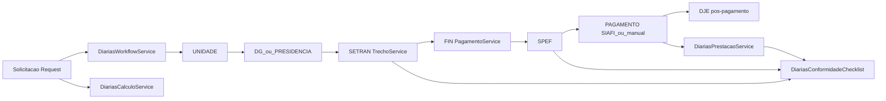
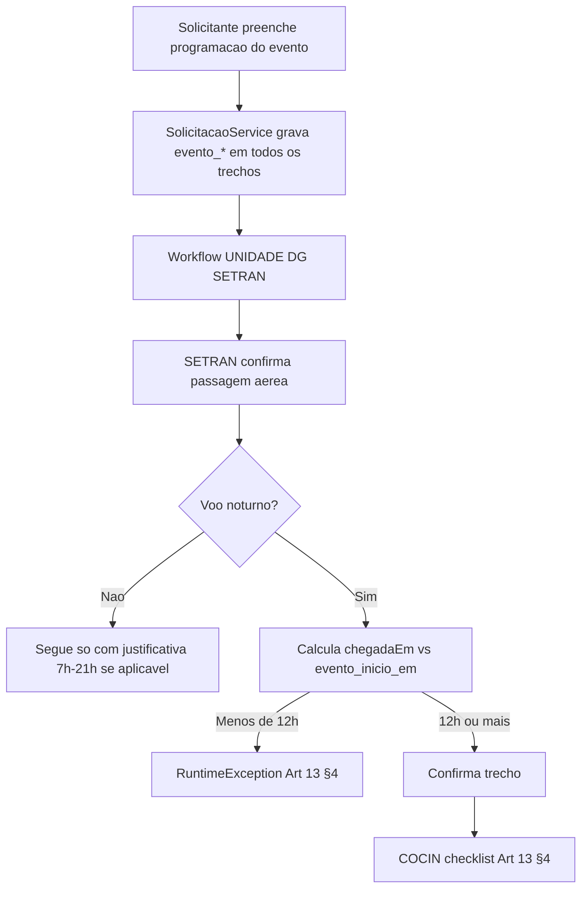
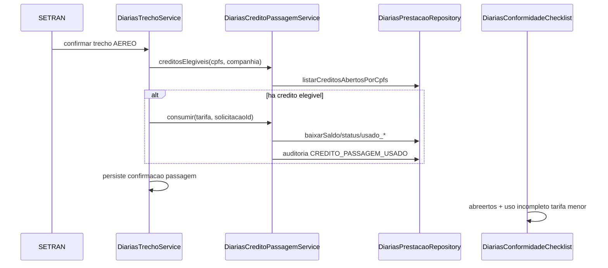
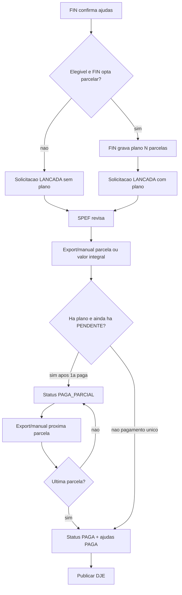

# 📦 Documentação Consolidada do Ecossistema Crepúsculo (Volume 3)
> **Base Unificada de Instruções e Documentação (.md) Fracionada**
> **Limite Otimizado por Volume:** 1500 KB

---

---
# 📁 ARQUIVO DE ORIGEM: `planejamento/convocacao-sms-zenvia.md`
## <PLANEJAMENTO_CONVOCACAO_SMS_ZENVIA_MD>

### 🧬 Mapeamento Estrutural para DFD, DRS e Modelagens (MER / UML)
- **Caminho Relativo no Servidor:** `planejamento/convocacao-sms-zenvia.md`
- **Tag Rastreável:** `PLANEJAMENTO_CONVOCACAO_SMS_ZENVIA_MD`

#### 📋 Estrutura de Requisitos & Regras (DRS / ERS):
```text
Sem cabeçalhos diretos de requisitos identificados
```

#### 🗄️ Estrutura de Dados & Entidades (MER / UML):
```text
## Hotfix: renderizacao da tela de modelos
```

#### ⚙️ Fluxos de Trabalho & Processos (DFD):
```text
Sem cabeçalhos diretos de processos/DFD identificados
```

### 📖 Conteúdo Integral do Arquivo Markdown:
# Plano: Convocacao por SMS via Zenvia

Status: novo envio pelo gestor, restauracao do telefone do ELO e filtro por funcao concluidos;
habilitacao de SMS longo na Zenvia a confirmar
Ambiente observado: `APP_ENV=production`  
Autorizacao operacional: em 14/08/2026 o usuario autorizou explicitamente o uso de
`apply_patch` e a criacao e execucao exclusiva das migrations desta implementacao.
Em 14/08/2026, o usuario autorizou tambem `apply_patch` especificamente para ampliar o limite
das mensagens SMS.
Depois do erro real causado pela constraint legada, o usuario autorizou a correcao solicitada,
incluindo a migration exclusiva e a limpeza DML auditada apresentadas no diagnostico.
Em 15/08/2026, o usuario autorizou `apply_patch` especificamente para retirar do menu a entrada
residual de convocacao por WhatsApp.
Em 15/08/2026, o usuario autorizou `apply_patch` especificamente para otimizar a listagem de
destinatarios SMS, sem migration, DDL ou DML.
Em 15/08/2026, o usuario autorizou `apply_patch` e a criacao e execucao exclusiva da migration
desta implementacao para permitir novo envio pelo gestor, restauracao do telefone vindo do ELO e
filtro por funcao eleitoral.
Em 15/08/2026, o usuario autorizou novamente `apply_patch` e a criacao e execucao exclusiva da
migration desta implementacao para impedir novo envio ao mesmo telefone ja usado pelo eleitor.
Em 15/08/2026, o usuario autorizou `apply_patch` especificamente para exibir e filtrar a
confirmacao do ELO na convocacao SMS, sem migration, DDL ou DML.

## Objetivo

Substituir operacionalmente a convocacao por WhatsApp Meta por SMS Zenvia, preservando
elegibilidade, escopo zonal, contexto de macroprojeto e turno, idempotencia, auditoria,
exportacoes e bloqueio seguro de reenvio. Receber status da Zenvia em webhook publico
autenticado por segredo compartilhado.

## Decisoes funcionais

- somente `NOMEADO` permanece elegivel;
- modelos de texto locais pertencem a `macroprojeto_turno_id + num_zona` e nao recebem seed
  inicial;
- toda mensagem inicia com `TRE-AC:`, aceita ate 500 caracteres normalizados e preserva a
  quantidade real de segmentos com `encodingStrategy=AUTO`;
- o cliente usa `POST /v2/channels/sms/messages`, `X-API-TOKEN`, sender configurado e telefone
  E.164;
- o HTTP `200` da Zenvia marca `ACEITO`; nao ha retry automatico depois de `PROCESSANDO`;
- a fila dedicada `convocacoes-sms` processa uma mensagem por segundo em um unico worker;
- o webhook `POST /rotas-publicas/integracoes/zenvia/sms/webhook` recebe apenas
  `MESSAGE_STATUS` de `SMS`, exige `X-Planeleito-Webhook-Token` e pertence a
  `PLANELEITO_ADMIN` no catalogo ACL;
- `SENT`, `DELIVERED`, `REJECTED` e `NOT_DELIVERED` mapeiam respectivamente para `ENVIADO`,
  `ENTREGUE`, `NAO_ENTREGUE` e `NAO_ENTREGUE`, sem regressao de estado;
- o menu exibe somente a entrada operacional de SMS, sem item residual de WhatsApp, enquanto a
  URL operacional antiga continua redirecionando para SMS por compatibilidade.

## Sequencia TDD e implementacao

1. Versionar este plano e o contrato proprio do SMS; alinhar contratos transversais.
2. Criar testes falhando para tamanho GSM-7/UCS-2, renderizacao, cliente Zenvia, disponibilidade,
   estados e webhook autenticado e idempotente.
3. Criar testes falhando para rotas, ACL, escopo, fila, modelos, historico, PDFs e redirecionamento
   do fluxo antigo.
4. Criar migrations Oracle revisaveis para `CE_SMS_*` e ACL, com preflight que falha se houver
   dados ou jobs legados.
5. Implementar repositories auditados, services, job, cliente Zenvia, controllers, requests,
   rotas e telas, preservando contexto explicito.
6. Executar testes focados, arquitetura, analise estatica, suite aplicavel e revisar o diff.
7. Executar cada migration nominalmente por `migrate:exclusive`, validar o schema e provisionar
   o worker dedicado.
8. Validar o webhook sem mensagem real e ativar envio/worker apenas com todas as configuracoes
   presentes.

## Remocao do runtime legado

Como a migration exige ausencia de dados e jobs WhatsApp antes de substituir o schema, o codigo,
as views e os testes de runtime Meta sao removidos na mesma entrega depois da migracao dos testes
de comportamento compartilhado para SMS. Permanecem versionados o contrato historico e as
migrations antigas necessarias ao rollback nominal. Essa decisao evita manter duas implementacoes
inativas e duplicadas dentro de `app/`.

## Persistencia prevista

- dominios `CE_SMS_CAMPO_VARIAVEL`, `CE_SMS_MODELO_SITUACAO` e `CE_SMS_ENVIO_STATUS`;
- configuracao local `CE_SMS_MODELO`;
- lotes `CE_SMS_LOTE` e `CE_SMS_LOTE_ITEM`;
- envios `CE_SMS_ENVIO` e eventos idempotentes `CE_SMS_ENVIO_EVENTO`;
- telefone manual `CE_SMS_TELEFONE_MANUAL`;
- identificacao do provedor, `externalId`, texto renderizado, encoding, quantidade de segmentos,
  status e causa segura ficam no snapshot do envio/evento.

## Criterios de aceite

- payload adulterado nao amplia populacao, zona, turno ou permissao;
- texto acima de 500 caracteres e recusado por destinatario, nunca truncado;
- lote duplicado, concorrencia e evento repetido nao provocam segundo envio nem DML ficticio;
- segredo incorreto e rejeitado antes do JSON; payload maior que 64 KiB e rejeitado;
- status e monotono e uma entrega confirmada nao regride;
- nenhuma credencial, telefone completo, payload bruto ou mensagem privada entra em log ou Git;
- listagens e PDFs preservam ACL, escopo e filtros;
- migrations sao executadas exclusivamente e identificadas nominalmente;
- `composer test:architecture`, `composer analyse` e a suite focada ficam verdes.

## Limites operacionais

- nenhum SMS real sera disparado como teste sem numero e autorizacao especificos;
- o worker revalida a disponibilidade imediatamente antes da rede e cancela com seguranca um item
  ainda nao enviado quando a integracao tiver sido desabilitada;
- a ativacao externa do webhook exige cadastrar no portal Zenvia a URL HTTPS e o mesmo segredo
  do `.env`;
- alteracoes paralelas ja presentes no worktree permanecem fora desta entrega.

## Checklist de ativacao externa

1. Revogar o token que foi exposto durante o diagnostico e gravar o novo token apenas em
   `PLANELEITO_SMS_ZENVIA_API_TOKEN` no `.env`.
2. Gerar um segredo forte, grava-lo em `PLANELEITO_SMS_ZENVIA_WEBHOOK_SECRET` e cadastrar no
   webhook Zenvia o mesmo valor no header `X-Planeleito-Webhook-Token`, usando a URL HTTPS
   declarada em `PLANELEITO_SMS_ZENVIA_DELIVERY_WEBHOOK_URL`.
3. Instalar a unidade versionada sem inicia-la antecipadamente:

   ```bash
   sudo install -o root -g root -m 0644 \
     /var/www/html/planeleito/deploy/systemd/planeleito-sms-queue.service \
     /etc/systemd/system/planeleito-sms-queue.service
   sudo systemctl daemon-reload
   sudo systemctl enable planeleito-sms-queue.service
   ```

4. Validar o webhook autenticado sem SMS real. Somente depois definir
   `PLANELEITO_SMS_ZENVIA_ENABLED=true` e `PLANELEITO_SMS_ZENVIA_WORKER_ENABLED=true`, reconstruir
   o cache e iniciar a unidade.
5. Confirmar um unico processo ativo da unidade e manter a fila `convocacoes-sms` vazia antes do
   primeiro lote autorizado.

## Evidencias de execucao em 14/08/2026

- schema aplicado exclusivamente no lote 297: nove tabelas `CE_SMS_*`, 97 constraints
  habilitadas e validadas, nenhum indice invalido e nenhuma tabela `CE_WA_*` remanescente;
- ACL aplicada exclusivamente no lote 298: 13 rotas SMS ativas, 44 vinculos e webhook pertencente
  somente a `PLANELEITO_ADMIN`; rotas operacionais Meta ficaram inativas;
- os testes focados aprovaram 95 testes e 306 assercoes, a arquitetura aprovou 755 testes e
  8.571 assercoes e `composer analyse` verificou 681 arquivos sem erros; o cache de producao,
  as rotas e os smokes de schema/webhook tambem passaram;
- a suite geral aprovou 3.275 testes e 31.524 assercoes e manteve quatro falhas externas a esta
  entrega (extensao SOAP ausente em dois testes e dois cenarios do modulo Riscos no worktree
  paralelo);
- healthcheck respondeu `200`, webhook sem segredo respondeu `401`, modelos e historico SMS
  iniciaram vazios e nenhum SMS real foi disparado;
- o token foi rotacionado e o segredo foi configurado no `.env` e no portal Zenvia; um
  `MESSAGE_STATUS` v2 autenticado contra o vhost local respondeu `200`, foi ignorado por usar uma
  mensagem propositalmente desconhecida e nao executou DML;
- a unidade `deploy/systemd/planeleito-sms-queue.service` foi instalada byte a byte em
  `/etc/systemd/system`, recarregada, habilitada e iniciada com exatamente um processo dedicado,
  sem reinicios e com a fila `convocacoes-sms` vazia;
- a publicacao HTTPS externa do hostname foi confirmada pelo responsavel da infraestrutura; a
  resolucao privada e a ausencia de hairpin observadas dentro do proprio host nao constituem
  bloqueio para a Zenvia;
- as duas flags operacionais foram ativadas, o diagnostico da integracao retornou disponivel sem
  motivos de bloqueio e o healthcheck permaneceu em `200`; nenhum SMS real foi usado na ativacao.

## Hotfix: renderizacao da tela de modelos

Em 14/08/2026, o acesso real de um gestor revelou erro `500` antes de qualquer DML. O log provou
que a expressao usada para apresentar placeholders como `{{NOME}}` foi compilada como PHP invalido
pela Blade. A correcao deve preservar a apresentacao literal das chaves, ganhar teste de
renderizacao real da view, recompilar o cache e nao alterar ACL, persistencia ou regra dos modelos.

O hotfix substituiu apenas os delimitadores visuais por entidades HTML, mantendo o codigo do campo
sob escape normal da Blade. O novo teste reproduziu primeiro o mesmo `ViewException` e passou depois
da correcao; suite SMS, arquitetura, analise estatica e cache de producao ficaram verdes.

## Correcao: leitura Oracle do envio pelo worker

Em 14/08/2026, o primeiro job real chegou ao worker, mas falhou antes da chamada externa com
`ORA-00918`. A consulta `buscarEnvio` selecionava `e.*` e projetava novamente `DT_ELEICAO` com o
mesmo alias; o wrapper de registro unico do Oracle exige nomes de coluna nao ambiguos.

Sequencia autorizada para a correcao:

1. criar teste de regressao que exija alias exclusivo para a data formatada e seu consumo pelo
   contexto do processamento;
2. confirmar a falha do teste antes de alterar o runtime;
3. aplicar a menor correcao no repository e no service, sem mudar estado, ACL ou regra de envio;
4. executar testes focados, arquitetura, analise estatica e uma leitura Oracle real sem DML;
5. recompilar os caches, confirmar o worker ativo e reenfileirar exclusivamente o job falho `161`;
6. acompanhar o processamento ate registrar a resposta da Zenvia ou um erro conclusivo, sem criar
   um segundo envio.

O usuario autorizou expressamente a correcao e o reenvio real. A falha ocorreu antes da rede: o
envio permaneceu `PENDENTE`, com zero tentativas e sem identificador do provedor, condicoes que
permitem repetir o proprio job sem risco conhecido de duplicidade externa.

### Evidencias da correcao e do reenvio

- os dois testes de regressao falharam primeiro pelo alias ausente e pelo contexto com data vazia;
- depois da menor correcao, passaram 97 testes SMS com 309 assercoes e a analise estatica terminou
  sem erros;
- a trava arquitetural especifica do SMS passou; a suite arquitetural global foi executada, mas
  permaneceu vermelha por testes de Agendamento, Colaboradores e Diarias afetados por alteracoes
  paralelas ja presentes no worktree;
- uma leitura no Oracle real retornou o envio `1`, ainda `PENDENTE`, com
  `dt_eleicao_iso=2026-10-04`, sem executar DML;
- o cache foi recompilado e o worker reiniciou graciosamente antes do reenvio, permanecendo unico,
  ativo e sem falhas de servico;
- o job falho de ID numerico `161` foi reenfileirado pelo UUID
  `17ea6ee2-eeb4-455b-ad0e-d9c7892f5136`, conforme o driver `database-uuids`;
- a Zenvia aceitou a mensagem com identificador `78cfd1bd-d3ed-4692-8f60-90ea8cf5d13a`; os eventos
  autenticados `SENT` e `DELIVERED` evoluiram o envio ate `ENTREGUE`, com uma unica tentativa;
- ao final, a fila dedicada ficou vazia e o registro original saiu de `failed_jobs`.

### Retrospectiva

- ocorreu uma ambiguidade Oracle porque `e.*` ja continha `DT_ELEICAO` e a mesma consulta projetava
  outro valor com o alias `dt_eleicao`;
- os testes unitarios anteriores mockavam o repository e nao exercitavam o wrapper Oracle criado
  por `first()`, por isso a falha apareceu somente no primeiro processamento real;
- a solucao correta foi criar o alias exclusivo `dt_eleicao_iso` no repository e consumi-lo
  explicitamente no service, sem fallback ou mudanca da regra de negocio;
- a repeticao fica prevenida pelo teste de contrato da projecao, pelo teste do contexto do worker,
  pela regra adicionada ao contrato do SMS e pelo smoke de leitura no Oracle antes de reenfileirar.

## Ampliacao para 500 caracteres

Objetivo: permitir mensagem renderizada com ate 500 caracteres Unicode depois da normalizacao de
espacos, preservando `TRE-AC:`, calculo GSM-7/UCS-2, quantidade real de segmentos e recusa sem
truncamento a partir do caractere 501.

Decisoes e riscos operacionais:

- o limite funcional passa a ser literal por caracteres, independentemente do encoding;
- 500 caracteres GSM-7 ocupam quatro segmentos com a regra atual de 152 unidades concatenadas;
- 500 caracteres UCS-2 no plano basico podem ocupar oito segmentos; caracteres fora do BMP, como
  emoji, usam dois code units e podem elevar a quantidade de segmentos;
- a Zenvia documenta suporte maximo de 1.520 caracteres, mas informa que SMS concatenado longo pode
  exigir habilitacao pela equipe de servico e sempre possui cobranca por segmento;
- o limite deve ter uma unica constante de dominio reutilizada pelo service, FormRequest,
  controller e frontend;
- nenhuma migration, nova rota, mudanca de ACL ou envio real integra esta alteracao.

Sequencia TDD:

1. criar casos vermelhos para aceitar exatamente 500 caracteres GSM-7 e UCS-2, calcular seus
   segmentos e rejeitar 501 caracteres;
2. proteger o FormRequest e a view para exporem o mesmo limite de 500 caracteres;
3. atualizar o contrato permanente antes do runtime;
4. implementar a constante compartilhada e substituir o bloqueio por quantidade fixa de segmentos;
5. ajustar a previa visual para mostrar caracteres e segmentos sem tratar mensagem longa valida
   como erro;
6. executar testes focados, arquitetura, analise estatica, recompilar cache e revisar o diff.

### Evidencias da ampliacao

- o ciclo vermelho reproduziu os quatro bloqueios: quarto segmento recusado, mensagem de 501
  caracteres aceita pelo request, constante ausente e interface ainda contratada em tres segmentos;
- a revisao acrescentou um segundo ciclo vermelho para garantir que o limite seja aplicado depois
  da normalizacao de espacos, sem recusa artificial pelo FormRequest;
- a constante `ConvocacaoSmsMensagem::LIMITE_CARACTERES` passou a ser a fonte unica de 500 para
  service, request, controller e view;
- exatamente 500 caracteres passaram em GSM-7 com quatro segmentos e em UCS-2 com oito segmentos;
  501 caracteres foram recusados sem truncamento;
- a tela passou a exibir caracteres, encoding, segmentos estimados e aviso de cobranca por
  segmento, mantendo a revalidacao definitiva por destinatario no backend;
- a suite focada aprovou 100 testes e 324 assercoes, e `composer analyse` terminou sem erros;
- a arquitetura especifica do SMS passou; a arquitetura global foi executada e permaneceu vermelha
  nos mesmos testes paralelos de Agendamento, Colaboradores e Diarias, fora desta mudanca;
- sintaxe PHP, `git diff --check`, compilacao dos caches e renderizacao Blade passaram;
- a fila estava vazia durante a publicacao, nenhum SMS real foi disparado e o worker dedicado
  reiniciou graciosamente, permanecendo habilitado e ativo com um unico processo;
- nao houve migration, DDL, DML, nova rota ou alteracao de ACL.

Pendencia externa: a documentacao oficial da Zenvia informa que mensagens concatenadas podem
exigir habilitacao de SMS longo pela equipe de servico. A aplicacao esta pronta para 500
caracteres, mas essa capacidade da conta deve ser confirmada antes de um disparo longo em producao.

## Hotfix: constraint de segmentos e atomicidade do lote

Em 14/08/2026, uma tentativa real com mensagem valida de quatro segmentos UCS-2 falhou antes do
enfileiramento com `ORA-02290`, pois `CK_CE_SMS_ENV_SEG` permanecia em `BETWEEN 1 AND 3`. A
transacao composta do lote tambem era dependencia opcional e o container injetava `null`, deixando
o lote vazio `2` persistido apesar da falha posterior. Nenhum envio ou job foi criado e nenhuma
chamada externa ocorreu.

Correcao planejada e autorizada:

1. criar teste vermelho para a migration incremental
   `2026_08_14_233500_expand_ce_sms_segment_constraint.php`, exigindo `1..16` no `up()` e preflight
   de rollback que impeça restaurar `1..3` enquanto houver envio incompatível;
2. criar teste vermelho comprovando que o container deve injetar obrigatoriamente
   `ConvocacaoSmsTransacao` no service de lote;
3. atualizar os contratos de dominio e migrations antes do runtime;
4. implementar a migration sem alterar a migration historica e tornar a transacao composta
   obrigatoria;
5. criar operacao nominal de repository para remover somente lote vazio, sem itens nem envios,
   usando `AuditaDml`;
6. executar testes focados, arquitetura e analise estatica;
7. executar exclusivamente a migration nominal, validar constraint habilitada/validada e limpar
   auditadamente apenas o lote vazio `2`;
8. recompilar cache, reiniciar o worker e confirmar fila vazia, sem reenviar SMS automaticamente.

O limite estrutural de 16 segmentos deriva do pior caso permitido em 500 caracteres: caracteres
fora do BMP consomem dois code units UCS-2. O limite funcional continua sendo 500 caracteres; a
constraint apenas impede divergencia entre o dominio e a persistencia.

### Evidencias e retrospectiva do hotfix

- os testes vermelhos provaram a ausencia da migration, a transacao `null` no container e a falta
  de uma remocao nominal auditada para lote vazio;
- a suite SMS passou com 103 testes e 335 assercoes, e a analise estatica terminou sem erros;
- a arquitetura especifica do SMS passou; a arquitetura global continuou vermelha somente nos
  mesmos testes paralelos de Agendamento, Colaboradores e Diarias;
- a migration `2026_08_14_233500_expand_ce_sms_segment_constraint.php` foi executada isoladamente
  pelo comando `migrate:exclusive`, no lote 299;
- o Oracle confirmou `CK_CE_SMS_ENV_SEG` com `segmentos BETWEEN 1 AND 16`, status `ENABLED` e
  validacao `VALIDATED`;
- o lote vazio `2` foi removido somente depois de confirmar totais zerados e ausencia de itens e
  envios; a exclusao gerou o evento auditado `32249`, `DELETE`, `SUCESSO=S`;
- cache, rotas e views foram recompilados, e o worker reiniciou graciosamente com um unico processo
  ativo e fila vazia;
- nenhum job foi criado e nenhum SMS foi enviado automaticamente durante o hotfix.

O erro ocorreu porque a ampliacao anterior alterou a regra em PHP e na interface, mas declarou
incorretamente que nenhuma migration seria necessaria. O teste unitario nao exercitava a constraint
real do Oracle. Alem disso, dependencias opcionais foram usadas para simplificar testes e fizeram o
container omitir a transacao externa. A solucao correta alinhou schema e dominio por migration
incremental, tornou a transacao obrigatoria e adicionou travas que verificam schema, container e
limpeza auditada. Mudancas futuras de limites persistidos devem inventariar constraints existentes
antes de concluir que nao ha impacto de banco.

## Remocao do item residual de WhatsApp do menu

Objetivo: retirar exclusivamente a entrada visual `WhatsApp (desabilitado)` do submenu de
colaboradores externos, preservando `Convocacao por SMS` e o redirecionamento da URL antiga.

Sequencia TDD:

1. ajustar o teste de contrato do menu para exigir a entrada SMS e rejeitar qualquer item
   residual de WhatsApp;
2. executar o teste e confirmar falha contra a configuracao atual;
3. remover apenas o bloco visual de WhatsApp de `config/planeleito_menu.php`;
4. executar novamente o teste focado e a suite arquitetural aplicavel;
5. revisar o diff e confirmar que rotas, ACL, migrations e banco nao foram alterados.

### Evidencias da remocao

- o teste focado falhou primeiro porque o menu ainda continha `WhatsApp (desabilitado)`;
- depois da remocao, os 5 testes do contrato SMS passaram com 40 assercoes;
- a suite arquitetural confirmou o teste SMS verde e terminou com 748 testes aprovados e 9 falhas
  externas a esta mudanca, concentradas no worktree paralelo de Agendamento, Colaboradores,
  Diarias e Rotas;
- a sintaxe PHP e `git diff --check` passaram;
- o cache de configuracao de producao foi recompilado e nao contem mais o item removido;
- nenhuma rota, ACL, migration, DDL ou DML foi alterada.

## Otimizacao da listagem de destinatarios SMS

Objetivo: reduzir para menos de dois segundos o carregamento da listagem paginada, preservando o
total exato, todas as nomeacoes do destinatario, os filtros, a ACL zonal e o limite de 50 pessoas
por pagina.

Diagnostico confirmado em producao:

- a listagem recuperava e consolidava em PHP todos os 10.678 destinatarios antes de aplicar
  `array_slice`, chegando a aproximadamente 158,5 MiB de memoria;
- no escopo restrito da 3a zona, combinar a igualdade da zona com o `IN` equivalente da ACL levou
  a consulta de aproximadamente 0,78 segundo para mais de 24 segundos;
- uma consulta analitica sem a view de perfil retornou a pagina zonal em aproximadamente 1,06
  segundo e a estadual em aproximadamente 1,24 segundo, antes do enriquecimento dos 50 registros.

Sequencia TDD e implementacao:

1. proteger por teste a aplicacao de um unico predicado territorial quando a zona explicita ja foi
   validada contra a ACL;
2. proteger pagina inicial, pagina seguinte, pagina vazia, total exato, ordenacao estavel e
   preservacao de multiplas nomeacoes da mesma pessoa;
3. paginar no Oracle por pessoa com `DENSE_RANK()` e calcular o total com funcao analitica;
4. retirar `VW_VOLUNTARIO_PERFIL_EFETIVO` da consulta paginada principal e enriquecer apenas as
   inscricoes da pagina;
5. manter a normalizacao e a prioridade de telefones no componente PHP existente, inclusive nos
   filtros `A_COMUNICAR` e `SEM_CELULAR_VALIDO`;
6. restringir `q` ao comportamento informado pela interface: nome ou inscricao;
7. preservar a consulta completa de exportacao e a reidratacao de ate 50 inscricoes antes do
   envio;
8. executar testes focados, teste Oracle somente leitura, arquitetura, analise estatica e medir
   tres carregamentos reais.

Nao sera criado indice nesta etapa. Se tres medicoes apos a correcao ultrapassarem dois segundos,
o plano de execucao sera revisto a partir do plano Oracle e qualquer indice funcional dependera de
migration exclusiva e nova autorizacao.

### Evidencias da otimizacao

- o teste Oracle somente leitura aprovou 4 cenarios e 221 assercoes, cobrindo primeira e segunda
  paginas, pagina inexistente, total exato, estabilidade, escopo da 3a zona, filtros de telefone,
  exportacao e reidratacao antes do envio;
- a comparacao real da 3a zona confirmou 844 registros tanto na nova paginacao quanto na
  exportacao integral e igualdade completa dos primeiros 50 destinatarios;
- tres medicoes estaduais retornaram 10.678 pessoas em `949,88 ms`, `877,07 ms` e `876,68 ms`;
- tres medicoes da 3a zona retornaram 844 pessoas em `693,53 ms`, `699,09 ms` e `692,94 ms`;
- a suite focada aprovou 110 testes e 359 assercoes, e `composer analyse` verificou 682 arquivos
  sem erros;
- os testes arquiteturais especificos do SMS e de namespace passaram; a suite arquitetural global
  permaneceu vermelha somente em testes ja afetados pelo worktree paralelo de Agendamento,
  Colaboradores e Diarias;
- nenhum indice, migration, DDL, DML, rota ou interface publica foi criado ou alterado.

## Novo envio pelo gestor, restauracao do telefone do ELO e filtro por funcao

Objetivo: permitir que `PLANELEITO_CONVOCACAO_GESTOR`, respeitando seu escopo zonal, selecione um
voluntario em `JA_COMUNICADO` para criar uma nova convocacao, restaure antes da nova reserva o
telefone atualmente carregado do ELO e restrinja a listagem por funcao eleitoral.

Decisoes funcionais e de seguranca:

- o novo envio cria outro registro e preserva integralmente o snapshot e o historico dos envios
  anteriores; nao reabre nem altera a mensagem antiga;
- apenas gestor e administrador podem selecionar `JA_COMUNICADO` com celular atual valido;
  operadores continuam podendo selecionar somente `A_COMUNICAR`;
- o reprocessamento do proprio registro `REJEITADO` permanece exclusivo do administrador;
- `PENDENTE`, `PROCESSANDO`, `REJEITADO` e `INDETERMINADO` continuam impedindo uma nova reserva;
- a unicidade Oracle passa a abranger somente esses estados bloqueadores, protegendo concorrencia
  sem impedir um novo registro depois de `ACEITO`, `ENVIADO`, `ENTREGUE`, `NAO_ENTREGUE` ou
  `CANCELADO_ANTES_ENVIO`;
- a listagem considera como situacao atual somente o envio nao cancelado mais recente do
  destinatario no turno, evitando linhas duplicadas depois do primeiro novo envio;
- gestor e administrador podem remover o telefone manual de um `JA_COMUNICADO` antes da nova
  reserva; a reidratacao volta a aplicar a prioridade canonica e recupera o telefone atual da view
  efetiva do ELO quando disponivel, sem alterar o telefone salvo nos snapshots anteriores;
- o filtro por funcao usa o catalogo eleitoral compartilhado, aplica correspondencia exata
  normalizada na consulta e e preservado na exportacao PDF;
- nenhuma rota nova e necessaria: o POST de lote, a alteracao de telefone e a exportacao ja possuem
  ACL nominal; a implementacao nao amplia o escopo territorial existente.

Sequencia TDD e implementacao:

1. atualizar este plano e os contratos de dominio, escopo e frontend;
2. criar testes vermelhos para a selecao de `JA_COMUNICADO` por gestor, a recusa para operador e o
   bloqueio dos estados em andamento ou incertos;
3. criar testes vermelhos para restauracao do telefone em `JA_COMUNICADO`, validacao e propagacao
   do filtro de funcao e uso do envio mais recente na listagem;
4. criar teste de contrato para a migration incremental que substitui `UX_CE_SMS_ENVIO_ATIVO` e
   protege o rollback com preflight de duplicidades;
5. implementar a regra compartilhada no dominio, repository, service, request, controller e view;
6. executar testes focados, arquitetura, analise estatica e smoke Oracle somente leitura;
7. executar apenas a nova migration por `migrate:exclusive`, validar o indice e recompilar caches;
8. confirmar worker e fila sem disparar SMS real automaticamente.

Criterios de aceite:

- gestor seleciona um comunicado e a reserva produz novo envio `PENDENTE`, mantendo o anterior;
- operador nao consegue forcar o novo envio por payload adulterado;
- duas reservas simultaneas continuam protegidas pelo indice funcional;
- restaurar remove somente a sobreposicao manual e o novo lote usa o telefone efetivo atual;
- filtro de funcao, total, pagina, exportacao e ACL retornam o mesmo universo;
- migration e rollback possuem diagnostico explicito e a migration e executada nominalmente.

### Evidencias da implementacao em 15/08/2026

- os testes vermelhos reproduziram a recusa do comunicado para o gestor, o bloqueio da restauracao,
  a ausencia de validacao da funcao e a inexistencia da migration; um ciclo adicional provou que
  comunicado sem celular atual valido nao pode ser reservado;
- a suite focada final aprovou 122 testes e 414 assercoes; os seis testes Oracle somente leitura
  aprovaram 234 assercoes, inclusive filtro/exportacao e selecao distinta para gestor e operador;
- `composer analyse` verificou 682 arquivos sem erros; a arquitetura aprovou 757 testes e 8.547
  assercoes, mantendo somente duas falhas preexistentes no modulo Diarias;
- depois da migration, a listagem permaneceu abaixo de dois segundos: tres leituras estaduais em
  `982,56 ms`, `906,69 ms` e `909,46 ms`, e tres leituras da 3a zona em `856,16 ms`,
  `719,08 ms` e `719,05 ms`;
- a migration `2026_08_15_120000_allow_sms_resend_after_communication.php` foi executada
  exclusivamente no lote 300; `UX_CE_SMS_ENVIO_ATIVO` permaneceu unico e valido, com as duas
  expressoes restritas a `PENDENTE`, `PROCESSANDO`, `REJEITADO` e `INDETERMINADO`, e nenhum indice
  do schema ficou invalido;
- os caches de producao foram recompilados e o worker dedicado reiniciou graciosamente, ficando
  ativo, habilitado e com um unico processo; as filas pendente e falha de `convocacoes-sms`
  permaneceram vazias;
- nenhuma rota ou vinculo ACL foi criado, nenhum snapshot anterior foi alterado e nenhum SMS real
  foi disparado durante a implementacao.

## Bloqueio de novo envio para telefone ja utilizado

Objetivo: permitir novo envio de `JA_COMUNICADO` somente quando o celular efetivo atual ainda nao
tiver sido usado em nenhum envio nao cancelado do mesmo eleitor e turno.

Decisoes funcionais e de integridade:

- a comparacao usa o telefone E.164 canonico do snapshot, por
  `macroprojeto_turno_id + num_inscricao + telefone_e164`;
- todo envio anterior diferente de `CANCELADO_ANTES_ENVIO` torna aquele destino indisponivel para
  um novo registro, inclusive se o eleitor tiver usado outro telefone no intervalo e depois voltar
  ao primeiro;
- restaurar o telefone da carga remove a sobreposicao manual, mas somente libera a selecao quando
  o numero restaurado for valido e diferente de todos os destinos anteriores;
- alterar manualmente para o mesmo numero, ainda que com outra mascara ou formato, nao libera o
  envio porque a comparacao ocorre depois da normalizacao E.164;
- a listagem e a reidratacao do lote consultam em lote os destinos anteriores; o backend repete a
  validacao imediatamente antes da reserva e nao confia na caixa de selecao da tela;
- um novo indice funcional unico protege a regra no Oracle contra concorrencia, sem substituir
  `UX_CE_SMS_ENVIO_ATIVO` e sem bloquear repeticao de registro que foi cancelado antes da chamada;
- o reprocessamento administrativo do proprio `REJEITADO` permanece fora desta regra porque nao
  cria outro registro de envio;
- nenhuma rota, ACL ou interface publica e criada.

Preflight em producao:

- existem 5 envios, dos quais 3 estao em estados comunicados;
- nao existe grupo duplicado por turno, inscricao e telefone entre registros nao cancelados;
- portanto a migration pode criar a nova unicidade sem limpeza DML.

Sequencia TDD e implementacao:

1. atualizar plano e contratos antes do runtime;
2. criar testes vermelhos para bloquear o mesmo E.164, liberar numero inedito e continuar
   bloqueando quando o eleitor volta a um telefone usado antes do ultimo envio;
3. cobrir restauracao da carga para numero igual e diferente, reidratacao do lote e mensagem visual;
4. criar teste de contrato da migration, incluindo preflight no `up()` e rollback nominal;
5. implementar consulta em lote dos telefones anteriores e regra compartilhada de selecao;
6. executar testes focados, Oracle somente leitura, arquitetura e analise estatica;
7. executar apenas `2026_08_15_130000_prevent_duplicate_sms_destination.php` por
   `migrate:exclusive` e validar o indice;
8. recompilar caches, reiniciar o worker e confirmar fila vazia sem enviar SMS real.

Criterios de aceite:

- mesmo telefone canonico do mesmo eleitor e turno nunca cria novo envio;
- telefone valido ainda nao usado pode criar novo envio pelo gestor;
- restauracao para telefone ja usado permanece bloqueada;
- UI e backend apresentam a mesma elegibilidade;
- concorrencia e payload adulterado continuam protegidos no Oracle e no service.

### Evidencias da implementacao em 15/08/2026

- o ciclo vermelho confirmou a permissao indevida do mesmo telefone, a ausencia da defesa no lote,
  da migration e do aviso visual; depois da implementacao, os 26 testes focados passaram com 170
  assercoes;
- `composer analyse` verificou 682 arquivos sem erros e os arquivos alterados passaram no Pint; o
  contrato arquitetural especifico do SMS passou, enquanto a suite global manteve sete falhas de
  Agendamento, Colaboradores e Diarias fora desta mudanca;
- o smoke Oracle somente leitura passou cinco cenarios e 230 assercoes; o cenario dependente de
  fixture foi ignorado porque nenhum comunicado atual da pagina mantinha um telefone ja utilizado,
  situacao corretamente elegivel para o gestor;
- o preflight encontrou cinco envios, tres comunicados e zero grupos duplicados por turno,
  inscricao e telefone, sem executar limpeza DML;
- a migration `2026_08_15_130000_prevent_duplicate_sms_destination.php` foi executada
  exclusivamente no lote 301; `UX_CE_SMS_ENVIO_DESTINO` ficou `UNIQUE`, `VALID`, com tres
  expressoes condicionais, e nenhum indice SMS ficou invalido;
- tres leituras reais da 3a zona, com 50 itens e total exato de 840 destinatarios, terminaram em
  `0,956 s`, `0,740 s` e `0,747 s`;
- os caches de producao foram recompilados, o worker dedicado permaneceu habilitado e ativo e as
  filas pendente e falha de `convocacoes-sms` ficaram vazias;
- nenhum SMS real foi disparado, nenhuma rota ou ACL foi criada e nenhum snapshot historico foi
  alterado.

## Confirmacao do ELO na convocacao por SMS

Objetivo: exibir a confirmacao de presenca existente no snapshot local do ELO e filtrar a
listagem por pessoa, sem alterar a elegibilidade para envio.

Decisoes funcionais e tecnicas:

- a fonte exclusiva e `PLANELEITO.CAD_CONVOCACAO_MESARIO_TSE`; a listagem nao consulta o dblink
  remoto e assume a defasagem da sincronizacao noturna;
- o parametro `confirmacao_elo` aceita `CONFIRMADO`, `NAO_CONFIRMADO` ou vazio;
- `CONFIRMADO` inclui a pessoa quando ao menos uma nomeacao efetiva possui resposta `SIM`;
- `NAO_CONFIRMADO` inclui quem nao possui resposta `SIM`, reunindo resposta `NAO` e ausencia de
  resposta; se futuramente houver divergencia entre nomeacoes, `SIM` prevalece;
- a tela distingue `Confirmado`, `Nao confirmou` e `Aguardando resposta`, informa origem e data da
  resposta e exibe a data da convocacao em cada nomeacao consolidada;
- para resposta consolidada, usa-se o registro mais recente compativel com a situacao escolhida;
- o filtro e informativo: nao altera `selecionavel`, reserva, telefone, reenvio ou snapshot SMS;
- paginacao, total, pagina inexistente, exportacao PDF e filtros por telefone devem preservar
  todas as nomeacoes da pessoa filtrada e a mesma ACL zonal;
- o PDF recebe os campos `Nomeacoes e datas de convocacao` e `Confirmacao no ELO`; a selecao
  padrao substitui secoes e funcoes separadas pelo resumo das nomeacoes e inclui a confirmacao;
- nao ha rota, ACL, migration, DDL ou DML nesta implementacao.

Sequencia TDD:

1. atualizar este plano e os contratos antes do runtime;
2. criar testes vermelhos de validacao, consolidacao, precedencia, datas e interface;
3. criar testes vermelhos para filtro anterior ao `DENSE_RANK()`, total exato, pagina vazia,
   caminho dependente de telefone e exportacao;
4. projetar os campos apenas no repository SMS e implementar a consolidacao compartilhada;
5. executar testes focados, Oracle somente leitura, analise estatica e arquitetura;
6. medir tres carregamentos de cada opcao na 3a zona, exigindo menos de dois segundos;
7. recompilar caches, reiniciar o worker e confirmar filas vazias sem disparar SMS real.

Criterios de aceite:

- filtro binario e exibicao detalhada correspondem ao snapshot local do ELO;
- todas as nomeacoes permanecem juntas, inclusive quando possuem datas diferentes;
- listagem, total e PDF retornam o mesmo universo sob os mesmos filtros e escopo;
- confirmacao do ELO nunca bloqueia nem libera envio;
- nenhum carregamento medido ultrapassa dois segundos.

### Evidencias da implementacao em 15/08/2026

- o ciclo vermelho apresentou seis falhas funcionais esperadas; depois da implementacao, os 24
  testes focados passaram com 119 assercoes, cobrindo filtro, normalizacao, precedencia de `SIM`,
  resposta negativa, ausencia de resposta, datas por nomeacao, paginacao e interface/PDF;
- a suite Oracle somente leitura passou oito cenarios e 542 assercoes, incluindo total exato,
  pagina inexistente, exportacao, reidratacao, filtro dependente de telefone e ACL da 3a zona;
  um cenario antigo foi ignorado porque nenhum comunicado da pagina mantinha telefone atual ja
  utilizado;
- `composer analyse` verificou 682 arquivos sem erros; a suite arquitetural aprovou 759 testes e
  8.556 assercoes, mantendo duas falhas preexistentes e alheias no modulo Diarias, enquanto o
  contrato arquitetural da convocacao SMS passou integralmente;
- os totais reais da 3a zona foram 626 confirmados e 214 nao confirmados; as tres leituras de
  `CONFIRMADO` terminaram em `1,027 s`, `0,785 s` e `0,798 s`, e as tres de `NAO_CONFIRMADO` em
  `0,794 s`, `0,753 s` e `0,791 s`, todas abaixo da meta de dois segundos;
- os caches de producao foram recompilados; o worker dedicado reiniciou graciosamente sob o
  systemd, permaneceu habilitado e ativo com novo PID, e as filas pendente e falha de
  `convocacoes-sms` ficaram vazias;
- nenhuma rota, ACL, migration, DDL ou DML foi criada ou executada, nenhum dblink participou do
  carregamento e nenhum SMS real foi disparado.

## Bloqueio de SMS para pessoas confirmadas no ELO

Objetivo: impedir nova reserva e reenvio administrativo quando qualquer nomeacao efetiva da
pessoa possuir resposta `SIM` no snapshot local do ELO.

Decisoes funcionais e tecnicas:

- toda confirmacao `SIM` bloqueia o envio, independentemente da origem ser Titulo Net,
  presencial ou outra origem futura;
- `A_COMUNICAR`, `JA_COMUNICADO` e os filtros permanecem como historico de SMS; a pessoa continua
  visivel, mas com selecao desabilitada e motivo explicito;
- operador, gestor e administrador obedecem ao mesmo bloqueio, sem override por perfil;
- a criacao do lote reidrata o destinatario e registra o item ignorado com motivo
  `CONFIRMADO_ELO`, sem reservar envio nem despachar job;
- o reenvio administrativo de `REJEITADO` reidrata a pessoa antes de mudar o status e e recusado
  quando houver confirmacao;
- item ja reservado continua seu processamento mesmo que a confirmacao apareca depois; o worker
  nao cancela retroativamente esse snapshot;
- a fonte permanece exclusivamente `PLANELEITO.CAD_CONVOCACAO_MESARIO_TSE`, sem dblink em
  requisicao;
- nao ha rota, ACL, migration, DDL, DML corretivo ou alteracao retroativa de historico.

Sequencia TDD:

1. atualizar este plano e os contratos de dominio e frontend;
2. criar testes vermelhos para elegibilidade, lote desatualizado, reenvio administrativo e UI;
3. congelar em teste que item ja reservado e posteriormente confirmado continua ate o gateway;
4. centralizar o bloqueio no dominio, expor indicador no destinatario e criar service de reenvio;
5. executar testes focados, Oracle somente leitura, analise estatica e arquitetura;
6. medir tres carregamentos da 3a zona, recompilar caches e reiniciar o worker sem disparar SMS.

Criterios de aceite:

- qualquer `CONFIRMADO` fica visivel e nao selecionavel para todos os perfis;
- payload desatualizado nao cria reserva e registra `CONFIRMADO_ELO`;
- `REJEITADO` confirmado nao volta a `PENDENTE` e nao gera job;
- envio anteriormente reservado nao e cancelado pela confirmacao posterior;
- filtros, paginacao, PDF, ACL e status de comunicacao permanecem compativeis.

### Evidencias da implementacao em 15/08/2026

- o ciclo vermelho apresentou oito falhas esperadas; ao final, a suite SMS passou 133 testes e
  467 assercoes, cobrindo todos os perfis, lote desatualizado, motivo `CONFIRMADO_ELO`, reenvio
  administrativo e a excecao contratada para item ja reservado;
- a suite Oracle somente leitura passou os cenarios aplicaveis, com 692 assercoes; um cenario
  antigo dependente de fixture foi ignorado por nao existir comunicado atual da pagina usando o
  mesmo telefone, e nenhuma escrita de banco foi executada;
- `composer analyse` verificou 683 arquivos sem erros; a suite arquitetural aprovou 760 testes e
  8.562 assercoes, mantendo somente as duas falhas preexistentes e alheias do modulo Diarias;
- os totais reais da 3a zona permaneceram em 626 confirmados e 214 nao confirmados; as tres
  leituras de `CONFIRMADO` terminaram em `0,789 s`, `0,737 s` e `0,738 s`, e as de
  `NAO_CONFIRMADO` em `0,737 s`, `0,740 s` e `0,737 s`;
- os caches de producao foram recompilados e o worker dedicado reiniciou graciosamente sob o
  systemd, permanecendo habilitado e ativo com o PID 1218912; as filas pendente e falha de
  `convocacoes-sms` ficaram vazias;
- nenhuma rota, ACL, migration, DDL ou DML foi criada ou executada, nenhum dblink foi consultado
  durante o carregamento e nenhum SMS real foi disparado.

## Ajuste do aviso de confirmacao no CONVOCA +

Objetivo: identificar na listagem SMS que a indisponibilidade decorre de convocacao ja confirmada
no sistema CONVOCA +, sem alterar a regra de bloqueio vigente.

Sequencia:

1. atualizar o contrato de frontend com o novo texto;
2. ajustar o teste de contrato e confirmar a falha esperada;
3. substituir somente o aviso da listagem;
4. executar o teste focado, revisar o diff e recompilar a view de producao.

Criterios de aceite:

- a linha confirmada exibe exatamente `envio indisponivel, convocacao ja confirmada no CONVOCA +`;
- selecao, elegibilidade, revalidacao, status SMS e demais mensagens permanecem inalterados;
- nenhuma migration, DDL ou DML e necessaria.

### Evidencias da implementacao em 15/08/2026

- o teste de contrato falhou inicialmente por encontrar o texto anterior e passou, com tres
  assercoes, depois da substituicao minima na Blade;
- o cache de views de producao foi recompilado e `git diff --check` nao encontrou problemas;
- nenhuma regra PHP, rota, ACL, migration, DDL, DML, fila ou envio SMS foi alterado.

## Dashboard da convocacao por SMS

Objetivo: adicionar ao conjunto de navegacao da convocacao SMS uma tela de dashboard com o funil
eleitoral atual e indicadores de entrega da Zenvia, respeitando o turno ativo, a ACL e o escopo
zonal sem consultar o dblink.

Decisoes funcionais e tecnicas:

- a navegacao compartilhada passa a seguir a ordem `Destinatarios`, `Historico`, `Modelos` e
  `Dashboard`; `Modelos` permanece restrito a gestor e administrador, enquanto `Dashboard` fica
  disponivel a todos os cinco perfis operacionais autorizados;
- a tela oferece os filtros `Zona`, `Data inicial` e `Data final`; zona vazia representa todas as
  zonas permitidas e datas vazias representam todo o turno ativo;
- o periodo, inclusivo nas duas extremidades, afeta somente os indicadores e graficos de envio;
  os indicadores populacionais representam a fotografia atual do snapshot local do ELO;
- os oito cartoes exibem pessoas nomeadas, confirmacoes no CONVOCA +, disponiveis para primeiro
  SMS, nao confirmados sem celular valido, reservas de SMS, entregues, nao entregues e segmentos
  enviados;
- pessoa disponivel para primeiro SMS e nomeada, nao possui resposta `SIM`, esta em
  `A_COMUNICAR` e possui celular valido pela normalizacao canonica; pessoa sem celular valido e
  nomeada, nao confirmada e classificada em `SEM_CELULAR_VALIDO`;
- segmentos enviados somam somente os registros cujo estado atual seja `ENVIADO`, `ENTREGUE` ou
  `NAO_ENTREGUE`;
- nomeados, confirmados e agregados de envio sao carregados diretamente do Oracle na resposta
  inicial; os dois indicadores dependentes da normalizacao telefonica sao obtidos por endpoint
  assincrono, com cache de cinco minutos, horario da ultima atualizacao, estado de carregamento,
  erro isolado e opcao de tentar novamente;
- a chave do cache e versionada e isolada por turno, pleito, data eleitoral, zona selecionada e
  escopo zonal normalizado; webhooks e alteracoes de telefone nao invalidam o cache antes do TTL;
- `MesarioConvocadoEfetivoQuery`, `ConvocacaoSmsTelefone` e a classificacao atual da listagem sao
  reutilizados; a normalizacao telefonica nao sera duplicada em SQL;
- operador, colaborador externo e colaborador administrador visualizam somente seus proprios
  envios; gestor e administrador visualizam os envios das zonas permitidas; indicadores
  populacionais sempre representam toda a populacao das zonas permitidas;
- Chart.js local renderiza distribuicao dos envios por situacao, evolucao diaria de reservas,
  entregues e nao entregues, e envios e resultados por zona, incluindo estado vazio;
- serao criadas as rotas nomeadas `convocacoes-sms.dashboard` e
  `convocacoes-sms.dashboard.elegibilidade`, ambas obrigatoriamente vinculadas ao contexto do
  turno e aos grupos `PLANELEITO_CONVOCACAO_OPERADOR`, `PLANELEITO_CONVOCACAO_GESTOR`,
  `PLANELEITO_ADMIN`, `PLANELEITO_COLABORADORES_ADMIN` e
  `PLANELEITO_COLABORADORES_EXTERNOS`;
- a unica persistencia nova e a migration exclusiva de cadastro nominal das duas rotas na ACL;
  nao ha nova tabela de negocio, item de menu principal, PDF ou detalhamento proprio nesta versao.

Sequencia TDD:

1. atualizar este plano e os contratos de dominio e frontend antes do runtime;
2. criar testes vermelhos para metricas, consolidacao por pessoa, precedencia de `SIM`, estados
   SMS, segmentos e validade telefonica;
3. criar testes vermelhos para periodo inclusivo, zona fora do escopo, turno ativo, diferenca de
   visibilidade entre operador e gestor e isolamento do cache;
4. criar testes vermelhos para as duas rotas, seus vinculos ACL e a navegacao compartilhada nas
   quatro telas;
5. implementar repositories e services com contexto explicito, endpoint assincrono, controller,
   rotas, componente de navegacao e dashboard responsivo;
6. executar testes focados, Oracle somente leitura, `composer analyse` e
   `composer test:architecture`;
7. medir tres carregamentos estaduais do HTML inicial e do endpoint com cache, executar a
   migration por `migrate:exclusive`, recompilar caches e confirmar que nenhum SMS foi disparado.

Criterios de aceite:

- a resposta HTML inicial fica abaixo de dois segundos nos tres carregamentos estaduais;
- o endpoint com cache fica abaixo de um segundo e o cache frio e medido separadamente;
- ACL, turno, escopo zonal e autoria dos envios sao aplicados no backend e preservados nos
  filtros e graficos;
- falha da elegibilidade assincrona nao impede os demais cartoes e graficos de serem exibidos;
- a navegacao tem ordem, visibilidade, destaque ativo, acessibilidade e comportamento responsivo
  protegidos por teste;
- Chart.js e servido localmente, nenhuma consulta usa dblink e nenhum SMS real e disparado.

### Evidencias da implementacao em 15/08/2026

- o ciclo TDD registrou as falhas esperadas para request, service, rotas, navegacao, dashboard,
  repository e migration; ao final, a suite focada SMS passou 149 testes e 546 assercoes;
- os dois testes novos no Oracle somente leitura passaram com 11 assercoes e confirmaram paridade
  dos totais populacionais, precedencia de `SIM`, autoria, periodo inclusivo e soma de segmentos;
- `composer analyse` verificou 688 arquivos sem erros e `composer test:architecture` aprovou 767
  testes e 8.681 assercoes;
- a suite Oracle completa executou 31 testes e 39.376 assercoes; os testes da convocacao SMS
  passaram, enquanto sete erros e duas falhas alheios permaneceram no modulo Diarias porque as
  tabelas e colunas esperadas por esse modulo ainda nao existem neste schema Oracle;
- os tres carregamentos estaduais completos, incluindo renderizacao Blade, terminaram em
  `0,890 s`, `0,711 s` e `0,721 s`; o calculo frio da elegibilidade levou `6,012 s` sem bloquear o
  HTML e os tres cache hits levaram `0,005 s`, `0,003 s` e `0,004 s`;
- a medicao estadual retornou 10.665 pessoas nomeadas, 4.721 confirmadas, 4.631 disponiveis para
  primeiro SMS, 453 nao confirmadas sem celular valido e 865 reservas de SMS;
- a migration `2026_08_15_150000_grant_convocacao_sms_dashboard_acl.php` foi executada somente por
  `migrate:exclusive`, no lote 302; as duas rotas ficaram ativas com cinco grupos cada;
- nenhum dblink foi consultado, nenhum SMS foi disparado e nenhuma tabela de negocio foi criada.

### Simplificacao dos indicadores em 15/08/2026

Objetivo: manter no dashboard apenas os indicadores necessarios para acompanhar confirmacao e
entrega, retirando metricas telefonicas que nao sao necessarias para essa leitura e eliminando o
estouro de memoria observado no endpoint assincrono estadual.

Diagnostico registrado:

- o endpoint de elegibilidade carregava e agrupava toda a populacao estadual para aplicar a
  normalizacao telefonica em PHP;
- sob o limite de `128 MB` do PHP-FPM, a operacao esgotou memoria em
  `ConvocacaoSmsDestinatarioAgrupador.php:125` e a interface exibiu o alerta de indisponibilidade;
- o erro nao veio da Zenvia e nao afetou os totais de envios, somente os dois cartoes dependentes
  de telefone.

Decisoes:

- remover os cartoes `Disponiveis para primeiro SMS`, `Nao confirmados sem celular valido` e
  `Segmentos enviados`;
- incluir `Ainda nao confirmados no CONVOCA +`, definido como pessoa nomeada sem resposta `SIM`
  em nenhuma nomeacao efetiva; respostas `NAO` e ausentes pertencem a esse total e `SIM` mantem
  precedencia;
- calcular nomeados, confirmados e ainda nao confirmados diretamente no Oracle, por pessoa e no
  mesmo snapshot local ja usado pela listagem, sem consultar telefone ou dblink;
- manter cinco cartoes: pessoas nomeadas, confirmacoes, ainda nao confirmados, entregues e nao
  entregues;
- remover `Reservas de SMS` dos cartoes e das series de evolucao diaria e por zona; a distribuicao
  por situacao continua apresentando o panorama dos registros de envio;
- retirar da tela o carregamento assincrono, o estado de carregamento, o alerta e a tentativa
  novamente;
- preservar por compatibilidade a rota nominal `dashboard.elegibilidade`, ja cadastrada na ACL,
  mas fazer sua resposta usar somente o resumo leve da confirmacao, sem classificacao telefonica
  ou cache;
- nao criar migration, DDL ou DML.

Sequencia TDD:

1. ajustar os testes para congelar o total de nao confirmados e os cinco cartoes;
2. confirmar a falha dos testes contra o comportamento anterior;
3. simplificar repository, service, controller e Blade;
4. executar os testes focados, `composer analyse` e `composer test:architecture`;
5. medir a resposta estadual, recompilar caches e confirmar filas SMS vazias.

Evidencias:

- os testes ajustados falharam inicialmente porque o service ainda exigia o repository completo
  de destinatarios e a Blade ainda dependia dos cartoes removidos; depois da implementacao, os
  13 testes focados passaram com 77 assercoes e a suite SMS passou 136 testes com 525 assercoes;
- os dois testes Oracle somente leitura passaram com 17 assercoes e pico de `44 MB`, confirmando
  a paridade de nomeados, confirmados e nao confirmados com os filtros da listagem;
- a medicao estadual retornou 10.665 pessoas nomeadas, 4.721 confirmadas e 5.944 ainda nao
  confirmadas; entregues somaram 545 e nao entregues 237 no escopo medido;
- tres renderizacoes estaduais completas terminaram em `0,795 s`, `0,713 s` e `0,718 s`; a rota
  auxiliar leve respondeu em `0,704 s` e o processo de medicao atingiu pico de `48,5 MB`;
- `composer analyse` verificou 688 arquivos sem erros e `composer test:architecture` aprovou 767
  testes e 8.686 assercoes;
- nenhuma migration, DDL, DML, consulta ao dblink ou chamada a Zenvia foi executada.

### Batimento entre confirmacao no CONVOCA + e SMS entregue

Objetivo: acrescentar ao dashboard um cartao que informe quantas pessoas confirmadas no
CONVOCA + receberam efetivamente a notificacao por SMS.

Decisoes:

- o cartao usa o rotulo `Confirmados no CONVOCA + que receberam SMS`;
- a metrica e a intersecao entre pessoas com ao menos uma nomeacao efetiva cuja resposta atual
  seja `SIM` e pessoas com ao menos um envio no estado `ENTREGUE`;
- cada pessoa e contada uma unica vez, independentemente de multiplas nomeacoes, lotes,
  telefones ou tentativas de envio;
- estados anteriores a entrega, inclusive `ACEITO` e `ENVIADO`, nao comprovam recebimento e nao
  entram no batimento;
- o periodo inclusivo selecionado no dashboard e aplicado aos envios; a confirmacao permanece a
  fotografia atual do snapshot local do ELO/CONVOCA +;
- zona, turno, escopo e autoria dos envios seguem as mesmas regras dos demais indicadores do
  dashboard;
- a metrica demonstra coexistencia entre entrega e confirmacao, sem atribuir causalidade da
  confirmacao ao SMS;
- a consulta reutiliza `MesarioConvocadoEfetivoQuery`, deduplica as duas fontes antes do
  batimento e nao consulta dblink;
- nao ha nova rota, migration, DDL, DML, chamada a Zenvia ou disparo de SMS.

Sequencia TDD:

1. atualizar o planejamento e os contratos do dominio e de frontend;
2. criar testes vermelhos para retorno da metrica, rotulo do cartao e deduplicacao por pessoa;
3. implementar o batimento no repository com os filtros e o contexto ja validados pelo service;
4. executar testes focados, teste Oracle somente leitura, `composer analyse` e
   `composer test:architecture`;
5. medir tres carregamentos estaduais, revisar o diff e recompilar os caches sem disparar SMS.

Criterios de aceite:

- somente pessoa confirmada com ao menos um envio `ENTREGUE` entra no cartao;
- multiplas nomeacoes e multiplos envios entregues nao duplicam a pessoa;
- o total respeita turno, zona, periodo, ACL e autoria dos envios;
- o card nao altera os cinco indicadores nem os tres graficos existentes;
- o carregamento estadual permanece abaixo de dois segundos.

Evidencias da implementacao em 16/08/2026:

- o ciclo TDD confirmou tres falhas esperadas pela ausencia do campo, do cartao e do contrato do
  repository; depois da implementacao, a suite focada SMS passou 135 testes e 530 assercoes;
- a consulta Oracle real, executada somente por leitura, retornou 113 pessoas unicas confirmadas
  com SMS entregue, 546 registros entregues e 237 nao entregues no escopo estadual atual;
- as tres cargas estaduais do service completo terminaram em `1,454 s`, `1,388 s` e `1,403 s`,
  todas abaixo da meta de dois segundos e com o mesmo total de 113 pessoas no batimento;
- `composer analyse` verificou 688 arquivos sem erros, o Pint aprovou os seis arquivos PHP
  alterados e `git diff --check` nao encontrou problemas;
- o contrato arquitetural da convocacao SMS passou integralmente; a suite arquitetural global
  permaneceu com duas falhas preexistentes e alheias no modulo Diarias, relativas a rotas de
  parametros e confirmadoras nao registradas;
- a suite Oracle automatizada nao foi executada contra producao porque sua trava proibe esse
  ambiente; a consulta equivalente foi validada diretamente pela conexao Oracle apenas com
  `SELECT`;
- os caches de producao foram recompilados; nenhuma migration, DDL, DML, consulta ao dblink,
  chamada a Zenvia ou disparo de SMS foi executado.

### Ajuste dos testes aos rotulos atuais do dashboard

Em 16/08/2026, o usuario definiu que os textos ja presentes no dashboard sao os
rotulos desejados e autorizou explicitamente a alteracao dos testes em
`APP_ENV=production`.

Escopo:

- manter o Blade e toda a logica do dashboard inalterados;
- atualizar os dois testes que ainda exigem os rotulos anteriores;
- alinhar somente a nomenclatura correspondente nos contratos de SMS e
  frontend, sem alterar a definicao das metricas;
- executar os testes focados, arquitetura e revisao do diff;
- nao executar migration, DDL, DML, chamada a Zenvia ou envio de SMS.

Diagnostico e ciclo vermelho:

- a compilacao e a renderizacao Blade terminaram sem erro;
- as variaveis `confirmados_ja_comunicados*` estao presentes no contrato do
  repository e nos dados de teste;
- dois testes falharam exclusivamente porque esperavam `Confirmados no CONVOCA
  + ja comunicados por SMS` e `Confirmados ja comunicados por origem`, enquanto
  a view usa `Confirmados no CONVOCA + apos comunicacao por SMS` e `Confirmacao
  no convoca + que receberam SMS por tipo`.

Resultado:

- os dois testes foram atualizados para os rotulos atuais, sem alterar o Blade
  nem a logica do dashboard;
- os testes focados passaram: 7 testes e 84 assercoes;
- a suite unitaria de Convocacao SMS passou: 123 testes e 483 assercoes;
- a suite arquitetural passou: 768 testes e 8.725 assercoes;
- o Pint aprovou os dois testes alterados, o Blade compilado passou na validacao
  sintatica e `git diff --check` nao encontrou problemas;
- nenhuma migration, DDL, DML, chamada a Zenvia ou disparo de SMS foi executado.

### Paridade dos confirmados ja comunicados com Destinatarios

Objetivo: fazer os dois cartoes de batimento do dashboard reproduzirem a fotografia atual dos
filtros `Ja comunicado + Confirmados no ELO` da listagem de Destinatarios.

Decisoes:

- usar nos cartoes os rotulos `Confirmados no CONVOCA + apos comunicacao por SMS` e `Confirmacao
  no convoca + que receberam SMS por tipo`;
- reutilizar a definicao canonica de `JA_COMUNICADO`: envio nao cancelado mais recente em
  `ACEITO`, `ENVIADO`, `ENTREGUE` ou `NAO_ENTREGUE`;
- deduplicar por `zona + inscricao`, preservar a precedencia de `SIM` e atribuir a origem da
  confirmacao compativel mais recente;
- aplicar turno, zona e ACL territorial como em Destinatarios, sem restringir o batimento por
  autoria;
- tratar o batimento como fotografia atual, sem aplicar o periodo; entregues, nao entregues e os
  graficos preservam periodo e autoria;
- renomear os campos internos que afirmam entrega, sem alterar rotas, tabelas, migrations,
  webhook ou envio Zenvia.

Sequencia TDD:

1. atualizar os contratos e este planejamento antes do runtime;
2. criar testes vermelhos para os quatro estados comunicados, exclusoes, envio mais recente,
   paridade com Destinatarios, periodo, autoria e rotulos;
3. centralizar a lista de estados e implementar o batimento Oracle da fotografia atual;
4. executar testes focados, validacao Oracle somente leitura, `composer analyse` e arquitetura;
5. medir a consulta estadual, recompilar caches e confirmar ausencia de migration e disparo SMS.

Criterios de aceite:

- o total coincide com Destinatarios sob os mesmos filtros de zona e confirmacao;
- `ACEITO`, `ENVIADO`, `ENTREGUE` e `NAO_ENTREGUE` entram; os demais estados nao entram;
- apenas o envio nao cancelado mais recente define a situacao da pessoa;
- os subtotais por origem somam o total e nao mudam com autoria ou periodo;
- no retrato estadual observado antes da implementacao, o resultado e 140 pessoas, sendo 86 por
  `Titulo Net` e 54 por `Presencial`;
- nenhuma migration, DDL, DML, consulta ao dblink ou chamada a Zenvia e necessaria.

Evidencias da execucao em 16/08/2026:

- o ciclo TDD iniciou com cinco falhas esperadas nos novos nomes, contrato da view e fonte
  canonica dos estados; depois da implementacao, os 18 testes focados passaram com 141
  assercoes;
- a suite completa de Convocacao SMS passou com 137 testes e 559 assercoes; a suite
  arquitetural passou com 767 testes e 8.704 assercoes; `composer analyse`, `pint --test` e
  `git diff --check` terminaram sem erros;
- a validacao Oracle somente leitura reproduziu 140 pessoas tanto no dashboard quanto em
  Destinatarios com `Ja comunicado + Confirmados no ELO`, divididas em 86 por `Titulo Net` e 54
  por `Presencial`;
- com periodo sem envios, o batimento permaneceu em 140 e os indicadores operacionais ficaram
  zerados, confirmando a independencia contratada de periodo; o mesmo total foi observado no
  contexto de operador sem autoria de envio;
- tres carregamentos estaduais completos foram medidos em 1,110 s, 1,047 s e 1,010 s; o trecho
  do batimento foi medido em aproximadamente 313 ms;
- os caches de producao foram recompilados, as duas rotas permaneceram registradas e a fila
  `convocacoes-sms` foi confirmada vazia; nenhuma migration, DDL, DML, consulta ao dblink,
  chamada a Zenvia ou disparo de SMS foi executado.

### Inclusao de nomeacoes sem local na convocacao SMS

Objetivo: incluir com seguranca os nomeados zonais que a carga do CONVOCA + fornece sem local e
sem secao, preservando ACL e evitando mensagens com dados territoriais ficticios.

Diagnostico de 16/08/2026:

- o titulo `004118932461` existe na view remota e no snapshot local do pleito `3220`, esta
  `NOMEADO` como `Auxiliar de Auditoria`, mas possui local, secao e municipio nulos;
- a consulta compartilhada usa `INNER JOIN` com o catalogo efetivo e elimina o registro antes da
  listagem;
- existem 1.216 pessoas nomeadas no pleito atual com `COD_OBJETO_LOCAL_VOTACAO` nulo, portanto a
  correcao deve representar uma categoria valida e nao um ajuste individual;
- o titulo diagnosticado possui telefone efetivo valido, nao possui confirmacao `SIM` nem envio
  SMS anterior.

Decisoes:

- adicionar modo opt-in `incluirSemLocal` na query compartilhada, mantendo o modo padrao e os
  demais consumidores inalterados;
- no modo SMS, usar `LEFT JOIN` no catalogo e `CAD_CONVOCACAO_MESARIO_TSE.NUM_ZONA` como fallback
  territorial quando nao houver local, aplicando a mesma expressao em identidade, filtros e ACL;
- manter municipio, local e secao vazios, exibir aviso explicito e preservar listagem, filtros,
  paginacao, PDF, dashboard e reidratacao antes do lote;
- formatar `RESUMO_CONVOCACOES` sem local apenas com funcao e data;
- recusar individualmente com `MODELO_INCOMPATIVEL_SEM_LOCAL` qualquer modelo que exija campo
  territorial ausente, sem reservar envio e sem substituir valores por texto ficticio;
- nao criar rota, migration, DDL, DML nem alterar a sincronizacao remota.

Sequencia TDD:

1. atualizar contratos e planejamento antes do runtime;
2. criar testes vermelhos para o modo opt-in, fallback zonal, ACL, agrupamento, apresentacao e
   incompatibilidade do modelo;
3. implementar a menor mudanca na query, repository, agrupador, lote e Blade;
4. executar testes focados, `composer analyse`, `composer test:architecture` e validacao Oracle
   somente leitura;
5. medir a listagem/dashboard, revisar o diff e recompilar caches sem disparar SMS.

Criterios de aceite:

- o titulo diagnosticado aparece como nomeado da 1a ZE, com funcao e aviso de dados ausentes;
- usuarios restritos continuam vendo somente as zonas permitidas;
- os 1.216 registros sem local nao alteram os consumidores que nao habilitarem o novo modo;
- modelo sem campos territoriais pode reservar o item; modelo incompatível registra o motivo
  proprio e nao cria envio;
- total, pagina, PDF, dashboard e reidratacao usam a mesma populacao;
- nenhuma migration, DDL, DML, chamada a Zenvia ou disparo de SMS ocorre na validacao.

Evidencias da execucao de 16/08/2026:

- o ciclo TDD iniciou com quatro falhas esperadas para query, agrupamento e reserva; depois da
  implementacao, a suite `ConvocacaoSms` concluiu com 141 testes e 581 assercoes;
- `composer analyse` concluiu sem erros, Pint validou os 12 arquivos PHP alterados e
  `composer test:architecture`, com caches de teste isolados dos caches de producao, concluiu com
  769 testes e 8.731 assercoes;
- a validacao Oracle local e somente leitura encontrou o titulo `004118932461` uma vez na
  listagem `A_COMUNICAR`, uma vez na exportacao e na reidratacao; o mesmo titulo retornou zero
  registros sob ACL restrita a 3a zona;
- a busca exata concluiu em 781 ms e o resumo populacional do dashboard em 709 ms, ambos com
  11.853 pessoas nomeadas no universo estadual; tres leituras da 1a zona concluiram em 2.279 ms,
  2.134 ms e 2.119 ms;
- a listagem estadual sem filtro concluiu em 5.638 ms. Esse caminho consultivo permanece acima da
  meta historica de dois segundos e deve receber analise Oracle separada caso passe a ser usado
  operacionalmente sem zona; a correcao nao cria indice ou migration sem autorizacao propria;
- nenhuma migration, DDL, DML, consulta ao dblink, chamada a Zenvia ou disparo de SMS foi
  executado durante a implementacao e a validacao.

### Divisao por origem dos confirmados que receberam SMS

Objetivo: acrescentar um cartao que decomponha o batimento entre confirmacao e SMS entregue pela
origem da resposta no CONVOCA +.

Decisoes:

- o card `Confirmados que receberam SMS por origem` exibe os subtotais `Titulo Net` e
  `Presencial`;
- o universo e exatamente o mesmo de `Confirmados no CONVOCA + que receberam SMS`: pessoa com
  confirmacao consolidada `SIM` e ao menos um envio `ENTREGUE`;
- cada inscricao e contada uma unica vez e recebe a origem da resposta `SIM` mais recente; em
  empate de data, o registro mais recente da carga decide de forma deterministica;
- os dois subtotais devem somar o total do batimento e obedecem aos mesmos filtros de turno,
  zona, periodo, ACL e autoria dos envios;
- o calculo integra o mesmo resumo Oracle, sem consulta adicional do frontend e sem dblink;
- nao ha nova rota, migration, DDL, DML, chamada a Zenvia ou disparo de SMS.

Sequencia TDD:

1. atualizar o planejamento e os contratos antes do runtime;
2. criar testes vermelhos para os dois campos, o card e a origem mais recente por pessoa;
3. incluir a origem consolidada na consulta reutilizada pelo batimento e agregar os subtotais;
4. executar testes focados, validacao Oracle somente leitura, `composer analyse` e arquitetura;
5. medir tres cargas estaduais, revisar o diff e recompilar os caches.

Criterios de aceite:

- apenas confirmados com SMS `ENTREGUE` aparecem nos subtotais;
- multiplas nomeacoes e tentativas nao duplicam a inscricao;
- `Titulo Net + Presencial` coincide com o total do card de batimento;
- filtros e tempo de carregamento abaixo de dois segundos permanecem preservados.

Evidencias da implementacao em 16/08/2026:

- o ciclo TDD confirmou tres falhas esperadas pela ausencia do card e dos campos de origem;
  depois da implementacao, a suite focada SMS passou 135 testes e 541 assercoes;
- a consulta Oracle real somente por leitura retornou 78 pessoas por `TITULONET` e 35 por
  `PRESENCIAL`, cuja soma coincide com as 113 pessoas do batimento;
- as tres cargas estaduais do service completo terminaram em `1,525 s`, `1,457 s` e `1,451 s`,
  todas abaixo da meta de dois segundos e com subtotais estaveis;
- o Pint aprovou os seis arquivos PHP verificados e `composer analyse` analisou 688 arquivos sem
  erros;
- o contrato arquitetural da convocacao SMS passou; a suite arquitetural global executou 767
  testes e permaneceu com somente duas falhas preexistentes e alheias no modulo Diarias, relativas
  as rotas de parametros e confirmadoras nao registradas;
- os caches de producao foram recompilados; nenhuma migration, DDL, DML, consulta ao dblink,
  chamada a Zenvia ou disparo de SMS foi executado.

</PLANEJAMENTO_CONVOCACAO_SMS_ZENVIA_MD>


---
# 📁 ARQUIVO DE ORIGEM: `planejamento/convocacao-whatsapp-acl-colaboradores-externos.md`
## <PLANEJAMENTO_CONVOCACAO_WHATSAPP_ACL_COLABORADORES_EXTERNOS_MD>

### 🧬 Mapeamento Estrutural para DFD, DRS e Modelagens (MER / UML)
- **Caminho Relativo no Servidor:** `planejamento/convocacao-whatsapp-acl-colaboradores-externos.md`
- **Tag Rastreável:** `PLANEJAMENTO_CONVOCACAO_WHATSAPP_ACL_COLABORADORES_EXTERNOS_MD`

#### 📋 Estrutura de Requisitos & Regras (DRS / ERS):
```text
## Escopo funcional
## Seguranca e escopo
```

#### 🗄️ Estrutura de Dados & Entidades (MER / UML):
```text
Sem cabeçalhos diretos de modelagem de dados identificados
```

#### ⚙️ Fluxos de Trabalho & Processos (DFD):
```text
Sem cabeçalhos diretos de processos/DFD identificados
```

### 📖 Conteúdo Integral do Arquivo Markdown:
# Plano executavel: convocacao WhatsApp para colaboradores externos

Status: concluido
Ambiente observado: `APP_ENV=production`
Contrato principal: `docs/contratos/convocacao-whatsapp-meta.md`

## Objetivo

Disponibilizar as capacidades de operador da convocacao por WhatsApp ao grupo
`PLANELEITO_COLABORADORES_EXTERNOS`, sem ampliar as capacidades de gestao de
modelos ou reenvio administrativo.

## Escopo funcional

O grupo recebera acesso nominal as seis rotas de operador:

- `colaboradores-eleitorais.convocacoes-whatsapp.index`;
- `colaboradores-eleitorais.convocacoes-whatsapp.destinatarios.pdf`;
- `colaboradores-eleitorais.convocacoes-whatsapp.envios.store`;
- `colaboradores-eleitorais.convocacoes-whatsapp.historico.index`;
- `colaboradores-eleitorais.convocacoes-whatsapp.historico.show`;
- `colaboradores-eleitorais.convocacoes-whatsapp.historico.pdf`.

O verificador interno de perfil deve reconhecer o grupo como operador. O grupo
continua sem acesso a `modelos.*`, ao historico geral e ao reenvio de rejeicao,
que permanecem exclusivos dos perfis gestor e administrador conforme o contrato
vigente.

## Seguranca e escopo

- preservar macroprojeto e turno ativos;
- preservar `cod_zonas_permitidas` e `acesso_todas_zonas` resolvidos pela ACL;
- operador externo consulta somente lotes criados pelo proprio usuario;
- detalhes e PDFs reaplicam a mesma ACL e o mesmo escopo da listagem;
- a migration apenas cria ou reativa os vinculos nominais, sem alterar o grupo,
  as rotas ou os dados operacionais `CE_WA_*`;
- nenhuma rota nova sera criada.

## TDD

1. Criar teste da matriz de permissoes e contrato da migration.
2. Confirmar RED porque o grupo ainda nao e operador e a migration nao existe.
3. Incluir o grupo no perfil interno de operador.
4. Criar migration exclusiva, idempotente e reversivel para as seis rotas.
5. Executar os testes focados e a regressao do modulo.

## Migration autorizada

Arquivo nominal previsto:

`2026_08_03_110000_grant_convocacao_whatsapp_operador_to_colaboradores_externos.php`

O usuario autorizou explicitamente `apply_patch` e a execucao exclusiva desta
migration para a implementacao corrente. A aplicacao deve usar somente:

```bash
php artisan migrate:exclusive 2026_08_03_110000_grant_convocacao_whatsapp_operador_to_colaboradores_externos.php
```

## Validacao

- testes focados de permissoes e migration;
- regressao dos testes `ConvocacaoWhatsapp*`;
- `composer test:architecture` e `composer analyse`;
- `composer test`, preservando e relatando falhas externas ao escopo;
- `php -l` da migration e dos arquivos PHP alterados;
- `git diff --check`;
- `migrate:status` nominal e consulta read-only dos seis vinculos ativos;
- smoke test autenticado quando o endpoint estiver acessivel.

## Guardrails

- nao executar `php artisan migrate` global;
- nao executar DDL ou DML ad hoc;
- nao alterar nem incluir na entrega as mudancas locais em andamento dos
  modulos de treinamentos e voluntarios externos.

## Execucao

- RED confirmado: o grupo externo era rejeitado pelo verificador interno e a
  migration nominal ainda nao existia;
- `ConvocacaoWhatsappPermissaoService` passou a reconhecer
  `PLANELEITO_COLABORADORES_EXTERNOS` somente em `podeOperar()`;
- a migration
  `2026_08_03_110000_grant_convocacao_whatsapp_operador_to_colaboradores_externos.php`
  foi aplicada exclusivamente em `production`, com autorizacao explicita do
  usuario, e registrada no batch 273;
- a migration criou ou reativou somente os seis vinculos de operador, sem DDL
  e sem alterar tabelas operacionais `CE_WA_*`;
- a consulta read-only posterior confirmou seis vinculos operacionais ativos,
  zero vinculos de modelos e zero vinculo de reenvio para o grupo externo;
- a sessao recalcula as rotas permitidas diretamente do banco a cada
  requisicao, portanto nao houve cache de ACL a invalidar.

## Validacoes executadas

- TDD focado: 5 testes e 28 assercoes;
- regressao `ConvocacaoWhatsapp*`: 45 testes e 187 assercoes;
- suite arquitetural: 658 testes e 7.744 assercoes;
- PHPStan: 621 arquivos, sem erros;
- lint PHP dos arquivos alterados: sem erros;
- `git diff --check`: sem erros;
- `migrate:status` nominal: batch 273, `Ran`;
- o smoke HTTP autenticado nao foi executado porque
  `planeleito.tre-ac.jus.br` recusou conexao na porta 443 a partir deste
  ambiente;
- suite completa: 2.775 testes aprovados e 27.095 assercoes; uma unica falha
  externa ao escopo permaneceu em `TreinamentoViewsContractTest`, pois a view
  local de treinamentos nao contem o literal `<strong>Zona:</strong>` esperado
  por aquele teste.

## Retrospectiva

A ACL nominal, isoladamente, nao disponibilizaria o fluxo porque o modulo
tambem valida o perfil interno a partir de `matchingGroups`. A implementacao
tratou as duas barreiras e congelou a matriz negativa para impedir que o grupo
externo herde gestao de modelos, historico geral ou reenvio administrativo.

</PLANEJAMENTO_CONVOCACAO_WHATSAPP_ACL_COLABORADORES_EXTERNOS_MD>


---
# 📁 ARQUIVO DE ORIGEM: `planejamento/convocacao-whatsapp-meta.md`
## <PLANEJAMENTO_CONVOCACAO_WHATSAPP_META_MD>

### 🧬 Mapeamento Estrutural para DFD, DRS e Modelagens (MER / UML)
- **Caminho Relativo no Servidor:** `planejamento/convocacao-whatsapp-meta.md`
- **Tag Rastreável:** `PLANEJAMENTO_CONVOCACAO_WHATSAPP_META_MD`

#### 📋 Estrutura de Requisitos & Regras (DRS / ERS):
```text
Sem cabeçalhos diretos de requisitos identificados
```

#### 🗄️ Estrutura de Dados & Entidades (MER / UML):
```text
Sem cabeçalhos diretos de modelagem de dados identificados
```

#### ⚙️ Fluxos de Trabalho & Processos (DFD):
```text
Sem cabeçalhos diretos de processos/DFD identificados
```

### 📖 Conteúdo Integral do Arquivo Markdown:
# Plano: Convocacao por WhatsApp via Meta

Status: implementacao e schema concluidos; configuracao operacional pendente  
Ambiente observado: `APP_ENV=production`  
Autorizacao operacional: `apply_patch` autorizado para esta implementacao; as cinco migrations
exclusivas foram autorizadas nominalmente e executadas em 29/07/2026. Nenhum DDL, DML ou seeder
ad hoc foi executado fora delas.

## Objetivo

Entregar um modulo interno separado para convocar, pela API oficial do WhatsApp da Meta,
somente eleitores cujo registro efetivo na carga ELO esteja com situacao `NOMEADO`.

O modulo deve consolidar as atribuicoes por inscricao eleitoral, respeitar zona, macroprojeto,
turno, pleito e data da eleicao, permitir selecao da pagina atual e impedir uma segunda mensagem
de convocacao depois que a Meta aceitar a primeira.

## Decisoes funcionais

- `NOMEADO` e o unico status elegivel; `CONVOCADO`, `ATRIBUIDO` e demais situacoes ficam fora do
  fluxo.
- a autorizacao de WhatsApp do perfil nao e requisito deste modulo;
- celular valido e requisito tecnico, usando a prioridade ja vigente: perfil efetivo,
  `num_tel_eleitor`, `num_tel_eleitor_2`, `num_telefone` e `num_telefone_comercial`;
- a unidade funcional e `macroprojeto_turno_id + num_inscricao`;
- `wamid` recebido marca `Ja comunicado` e fecha definitivamente o reenvio naquele contexto;
- somente `PLANELEITO_ADMIN` pode repetir uma tentativa explicitamente rejeitada sem `wamid`;
- timeout ou resultado ambiguo nunca gera retry automatico;
- modelos sao configuracoes locais por zona e turno de templates Meta ja aprovados como
  `UTILITY`, `pt_BR` e texto;
- lotes aceitam no maximo 50 inscricoes da pagina atual e de uma unica zona;
- todas as listagens novas oferecem PDF com pre-selecao editavel de campos.

## Sequencia TDD

1. Versionar este plano, criar o contrato do modulo e atualizar os contratos relacionados.
2. Criar testes de dominio para telefone, renderizacao de parametros e transicoes de status.
3. Criar testes HTTP para ACL, escopo, validacao do lote, modelos, historico, PDFs e webhook.
4. Criar testes de contrato para migrations Oracle, dominios, indices, grupos e rotas.
5. Implementar migrations e seeders somente como arquivos revisaveis, sem executa-los.
6. Implementar repositories, services, jobs, cliente Meta e webhook.
7. Implementar controllers, FormRequests, rotas e telas Blade responsivas.
8. Executar apenas validacoes sem DML/DDL: testes com doubles, lint, arquitetura, analise estatica,
   build frontend e revisao do diff.
9. Entregar a lista nominal de migrations/seeders e comandos pendentes para revisao e
   autorizacao do usuario.

## Estruturas previstas

- extensao de `MACROPROJETO_TURNO` com `COD_PLEITO` e `DT_ELEICAO`;
- dominios `CE_WA_CAMPO_VARIAVEL`, `CE_WA_MODELO_SITUACAO` e `CE_WA_ENVIO_STATUS`;
- catalogo remoto `CE_WA_MODELO_META`;
- configuracao zonal `CE_WA_MODELO` e `CE_WA_MODELO_PARAMETRO`;
- lotes `CE_WA_LOTE` e `CE_WA_LOTE_ITEM`;
- envios `CE_WA_ENVIO` e eventos `CE_WA_ENVIO_EVENTO`;
- perfis `PLANELEITO_CONVOCACAO_OPERADOR` e `PLANELEITO_CONVOCACAO_GESTOR`;
- rotas internas sob `/colaboradores-eleitorais/convocacoes-whatsapp`;
- webhook sob `/rotas-publicas/integracoes/meta/whatsapp/webhook`.

## Criterios de aceite

- nenhuma pessoa fora de `NOMEADO` aparece ou pode ser enviada por payload adulterado;
- todos os endpoints aplicam o mesmo contexto territorial e de turno;
- uma resposta com `wamid` impede qualquer novo envio no mesmo contexto;
- lote duplicado e concorrencia nao provocam segunda chamada externa;
- webhook exige assinatura valida, e eventos duplicados ou fora de ordem sao idempotentes;
- nenhuma credencial, telefone, inscricao real ou mensagem privada entra em migration, seeder,
  fixture ou log versionado;
- as migrations sao executadas exclusivamente, em ordem nominal, sem alcancar outras migrations
  pendentes do repositorio.

## Resultado da implementacao

- contratos de dominio e contratos transversais atualizados antes do codigo;
- migrations Oracle, catalogo ACL, perfis e arquivos de restauracao criados e aplicados de forma
  exclusiva depois da autorizacao especifica do usuario;
- consulta efetiva reutilizavel, consolidacao por inscricao, escolha de telefone, lote
  idempotente, trava de reenvio, job, cliente Meta, sincronizacao e webhook implementados;
- telas responsivas de destinatarios, historico, detalhe e modelos entregues, com os tres
  fluxos de exportacao PDF e modal de campos;
- configuracao por ambiente, fila `database`, scheduler de abandonados e menu registrados.

## Validacao executada

- 75 testes focados do modulo aprovados, com 8.830 assercoes;
- 8 testes de restauracao aprovados, com 8.602 assercoes;
- 621 testes de arquitetura aprovados, com 7.172 assercoes;
- 139 testes de Feature aprovados, com 1.060 assercoes;
- a bateria Unit aprovou 2.195 testes antes de encontrar uma unica falha isolada e
  preexistente em `StoreDiariasSolicitacaoRequestTest`: a data fixa `2026-08-11` passou a
  violar a antecedencia minima de 15 dias e o teste nao fixa o relogio;
- a suite monolitica tambem esgota 512 MB no TCPDF porque controllers legados reduzem o
  `memory_limit` do processo; o teste de PDF apontado passa isoladamente com 13 testes e
  517 assercoes;
- PHPStan, lint PHP, compilacao das views Blade, catalogo de rotas e `git diff --check`
  aprovados;
- build frontend nao executado porque Node/npm, pnpm e Bun nao estao instalados no ambiente;
- testes Oracle de integracao destrutivos nao foram executados em `production`; a validacao
  pos-migration consultou apenas dicionario, contagens, constraints, indices, ACL e status.

## Registro de execucao das migrations

As migrations foram aplicadas individualmente com `php artisan migrate:exclusive`, sem uso de
`php artisan migrate` global e sem alcancar as migrations pendentes de outros modulos:

1. `2026_07_29_100000_add_eleicao_context_to_macroprojeto_turno.php` — batch 254;
2. `2026_07_29_101000_create_ce_wa_domain_tables.php` — batch 255;
3. `2026_07_29_102000_create_ce_wa_model_tables.php` — batch 256;
4. `2026_07_29_103000_create_ce_wa_delivery_tables.php` — batch 257;
5. `2026_07_29_104000_create_convocacao_whatsapp_acl.php` — batch 258.

Validacao observada: 10 tabelas `CE_WA_*` validas, zero objetos invalidos, zero constraints
desabilitadas, 14 rotas ativas e distribuicao ACL `operador=6`, `gestor=11`, `admin=14`.

## Registro de configuracao do turno

Depois de autorizacao DML especifica, o turno ativo ID 1 de `Eleicoes 2026` foi associado ao
pleito `3220` e a data `2026-10-04` pela repository auditada. A alteracao afetou uma linha e
gerou `AUDITORIA_ACAO` ID 17319. A consulta efetiva do modulo retornou 8.976 destinatarios
consolidados e 50 itens na primeira pagina, sem nova excecao.

## Pendencias para ativacao

1. configurar as credenciais Meta, habilitar a integracao e o worker da fila `database` e
   provisionar o webhook HTTPS;
2. atribuir os perfis dedicados e os grupos de unidade/zona correspondentes aos usuarios no
   Authelia;
3. executar o build frontend em ambiente que possua Node/npm;
4. realizar o teste de integracao Oracle fora de producao antes de habilitar envios reais.

## Correcao pos-implantacao: territorios no Oracle

Ao abrir a listagem em producao depois da configuracao do turno, a consulta de territorios
falhou com `ORA-01791`. A causa foi o uso de `SELECT DISTINCT` com expressoes de ordenacao nao
presentes na projecao. A verificacao anterior exercitou a listagem de destinatarios, mas nao
`listarTerritorios()`, deixando essa incompatibilidade Oracle sem cobertura.

A correcao foi feita em TDD: `zona_ordem` e `municipio_ordem` passaram a integrar a projecao do
`DISTINCT`, e a ordenacao usa esses aliases. O teste de regressao falhou antes da mudanca e passou
depois com quatro assercoes. A consulta real retornou 9 zonas e 23 combinacoes municipais; a view
completa do endpoint foi renderizada com sucesso. A bateria focada passou com 30 testes e 115
assercoes, e o PHPStan permaneceu sem erros.

Retrospectiva: a verificacao inicial validou a consulta principal e a paginacao, mas nao chamou
todos os fornecedores auxiliares do controller. Para este modulo, o smoke test pos-alteracao deve
renderizar a view completa, alem de testar repositories isoladamente.

## Alteracao funcional: populacao somente NOMEADO

Em 05/08/2026, o dono do dominio substituiu a populacao elegivel do WhatsApp: a listagem, o PDF,
a selecao e a reidratacao do envio devem considerar exclusivamente registros efetivos com
situacao `NOMEADO` no pleito e na data da eleicao ativos.

Sequencia executavel:

1. atualizar o contrato proprio e os contratos relacionados para retirar `CONVOCADO` da
   elegibilidade;
2. ajustar primeiro os testes da consulta e do agrupador, confirmando falha contra o codigo
   vigente;
3. alterar a fonte compartilhada da listagem e da reidratacao para exigir `NOMEADO`;
4. alinhar os textos da listagem e do PDF com a nova populacao;
5. executar testes focados, analise estatica, arquitetura e smoke test somente leitura no Oracle;
6. revisar o diff sem executar DDL, DML, migration ou sincronizacao.

Criterios de aceite adicionais:

- `NOMEADO` aparece e pode prosseguir para a avaliacao tecnica de telefone e comunicacao;
- `CONVOCADO`, `ATRIBUIDO` e qualquer outra situacao nao aparecem e nao podem ser reidratados por
  POST adulterado;
- filtros, paginacao, PDF, consolidacao por inscricao, ACL zonal, pleito e data permanecem
  inalterados.

Resultado validado:

- ciclo TDD confirmado com falha previa por `CONVOCADO` e sucesso depois da troca para `NOMEADO`;
- 93 testes focados aprovados com 383 assercoes;
- `composer test:architecture` aprovado com 668 testes e 7.812 assercoes;
- `composer analyse` aprovou sem erros antes das alteracoes paralelas do filtro de funcao; a
  repeticao final encontrou duas falhas fora deste escopo em `ColaboradorEleitoralController`
  (tipo de retorno de collection e variavel `$funcao` indefinida), preservadas para nao
  sobrescrever o trabalho concorrente do usuario;
- smoke somente leitura no Oracle retornou exclusivamente `NOMEADO` e 10.449 pessoas consolidadas
  no acesso estadual, com 50 itens na primeira pagina;
- a suite Oracle automatizada nao foi executada por estar bloqueada em `production`; o teste
  dedicado foi versionado para execucao fora de producao;
- nenhum DDL, DML, migration ou sincronizacao foi executado.

</PLANEJAMENTO_CONVOCACAO_WHATSAPP_META_MD>


---
# 📁 ARQUIVO DE ORIGEM: `planejamento/convocacao-whatsapp-normalizacao-telefones.md`
## <PLANEJAMENTO_CONVOCACAO_WHATSAPP_NORMALIZACAO_TELEFONES_MD>

### 🧬 Mapeamento Estrutural para DFD, DRS e Modelagens (MER / UML)
- **Caminho Relativo no Servidor:** `planejamento/convocacao-whatsapp-normalizacao-telefones.md`
- **Tag Rastreável:** `PLANEJAMENTO_CONVOCACAO_WHATSAPP_NORMALIZACAO_TELEFONES_MD`

#### 📋 Estrutura de Requisitos & Regras (DRS / ERS):
```text
Sem cabeçalhos diretos de requisitos identificados
```

#### 🗄️ Estrutura de Dados & Entidades (MER / UML):
```text
Sem cabeçalhos diretos de modelagem de dados identificados
```

#### ⚙️ Fluxos de Trabalho & Processos (DFD):
```text
Sem cabeçalhos diretos de processos/DFD identificados
```

### 📖 Conteúdo Integral do Arquivo Markdown:
# Plano: Normalizacao de Telefones da Convocacao por WhatsApp

Status: implementado e validado  
Ambiente observado: `APP_ENV=production`  
Autorizacao operacional: `apply_patch` autorizado explicitamente pelo usuario em 04/08/2026
para esta correcao. Nao ha migration, DDL ou DML no escopo.

## Objetivo

Reduzir a classificacao incorreta de convocados como `Sem celular valido`, normalizando no
dominio de convocacao os formatos reais importados do perfil efetivo e da carga ELO/TSE, sem
alterar os dados sincronizados nem flexibilizar a validacao dos formularios digitados.

## Decisoes funcionais

- preservar o telefone manual ja existente como primeira opcao e, entre as cinco fontes
  sincronizadas, a prioridade: perfil efetivo, `num_tel_eleitor`, `num_tel_eleitor_2`,
  `num_telefone` e `num_telefone_comercial`;
- aceitar celular nacional completo e celular completo com prefixo `55`;
- remover um prefixo nacional `0` quando o restante formar celular completo valido;
- aplicar DDD `68` a celular local de nove digitos;
- converter celular legado local de oito digitos para `68 + 9 + numero`;
- inserir o nono digito em celular legado de dez digitos que ja possua DDD;
- aplicar as mesmas conversoes quando o legado vier precedido por `55`;
- tratar `TIP_* = 1` como telefone fixo e continuar procurando nas fontes seguintes;
- permitir avaliacao por formato quando `TIP_*` for `2` ou nulo;
- rejeitar texto arbitrario, multiplos numeros, sequencias incompletas e telefone fixo;
- manter `SEM_CELULAR_VALIDO`, detalhando o motivo e a transformacao aplicada;
- limitar a mudanca ao modulo de convocacao por WhatsApp, inclusive seu PDF.

## Sequencia TDD

1. Versionar este plano e atualizar o contrato do dominio.
2. Criar testes para formatos nacionais, internacionais, locais, legados, fixos e invalidos.
3. Confirmar que os novos testes falham pelo comportamento antigo.
4. Implementar a menor normalizacao especifica do dominio, reutilizando `TelefoneBrasileiro`
   para validar o numero nacional final.
5. Projetar os campos `TIP_*` apenas no repository do modulo WhatsApp.
6. Propagar diagnostico e transformacao pela consolidacao, tela e PDF.
7. Executar testes focados, arquitetura, analise estatica, `git diff --check` e smoke Oracle
   exclusivamente de leitura e sem exibir dados pessoais.

## Criterios de aceite

- a quantidade de destinatarios consolidados nao muda por causa da normalizacao;
- o primeiro candidato normalizavel respeita a prioridade contratada;
- listagem, POST reidratado e processamento escolhem o mesmo E.164;
- `TIP_* = 1`, telefone fixo e valor ambiguo nunca se tornam destino WhatsApp;
- numeros normalizados informam a transformacao aplicada;
- registros sem destino informam motivo especifico em tela e PDF;
- nenhuma rota, ACL, tabela ou dado sincronizado e alterado.

## Resultado da execucao

- o ciclo TDD foi confirmado em vermelho antes da implementacao e terminou com os testes do
  modulo em verde;
- `TelefoneBrasileiro` permaneceu inalterado e seus testes de regressao continuam verdes;
- listagem, reserva do lote e reidratacao do processamento compartilham o E.164 produzido pelo
  mesmo seletor de telefone;
- `composer test:architecture`, `composer analyse`, formatacao e `git diff --check` passaram;
- nao houve migration, DDL, DML, envio de mensagem nem alteracao dos valores sincronizados.

O smoke Oracle exclusivamente de leitura do pleito `3220`, eleicao `2026-10-04`, consolidou
`6.709` pessoas tanto antes quanto depois da mudanca. Os destinos validos passaram de `1.540`
para `6.372`; `337` permaneceram sem celular valido. As origens efetivas depois da normalizacao
foram: perfil `976`, `num_tel_eleitor` `4.644`, `num_tel_eleitor_2` `552`, `num_telefone` `193`
e `num_telefone_comercial` `7`.

Transformacoes observadas, sem exibicao de dados pessoais:

- sem transformacao: `1.089`;
- prefixo `55` removido: `2.174`;
- prefixo `55` removido com nono digito inferido: `9`;
- prefixo `0` removido: `4`;
- DDD `68` inferido: `1.516`;
- DDD `68` e nono digito inferidos: `1.562`;
- apenas nono digito inferido: `18`.

## Retrospectiva

A alta incidencia vinha majoritariamente de formatos recuperaveis, e nao da ausencia real de
telefone. A descoberta de uma fonte manual ja existente exigiu preservar sua precedencia acima
das cinco fontes sincronizadas; essa compatibilidade foi incorporada ao plano e aos testes. A
separacao da normalizacao no dominio WhatsApp evitou ampliar a permissividade dos formularios
globais e manteve a tela antiga de mesarios convocados fora do diff.

</PLANEJAMENTO_CONVOCACAO_WHATSAPP_NORMALIZACAO_TELEFONES_MD>


---
# 📁 ARQUIVO DE ORIGEM: `planejamento/convocacao-whatsapp-telefone-manual.md`
## <PLANEJAMENTO_CONVOCACAO_WHATSAPP_TELEFONE_MANUAL_MD>

### 🧬 Mapeamento Estrutural para DFD, DRS e Modelagens (MER / UML)
- **Caminho Relativo no Servidor:** `planejamento/convocacao-whatsapp-telefone-manual.md`
- **Tag Rastreável:** `PLANEJAMENTO_CONVOCACAO_WHATSAPP_TELEFONE_MANUAL_MD`

#### 📋 Estrutura de Requisitos & Regras (DRS / ERS):
```text
## Rota, ACL e escopo
```

#### 🗄️ Estrutura de Dados & Entidades (MER / UML):
```text
Sem cabeçalhos diretos de modelagem de dados identificados
```

#### ⚙️ Fluxos de Trabalho & Processos (DFD):
```text
Sem cabeçalhos diretos de processos/DFD identificados
```

### 📖 Conteúdo Integral do Arquivo Markdown:
# Plano executavel: telefone manual na convocacao WhatsApp

Status: concluido em 2026-08-04
Data: 2026-08-04
Ambiente observado: `APP_ENV=production`
Contrato principal: `docs/contratos/convocacao-whatsapp-meta.md`

## Objetivo

Permitir que o operador corrija o celular de um convocado sem alterar
`CAD_CONVOCACAO_MESARIO_TSE`, que e truncada e reidratada diariamente as 23h.
A correcao deve ser global por inscricao eleitoral, persistir entre pleitos e
prevalecer ate ser removida pela acao `Usar telefone da carga`.

## Persistencia

- criar `CE_WA_TELEFONE_MANUAL` com `id`, `num_inscricao`,
  `telefone_nacional`, usuario responsavel e datas;
- usar chave unica por `num_inscricao`, sem qualquer FK fisica;
- manter correspondencia apenas logica com as fontes eleitorais sincronizadas;
- classificar a tabela como `CARGA_REAL_PRIVADA`, sem seeder ou backfill;
- executar insert, update e delete de runtime por repository com `AuditaDml`;
- salvar o mesmo numero deve ser idempotente, e salvar o numero vigente da
  carga deve remover uma correcao redundante.

## Comportamento

- prioridade efetiva: telefone manual, perfil efetivo, `num_tel_eleitor`,
  `num_tel_eleitor_2`, `num_telefone` e `num_telefone_comercial`;
- tela, PDF, reserva, snapshot e worker usam o mesmo telefone efetivo;
- a edicao fica disponivel apenas para `A_COMUNICAR` e
  `SEM_CELULAR_VALIDO`;
- registros com envio que mantem reserva ativa no turno atual nao podem ser
  alterados por essa tela; snapshots e historicos existentes sao imutaveis;
- mudanca concorrente posterior a reserva continua protegida pela comparacao
  do telefone no worker, que cancela antes da chamada externa;
- a restauracao exclui somente a linha manual e nunca altera a carga eleitoral.

## Rota, ACL e escopo

- criar `PUT colaboradores-eleitorais/convocacoes-whatsapp/destinatarios/{num_inscricao}/telefone`;
- aceitar somente `acao`, `zona` e, ao salvar, `telefone` digitado;
- reidratar inscricao, convocacao, turno, pleito, data, zona, escopo e estado
  de envio no backend;
- vincular nominalmente a nova rota a
  `PLANELEITO_COLABORADORES_ADMIN`, `PLANELEITO_ADMIN`,
  `PLANELEITO_CONVOCACAO_GESTOR` e `PLANELEITO_CONVOCACAO_OPERADOR`;
- conceder ao `PLANELEITO_COLABORADORES_ADMIN` as seis rotas operacionais ja
  existentes no modulo;
- manter `PLANELEITO_COLABORADORES_EXTERNOS` nas rotas operacionais atuais,
  sem acesso a alteracao do telefone;
- aplicar sempre `cod_zonas_permitidas`, `acesso_todas_zonas`, macroprojeto e
  turno resolvidos pelo contexto efetivo.

## TDD

1. Criar testes de contrato para tabela sem FK, unicidade, manifesto de
   restauracao, rota e vinculos ACL.
2. Criar testes de dominio para prioridade manual, fallback e restauracao.
3. Criar testes do service para entrada valida, escopo, elegibilidade,
   bloqueio apos reserva e idempotencia.
4. Criar testes da interface para acao condicional, modal unico e identificacao
   do telefone manual.
5. Confirmar RED antes da implementacao e executar novamente ate GREEN.
6. Rodar regressao `ConvocacaoWhatsapp*`, arquitetura, PHPStan e suite completa.

## Migrations autorizadas

O usuario autorizou explicitamente, para esta implementacao em producao:

- uso de `apply_patch`;
- DDL/DML e execucao exclusiva da migration de `CE_WA_TELEFONE_MANUAL`;
- DML e execucao exclusiva da migration de rota e vinculos ACL.

As migrations devem ser executadas nominalmente por `migrate:exclusive`, sem
`php artisan migrate` global e sem DML ad hoc.

## Rollout e rollback

- aplicar primeiro a migration da tabela e depois a migration ACL;
- validar tabela, constraints, indices e vinculos por consultas somente leitura;
- ativar o codigo consumidor somente com as duas migrations aplicadas;
- em rollback, reverter primeiro o codigo; depois que houver dados reais, nao
  remover a tabela sem copia privada, pois isso destruiria correcoes manuais.

## Criterios de aceite

- a sincronizacao noturna nao toca a nova tabela;
- somente celular brasileiro valido e persistido sem mascara;
- telefone manual aparece identificado e e usado no envio;
- restaurar volta imediatamente a prioridade da carga;
- usuarios fora dos quatro grupos nominais nao alteram telefone;
- zona fora do escopo, inscricao adulterada ou envio existente falham fechados;
- toda mudanca efetiva gera auditoria atomica e repeticao sem mudanca nao gera DML.

## Resultado da execucao

- ciclo RED registrado com 24 falhas esperadas antes da implementacao;
- migration `2026_08_04_120000_create_ce_wa_telefone_manual_table.php`
  executada exclusivamente no batch 274;
- migration `2026_08_04_121000_create_convocacao_whatsapp_telefone_acl.php`
  executada exclusivamente no batch 275;
- Oracle confirmou sete colunas, check de celular, indice unico por inscricao,
  nenhuma constraint do tipo `R`, quatro grupos ativos na nova rota e as seis
  rotas operacionais ativas para `PLANELEITO_COLABORADORES_ADMIN`;
- 60 testes focados passaram com 8.822 assercoes;
- `composer test:architecture` passou;
- `composer analyse` passou sem erros nos 625 arquivos analisados;
- Pint isolado passou nos 11 arquivos novos da entrega; o teste global do Pint
  permanece inviavel por 884 pendencias legadas em 1.590 arquivos;
- a suite completa passou em 2.794 testes e manteve uma falha isolada em
  `TreinamentoViewsContractTest`, reproduzida fora dos arquivos desta entrega;
- a suite Oracle read-only nao foi executada porque seu proprio bootstrap a
  proibe quando `APP_ENV=production`;
- `apply_patch` foi usado em `production` com autorizacao explicita do usuario
  para esta implementacao.

</PLANEJAMENTO_CONVOCACAO_WHATSAPP_TELEFONE_MANUAL_MD>


---
# 📁 ARQUIVO DE ORIGEM: `planejamento/coordenadores-acessibilidade-e-exclusao-supervisores.md`
## <PLANEJAMENTO_COORDENADORES_ACESSIBILIDADE_E_EXCLUSAO_SUPERVISORES_MD>

### 🧬 Mapeamento Estrutural para DFD, DRS e Modelagens (MER / UML)
- **Caminho Relativo no Servidor:** `planejamento/coordenadores-acessibilidade-e-exclusao-supervisores.md`
- **Tag Rastreável:** `PLANEJAMENTO_COORDENADORES_ACESSIBILIDADE_E_EXCLUSAO_SUPERVISORES_MD`

#### 📋 Estrutura de Requisitos & Regras (DRS / ERS):
```text
Sem cabeçalhos diretos de requisitos identificados
```

#### 🗄️ Estrutura de Dados & Entidades (MER / UML):
```text
Sem cabeçalhos diretos de modelagem de dados identificados
```

#### ⚙️ Fluxos de Trabalho & Processos (DFD):
```text
Sem cabeçalhos diretos de processos/DFD identificados
```

### 📖 Conteúdo Integral do Arquivo Markdown:
# Plano: Coordenadores de Acessibilidade e Exclusao Auditada de Supervisores

Status: implementado e validado em 2026-07-20; suite global com uma falha externa ao diff

## Objetivo

Criar o cadastro administrativo proprio de coordenadores de acessibilidade e
permitir que `PLANELEITO_COLABORADORES_ADMIN` exclua, com auditoria DML e
respeito ao escopo zonal, coordenadores e supervisores de predio.

## Entregas

- criar contrato, tabela, repository, Form Request, controller, rotas, ACL,
  listagem, formulario e PDF dos coordenadores;
- manter um coordenador por local e um cadastro por titulo eleitoral;
- reutilizar o padrao Select2 dos locais de votacao, limitado a 50 resultados
  apenas no autocomplete;
- adicionar exclusao fisica de supervisores publicos e internos;
- auditar individualmente respostas e notificacoes antes de excluir o
  supervisor, tudo na mesma transacao;
- vincular todas as rotas de coordenadores e as rotas de exclusao somente a
  `PLANELEITO_COLABORADORES_ADMIN`;
- expor o cadastro no menu de colaboradores externos somente quando autorizado;
- cobrir schema, ACL, escopo, CRUD, auditoria, interface e PDF por TDD.

## Sequencia de execucao

1. Atualizar os contratos do dominio.
2. Escrever e executar os testes em estado vermelho.
3. Criar as migrations de schema e ACL.
4. Implementar a persistencia e as consultas escopadas.
5. Implementar controllers, rotas, telas e PDF.
6. Executar as migrations, uma por vez, com `migrate:exclusive`.
7. Rodar testes focados, analise estatica, suite completa e revisar o diff.

## Decisoes fechadas

- o cadastro e independente de mesarios, eleitores e supervisores;
- os campos sao nome, CPF, titulo, e-mail, telefone, WhatsApp e local de
  atuacao, alem dos metadados operacionais;
- CPF nao e unico; titulo e local sao unicos;
- nao ha banco, Pix, questionario, aceite LGPD especifico ou e-mail automatico;
- registros fora do escopo resultam em `404` e rotas sem ACL em `403`;
- listagem e PDF compartilham filtros e a mesma consulta escopada;
- o ambiente e `production` e o usuario autorizou explicitamente `apply_patch`
  e a execucao exclusiva das migrations para esta implementacao.

## Validacao final

- migrations executadas nominalmente e registradas na entrega;
- nenhuma gravacao nova fora de `AuditaDml`;
- listagens paginadas sem truncamento silencioso;
- botoes condicionados pela ACL nominal;
- testes focados, `composer analyse` e `composer test` verdes, ou limitacao
  objetiva registrada na entrega.

</PLANEJAMENTO_COORDENADORES_ACESSIBILIDADE_E_EXCLUSAO_SUPERVISORES_MD>


---
# 📁 ARQUIVO DE ORIGEM: `planejamento/coordenadores-acessibilidade-unificar-voluntarios.md`
## <PLANEJAMENTO_COORDENADORES_ACESSIBILIDADE_UNIFICAR_VOLUNTARIOS_MD>

### 🧬 Mapeamento Estrutural para DFD, DRS e Modelagens (MER / UML)
- **Caminho Relativo no Servidor:** `planejamento/coordenadores-acessibilidade-unificar-voluntarios.md`
- **Tag Rastreável:** `PLANEJAMENTO_COORDENADORES_ACESSIBILIDADE_UNIFICAR_VOLUNTARIOS_MD`

#### 📋 Estrutura de Requisitos & Regras (DRS / ERS):
```text
Sem cabeçalhos diretos de requisitos identificados
```

#### 🗄️ Estrutura de Dados & Entidades (MER / UML):
```text
Sem cabeçalhos diretos de modelagem de dados identificados
```

#### ⚙️ Fluxos de Trabalho & Processos (DFD):
```text
Sem cabeçalhos diretos de processos/DFD identificados
```

### 📖 Conteúdo Integral do Arquivo Markdown:
# Plano: Unificar Coordenadores Voluntarios e Avulsos

Status: concluido

## Objetivo

Exibir na administracao de coordenadores de acessibilidade tanto os voluntarios
do perfil `COORDENADOR_ACESSIBILIDADE` quanto os cadastros exclusivamente
avulsos, sem duplicar pessoas e sem confundir local de votacao com local de
atuacao.

## Entregas

- consolidar voluntarios ativos ou pendentes e cadastros avulsos por titulo;
- manter os dados pessoais e a autorizacao para convocacao por WhatsApp dos
  voluntarios sincronizados com `VW_VOLUNTARIO_PERFIL_EFETIVO`;
- usar `cad_coordenador_acessibilidade` como camada de atribuicao do local de
  atuacao para voluntarios;
- permitir atribuir o local pelo formulario avulso existente, sem nova rota;
- ampliar o cadastro para manter o mesmo conjunto operacional usado no cadastro
  interno de supervisor de predio, incluindo perfil, dados bancarios, Pix,
  autorizacoes e aceite LGPD;
- expor no view local os dados bancarios fornecidos pela fonte de voluntarios;
- persistir no cadastro de atribuicao um snapshot dos dados autoritativos do
  voluntario, sem permitir sua alteracao pelo POST;
- aplicar escopo eleitoral antes da atribuicao e escopo do local de atuacao
  depois dela;
- manter listagem e PDF sobre a mesma consulta consolidada e filtrada;
- cobrir consulta, ACL, hidratacao autoritativa, interface e PDF por TDD.

## Decisoes

- incluir somente status efetivos `Ativo` e `Pendente`;
- identificar o perfil pelo codigo `COORDENADOR_ACESSIBILIDADE`;
- voluntario sem atribuicao exibe separadamente local de votacao e
  `Local de atuacao: Nao atribuido`;
- titulo presente nas duas fontes gera uma unica linha;
- para voluntarios, nome civil, nome social, profissao, nascimento, CPF,
  titulo, e-mail, telefone, tamanho de camisa, endereco, experiencias, dados
  bancarios, Pix e autorizacoes existentes na fonte sao somente leitura e
  reidratados no backend;
- nivel de conhecimento em informatica, escolaridade, local de atuacao e
  aceite LGPD sao complementos administrativos quando nao existirem na fonte;
- para cadastros exclusivamente avulsos, todos os campos do formulario sao
  editaveis e validados;
- a autorizacao WhatsApp e `SIM` apenas quando a opcao positiva constar em
  `AUTORIZACAO_DISPONIBILIDADE`; ausencia e valor nulo significam `NAO`;
- o nome tecnico legado `possui_whatsapp` permanece sem migration, mas os
  rotulos passam a expressar autorizacao para convocacao;
- `cad_supervisor_pergunta` sera reutilizada como catalogo compartilhado de
  autorizacoes, e as respostas do coordenador terao tabela propria e auditada;
- a resposta tecnica `autoriza_whatsapp` deve permanecer sincronizada com
  `possui_whatsapp`;
- excluir o cadastro avulso de um voluntario remove somente sua atribuicao;
- nao criar rota HTTP nem alterar ACL;
- nao executar DML de carga ou backfill: a tabela de coordenadores estava
  vazia no diagnostico anterior a implementacao.

## Alteracoes de schema

As alteracoes serao separadas e executadas individualmente, conforme o
contrato de migrations exclusivas:

1. adicionar ao cadastro de coordenador os campos de perfil, nascimento,
   camisa, endereco, experiencias, autorizacoes de origem, conhecimento de
   informatica, escolaridade, Pix, banco, agencia, conta, tipo de conta, dados
   bancarios de origem e origem do cadastro;
2. criar `cad_coordenador_resposta`, ligada ao coordenador e ao catalogo
   `cad_supervisor_pergunta`, com unicidade por coordenador/pergunta;
3. recriar `VW_VOLUNTARIO_PERFIL_EFETIVO` preservando as colunas atuais e
   acrescentando `BANCOS`, `AGENCIAS`, `NUMEROS_CONTA`, `TIPOS_CONTA`,
   `CHAVES_PIX` e `DADOS_BANCARIOS`.
4. remover a FK entre o banco do coordenador e `cad_supervisor_banco`, pois o
   diagnostico apos a exposicao da fonte encontrou 45 voluntarios com codigos
   bancarios fora do catalogo ativo local. O catalogo continua obrigatorio para
   cadastros avulsos, enquanto o snapshot voluntario deve aceitar a fonte.

A remocao corretiva da FK e idempotente e seu rollback nao recria a restricao
incompativel. A migration-base nao cria essa FK em instalacoes novas.

O rollback da migration da view deve restaurar sua definicao anterior. As
colunas novas ficam nullable no banco para compatibilidade com dados legados,
mas o request exige os campos aplicaveis em novos cadastros.

## Sequencia

1. Atualizar os contratos aplicaveis.
2. Criar testes em estado vermelho.
3. Criar e executar cada migration de forma exclusiva.
4. Implementar a consulta consolidada, o snapshot e a hidratacao autoritativa.
5. Ajustar listagem, formulario e PDF.
6. Executar testes focados, analise estatica, suite viavel e revisar o diff.

## Validacao

- testes de repository/controller/request/UI/PDF;
- `composer analyse`;
- cache de views;
- `composer test`, se viavel;
- `git diff --check`.

## Ambiente

`APP_ENV=production`. O usuario autorizou explicitamente o uso de
`apply_patch` para esta implementacao em 2026-07-21. O usuario tambem autorizou
explicitamente, na mesma data, criar e executar as migrations/DDL exclusivas
necessarias para ampliar este CRUD.

</PLANEJAMENTO_COORDENADORES_ACESSIBILIDADE_UNIFICAR_VOLUNTARIOS_MD>


---
# 📁 ARQUIVO DE ORIGEM: `planejamento/correcao-acesso-mesario-data-nascimento.md`
## <PLANEJAMENTO_CORRECAO_ACESSO_MESARIO_DATA_NASCIMENTO_MD>

### 🧬 Mapeamento Estrutural para DFD, DRS e Modelagens (MER / UML)
- **Caminho Relativo no Servidor:** `planejamento/correcao-acesso-mesario-data-nascimento.md`
- **Tag Rastreável:** `PLANEJAMENTO_CORRECAO_ACESSO_MESARIO_DATA_NASCIMENTO_MD`

#### 📋 Estrutura de Requisitos & Regras (DRS / ERS):
```text
Sem cabeçalhos diretos de requisitos identificados
```

#### 🗄️ Estrutura de Dados & Entidades (MER / UML):
```text
Sem cabeçalhos diretos de modelagem de dados identificados
```

#### ⚙️ Fluxos de Trabalho & Processos (DFD):
```text
Sem cabeçalhos diretos de processos/DFD identificados
```

### 📖 Conteúdo Integral do Arquivo Markdown:
# Correcao do acesso publico do mesario por data de nascimento

Status: concluido
Inicio: 2026-08-11
Ambiente efetivo: `production`

## Objetivo

Corrigir a regressao que impede o acesso do mesario quando a data de nascimento
e digitada no formato `DD/MM/AAAA` imposto pela propria tela publica.

## Diagnostico

- a view mascara e envia `dt_nascimento` em `DD/MM/AAAA`;
- o `MesarioPublicoLookupRequest` valida exclusivamente `Y-m-d`;
- a normalizacao de `DD/MM/AAAA` para `Y-m-d`, existente desde a criacao da
  mascara, foi removida na centralizacao de validacoes;
- o teste de sucesso com o valor real da tela foi substituido por um teste que
  espera a rejeicao desse mesmo valor, congelando a regressao.

## Comportamento esperado

- aceitar uma data civil valida no formato exato `DD/MM/AAAA` enviado pela tela;
- normalizar a data para `Y-m-d` antes da validacao e da consulta ao repository;
- preservar a aceitacao do formato canonico `Y-m-d` quando recebido diretamente
  pelo backend;
- rejeitar datas inexistentes e outros formatos, sem correcao silenciosa;
- preservar a validacao e a normalizacao central do titulo eleitoral;
- nao alterar rotas, ACL, banco, migrations ou o formato canonico recebido pelo
  repository.

## Execucao em TDD

1. Atualizar o contrato do dominio antes do codigo.
2. Restaurar o teste HTTP que autentica com `DD/MM/AAAA` e comprova o envio de
   `Y-m-d` ao repository.
3. Executar o teste e confirmar a falha pelo erro de validacao da data.
4. Implementar a menor normalizacao estrita no FormRequest do acesso publico.
5. Adicionar cobertura para data civil inexistente e formato nao suportado.
6. Executar os testes focados, `composer test:architecture`, analise estatica e
   revisao do diff.

## Limites e seguranca

- nenhuma migration, DDL ou DML;
- nenhuma rota nova ou renomeada;
- nenhum acesso a dados de producao;
- `apply_patch` autorizado explicitamente pelo usuario para esta correcao em
  `production`.

## Resultado e validacoes

- RED confirmado: o teste HTTP com `20/05/1990` falhou com a mensagem de data
  invalida antes de consultar o repository.
- GREEN do acesso: conversao da data brasileira, rejeicao de data inexistente
  e rejeicao de formato nao suportado; 13 testes e 57 assercoes aprovados.
- Suite do dominio do mesario: 42 testes e 201 assercoes aprovados.
- `composer test:architecture`: 720 testes e 8.184 assercoes aprovados.
- `composer analyse --no-progress`: 657 arquivos analisados sem erros.
- `php -l`, Laravel Pint dos arquivos PHP alterados e `git diff --check`:
  aprovados.

## Retrospectiva da regressao

- O que ocorreu: a centralizacao de validacoes removeu a conversao exigida
  pela mascara `DD/MM/AAAA`, mantendo no backend apenas `Y-m-d`.
- Onde o diagnostico anterior falhou: a refatoracao tratou a data da tela como
  entrada ISO generica e alterou o teste para esperar a rejeicao, sem conferir
  o payload realmente produzido pela interface.
- Solucao correta: preservar a UX brasileira, normalizar no FormRequest para o
  formato canonico e manter a validacao de existencia da data antes da consulta.
- Regra que evita repeticao: testar comportamento observavel no ponto HTTP e
  preservar normalizadores especificos de dominio quando a semantica divergir.
- Contrato atualizado: `docs/contratos/mesario-publico-situacao.md` agora fixa
  explicitamente o formato exibido, a normalizacao e a rejeicao de datas
  inexistentes.

</PLANEJAMENTO_CORRECAO_ACESSO_MESARIO_DATA_NASCIMENTO_MD>


---
# 📁 ARQUIVO DE ORIGEM: `planejamento/correcao-atualizacao-evento-num-inscricao-oracle.md`
## <PLANEJAMENTO_CORRECAO_ATUALIZACAO_EVENTO_NUM_INSCRICAO_ORACLE_MD>

### 🧬 Mapeamento Estrutural para DFD, DRS e Modelagens (MER / UML)
- **Caminho Relativo no Servidor:** `planejamento/correcao-atualizacao-evento-num-inscricao-oracle.md`
- **Tag Rastreável:** `PLANEJAMENTO_CORRECAO_ATUALIZACAO_EVENTO_NUM_INSCRICAO_ORACLE_MD`

#### 📋 Estrutura de Requisitos & Regras (DRS / ERS):
```text
Sem cabeçalhos diretos de requisitos identificados
```

#### 🗄️ Estrutura de Dados & Entidades (MER / UML):
```text
Sem cabeçalhos diretos de modelagem de dados identificados
```

#### ⚙️ Fluxos de Trabalho & Processos (DFD):
```text
Sem cabeçalhos diretos de processos/DFD identificados
```

### 📖 Conteúdo Integral do Arquivo Markdown:
# Plano executavel: corrigir atualizacao de evento no Oracle

Status: concluido

## Objetivo

Corrigir a atualizacao de eventos de voluntarios que possuem participantes ja
vinculados, eliminando o erro `Undefined property: stdClass::$NUM_INSCRICAO`
sem alterar ACL, escopo territorial ou dados persistidos.

## Diagnostico confirmado

- o fluxo de atualizacao valida novamente os titulos enviados pelo formulario;
- para preservar participantes ja vinculados, a consulta complementar usa
  `pluck('EVP.NUM_INSCRICAO')` sem projetar um alias estavel;
- no Oracle deste ambiente, a mesma selecao e hidratada no PHP com a propriedade
  `num_inscricao` em minusculas;
- o `pluck` remove o qualificador da tabela e tenta ler a propriedade
  `NUM_INSCRICAO`, que nao existe no `stdClass`, produzindo o erro exibido;
- a excecao ocorre antes da transacao de atualizacao, portanto a tentativa
  apresentada nao persistiu alteracoes parciais.

## Comportamento esperado

- participantes existentes e permitidos pelo escopo continuam aceitos na
  edicao do evento;
- a consulta projeta `TRIM(EVP.NUM_INSCRICAO) as num_inscricao` e consome o
  mesmo alias `num_inscricao`, independentemente da capitalizacao devolvida
  pelo driver Oracle;
- participantes fora do escopo continuam rejeitados;
- nenhuma rota, permissao, migration, DDL ou DML corretivo sera criado.

## TDD

1. Ajustar o teste da sincronizacao para exigir alias minusculo tambem na
   consulta complementar de participantes vinculados.
2. Executar o teste e confirmar a falha contra a implementacao atual.
3. Aplicar a menor mudanca no controller: projetar e consumir o alias estavel.
4. Executar novamente o teste direcionado e a bateria relevante.

## Validacoes

- teste direcionado de
  `ColaboradorEleitoralVoluntariosExternosControllerTest`;
- arquivo completo do teste do controller;
- `composer analyse`;
- `composer test:architecture`;
- sintaxe PHP e revisao do diff final.

## Rollback

Reverter somente o alias da consulta, o teste de regressao e os registros
documentais desta correcao. Nao ha rollback de banco.

## Resultado da execucao

- a consulta diagnostica confirmou que o Oracle hidrata a coluna sem alias
  como `num_inscricao`;
- o teste direcionado falhou antes da correcao ao encontrar
  `pluck('EVP.NUM_INSCRICAO')` e passou depois da projecao do alias estavel;
- a leitura real, somente leitura, no Oracle consumiu 155 titulos de um evento
  de amostra por `pluck('num_inscricao')`, sem erro;
- o arquivo completo do controller passou com 43 testes e 195 assercoes;
- `composer test:architecture` passou com 806 testes e 9.379 assercoes;
- o Larastan direcionado ao controller passou sem erros;
- `composer analyse` global permaneceu vermelho por nove erros preexistentes
  e fora do escopo nos arquivos de Kits/LDA;
- nenhuma migration, DDL, DML, rota ou permissao foi alterada.

</PLANEJAMENTO_CORRECAO_ATUALIZACAO_EVENTO_NUM_INSCRICAO_ORACLE_MD>


---
# 📁 ARQUIVO DE ORIGEM: `planejamento/correcao-busca-participantes-evento-perfis-autorizados.md`
## <PLANEJAMENTO_CORRECAO_BUSCA_PARTICIPANTES_EVENTO_PERFIS_AUTORIZADOS_MD>

### 🧬 Mapeamento Estrutural para DFD, DRS e Modelagens (MER / UML)
- **Caminho Relativo no Servidor:** `planejamento/correcao-busca-participantes-evento-perfis-autorizados.md`
- **Tag Rastreável:** `PLANEJAMENTO_CORRECAO_BUSCA_PARTICIPANTES_EVENTO_PERFIS_AUTORIZADOS_MD`

#### 📋 Estrutura de Requisitos & Regras (DRS / ERS):
```text
Sem cabeçalhos diretos de requisitos identificados
```

#### 🗄️ Estrutura de Dados & Entidades (MER / UML):
```text
Sem cabeçalhos diretos de modelagem de dados identificados
```

#### ⚙️ Fluxos de Trabalho & Processos (DFD):
```text
Sem cabeçalhos diretos de processos/DFD identificados
```

### 📖 Conteúdo Integral do Arquivo Markdown:
# Plano executavel: corrigir busca de participantes de evento por perfis autorizados

Status: concluido

## Objetivo

Corrigir o autocomplete de voluntarios externos no formulario de evento para
que todos os grupos ja autorizados na tela consigam pesquisar pessoas dentro do
escopo territorial efetivo, sem ampliar ACL nem permitir pesquisa de
voluntarios manuais fora de `PLANELEITO_ADMIN`.

## Diagnostico confirmado

- a requisicao `modo=buscar-participantes-evento` chega ao controller e passa
  pela ACL nominal;
- para usuario nao administrador, a fonte e
  `VW_VOLUNTARIO_PERFIL_EFETIVO`, que nao possui `ORIGEM_CODIGO`;
- o filtro territorial acrescenta incondicionalmente uma referencia a
  `V.ORIGEM_CODIGO`, mesmo quando a inclusao de manuais esta desabilitada;
- o Oracle rejeita a consulta com `ORA-06553 / PLS-306`, e o Select2 apresenta
  `The results could not be loaded`.

## Comportamento esperado

- `PLANELEITO_COLABORADORES_ADMIN`,
  `PLANELEITO_COLABORADORES_CONSIDERA_TAREFA` e
  `PLANELEITO_COLABORADORES_EXTERNOS` continuam usando as ACLs nominais ja
  existentes;
- usuario nao administrador pesquisa somente voluntarios externos cuja zona
  eleitoral esteja em `cod_zonas_permitidas`;
- somente `PLANELEITO_ADMIN` pode pesquisar e incluir voluntarios manuais;
- a consulta baseada em `VW_VOLUNTARIO_PERFIL_EFETIVO` nao referencia colunas
  exclusivas de `VW_VOLUNTARIO_OPERACIONAL`;
- nenhum endpoint, rota, grupo ou registro de banco sera criado ou alterado.

## TDD

1. Criar teste de regressao para usuario nao administrador com escopo de zona.
2. Confirmar que o teste falha porque a consulta tenta aplicar a condicao de
   origem manual na fonte externa.
3. Condicionar a alternativa de origem manual ao contexto
   `PLANELEITO_ADMIN`.
4. Executar novamente o teste direcionado e a suite relevante.

## Validacoes

- teste direcionado de
  `ColaboradorEleitoralVoluntariosExternosControllerTest`;
- suite completa do arquivo de teste do controller;
- `composer analyse`;
- `composer test:architecture`;
- revisao final do diff e confirmacao de ausencia de migration ou mudanca de
  ACL.

## Rollback

Reverter apenas o teste de regressao, a condicao territorial do autocomplete e
o registro contratual desta correcao. Nao ha rollback de banco.

## Resultado da execucao

- o teste de regressao falhou inicialmente ao detectar a chamada de
  `orWhereRaw` com a coluna `V.ORIGEM_CODIGO` na fonte externa e passou apos a
  correcao;
- os dois cenarios direcionados do autocomplete passaram com 9 assercoes;
- os testes de integracao de voluntario manual passaram com 11 assercoes;
- os testes das ACLs de eventos passaram com 33 assercoes e confirmaram os tres
  grupos da tela;
- `composer analyse` e as validacoes de sintaxe passaram sem erros;
- o arquivo completo do controller teve 41 testes aprovados e uma falha
  preexistente no encerramento do teste de reidratacao, causada pelo mock do
  driver de sessao em banco;
- `composer test:architecture` teve 746 testes aprovados e 9 falhas
  preexistentes; o novo teste de regressao foi aprovado nessa execucao;
- nenhuma migration, DDL, DML, rota ou vinculacao de ACL foi criada ou
  alterada.

</PLANEJAMENTO_CORRECAO_BUSCA_PARTICIPANTES_EVENTO_PERFIS_AUTORIZADOS_MD>


---
# 📁 ARQUIVO DE ORIGEM: `planejamento/correcao-constraint-identidade-turmas-tse.md`
## <PLANEJAMENTO_CORRECAO_CONSTRAINT_IDENTIDADE_TURMAS_TSE_MD>

### 🧬 Mapeamento Estrutural para DFD, DRS e Modelagens (MER / UML)
- **Caminho Relativo no Servidor:** `planejamento/correcao-constraint-identidade-turmas-tse.md`
- **Tag Rastreável:** `PLANEJAMENTO_CORRECAO_CONSTRAINT_IDENTIDADE_TURMAS_TSE_MD`

#### 📋 Estrutura de Requisitos & Regras (DRS / ERS):
```text
Sem cabeçalhos diretos de requisitos identificados
```

#### 🗄️ Estrutura de Dados & Entidades (MER / UML):
```text
# Plano executavel: Correcao da constraint de identidade das turmas TSE
```

#### ⚙️ Fluxos de Trabalho & Processos (DFD):
```text
Sem cabeçalhos diretos de processos/DFD identificados
```

### 📖 Conteúdo Integral do Arquivo Markdown:
# Plano executavel: Correcao da constraint de identidade das turmas TSE

Status: concluido quanto a implementacao e ao DDL
Data: 2026-08-13
Ambiente observado: `APP_ENV=production`

## Objetivo

Remover a unicidade legada `UK_TSE_TURMA_ORIGEM` de
`TREINAMENTO_TSE_TURMA`, mantendo `UK_TSE_TURMA_OBJETO` como unica regra de
unicidade da identidade remota, para permitir a reutilizacao temporal de
processo, zona proprietaria e numero de turma por identidades canonicas
distintas.

## Diagnostico confirmado

- `UK_TSE_TURMA_ORIGEM` e `UK_TSE_TURMA_OBJETO` permanecem habilitadas no
  banco;
- a origem atual possui a turma `d7e826081118375400`, cuja chave legada
  coincide com o registro inativo local `id = 245`, identidade
  `6dap26080612122300`;
- existe uma segunda colisao entre `hu4m26081118195100` e o registro inativo
  local `id = 246`;
- o repository encontra e reconcilia turmas pela identidade canonica, mas o
  `INSERT` e rejeitado pela constraint legada antes de concluir a transacao;
- a falha reverte a carga inteira e preserva o snapshot valido de 11/08/2026.

## Comportamento esperado

- `COD_OBJETO_TURMA_PE` permanece unico, inclusive para turmas inativas;
- processo eleitoral, zona proprietaria e numero da turma deixam de formar
  uma chave unica;
- identidades canonicas diferentes podem reutilizar a chave legada, ao mesmo
  tempo ou em momentos distintos;
- turmas inativas e seus complementos locais permanecem preservados;
- a correcao nao cria rota, permissao, limite de resultado nem DML de negocio.

## TDD e implementacao

1. Ajustar o teste de migration para exigir uma migration progressiva que
   remova `UK_TSE_TURMA_ORIGEM`, preserve `UK_TSE_TURMA_OBJETO` e possua
   rollback explicito.
2. Executar o teste e confirmar falha pela ausencia da migration.
3. Atualizar `docs/contratos/cadastro-treinamentos.md` com a regra permanente
   de unicidade canonica e reutilizacao da chave legada.
4. Criar uma migration exclusiva contendo apenas a alteracao da constraint.
5. Executar a suite `TreinamentoTse`, `composer test:architecture`,
   `composer analyse` e `git diff --check`.
6. Conferir por consultas somente leitura as constraints e as colisoes antes
   da execucao.
7. Executar exclusivamente a migration autorizada e validar o schema depois
   do DDL.

## Autorizacao e limites

Em 2026-08-13, o usuario autorizou explicitamente para esta implementacao:

- uso de `apply_patch` em `production`;
- execucao exclusiva da migration e do DDL correspondente.

A autorizacao nao inclui implicitamente a execucao de
`sync:treinamento-tse`, pois ela realiza DML de negocio. A nova sincronizacao
depende de autorizacao explicita adicional.

## Rollback

O `down` somente pode restaurar `UK_TSE_TURMA_ORIGEM` quando nao houver duas
identidades canonicas armazenadas com a mesma chave legada. A migration deve
abortar o rollback com diagnostico explicito se essa pre-condicao nao for
atendida, sem excluir ou fundir registros para forcar a reversao.

## Retrospectiva

- ocorreu: a migration da identidade canonica adicionou a nova unicidade sem
  remover a anterior;
- falha de diagnostico original: o teste verificou a inclusao da nova
  constraint, mas nao a exclusao da incompatibilidade legada;
- solucao correta: migration progressiva pequena, protegida por teste e sem
  alterar dados sincronizados;
- prevencao: toda substituicao de chave logica deve testar o conjunto final de
  constraints, incluindo a retirada das regras incompatíveis.

## Definition of Done

- plano, contrato, teste e migration versionados;
- teste observado vermelho antes da implementacao e verde depois;
- migration aplicada exclusivamente pelo nome autorizado;
- `UK_TSE_TURMA_ORIGEM` ausente e `UK_TSE_TURMA_OBJETO` habilitada;
- nenhuma turma ou complemento local removido;
- validacoes relevantes verdes e diff revisado;
- sincronizacao DML nao executada sem nova autorizacao.

## Evidencias da execucao em 2026-08-13

- o teste de regressao falhou inicialmente pela ausencia da migration e
  passou depois da implementacao;
- `php artisan test --filter=TreinamentoTse`: 40 testes e 246 assercoes
  aprovados;
- `composer test:architecture`: 739 testes e 8.421 assercoes aprovados;
- `composer analyse`: aprovado sem erros;
- a migration
  `2026_08_13_100000_drop_legacy_tse_turma_origin_constraint.php` foi
  executada exclusivamente e registrada no lote `295`;
- `UK_TSE_TURMA_ORIGEM` foi removida;
- `UK_TSE_TURMA_OBJETO` permaneceu habilitada, com indice unico valido;
- antes e depois do DDL permaneceram 186 turmas, 180 ativas e 130 com algum
  complemento local;
- `sync:treinamento-tse` nao foi executado porque a autorizacao recebida
  cobriu `apply_patch` e migration/DDL, nao o DML da sincronizacao.

</PLANEJAMENTO_CORRECAO_CONSTRAINT_IDENTIDADE_TURMAS_TSE_MD>


---
# 📁 ARQUIVO DE ORIGEM: `planejamento/correcao-envio-sms-nomeacao-sem-municipio.md`
## <PLANEJAMENTO_CORRECAO_ENVIO_SMS_NOMEACAO_SEM_MUNICIPIO_MD>

### 🧬 Mapeamento Estrutural para DFD, DRS e Modelagens (MER / UML)
- **Caminho Relativo no Servidor:** `planejamento/correcao-envio-sms-nomeacao-sem-municipio.md`
- **Tag Rastreável:** `PLANEJAMENTO_CORRECAO_ENVIO_SMS_NOMEACAO_SEM_MUNICIPIO_MD`

#### 📋 Estrutura de Requisitos & Regras (DRS / ERS):
```text
Sem cabeçalhos diretos de requisitos identificados
```

#### 🗄️ Estrutura de Dados & Entidades (MER / UML):
```text
Sem cabeçalhos diretos de modelagem de dados identificados
```

#### ⚙️ Fluxos de Trabalho & Processos (DFD):
```text
Sem cabeçalhos diretos de processos/DFD identificados
```

### 📖 Conteúdo Integral do Arquivo Markdown:
# Correção do envio SMS para nomeação sem município

## Contexto

Em 17/08/2026 às 17:21:49, a reserva de uma convocação sem local, seção e
município falhou com `ORA-01400` ao inserir `CE_SMS_ENVIO.MUNICIPIO`.

O fluxo SMS já contrata a inclusão dessas nomeações, preservando os campos
territoriais ausentes e recusando apenas modelos que exijam município, local ou
seção. A migration original, porém, criou `MUNICIPIO` como `NOT NULL`. Como o
Oracle converte string vazia em `NULL`, um modelo compatível chega corretamente
à reserva e encontra um schema incompatível com o domínio.

No snapshot do pleito `3220`, a análise somente leitura encontrou 1.201 pessoas
nomeadas sem local. A tentativa que gerou o erro foi integralmente revertida
pela transação e não enfileirou job nem chamou o TextBee.

## Objetivo

Permitir a reserva de uma convocação SMS sem município quando a fonte eleitoral
não possuir dados territoriais, sem inventar valor e sem flexibilizar os demais
campos obrigatórios do envio.

## Implementação

- atualizar os contratos de convocação SMS, modelagem, repositories e
  migrations exclusivas;
- criar a migration exclusiva
  `2026_08_18_010000_allow_null_municipio_on_ce_sms_envio.php`;
- alterar somente a nulabilidade de `CE_SMS_ENVIO.MUNICIPIO` para `NULL`;
- tornar a migration reentrante por consulta a `USER_TAB_COLUMNS`;
- no rollback, recusar `NOT NULL` enquanto existir qualquer envio sem
  município;
- mapear município ausente explicitamente para `null` no repository, mantendo
  limite de 160 caracteres quando presente;
- preservar transação, auditoria, elegibilidade, modelo, ACL, fila e envio
  TextBee sem outras alterações.

## Sequência TDD

1. registrar este plano e atualizar os contratos antes do código;
2. criar teste de repository que exija `municipio = null` no payload auditado;
3. criar teste de contrato para a migration, sua reentrância e rollback
   protegido;
4. executar os testes e confirmar as falhas pelos motivos esperados;
5. implementar a menor alteração no repository e a migration incremental;
6. executar testes focados, `composer analyse`, `composer test:architecture` e
   `git diff --check`;
7. aplicar exclusivamente a migration autorizada e validar `NULLABLE = 'Y'` no
   Oracle;
8. recompilar caches, reiniciar graciosamente o worker e confirmar sua saúde,
   sem reservar ou disparar SMS no aceite.

## Critérios de aceite

- nomeação sem local com modelo compatível pode criar o snapshot de envio com
  município nulo;
- modelo territorial incompatível continua sendo ignorado com
  `MODELO_INCOMPATIVEL_SEM_LOCAL`;
- município presente continua normalizado e limitado a 160 caracteres;
- nenhum município fictício é persistido;
- rollback é possível antes do primeiro registro nulo e falha fechado depois
  dele;
- a migration é executada somente por `migrate:exclusive`;
- nenhum DML corretivo ou SMS real é executado durante a validação.

## Premissas operacionais

- o ambiente efetivo é `production`;
- o usuário autorizou explicitamente `apply_patch` e a migration exclusiva para
  esta implementação;
- não existe lote parcial a limpar, pois a falha observada ocorreu dentro da
  transação composta;
- o worktree será preservado e somente arquivos relacionados serão alterados.

## Evidências da execução

- TDD vermelho confirmou que o repository ainda enviava string vazia ou texto
  acima do limite e que a migration não existia;
- 20 testes focados de repository, migration e lote passaram com 129 asserções;
- a suíte SMS passou com 197 testes e 729 asserções;
- PHPStan analisou 707 arquivos sem erros;
- a suíte arquitetural passou com 773 testes e 8.834 asserções;
- a migration foi executada exclusivamente em 18/08/2026, lote 306;
- o Oracle confirmou `CE_SMS_ENVIO.MUNICIPIO` como `VARCHAR2(160)` anulável,
  sem DML corretivo e sem envio real de SMS;
- caches foram recompilados e o worker reiniciou graciosamente, permanecendo
  `active/running`, com zero jobs, zero envios pendentes e zero em processamento.

</PLANEJAMENTO_CORRECAO_ENVIO_SMS_NOMEACAO_SEM_MUNICIPIO_MD>


---
# 📁 ARQUIVO DE ORIGEM: `planejamento/correcao-filtro-enviado-destinatarios-sms.md`
## <PLANEJAMENTO_CORRECAO_FILTRO_ENVIADO_DESTINATARIOS_SMS_MD>

### 🧬 Mapeamento Estrutural para DFD, DRS e Modelagens (MER / UML)
- **Caminho Relativo no Servidor:** `planejamento/correcao-filtro-enviado-destinatarios-sms.md`
- **Tag Rastreável:** `PLANEJAMENTO_CORRECAO_FILTRO_ENVIADO_DESTINATARIOS_SMS_MD`

#### 📋 Estrutura de Requisitos & Regras (DRS / ERS):
```text
Sem cabeçalhos diretos de requisitos identificados
```

#### 🗄️ Estrutura de Dados & Entidades (MER / UML):
```text
Sem cabeçalhos diretos de modelagem de dados identificados
```

#### ⚙️ Fluxos de Trabalho & Processos (DFD):
```text
Sem cabeçalhos diretos de processos/DFD identificados
```

### 📖 Conteúdo Integral do Arquivo Markdown:
# Correção dos filtros exatos de comunicação nos destinatários SMS

## Diagnóstico

O formulário e o request aceitam `ENVIADO`, `ENTREGUE` e `NAO_ENTREGUE`, mas
o repository de destinatários aplicava `1 = 0` para esses valores. A consulta
agregada de produção confirmou a existência de 1.543 registros em `ENVIADO`,
sem exposição de dados pessoais.

A exportação possuía uma segunda divergência: comparava o filtro exato com a
situação consolidada `JA_COMUNICADO`, em vez de comparar com o status
persistido do envio mais recente.

## Objetivo

Fazer os filtros exatos da tela de Destinatários retornarem as pessoas cujo
envio não cancelado mais recente esteja no estado selecionado, preservando o
agrupamento `JA_COMUNICADO`, a paginação e o PDF.

## Implementação

- centralizar no serviço de status os estados persistidos filtráveis;
- considerar `PENDENTE`, `PROCESSANDO`, `REJEITADO`, `INDETERMINADO`,
  `ACEITO`, `ENVIADO`, `ENTREGUE` e `NAO_ENTREGUE` como filtros exatos;
- manter `JA_COMUNICADO` como agrupamento canônico de `ACEITO`, `ENVIADO`,
  `ENTREGUE` e `NAO_ENTREGUE`;
- aplicar o estado exato ao envio não cancelado mais recente antes da
  paginação Oracle;
- fazer a exportação comparar filtros exatos com `status_codigo` e filtros
  derivados com `situacao_comunicacao`;
- preservar ACL, zona, turno, confirmação no ELO, função e demais filtros.

## TDD e aceite

1. criar testes para a classificação de filtros exatos e agrupados;
2. criar guardrail de integração entre repository e regra canônica;
3. confirmar a falha anterior à implementação;
4. implementar a menor correção;
5. executar testes focados, suíte SMS, PHPStan, arquitetura e revisão do diff;
6. recompilar caches sem disparar SMS.

O filtro `ENVIADO` deve retornar destinatários quando o último envio vigente
estiver nesse estado. `ENTREGUE` e `NAO_ENTREGUE` devem seguir a mesma regra,
e `JA_COMUNICADO` deve continuar abrangendo os quatro estados canônicos.

## Premissas operacionais

- ambiente efetivo `production`;
- uso de `apply_patch` autorizado explicitamente pelo usuário para esta
  correção;
- nenhuma migration, DDL ou DML é necessária;
- as alterações locais existentes serão preservadas.

## Evidências da execução

- ciclo vermelho: dois testes falharam pela ausência da regra canônica e de
  seu uso no repository;
- ciclo verde focado: 28 testes aprovados, com 172 asserções;
- após a revisão da constante canônica, os dois testes diretamente afetados
  passaram com 15 asserções;
- consulta Oracle somente leitura no turno ativo: 1.529 destinatários para
  `ENVIADO`, 50 itens na primeira página e somente esse status retornado;
- smoke somente leitura do PDF: um item localizado dinamicamente e status
  `ENVIADO` preservado, sem exposição da identidade;
- suíte SMS: 198 testes aprovados, com 747 asserções;
- análise estática: 707 arquivos analisados, sem erros;
- suíte arquitetural: 773 testes aprovados, com 8.842 asserções;
- `Pint --test` e `git diff --check` aprovados;
- nenhuma migration, DDL, DML ou chamada de envio SMS foi executada.

</PLANEJAMENTO_CORRECAO_FILTRO_ENVIADO_DESTINATARIOS_SMS_MD>


---
# 📁 ARQUIVO DE ORIGEM: `planejamento/correcao-filtro-secao-resumo-locais-votacao.md`
## <PLANEJAMENTO_CORRECAO_FILTRO_SECAO_RESUMO_LOCAIS_VOTACAO_MD>

### 🧬 Mapeamento Estrutural para DFD, DRS e Modelagens (MER / UML)
- **Caminho Relativo no Servidor:** `planejamento/correcao-filtro-secao-resumo-locais-votacao.md`
- **Tag Rastreável:** `PLANEJAMENTO_CORRECAO_FILTRO_SECAO_RESUMO_LOCAIS_VOTACAO_MD`

#### 📋 Estrutura de Requisitos & Regras (DRS / ERS):
```text
Sem cabeçalhos diretos de requisitos identificados
```

#### 🗄️ Estrutura de Dados & Entidades (MER / UML):
```text
Sem cabeçalhos diretos de modelagem de dados identificados
```

#### ⚙️ Fluxos de Trabalho & Processos (DFD):
```text
Sem cabeçalhos diretos de processos/DFD identificados
```

### 📖 Conteúdo Integral do Arquivo Markdown:
# Correcao do filtro de secao no resumo de Locais de Votacao

Status: concluido
Data: 2026-08-11
Ambiente: `production`

## Objetivo

Restaurar a abertura das listagens interna e externa de Locais de Votacao
quando houver filtro por numero de secao, preservando os totais do resumo, a
lotacao efetiva, a ACL e o resultado completo.

## Diagnostico

O resumo de eleitores aptos consulta a tabela fisica `planeleito.secoes` com o
alias `s`, cuja chave e `s.cod_objeto`. O filtro compartilhado de numero de
secao correlaciona fixamente `s.cod_objeto_secao`, coluna disponivel apenas na
projecao de secoes efetivas usada por outra consulta. No Oracle, a combinacao
do filtro com o resumo falha com `ORA-00904` antes de renderizar a pagina.

## Execucao

1. Atualizar o contrato de Locais de Votacao com a chave de correlacao exigida
   por cada fonte de secoes.
2. Criar um teste de regressao que falhe enquanto o resumo usar a coluna
   inexistente da tabela fisica.
3. Parametrizar internamente a coluna de correlacao do filtro, usando
   `s.cod_objeto` no resumo e preservando `s.cod_objeto_secao` na projecao
   efetiva.
4. Executar testes focados e arquiteturais, analise estatica, Pint em modo de
   verificacao, `git diff --check` e uma consulta Oracle somente leitura.

## Restricoes

- Nenhuma rota, ACL, sessao, interface publica ou regra de escopo sera alterada.
- Nenhuma migration, DDL, DML ou backfill sera executado nesta correcao.
- A alteracao sera minima e limitada ao filtro compartilhado e sua cobertura.
- `apply_patch` foi autorizado explicitamente pelo usuario para esta correcao
  no ambiente `production`.

## Resultado e validacao

- O ciclo vermelho falhou porque o resumo ainda chamava o filtro sem informar
  `s.cod_objeto`; apos a implementacao, o teste passou com 6 assercoes.
- O repository passou a receber a coluna de correlacao internamente, usando a
  chave fisica no resumo e preservando a chave projetada como padrao para a
  consulta de secoes efetivas.
- Cinco suites focadas passaram com 53 testes e 1.303 assercoes.
- `composer test:architecture` passou com 732 testes e 8.368 assercoes, e
  `composer analyse` passou sem erros.
- O teste alterado passou no Pint, os dois arquivos PHP passaram na verificacao
  de sintaxe e `git diff --check` passou sem erros.
- O repository completo continua fora do padrao integral do Pint por divida
  preexistente reproduzida também sobre sua versao em `HEAD`; ele nao foi
  reformatado em massa para evitar centenas de alteracoes alheias a correcao.
- Uma chamada real do resumo com filtro por zona e secao concluiu no Oracle,
  somente por leitura e sem expor dados, retornando todos os campos esperados
  sem `ORA-00904`.
- Nao houve migration, DDL, DML, backfill, alteracao de rota, ACL, sessao,
  schema ou interface publica.

</PLANEJAMENTO_CORRECAO_FILTRO_SECAO_RESUMO_LOCAIS_VOTACAO_MD>


---
# 📁 ARQUIVO DE ORIGEM: `planejamento/correcao-identidade-turmas-tse.md`
## <PLANEJAMENTO_CORRECAO_IDENTIDADE_TURMAS_TSE_MD>

### 🧬 Mapeamento Estrutural para DFD, DRS e Modelagens (MER / UML)
- **Caminho Relativo no Servidor:** `planejamento/correcao-identidade-turmas-tse.md`
- **Tag Rastreável:** `PLANEJAMENTO_CORRECAO_IDENTIDADE_TURMAS_TSE_MD`

#### 📋 Estrutura de Requisitos & Regras (DRS / ERS):
```text
Sem cabeçalhos diretos de requisitos identificados
```

#### 🗄️ Estrutura de Dados & Entidades (MER / UML):
```text
# Plano executavel: Correcao da identidade das turmas TSE
```

#### ⚙️ Fluxos de Trabalho & Processos (DFD):
```text
Sem cabeçalhos diretos de processos/DFD identificados
```

### 📖 Conteúdo Integral do Arquivo Markdown:
# Plano executavel: Correcao da identidade das turmas TSE

Status: concluido
Data: 2026-08-03
Ambiente observado: `APP_ENV=production`

## Objetivo

Substituir a leitura de `VW_CONVOCACAO_TREINAMENTO@cad_tse` pelo SQL-base da
propria view, expondo `TURMA_PROCESSO_ELEITORAL.COD_OBJETO` como identidade
canonica da turma e eliminando colisoes entre numero da turma e zona de trabalho
do convocado.

## Decisoes funcionais

- uma turma real e identificada por `cod_objeto_turma_pe` e possui um unico
  conjunto de complementos locais;
- a zona proprietaria da turma permanece no registro da turma;
- a zona de trabalho pertence ao convocado e continua sendo a fonte do escopo
  territorial de consulta;
- uma turma multizona aparece uma unica vez, mas usuario restrito consulta,
  conta e exporta somente os convocados de suas zonas efetivas;
- filtro de zona e ACL sao combinados por intersecao, sem ampliacao por uma
  segunda consulta de existencia;
- registros locais legados ativos devem ser vinculados de forma unica pela
  chave anterior e pela assinatura completa da sessao antes de qualquer DML;
- registros inativos sem correspondencia permanecem preservados, inclusive com
  complementos locais, e podem manter a nova identidade nula;
- nao ha criacao ou renomeacao de rota nem alteracao dos grupos ACL.

## Entrega tecnica

1. Atualizar `docs/contratos/cadastro-treinamentos.md` com a nova fonte,
   identidade, reconciliacao legada e escopo multizona.
2. Criar testes TDD para identidade real, divergencia de sessao, duplicidade de
   convocado, preservacao legada, atomicidade e escopo zonal em todos os
   consumidores.
3. Criar migration aditiva com `cod_objeto_turma_pe` na turma e zona de trabalho
   no convocado, com unicidade e indices Oracle.
4. Reproduzir no repository o SQL-base remoto, com filtros fixos AC/processo
   1219, metadados das tabelas-base e sem limite de resultado.
5. Reconciliar uma linha local por turma real, preservando complementos e
   recarregando convocados com a zona de trabalho dentro da transacao.
6. Aplicar o escopo por existencia e filtro dos convocados nas listagens,
   calendario, detalhe, complementacao, PDF e XLSX.
7. Exibir as zonas acessiveis da turma em lista textual e preservar o filtro
   zonal nos links de detalhe e exportacao.

## TDD e validacao

- confirmar falha dos testes novos antes da implementacao;
- executar `php artisan test --filter=TreinamentoTse`;
- executar `composer test:architecture`, `composer analyse` e
  `git diff --check`;
- adicionar cobertura na suite Oracle read-only e registrar que ela nao pode
  executar em `production` por guardrail proprio;
- validar por SELECT real a equivalencia entre view e SQL-base antes do DML;
- executar a migration exclusivamente pelo nome e a primeira sincronizacao
  somente apos todas as validacoes locais verdes.

## Implantacao autorizada

Em 2026-08-03, o usuario autorizou explicitamente, para esta implementacao:

- uso de `apply_patch` em `production`;
- execucao da migration/DDL correspondente;
- execucao da primeira sincronizacao/DML correspondente.

Nenhuma autorizacao deste plano se estende a outras migrations ou tarefas.

## Rollback

- antes da primeira carga, a migration aditiva pode ser revertida
  exclusivamente pelo arquivo;
- depois da primeira carga, eventual falha deve suspender a etapa agendada e
  receber correcao progressiva, sem retornar ao modelo que amplia ou mistura o
  escopo dos convocados;
- qualquer falha de validacao ou contagem durante a reconciliacao deve reverter
  integralmente a transacao e preservar o ultimo snapshot valido.

## Definition of Done

- plano e contrato versionados;
- testes TDD e guardrails verdes;
- SQL-base equivalente a view no recorte contratado;
- uma linha por turma real e escopo por zona do convocado;
- complementos legados preservados;
- migration exclusiva e primeira carga conferidas;
- nenhuma rota, permissao ou limite silencioso introduzido.

## Evidencias da execucao em 2026-08-03

- implementacao e testes da identidade canonica, consolidacao multizona,
  reconciliacao transacional e ACL por convocado concluidos;
- `php artisan test --filter=TreinamentoTse`: 38 testes e 235 assercoes
  aprovados;
- `composer test:architecture` e `composer analyse`: aprovados;
- metadados das tabelas-base: nenhuma coluna obrigatoria ausente;
- origem direta e view: 9.326 linhas em cada consulta, 167 turmas reais,
  nenhuma identidade real nula e uma turma multizona;
- o baseline de implantacao cresceu em relacao ao observado em 02/08/2026
  (9.301 linhas e 166 turmas), por isso todas as conferencias foram refeitas;
- a pre-reconciliacao encontrou 152 legados ativos, sendo 151 com
  correspondencia exata unica e um sem correspondencia pela assinatura
  completa;
- o legado local `id = 174`, chave anterior
  `aa1525122215054100|9|34`, corresponde por chave unica a turma real
  `sbbl26073012234400`, mas os indicadores `ind_apresenta_tn` e
  `ind_apresenta_carta` mudaram de `2` no snapshot local para `1` na origem;
- a turma local `id = 174` nao possui complementos locais e possui tres
  convocados no snapshot anterior;
- conforme o guardrail aprovado, migration e sincronizacao foram inicialmente
  interrompidas enquanto a excecao de reconciliacao aguardava decisao.

## Implantacao concluida em 2026-08-03

- o usuario autorizou explicitamente o mapeamento preparatorio da turma local
  `id = 174` para `sbbl26073012234400`;
- a migration
  `2026_08_03_100000_add_canonical_identity_to_treinamento_tse.php` foi
  executada exclusivamente e registrada no lote `272`;
- o DML preparatorio protegido afetou exatamente uma linha e somente preencheu
  `cod_objeto_turma_pe` antes da reconciliacao;
- `sync:treinamento-tse` concluiu com `167` turmas, `9.326` convocados na
  origem e `9.326` no destino;
- as diferencas origem/destino nos dois sentidos foram zero para turmas e
  convocados;
- nao restaram turmas ativas sem identidade, convocados sem zona, orfaos,
  convocados em turmas inativas ou duplicidades de turma/convocado;
- os tres legados inativos sem origem permaneceram com identidade nula;
- os 48 registros com complementos conservaram o mesmo hash antes e depois:
  `5dba4438db990873fa9d13f669bb4004a299f5d1f7caf9a77f90b01e9462782a`;
- a turma multizona `e2on26072212572400` foi consolidada em um registro com
  zonas `001, 009`: 39 convocados na zona 001 e um na zona 009;
- a turma local `id = 174` foi atualizada para os indicadores `1/1` da origem
  e passou de tres para 22 convocados, sem complementos locais a preservar;
- consultas reais confirmaram filtro fora da ACL vazio e contagens, zonas e
  convocados restritos ao mesmo escopo territorial;
- o painel de sincronizacao registra `treinamento_tse` como sucesso e o erro
  anterior do sequencial como resolvido.

</PLANEJAMENTO_CORRECAO_IDENTIDADE_TURMAS_TSE_MD>


---
# 📁 ARQUIVO DE ORIGEM: `planejamento/correcao-isolamento-cache-configuracao-testes.md`
## <PLANEJAMENTO_CORRECAO_ISOLAMENTO_CACHE_CONFIGURACAO_TESTES_MD>

### 🧬 Mapeamento Estrutural para DFD, DRS e Modelagens (MER / UML)
- **Caminho Relativo no Servidor:** `planejamento/correcao-isolamento-cache-configuracao-testes.md`
- **Tag Rastreável:** `PLANEJAMENTO_CORRECAO_ISOLAMENTO_CACHE_CONFIGURACAO_TESTES_MD`

#### 📋 Estrutura de Requisitos & Regras (DRS / ERS):
```text
Sem cabeçalhos diretos de requisitos identificados
```

#### 🗄️ Estrutura de Dados & Entidades (MER / UML):
```text
Sem cabeçalhos diretos de modelagem de dados identificados
```

#### ⚙️ Fluxos de Trabalho & Processos (DFD):
```text
Sem cabeçalhos diretos de processos/DFD identificados
```

### 📖 Conteúdo Integral do Arquivo Markdown:
# Correção do isolamento de caches da suíte de testes

## Contexto

Em 17/08/2026, `composer test:architecture` apresentou nove ocorrências:
seis erros de execução e três falhas de asserção. A investigação confirmou que
o processo de testes reutilizava `bootstrap/cache/config.php` e o cache de rotas
compilados em `production`.

Com isso, o PHPUnit não aplicava integralmente as variáveis declaradas em
`phpunit.xml`: a sessão permanecia em `database-with-username`, as rotas
refletiam a configuração de produção e o log tentava escrever no arquivo diário
mantido por `www-data`.

Os cinco testes externos ao módulo de Diárias foram reexecutados com o cache de
configuração isolado e concluíram com cinco testes e quatorze asserções
aprovados. Portanto, não há correção funcional a fazer em Cadastro Eleitoral,
Colaboradores Eleitorais ou LDA.

## Objetivo

Garantir que as suítes PHPUnit nunca leiam, removam ou sobrescrevam caches
compilados da aplicação em produção.

## Implementação

- tornar explícito no contrato de TDD o isolamento entre caches de teste e de
  produção;
- criar teste arquitetural que proteja a configuração de isolamento;
- direcionar os caches de configuração e rotas da suíte padrão para caminhos
  exclusivos de teste;
- usar o canal de log `null` durante os testes, evitando escrita nos logs de
  produção;
- remover do script `composer test` a chamada a `php artisan config:clear`;
- manter os parâmetros funcionais de produção e todos os módulos de negócio
  inalterados.

## Sequência TDD

1. registrar este plano e atualizar o contrato aplicável;
2. criar teste que falhe enquanto o PHPUnit puder reutilizar ou apagar o cache
   de produção;
3. aplicar a menor alteração em `phpunit.xml` e `composer.json`;
4. reexecutar os cinco testes diagnosticados;
5. executar `composer test:architecture`, `composer analyse` e
   `git diff --check`;
6. revisar o diff sem incorporar alterações locais alheias.

## Critérios de aceite

- os cinco testes de Cadastro Eleitoral, Colaboradores Eleitorais e LDA passam
  sem `DatabaseManager::connection()` inesperado;
- a suíte não usa `bootstrap/cache/config.php` nem o cache de rotas de produção;
- nenhum script de teste executa `config:clear` sobre a aplicação em produção;
- testes não tentam escrever em `storage/logs/laravel-*.log`;
- nenhuma regra funcional, rota, ACL, migration, DDL ou DML é alterada.

## Premissas operacionais

- o ambiente efetivo é `production`;
- `apply_patch` foi autorizado explicitamente pelo usuário para esta correção;
- o worktree existente será preservado e somente os arquivos desta correção
  serão modificados.

## Evidências da execução de 17/08/2026

- o teste de regressão iniciou com duas falhas esperadas: ausência de
  `APP_CONFIG_CACHE` e presença de `config:clear` no script `composer test`;
- após a correção, o contrato de isolamento concluiu com dois testes e vinte
  asserções aprovados;
- os cinco casos originalmente quebrados em Cadastro Eleitoral, Colaboradores
  Eleitorais e LDA concluíram com quatorze asserções aprovadas;
- `composer test:architecture` concluiu com 773 testes e 8.830 asserções;
- `composer analyse` verificou 707 arquivos sem erros;
- `git diff --check` não encontrou problemas;
- `bootstrap/cache/config.php` e `bootstrap/cache/routes-v7.php` preservaram os
  horários de compilação de produção, e nenhum cache exclusivo de PHPUnit foi
  materializado no worktree.

</PLANEJAMENTO_CORRECAO_ISOLAMENTO_CACHE_CONFIGURACAO_TESTES_MD>


---
# 📁 ARQUIVO DE ORIGEM: `planejamento/correcao-limite-nome-tarefa.md`
## <PLANEJAMENTO_CORRECAO_LIMITE_NOME_TAREFA_MD>

### 🧬 Mapeamento Estrutural para DFD, DRS e Modelagens (MER / UML)
- **Caminho Relativo no Servidor:** `planejamento/correcao-limite-nome-tarefa.md`
- **Tag Rastreável:** `PLANEJAMENTO_CORRECAO_LIMITE_NOME_TAREFA_MD`

#### 📋 Estrutura de Requisitos & Regras (DRS / ERS):
```text
Sem cabeçalhos diretos de requisitos identificados
```

#### 🗄️ Estrutura de Dados & Entidades (MER / UML):
```text
Sem cabeçalhos diretos de modelagem de dados identificados
```

#### ⚙️ Fluxos de Trabalho & Processos (DFD):
```text
Sem cabeçalhos diretos de processos/DFD identificados
```

### 📖 Conteúdo Integral do Arquivo Markdown:
# Correcao do limite do nome de tarefas

Status: concluido  
Data: 2026-08-14  
Escopo: cadastro de tarefas e solicitacoes de alteracao de prazo

## Contexto

A aprovacao da solicitacao `1586`, vinculada a tarefa `441`, falha com
`ORA-12899` porque tenta gravar um nome de 171 caracteres em `TAREFA.NOME`,
coluna atualmente limitada a 150 caracteres. O fluxo que cria a solicitacao
aceita e persiste ate 500 caracteres em `TAREFA_SOLICITACAO_PRAZO.NOME_NOVO`.

Consulta somente leitura em producao confirmou:

- `TAREFA.NOME` como `VARCHAR2(150 CHAR)`;
- `TAREFA_SOLICITACAO_PRAZO.NOME_NOVO` com capacidade declarada de 500;
- somente a solicitacao pendente `1586` excede 150 caracteres;
- nenhuma alteracao da solicitacao ou da tarefa foi persistida pela tentativa
  que falhou, pois a operacao e transacional.

## Comportamento esperado

- nomes de tarefas devem aceitar ate 500 caracteres em todos os fluxos de
  cadastro, edicao e solicitacao de alteracao;
- a capacidade deve ser medida em caracteres, inclusive para texto Unicode;
- a aprovacao deve preservar o nome integral, sem truncamento silencioso;
- nomes com mais de 500 caracteres devem ser rejeitados pelo backend e
  limitados de forma complementar no frontend;
- a solicitacao `1586` deve permanecer pendente para decisao manual depois da
  correcao, sem DML automatico sobre seu estado.

## Plano TDD

1. Atualizar o contrato do modulo com a regra permanente de 500 caracteres.
2. Criar testes de regressao que exijam:
   - aceitacao de exatamente 500 caracteres no cadastro direto e nos requests
     individual e em lote de solicitacao;
   - rejeicao de 501 caracteres;
   - `maxlength="500"` no cadastro direto e nos dois formularios de
     solicitacao;
   - migration exclusiva ampliando `TAREFA.NOME`, `NOME_ATUAL` e `NOME_NOVO`
     para semantica `CHAR`.
3. Executar os testes e confirmar a falha anterior a implementacao.
4. Implementar a menor alteracao em request, Blade e migration.
5. Executar testes focados, teste arquitetural, analise estatica e revisar o
   diff.
6. Executar exclusivamente a migration nominal autorizada e validar os
   metadados Oracle por consulta somente leitura.

## Migration e rollback

Arquivo planejado:

`2026_08_14_190000_expand_tarefa_nome_to_500_chars.php`

Execucao autorizada pelo usuario em `production`:

```bash
php artisan migrate:exclusive 2026_08_14_190000_expand_tarefa_nome_to_500_chars.php
```

O `down()` somente pode restaurar `TAREFA.NOME` para 150 caracteres se nao
existir nome acima desse limite. Ele deve falhar de forma explicita em vez de
truncar dados. A execucao de rollback nao esta autorizada por este plano.

## Autorizacoes e limites

O usuario autorizou explicitamente, em 2026-08-14, o uso de `apply_patch` em
`APP_ENV=production` e a execucao da migration/DDL exclusiva desta
implementacao. A autorizacao nao inclui aprovar, rejeitar ou editar a
solicitacao `1586`, nem executar outro DML operacional.

## Resultado

- o cadastro direto, a edicao e os dois fluxos de solicitacao validam no
  maximo 500 caracteres;
- os tres formularios declaram `maxlength="500"`;
- `TAREFA.NOME`, `TAREFA_SOLICITACAO_PRAZO.NOME_ATUAL` e
  `TAREFA_SOLICITACAO_PRAZO.NOME_NOVO` foram confirmadas no Oracle como
  `VARCHAR2(500 CHAR)`;
- a migration foi executada exclusivamente no lote `296`;
- a solicitacao `1586` permaneceu `PENDENTE`, com os 171 caracteres
  originais, e agora e compativel com a coluna de destino.

## Validacoes executadas

- ciclo vermelho: 3 testes falharam pelos motivos esperados;
- testes focados iniciais: 11 testes e 51 assercoes aprovados;
- testes de tarefas: 71 testes e 150 assercoes aprovados;
- `composer test:architecture`: aprovado;
- `composer analyse`: aprovado sem erros;
- `composer test`: aprovado;
- sintaxe PHP dos arquivos alterados: aprovada;
- metadados e estado da solicitacao: confirmados por consultas somente
  leitura apos a migration.

## Retrospectiva

O erro ocorreu porque a funcionalidade de solicitacao passou a aceitar nomes
de 500 caracteres em sua tabela de snapshot sem alinhar a coluna final da
tarefa. O cadastro direto tambem declarava 255 caracteres, criando uma segunda
fonte divergente. O diagnostico correto veio do `ORA-12899`, dos metadados
Oracle e da leitura conjunta de request, migration e operacao de aprovacao.

A correcao centralizou a mesma regra observavel de 500 caracteres no contrato,
backend, frontend e schema, sem alterar o controller ou truncar dados. A
exigencia de TDD, verificacao do schema real e atualizacao contratual antes da
implementacao reduz a chance de uma nova divergencia desse tipo.

</PLANEJAMENTO_CORRECAO_LIMITE_NOME_TAREFA_MD>


---
# 📁 ARQUIVO DE ORIGEM: `planejamento/correcao-nat-ocorrencias-por-rota-mensagens-nao-lidas.md`
## <PLANEJAMENTO_CORRECAO_NAT_OCORRENCIAS_POR_ROTA_MENSAGENS_NAO_LIDAS_MD>

### 🧬 Mapeamento Estrutural para DFD, DRS e Modelagens (MER / UML)
- **Caminho Relativo no Servidor:** `planejamento/correcao-nat-ocorrencias-por-rota-mensagens-nao-lidas.md`
- **Tag Rastreável:** `PLANEJAMENTO_CORRECAO_NAT_OCORRENCIAS_POR_ROTA_MENSAGENS_NAO_LIDAS_MD`

#### 📋 Estrutura de Requisitos & Regras (DRS / ERS):
```text
Sem cabeçalhos diretos de requisitos identificados
```

#### 🗄️ Estrutura de Dados & Entidades (MER / UML):
```text
Sem cabeçalhos diretos de modelagem de dados identificados
```

#### ⚙️ Fluxos de Trabalho & Processos (DFD):
```text
Sem cabeçalhos diretos de processos/DFD identificados
```

### 📖 Conteúdo Integral do Arquivo Markdown:
# Correcao do Painel NAT para Rotas com Mensagens Nao Lidas

Status: concluido
Escopo: tela interna `nat.ocorrencias-por-rota.index` e seu polling

## Objetivo

Corrigir a grade de ocorrencias por rota para que uma rota autorizada continue
visivel quando possuir mensagens nao lidas, mesmo que nao tenha ocorrencias nos
status `ATRIBUIDA` ou `EM_ANDAMENTO`.

## Diagnostico

O controller monta primeiro os cards somente com o retorno de
`NatOcorrenciaRepository::contarNaoFinalizadasPorRota()` e repassa apenas os
`rota_id` desses cards para a contagem de mensagens. Por isso, uma rota sem
ocorrencia aberta nunca participa da consulta de nao lidas e desaparece da
grade.

O polling reutiliza a mesma composicao e repete a omissao.

## Comportamento esperado

- a grade deve conter a uniao das rotas que possuam ocorrencias nao finalizadas
  ou mensagens nao lidas;
- uma rota presente apenas por mensagens deve exibir `total`, `atribuidas` e
  `em_andamento` iguais a zero;
- uma rota que possua os dois tipos de pendencia deve gerar um unico card;
- rotas sem ocorrencia aberta e sem mensagem nao lida permanecem ocultas;
- mensagens proprias, ja lidas, de conversa arquivada, de outro macroprojeto ou
  de rota fora do escopo zonal nao tornam o card visivel;
- os cards de `LDA` e a navegacao dedicada permanecem inalterados;
- a resposta inicial e o endpoint de polling devem aplicar a mesma regra.

## Plano TDD

1. Ajustar o teste do controller para congelar a uniao por `rota_id`, incluindo
   a rota que existe somente por mensagem e a ausencia de duplicidade.
2. Criar teste de repository com banco SQLite cobrindo macroprojeto, conversa
   ativa, autor/leitura e escopo zonal.
3. Executar os testes e confirmar a falha pelo motivo diagnosticado.
4. Substituir a leitura limitada aos ids dos cards de ocorrencia por uma consulta
   de rotas com mensagens nao lidas no escopo explicito.
5. Unir no controller os dois conjuntos, preencher zeros nos totais de
   ocorrencia e ordenar os cards de rota pelo numero.
6. Ajustar o estado vazio da grade e sua protecao automatizada.
7. Adicionar smoke Oracle somente leitura para compilar e exercitar a nova
   consulta em ambiente nao produtivo.
8. Executar testes direcionados, `composer analyse`,
   `composer test:architecture` e `composer test`.

## Arquivos previstos

- `docs/contratos/nat-rotas-painel.md`;
- `app/Http/Controllers/Nat/NatOcorrenciasPorRotaController.php`;
- `app/Repositories/Nat/NatRotaMensagemRepository.php`;
- `resources/views/nat/partials/ocorrencias-por-rota-grid.blade.php`;
- `tests/Unit/NatOcorrenciasPorRotaControllerTest.php`;
- `tests/Unit/NatRotaMensagemRepositoryTest.php`;
- `tests/Integration/OracleReadOnly/NatRotaMensagemRepositoryOracleTest.php`;
- testes consumidores que precisarem adequar mocks ao novo contrato.

## Seguranca e limites

- macroprojeto, zonas permitidas, acesso a todas as zonas e login do usuario
  devem chegar explicitamente ao repository;
- o repository nao pode ler sessao, request ou autenticacao;
- nenhuma nova rota HTTP ou permissao ACL sera criada;
- nao havera migration, DDL, DML ou alteracao de dados;
- a consulta nao recebera limite silencioso;
- o polling continuara substituindo somente o fragmento da grade.

## Criterios de aceite

- uma rota autorizada com mensagem nao lida aparece mesmo sem ocorrencia aberta;
- a leitura da conversa remove o card quando nao houver outra pendencia;
- nenhuma rota fora do escopo ou do macroprojeto ativo aparece;
- nao ha cards duplicados;
- os cards de LDA continuam funcionando;
- testes e guardrails aplicaveis ficam verdes, ressalvada a suite Oracle que,
  por contrato, deve ser executada fora de `production`.

## Ambiente e autorizacao

O ambiente efetivo identificado antes da edicao e `APP_ENV=production`. O
usuario autorizou explicitamente o uso de `apply_patch` para esta implementacao.

## Resultado da execucao

- o teste de regressao foi executado antes do codigo e falhou pela chamada ao
  metodo antigo, limitada aos ids das rotas com ocorrencia;
- `NatRotaMensagemRepository` passou a consultar todas as conversas ativas de
  rota no macroprojeto e escopo zonal explicitos, excluindo autoria propria e
  recibos de leitura do usuario;
- o controller passou a unir ocorrencias e mensagens por `rota_id`, sem
  duplicidade e com totais de ocorrencia zerados quando aplicavel;
- o endpoint inicial e o polling continuam usando a mesma composicao;
- o estado vazio foi atualizado para representar ocorrencias e mensagens;
- nao houve rota nova, mudanca de ACL, migration, DDL, DML ou limite de
  resultado.

## Validacoes executadas

- testes direcionados: `13` aprovados, `56` assercoes;
- `composer analyse`: aprovado sem erros;
- `composer test:architecture`: `773` testes e `8834` assercoes aprovados;
- `composer test`: executado com `3406` testes aprovados e `8` falhas
  reproduzidas isoladamente em fluxos preexistentes e externos ao NAT:
  `Bootstrap5PaginationGuardrailTest`, dois casos de
  `DiariasSeiRetificacaoIdempotenciaTest`, `RestoreManifestContractTest`, tres
  casos de `RiscoAnexo3683109AcceptanceTest` e um caso de
  `RiscoResponsavelGrupoAcceptanceTest`;
- `composer test:oracle-readonly`: nao executado porque o ambiente efetivo e
  `production` e a trava contratual proibe essa suite nesse ambiente; o smoke
  `NatRotaMensagemRepositoryOracleTest` foi adicionado para execucao em
  desenvolvimento ou homologacao.

## Retrospectiva

- ocorrido: a contagem de mensagens recebia somente os ids produzidos pela
  consulta de ocorrencias abertas;
- lacuna de diagnostico anterior: o teste existente congelava explicitamente
  cards apenas para rotas com ocorrencias e nao cobria a uniao das duas fontes;
- solucao: consultar mensagens nao lidas diretamente no escopo autorizado e
  unir os resultados por `rota_id` na composicao do painel;
- prevencao: o contrato e os testes agora exigem rota presente somente por
  mensagem, ausencia de duplicidade, polling equivalente e exclusoes de
  autoria, leitura, arquivamento, macroprojeto e zona;
- contrato atualizado: `docs/contratos/nat-rotas-painel.md`.

</PLANEJAMENTO_CORRECAO_NAT_OCORRENCIAS_POR_ROTA_MENSAGENS_NAO_LIDAS_MD>


---
# 📁 ARQUIVO DE ORIGEM: `planejamento/correcao-paginacao-candidaturas-colaboradores-eleitorais.md`
## <PLANEJAMENTO_CORRECAO_PAGINACAO_CANDIDATURAS_COLABORADORES_ELEITORAIS_MD>

### 🧬 Mapeamento Estrutural para DFD, DRS e Modelagens (MER / UML)
- **Caminho Relativo no Servidor:** `planejamento/correcao-paginacao-candidaturas-colaboradores-eleitorais.md`
- **Tag Rastreável:** `PLANEJAMENTO_CORRECAO_PAGINACAO_CANDIDATURAS_COLABORADORES_ELEITORAIS_MD`

#### 📋 Estrutura de Requisitos & Regras (DRS / ERS):
```text
Sem cabeçalhos diretos de requisitos identificados
```

#### 🗄️ Estrutura de Dados & Entidades (MER / UML):
```text
Sem cabeçalhos diretos de modelagem de dados identificados
```

#### ⚙️ Fluxos de Trabalho & Processos (DFD):
```text
Sem cabeçalhos diretos de processos/DFD identificados
```

### 📖 Conteúdo Integral do Arquivo Markdown:
# Plano: Correcao da paginacao de candidaturas de colaboradores eleitorais

Status: concluido
Ambiente observado: `APP_ENV=production`
Autorizacao operacional: o usuario autorizou explicitamente o uso de `apply_patch` para esta
correcao em 30/07/2026.

## Objetivo

Corrigir a tela `colaboradores-eleitorais/candidaturas` para que o clique na pagina 2, anterior ou
proxima carregue o resultado solicitado no fragmento AJAX correspondente.

## Diagnostico

- os endpoints ja retornam paginadores de 10 registros com os parametros de query preservados;
- as duas views parciais ja usam o paginator Bootstrap 5;
- o JavaScript intercepta os links de ambos os paginadores e repassa diretamente seus `hrefs` ao
  `$.get`;
- em producao, o proxy pode fazer o Laravel gerar esses links com HTTP enquanto a pagina externa
  esta em HTTPS;
- o navegador bloqueia a requisicao AJAX como conteudo misto, impedindo a exibicao da pagina 2;
- a listagem administrativa do mesmo modulo ja possui a normalizacao de protocolo aplicavel a esse
  caso.

## Sequencia TDD

1. Registrar este plano e a regra permanente no contrato do modulo.
2. Criar teste de regressao para os dois fragmentos, exigindo o uso do `href` do paginator com o
   protocolo da pagina atual.
3. Executar o teste e confirmar a falha no JavaScript vigente.
4. Reutilizar no fluxo de candidaturas a normalizacao ja consolidada na administracao.
5. Reexecutar o teste focado, o guardrail de paginacao Bootstrap 5, a suite de arquitetura, a
   analise estatica e a verificacao do diff.
6. Atualizar este plano com o resultado e revisar a arvore de trabalho sem interferir nas mudancas
   preexistentes do usuario.

## Criterios de aceite

- clicar nos links dos paginadores de acoes disponiveis ou de minhas inscricoes solicita a pagina
  indicada pelo `href`;
- o destino usa o protocolo da pagina aberta e preserva host, caminho e query;
- cada resposta substitui apenas seu container atual;
- primeira carga, busca e filtro de status continuam funcionando;
- nenhuma rota, ACL, consulta, limite, migration, DDL ou DML e alterada.

## Resultado

- `candidaturas.js` passou a normalizar para o protocolo da pagina aberta tanto a rota inicial
  quanto o `href` recebido dos dois paginadores;
- host, caminho e parametros de query do destino continuam preservados;
- as cargas de acoes disponiveis e de minhas inscricoes continuam independentes e substituem apenas
  seus respectivos containers;
- o teste de regressao falhou antes da implementacao por ausencia da normalizacao e passou depois;
- nenhuma rota, ACL, consulta, limite, migration, DDL ou DML foi alterada ou executada.

## Validacao executada

- teste de regressao e guardrail Bootstrap 5: 3 testes e 17 assercoes;
- `composer test:architecture`: 641 testes e 7.456 assercoes;
- `composer analyse`: sem erros;
- a verificacao de sintaxe por Node nao foi executada porque o binario nao esta instalado no
  ambiente; o JavaScript permaneceu coberto pelo teste arquitetural focado.

</PLANEJAMENTO_CORRECAO_PAGINACAO_CANDIDATURAS_COLABORADORES_ELEITORAIS_MD>


---
# 📁 ARQUIVO DE ORIGEM: `planejamento/correcao-paginacao-colaboradores-eleitorais-administracao.md`
## <PLANEJAMENTO_CORRECAO_PAGINACAO_COLABORADORES_ELEITORAIS_ADMINISTRACAO_MD>

### 🧬 Mapeamento Estrutural para DFD, DRS e Modelagens (MER / UML)
- **Caminho Relativo no Servidor:** `planejamento/correcao-paginacao-colaboradores-eleitorais-administracao.md`
- **Tag Rastreável:** `PLANEJAMENTO_CORRECAO_PAGINACAO_COLABORADORES_ELEITORAIS_ADMINISTRACAO_MD`

#### 📋 Estrutura de Requisitos & Regras (DRS / ERS):
```text
Sem cabeçalhos diretos de requisitos identificados
```

#### 🗄️ Estrutura de Dados & Entidades (MER / UML):
```text
Sem cabeçalhos diretos de modelagem de dados identificados
```

#### ⚙️ Fluxos de Trabalho & Processos (DFD):
```text
Sem cabeçalhos diretos de processos/DFD identificados
```

### 📖 Conteúdo Integral do Arquivo Markdown:
# Plano: Correcao da paginacao da administracao de colaboradores eleitorais

Status: concluido
Ambiente observado: `APP_ENV=production`
Autorizacao operacional: o usuario autorizou explicitamente o uso de `apply_patch` para esta
correcao em 29/07/2026.

## Objetivo

Corrigir a listagem acessada por `Colaboradores Eleitorais > Colaboradores Internos >
Administracao` para que os links do paginator carreguem a pagina solicitada dentro do fragmento
AJAX, inclusive quando o proxy entregar ao Laravel uma URL HTTP e o navegador estiver em HTTPS.

## Diagnostico

- a pagina inicial usa a rota gerada pelo Laravel e carrega o fragmento normalmente;
- os links seguintes sao gerados pelo paginator a partir da URL observada no request;
- o ambiente de producao forca HTTPS, mas a URL interna do proxy pode permanecer HTTP;
- o JavaScript desta tela usa diretamente o `href` do paginator, ao contrario dos CRUDs
  equivalentes que ajustam o protocolo para o da pagina atual;
- o navegador pode bloquear a requisicao AJAX da pagina 2 como conteudo misto.

## Sequencia TDD

1. Versionar este plano e o contrato do fluxo antes da mudanca funcional.
2. Criar teste de regressao que exija a normalizacao do link de paginacao para o protocolo atual.
3. Executar o teste e confirmar a falha no JavaScript vigente.
4. Implementar a menor correcao no carregamento AJAX da listagem.
5. Reexecutar o teste focado, a suite de arquitetura, a analise estatica e a checagem do diff.
6. Revisar a arvore de trabalho e registrar o resultado nesta entrega.

## Criterios de aceite

- clicar nas paginas `2`, anterior ou proxima solicita o `href` do paginator com o protocolo da
  pagina aberta;
- o parametro `page` e os filtros presentes no link continuam preservados;
- a listagem permanece dentro do container `#conteudo`, sem recarregar a pagina inteira;
- a primeira carga e os filtros atuais continuam usando a rota de listagem existente;
- nenhuma rota, ACL, consulta, limite ou regra de escopo e alterada.

## Resultado

- `administracao.js` passou a ajustar a URL da carga AJAX para o protocolo da pagina atual;
- host, caminho e query do link do paginator permanecem inalterados;
- o teste de regressao falhou antes da correcao por ausencia da normalizacao e passou depois;
- nenhuma rota, ACL, consulta, migration, DDL ou DML foi alterada ou executada.

## Validacao executada

- teste focado da regressao e guardrail de paginacao Bootstrap 5: 3 testes e 13 assercoes;
- suite `composer test:architecture`: 624 testes e 7.186 assercoes;
- `composer analyse`: sem erros;
- `git diff --check`: aprovado antes da revisao final.

</PLANEJAMENTO_CORRECAO_PAGINACAO_COLABORADORES_ELEITORAIS_ADMINISTRACAO_MD>


---
# 📁 ARQUIVO DE ORIGEM: `planejamento/correcao-paginacao-participantes-pdf-eventos.md`
## <PLANEJAMENTO_CORRECAO_PAGINACAO_PARTICIPANTES_PDF_EVENTOS_MD>

### 🧬 Mapeamento Estrutural para DFD, DRS e Modelagens (MER / UML)
- **Caminho Relativo no Servidor:** `planejamento/correcao-paginacao-participantes-pdf-eventos.md`
- **Tag Rastreável:** `PLANEJAMENTO_CORRECAO_PAGINACAO_PARTICIPANTES_PDF_EVENTOS_MD`

#### 📋 Estrutura de Requisitos & Regras (DRS / ERS):
```text
Sem cabeçalhos diretos de requisitos identificados
```

#### 🗄️ Estrutura de Dados & Entidades (MER / UML):
```text
Sem cabeçalhos diretos de modelagem de dados identificados
```

#### ⚙️ Fluxos de Trabalho & Processos (DFD):
```text
Sem cabeçalhos diretos de processos/DFD identificados
```

### 📖 Conteúdo Integral do Arquivo Markdown:
# Plano executavel: correcao da paginacao de participantes no PDF de eventos

## Contexto

A exportacao administrativa de eventos pode receber todos os participantes
autorizados e ainda gerar um PDF incompleto. O template atual coloca a tabela
inteira de participantes dentro de uma unica linha da tabela externa; o Dompdf
nao fragmenta essa linha entre paginas e corta parte do conteudo.

Reproducao diagnostica sem acesso ao banco:

- 151 participantes no template atual resultam em somente 2 paginas;
- os mesmos 151 participantes em uma tabela plana e paginavel resultam em 4
  paginas;
- a listagem da tela e a consulta do PDF nao possuem limite de 46 registros.

## Comportamento esperado

- exportar todos os participantes visiveis e autorizados do evento;
- permitir que a tabela de participantes continue por quantas paginas forem
  necessarias, sem corte silencioso;
- repetir o cabecalho das colunas de participantes nas paginas seguintes;
- preservar agrupamento por acao, dados do evento, agendas, ordem dos
  participantes, filtros, ACL e escopo territorial;
- continuar exibindo participantes somente quando o campo correspondente for
  selecionado no modal.

## TDD e implementacao

1. Criar teste de regressao que renderize o PDF real com 151 participantes e
   demonstre que o layout atual produz menos paginas que uma lista completa.
2. Executar o teste e confirmar a falha pelo motivo esperado.
3. Retirar a tabela de participantes da linha indivisivel da tabela externa,
   mantendo-a como tabela paginavel de primeiro nivel com `thead` repetivel.
4. Executar novamente os testes direcionados do PDF e do fluxo de eventos.
5. Executar `composer test:architecture` e revisar o diff final.

## Restricoes

- nao alterar consultas, filtros, limites, rotas ou ACL;
- nao executar migration, DDL ou DML;
- nao interferir nas alteracoes nao relacionadas ja presentes no repositorio;
- usar `apply_patch` em `production` somente nesta implementacao, conforme
  autorizacao explicita do usuario em 20/08/2026.

## Definition of Done

- contrato do dominio registra que a estrutura da lista deve ser fragmentavel;
- teste de regressao falha antes e passa depois da correcao;
- PDF sintetico com 151 participantes ocupa as paginas necessarias;
- suites direcionada e arquitetural ficam verdes;
- diff final nao altera fonte de dados, escopo ou filtros.

## Resultado e retrospectiva

- o teste de regressao confirmou a falha original: o template com 151
  participantes gerava somente 2 paginas;
- a causa foi um teste anterior restrito ao HTML e a exemplos pequenos, que
  nao exercitava a fragmentacao real feita pelo Dompdf;
- a tabela de participantes passou a ser uma tabela de primeiro nivel, com
  linhas fragmentaveis entre paginas e `thead` repetivel;
- depois da correcao, o teste real de 151 participantes passou com pelo menos
  4 paginas, sem alterar a consulta ou adicionar limite;
- a prevencao permanente e manter o teste de PDF real com volume superior a
  uma pagina sempre que a estrutura de participantes for modificada.

Validacoes executadas:

- 55 testes direcionados, com 337 assercoes;
- `composer test:architecture`;
- `composer analyse` sem erros;
- `git diff --check` nos arquivos rastreados da correcao.

</PLANEJAMENTO_CORRECAO_PAGINACAO_PARTICIPANTES_PDF_EVENTOS_MD>


---
# 📁 ARQUIVO DE ORIGEM: `planejamento/correcao-pdf-locais-votacao-nomes.md`
## <PLANEJAMENTO_CORRECAO_PDF_LOCAIS_VOTACAO_NOMES_MD>

### 🧬 Mapeamento Estrutural para DFD, DRS e Modelagens (MER / UML)
- **Caminho Relativo no Servidor:** `planejamento/correcao-pdf-locais-votacao-nomes.md`
- **Tag Rastreável:** `PLANEJAMENTO_CORRECAO_PDF_LOCAIS_VOTACAO_NOMES_MD`

#### 📋 Estrutura de Requisitos & Regras (DRS / ERS):
```text
## Fora de escopo
```

#### 🗄️ Estrutura de Dados & Entidades (MER / UML):
```text
Sem cabeçalhos diretos de modelagem de dados identificados
```

#### ⚙️ Fluxos de Trabalho & Processos (DFD):
```text
Sem cabeçalhos diretos de processos/DFD identificados
```

### 📖 Conteúdo Integral do Arquivo Markdown:
# Plano: correcao do PDF de locais de votacao

## Estado

- Concluido.
- Ambiente confirmado: `APP_ENV=production`.
- `apply_patch` autorizado explicitamente pelo usuario em 27/07/2026 para
  esta correcao.

## Diagnostico

O controller normaliza `nome_local` como uma lista, inclusive como lista vazia
quando o filtro nao esta ativo. A view do PDF ainda compara esse valor com uma
string vazia e o envia diretamente para a interpolacao Blade. A renderizacao
tenta escapar o array com `htmlspecialchars()` e encerra a exportacao com erro
500.

Os registros de producao de 27/07/2026, as 12:22 e 12:38, confirmam a excecao
na view `lda.locais-votacao.pdf`, chamada por
`LocalVotacaoCrudController::exportarPdf()`.

## Comportamento esperado

- lista vazia de nomes nao deve gerar metadado no cabecalho do PDF;
- um ou mais nomes selecionados devem aparecer como texto separado por
  virgula;
- nenhum array deve chegar a interpolacao escapada do Blade;
- filtros, consulta, ACL, escopo e campos exportados devem permanecer
  inalterados.

## Execucao

1. Atualizar o contrato de locais de votacao antes do codigo.
2. Criar teste que renderize o Blade real com lista vazia e com dois nomes.
3. Confirmar a falha pelo motivo diagnosticado.
4. Aplicar a menor correcao na view, seguindo o tratamento ja usado para
   bairros.
5. Executar testes direcionados, cache Blade, analise estatica, testes
   arquiteturais e suite completa.
6. Revisar o diff preservando todas as alteracoes preexistentes no workspace.

## Fora de escopo

- alterar controller ou repository;
- criar rota, migration, DDL ou DML;
- alterar ACL ou grupos de acesso;
- mudar os filtros efetivos da listagem ou do PDF.

## Resultado

- teste de regressao confirmado em vermelho com `htmlspecialchars(): array
  given` antes da correcao;
- a view passou a normalizar os nomes, omitir a lista vazia e exibir multiplos
  valores separados por virgula;
- teste direcionado: 1 teste e 2 assercoes aprovados;
- testes do controller de locais de votacao: 22 testes e 61 assercoes
  aprovados;
- conjunto relacionado a locais de votacao: 147 testes e 1.632 assercoes
  aprovados;
- cache das views compilado com sucesso;
- analise estatica aprovada em 518 arquivos;
- testes arquiteturais: 597 testes e 6.726 assercoes aprovados;
- suite completa: 2.350 testes e 23.950 assercoes aprovados;
- nenhuma alteracao em controller, repository, rota, ACL, migration, DDL ou
  DML foi realizada por esta correcao.

</PLANEJAMENTO_CORRECAO_PDF_LOCAIS_VOTACAO_NOMES_MD>


---
# 📁 ARQUIVO DE ORIGEM: `planejamento/correcao-testes-riscos-paginacao-arquivamento.md`
## <PLANEJAMENTO_CORRECAO_TESTES_RISCOS_PAGINACAO_ARQUIVAMENTO_MD>

### 🧬 Mapeamento Estrutural para DFD, DRS e Modelagens (MER / UML)
- **Caminho Relativo no Servidor:** `planejamento/correcao-testes-riscos-paginacao-arquivamento.md`
- **Tag Rastreável:** `PLANEJAMENTO_CORRECAO_TESTES_RISCOS_PAGINACAO_ARQUIVAMENTO_MD`

#### 📋 Estrutura de Requisitos & Regras (DRS / ERS):
```text
Sem cabeçalhos diretos de requisitos identificados
```

#### 🗄️ Estrutura de Dados & Entidades (MER / UML):
```text
Sem cabeçalhos diretos de modelagem de dados identificados
```

#### ⚙️ Fluxos de Trabalho & Processos (DFD):
```text
Sem cabeçalhos diretos de processos/DFD identificados
```

### 📖 Conteúdo Integral do Arquivo Markdown:
# Correção dos testes de riscos, arquivamento e paginação

Status: implementado com validação Oracle transacional pendente

## Contexto

A suíte completa expôs falhas em testes que ficaram desalinhados após a
listagem de riscos passar a controlar permissões de arquivamento/reativação e
adotar `arquivado=0` como filtro padrão. Também existe um teste de
responsabilidade por grupo que depende da presença eventual de uma pendência
aberta no Oracle.

A divergência da distribuição residual oficial não pertence a esta correção:
o contrato determina que o risco `R98` permaneça sem residual e com pendência.
Essa falha deve continuar visível até que a integridade da carga seja
investigada e corrigida ou que uma mudança de domínio seja aprovada.

## Comportamento esperado

- o guardrail de paginação deve renderizar a view real com todas as permissões
  exigidas pela listagem e então validar o markup Bootstrap 5;
- a paginação padrão do repository deve ser comparada com a quantidade de
  riscos ativos, preservando a cobertura de 20 itens por página;
- a exportação PDF deve ser validada com o mesmo filtro efetivo do repository,
  sem presumir que riscos arquivados pertençam ao resultado padrão;
- o teste de escopo por grupo não deve depender da existência ocasional de uma
  pendência aberta vinculada a importação no banco compartilhado;
- nenhuma expectativa da distribuição oficial da carga será relaxada.

## Plano TDD

1. Executar isoladamente os testes falhos e confirmar cada motivo atual.
2. Ajustar primeiro as fixtures e expectativas, sem alterar código de produção.
3. Reexecutar cada classe de teste e confirmar que somente a divergência
   residual contratual permanece, se os dados continuarem inconsistentes.
4. Executar a suíte relevante de Riscos, o guardrail de paginação, a suíte de
   arquitetura e validações estáticas aplicáveis.
5. Revisar o diff para impedir expectativas tautológicas ou flexibilização de
   ACL, filtros e integridade da importação.

## Restrições

- não alterar código de produção, regra de domínio, contrato de Riscos, rota,
  ACL, escopo, query ou paginação;
- não executar migration, DDL ou DML permanente;
- qualquer repetição do teste Oracle que usa DML transitório e rollback exige
  autorização específica do usuário;
- não substituir a distribuição oficial pelos valores atuais do Oracle;
- preservar as mudanças NAT já existentes no worktree.

## Ambiente e autorização

- `APP_ENV=production` foi confirmado antes da edição;
- o usuário autorizou explicitamente a correção dos testes nesta implementação;
- `apply_patch` fica autorizado somente para o plano e os testes descritos
  neste documento.

## Critérios de conclusão

- os testes corrigidos expressam as regras atuais documentadas;
- a paginação Bootstrap 5 é efetivamente alcançada pelo teste de renderização;
- filtros padrão e explícitos de arquivamento ficam cobertos;
- o teste de grupo usa cenário determinístico ou encerra de forma explícita
  quando o pré-requisito de dados compartilhados não existe;
- testes focados, arquitetura e `git diff --check` são executados;
- qualquer falha residual é relatada sem ser mascarada.

## Resultado e validações

- o guardrail da paginação passou a fornecer todas as permissões exigidas pela
  view e foi aprovado com `2` testes e `6` asserções;
- os cenários somente leitura de paginação do repository e exportação PDF
  foram aprovados com `2` testes e `13` asserções;
- a paginação cobre separadamente o padrão de riscos ativos e o filtro
  explícito `arquivado=todos`;
- a exportação passou a comparar o resultado com os riscos extremos ativos,
  sem congelar uma quantidade que muda legitimamente por arquivamento;
- o cenário de responsabilidade por grupo passou a criar sua própria
  pendência dentro da transação de teste, sem depender de pendência aberta no
  estado compartilhado do Oracle;
- a reprodução inicial da classe de grupo executou DML transitório protegido
  por transação e rollback; nenhuma alteração foi persistida;
- o usuário decidiu adiar a reexecução desse cenário transacional, portanto a
  correção permanece com lint e análise estática aprovados, mas sem nova
  execução Oracle;
- a distribuição residual oficial e a expectativa de `R98` não foram
  alteradas e continuam denunciando a divergência atual dos dados;
- PHP lint e Pint foram aprovados nos três arquivos modificados;
- `composer analyse` foi aprovado sem erros;
- `composer test:architecture` foi aprovado com `773` testes e `8834`
  asserções;
- `git diff --check` foi aprovado.

</PLANEJAMENTO_CORRECAO_TESTES_RISCOS_PAGINACAO_ARQUIVAMENTO_MD>


---
# 📁 ARQUIVO DE ORIGEM: `planejamento/correcao-titulo-legado-forcas-seguranca.md`
## <PLANEJAMENTO_CORRECAO_TITULO_LEGADO_FORCAS_SEGURANCA_MD>

### 🧬 Mapeamento Estrutural para DFD, DRS e Modelagens (MER / UML)
- **Caminho Relativo no Servidor:** `planejamento/correcao-titulo-legado-forcas-seguranca.md`
- **Tag Rastreável:** `PLANEJAMENTO_CORRECAO_TITULO_LEGADO_FORCAS_SEGURANCA_MD`

#### 📋 Estrutura de Requisitos & Regras (DRS / ERS):
```text
Sem cabeçalhos diretos de requisitos identificados
```

#### 🗄️ Estrutura de Dados & Entidades (MER / UML):
```text
Sem cabeçalhos diretos de modelagem de dados identificados
```

#### ⚙️ Fluxos de Trabalho & Processos (DFD):
```text
Sem cabeçalhos diretos de processos/DFD identificados
```

### 📖 Conteúdo Integral do Arquivo Markdown:
# Correcao de titulo legado no acesso externo das Forcas de Seguranca

Status: concluido
Data: 2026-08-11
Ambiente: `production`

## Objetivo

Restaurar a localizacao de representantes cujo titulo eleitoral foi persistido
antes da normalizacao canonica para 12 digitos, sem alterar dados no Oracle e
sem permitir novo cadastro duplicado para o mesmo titulo logico.

## Diagnostico

O componente central passou a completar o titulo eleitoral com zeros a
esquerda, enquanto o repository manteve uma consulta por igualdade exata. A
base atual possui um representante ativo no formato legado, criado antes dessa
mudanca, sem registro canonico equivalente.

## Execucao

1. Atualizar os contratos transversal de validacoes e do acesso externo para
   preservar compatibilidade de leitura de identificadores legados.
2. Criar testes de repository que reproduzam a falha, priorizem o registro
   canonico e impeçam duplicacao quando existir somente o legado.
3. Implementar busca em duas etapas: titulo canonico exato e, somente na sua
   ausencia, variantes formadas pela remocao progressiva de zeros iniciais.
4. Tornar estritas as expectativas de titulo nos testes do acesso do mesario.
5. Executar suites focadas, testes arquiteturais, analise estatica, Pint em
   modo de verificacao, consulta Oracle somente leitura e revisao do diff.

## Restricoes

- Nenhuma rota, ACL, sessao, interface publica ou schema sera alterado.
- Nenhuma migration, DDL, DML ou backfill sera executado.
- Novos titulos continuarao persistidos no formato canonico de 12 digitos.
- As alteracoes locais anteriores do fluxo do mesario serao preservadas.
- `apply_patch` foi autorizado explicitamente pelo usuario para esta correcao
  no ambiente `production`.

## Resultado e validacao

- O ciclo vermelho demonstrou que o registro legado nao era localizado e que
  uma nova solicitacao seguia para insercao; apos a implementacao, os tres
  cenarios do repository passaram com 10 assercoes.
- As suites de Forcas de Seguranca e Mesario passaram com 76 testes e 457
  assercoes.
- `composer test:architecture` passou com 720 testes e 8.184 assercoes.
- `composer analyse`, Pint em modo de verificacao e `git diff --check`
  passaram sem erros.
- A suite completa teve 3.058 testes aprovados e duas falhas alheias a esta
  mudanca em `DiariasSeiRetificacaoIdempotenciaTest`, ambas causadas pela
  ausencia da classe/extensao `SoapFault` no ambiente. A execucao isolada
  reproduziu exatamente a mesma limitacao: um teste aprovado e dois falhos.
- A verificacao somente leitura no Oracle, sem expor dados pessoais,
  encontrou um registro ativo legado sem par canonico e confirmou que a nova
  resolucao retorna o mesmo ID ativo.
- Nao houve migration, DDL, DML, backfill, alteracao de rota, ACL, sessao,
  schema ou interface publica.

</PLANEJAMENTO_CORRECAO_TITULO_LEGADO_FORCAS_SEGURANCA_MD>


---
# 📁 ARQUIVO DE ORIGEM: `planejamento/cursor/README.md`
## <PLANEJAMENTO_CURSOR_README_MD>

### 🧬 Mapeamento Estrutural para DFD, DRS e Modelagens (MER / UML)
- **Caminho Relativo no Servidor:** `planejamento/cursor/README.md`
- **Tag Rastreável:** `PLANEJAMENTO_CURSOR_README_MD`

#### 📋 Estrutura de Requisitos & Regras (DRS / ERS):
```text
Sem cabeçalhos diretos de requisitos identificados
```

#### 🗄️ Estrutura de Dados & Entidades (MER / UML):
```text
Sem cabeçalhos diretos de modelagem de dados identificados
```

#### ⚙️ Fluxos de Trabalho & Processos (DFD):
```text
Sem cabeçalhos diretos de processos/DFD identificados
```

### 📖 Conteúdo Integral do Arquivo Markdown:
# Planos Cursor (snapshot)

Cópias versionadas dos planos gerados na UI do Cursor (`~/.cursor/plans/`).

- Mantêm o detalhe operacional e o frontmatter original (todos, overview).
- Os planos executáveis canônicos do projeto continuam em `docs/planejamento/<tema>.md`.
- Atualizar esta pasta quando um plano Cursor relevante for aprovado ou concluído.

</PLANEJAMENTO_CURSOR_README_MD>


---
# 📁 ARQUIVO DE ORIGEM: `planejamento/cursor/analise-diarias-in65-520b6897.plan.md`
## <PLANEJAMENTO_CURSOR_ANALISE_DIARIAS_IN65_520B6897_PLAN_MD>

### 🧬 Mapeamento Estrutural para DFD, DRS e Modelagens (MER / UML)
- **Caminho Relativo no Servidor:** `planejamento/cursor/analise-diarias-in65-520b6897.plan.md`
- **Tag Rastreável:** `PLANEJAMENTO_CURSOR_ANALISE_DIARIAS_IN65_520B6897_PLAN_MD`

#### 📋 Estrutura de Requisitos & Regras (DRS / ERS):
```text
### Dados necessários para o sistema aplicar a regra
```

#### 🗄️ Estrutura de Dados & Entidades (MER / UML):
```text
### Dados necessários para o sistema aplicar a regra
```

#### ⚙️ Fluxos de Trabalho & Processos (DFD):
```text
Sem cabeçalhos diretos de processos/DFD identificados
```

### 📖 Conteúdo Integral do Arquivo Markdown:

---
name: Análise Diárias IN65
overview: "Parecer de conformidade do módulo Diárias do planeleito frente à IN 65 (PDF local, com alterações até IN 89/2026): cobertura normativa madura e testada, com poucos gaps residuais reais e documentação parcialmente defasada."
todos:
  - id: decidir-art13
    content: "Decidir Art. 13 §4 (12h voo noturno): reativar validação ou formalizar exceção e limpar contrato"
    status: pending
  - id: fix-cocin-artigo
    content: "Corrigir DiariasConformidadeChecklist: antecedência Arts. 7–9 (não Art. 10)"
    status: pending
  - id: credito-cpf-consumo
    content: Especificar e implementar uso compulsório do crédito de passagem por CPF na emissão SETRAN
    status: pending
  - id: parcelamento-siafi
    content: Planejar DDL/modelagem de parcelamento de pagamento >15 dias (Art. 20)
    status: pending
  - id: reconciliar-docs
    content: Reconciliar plano-implementacao e menção residual de 12h em diarias.md com gap analysis
    status: pending
isProject: false

---

# Análise: Módulo Diárias × IN 65

## Veredito

O módulo está **amplamente aderente** à IN 65 vigente no repositório ([`docs/contratos/Instrucao_Normativa_65.pdf`](docs/contratos/Instrucao_Normativa_65.pdf), com redações da IN 74/2024, 75/2024, 87/2025 e 89/2026). A fonte de verdade operacional é o gap analysis fechado em 2026-07-07 ([`docs/planejamento/diarias-in65-legado-gap-analysis.md`](docs/planejamento/diarias-in65-legado-gap-analysis.md)) + testes (`DiariasLegadoAdaptadoTest`, `DiariasContractTest`, `DiariasConformidadeChecklistTest`), não a lista de “lacunas” no topo de [`docs/planejamento/diarias-in65-plano-implementacao.md`](docs/planejamento/diarias-in65-plano-implementacao.md) (documento defasado).

Não é certificação jurídica: “coberto” no gap analysis significa **regra implementada + teste proporcional**, com alguns itens **adiados por decisão de produto** ou **parcialmente monitorados**.

## Arquitetura normativa



Peças centrais:

- Cálculo: [`app/Services/Diarias/DiariasCalculoService.php`](app/Services/Diarias/DiariasCalculoService.php)
- Fluxo: [`app/Services/Diarias/DiariasWorkflowService.php`](app/Services/Diarias/DiariasWorkflowService.php)
- SETRAN/emissão: [`app/Services/Diarias/DiariasTrechoService.php`](app/Services/Diarias/DiariasTrechoService.php)
- Pagamento/SPEF/DJE: [`app/Services/Diarias/DiariasPagamentoService.php`](app/Services/Diarias/DiariasPagamentoService.php)
- Prestação/38-A/crédito: [`app/Services/Diarias/DiariasPrestacaoService.php`](app/Services/Diarias/DiariasPrestacaoService.php)
- Contrato de domínio: [`docs/contratos/diarias.md`](docs/contratos/diarias.md)

## Matriz de conformidade (resumo)

| Bloco IN 65 | Regra-chave | Status no código | Evidência |
| --- | --- | --- | --- |
| Arts. 1–2 | Sede/mesmo município, LDA, limítrofe+pernoite, ≤60 km, localidade 1/2/especial, auxílio requisitado | Coberto (cálculo + request limítrofe) | `DiariasCalculoService` distância/LDA/meia; testes legado arts. 1–2 |
| Arts. 3–6 | Internacional integral, câmbio, relatório missão 30 dias | Coberto (câmbio BC automático opcional; GRU manual) | Detecção internacional, prestação 30 dias, COCIN missão |
| Arts. 7–9 + 12 §3 + 22 | Antecedência 15 dias (param), 10 dias Regional, UNIDADE→DG/Presidência, fim de semana/feriado | Coberto | `StoreDiariasSolicitacaoRequest`, workflow, parâmetro `ANTECEDENCIA_MINIMA_DIAS` |
| Arts. 10–16 | SETRAN 3 dias úteis, horários 7–21, bagagem, alternativa, no-show, crédito CPF | Quase coberto | `DiariasTrechoService` + prestação; **gaps abaixo** |
| Arts. 17–19 + 32 | Terrestre, motorista/veículo, 40% passagem / ANP km com decisão | Coberto | Cotação SETRAN + cálculo combustível |
| Arts. 20–25 | SPEF pré-pagamento, DJE pós, SIAFI bloqueado sem SPEF, prorrogação | Quase coberto | Pagamento/SPEF/DJE; **parcelamento >15d pendente** |
| Arts. 26–36 | Base, meia, adicional 80/40, auxílios, LDO, equipe, acompanha membro | Coberto | Matriz `FuncCalculo*` + testes |
| Arts. 37–41 + 38-A | Prestação 5 dias úteis, GRU, ressarcimento formal, bloqueio nova diária, COCIN | Coberto (crédito só monitorado) | `DiariasPrestacaoService` + checklist |

Alterações normativas refletidas: Art. 7 = 15 dias (IN 87); Art. 32 = 40% + fallback combustível (IN 87); Art. 38-A (IN 75); Art. 12 §1-A e Art. 16 §7 (IN 89) — este último só parcial.

## Detalhe: Art. 13 §4 — voo noturno e 12 horas

### Texto da IN 65 (literal, PDF local)

> § 4º No intuito de preservar a saúde física e mental do servidor, bem como a qualidade da atividade a ser desenvolvida, quando necessário o deslocamento em voo noturno, deverá o(a) servidor(a) chegar ao local do evento com, no mínimo, 12 (doze) horas de antecedência.

### O que a norma pede, na prática

O Art. 13 tem duas camadas distintas:

1. **Caput** — faixa horária “normal” de voo: entre **7h e 21h** (horário do Acre no espírito da regra operacional do sistema). Fora dessa janela só com inexistência de voos ou “imperiosa necessidade do serviço”, com justificativa.
2. **§ 4º** — regra **adicional** quando o deslocamento for em **voo noturno**: a chegada ao **local do evento** precisa ser pelo menos **12 horas antes do início do evento**.

Exemplo concreto:

- Evento começa sábado 08:00.
- Voo noturno chega sexta 22:00 → intervalo = 10h → **viola** o § 4º.
- Voo noturno chega sexta 19:00 → intervalo = 13h → **atende** o § 4º.

Ou seja: não basta justificar horário excepcional (caput); o § 4º exige folga mínima de 12h entre **desembarque no destino do evento** e **início do evento**.

### Dados necessários para o sistema aplicar a regra

Para validar automaticamente, o sistema precisaria de:

- horário de **desembarque** do trecho aéreo (já existe na confirmação SETRAN);
- critério de “voo noturno” (na prática: fora de 7h–21h, ou só desembarque noturno — a IN não define o relógio exato de “noturno”);
- **data/hora de início do evento** no destino (`evento_inicio_em`).

Sem `evento_inicio_em`, a regra **não tem âncora** para calcular as 12h.

### O que o planeleito faz hoje

- **Caput (7h–21h)**: implementado. Embarque/desembarque fora da janela exigem `passagem_horario_excepcional_justificativa`; COCIN aponta pendência sem justificativa.
- **§ 4º (12h)**: **não implementado**. Em 2026-07-07 o plano [`diarias-setran-confirmacao-sem-campos-redundantes.md`](docs/planejamento/diarias-setran-confirmacao-sem-campos-redundantes.md) removeu `evento_inicio_em` / `evento_fim_em` do formulário SETRAN, e com isso caiu a validação `validarChegadaVooNoturno`. Testes (`DiariasContractTest`) travam a **ausência** dessa validação.

Motivo da remoção (produto/UX): a confirmação SETRAN passou a registrar só a decisão operacional de transporte; programação do evento deixou de ser pedida nesse passo; distância/SEI também saíram como campos redundantes.

### Contradição documental atual

- [`diarias.md`](docs/contratos/diarias.md) ~linha 235–236 ainda diz que SETRAN registra início/fim do evento para validar as 12h.
- O mesmo contrato ~1033–1036 diz o oposto: horário excepcional **sem** exigir programação de evento nem validação de 12h.

### Decisão pendente (produto + normativo)

- **Opção A — Conformidade literal:** recolocar `evento_inicio_em` (ou equivalente na solicitação) e validar chegada ≥12h quando o voo for noturno.
- **Opção B — Exceção consciente:** manter só o controle 7h–21h + justificativa; registrar no contrato que o § 4º fica sob responsabilidade humana (autoridade/SETRAN), sem trava sistêmica; apagar a menção residual da linha ~236.

Enquanto isso não for decidido, o gap analysis marcar “Arts. 10–16 coberto” é **parcialmente otimista** em relação ao § 4º.

## Gaps e riscos reais (não “coberto integral”)

1. **Art. 13 §4 — voo noturno ≥12h antes do evento**  
   Norma literal exige; código **não valida** (âncora `evento_inicio_em` removida). Ver seção detalhada acima. Risco de auditoria se a norma literal prevalecer.

2. **Art. 16 §7 — uso compulsório do crédito de passagem (CPF)**  
   Há registro/monitoramento em `diarias_credito_passagem` e apontamento COCIN; **não há consumo automático** na próxima emissão.

3. **Art. 20 — parcelamento de pagamento >15 dias**  
   Explicitamente pendente no gap analysis (sem modelagem em `diarias_ajuda_custo` / lote SIAFI / DJE). Exige DDL autorizado.

4. **COCIN — rótulo errado de antecedência**  
   Em [`DiariasConformidadeChecklist.php`](app/Services/Diarias/DiariasConformidadeChecklist.php), antecedência aparece como `Art. 10` (deveria ser Arts. 7–9 / 12 §3). Afeta filtros/relatórios, não o cálculo.

5. **Decisões de produto fora do escopo atual** (não são bugs, mas lacunas normativas conscientes): pagamento excepcional; escopo completo de diligência sigilosa no DJE; câmbio BC automático (manual FIN/GRU ok).

6. **Vedação mesma sede/município**  
   Mais forte no **cálculo** (zera diária) do que bloqueio duro estrutural no request para todo caso de Art. 1 §2 II/III/§3.

7. **Drift documental**  
   [`diarias-in65-plano-implementacao.md`](docs/planejamento/diarias-in65-plano-implementacao.md) ainda lista lacunas já entregues (DJE, prorrogação, 38-A, equipe, etc.). Quem ler só esse arquivo terá impressão falsa de não conformidade.

## Contradições internas a resolver (docs)

- Gap analysis + `DiariasContractTest`: Arts. 1–41 = `coberto`.
- Plano-implementação (cabeçalho): ainda “parcialmente implementado” / lacunas antigas.
- Contrato `diarias.md`: menção residual à regra de 12h vs seção posterior que a remove.

## O que NÃO precisa ser reimplementado

Motor de cálculo legado (`FuncCalculo*`), fluxo SETRAN/SPEF/DJE, prestação Art. 37/38, ressarcimento 38-A, LDO, adicional Art. 31, combustível Art. 32, antecedência parametrizada, justificativa fim de semana/feriado, equipe/colaborador eventual — já têm implementação e regressão unitária.

## Próximos passos sugeridos (após aprovação deste parecer)

Ordem recomendada se quiser fechar conformidade residual:

1. Decidir formalmente Art. 13 §4 (reativar validação **ou** registrar exceção normativa no contrato e limpar a menção antiga na linha ~236).
2. Corrigir rótulo COCIN antecedência → Arts. 7–9.
3. Definir regra de **consumo** de crédito CPF (Art. 16 §7) na emissão SETRAN.
4. Modelar parcelamento SIAFI >15 dias (com autorização DDL).
5. Conciliar/arquivar o cabeçalho de lacunas em `diarias-in65-plano-implementacao.md`.

Nenhuma alteração de código nesta fase — apenas análise.

</PLANEJAMENTO_CURSOR_ANALISE_DIARIAS_IN65_520B6897_PLAN_MD>


---
# 📁 ARQUIVO DE ORIGEM: `planejamento/cursor/art13-voo-noturno-92d13a86.plan.md`
## <PLANEJAMENTO_CURSOR_ART13_VOO_NOTURNO_92D13A86_PLAN_MD>

### 🧬 Mapeamento Estrutural para DFD, DRS e Modelagens (MER / UML)
- **Caminho Relativo no Servidor:** `planejamento/cursor/art13-voo-noturno-92d13a86.plan.md`
- **Tag Rastreável:** `PLANEJAMENTO_CURSOR_ART13_VOO_NOTURNO_92D13A86_PLAN_MD`

#### 📋 Estrutura de Requisitos & Regras (DRS / ERS):
```text
## Regra normativa a implementar
## Fora de escopo desta entrega
```

#### 🗄️ Estrutura de Dados & Entidades (MER / UML):
```text
Sem cabeçalhos diretos de modelagem de dados identificados
```

#### ⚙️ Fluxos de Trabalho & Processos (DFD):
```text
## Fluxo
```

### 📖 Conteúdo Integral do Arquivo Markdown:

---
name: Art13 §4 voo noturno
overview: Plano detalhado para reativar a regra do Art. 13 §4 da IN 65 (voo noturno ≥12h antes do evento), incluindo limpeza DML de todas as diárias/solicitações operacionais atualmente cadastradas no BD — somente após confirmação prévia explícita do usuário.
todos:
  - id: plano-repo
    content: Criar docs/planejamento/diarias-art13-voo-noturno-12h.md e atualizar contrato diarias.md (remover contradição)
    status: completed
  - id: inventario-operacional
    content: "Inventário read-only: contar todas as solicitações/diárias operacionais no BD e listar IDs/status antes de qualquer DELETE"
    status: completed
  - id: confirmacao-dml
    content: Obter confirmação prévia explícita do usuário (frase-chave) antes de executar DML de exclusão
    status: completed
  - id: limpeza-dml-operacional
    content: "Após confirmação: excluir todos os agregados operacionais de diárias no BD; preservar parâmetros/domínios; registrar contagens"
    status: completed
  - id: testes-red
    content: "Escrever testes TDD: <12h falha, ≥12h ok, diurno ignora, sem evento falha, retorno ignora"
    status: completed
  - id: ui-solicitacao
    content: Campos evento_inicio_em/evento_fim_em no form da solicitação + validação do Request
    status: completed
  - id: persistencia
    content: Propagar evento_* para todos os trechos no SolicitacaoService/Repositories
    status: completed
  - id: validacao-setran
    content: Implementar validarChegadaVooNoturno em DiariasTrechoService + exibição leitura SETRAN
    status: completed
  - id: cocin
    content: Item COCIN Art. 13 §4 + query/flag no ConformidadeRepository
    status: completed
  - id: inverter-contratos-teste
    content: Ajustar DiariasContractTest e docs que congelavam a ausência da regra
    status: completed
  - id: validar-suite
    content: Rodar filtros Diarias/Art13 + analyse
    status: completed
isProject: false

---

# Plano: Art. 13 §4 — voo noturno com 12h de antecedência

## Decisões fechadas

| Tema | Decisão |
| --- | --- |
| Onde capturar o evento | Na **solicitação** (proponente), alinhado ao Art. 16 (“programação informada na requisição”) |
| Onde validar | Em `DiariasTrechoService::validarPassagemAerea()` na confirmação SETRAN |
| Persistência | Reutilizar colunas já migradas `diarias_solicitacao_trecho.evento_inicio_em` e `evento_fim_em` ([`2026_06_28_121000_add_art13_sei_evento_to_diarias_trechos.php`](database/migrations/2026_06_28_121000_add_art13_sei_evento_to_diarias_trechos.php)) — **sem DDL novo** |
| Definição de “voo noturno” | Mesmo critério do caput do Art. 13 já usado no sistema: embarque **ou** desembarque com `horarioForaJanelaPadrao` (hora &lt; 7 ou ≥ 21) |
| SETRAN | **Não** reabre campos editáveis de evento no formulário de confirmação; exibe leitura; só valida |
| Trechos de retorno | §4 só aplica se a chegada do trecho for **antes ou no** `evento_inicio_em` (ida ao evento). Trecho com desembarque depois do início do evento não é barrado por esta regra |
| Ambiente | `APP_ENV=local` — `apply_patch` permitido na execução |
| Limpeza de dados | Excluir **todas** as solicitações/diárias **operacionais atualmente cadastradas** no BD, **depois** de inventário + confirmação prévia explícita do usuário |
| Escopo da limpeza | Todo o agregado operacional (`diarias_solicitacao` e dependentes: trechos, beneficiários, diárias, fluxo, prestações, pagamentos, créditos, etc.); **não** apagar parâmetros, domínios, cidades, distâncias, veículos, motoristas nem catálogos auxiliares |

## Limpeza DML: diárias atualmente cadastradas (com confirmação prévia)

Objetivo operacional: zerar o estoque operacional de diárias no BD (todas as solicitações e dependências), para recomeçar o fluxo já com a regra do Art. 13 §4. Cadastros mestres e parâmetros permanecem.

### Gate obrigatório (não negociável)

Nenhuma exclusão roda sem esta sequência, nesta ordem:

1. **Inventário read-only** (sem DML):
   - contar **todas** as linhas de `diarias_solicitacao` (sem filtro de data);
   - listar `id`, `status`, `dt_criacao`, `requerente`/`usuario_criacao`, `sei_procedimento` (se houver);
   - contar filhos relevantes (trechos, beneficiários, diárias individuais, fluxo, prestações, lotes/pagamentos, créditos, etc.);
   - apresentar o resumo ao usuário no chat.
2. **Confirmação prévia explícita** do usuário no chat, com frase-chave exata:
   - `CONFIRMO EXCLUIR TODAS AS DIARIAS CADASTRADAS NO BD`
   - A confirmação vale **somente** para o inventário apresentado (mesmos totais/IDs). Se o inventário mudar, repetir o gate.
3. **Só então** executar o DML de exclusão.
4. Se o usuário não enviar a frase-chave, **parar** — implementação da regra Art. 13 §4 pode seguir sem a limpeza, ou aguardar confirmação.

Autorização DML desta tarefa é limitada a esse escopo (agregado operacional de diárias); não reaproveitar para apagar parâmetros, cidades, distâncias ou outros módulos.

### Critério de seleção

```sql
-- inventário (read-only)
SELECT s.id, s.status, s.dt_criacao
FROM diarias_solicitacao s
ORDER BY s.id;
```

Excluir **todas** as solicitações raiz em `diarias_solicitacao`, deixando o banco remover filhos com `ON DELETE CASCADE` quando existir; para tabelas sem cascade, apagar filhos na ordem de dependência **antes** da solicitação (mesmo padrão da exclusão de rascunho já documentada em [`docs/planejamento/diarias-solicitacao-exclusao-rascunho.md`](docs/planejamento/diarias-solicitacao-exclusao-rascunho.md)). Incluir limpeza de órfãos operacionais conhecidos (créditos, lotes SIAFI, publicações DJE, auditoria operacional vinculada) quando não cascatearem.

### O que NÃO se apaga

- `diarias_parametro`, valores de diária, modais, grupos, distâncias, cidades
- veículos, motoristas, transportes terrestres
- tabelas auxiliares de domínio (`diarias_passagem_*`, status, etc.)
- Preferir preservar trilha de auditoria sensível quando a FK permitir; se bloquear o delete, remover apenas o vínculo mínimo necessário e registrar na entrega

### Execução pós-confirmação

- Preferir script/SQL pontual em sessão controlada (não migration permanente de purge).
- Registrar na entrega: data/hora, quantidade de solicitações, IDs (ou faixa), e que houve confirmação explícita com a frase-chave.
- Recontar após o delete (`COUNT(*) = 0` em `diarias_solicitacao` e filhos operacionais) e reportar.

### Posição na sequência

A limpeza ocorre **antes** dos testes manuais do fluxo novo (após código da regra estar pronto, ou imediatamente antes da validação operacional — o inventário/confirmação pode ser feito cedo, mas o DELETE só após a frase-chave). Ordem preferida na execução:

1. Docs + implementação Art. 13 §4 + testes automatizados  
2. Inventário completo do operacional + pedido de confirmação  
3. DELETE só com frase-chave  
4. Smoke manual com solicitação nova já exigindo `evento_inicio_em`
## Regra normativa a implementar

```text
SE modalidade = AEREA
E (embarque fora 7–21 OU desembarque fora 7–21)
ENTÃO:
  exigir evento_inicio_em preenchido
  chegadaEm = data_chegada_efetiva + passagem_horario_desembarque
  SE chegadaEm <= evento_inicio_em
  ENTÃO exigir (evento_inicio_em - chegadaEm) >= 12 horas
```

Mensagem de erro sugerida:

> Voo noturno exige chegada ao local do evento com no mínimo 12 horas de antecedência (Art. 13, § 4º, IN 65).

## Fluxo



## Artefatos a criar/atualizar (ordem TDD)

### 0) Planejamento versionado no repo

Antes de mutação: criar [`docs/planejamento/diarias-art13-voo-noturno-12h.md`](docs/planejamento/diarias-art13-voo-noturno-12h.md) com este plano executável e atualizar já na fase de planejamento:

- [`docs/contratos/diarias.md`](docs/contratos/diarias.md) — remover contradição (linhas ~235–236 vs ~1033–1036); declarar regra ativa
- [`docs/planejamento/diarias-setran-confirmacao-sem-campos-redundantes.md`](docs/planejamento/diarias-setran-confirmacao-sem-campos-redundantes.md) — nota de supersessão parcial: SETRAN continua sem editar evento; validação 12h volta
- Gap analysis / matriz arts. 10–16 — registrar §4 como coberto **com** esta entrega (hoje está otimista)

### 1) Testes primeiro (falham)

Arquivo principal: [`tests/Unit/DiariasLegadoAdaptadoTest.php`](tests/Unit/DiariasLegadoAdaptadoTest.php) (ou novo `DiariasArt13VooNoturnoTest.php` se o arquivo estiver pesado demais).

Casos obrigatórios:

1. **Voo noturno com &lt;12h** → falha na confirmação aérea  
   Ex.: desembarque 22:00 do dia D, evento 08:00 do dia D+1 (= 10h)
2. **Voo noturno com ≥12h** → confirma  
   Ex.: desembarque 19:00 do dia D, evento 08:00 do dia D+1 (= 13h)
3. **Voo diurno (ambos horários em 7–21)** → **não** aplica §4 mesmo com evento perto
4. **Voo noturno sem `evento_inicio_em`** → falha pedindo programação do evento
5. **Trecho de retorno** (desembarque depois do `evento_inicio_em`) → não aplica §4
6. **Apenas embarque noturno** (desembarque diurno) ainda dispara §4 (definição fechada)
7. Contrato: inverter asserts em [`DiariasContractTest`](tests/Unit/DiariasContractTest.php) que hoje **proíbem** `validarChegadaVooNoturno` e campos de evento na tela SETRAN:
   - manter: SETRAN **sem** `name="evento_inicio_em"` no formulário de confirmação
   - trocar: service **deve** conter `validarChegadaVooNoturno`
   - contrato deve afirmar a regra das 12h, não a ausência dela

COCIN (opcional nesta entrega, recomendado):

- Novo item em [`DiariasConformidadeChecklist`](app/Services/Diarias/DiariasConformidadeChecklist.php): código `voo_noturno_12h`, artigo `Art. 13 §4`
- Flag agregada em [`DiariasConformidadeRepository`](app/Repositories/Diarias/DiariasConformidadeRepository.php) para trecho aéreo noturno confirmado com antecedência &lt;12h ou evento nulo

### 2) Captura na solicitação (UI + request + persistência)

**UI** — [`resources/views/diarias/solicitacoes/form.blade.php`](resources/views/diarias/solicitacoes/form.blade.php):

- Bloco no cabeçalho: “Programação do evento/serviço”
- `evento_inicio_em` (`datetime-local`)
- `evento_fim_em` (`datetime-local`, opcional; se preenchido, `fim >= inicio`)
- Exibir também em show/PDF se o contrato de campos de exportação incluir

**Request** — `StoreDiariasSolicitacaoRequest` (e update equivalente):

- Validar formato datetime
- Se existir trecho `modal_codigo = AEREO`, exigir `evento_inicio_em` (antecipa SETRAN; Art. 16)
- Não exigir para pedidos só terrestres

**Service/Repository**:

- [`DiariasSolicitacaoService`](app/Services/Diarias/DiariasSolicitacaoService.php) propaga o mesmo par `evento_inicio_em` / `evento_fim_em` para **todos** os trechos ao criar/atualizar
- [`DiariasTrechoRepository`](app/Repositories/Diarias/DiariasTrechoRepository.php) / solicitação repository: incluir colunas no INSERT/UPDATE/SELECT (hoje não aparecem no app)
- Snapshot de auditoria sensível do trecho deve incluir esses campos quando alterados via solicitação

Sem migration: colunas Oracle `DATE` já aceitam hora.

### 3) Validação SETRAN (núcleo)

Em [`DiariasTrechoService`](app/Services/Diarias/DiariasTrechoService.php), ao final de `validarPassagemAerea()` (depois da regra 7h–21h):

```php
private function validarChegadaVooNoturno(array $dados, object $trecho): void
{
    $embarque = $dados['passagem_horario_embarque'] ?? null;
    $desembarque = $dados['passagem_horario_desembarque'] ?? null;
    if (! $this->horarioForaJanelaPadrao($embarque) && ! $this->horarioForaJanelaPadrao($desembarque)) {
        return; // não é voo noturno
    }

    $eventoInicio = $this->dateTimeOuNull($trecho->evento_inicio_em ?? null);
    if ($eventoInicio === null) {
        throw new RuntimeException('Voo noturno exige programação do evento (início) na solicitação (Art. 13, § 4º, IN 65).');
    }

    $dataChegada = $dados['data_chegada_confirmada']
        ?? $trecho->data_chegada_confirmada
        ?? $trecho->data_chegada
        ?? null;
    $chegadaEm = $this->combinarDataHora($dataChegada, $desembarque);
    if ($chegadaEm === null) {
        throw new RuntimeException('Voo noturno exige data e horário de desembarque para validar a antecedência de 12 horas.');
    }

    if ($chegadaEm > $eventoInicio) {
        return; // trecho após o início do evento (ex.: retorno)
    }

    if ($chegadaEm->diffInMinutes($eventoInicio, false) < 12 * 60) {
        throw new RuntimeException('Voo noturno exige chegada ao local do evento com no mínimo 12 horas de antecedência (Art. 13, § 4º, IN 65).');
    }
}
```

Detalhes de implementação:

- Usar `Carbon` já adotado no módulo; cuidado com timezone (mesmo padrão dos demais cálculos de data do módulo — local/app timezone)
- `diffInMinutes` com sinal: preferir `$chegadaEm->copy()->addHours(12)->lte($eventoInicio)`
- Wizard e confirmação avulsa passam pelo mesmo `validarPassagemAerea`
- Se SETRAN alterar `data_chegada_confirmada` no mesmo submit do wizard, usar o valor do payload antes do persistido

**UI SETRAN** — [`_setran_confirmacao_campos.blade.php`](resources/views/diarias/solicitacoes/_setran_confirmacao_campos.blade.php) / [`_setran_trecho.blade.php`](resources/views/diarias/solicitacoes/_setran_trecho.blade.php):

- Bloco somente leitura: “Início do evento: …” / “Fim do evento: …”
- Sem `name="evento_inicio_em"` (preserva decisão de não editar evento na confirmação)
- Hint quando horários forem noturnos: lembrar a regra das 12h

### 4) Conformidade COCIN

- Checklist item `voo_noturno_12h` → `Art. 13 §4`
- Repository: para trechos `passagem_modalidade = AEREA` confirmados com horário excepcional e `(evento_inicio_em IS NULL OR chegada + 12h > evento)`, marcar irregular
- Teste em `DiariasConformidadeChecklistTest`

### 5) Ajustes de contrato/testes de documentação

Arquivos que hoje **congelam a ausência** da regra e precisam inverter trechos específicos:

- [`tests/Unit/DiariasContractTest.php`](tests/Unit/DiariasContractTest.php) (~1274–1291)
- [`tests/Unit/DiariasLegadoAdaptadoTest.php`](tests/Unit/DiariasLegadoAdaptadoTest.php) (~648, ~1246 — asserts que payload SETRAN não carrega evento; manter, porque evento vem do trecho persistido, não do POST SETRAN)
- [`docs/contratos/diarias.md`](docs/contratos/diarias.md)

## Fora de escopo desta entrega

- Reintroduzir edição de evento no formulário SETRAN
- Reintroduzir `procedimento_sei_autorizacao` / `distancia_km` na confirmação
- Parcelamento SIAFI, crédito CPF Art. 16 §7, rótulo COCIN da antecedência (Art. 10 vs 7–9) — gaps separados do parecer IN 65
- Nova migration/DDL
- Apagar parâmetros, cidades, distâncias, veículos/motoristas ou catálogos mestres do módulo
- Qualquer DML de limpeza **sem** a frase-chave de confirmação

## Sequência de execução (quando autorizado)

1. Escrever `docs/planejamento/diarias-art13-voo-noturno-12h.md` + atualizar contrato
2. Escrever testes unitários (red)
3. Persistência solicitação → trecho + UI formulário
4. `validarChegadaVooNoturno` + exibição leitura SETRAN
5. COCIN
6. Inverter asserts de contrato
7. Rodar:  
   `php artisan test --filter 'DiariasArt13|DiariasLegadoAdaptadoTest|DiariasContractTest|DiariasConformidadeChecklistTest|DiariasSetran'`  
   e bateria `Diarias` + `composer analyse` se o fluxo do módulo exigir
8. Inventário read-only de **todas** as solicitações/diárias operacionais no BD + pedir confirmação com frase-chave
9. **Somente após** `CONFIRMO EXCLUIR TODAS AS DIARIAS CADASTRADAS NO BD`: executar DELETE do agregado operacional, recontar e registrar na entrega
10. Smoke manual com solicitação nova (evento + voo noturno)

## Critérios de aceite

- Pedido aéreo noturno com chegada &lt;12h antes do evento **não confirma** na SETRAN
- Pedido aéreo diurno não é bloqueado pelo §4
- SETRAN não pede de novo início/fim do evento
- Proponente informa início do evento na solicitação quando há trecho aéreo
- Contrato e testes deixam de afirmar a remoção da regra das 12h
- Sem migration nova
- Limpeza operacional: inventário completo apresentado; DELETE só com frase-chave; parâmetros/domínios intactos; `diarias_solicitacao` e filhos operacionais com `COUNT = 0` após exclusão confirmada

</PLANEJAMENTO_CURSOR_ART13_VOO_NOTURNO_92D13A86_PLAN_MD>


---
# 📁 ARQUIVO DE ORIGEM: `planejamento/cursor/art16-credito-compulsorio-49f451eb.plan.md`
## <PLANEJAMENTO_CURSOR_ART16_CREDITO_COMPULSORIO_49F451EB_PLAN_MD>

### 🧬 Mapeamento Estrutural para DFD, DRS e Modelagens (MER / UML)
- **Caminho Relativo no Servidor:** `planejamento/cursor/art16-credito-compulsorio-49f451eb.plan.md`
- **Tag Rastreável:** `PLANEJAMENTO_CURSOR_ART16_CREDITO_COMPULSORIO_49F451EB_PLAN_MD`

#### 📋 Estrutura de Requisitos & Regras (DRS / ERS):
```text
## Fora de escopo
```

#### 🗄️ Estrutura de Dados & Entidades (MER / UML):
```text
Sem cabeçalhos diretos de modelagem de dados identificados
```

#### ⚙️ Fluxos de Trabalho & Processos (DFD):
```text
## Fluxo
```

### 📖 Conteúdo Integral do Arquivo Markdown:

---
name: Art 16 credito compulsorio
overview: Implementar o consumo compulsório de crédito de passagem vinculado ao CPF (IN 65 Art. 16 §7) na confirmação SETRAN de passagem aérea, atualizando saldo/status em `diarias_credito_passagem`, alertando a SETRAN e reforçando a conformidade COCIN — sem DDL novo.
todos:
  - id: plano-contrato
    content: Criar docs/planejamento/diarias-art16-credito-compulsorio.md e atualizar docs/contratos/diarias.md
    status: completed
  - id: testes-red
    content: "Escrever testes TDD: consumo, parcial, FIFO, companhia, COCIN Art. 16 §7"
    status: completed
  - id: repo-service
    content: Implementar listar/consumir no repository + DiariasCreditoPassagemService
    status: completed
  - id: setran-ui
    content: Integrar consumo na confirmação SETRAN aérea + alerta na blade
    status: completed
  - id: cocin
    content: Ajustar checklist/repository COCIN (rótulo + resumo parcial/abertos)
    status: completed
  - id: validar
    content: Rodar suite Diarias + analyse e fechar DoD
    status: completed
isProject: false

---

# Plano: Art. 16 §7 — uso compulsório de crédito CPF

## Contexto

Hoje o módulo **registra** crédito em `diarias_credito_passagem` (no-show/cancelamento/remarcação via `DiariasPrestacaoService`) e a COCIN **monitora** créditos abertos/`no_show_sem_credito`. O contrato em [`docs/contratos/diarias.md`](docs/contratos/diarias.md) (~944–954) ainda diz que o uso automático “não foi definido”.

A confirmação SETRAN em [`DiariasTrechoService`](app/Services/Diarias/DiariasTrechoService.php) / [`DiariasTrechoRepository::confirmar`](app/Repositories/Diarias/Contracts/DiariasTrechoRepositoryInterface.php) **não consome** crédito.

Schema já permite uso: `saldo_credito`, `status` (`ABERTO` | `UTILIZADO_PARCIAL` | `UTILIZADO` | …), `usado_em`, `usado_solicitacao_id`.

## Decisões fechadas (defaults)

| Tema | Decisão |
|------|---------|
| Momento | Confirmação SETRAN de trecho **aéreo** com `passagem_companhia` + `passagem_tarifa_valor` |
| Compulsório | Auto-aplicar; SETRAN **não** pode omitir o uso quando houver crédito elegível |
| Escopo companhia | Somente **mesma companhia** (normalização trim + case-insensitive) — realidade operacional de bilhete |
| Ordem | FIFO por `registrado_em`, depois `id` |
| Valor | Consumir `min(saldo, tarifa restante)` em cadeia até zerar a tarifa ou os créditos |
| Tarifa &lt; saldo | Aplicar parcial (`UTILIZADO_PARCIAL`) e marcar pendência COCIN de compensação incompleta (priorizar tarifa ≥ saldo) |
| Multi-beneficiário | CPFs dos beneficiários da solicitação; créditos elegíveis entram no mesmo FIFO contra a tarifa do trecho |
| Opt-out | Não permitido nesta entrega |
| DDL | Nenhum; `usado_solicitacao_id` = última solicitação de uso; histórico em `diarias_auditoria_sensivel` |
| Rótulo COCIN | Corrigir `credito_passagem` de `Art. 41` → `Art. 16 §7` |

## Fluxo



## Artefatos de planejamento (1ª ação na execução)

1. Criar [`docs/planejamento/diarias-art16-credito-compulsorio.md`](docs/planejamento/diarias-art16-credito-compulsorio.md) com estas regras.
2. Atualizar [`docs/contratos/diarias.md`](docs/contratos/diarias.md): substituir o trecho “uso automático não definido” pela regra de consumo compulsório na SETRAN; documentar FIFO, mesma companhia, parcial, auditoria e critério COCIN.

## TDD (red → green)

Arquivos-alvo de teste (padrão existente em [`tests/Unit/DiariasLegadoAdaptadoTest.php`](tests/Unit/DiariasLegadoAdaptadoTest.php) / suite Diarias):

1. **Consome crédito elegível** na confirmação aérea: saldo baixa, status `UTILIZADO` se tarifa ≥ saldo; `usado_solicitacao_id` preenchido.
2. **Uso parcial**: tarifa &lt; saldo → `UTILIZADO_PARCIAL`, saldo residual correto.
3. **FIFO**: dois créditos abertos mesma CPF/companhia → consome o mais antigo primeiro.
4. **Companhia diferente**: crédito LATAM não é tocado se confirmação for GOL.
5. **Sem crédito**: confirmação segue igual ao comportamento atual.
6. **COCIN**: rótulo `Art. 16 §7`; item cobre créditos abertos **e** uso com tarifa &lt; saldo sem compensação integral (mensagem objetiva).
7. **Contrato/static**: asserts em `DiariasContractTest` se o projeto já amarra texto do contrato / checklist.

## Implementação

### 1. Repository

Em [`DiariasPrestacaoRepositoryInterface`](app/Repositories/Diarias/Contracts/DiariasPrestacaoRepositoryInterface.php) + [`DiariasPrestacaoRepository`](app/Repositories/Diarias/DiariasPrestacaoRepository.php):

- `listarCreditosAbertosPorCpfs(array $cpfs, ?string $companhia = null): Collection` — status `ABERTO`/`UTILIZADO_PARCIAL` com `saldo_credito > 0`, filtro companhia normalizado, ordem FIFO.
- `consumirCreditoPassagem(int $creditoId, float $valorConsumido, int $solicitacaoUsoId, string $usuario): void` — atualiza `saldo_credito`, `status`, `usado_em`, `usado_solicitacao_id`, `dt_atualizacao`; audita via padrão já usado no módulo (`AuditaDml` + evento sensível `CREDITO_PASSAGEM_USADO`).

Sem ler `session()`/`auth()` no repository.

### 2. Service de domínio

Novo [`app/Services/Diarias/DiariasCreditoPassagemService.php`](app/Services/Diarias/DiariasCreditoPassagemService.php) (ou métodos claros em serviço existente se o time preferir colocalizar — **preferência: service dedicado** para não inflar `DiariasTrechoService`):

- `listarElegiveisParaSolicitacao(int $solicitacaoId, string $companhia): Collection`
- `consumirNaConfirmacaoAerea(int $solicitacaoId, string $companhia, float $tarifa, string $usuario): array` — retorna resumo `{ consumido_total, creditos: [...] }` para flash/UI/auditoria

Obter CPFs via beneficiários da solicitação (mesmo caminho já usado em prestação/crédito).

### 3. Integração SETRAN

Em `DiariasTrechoService` no fluxo de confirmação aérea (após validar dados de passagem, **antes ou na mesma transação** do `confirmar` do repository — preferir mesma transação DB se já houver):

- Se modalidade aérea e tarifa/companhia presentes → chamar consumo compulsório.
- Falha de persistência do crédito deve falhar a confirmação (não confirmar passagem sem baixar crédito elegível).

Controller SETRAN / show: carregar créditos elegíveis e passar à view.

### 4. Frontend SETRAN

Em [`resources/views/diarias/solicitacoes/_setran_confirmacao_campos.blade.php`](resources/views/diarias/solicitacoes/_setran_confirmacao_campos.blade.php) (bloco aéreo):

- Alerta read-only listando créditos que **serão** aplicados (CPF mascarado/nome, companhia, saldo, origem).
- Texto curto: uso compulsório Art. 16 §7; priorizar tarifa ≥ saldo.
- Sem checkbox de “não usar”.

### 5. COCIN

Em [`DiariasConformidadeChecklist`](app/Services/Diarias/DiariasConformidadeChecklist.php) + [`DiariasConformidadeRepository`](app/Repositories/Diarias/DiariasConformidadeRepository.php):

- Rótulo: `Art. 16 §7`.
- Manter detecção de no-show sem crédito.
- Acrescentar sinal de “crédito aberto elegível não consumido em viagem posterior” **somente se detectável sem varredura cara**; mínimo desta entrega: (a) créditos `ABERTO`/`UTILIZADO_PARCIAL` com saldo &gt; 0 continuam no resumo; (b) flag quando último uso deixou saldo e tarifa da solicitação de uso foi &lt; saldo pré-consumo (pode ser inferido no momento do consumo gravando observação/auditoria e/ou contador na query COCIN se já houver join).

Implementação mínima objetiva da (b): no consumo, se após aplicar ainda `saldo > 0` porque tarifa esgotou, registrar na auditoria/observações e expor na COCIN via contagem `creditos_compensacao_parcial` (query em créditos `UTILIZADO_PARCIAL` ainda com saldo, ou campo derivado já existente — **sem DDL**: contar `UTILIZADO_PARCIAL` com `saldo_credito > 0` no resumo COCIN como atenção operacional).

## Fora de escopo

- Uso em passagem rodoviária
- Crédito cross-companhia
- Opt-out / justificativa de não uso
- Tabela de movimentos de uso (histórico multi-uso além de auditoria)
- Migration / DDL

## Validação

- Testes unitários novos/ajustados da suite Diarias
- `composer analyse` (ou padrão do projeto)
- Smoke manual: registrar crédito → nova solicitação mesmo CPF → SETRAN confirma mesma companhia → saldo baixado + COCIN atualizada

## Entrega

- Plano versionado + contrato atualizado
- Código + testes verdes
- Registrar na entrega se `apply_patch` foi usado e `APP_ENV` (conforme `AGENTS.md`)

</PLANEJAMENTO_CURSOR_ART16_CREDITO_COMPULSORIO_49F451EB_PLAN_MD>


---
# 📁 ARQUIVO DE ORIGEM: `planejamento/cursor/corrigir-rotulos-cocin-8c9733f7.plan.md`
## <PLANEJAMENTO_CURSOR_CORRIGIR_ROTULOS_COCIN_8C9733F7_PLAN_MD>

### 🧬 Mapeamento Estrutural para DFD, DRS e Modelagens (MER / UML)
- **Caminho Relativo no Servidor:** `planejamento/cursor/corrigir-rotulos-cocin-8c9733f7.plan.md`
- **Tag Rastreável:** `PLANEJAMENTO_CURSOR_CORRIGIR_ROTULOS_COCIN_8C9733F7_PLAN_MD`

#### 📋 Estrutura de Requisitos & Regras (DRS / ERS):
```text
## Escopo
## Fora de escopo
```

#### 🗄️ Estrutura de Dados & Entidades (MER / UML):
```text
Sem cabeçalhos diretos de modelagem de dados identificados
```

#### ⚙️ Fluxos de Trabalho & Processos (DFD):
```text
Sem cabeçalhos diretos de processos/DFD identificados
```

### 📖 Conteúdo Integral do Arquivo Markdown:

---
name: Corrigir rótulos COCIN
overview: "Corrigir os rótulos de artigo do checklist COCIN de Diárias para alinhar à IN 65: antecedência deixa de ser Art. 10; confirmação da unidade e autoridade concedente trocam Arts. 8 e 9; testes e contrato acompanham."
todos:
  - id: plano-repo-cocin
    content: Criar docs/planejamento/diarias-cocin-rotulos-artigos-7-9.md e atualizar contrato diarias.md
    status: completed
  - id: testes-rotulos
    content: Atualizar/criar testes do checklist para Arts. 7 e 12 §3, Art. 8 autoridade, Art. 9 unidade
    status: completed
  - id: fix-checklist
    content: Corrigir rótulos em DiariasConformidadeChecklist::criterios()
    status: completed
  - id: validar-suite-cocin
    content: Rodar testes DiariasConformidade/Diarias e composer analyse
    status: completed
isProject: false

---

# Plano: corrigir rótulos COCIN Arts. 7–9

## Problema

Em [`DiariasConformidadeChecklist.php`](app/Services/Diarias/DiariasConformidadeChecklist.php), três rótulos estão invertidos/errados em relação à IN 65:

| Código | Rótulo atual | Rótulo correto (IN 65) |
| --- | --- | --- |
| `antecedencia` | Art. 10 | **Arts. 7 e 12 §3** |
| `confirmacao_unidade` | Art. 8 | **Art. 9** |
| `autoridade_concedente` | Art. 9 | **Art. 8** |

A lógica de negócio (`antecedencia_regular`, flags de unidade/autoridade) **não muda** — só o texto do artigo usado em relatório, filtro e `pendencias_artigos`.

Justificativa dos rótulos escolhidos:

- **Antecedência:** Art. 7 = prazo geral (15 dias parametrizado); Art. 12 §3 = 10 dias Regional (campo `justificativa_10_dias`). O SQL de `antecedencia_regular` cobre os dois.
- **Art. 8:** competência da autoridade concedente (Presidência/DG).
- **Art. 9:** pedido confirmado pelo titular da unidade.
- **Art. 10** permanece só no item `setran_prazo` (“Arts. 10 a 16”), que é emissão SETRAN.

## Escopo

Somente rótulos COCIN + testes/contrato que os congelam. Sem migration, sem alteração de cálculo/validação de solicitação.

## Implementação (TDD)

### 1) Testes vermelhos

Em [`tests/Unit/DiariasConformidadeChecklistTest.php`](tests/Unit/DiariasConformidadeChecklistTest.php):

- Em `avaliacao_marca_pendencias_normativas_por_artigo`, trocar expectativa de `Art. 10` (pela pendência de antecedência) para `Arts. 7 e 12 §3`.
- Adicionar asserts explícitos de que, com `unidade_confirmada = 0` e `autoridade_concedente_correta = 0`, `pendencias_artigos` contém `Art. 9` e `Art. 8` respectivamente (e não o inverso).
- Garantir que `Art. 10` **não** aparece só por antecedência irregular (o item SETRAN continua podendo gerar “Arts. 10 a 16” quando `passagens_fora_prazo > 0` — no teste atual isso já ocorre; distinguir: a string exata `Art. 10` some; `Arts. 10 a 16` pode permanecer).

Opcional e útil: teste dedicado pequeno que isola só antecedência irregular (demais flags OK) e espera exatamente `Arts. 7 e 12 §3`.

### 2) Correção no checklist

Em [`app/Services/Diarias/DiariasConformidadeChecklist.php`](app/Services/Diarias/DiariasConformidadeChecklist.php), método `criterios()`:

```php
['codigo' => 'antecedencia', 'artigo' => 'Arts. 7 e 12 §3', 'criterio' => 'Antecedencia do pedido'],
['codigo' => 'confirmacao_unidade', 'artigo' => 'Art. 9', 'criterio' => 'Confirmacao da unidade'],
['codigo' => 'autoridade_concedente', 'artigo' => 'Art. 8', 'criterio' => 'Autoridade concedente correta'],
```

`artigos()` e filtros COCIN passam a listar os rótulos novos automaticamente.

### 3) Contrato e plano versionado

- Atualizar [`docs/contratos/diarias.md`](docs/contratos/diarias.md) na seção de conformidade COCIN: declarar o mapeamento correto dos três códigos.
- Criar [`docs/planejamento/diarias-cocin-rotulos-artigos-7-9.md`](docs/planejamento/diarias-cocin-rotulos-artigos-7-9.md) com este plano executável (obrigatório pelo AGENTS antes da mutação).

### 4) Validação

```bash
php artisan test --filter 'DiariasConformidadeChecklistTest|DiariasContractTest'
php artisan test --filter Diarias
composer analyse
```

## Fora de escopo

- Revisar outros possíveis desalinhamentos de rótulo (ex.: `horario_excepcional` como Art. 15 vs Art. 13 da IN).
- Alterar SQL de `antecedencia_regular` ou fluxos de solicitação/aprovação.
- DDL/DML.

</PLANEJAMENTO_CURSOR_CORRIGIR_ROTULOS_COCIN_8C9733F7_PLAN_MD>


---
# 📁 ARQUIVO DE ORIGEM: `planejamento/cursor/parcelamento-siafi-15-dias-bea8de17.plan.md`
## <PLANEJAMENTO_CURSOR_PARCELAMENTO_SIAFI_15_DIAS_BEA8DE17_PLAN_MD>

### 🧬 Mapeamento Estrutural para DFD, DRS e Modelagens (MER / UML)
- **Caminho Relativo no Servidor:** `planejamento/cursor/parcelamento-siafi-15-dias-bea8de17.plan.md`
- **Tag Rastreável:** `PLANEJAMENTO_CURSOR_PARCELAMENTO_SIAFI_15_DIAS_BEA8DE17_PLAN_MD`

#### 📋 Estrutura de Requisitos & Regras (DRS / ERS):
```text
## Escopo normativo
```

#### 🗄️ Estrutura de Dados & Entidades (MER / UML):
```text
## Modelo de dados
```

#### ⚙️ Fluxos de Trabalho & Processos (DFD):
```text
## Fluxo operacional
```

### 📖 Conteúdo Integral do Arquivo Markdown:

---
name: Parcelamento SIAFI 15 dias
overview: Modelar e implementar o parcelamento de pagamento de diárias (IN 65 Art. 20, II) para afastamento superior a 15 dias. FIN decide se cria o plano; rateio automático com edição 100% manual; após a primeira parcela a solicitação fica PAGA_PARCIAL e só vira PAGA na última.
todos:
  - id: plano-contrato-art20
    content: Criar docs/planejamento/diarias-art20-parcelamento-siafi.md e atualizar docs/contratos/diarias.md (incl. status PAGA_PARCIAL)
    status: completed
  - id: autorizar-ddl
    content: Obter autorização explícita do usuário para migration DDL das tabelas de parcela e status PAGA_PARCIAL
    status: completed
  - id: migration-parcelas
    content: Criar migration diarias_pagamento_parcela + item, parâmetro SIAFI_MAX_PARCELAS e status PAGA_PARCIAL no workflow
    status: completed
  - id: testes-red-art20
    content: Escrever testes TDD de elegibilidade, decisão FIN, rateio, PAGA_PARCIAL/PAGA e contrato
    status: completed
  - id: repo-service-art20
    content: Implementar repository/service de plano no FIN e adaptar exportarSiafi/pagamento manual + workflow
    status: completed
  - id: ui-rotas-art20
    content: UI FIN (decidir/criar plano) + Pagamentos (seleção de parcelas) e rotas/ACL
    status: completed
  - id: validar-art20
    content: Rodar suite Diarias + analyse; atualizar gap analysis
    status: completed
isProject: false

---

# Plano: parcelamento SIAFI — afastamento > 15 dias (Art. 20, II)

## Escopo normativo

Fonte: IN 65 Art. 20 — diárias pagas antecipadamente e de uma só vez, **exceto** quando o afastamento for **superior a 15 dias**, caso em que **poderão ser parceladas** (a critério da autoridade concedente).

**Incluído nesta entrega:** apenas o inciso II (parcelamento por duração > 15 dias).

**Fora de escopo (permanece como hoje):**
- Art. 20 I e III (pagamento “no decorrer do afastamento” por imprevisibilidade / < 3 dias)
- Parcelamento de restituição/ressarcimento (Art. 38-A) — já existe
- Integração webservice SIAFI além do XML batch atual

## Decisões de produto (fechadas com o usuario)

| Tema | Decisão |
|------|---------|
| Critério de elegibilidade | `dias_afastamento = diffInDays(data_partida, data_retorno) + 1` na solicitação; elegível se `> 15` |
| Quem decide | **FIN** decide se cria ou não o plano de parcelas (mesmo elegível, parcelar é opcional — “poderão”) |
| Quando cria o plano | Na etapa FIN (ao confirmar valores), se FIN optar por parcelar |
| Rateio | **Automático** (igualitário sobre totais das ajudas; última parcela/item absorve centavos) **e 100% manual** (FIN pode editar livremente qualquer valor/competência antes de gravar, desde que as somas fechem) |
| Quantidade | Inteiro `N` com `2 <= N <= parametro SIAFI_MAX_PARCELAS` (default `6` se parâmetro ausente) |
| Solicitação ≤ 15 dias ou FIN não parcela | Fluxo atual intacto (pagamento único → `PAGA`) |
| Status da solicitação | 1ª parcela paga → `PAGA_PARCIAL`; última parcela paga → `PAGA` |
| Ajudas (`pagamento_status`) | Permanecem `CONFIRMADA` em `PAGA_PARCIAL`; só viram `PAGA` na quitação total |
| Lote SIAFI | Um lote por evento de pagamento de parcela(s) selecionadas; XML usa valor do item da parcela |
| DJE | Continua só após status `PAGA` (pagamento integral), como hoje |
| SPEF | Continua pré-requisito único por solicitação (não por parcela), antes do 1º pagamento |
| DDL | Novas tabelas + status `PAGA_PARCIAL` no workflow; **execução exige autorização explícita do usuário** |

## Modelo de dados

Nova tabela `diarias_pagamento_parcela`:

- `id`
- `solicitacao_id` (FK → `diarias_solicitacao`)
- `numero` (1..N, unique por solicitação)
- `valor_total` `NUMBER(12,2)`
- `status` `PENDENTE | PAGA | CANCELADA`
- `competencia_prevista` `DATE` (nullable)
- `lote_siafi_id` (FK nullable → `diarias_lote_siafi`)
- `pago_em`, `pago_por_username`
- `observacoes` CLOB nullable
- `criado_por_username`
- `dt_criacao`, `dt_atualizacao`

Nova tabela `diarias_pagamento_parcela_item`:

- `id`
- `parcela_id` (FK)
- `ajuda_custo_id` (FK → `diarias_ajuda_custo`)
- `beneficiario_id` (FK)
- `valor` `NUMBER(12,2)`
- `dt_criacao`

Constraints:
- `SUM(itens.valor) = parcela.valor_total` (validado no service)
- `SUM(parcelas ativas.valor_total) = SUM(ajudas.total_calculado)` (validado no service)
- índice `(solicitacao_id, numero)` unique
- check status / valores ≥ 0

Parâmetro: `SIAFI_MAX_PARCELAS` em `diarias_parametro` (grupo siafi), default documental `6`.

Workflow (`DiariasWorkflowService` + constraint/status da solicitação):

- Incluir status `PAGA_PARCIAL`
- Transições: `LANCADA` → `PAGA_PARCIAL` | `PAGA`; `PAGA_PARCIAL` → `PAGA`
- Prestação / COCIN / bloqueios que hoje olham só `PAGA` devem tratar `PAGA_PARCIAL` como “pagamento iniciado, ainda não integral” (não liberar finalização nem DJE)

Sem alterar CHECK de `diarias_ajuda_custo.pagamento_status` nesta entrega.



## Fluxo operacional

1. FIN materializa/confere valores.
2. Se `dias_afastamento > 15`, a UI FIN oferece opção explícita:
   - **Não parcelar** → confirmação atual (`LANCADA`, pagamento único depois)
   - **Parcelar** → informa `N`, sistema sugere rateio automático; FIN edita 100% dos valores/competências; grava plano + confirma ajudas → `LANCADA`
3. SPEF revisa como hoje (uma vez por solicitação).
4. Export SIAFI / pagamento manual:
   - **sem plano:** comportamento atual → `PAGA`
   - **com plano:** seleciona parcela(s) `PENDENTE`; XML/manual usa itens; marca parcela `PAGA`
     - se ainda restar `PENDENTE` → `marcarPagaParcial` (`PAGA_PARCIAL`)
     - se não restar `PENDENTE` → `marcarAjudasPagas` + `marcarPaga` (`PAGA`) + sync legado
5. Cancelamento/alteração de plano: só se nenhuma parcela estiver `PAGA` e status ainda `LANCADA` (antes do 1º pagamento). Após `PAGA_PARCIAL`, plano fica travado.

## Alterações por camada

### 1. Planejamento e contrato (antes do código)

- Criar [`docs/planejamento/diarias-art20-parcelamento-siafi.md`](docs/planejamento/diarias-art20-parcelamento-siafi.md) com estas regras.
- Atualizar [`docs/contratos/diarias.md`](docs/contratos/diarias.md):
  - Art. 20 II; decisão FIN; rateio automático + edição manual; status `PAGA_PARCIAL` / `PAGA`; DJE só em `PAGA`
  - distinguir de parcelamento de ressarcimento
- Atualizar gap em [`docs/planejamento/diarias-in65-legado-gap-analysis.md`](docs/planejamento/diarias-in65-legado-gap-analysis.md) ao fechar a entrega.

### 2. Migration (DDL — só com autorização)

- `diarias_pagamento_parcela` + `diarias_pagamento_parcela_item`
- parâmetro `SIAFI_MAX_PARCELAS`
- incluir `PAGA_PARCIAL` onde o status da solicitação for restringido por CHECK/constraint (se existir) e documentar na seed de fluxo

### 3. Repository / contracts

Em [`DiariasFinanceiroRepository`](app/Repositories/Diarias/DiariasFinanceiroRepository.php) (+ interface):

- `diasAfastamentoSolicitacao` / `elegivelParcelamentoArt20`
- `listarPlanoParcelamento` / `criarPlanoParcelamento` / `cancelarPlanoParcelamento`
- `marcarParcelasPagas` / `solicitacaoTotalmentePagaPorParcelas` / `possuiParcelaPaga`
- `dadosExportacaoSiafi` com escopo por `parcela_id`

Em [`DiariasWorkflowService`](app/Services/Diarias/DiariasWorkflowService.php) / fluxo repository:

- `marcarPagaParcial(int $solicitacaoId, DiariasUsuario $usuario): void`
- ampliar mapa de transições e qualquer lista de status “paga/finalizável”

Auditoria DML + evento sensível `PAGAMENTO_PARCELA_PAGA` / `SOLICITACAO_PAGA_PARCIAL`.

### 4. Service

Em [`DiariasPagamentoService`](app/Services/Diarias/DiariasPagamentoService.php):

- `montarSugestaoParcelas` (rateio automático)
- `salvarPlanoParcelamento` na confirmação FIN quando FIN optar por parcelar (valida somas após edição manual)
- `confirmar` aceita flag/payload `parcelar` + plano
- `exportarSiafi` / `registrarPagamentoManual`:
  - com plano multi → exige `parcela_ids[]`
  - 1ª quitação parcial → `PAGA_PARCIAL`
  - última → `PAGA` + ajudas

### 5. Controller / rotas / ACL

- Extender confirmação FIN para receber plano (mesmo endpoint ou `POST diarias.pagamentos.parcelamento` chamado na etapa FIN)
- Cancelar plano só em `LANCADA` sem parcela paga
- Grupo: mesmos perfis de `diarias.pagamentos.*` / FIN; registrar no contrato (default `planeleito_admin` se aplicável)

### 6. Frontend

- Etapa FIN: se elegível, switch “Parcelar pagamento (Art. 20, II)” + formulário N + grid editável (pré-preenchido pelo rateio automático)
- Pagamentos: listar parcelas; checkboxes das `PENDENTE`; badge `PAGA_PARCIAL`
- DJE permanece bloqueado até `PAGA`

### 7. TDD (red → green)

`tests/Unit/DiariasPagamentoParcelamentoArt20Test.php` (+ contract/workflow):

1. 10 dias → não elegível; FIN não vê obrigação de parcelar.
2. 16 dias → elegível; FIN pode confirmar **sem** plano (pagamento único).
3. FIN com plano: rateio automático soma o total; edição manual inválida (soma diverge) falha.
4. 1ª parcela paga → status `PAGA_PARCIAL`; ajudas ainda `CONFIRMADA`.
5. Última parcela → `PAGA` + ajudas `PAGA`.
6. Export com plano e sem `parcela_ids` falha fechado.
7. Cancelar plano após `PAGA_PARCIAL` bloqueia.
8. Prestação/DJE não tratam `PAGA_PARCIAL` como `PAGA`.
9. Suite Diarias + `composer analyse` verdes.

## Ordem de execução

1. Plano versionado + contrato (sem DDL ainda).
2. **Pausar e obter autorização explícita de DDL** (tabelas + status `PAGA_PARCIAL`).
3. Migration + testes red.
4. Workflow/repository/service/controller/UI green.
5. Validação suite + analyse.
6. Atualizar gap analysis.

## Riscos e mitigação

- **Ripple de `PAGA_PARCIAL`:** auditar todos os pontos que comparam status `PAGA` / `LANCADA` (prestação, COCIN, bloqueio de nova diária, DJE, recalculo) e tratar `PAGA_PARCIAL` explicitamente.
- **Quebra do export atual:** sem plano, caminho legado inalterado.
- **Centavos:** última parcela/item ajusta diferença; edição manual revalida somas.
- **Decisão FIN opcional:** elegível ≠ obrigatório parcelar.

</PLANEJAMENTO_CURSOR_PARCELAMENTO_SIAFI_15_DIAS_BEA8DE17_PLAN_MD>


---
# 📁 ARQUIVO DE ORIGEM: `planejamento/dashboard-lda-alinhamento-nomenclaturas.md`
## <PLANEJAMENTO_DASHBOARD_LDA_ALINHAMENTO_NOMENCLATURAS_MD>

### 🧬 Mapeamento Estrutural para DFD, DRS e Modelagens (MER / UML)
- **Caminho Relativo no Servidor:** `planejamento/dashboard-lda-alinhamento-nomenclaturas.md`
- **Tag Rastreável:** `PLANEJAMENTO_DASHBOARD_LDA_ALINHAMENTO_NOMENCLATURAS_MD`

#### 📋 Estrutura de Requisitos & Regras (DRS / ERS):
```text
Sem cabeçalhos diretos de requisitos identificados
```

#### 🗄️ Estrutura de Dados & Entidades (MER / UML):
```text
Sem cabeçalhos diretos de modelagem de dados identificados
```

#### ⚙️ Fluxos de Trabalho & Processos (DFD):
```text
Sem cabeçalhos diretos de processos/DFD identificados
```

### 📖 Conteúdo Integral do Arquivo Markdown:
# Plano: alinhamento das nomenclaturas do Dashboard LDA

Status: concluido
Data: 2026-08-02

## Objetivo

Alinhar os contratos, a documentacao funcional e os testes automatizados aos
rotulos efetivamente exibidos pelo Dashboard de Locais de Votacao, sem alterar
view, calculos, rotas, ACL ou persistencia.

## Comportamento esperado

- o menu permanece identificado como `Dashboard de distribuicao de urnas`;
- a pagina permanece intitulada `Dashboard de Locais de Votacao`;
- os cabecalhos visuais permanecem `ZRCC`, `ZRLDA`, `% (ZU + ZRSC)`, `ZU` e
  `ZRSC`;
- os nomes tecnicos internos `UC RURAL`, `UC LDA`, `Percentual aplicado`,
  `UC URBANA` e `UC RURAL SC` permanecem validos como descricoes das metricas;
- o catalogo funcional registra o caminho de menu efetivamente configurado;
- nenhuma regra de calculo ou comportamento da aplicacao e modificada.

## Execucao

1. Reproduzir isoladamente as duas falhas de nomenclatura.
2. Registrar nos contratos LDA o mapeamento entre nomes tecnicos e rotulos
   visuais compactos.
3. Ajustar o teste arquitetural para verificar exatamente os cinco cabecalhos
   atuais.
4. Atualizar somente o caminho de menu divergente no catalogo funcional.
5. Executar testes focados, suite arquitetural, suite completa, Pint no teste
   alterado, Larastan e `git diff --check`.

## Guardrails

- `APP_ENV=production` foi confirmado antes do primeiro `apply_patch`;
- o usuario autorizou explicitamente `apply_patch` somente para o plano,
  contratos, documentacao funcional e teste desta correcao;
- nao executar migrations, DDL, DML, commit ou push;
- nao aplicar formatacao global nem alterar codigo funcional.

## Criterios de aceite

- as duas falhas de nomenclatura passam;
- `composer test:architecture` passa;
- a suite completa preserva somente a falha temporal conhecida de Diarias;
- o diff fica restrito aos artefatos documentais e ao teste arquitetural;
- nenhuma alteracao incidental de formatacao e introduzida.

## Evidencias da execucao

- as duas falhas foram reproduzidas isoladamente antes da correcao;
- os testes focados passaram com `17` testes e `638` assercoes;
- o Pint do unico arquivo PHP alterado passou;
- `composer test:architecture` passou com `656` testes e `7.714` assercoes;
- `composer analyse` passou sem erros nos `620` arquivos analisados;
- a suite completa terminou com `2.752` testes aprovados e apenas a falha
  temporal conhecida de `StoreDiariasSolicitacaoRequestTest`, fora deste
  escopo, em um total de `26.958` assercoes;
- nenhuma view, rota, controller, repository, migration ou regra de calculo
  foi alterada.

</PLANEJAMENTO_DASHBOARD_LDA_ALINHAMENTO_NOMENCLATURAS_MD>


---
# 📁 ARQUIVO DE ORIGEM: `planejamento/dashboard-locais-votacao-consolidacao.md`
## <PLANEJAMENTO_DASHBOARD_LOCAIS_VOTACAO_CONSOLIDACAO_MD>

### 🧬 Mapeamento Estrutural para DFD, DRS e Modelagens (MER / UML)
- **Caminho Relativo no Servidor:** `planejamento/dashboard-locais-votacao-consolidacao.md`
- **Tag Rastreável:** `PLANEJAMENTO_DASHBOARD_LOCAIS_VOTACAO_CONSOLIDACAO_MD`

#### 📋 Estrutura de Requisitos & Regras (DRS / ERS):
```text
## Regras funcionais
```

#### 🗄️ Estrutura de Dados & Entidades (MER / UML):
```text
Sem cabeçalhos diretos de modelagem de dados identificados
```

#### ⚙️ Fluxos de Trabalho & Processos (DFD):
```text
Sem cabeçalhos diretos de processos/DFD identificados
```

### 📖 Conteúdo Integral do Arquivo Markdown:
# Dashboard de Locais de Votacao na Consolidacao

## Objetivo

Criar em `Transmissao de Dados > Consolidacao` um dashboard comparativo por
zona e municipio, com metricas clicaveis e detalhamento que reutiliza
integralmente a listagem interna de locais de votacao.

## Regras funcionais

- a fonte canonica e `planeleito.vw_locais_votacao_efetivos`;
- toda consulta respeita `cod_zonas_permitidas`, `acesso_todas_zonas` e o
  macroprojeto ativo recebidos explicitamente pelo repository;
- a consolidacao retorna todas as combinacoes zona/municipio, sem truncamento;
- o detalhamento usa paginacao explicita de 10 locais;
- secoes fisicas sao as linhas sem agregacao mais as agregadoras, secoes
  agregadas sao as incorporadas e secoes totais sao a soma das duas;
- exatamente uma hora pertence a classificacao `ATE_1H`;
- rural/urbano usa a classificacao efetiva compartilhada, e LDA e derivado da
  existencia de registro em `lda`;
- zona abre todos os locais da zona; municipio e metricas preservam o par
  zona/municipio da linha;
- nos pares `locais / secoes fisicas`, os dois valores abrem o mesmo conjunto
  de locais da categoria, inclusive locais sem secoes;
- a tabela inferior preserva dados, badges, lazy loads, edicao, mapa e
  paginacao da listagem atual.

## Implementacao planejada

1. Atualizar os contratos LDA antes da implementacao.
2. Criar testes em vermelho para agrupamento, filtros, controller, interface,
   PDF, menu e ACL.
3. Criar uma consulta de fatos com uma linha por local efetivo e um service
   puro para agrupar as metricas por zona/municipio.
4. Criar filtro tipado de drill-down e estender o nucleo compartilhado de
   locais somente com o filtro adicional de tipo de local.
5. Extrair a tabela e o carregamento lazy atual para componentes reutilizados
   pela listagem e pelo dashboard.
6. Implementar carregamento assincrono do detalhamento com URL navegavel,
   fallback por recarga e protecao contra resposta obsoleta.
7. Implementar exportacao PDF de resumo e de detalhamento com pre-selecao de
   campos validada no backend.
8. Registrar as rotas no menu e vincula-las aos mesmos grupos ativos de
   `lda.locais-votacao.index` por migration exclusiva.
9. Executar testes focados, arquitetura, Larastan, suite completa, smoke
   Oracle somente leitura e revisao final do diff.

## Interfaces

- `GET /lda/consolidacao/dashboard-locais-votacao`
  (`lda.consolidacao.dashboard-locais-votacao`);
- `GET /lda/consolidacao/dashboard-locais-votacao/exportar-pdf`
  (`lda.consolidacao.dashboard-locais-votacao.exportar-pdf`);
- parametros do drill-down: `zona`, `municipio`, `indicador` e `page`;
- parametros do PDF: `modo=resumo|detalhe`, `campos[]` e, no detalhamento,
  os mesmos parametros territoriais e de indicador.

## TDD e validacao

- provar `total = fisicas + agregadas` e as categorias de tipo, area, LDA,
  secoes e deslocamento;
- provar que rural sem LDA e subconjunto rural e que as tres categorias de
  tempo sao exclusivas;
- provar repasse explicito de escopo e rejeicao/normalizacao da allowlist;
- provar paridade da partial da listagem e dos campos PDF;
- testar a migration e verificar a paridade nominal de grupos;
- executar `composer test:architecture`, `composer analyse`, `composer test`
  e `git diff --check`;
- em `production`, nao executar `composer test:oracle-readonly`; usar somente
  smoke `SELECT` controlado para as invariantes do resumo.

## Ambiente e autorizacao

- `APP_ENV=production` confirmado em 30/07/2026;
- o usuario autorizou explicitamente `apply_patch` para esta implementacao;
- o usuario autorizou criar e executar exclusivamente a migration de ACL,
  incluindo o DML correspondente;
- alteracoes preexistentes no worktree devem ser preservadas.

## Evidencias de execucao

- migration exclusiva executada:
  `php artisan migrate:exclusive 2026_07_30_120000_grant_dashboard_locais_votacao_acl.php`;
- as duas novas rotas ficaram ativas nos mesmos grupos da rota
  `lda.locais-votacao.index`: `PLANELEITO_TRANSMISSAO`,
  `PLANELEITO_TRANSMISSAO_ADMIN` e `PLANELEITO_TRANSMISSAO_CONSULTA`;
- smoke Oracle somente leitura, na zona 1 e no macroprojeto 1, retornou 141
  fatos e duas linhas consolidadas, com todas as linhas obedecendo
  `secoes_totais = secoes_fisicas + secoes_agregadas`;
- no mesmo smoke, a paridade com o resumo existente foi confirmada para 141
  locais, 535 secoes fisicas, 47 secoes agregadas e zero LDA;
- drill-downs Oracle confirmados: zona com 141 locais, municipio com 17,
  convencionais com 17, rurais sem LDA com 7, ate uma hora com 8 e zona 999
  fora da ACL com conjunto vazio;
- testes focados finais: 40 aprovados e 639 assercoes;
- `composer test:architecture`: 631 aprovados e 7.276 assercoes;
- `composer analyse`: sem erros;
- `git diff --check`: sem erros;
- a suite `composer test` concluiu sem esgotamento de memoria depois que o
  `TestCase` passou a restaurar o limite alterado por testes de PDF: 2.595
  testes e 25.303 assercoes passaram. Permaneceram falhas reproduziveis
  isoladamente em `StoreDiariasSolicitacaoRequestTest` e em dois cenarios de
  `RiscoAnexo3683109AcceptanceTest`, fora dos arquivos e do dominio desta
  implementacao;
- `composer test:oracle-readonly` nao foi executado porque o ambiente efetivo
  e `production`, conforme o guardrail do projeto.

## Retrospectiva

- a extracao da tabela e dos dados auxiliares eliminou duplicacao entre a
  listagem original e o dashboard e tornou obsoleta uma supressao do Larastan;
- a navegacao assincrona usa cancelamento e identidade da requisicao para
  impedir que resposta antiga substitua a selecao atual;
- a restauracao de `memory_limit` no `TestCase` evita que um teste de PDF
  contamine os testes seguintes no mesmo processo;
- nenhuma alteracao preexistente do worktree foi revertida ou incorporada a
  este escopo.

## Evolucao: largura total do dashboard

Objetivo:

- permitir que o dashboard comparativo ocupe a largura disponivel da tela,
  preservando um pequeno respiro lateral;
- manter todas as demais views no `container` Bootstrap atual sem exigir
  alteracao individual.

Implementacao planejada:

1. proteger por teste que o layout aceite uma classe opcional para o elemento
   `main`, com `container` como valor padrao;
2. permitir que somente a view do dashboard declare
   `container-fluid px-2 px-lg-3`;
3. registrar a excecao no contrato da consolidacao, pois o painel exige
   comparacao horizontal real;
4. executar o teste focado, a suite arquitetural e `git diff --check`.

Ambiente e autorizacao:

- `APP_ENV=production` reconfirmado em 30/07/2026;
- o usuario autorizou explicitamente o uso de `apply_patch` para esta
  evolucao.

Resultado:

- teste TDD confirmou inicialmente a ausencia do seletor de classe no layout;
- teste focado final: 4 testes e 43 assercoes aprovados;
- `composer test:architecture`: 632 testes e 7.280 assercoes aprovados;
- `git diff --check`: sem erros;
- somente o dashboard passou a usar largura fluida; as demais views continuam
  usando `container` por omissao.

## Correcao: paginacao assincrona em HTTPS

Diagnostico:

- o paginador pode produzir links absolutos com esquema `http` quando a
  aplicacao esta atras de proxy reverso;
- ao acionar esses links a partir do dashboard servido por `https`, o
  navegador bloqueia o `fetch` como conteudo misto antes da requisicao chegar
  ao Laravel.

Implementacao planejada:

1. proteger por teste que o dashboard normalize o esquema do destino para o
   mesmo protocolo da pagina atual;
2. registrar no contrato que a navegacao assincrona deve preservar caminho,
   filtros, pagina e fragmento do link, alterando apenas o esquema divergente;
3. reutilizar no dashboard o padrao `ajustarEsquema` ja empregado pelas
   listagens administrativas;
4. usar a URL normalizada no `fetch`, historico, estado do PDF e fallback;
5. executar o teste focado, a suite arquitetural e `git diff --check`.

Ambiente e autorizacao:

- `APP_ENV=production` reconfirmado em 30/07/2026;
- o uso de `apply_patch` permanece restrito a esta implementacao do dashboard,
  conforme autorizacao explicita do usuario na sequencia corrente.

Resultado:

- o teste de regressao falhou inicialmente pela ausencia de
  `ajustarEsquema` e passou depois da correcao;
- teste focado final: 5 testes e 52 assercoes aprovados;
- `composer test:architecture`: 633 testes e 7.289 assercoes aprovados;
- `git diff --check`: sem erros;
- a validacao adicional com `node --check` nao foi executada porque o
  binario Node.js nao esta instalado no servidor.

## Evolucao: altura automatica e total geral

Objetivo:

- exibir todas as linhas do resumo sem rolagem vertical interna;
- acrescentar uma ultima linha de total geral para todas as metricas
  aditivas, preservando os pares `locais / secoes fisicas`;
- manter os valores totais clicaveis, detalhando a categoria em todo o
  escopo permitido pela ACL.

Implementacao planejada:

1. remover os limites de altura do wrapper responsivo, mantendo apenas a
   rolagem horizontal necessaria para a tabela comparativa;
2. criar no service a totalizacao das mesmas metricas produzidas por
   zona/municipio e proteger suas invariantes por teste;
3. renderizar um `tfoot` somente quando houver resumo, com rotulo `Total
   geral` e links de drill-down para cada metrica totalizavel;
4. permitir indicador total sem zona apenas para metricas totalizaveis,
   mantendo zona obrigatoria nos indicadores territoriais e anulando
   municipio no escopo global;
5. preservar a mesma permissao no PDF de detalhamento e incluir o total no
   PDF de resumo;
6. atualizar testes de service, request, controller e interface antes da
   implementacao e confirmar a falha esperada;
7. executar testes focados, `composer test:architecture`, `composer analyse`
   e `git diff --check`.

Ambiente e autorizacao:

- `APP_ENV=production` reconfirmado em 30/07/2026;
- o usuario autorizou explicitamente o uso de `apply_patch` para esta
  evolucao em 30/07/2026;
- nao ha migration, DDL, DML ou nova rota nesta alteracao.

Resultado:

- os testes TDD falharam inicialmente pela ausencia do totalizador, do escopo
  global controlado, do `tfoot` e pela permanencia de `max-height` no CSS;
- o limite vertical foi removido nas regras desktop e mobile, mantendo a
  tabela responsiva apenas no eixo horizontal;
- a totalizacao usa todos os campos numericos da estrutura canonica, incluindo
  os componentes de secoes fisicas dos quatro pares territoriais;
- o drill-down e o PDF do total geral continuam recebendo
  `cod_zonas_permitidas`, `acesso_todas_zonas` e o macroprojeto ativo;
- testes focados finais: 34 aprovados e 150 assercoes;
- `composer test:architecture`: 634 testes e 7.299 assercoes aprovados;
- `composer analyse`: sem erros;
- `git diff --check`: sem erros;
- `composer test:oracle-readonly` nao foi executado porque o ambiente efetivo
  e `production`.

## Evolucao: alocacao provisoria

Objetivo:

- acrescentar ao resumo a coluna comparativa
  `Alocacao provisoria · locais / secoes fisicas`;
- contabilizar os locais de destino distintos e as secoes fisicas distintas
  que estejam efetivamente projetadas nesses destinos;
- abrir no clique a listagem compartilhada filtrada por
  `movimentacaoSecoes=alocacao_provisoria`, tanto por zona/municipio quanto no
  total geral;
- disponibilizar e pre-selecionar os dois componentes no PDF de resumo.

Definicao:

- o local contabilizado e exclusivamente o destino indicado por
  `secao_alocacao_provisoria.cod_objeto_local_provisorio`;
- a secao contabilizada deve existir como secao fisica em
  `planeleito.vw_secoes_agregadas` no mesmo destino provisorio;
- cada local e cada `cod_objeto` de secao devem ser contados uma unica vez;
- local de origem nao compoe essa coluna;
- os dois numeros do par abrem o mesmo conjunto de locais de destino;
- ACL zonal, macroprojeto, paginacao, total geral e PDF seguem o fluxo atual.

Implementacao planejada:

1. criar testes em vermelho para fatos, agrupamento, totalizacao, allowlist,
   drill-down, PDF e interface;
2. reutilizar as fontes canonicas de alocacao provisoria e secoes fisicas na
   consulta de fatos, sem subconsulta correlacionada por local;
3. adicionar o indicador totalizavel e mapea-lo ao filtro compartilhado de
   movimentacao de secoes;
4. renderizar a coluna no resumo, total geral e catalogo de campos do PDF;
5. atualizar o contrato da consolidacao antes da implementacao;
6. executar testes focados, `composer test:architecture`, `composer analyse`,
   `composer test`, smoke Oracle somente leitura e `git diff --check`.

Ambiente e autorizacao:

- `APP_ENV=production` reconfirmado em 30/07/2026;
- o usuario autorizou explicitamente esta evolucao e o uso de `apply_patch`;
- nao ha migration, DDL, DML, nova rota ou alteracao de ACL;
- `composer test:oracle-readonly` nao sera executado em producao.

Baseline observada antes da implementacao:

- 7 locais de destino distintos;
- 13 secoes fisicas distintas em alocacao provisoria;
- nenhuma das 13 secoes permanece projetada no local de origem.

Resultado:

- os testes TDD falharam inicialmente apenas pela ausencia da metrica, do
  indicador, do filtro, dos campos PDF, da consulta e da coluna esperados;
- testes focados finais: 47 aprovados e 252 assercoes;
- smoke Oracle somente leitura confirmou 666 fatos no catalogo, 7 locais de
  destino e 13 secoes fisicas em alocacao provisoria;
- o mesmo smoke confirmou 7 locais distintos no drill-down compartilhado;
- `composer test:architecture`: 638 testes e 7.370 assercoes aprovados;
- `composer analyse`: sem erros;
- `composer test -- --stop-on-failure` alcancou 2.250 testes aprovados e 367
  pendentes antes de falhar em teste alheio a este fluxo:
  `StoreDiariasSolicitacaoRequestTest`, cuja partida fixa em 11/08/2026
  passou a cair dentro da antecedencia minima de 15 dias na data corrente;
- `git diff --check`: sem erros;
- `composer test:oracle-readonly` nao foi executado porque o ambiente efetivo
  e `production`;
- nenhuma migration, DDL, DML, rota ou ACL foi criada ou alterada nesta
  evolucao.

## Evolucao: urnas de contingencia em zona rural

Objetivo:

- criar no resumo o grupo de cabecalho `Urnas de contingencia`;
- disponibilizar inicialmente apenas a subcoluna
  `Urnas de contingencia zona rural`;
- somar a quantidade informada do recurso cujo codigo tecnico seja exatamente
  `URNAS` nos locais classificados como rurais;
- abrir, a partir da metrica, as origens rurais e todos os locais efetivos das
  rotas dessas origens.

Definicao:

- o recurso e identificado por `UPPER(codigo) = 'URNAS'`, sem considerar
  `KIT_DE_CONTINGENCIA_DE_URNAS` ou `URNA_SECAO`;
- a quantidade e agrupada por local e pelo macroprojeto ativo antes de compor
  os fatos do dashboard;
- a classificacao rural reutiliza a regra canonica: marcacao manual com
  fallback pelo bairro;
- cada quantidade e somada uma unica vez na zona e no municipio da origem
  rural; pertencer a uma ou mais rotas nao multiplica o valor;
- um local urbano com o recurso nao origina a metrica;
- o detalhamento preserva a origem rural sem rota e, quando houver rota,
  inclui todos os seus locais efetivos, ainda que urbanos ou pertencentes a
  outro municipio;
- somente origens pertencentes a ACL efetiva podem ativar uma rota e os
  membros expandidos tambem sao novamente submetidos a ACL;
- a expansao elimina duplicidades de origens, rotas e membros;
- no total geral, todas as origens rurais permitidas sao selecionadas antes da
  expansao;
- a metrica integra o PDF de resumo e vem selecionada por padrao; o PDF
  detalhado reutiliza exatamente o conjunto expandido.

Implementacao planejada:

1. atualizar os contratos de consolidacao e recursos logisticos;
2. criar testes em vermelho para fatos, agrupamento, totalizacao, allowlist,
   PDF, cabecalho agrupado e repasse do filtro tipado;
3. criar uma consulta compartilhada que agrupe o recurso `URNAS` por local e
   macroprojeto, sem ler sessao;
4. reutilizar a consulta nos fatos e na selecao das origens do drill-down;
5. expandir as identidades pelas rotas somente depois de aplicar linha e ACL
   as origens, reaplicando a ACL no conjunto final;
6. executar testes focados, arquitetura, analise estatica, suite geral, smoke
   Oracle somente leitura e `git diff --check`.

Baseline observado antes da implementacao:

- 46 urnas em 28 locais rurais de origem;
- 42 locais efetivos distintos depois da expansao das rotas;
- uma rota cruza municipios e um membro expandido e urbano.

Ambiente e autorizacao:

- `APP_ENV=production` reconfirmado em 30/07/2026;
- o usuario autorizou explicitamente o uso de `apply_patch` exclusivamente
  para esta evolucao;
- nao ha nova rota, migration, DDL, DML ou alteracao de ACL;
- `composer test:oracle-readonly` nao sera executado em producao.

Resultado:

- a fase TDD vermelha confirmou a ausencia inicial da metrica, do indicador,
  do filtro tipado, dos campos PDF e dos dois niveis de cabecalho;
- testes focados finais: 51 aprovados e 277 assercoes;
- o smoke Oracle somente leitura confirmou 666 fatos, 46 urnas em 28 origens
  rurais e nenhuma multiplicacao da quantidade por rota;
- durante a implementacao foram criadas no banco as rotas 155 e 156, fora
  desta entrega, elevando o conjunto expandido observado de 42 para 46 locais
  efetivos distintos; a consulta bruta e a implementacao permaneceram em
  paridade, sem duplicidades;
- a linha da zona 4 e municipio 6 expandiu 27 locais entre Cruzeiro do Sul e
  Rodrigues Alves, confirmando o detalhamento entre municipios;
- com ACL restrita a zona 2, o total expandido retornou somente 8 locais da
  propria zona; a tentativa de abrir a linha da zona 4 sob essa ACL retornou
  conjunto vazio;
- a paginacao real confirmou total dinamico de 46 e pagina de 10 locais;
- `composer test:architecture`: 639 testes e 7.391 assercoes aprovados;
- `composer analyse`: sem erros;
- `composer test -- --stop-on-failure` alcancou 2.254 testes aprovados e 367
  pendentes antes da falha preexistente e alheia a este fluxo em
  `StoreDiariasSolicitacaoRequestTest`, causada pela partida fixa em
  11/08/2026 ter passado a cair na antecedencia minima de 15 dias;
- `git diff --check`: sem erros;
- `composer test:oracle-readonly` nao foi executado porque o ambiente efetivo
  e `production`;
- nenhuma migration, DDL, DML, rota ou ACL foi criada ou alterada nesta
  evolucao.

## Otimizacao: drill-down de urnas de contingencia

Diagnostico:

- o clique na linha da zona 4 e municipio 6 consumiu 7,49 segundos;
- o total geral consumiu 8,62 segundos, contra 0,11 segundo do indicador
  comum de locais rurais;
- contagem e busca da pagina consumiram mais de 99% do tempo;
- a consulta de origens rurais com `URNAS` era materializada duas vezes no
  mesmo SQL e o paginador executava esse SQL novamente para contar;
- a hidratacao dos dez locais permaneceu abaixo de 60 milissegundos;
- a decomposicao somente leitura em origens, membros e identidades finais
  preservou os mesmos 46 locais em aproximadamente 109 milissegundos de
  banco.

Plano:

1. proteger por teste que origens nao voltem a ser clonadas dentro da mesma
   consulta de paginacao;
2. resolver uma unica vez os codigos das origens rurais, ja submetidas a
   zona/municipio da linha, macroprojeto e ACL;
3. consultar em seguida os membros das rotas dessas origens e unir as
   proprias origens, preservando origens sem rota e eliminando duplicidades;
4. montar a consulta paginavel final apenas sobre os codigos expandidos,
   reaplicando a ACL aos locais efetivos;
5. transportar conjuntos de codigos com `JSON_TABLE` em lotes, sem limite
   silencioso e sem ultrapassar a restricao de listas do Oracle;
6. confirmar paridade de 46 urnas, 28 origens e conjunto expandido corrente,
   alem dos cenarios de ACL e de linha entre municipios;
7. executar testes focados, arquitetura, analise estatica e
   `git diff --check`.

Ambiente e autorizacao:

- `APP_ENV=production` reconfirmado em 30/07/2026;
- o usuario autorizou explicitamente `apply_patch` para esta otimizacao;
- nao ha migration, DDL, DML, nova rota ou alteracao de ACL;
- `composer test:oracle-readonly` nao sera executado em producao.

Resultado:

- o teste de regressao falhou inicialmente porque o drill-down ainda clonava
  a consulta de origens e passou depois da decomposicao em tres consultas
  simples;
- o total geral caiu de 8,62 segundos para 0,135 segundo, reducao de 98,4% e
  ganho aproximado de 63,8 vezes;
- a linha da zona 4 e municipio 6 caiu de 7,49 segundos para 0,120 segundo,
  preservando os 27 locais expandidos entre Cruzeiro do Sul e Rodrigues
  Alves;
- o smoke Oracle somente leitura preservou 46 urnas, 28 origens rurais, 46
  locais expandidos sem duplicidade, pagina de 10 itens e a filtragem final
  pela ACL;
- com ACL restrita a zona 2 foram retornados somente 8 locais da zona e a
  tentativa de abrir a linha da zona 4 permaneceu vazia;
- testes focados finais: 71 aprovados e 464 assercoes;
- `composer test:architecture`: 639 testes e 7.404 assercoes aprovados;
- `composer analyse`: sem erros;
- `composer test -- --stop-on-failure` alcancou 2.254 testes aprovados e 367
  pendentes antes da mesma falha preexistente e alheia a este fluxo em
  `StoreDiariasSolicitacaoRequestTest`, cuja partida fixa em 11/08/2026
  passou a cair dentro da antecedencia minima de 15 dias;
- `git diff --check`: sem erros;
- `composer test:oracle-readonly` nao foi executado porque o ambiente efetivo
  e `production`;
- nenhuma migration, DDL, DML, rota ou ACL foi criada ou alterada nesta
  otimizacao.

## Evolucao: cabecalho duplo fixo

Objetivo:

- manter as duas linhas de cabecalho do resumo visiveis enquanto a pagina
  percorre verticalmente as linhas da tabela;
- sincronizar o cabecalho visivel com a rolagem horizontal existente;
- preservar zona e municipio fixos, o alinhamento das 18 colunas e o fluxo
  atual sem rolagem vertical interna.

Diagnostico:

- o `thead` ja declara `position: sticky`, mas o `table-responsive` cria o
  ancestral de rolagem horizontal e impede que esse cabecalho acompanhe a
  rolagem vertical da janela;
- o deslocamento fixo de 33 pixels entre as duas linhas tambem depende de uma
  altura rigida que pode divergir quando textos quebram ou a tela muda de
  tamanho.

Implementacao planejada:

1. proteger por teste os ganchos da tabela, a copia visual inacessivel, a
   sincronizacao horizontal e os limites verticais;
2. manter o `thead` original como unica estrutura semantica e criar por
   JavaScript uma copia visual com `aria-hidden=true`;
3. exibir a copia como camada fixa apenas entre o topo e o final da tabela;
4. medir as colunas renderizadas e reproduzir suas larguras, sem deslocamento
   vertical fixo entre as duas linhas;
5. sincronizar `scrollLeft`, redimensionamento e alteracoes dimensionais com
   listeners passivos e `requestAnimationFrame`;
6. validar desktop e mobile, rolagem vertical e horizontal combinadas, teste
   focado, arquitetura e `git diff --check`.

Ambiente e autorizacao:

- `APP_ENV=production` reconfirmado em 30/07/2026;
- o usuario autorizou explicitamente `apply_patch` para esta evolucao;
- nao ha backend, rota, ACL, migration, DDL, DML ou alteracao de PDF.

Resultado:

- o teste TDD falhou inicialmente pela ausencia dos ganchos da tabela e
  passou depois da implementacao da copia visual sincronizada;
- o `thead` original continua sendo a unica estrutura semantica e a copia
  recebe `aria-hidden=true` e `pointer-events: none`;
- as larguras sao obtidas das 18 celulas renderizadas, zona e municipio
  continuam fixos na horizontal e o cabecalho e exibido somente entre o topo
  e o final da tabela;
- o deslocamento vertical rigido de 33 pixels foi removido; as duas linhas
  sao clonadas e dimensionadas como uma unica unidade;
- teste focado final: 1 aprovado e 18 assercoes;
- `composer analyse`: sem erros;
- `composer test:architecture` aprovou 639 testes, inclusive o novo, e
  registrou uma falha alheia a esta evolucao: o teste anterior ainda exige o
  rotulo `Urnas de contingencia zona rural`, enquanto a view foi alterada em
  paralelo para `UC RURAL`;
- `composer test -- --stop-on-failure` aprovou 121 testes antes de parar na
  mesma divergencia de rotulo;
- nao havia Node.js nem navegador automatizavel instalado no ambiente para
  uma validacao visual adicional;
- `git diff --check`: sem erros;
- nenhuma rota, ACL, migration, DDL, DML, consulta ou PDF foi alterado nesta
  evolucao.

## Evolucao: separacao entre UC RURAL e UC LDA

Objetivo:

- retirar de `UC RURAL` as quantidades pertencentes a locais de votacao LDA;
- criar a subcoluna `UC LDA` com exatamente a parcela rural LDA removida;
- preservar quantidade, zona/municipio de origem, expansao por rotas, ACL,
  total geral, lazy-load e PDF.

Definicao:

- `UC RURAL` exige origem rural pela classificacao canonica e ausencia de
  vinculo em `lda`;
- `UC LDA` exige origem rural pela mesma classificacao e existencia de
  vinculo em `lda`;
- as categorias sao mutuamente exclusivas e
  `UC RURAL + UC LDA = total rural anterior`;
- local urbano com `URNAS` continua sem originar qualquer das duas metricas;
- a expansao por rota ocorre somente depois da selecao da categoria e pode
  incluir membros urbanos, LDA ou comuns e de outro municipio, sempre sob a
  ACL final.

Baseline somente leitura em 30/07/2026, macroprojeto 1:

- 39 urnas rurais no indicador anterior;
- 11 urnas em 11 origens rurais sem LDA, destinadas a `UC RURAL`;
- 28 urnas em 16 origens rurais LDA, destinadas a `UC LDA`;
- nenhuma origem LDA urbana com `URNAS` no estado observado.

Implementacao planejada:

1. criar testes em vermelho para a particao das metricas, total geral,
   allowlist, filtro tipado, titulos, PDF e duas subcolunas;
2. acrescentar `urnas_contingencia_lda` sem renomear o indicador existente,
   preservando URLs atuais de `UC RURAL`;
3. generalizar a consulta otimizada de origens para aplicar existencia ou
   ausencia de LDA antes da expansao por rotas;
4. manter uma unica avaliacao da consulta `URNAS` por requisicao e reaplicar a
   ACL ao conjunto expandido;
5. ampliar para 19 colunas a tabela e seu cabecalho fixo, ajustar `colspan`,
   total geral e campos PDF selecionados por padrao;
6. executar testes focados, arquitetura, analise estatica, suite geral,
   smoke Oracle somente leitura, medicao do drill-down e `git diff --check`.

Ambiente e autorizacao:

- `APP_ENV=production` reconfirmado em 30/07/2026;
- o usuario autorizou explicitamente a implementacao e, em resposta direta a
  solicitacao operacional, o uso de `apply_patch` nesta evolucao;
- nao ha nova rota, migration, DDL, DML ou alteracao de ACL.

Resultado:

- o teste de servico falhou primeiro com as 6 urnas ainda concentradas em
  `UC RURAL` e passou depois da particao em 2 de `UC RURAL` e 4 de `UC LDA`;
- os testes focados finais aprovaram 54 testes e 327 assercoes;
- o indicador anterior foi preservado e passou a filtrar origens rurais sem
  LDA; o novo `urnas_contingencia_lda` filtra origens rurais com LDA antes da
  expansao pelas rotas;
- a tabela e o total geral passaram a exibir as duas subcolunas, e ambas foram
  incluidas entre os campos padrao do PDF de resumo;
- smoke Oracle somente leitura, macroprojeto 1: `UC RURAL = 11`, `UC LDA =
  28` e soma 39, igual ao total rural anterior;
- os detalhamentos globais retornaram 29 locais expandidos para `UC RURAL` em
  126,35 ms e 16 para `UC LDA` em 114,64 ms, sem duplicidade na pagina
  inspecionada;
- o smoke restrito a zona 2 retornou 3 locais para `UC RURAL` e 5 para `UC
  LDA`; uma linha forjada da zona 4 retornou conjunto vazio, confirmando a
  reaplicacao da ACL nas origens e nos membros expandidos;
- `composer analyse`: sem erros;
- `composer test:architecture`: 640 testes e 7.431 assercoes aprovados;
- a suite geral aprovou 2.257 testes, deixou 367 pendentes e parou em uma
  falha preexistente e dependente da data em
  `StoreDiariasSolicitacaoRequestTest.php:189`, fora deste escopo;
- `composer test:oracle-readonly` nao foi executado em `production`, conforme
  o contrato; `git diff --check` terminou sem erros;
- nenhuma rota, ACL, migration, DDL ou DML foi criada ou alterada nesta
  evolucao.

## Evolucao: UC URBANA e UC RURAL SC

Objetivo:

- acrescentar `UC URBANA` e `UC RURAL SC` ao grupo `Urnas de contingencia`;
- calcular necessidade inteira de urnas com 15% das secoes fisicas elegiveis,
  arredondando para cima por linha de zona/municipio;
- permitir drill-down somente dos locais que contribuíram para cada calculo.

Definicao:

- `UC URBANA = CEIL(secoes fisicas urbanas * 0,15)`, incluindo locais urbanos
  LDA e sem descontar `URNAS` existentes;
- `UC RURAL SC = CEIL(secoes fisicas rurais elegiveis * 0,15)`;
- para `UC RURAL SC`, elegivel significa rural, sem LDA, sem `URNAS` no
  proprio local e sem `URNAS` em qualquer local de qualquer rota vinculada;
- a cobertura usa exclusivamente o codigo tecnico `URNAS` e o macroprojeto
  ativo; membro urbano, LDA ou de outro municipio tambem cobre a rota;
- local sem rota e sem recurso direto permanece elegivel; qualquer rota
  coberta exclui local que participe de multiplas rotas;
- o total geral soma os resultados inteiros por linha e nao recalcula 15%
  sobre o agregado global;
- os novos indicadores publicos sao `urnas_contingencia_urbana` e
  `urnas_contingencia_rural_sem_cobertura`.

Baseline somente leitura em 30/07/2026, macroprojeto 1:

- 1.877 secoes fisicas urbanas em 464 locais contribuintes, resultando em 293 urnas pela
  soma do arredondamento das 23 linhas;
- 166 secoes fisicas elegiveis em 77 locais rurais sem LDA e sem cobertura,
  resultando em 31 urnas pela soma das linhas;
- 35 locais possuem `URNAS` diretamente, 10 rotas possuem ao menos um desses
  locais e 61 locais sao cobertos direta ou indiretamente no estado atual.

Implementacao planejada:

1. criar testes em vermelho para calculo por linha, `CEIL`, total geral,
   cobertura direta e por rota, filtros tipados, PDF e interface;
2. estender a consulta compartilhada de `URNAS` com um conjunto distinto de
   locais cobertos direta ou indiretamente, sem consulta correlacionada por
   local;
3. incorporar a cobertura aos fatos do dashboard e calcular as necessidades
   apenas depois da soma das secoes de cada linha;
4. reutilizar o filtro urbano no primeiro drill-down e aplicar rural sem LDA
   e sem cobertura no segundo, sem expansao por rota;
5. ampliar o cabecalho para quatro subcolunas, a tabela para 21 colunas, o
   total geral, a largura minima e os campos PDF selecionados por padrao;
6. executar testes focados, arquitetura, analise estatica, suite geral,
   smoke Oracle somente leitura e `git diff --check`.

Ambiente e autorizacao:

- `APP_ENV=production` reconfirmado em 30/07/2026;
- o usuario autorizou explicitamente a implementacao e o uso de `apply_patch`
  para esta evolucao;
- nao ha nova rota, migration, DDL, DML ou alteracao de ACL.

Resultado:

- o ciclo TDD iniciou em vermelho pela ausencia das duas metricas, dos
  indicadores e da cobertura compartilhada, e terminou com 60 testes focados
  e 371 assercoes aprovados;
- `UC URBANA` e `UC RURAL SC` sao calculadas com `CEIL` de 15% somente depois
  da soma das secoes fisicas elegiveis de cada linha; o total geral soma os
  inteiros ja calculados por zona/municipio;
- a cobertura de `UC RURAL SC` parte exclusivamente do recurso de codigo
  `URNAS` no macroprojeto ativo, preserva o local direto e materializa sem
  duplicidade todos os membros das rotas que contenham o recurso;
- os detalhamentos nao expandem rotas: `UC URBANA` retorna somente locais
  urbanos com secoes e `UC RURAL SC` somente locais rurais sem LDA, com secoes
  e sem cobertura direta ou por rota;
- a tabela passou a ter quatro subcolunas sob `Urnas de contingencia`, 21
  colunas no total, links acessiveis e os dois campos selecionados por padrao
  no PDF de resumo;
- smoke Oracle somente leitura, macroprojeto 1: 23 linhas, `UC URBANA = 293`
  e `UC RURAL SC = 31`; os detalhamentos retornaram 464 e 77 locais
  contribuintes, respectivamente, sem duplicidade na pagina inspecionada;
- o resumo foi obtido em 42,93 ms; as paginacoes globais de `UC URBANA` e `UC
  RURAL SC` foram obtidas em 1.110,42 ms e 1.350,08 ms, respectivamente, no
  smoke final;
- o escopo restrito da zona 2 retornou apenas fatos dessa zona e a tentativa
  forjada de consultar a zona 4 sob ACL da zona 2 retornou conjunto vazio;
- `composer analyse`: sem erros; `composer test:architecture`: 641 testes e
  7.459 assercoes aprovados;
- a suite geral aprovou 2.264 testes, deixou 368 pendentes e parou na falha
  preexistente e dependente da data em
  `StoreDiariasSolicitacaoRequestTest.php:189`, fora desta evolucao;
- `composer test:oracle-readonly` nao foi executado em `production`, conforme
  o contrato; nenhuma rota, ACL, migration, DDL ou DML foi criada ou alterada
  nesta evolucao.

## Evolucao: Total Contingencia e Total Urnas

Objetivo:

- acrescentar `Total Contingencia` e `Total Urnas` ao grupo `Urnas de
  contingencia`, depois de `UC RURAL SC`;
- consolidar a quantidade completa de contingencia e a quantidade operacional
  formada pelas secoes fisicas mais a contingencia;
- oferecer detalhamentos compostos, deduplicados e sujeitos a mesma ACL do
  dashboard.

Definicao:

- `urnas_contingencia_total = UC RURAL + UC LDA + UC URBANA + UC RURAL SC`;
- `urnas_total = secoes fisicas + urnas_contingencia_total`;
- as formulas sao aplicadas em cada linha de zona/municipio depois do calculo
  das quatro parcelas; o total geral soma os inteiros das linhas;
- o detalhamento de `urnas_contingencia_total` une os quatro detalhamentos,
  preserva a expansao por rota de `UC RURAL` e `UC LDA`, mantem somente os
  contribuintes das outras parcelas e remove duplicidades;
- o detalhamento de `urnas_total` acrescenta todos os locais com secoes
  fisicas ao conjunto anterior e remove duplicidades;
- nas linhas, somente origens e contribuintes da zona/municipio selecionados
  iniciam a composicao; membros de rota de outro municipio podem aparecer se
  estiverem na ACL; o total geral usa todo o escopo permitido.

Baseline somente leitura em 30/07/2026, macroprojeto 1:

- 23 linhas e 2.274 secoes fisicas;
- `UC RURAL = 11`, `UC LDA = 190`, `UC URBANA = 293` e `UC RURAL SC = 31`;
- `Total Contingencia = 525` e `Total Urnas = 2.799`;
- a uniao atual dos quatro detalhamentos possui 659 locais e, acrescentando
  os locais com secoes fisicas, a uniao de `Total Urnas` possui 660 locais.

Implementacao planejada:

1. criar testes em vermelho para formulas, total geral, indicadores, filtros
   compostos, PDF e 23 colunas;
2. acrescentar os dois campos derivados somente depois de calculadas as quatro
   parcelas de cada linha;
3. compor identidades no repository reutilizando filtros canonicos e a
   expansao existente de rotas, sem hidratar quatro listagens nem consultar
   por local;
4. reaplicar ACL ao conjunto final, deduplicar antes da paginacao e reutilizar
   o mesmo filtro no PDF detalhado;
5. ampliar o grupo para seis subcolunas, a tabela para 23 colunas, a largura
   minima e os campos padrao do PDF de resumo;
6. executar testes focados, arquitetura, analise estatica, suite geral, smoke
   Oracle somente leitura e `git diff --check`.

Ambiente e autorizacao:

- `APP_ENV=production` reconfirmado em 30/07/2026;
- o usuario autorizou explicitamente o uso de `apply_patch` para esta
  implementacao;
- nao ha nova rota, migration, DDL, DML ou alteracao de ACL.

Resultado:

- o ciclo TDD iniciou em vermelho pela ausencia das duas metricas, dos
  indicadores, dos filtros compostos e das duas novas colunas, e terminou com
  63 testes focados e 406 assercoes aprovados;
- `Total Contingencia` passou a somar exatamente `UC RURAL + UC LDA + UC
  URBANA + UC RURAL SC` em cada linha, enquanto `Total Urnas` soma as secoes
  fisicas da linha ao total de contingencia;
- o total geral soma os valores inteiros ja calculados por zona/municipio,
  preservando o arredondamento das necessidades de contingencia calculadas;
- os detalhamentos compostos unem identidades no repository, preservam a
  expansao por rota de `UC RURAL` e `UC LDA`, incluem os contribuintes das
  parcelas calculadas e eliminam duplicidades antes da paginacao;
- `Total Urnas` acrescenta ao conjunto de contingencia todos os locais com
  secoes fisicas; origens fora da ACL nao iniciam expansao e a ACL e reaplicada
  aos membros das rotas antes do resultado final;
- o dashboard passou a ter seis subcolunas sob `Urnas de contingencia` e 23
  colunas no total; os dois valores possuem links acessiveis e foram incluidos
  por padrao no PDF de resumo, enquanto o PDF detalhado usa os mesmos filtros
  compostos da listagem;
- smoke Oracle somente leitura, macroprojeto 1: 23 linhas, 2.274 secoes
  fisicas, `Total Contingencia = 525` e `Total Urnas = 2.799`;
- os detalhamentos globais retornaram 659 locais para `Total Contingencia` em
  1.143,70 ms e 660 locais para `Total Urnas` em 1.760,83 ms, sem duplicidade
  na pagina inspecionada;
- com ACL restrita a zona 2, o detalhamento de `Total Urnas` retornou somente
  locais dessa zona; a tentativa forjada de consultar zona 4 e municipio 6
  retornou conjunto vazio;
- `composer analyse`: sem erros; `composer test:architecture`: 643 testes e
  7.510 assercoes aprovados; `git diff --check`: sem inconsistencias;
- a suite geral aprovou 2.270 testes, deixou 399 pendentes e encontrou somente
  a falha preexistente e dependente da data em
  `StoreDiariasSolicitacaoRequestTest.php:189`, fora desta evolucao;
- `composer test:oracle-readonly` nao foi executado em `production`, conforme
  o contrato; nenhuma rota, ACL, migration, DDL ou DML foi criada ou alterada;
- `apply_patch` foi usado em `production` com autorizacao explicita do usuario
  para esta implementacao.

## Evolucao: Urnas de auditoria no dashboard

Objetivo:

- acrescentar a coluna `Auditoria` ao grupo `Urnas de contingencia`,
  imediatamente antes de `Total Urnas`;
- consumir `qtd_urna_auditoria` do CRUD territorial ja existente;
- alterar a formula para `Total Urnas = secoes fisicas + Total Contingencia +
  Urnas de auditoria`, sem modificar `Total Contingencia`.

Definicao:

- a correspondencia territorial reutiliza a mesma consulta canonica do
  percentual, considerando simultaneamente zona e municipio;
- a quantidade e atribuida uma unica vez por linha, ainda que os fatos possuam
  varios locais; sem registro territorial, o valor e zero;
- o total geral soma as quantidades de auditoria das linhas permitidas pela
  ACL e soma os `Total Urnas` ja calculados por linha;
- para `PLANELEITO_ADMIN`, o valor da linha reutiliza o modal do CRUD; os
  demais grupos veem somente o numero e o total geral nao abre edicao;
- a quantidade entra selecionada por padrao no PDF de resumo;
- nao sera criado indicador de locais: a quantidade e territorial, sem
  vinculo individual com local, e por isso nao altera o conjunto detalhado de
  `Total Urnas`.

Baseline somente leitura em 31/07/2026:

- existem 23 configuracoes territoriais;
- na primeira leitura, todas possuiam `qtd_urna_auditoria = 0`; durante a
  implementacao, o CRUD recebeu valores e o smoke final encontrou 18 urnas de
  auditoria distribuidas em oito territorios.

Implementacao planejada:

1. criar testes em vermelho para consulta territorial, atribuicao unica por
   linha, formula, total geral, interface, modal e PDF;
2. ampliar a consulta compartilhada de configuracoes territoriais com
   `qtd_urna_auditoria`, sem nova consulta por local;
3. propagar `urnas_auditoria` pelo service e recalcular `urnas_total`;
4. ampliar o grupo para oito subcolunas, a tabela para 25 colunas e ajustar a
   largura minima;
5. executar testes focados, analise estatica, arquitetura, suite geral, smoke
   Oracle somente leitura e `git diff --check`.

Ambiente e autorizacao:

- `APP_ENV=production` reconfirmado em 31/07/2026;
- o usuario autorizou explicitamente o uso de `apply_patch` para esta
  implementacao;
- nao ha nova rota, migration, DDL, DML ou alteracao de ACL nesta evolucao.

Resultado:

- o ciclo TDD iniciou com 9 falhas esperadas pela ausencia da configuracao na
  consulta, da metrica no service, da nova formula, da coluna e do campo PDF,
  e terminou com 71 testes focados e 482 assercoes aprovados;
- a consulta territorial compartilhada passou a retornar percentual e
  `qtd_urna_auditoria` pelo mesmo vinculo de zona/municipio, sem criar consulta
  por local;
- `urnas_auditoria` e atribuida uma unica vez por linha, mesmo quando varios
  fatos locais repetem a configuracao territorial, e o total geral soma apenas
  as linhas permitidas pela ACL;
- `Total Contingencia` permaneceu inalterado e `Total Urnas` passou a calcular
  `secoes fisicas + Total Contingencia + urnas de auditoria`;
- o dashboard passou a exibir a coluna `Auditoria` imediatamente antes de
  `Total Urnas`, com oito subcolunas no grupo e 25 colunas no total; para
  `PLANELEITO_ADMIN`, o valor territorial abre o mesmo modal do CRUD;
- o PDF de resumo oferece `Urnas de auditoria` e deixa o campo selecionado por
  padrao; a quantidade nao cria indicador nem acrescenta locais ao
  detalhamento de `Total Urnas`;
- smoke Oracle somente leitura, macroprojeto 1: 23 linhas, 2.274 secoes
  fisicas, 18 urnas de auditoria, `Total Contingencia = 574` e `Total Urnas =
  2.866`, confirmando a formula em 47,15 ms;
- com ACL restrita a zona 2, foram retornadas somente duas linhas da zona e 2
  urnas de auditoria;
- `composer analyse`: sem erros; `composer test:architecture`: 644 testes e
  7.539 assercoes aprovados; `git diff --check`: sem inconsistencias;
- a suite geral executou os testes desta entrega com sucesso e apresentou
  duas falhas externas reproduzidas isoladamente: documentacao funcional
  desatualizada para o caminho do menu do dashboard em
  `RecursosFuncionaisDocumentationTest.php:48` e o caso dependente da data em
  `StoreDiariasSolicitacaoRequestTest.php:189`;
- `composer test:oracle-readonly` nao foi executado em `production`, conforme
  o contrato; nenhuma rota, ACL, migration, DDL ou DML foi criada ou alterada
  nesta evolucao;
- `apply_patch` foi usado em `production` com autorizacao explicita do usuario
  para esta implementacao.

## Evolucao: Quadro de Total Urnas por zona

Objetivo:

- inserir, imediatamente depois da tabela consolidada geral e antes do
  detalhamento, um quadro compacto com uma linha por zona e o respectivo
  `Total Urnas`;
- preservar a possibilidade de abrir os locais da zona e o detalhamento de
  `Total Urnas` limitado a zona selecionada.

Definicao:

- o total de cada zona sera a soma de `urnas_total` das linhas de municipio
  ja consolidadas e autorizadas, preservando os arredondamentos territoriais;
- o quadro nao executara nova consulta de fatos e nao recalculara as formulas
  de contingencia;
- a ultima linha apresentara o mesmo total geral de urnas da tabela principal;
- o nome da zona abrira o indicador territorial `zona` e o valor de urnas
  abrira `urnas_total` com zona e sem municipio;
- a validacao aceitara esse unico escopo zonal de metrica sem tornar o
  municipio opcional para os demais indicadores de linha;
- o detalhamento e o PDF detalhado continuarao usando a consulta canonica,
  paginacao, ACL e macroprojeto ativos.

Implementacao planejada:

1. criar testes em vermelho para agrupamento, ordenacao, total, dados do
   controller, interface e validacao do indicador por zona;
2. agrupar as linhas consolidadas no service e repassar o quadro pelo
   controller, sem nova chamada ao repository;
3. renderizar uma tabela responsiva de duas colunas logo depois do dashboard
   geral, com links acessiveis e fallback navegavel;
4. executar testes focados, analise estatica, arquitetura, suite geral e
   `git diff --check`.

Ambiente e autorizacao:

- `APP_ENV=production` reconfirmado em 31/07/2026;
- o usuario autorizou explicitamente o uso de `apply_patch` para esta
  implementacao;
- nao ha nova rota, migration, DDL, DML ou alteracao de ACL nesta evolucao;
- `composer test:oracle-readonly` nao sera executado em `production`.

Resultado:

- o ciclo TDD iniciou com cinco falhas esperadas pela ausencia do agrupador,
  dos dados do controller, da permissao territorial e do quadro na view;
- o service passou a somar `urnas_total` das linhas municipais por zona e a
  ordenar as zonas numericamente, sem nova consulta nem arredondamento;
- a tela apresenta o quadro responsivo logo depois da consolidacao geral e
  antes do detalhamento, com zona, `Total Urnas` e total geral clicaveis;
- o indicador `urnas_total` aceita zona sem municipio exclusivamente para
  esse detalhamento, sem afrouxar as travas dos demais indicadores;
- 62 testes focados e 359 assercoes foram aprovados; `composer analyse` e a
  verificacao de estilo terminaram sem erros;
- `composer test:architecture`: 645 testes e 7.547 assercoes aprovados;
  `git diff --check`: sem inconsistencias;
- smoke Oracle somente leitura no macroprojeto 1: nove zonas e 2.868 urnas,
  com igualdade entre a soma do quadro e o total geral; sob ACL restrita a
  zona 2, somente essa zona foi retornada, com 118 urnas;
- a suite geral aprovou 2.695 testes e 26.110 assercoes e reproduziu somente
  as duas falhas externas ja conhecidas em
  `RecursosFuncionaisDocumentationTest.php:48` e
  `StoreDiariasSolicitacaoRequestTest.php:189`;
- `composer test:oracle-readonly` nao foi executado em `production`, conforme
  o contrato; nenhuma rota, ACL, migration, DDL ou DML foi criada ou alterada;
- `apply_patch` foi usado em `production` com autorizacao explicita do usuario
  para esta implementacao.

## Evolucao: Largura compacta do quadro de Total Urnas por zona

Objetivo:

- reduzir a largura visual do quadro `Resumo do Total de Urnas por Zona`, que
  possui somente duas colunas e anteriormente ocupava toda a largura fluida do
  dashboard;
- preservar a leitura integral em telas pequenas e nao alterar dados, links,
  detalhamento, ACL ou a largura da tabela consolidada principal.

Definicao:

- o quadro deve permanecer alinhado a esquerda e ocupar toda a largura
  disponivel somente ate o limite maximo de `36rem`;
- em viewport ou container mais estreito que esse limite, o quadro deve usar
  `100%` da largura disponivel, sem rolagem horizontal adicional;
- a regra deve ficar no CSS proprio do dashboard e ser vinculada ao quadro por
  uma classe semantica especifica.

Implementacao planejada:

1. atualizar o contrato de consolidacao com a regra responsiva do quadro;
2. criar em vermelho um teste de contrato da view e do CSS para a classe e o
   limite de largura;
3. aplicar a classe ao quadro e implementar `width: 100%` com
   `max-width: 36rem` no CSS existente;
4. executar o teste focado, a validacao arquitetural aplicavel e
   `git diff --check`, revisando o diff final.

Ambiente e autorizacao:

- `APP_ENV=production` reconfirmado em 01/08/2026;
- o usuario autorizou explicitamente o uso de `apply_patch` para esta
  implementacao;
- nao ha rota, migration, DDL, DML, consulta, limite de resultado ou alteracao
  de ACL nesta evolucao.

Resultado:

- o teste focado iniciou em vermelho pela ausencia da classe compacta e
  terminou aprovado com 13 assercoes;
- o quadro recebeu a classe `dashboard-urnas-por-zona` e passou a usar
  `width: 100%` com `max-width: 36rem`, sem alterar a tabela principal;
- a classe completa de interface aprovou oito testes e encontrou uma falha
  anterior a esta evolucao: o teste exige `UC LDA`, enquanto a view versionada
  ja usa o rotulo `ZRLDA`;
- `composer test:architecture` aprovou 648 testes e 7.559 assercoes, mantendo
  somente a mesma falha preexistente de rotulo;
- `php -l` e `git diff --check` foram aprovados; nao foi executado teste de
  banco porque esta alteracao e exclusivamente visual;
- `apply_patch` foi usado em `production` com autorizacao explicita do usuario
  para esta implementacao.

## Evolucao: filtros de zona e municipio no resumo

Objetivo:

- adicionar ao dashboard filtros de selecao unica por zona e municipio, com
  municipio dependente da zona;
- aplicar o mesmo recorte a tabela consolidada, aos totais, ao quadro de
  `Total Urnas` por zona e ao PDF de resumo, sem alterar a consulta de fatos;
- manter `zona`, `municipio` e `indicador` exclusivos do drill-down atual e
  usar `filtro_zona` e `filtro_municipio` para o estado do resumo.

Definicao:

- o service filtrara somente as linhas ja consolidadas e autorizadas pela ACL;
- uma combinacao inexistente ou fora do resumo autorizado retornara conjunto
  vazio, sem ampliar o escopo;
- os totais filtrados abrirao o mesmo indicador no territorio selecionado e
  todos os indicadores totalizaveis aceitarao o recorte de uma zona inteira;
- links, paginacao AJAX, historico e modal de PDF preservarao os parametros do
  resumo;
- o PDF de resumo exibira os filtros territoriais ativos em seu cabecalho;
- a cascata de municipio reutilizara a rota e o JavaScript existentes dos
  filtros de Locais de Votacao, desacoplando-a da presenca do campo Bairro.

Implementacao planejada:

1. atualizar os contratos de consolidacao e de Locais de Votacao;
2. criar testes em vermelho para request, service, controller, interface,
   navegacao AJAX e PDF;
3. implementar o recorte no service, recalcular totais a partir do conjunto
   filtrado e manter a consulta de fatos inalterada;
4. adicionar o card responsivo com acoes `Aplicar filtros` e `Limpar filtros`;
5. preservar os filtros nos drill-downs e permitir totais por zona sem
   municipio;
6. executar testes focados, arquitetura, analise estatica, suite completa e
   `git diff --check`.

Ambiente e autorizacao:

- `APP_ENV=production` reconfirmado em 02/09/2026;
- o usuario autorizou explicitamente o uso de `apply_patch` para esta
  implementacao;
- nao ha nova rota, migration, DDL, DML, alteracao de ACL, limite de resultado
  nem mudanca no SQL Oracle;
- as alteracoes preexistentes no worktree devem ser preservadas e
  `composer test:oracle-readonly` nao sera executado em `production`.

Resultado:

- o ciclo TDD iniciou com 8 falhas esperadas e 61 testes existentes
  aprovados; depois da implementacao, o recorte focado aprovou 69 testes e
  479 assercoes;
- o dashboard passou a validar e transportar `filtro_zona` e
  `filtro_municipio`, filtrar somente o resumo ja autorizado e recalcular a
  tabela principal, os totais e o quadro por zona sobre esse recorte;
- o card responsivo reutiliza a rota e o JavaScript territoriais vigentes,
  com municipio desabilitado sem zona, e o PDF de resumo recebe o mesmo
  recorte e identifica os filtros ativos;
- `composer test:architecture` aprovou 805 testes e 9.348 assercoes;
- a analise PHPStan focada nos quatro arquivos PHP alterados foi aprovada
  sem erros; `composer analyse` global encontrou 9 erros preexistentes e fora
  deste escopo em `LocalDificilAcessoController`,
  `LocalTransmissaoController` e `KitVinculoRepository`;
- `composer test` executou 3.636 testes e aprovou 3.630, inclusive todos os
  testes desta entrega; as 6 falhas restantes estao fora do escopo, em tres
  cenarios de Convocacao SMS, dois cenarios sem a extensao `SoapFault` e um
  aceite de distribuicao do modulo de Riscos;
- a verificacao de estilo com Pint nos 9 arquivos PHP alterados, `php -l` e
  `git diff --check` foram aprovados; a validacao `node --check` nao estava
  disponivel porque o binario `node` nao existe no ambiente;
- nao houve alteracao de rota, repository, SQL, limite, migration, DDL, DML
  ou ACL e, por estar em `production`, a suite Oracle nao foi executada;
- `apply_patch` foi usado em `production` com autorizacao explicita do usuario
  exclusivamente para esta implementacao.

Retrospectiva:

- a separacao nominal entre filtros do resumo e parametros de drill-down
  evitou alterar o contrato do detalhamento e permitiu preservar o historico
  AJAX sem criar novo endpoint;
- as validacoes globais evidenciaram dividas de trabalhos paralelos no
  worktree; elas foram registradas sem ampliar o escopo nem modificar arquivos
  pertencentes a essas entregas.

</PLANEJAMENTO_DASHBOARD_LOCAIS_VOTACAO_CONSOLIDACAO_MD>


---
# 📁 ARQUIVO DE ORIGEM: `planejamento/dashboard-sms-enviados.md`
## <PLANEJAMENTO_DASHBOARD_SMS_ENVIADOS_MD>

### 🧬 Mapeamento Estrutural para DFD, DRS e Modelagens (MER / UML)
- **Caminho Relativo no Servidor:** `planejamento/dashboard-sms-enviados.md`
- **Tag Rastreável:** `PLANEJAMENTO_DASHBOARD_SMS_ENVIADOS_MD`

#### 📋 Estrutura de Requisitos & Regras (DRS / ERS):
```text
Sem cabeçalhos diretos de requisitos identificados
```

#### 🗄️ Estrutura de Dados & Entidades (MER / UML):
```text
Sem cabeçalhos diretos de modelagem de dados identificados
```

#### ⚙️ Fluxos de Trabalho & Processos (DFD):
```text
Sem cabeçalhos diretos de processos/DFD identificados
```

### 📖 Conteúdo Integral do Arquivo Markdown:
# Card e evolução diária de SMS enviados

## Contexto

O dashboard da convocação por SMS apresenta cartões e séries diárias para os
estados finais `ENTREGUE` e `NAO_ENTREGUE`, mas não evidencia os registros cujo
estado atual permanece `ENVIADO`. Essa ausência dificulta acompanhar mensagens
que o aparelho repassou à operadora e para as quais o provedor ainda não
informou entrega ou falha.

## Objetivo

Exibir a quantidade atual de envios em `ENVIADO` e sua evolução diária, sem
inferir entrega e sem somar registros já promovidos para estados finais.

## Implementação

- atualizar os contratos de convocação SMS e frontend antes do código;
- incluir `enviados` no contrato interno do repository do dashboard;
- contar somente `CE_SMS_ENVIO.STATUS_CODIGO = 'ENVIADO'`;
- aplicar os mesmos filtros operacionais de turno, zona, autoria e período já
  usados por entregues e não entregues;
- acrescentar o card `Enviados` ao conjunto de indicadores;
- acrescentar a série azul `Enviados` ao gráfico `Evolução diária`;
- manter os gráficos de distribuição e por zona sem outras alterações;
- não alterar status, sincronização, envio, dashboard populacional ou
  batimento com o CONVOCA +.

## TDD

1. ajustar testes de contrato, service e view para exigir a nova métrica;
2. executar os testes e confirmar falha pela ausência de `enviados`;
3. implementar a menor alteração no repository, interface e Blade;
4. executar os testes focados, PHPStan, suíte arquitetural e revisão do diff.

## Critérios de aceite

- o card mostra exclusivamente o total corrente em `ENVIADO`;
- a linha diária usa `DT_CRIACAO`, como as séries existentes;
- `ENTREGUE` e `NAO_ENTREGUE` não entram no total de `Enviados`;
- filtros, ACL e estado vazio permanecem compatíveis;
- nenhuma migration, DDL, DML, rota ou alteração de ACL é necessária;
- nenhum SMS real é disparado durante a validação.

## Premissas operacionais

- o ambiente efetivo é `production`;
- o usuário autorizou explicitamente o uso de `apply_patch` nesta
  implementação;
- as alterações locais existentes serão preservadas.

## Evidências da execução

- ciclo vermelho: 11 testes executados, com três falhas esperadas pela
  ausência inicial da métrica no repository e na view;
- ciclo verde focado: 11 testes aprovados, com 105 asserções;
- suíte SMS: 197 testes aprovados, com 739 asserções;
- análise estática: 707 arquivos analisados, sem erros;
- suíte arquitetural: 773 testes aprovados, com 8.840 asserções;
- `Pint --test` e `git diff --check` aprovados;
- nenhuma migration, DDL, DML ou chamada de envio SMS foi executada.

## Correcao do total acumulado em 25/08/2026

### Diagnostico e decisao funcional

O cartao `Enviados` foi inicialmente implementado como a quantidade ainda no
estado `ENVIADO`. Como os registros deixam esse estado quando passam a
`ENTREGUE` ou `NAO_ENTREGUE`, e os `ENVIADO` confirmados no CONVOCA + sao
classificados efetivamente como entregues, o numero diminuia durante a
conciliacao mesmo sem remocao de qualquer envio.

Por definicao do usuario, `Enviados` passa a representar o total acumulado:

```text
ENVIADO + ENTREGUE + NAO_ENTREGUE
```

Entregues e nao entregues permanecem indicadores de resultado e subconjuntos
do total enviado. Confirmacao no CONVOCA + pode alterar a classificacao efetiva
de entrega, mas nao reduz o total enviado. `ACEITO`, `INDETERMINADO`, estados
anteriores ao envio e cancelamentos nao entram nessa metrica.

### Implementacao TDD

1. atualizar este plano e os contratos de SMS e frontend antes do runtime;
2. ajustar o teste Oracle somente leitura e o guardrail do dashboard para
   exigir a soma exata dos tres estados no cartao e na evolucao diaria;
3. executar o ciclo vermelho contra a definicao transitória atual;
4. alterar somente a agregacao do repository, preservando entrega inferida,
   ACL, autoria, zona, periodo e batimento com o CONVOCA +;
5. executar testes focados, suite SMS, analise estatica, arquitetura e revisao
   do diff;
6. validar o valor estadual com `SELECT`, sem DML, chamada ao provedor ou envio
   real de SMS.

### Criterios de aceite

- o cartao e a serie diaria `Enviados` somam registros nos estados atuais
  `ENVIADO`, `ENTREGUE` e `NAO_ENTREGUE`;
- a mudanca de um registro entre esses estados nao diminui o total enviado;
- `Entregues` preserva a classificacao efetiva e `Nao entregues` preserva o
  estado tecnico, ambos sem serem subtraidos de `Enviados`;
- filtros de turno, zona, autoria e periodo continuam aplicados pela mesma
  consulta base;
- nenhuma rota, ACL, migration, DDL ou DML e necessaria.

### Premissas operacionais

- o ambiente efetivo e `production`;
- o usuario autorizou explicitamente o uso de `apply_patch` nesta correcao em
  25/08/2026;
- as alteracoes locais anteriores devem ser preservadas.

### Evidencias da correcao

- o ciclo vermelho falhou pela ausencia da soma dos tres estados e passou
  depois da alteracao minima no repository;
- os 11 testes focados passaram com 112 assercoes, e a suite SMS passou com
  169 testes e 714 assercoes;
- o PHPStan analisou 748 arquivos sem erros, o Pint aprovou os tres arquivos
  PHP tocados e a suite arquitetural completa passou;
- a consulta Oracle somente leitura confirmou `2.993` enviados, exatamente a
  soma dos registros `ENVIADO`, `ENTREGUE` e `NAO_ENTREGUE`; os indicadores
  permaneceram em `1.382` entregues e `558` nao entregues;
- a evolucao diaria retornou o mesmo total de `2.993` ao somar suas datas;
- a suite Oracle automatizada nao foi executada porque sua trava proibe o
  ambiente efetivo `production`; a consulta equivalente usou somente `SELECT`;
- `git diff --check` nao encontrou problemas, nenhuma migration, DDL, DML,
  chamada ao provedor ou envio real de SMS foi executado.

</PLANEJAMENTO_DASHBOARD_SMS_ENVIADOS_MD>


---
# 📁 ARQUIVO DE ORIGEM: `planejamento/dashboard-vistoria-transmissao.md`
## <PLANEJAMENTO_DASHBOARD_VISTORIA_TRANSMISSAO_MD>

### 🧬 Mapeamento Estrutural para DFD, DRS e Modelagens (MER / UML)
- **Caminho Relativo no Servidor:** `planejamento/dashboard-vistoria-transmissao.md`
- **Tag Rastreável:** `PLANEJAMENTO_DASHBOARD_VISTORIA_TRANSMISSAO_MD`

#### 📋 Estrutura de Requisitos & Regras (DRS / ERS):
```text
## Fora de escopo
```

#### 🗄️ Estrutura de Dados & Entidades (MER / UML):
```text
Sem cabeçalhos diretos de modelagem de dados identificados
```

#### ⚙️ Fluxos de Trabalho & Processos (DFD):
```text
Sem cabeçalhos diretos de processos/DFD identificados
```

### 📖 Conteúdo Integral do Arquivo Markdown:
# Plano executavel: dashboard de vistorias de transmissao

## Objetivo

Manter a listagem existente em `/lda/vistoria-transmissao` e acrescentar nela
um botao para abrir um dashboard separado, com visao agregada das vistorias do
macroprojeto ativo e do escopo zonal efetivo do usuario.

## Decisoes validadas com o usuario

- a listagem atual nao sera transformada em dashboard;
- o dashboard tera pagina e rota proprias;
- a nova rota sera vinculada nominalmente aos grupos
  `PLANELEITO_TRANSMISSAO_ADMIN`, `PLANELEITO_TRANSMISSAO` e
  `PLANELEITO_VISTORIA_OPERADOR`;
- o usuario autorizou a criacao e a execucao exclusiva da migration de ACL
  desta tarefa;
- nao havera alteracao de schema nem de dados das vistorias.

## Comportamento esperado

1. A listagem preserva filtros, tabela, paginacao e acoes atuais e recebe
   somente o botao `Abrir dashboard`.
2. `GET /lda/vistoria-transmissao/dashboard`, nomeada
   `lda.vistoria-transmissao.dashboard`, exige macroprojeto ativo e autorizacao
   nominal de rota.
3. Dashboard e listagem usam os mesmos filtros territoriais `zona` e
   `municipio_cod`, sem permitir que a requisicao amplie a ACL zonal.
4. Todas as agregacoes usam apenas o `macroprojeto_id` ativo e o escopo
   `cod_zonas_permitidas` / `acesso_todas_zonas` da sessao.
5. O dashboard apresenta:
   - total de vistorias e total de locais distintos vistoriados;
   - totais de `APTO`, `APTO_COM_RESSALVAS` e `INAPTO`;
   - distribuicao das vistorias por situacao, zona e municipio;
   - cobertura tecnica para sala de transmissao, energia, internet, VPN e
     contingencia por internet movel;
   - estado vazio explicito quando nenhum registro estiver no recorte.
6. O dashboard usa os assets locais de Chart.js ja existentes no projeto e
   permanece legivel em telas pequenas.
7. Nenhuma consulta de agregacao recebe corte silencioso de resultados.

## Estrategia tecnica

- centralizar no `VistoriaTransmissaoRepository` uma query-base de leitura que
  aplica macroprojeto, escopo zonal, zona e municipio;
- reutilizar essa base na listagem e nas agregacoes, evitando divergencia de
  filtros e ACL;
- resolver e normalizar o contexto HTTP somente no controller;
- renderizar os dados agregados no primeiro carregamento, sem criar endpoint
  AJAX adicional;
- cadastrar a nova rota por migration idempotente e vincula-la somente aos
  tres grupos autorizados.

## TDD e validacoes

1. Criar teste HTTP cobrindo view, contexto, filtros e escopo repassados ao
   repository.
2. Criar teste da migration cobrindo cadastro idempotente, os tres vinculos
   nominais e rollback restrito.
3. Criar protecao da UI para o botao na listagem e os elementos essenciais do
   dashboard.
4. Executar os testes novos antes da implementacao para confirmar a falha
   esperada.
5. Implementar a menor mudanca suficiente e repetir a suite relevante.
6. Executar `composer analyse` por haver nova assinatura/metodo de repository.
7. Executar `composer test:architecture` por tocar PHP, ACL e reuso.
8. Revisar o diff sem incorporar as alteracoes preexistentes do modulo RCAND.
9. Aplicar exclusivamente a migration autorizada com
   `php artisan migrate:exclusive <arquivo>.php` e registrar o resultado.

## Arquivos previstos

- `docs/contratos/vistoria-transmissao.md`;
- `routes/web.php`;
- `app/Http/Controllers/Lda/VistoriaTransmissaoController.php`;
- `app/Repositories/Lda/VistoriaTransmissaoRepository.php`;
- `resources/views/lda/vistoria_transmissao/index.blade.php`;
- `resources/views/lda/vistoria_transmissao/dashboard.blade.php`;
- `public/js/lda-vistoria-transmissao-dashboard.js`;
- `database/migrations/2026_08_12_140000_grant_vistoria_transmissao_dashboard_acl.php`;
- testes de feature, UI e migration relacionados ao modulo.

## Fora de escopo

- alterar o formulario ou as regras de persistencia da vistoria;
- criar ou alterar colunas e tabelas de negocio;
- transformar a listagem em dashboard;
- exportacao PDF especifica do dashboard;
- alterar grupos, escopo global ou macroprojeto de qualquer perfil.

## Definition of Done

- contrato de dominio atualizado;
- teste vermelho observado antes da implementacao;
- rota, botao, dashboard e ACL implementados;
- agregacoes protegidas por macroprojeto e escopo zonal;
- migration aplicada de forma exclusiva;
- testes relevantes, analise estatica e arquitetura verdes;
- diff final revisado e limites documentados na entrega.

</PLANEJAMENTO_DASHBOARD_VISTORIA_TRANSMISSAO_MD>


---
# 📁 ARQUIVO DE ORIGEM: `planejamento/desacoplamento-repositories-plano-executavel.md`
## <PLANEJAMENTO_DESACOPLAMENTO_REPOSITORIES_PLANO_EXECUTAVEL_MD>

### 🧬 Mapeamento Estrutural para DFD, DRS e Modelagens (MER / UML)
- **Caminho Relativo no Servidor:** `planejamento/desacoplamento-repositories-plano-executavel.md`
- **Tag Rastreável:** `PLANEJAMENTO_DESACOPLAMENTO_REPOSITORIES_PLANO_EXECUTAVEL_MD`

#### 📋 Estrutura de Requisitos & Regras (DRS / ERS):
```text
Sem cabeçalhos diretos de requisitos identificados
```

#### 🗄️ Estrutura de Dados & Entidades (MER / UML):
```text
Sem cabeçalhos diretos de modelagem de dados identificados
```

#### ⚙️ Fluxos de Trabalho & Processos (DFD):
```text
Sem cabeçalhos diretos de processos/DFD identificados
```

### 📖 Conteúdo Integral do Arquivo Markdown:
# Plano executável: desacoplamento de repositories

Status: substituido por `docs/planejamento/repositories-acoplamento-remediacao-plano.md`
Escopo: `app/Repositories`
Contrato regente: `docs/contratos/repositories.md`
Metodologia: `docs/contratos/tdd.md` (teste primeiro, vermelho → verde)
Data: 2026-06-21

## Aviso de substituicao

Este documento registra a primeira rodada de remediacao e nao deve mais orientar novas alteracoes. O estado atual, a ordem de execucao e os testes vigentes estao no plano substituto acima.

## Problema

Seis repositories descobrem contexto de execução por conta própria, violando o
contrato `repositories.md` (§15-17, §29-38, §180-185, anti-padrões §202-209):
repository não deve ler `session()`, `auth()` nem depender de `Request`/`request()`.
O contexto deve chegar por parâmetro vindo de controller/service.

Detecção via teste arquitetural `tests/Unit/RepositoriesDesacoplamentoContractTest.php`.

## Violações confirmadas

| Repository | Sintoma | Gravidade |
|---|---|---|
| `RiscoRepository` | `macroprojetoAtivoId()` lê `session('macroprojeto_ativo_id')` (~12 métodos) | 🔴 escopo |
| `TarefaRepository` | `macroprojetoAtivoId()` lê `session(...)` (~20 usos) + interface inchada | 🔴 escopo |
| `VistoriaTransmissaoRepository` | `request()->url()/query()` para paginação | 🟠 HTTP |
| `CadastroEleitoralAgendamentoAdminRepository` | `usuarioAuditoria()` lê `session('user.*')` | 🟡 auditoria |
| `CadastroEleitoralAgendamentoRepository` | idem | 🟡 auditoria |
| `CadastroEleitoralFilaRepository` | idem | 🟡 auditoria |

`auth()` em repository: 0. `\n` literal em SQL: 0. Acoplamento entre repositories: 0.
Repositories sem interface NÃO são violação (interface é condicional, §117-130).

## Princípio da correção

Convergir ao padrão já conforme do `ProjetoRepository`: contexto entra por
parâmetro. **SQL não muda** — só assinatura e origem do contexto. Controller já
resolve a sessão (ex.: `RiscoController::macroprojetoAtivoId()`).

## Sequência (repositories.md §212-221)

1. proteger comportamento com teste;
2. explicitar contexto por parâmetro;
3. migrar leituras;
4. migrar escritas;
5. só então quebrar classes grandes (fora do escopo deste plano).

## Passos

### Passo 0 — Proteção arquitetural ✅ feito
- `tests/Unit/RepositoriesDesacoplamentoContractTest.php`: varre `app/Repositories`
  e falha em `session(`/`auth(`/`request(`/`Request`. Allowlist `PERMITIDOS` vazia
  de propósito. Hoje 🔴 listando os 6.

### Passo 1 — RiscoRepository 🔴 (piloto) — teste escrito, impl pendente
- Teste de fiação: `tests/Unit/RiscoControllerDesacoplamentoTest.php` (🔴).
- Remover `macroprojetoAtivoId()` do repository.
- Adicionar `int $macroprojetoId` na interface e impl. Ex.:
  - `listarRiscos(int $macroprojetoId)`
  - `buscarRisco(int $id, int $macroprojetoId)`
  - `buscarAlvos(int $riscoId, int $macroprojetoId)`, etc.
- `RiscoController` passa `$this->macroprojetoAtivoId()` em todas as chamadas.
- Verde esperado: `RiscoControllerDesacoplamentoTest`.

### Passo 2 — TarefaRepository 🔴 (impl pendente)
- Escrever `TarefaControllerDesacoplamentoTest` antes (espelho do Risco).
- Mesmo threading de `int $macroprojetoId`; não quebrar a classe agora.

### Passo 3 — VistoriaTransmissaoRepository 🟠 (impl pendente)
- Proteger/estender `VistoriaTransmissaoControllerTest`.
- Remover `request()->url()/query()`: receber `path`/`query` por parâmetro
  ou montar o `LengthAwarePaginator` no controller.

### Passo 4 — Cadastro\* (3 repos) 🟡 (impl pendente)
- Substituir `usuarioAuditoria()` por parâmetro `array $usuarioAuditoria`
  (login/nome) vindo do controller.

### Fechamento
- Cada repo migrado remove uma violação do teste arquitetural automaticamente.
- `composer test` ao fim de cada passo.
- Atualizar `repositories.md` só se alguma regra mudar (não muda: é convergência).

## Limitações conhecidas

- Testes de controller provam a **fiação** (argumento repassado), não o filtro SQL
  real — o SQL é Oracle e não roda no sqlite de teste. Limite aceito por `tdd.md`.
- O teste arquitetural casa padrões via texto; comentários futuros com `session(`
  gerariam falso positivo. Sem ocorrência hoje.

## Critério de pronto

- `RepositoriesDesacoplamentoContractTest` verde com `PERMITIDOS` vazia.
- Testes de fiação dos controllers afetados verdes.
- `composer test` verde.
- Nenhum repository lendo `session()`/`auth()`/`request()`/`Request`.

## Rastreio

| Passo | Item | Status |
|---|---|---|
| 0 | Teste arquitetural | ✅ escrito 🔴 |
| 1 | Teste fiação Risco | ✅ escrito 🔴 |
| 1 | Impl Risco | ⬜ |
| 2 | Teste + impl Tarefa | ⬜ |
| 3 | Teste + impl Vistoria | ⬜ |
| 4 | Teste + impl Cadastro\* (3) | ⬜ |

</PLANEJAMENTO_DESACOPLAMENTO_REPOSITORIES_PLANO_EXECUTAVEL_MD>


---
# 📁 ARQUIVO DE ORIGEM: `planejamento/desistencia-colaborador-interno-pelo-gestor.md`
## <PLANEJAMENTO_DESISTENCIA_COLABORADOR_INTERNO_PELO_GESTOR_MD>

### 🧬 Mapeamento Estrutural para DFD, DRS e Modelagens (MER / UML)
- **Caminho Relativo no Servidor:** `planejamento/desistencia-colaborador-interno-pelo-gestor.md`
- **Tag Rastreável:** `PLANEJAMENTO_DESISTENCIA_COLABORADOR_INTERNO_PELO_GESTOR_MD`

#### 📋 Estrutura de Requisitos & Regras (DRS / ERS):
```text
Sem cabeçalhos diretos de requisitos identificados
```

#### 🗄️ Estrutura de Dados & Entidades (MER / UML):
```text
## Execução de banco e rollback
```

#### ⚙️ Fluxos de Trabalho & Processos (DFD):
```text
Sem cabeçalhos diretos de processos/DFD identificados
```

### 📖 Conteúdo Integral do Arquivo Markdown:
# Plano executavel: desistência de colaborador interno registrada pelo gestor

Status: concluído
Data: 2026-08-06
Escopo: `colaboradores-eleitorais/deferimento`

## Objetivo

Permitir que o gestor registre diretamente a desistência de uma candidatura
interna `DEFERIDA`, informando justificativa, sem substituir o fluxo em que o
próprio colaborador solicita desistência.

## Comportamento contratado

- a ação gestora executa `DEFERIDA -> CANCELADA` imediatamente;
- a justificativa é obrigatória, normalizada por `trim` e possui de 5 a 1000
  caracteres;
- somente candidaturas dentro do escopo de unidade efetivo da rota podem ser
  alteradas;
- gestor, data e justificativa ficam persistidos e cobertos pela auditoria DML;
- cancelamentos ficam fora da listagem administrativa padrão, mas podem ser
  consultados pelo filtro explícito `CANCELADA`;
- gestor e inscrito visualizam justificativa, responsável e data;
- a candidatura cancelada não bloqueia nova inscrição na mesma ação enquanto
  ela estiver aberta, preservando a regra vigente;
- quando houver e-mail do inscrito, uma notificação `CANCELADA` é persistida e
  enviada assincronamente após o commit;
- ausência de e-mail não impede o cancelamento e deve gerar log técnico.

## Implementação

1. Atualizar o contrato de deferimento com a nova transição, visibilidade,
   escopo, reinscrição e notificação.
2. Criar testes falhando para validação, controller/service, persistência,
   escopo, interface, e-mail e ACL.
3. Compartilhar um `FormRequest` de desistência entre o fluxo do colaborador e
   o novo fluxo gestor, evitando duplicação da regra de entrada.
4. Criar a rota
   `colaboradores-eleitorais.deferimento.registrar-desistencia`, controller,
   service e operação auditada no repository.
5. Reutilizar os campos atuais de cancelamento da candidatura, preservando os
   dados do deferimento original e limpando metadados obsoletos de solicitação
   ou rejeição anterior.
6. Adicionar a ação e o modal na listagem, o filtro `CANCELADA` e os detalhes
   nas telas administrativa e do inscrito.
7. Ampliar o outbox de candidatura para o status `CANCELADA` e adaptar o e-mail
   com justificativa, gestor e data.
8. Criar migrations separadas para a constraint de notificação e para o
   cadastro/vínculo ACL da nova rota.

## ACL

A nova rota será vinculada explicitamente aos mesmos grupos do deferimento:

- `PLANELEITO_OPERADOR`;
- `PLANELEITO_COLABORADORES_ADMIN`;
- `PLANELEITO_COLABORADORES_CONSIDERA_TAREFA`.

O administrador global conserva acesso conforme o contrato transversal do
núcleo de acesso.

## TDD e aceite

- confirmar falha dos testes novos antes da implementação;
- cobrir sucesso, justificativa inválida, usuário ausente, status diferente de
  `DEFERIDA`, candidatura inexistente e escopo restrito;
- cobrir filtro de canceladas sem ampliação de escopo;
- cobrir auditoria, notificação, e-mail ausente e despacho após commit;
- cobrir rota/grupos e expansão/rollback da constraint por testes de migration;
- executar testes direcionados, `composer test:architecture`,
  `composer analyse` e `composer test`;
- revisar o diff e registrar nominalmente as migrations exclusivas executadas.

## Execução de banco e rollback

As migrations serão executadas somente de forma nominal com
`php artisan migrate:exclusive <arquivo>.php`, conforme autorização explícita
do usuário para esta tarefa. O rollback da constraint remove apenas registros
de notificação `CANCELADA` antes de restaurar o domínio antigo; candidaturas já
canceladas não são revertidas automaticamente.

## Guardrail operacional

O ambiente efetivo é `production`. O usuário autorizou explicitamente o uso de
`apply_patch` e a execução exclusiva das migrations desta implementação.

## Resultado da execução

- o ciclo TDD confirmou inicialmente 15 falhas relacionadas à funcionalidade
  ausente e terminou com 31 testes direcionados aprovados, totalizando 130
  asserções;
- `composer test:architecture` foi aprovado com 685 testes e 7.981 asserções;
- `composer analyse` foi aprovado sem erros;
- `composer test` foi aprovado com 2.939 testes e 27.984 asserções;
- a rota foi vinculada e verificada como ativa para os três grupos definidos
  neste plano;
- a constraint `CK_CE_CAND_NOTIF_STATUS` foi verificada como habilitada e
  contendo `DEFERIDA`, `INDEFERIDA` e `CANCELADA`;
- a checagem isolada por Node.js não foi executada porque o binário não está
  instalado no ambiente; o comportamento de interface permaneceu coberto pelos
  testes direcionados e pela suíte completa.

## Migrations exclusivas aplicadas

- `2026_08_06_130000_expand_ce_candidatura_notificacao_status_for_cancelada.php`
  — batch 289;
- `2026_08_06_131000_grant_desistencia_gestor_route_to_deferimento_groups.php`
  — batch 290.

As duas migrations foram executadas nominalmente por `migrate:exclusive`, sem
execução de migration global.

</PLANEJAMENTO_DESISTENCIA_COLABORADOR_INTERNO_PELO_GESTOR_MD>


---
# 📁 ARQUIVO DE ORIGEM: `planejamento/diagramas-der-classes-projeto.md`
## <PLANEJAMENTO_DIAGRAMAS_DER_CLASSES_PROJETO_MD>

### 🧬 Mapeamento Estrutural para DFD, DRS e Modelagens (MER / UML)
- **Caminho Relativo no Servidor:** `planejamento/diagramas-der-classes-projeto.md`
- **Tag Rastreável:** `PLANEJAMENTO_DIAGRAMAS_DER_CLASSES_PROJETO_MD`

#### 📋 Estrutura de Requisitos & Regras (DRS / ERS):
```text
Sem cabeçalhos diretos de requisitos identificados
```

#### 🗄️ Estrutura de Dados & Entidades (MER / UML):
```text
Sem cabeçalhos diretos de modelagem de dados identificados
```

#### ⚙️ Fluxos de Trabalho & Processos (DFD):
```text
# Plano executavel: DER e diagramas de classes do projeto
```

### 📖 Conteúdo Integral do Arquivo Markdown:
# Plano executavel: DER e diagramas de classes do projeto

Status: concluido

Data: 2026-08-06

Escopo: documentacao arquitetural e de dados do `planeleito`

## Objetivo

Gerar diagramas reproduziveis que representem a estrutura persistida e as
principais dependencias entre classes do projeto, sem alterar comportamento,
schema, rotas ou dados.

## Fontes de verdade

- migrations versionadas em `database/migrations` para tabelas, colunas,
  chaves e relacionamentos fisicos;
- SQL versionado em `database/oracle` quando complementar ao baseline legado;
- classes PHP em `app` para heranca, implementacao de interfaces e dependencias
  explicitas;
- contratos de dominio em `docs/contratos` para relacionamentos logicos e
  fronteiras arquiteturais que nao estejam expressos por FK;
- `app/Providers/AppServiceProvider.php` para bindings entre contratos e
  implementacoes.

## Decisoes de representacao

- usar Mermaid (`.mmd`) por ser textual, versionavel e renderizavel em
  ferramentas comuns;
- manter um indice em Markdown com escopo, legenda, fontes e limitacoes;
- dividir o DER por dominios para evitar um grafo unico ilegivel;
- criar uma visao geral do banco apenas com agregados e pontos de integracao;
- dividir os diagramas de classes por modulo/camada e incluir uma visao geral
  da arquitetura;
- representar como dependencia apenas relacoes encontradas no codigo; nao
  inventar models Eloquent para tabelas acessadas diretamente pelos
  repositories;
- marcar relacoes logicas sem FK com linha pontilhada e rotulo explicito.

## Entregaveis

1. `docs/diagramas/README.md` com catalogo e orientacoes de leitura.
2. `docs/diagramas/dados/der-visao-geral.mmd`.
3. DERs modulares para acesso, planejamento/tarefas, cadastro eleitoral,
   colaboradores/treinamentos/WhatsApp, LDA/NAT, diarias, riscos, calendario,
   RCAND/sincronizacoes e Disque Eleicao.
4. `docs/diagramas/classes/classes-visao-geral.mmd`.
5. Diagramas de classes modulares baseados em controllers, requests, services,
   repositories, interfaces, jobs e classes de suporte realmente existentes.
6. Relatorio de cobertura com quantidade de migrations, classes e arquivos
   considerados, alem das limitacoes da extracao estatica.

## Etapas

- [x] reler os contratos obrigatorios e os contratos de modelagem e repositories;
- [x] inventariar migrations, classes e diagramas existentes;
- [x] confirmar `APP_ENV=production` e obter autorizacao explicita do usuario
  para `apply_patch` nesta implementacao;
- [x] extrair o catalogo de tabelas, FKs e dependencias de classes;
- [x] definir os agrupamentos por dominio;
- [x] criar os fontes Mermaid e o indice;
- [x] validar sintaxe, referencias de arquivos e cobertura;
- [x] revisar o diff final e registrar limites conhecidos.

## Validacao objetiva

- parser local de Mermaid para conferir blocos, identificadores e ligacoes;
- verificacao automatizada de que toda classe citada existe em `app`;
- verificacao automatizada de que toda tabela citada existe nas migrations ou
  no SQL versionado;
- busca por caminhos quebrados no indice;
- revisao de `git diff --check` e `git diff --stat`;
- nenhuma migration, DDL ou DML sera executada.

## Riscos e mitigacoes

- migrations historicas podem criar e depois remover estruturas: priorizar o
  estado final versionado e registrar exclusoes relevantes;
- FKs logicas do legado podem nao existir fisicamente: diferencia-las
  visualmente e citar a fonte;
- o volume total nao cabe em um diagrama legivel: fornecer visao geral e
  diagramas por dominio;
- dependencias dinamicas do container podem nao aparecer em construtores:
  complementar a leitura com os bindings do provider e declarar a limitacao.

## Resultado da validacao

- 36 fontes Mermaid validados estruturalmente: 17 DERs e 19 diagramas de
  classes;
- 200 de 200 tabelas do schema implantado representadas;
- 68 de 68 tabelas de Diarias versionadas e ainda pendentes representadas;
- 643 de 643 tipos PHP em `app` representados nos diagramas modulares;
- 14 views implantadas inventariadas no indice;
- nenhuma referencia interna, entidade, classe ou link quebrado encontrado;
- compilacao binaria nao executada porque o host nao possui Node, Mermaid CLI,
  Graphviz ou PlantUML; os fontes permaneceram no formato Mermaid validado pelo
  parser estrutural local.

</PLANEJAMENTO_DIAGRAMAS_DER_CLASSES_PROJETO_MD>


---
# 📁 ARQUIVO DE ORIGEM: `planejamento/diarias-alteracao-solicitante.md`
## <PLANEJAMENTO_DIARIAS_ALTERACAO_SOLICITANTE_MD>

### 🧬 Mapeamento Estrutural para DFD, DRS e Modelagens (MER / UML)
- **Caminho Relativo no Servidor:** `planejamento/diarias-alteracao-solicitante.md`
- **Tag Rastreável:** `PLANEJAMENTO_DIARIAS_ALTERACAO_SOLICITANTE_MD`

#### 📋 Estrutura de Requisitos & Regras (DRS / ERS):
```text
## Regras fechadas
```

#### 🗄️ Estrutura de Dados & Entidades (MER / UML):
```text
## Guardrail de banco
```

#### ⚙️ Fluxos de Trabalho & Processos (DFD):
```text
## Fluxos
```

### 📖 Conteúdo Integral do Arquivo Markdown:
# Plano: alteracao de solicitacao de diaria antes do pagamento

Status: implementado, validado e concluido em 2026-07-27
Data: 2026-07-27
Dominio: Diarias

## Objetivo

Permitir que o requerente original ou um administrador altere integralmente
uma solicitacao ainda nao paga, mantendo o mesmo ID e processo SEI, preservando
as revisoes e decisoes anteriores e submetendo o conteudo alterado a um novo
fluxo de aprovacao.

## Regras fechadas

- Podem entrar em alteracao solicitacoes `SOLICITADA`, `VALIDADA`, `COTADA`,
  `AUTORIZADA`, `CONFIRMADA` ou `LANCADA`, desde que nao exista ajuda, parcela,
  diaria ou lote com pagamento efetivo.
- `RASCUNHO` continua no fluxo de edicao atual. `PAGA_PARCIAL`, `PAGA`,
  `FINALIZADA`, `REJEITADA` e `CANCELADA` nao podem ser alteradas por este
  fluxo.
- Somente o `requerente_username` original ou administrador pode iniciar,
  editar, desistir e reenviar a alteracao.
- A solicitacao usa `EM_ALTERACAO` enquanto o workflow anterior esta suspenso.
- Motivo da alteracao, decisoes SETRAN/FIN e deliberacao DG sao obrigatorios e
  aceitam ate 4.000 caracteres.
- Apenas uma alteracao pode estar ativa por solicitacao.
- O formulario completo e editavel, exceto ID, requerente e processo SEI.

## Fluxos

### Liberacoes favoraveis

1. Solicitar alteracao e suspender o fluxo anterior.
2. Obter as liberacoes SETRAN e/ou FIN exigidas pelos artefatos existentes.
3. Ativar e salvar a nova revisao.
4. Incluir uma retificacao idempotente no mesmo processo SEI.
5. Reenviar como `SOLICITADA` para `UNIDADE` e refazer o fluxo normal completo.

### Negativa setorial

1. Aguardar todas as liberacoes exigidas e consolidar as negativas motivadas.
2. Encaminhar a tentativa a DG, ainda com edicao bloqueada.
3. Se a DG mantiver a negativa, restaurar status e workflow anteriores.
4. Se a DG autorizar a alteracao, ativar a edicao pelo caminho `EXCECAO_DG`.
5. Reenviar diretamente a SETRAN, sem aprovacao da unidade.
6. A SETRAN regulariza os artefatos antigos pendentes, confirma a revisao em
   `REVISADA_SETRAN` e encaminha a DG ou Presidencia, conforme a autoridade
   competente; depois seguem FIN e pagamento.

## Persistencia e integridade

- Criar agregado de alteracao, liberacoes e dominios auxiliares.
- Adicionar numero de revisao aos agregados operacionais e backfill logico da
  base existente como revisao 1.
- Preservar filhos das revisoes antigas; consultas operacionais usam apenas a
  revisao atual.
- Suspender, restaurar ou superar o workflow anterior sem apagar etapas ou
  decisoes.
- Cancelar apenas planos ainda nao pagos e substituir as diarias individuais
  antigas, mantendo movimentacoes e calculos historicos.
- Estorno de credito e compensatorio, auditado e idempotente. Quando a DG
  contrariar a SETRAN, o estorno so ocorre na nova etapa SETRAN, depois da
  confirmacao da regularizacao externa.
- Bloquear e revalidar solicitacao, alteracao e evidencias de pagamento em
  todas as transacoes criticas.

## HTTP, ACL e interface

- Criar as rotas internas `diarias.solicitacoes.alteracoes.store`,
  `diarias.solicitacoes.alteracoes.desistir`,
  `diarias.solicitacoes.alteracoes.liberacoes.decidir` e
  `diarias.solicitacoes.alteracoes.deliberar`.
- Vincular as rotas ao grupo `planeleito_admin`, usando a cobertura global `*`
  ja contratada, sem migration nominal de ACL.
- Liberacao exige perfil SETRAN ou FIN/SPEF; deliberacao exige `DEFERIDOR`;
  administrador pode atuar em contingencia, sempre com auditoria.
- Reutilizar a listagem existente com acoes contextuais, filtros e PDF, sem
  criar nova listagem administrativa.
- Mover a acao `Iniciar alteracao` das telas de detalhe da solicitacao normal
  e da prorrogacao para a coluna `Acoes` da listagem existente. A listagem deve
  usar os dados ja projetados por pagina, sem consulta adicional por linha, e
  abrir um unico modal reutilizavel para coletar o motivo antes do `POST`.
- Preservar no detalhe somente o historico e as operacoes de alteracoes ja
  iniciadas. A elegibilidade visual nao substitui a revalidacao transacional
  do backend.
- Reutilizar o formulario com os rotulos `Salvar alteracao` e
  `Enviar alteracao para aprovacao`.
- Exibir no detalhe revisoes, decisoes, diferencas e documentos SEI.

## TDD e validacao

- Testar elegibilidade, autoria, concorrencia e bloqueio por pagamento.
- Testar liberacoes, negativa, deliberacao DG, restauracao e os dois caminhos
  de workflow.
- Testar versionamento, preservacao historica, cancelamento financeiro e
  estorno de credito.
- Testar retificacao SEI idempotente e falhas parciais.
- Testar rotas, ACL funcional, formulario, listagem, filtros, detalhe e PDF.
- Testar por regressao que o inicio da alteracao normal ou de prorrogacao esta
  na listagem e nao aparece em nenhuma das duas telas de detalhe.
- Executar testes focados, `composer test` e `composer analyse`.

## Guardrail de banco

As migrations serao apenas versionadas nesta implementacao. Nenhuma migration,
DDL ou DML operacional pode ser executada sem nova autorizacao explicita do
usuario e cada migration devera usar `php artisan migrate:exclusive <arquivo>`.

## Registro de implementacao

- Em 2026-07-27, a acao `Iniciar alteracao` foi retirada dos detalhes da
  solicitacao normal e da prorrogacao e movida para a coluna `Acoes` da
  listagem. Um unico modal coleta o motivo, e a elegibilidade por item usa a
  projecao paginada existente sem nova consulta por linha.
- A regressao do ajuste passou nos testes focados, na compilacao Blade, em
  `composer test:architecture`, `composer analyse` e na suite completa.
- O agregado de alteracao, o versionamento por revisao, as liberacoes
  SETRAN/FIN, a deliberacao DG, a restauracao e o caminho excepcional foram
  implementados em service e repository proprios.
- O formulario, a listagem, o detalhe, os filtros e a exportacao PDF foram
  adaptados para a revisao atual e para o historico comparativo.
- A retificacao SEI foi implementada de forma idempotente no processo
  existente, sem integracao externa ao salvar localmente.
- As quatro rotas internas foram vinculadas ao grupo `planeleito_admin` pela
  cobertura global `*` ja contratada.
- Foram preparados, sem execucao, os arquivos de migration
  `2026_07_26_120000_create_diarias_solicitacao_alteracao.php`,
  `2026_07_26_120100_version_diarias_solicitacao_workflow.php` e
  `2026_07_26_120200_add_diarias_credito_consumo_estorno.php`.
- Antes dessas tres migrations, devem ser executadas individualmente as
  migrations Diarias pendentes `2026_07_25_170000` a
  `2026_07_25_170300`; a ultima cria a estrutura de consumo de credito
  estendida pela migration `120200`.
- Validacao final de codigo: 2.001 testes unitarios aprovados (22.099
  assercoes), testes focados aprovados, templates Blade compilados e
  `composer analyse` sem erros.
- `composer test` foi executado: 2.119 testes passaram e 11 testes funcionais
  preexistentes do modulo Riscos falharam porque a migration pendente
  `2026_07_26_120000_add_grupo_responsavel_to_risco_acoes.php` ainda nao foi
  aplicada. Nenhuma migration foi executada para contornar essas falhas.

## Correcao do erro Oracle ao iniciar alteracao

Diagnostico de 2026-07-27:

- a verificacao de artefatos SETRAN consultava `passagem_valor` e
  `passagem_confirmada_em`, colunas inexistentes no schema Oracle; os campos
  persistidos pela migration de passagens sao `passagem_tarifa_valor` e
  `passagem_emitida_em`;
- o mesmo par invalido aparecia na coleta de pendencias SETRAN e na limpeza dos
  campos operacionais da revisao clonada;
- ao tratar o erro, a busca da prorrogacao pela solicitacao filha projetava
  `id` sem alias depois de um `join`, provocando `ORA-00918` e ocultando a
  falha original.

Plano de execucao:

1. criar uma regressao que exija os campos canonicos e proiba os aliases
   inexistentes em consultas, projecoes e snapshots da alteracao;
2. criar uma regressao que exija `p.id` na busca agregada da prorrogacao;
3. corrigir os dois repositories sem alterar schema, rota, ACL ou regra de
   negocio;
4. validar os testes focados, a arquitetura, a analise estatica e a suite
   aplicavel;
5. registrar o resultado e concluir este plano.

Resultado de 2026-07-27:

- `DiariasAlteracaoRepository` passou a usar `passagem_tarifa_valor` e
  `passagem_emitida_em` na deteccao, projecao e limpeza dos artefatos SETRAN;
- `DiariasProrrogacaoRepository` passou a projetar `p.id` na busca com `join`;
- as duas consultas foram executadas no Oracle em modo somente leitura para a
  solicitacao diagnosticada, sem `ORA-00904` ou `ORA-00918`;
- a regressao focada aprovou 21 testes e 83 assercoes, a arquitetura aprovou
  593 testes e 6.709 assercoes, `composer analyse` terminou sem erros e a suite
  completa aprovou 2.347 testes e 23.957 assercoes;
- nenhuma migration, DDL ou DML foi executada nesta correcao.

## Segunda correcao Oracle ao iniciar alteracao

Diagnostico de 2026-07-27 apos nova tentativa da solicitacao 161:

- `DIARIAS_SOLICITACAO_ALTERACAO.ID` existe no schema real e e a chave
  primaria; o erro `ORA-00904: "A"."ID"` nao indica coluna ausente;
- ao compilar `orderByDesc('a.id')`, `first()` e `lockForUpdate()`, o driver
  Oracle move o limite para uma subconsulta e reaplica `ORDER BY a.id` depois
  de `FOR UPDATE`, fora do escopo do alias `a`;
- `UX_DIARIAS_ALT_ATIVA` existe e garante no maximo uma alteracao ativa por
  solicitacao, tornando a ordenacao redundante.

Plano de correcao:

1. ampliar o smoke test Oracle para executar a busca ativa sem lock e compilar
   a variante com lock em modo `pretend`, sem adquirir bloqueio real;
2. confirmar que o SQL atual falha a regressao por conter ordenacao depois de
   `FOR UPDATE`;
3. remover somente a ordenacao redundante de `buscarAlteracaoAtiva()`;
4. executar novamente a suite Oracle, testes focados, arquitetura, analise
   estatica e suite completa;
5. registrar a retrospectiva e concluir esta segunda correcao sem migration,
   DDL ou DML.

Resultado da segunda correcao:

- a ordenacao redundante por `a.id` foi removida de
  `buscarAlteracaoAtiva()`; a unicidade continua garantida por
  `UX_DIARIAS_ALT_ATIVA` no schema real;
- o smoke test executa a busca sem lock no Oracle e compila a variante com
  `FOR UPDATE` em modo `pretend`, comprovando que a SQL final nao possui mais
  `ORDER BY` fora do escopo do alias;
- a suite Oracle aprovou 5 testes e 22 assercoes, os testes focados aprovaram
  44 testes e 141 assercoes, a arquitetura aprovou 596 testes e 6.730
  assercoes, `composer analyse` terminou sem erros e a suite completa aprovou
  2.370 testes e 24.015 assercoes;
- a solicitacao 161 permaneceu `SOLICITADA`, na revisao 1 e sem registro de
  alteracao, confirmando rollback integral das tentativas com erro;
- nenhuma migration, DDL ou DML foi executada nesta correcao.

Retrospectiva:

- o smoke anterior validava schema, snapshot, liberacoes e prorrogacao, mas nao
  chamava `buscarAlteracaoAtiva()` nem compilava sua variante bloqueante;
- conferir que `ID` existe nao bastava, porque o defeito estava no escopo do
  alias gerado pelo compilador Oracle depois de `FOR UPDATE`;
- consultas Oracle com caminho opcional de lock devem ter a variante bloqueante
  compilada em `pretend`, sem adquirir lock real, alem da execucao read-only da
  variante consultiva.

## Correcao da autorizacao DG apos alteracao

Diagnostico de 2026-07-27 na solicitacao 161:

- a revisao alterada clonou beneficiarios, adicionais e trechos, mas nao criou
  as diarias individuais correspondentes em `diarias_diaria`;
- a autorizacao DG gravou decisao, status `AUTORIZADA` e avanco para SETRAN
  antes de tentar a movimentacao legada `DEFERIR`, que falhou por consultar
  somente a revisao atual sem diarias individuais;
- `aprovarEtapaAtual()` nao possuia transacao externa envolvendo todos esses
  efeitos, permitindo o avanco parcial apesar da mensagem de erro;
- o retorno com `withInput()` e `withErrors()` acionou a abertura generica do
  modal antes de a lista assincrona confirmar que a solicitacao ainda existia
  na fila.

Plano de correcao:

1. criar regressao para exigir a materializacao idempotente das diarias
   individuais antes do novo fluxo da revisao reenviada;
2. criar regressao para exigir transacao unica na aprovacao, incluindo a
   movimentacao legada;
3. criar regressao de interface para que o modal assincrono seja reaberto
   somente depois de localizar a acao correspondente na fila atual;
4. implementar a menor mudanca nos services e no controle compartilhado de
   retorno de formulario;
5. executar testes focados, arquitetura, analise estatica, suite Oracle
   somente leitura e suite completa;
6. tratar eventual reparo operacional da solicitacao 161 separadamente, sem
   DML enquanto nao houver autorizacao explicita para essa operacao.

Resultado da correcao da autorizacao DG:

- o reenvio da alteracao passou a materializar de forma idempotente as diarias
  individuais da revisao atual antes de criar o novo fluxo;
- a aprovacao passou a executar decisao, status, avanco, materializacao e
  movimentacao legada na mesma transacao, impedindo novo avanco parcial;
- o modal de decisao da fila assincrona passou a ignorar a reabertura generica
  e somente volta a abrir quando a acao da solicitacao ainda existe na lista;
- a regressao focada aprovou 122 testes e 347 assercoes, a arquitetura aprovou
  596 testes e 6.732 assercoes, a suite Oracle somente leitura aprovou 5 testes
  e 22 assercoes, `composer analyse` terminou sem erros e a suite completa
  aprovou 2.372 testes e 24.020 assercoes;
- nenhuma migration, DDL ou DML manual foi executada nesta correcao;
- a nova revisao 4 da solicitacao 161 comprovou o fluxo corrigido: duas
  diarias individuais foram materializadas e receberam, para cada
  beneficiario, as movimentacoes `SOLICITAR`, `DEFERIR` e `CONFIRMAR_DATA`;
- depois dessa validacao, uma nova alteracao da revisao 4 para a revisao 5 foi
  iniciada pelo usuario e esta em `AGUARDANDO_LIBERACOES`, razao pela qual a
  solicitacao voltou a ficar `EM_ALTERACAO` e saiu da fila de aprovacoes;
- como as revisoes 2 e 3 defeituosas ficaram historicas e suspensas e a revisao
  operacional 4 esta consistente, nao ha reparo DML pendente.

## Ajuste da liberacao SETRAN para operacao aerea

Decisao funcional de 2026-07-27:

- somente trecho aereo ja operado exige liberacao previa da SETRAN;
- considera-se operado o trecho aereo com confirmacao, reserva,
  companhia/localizador, tarifa, emissao ou credito nao estornado, alem de
  ajuste aereo de prorrogacao ja registrado;
- artefatos exclusivamente terrestres, inclusive confirmacao, subdivisao,
  cotacao, veiculo e motorista, nao geram liberacao SETRAN;
- a regra de liberacao FIN permanece inalterada;
- a liberacao inicial e a regularizacao posterior a autorizacao excepcional da
  DG devem ser executadas integralmente na fila/wizard SETRAN; o detalhe comum
  permanece apenas informativo para a SETRAN;
- a fila unificada recebe o tipo `LIBERACAO_ALTERACAO`, com busca, filtro,
  paginacao, PDF e a mesma autorizacao funcional SETRAN ja existente;
- nao sera criada rota web, regra de ACL ou estrutura de banco nova.

Plano TDD:

1. criar regressao comportamental para distinguir operacao aerea, aereo ainda
   nao operado e artefatos exclusivamente terrestres;
2. proteger fila, selecao, PDF, formulario, redirecionamentos e remocao das
   acoes SETRAN do detalhe compartilhado;
3. mover a regularizacao excepcional da DG para a revisao final do wizard;
4. criar comando operacional com simulacao padrao e confirmacao duplicada para
   exclusao auditada de solicitacao usada em correcao;
5. executar as suites focadas, arquitetura, analise estatica, Oracle somente
   leitura e suite completa antes de qualquer exclusao operacional;
6. revalidar e excluir fisicamente somente a solicitacao 161, conforme
   autorizacao explicita do usuario, preservando auditorias e sem atuar no SEI.

Guardrails da exclusao 161:

- o ambiente efetivo deve continuar diferente de `production`;
- ID e confirmacao devem ser exatamente `161`, com operador e motivo
  obrigatorios;
- a solicitacao deve permanecer `EM_ALTERACAO`, sem pagamento, credito ou
  prorrogacao; qualquer divergencia interrompe a operacao;
- o comando opera em simulacao por padrao e exige opcao explicita de execucao;
- a exclusao local e irreversivel pela interface e nao remove processo ou
  documento do SEI.

Resultado executado em 2026-07-27:

- a deteccao de liberacao SETRAN passou a considerar somente operacao aerea;
  confirmacao, subdivisao, cotacao, veiculo e motorista exclusivamente
  terrestres nao geram a liberacao, e FIN permanece independente;
- `LIBERACAO_ALTERACAO` foi incorporada antes de cotacao e transporte na fila
  SETRAN existente, com os mesmos filtros, busca, paginacao, ACL e PDF;
- liberacao inicial e regularizacao pos-DG passaram para a operacao SETRAN; o
  detalhe compartilhado ficou sem formularios SETRAN;
- o comando protegido foi criado com `dry-run` padrao, confirmacao duplicada,
  operador, motivo, revalidacao transacional e auditoria;
- os testes focados aprovaram 45 testes e 258 assercoes; arquitetura aprovou
  598 testes e 6.765 assercoes; Oracle somente leitura aprovou 6 testes e 26
  assercoes; `composer analyse` terminou sem erros; a suite integral aprovou
  2.383 testes e 24.082 assercoes; a compilacao Blade e `git diff --check`
  tambem foram aprovados;
- em `APP_ENV=local`, o `dry-run` confirmou a solicitacao 161 em
  `EM_ALTERACAO`, sem pagamento, credito ou prorrogacao; a execucao autorizada
  removeu exatamente uma solicitacao e, por cascata, 4 alteracoes, 8
  beneficiarios, 8 trechos, 4 fluxos, 4 diarias individuais e 10
  movimentacoes;
- a verificacao posterior encontrou zero registros da solicitacao 161 e zero
  dependentes diretos, creditos ou prorrogacoes, alem de exatamente um evento
  tecnico `DELETE` bem-sucedido para o operador `edcley`; nenhum processo ou
  documento do SEI foi alterado.

Retrospectiva tecnica:

- a primeira retirada da operacao SETRAN do detalhe manteve ramos mortos
  condicionados por uma flag fixa; `composer analyse` identificou o problema;
- a solucao correta foi remover a consulta e os ramos antigos do controller,
  deixando o detalhe explicitamente somente leitura e concentrando a operacao
  no wizard;
- a regra de TDD, analise estatica e revisao integral do contrato evitou que a
  simplificacao incompleta chegasse ao resultado final; o contrato de Diarias
  foi atualizado com o comando operacional e suas travas.

</PLANEJAMENTO_DIARIAS_ALTERACAO_SOLICITANTE_MD>


---
# 📁 ARQUIVO DE ORIGEM: `planejamento/diarias-aprovacoes-crud.md`
## <PLANEJAMENTO_DIARIAS_APROVACOES_CRUD_MD>

### 🧬 Mapeamento Estrutural para DFD, DRS e Modelagens (MER / UML)
- **Caminho Relativo no Servidor:** `planejamento/diarias-aprovacoes-crud.md`
- **Tag Rastreável:** `PLANEJAMENTO_DIARIAS_APROVACOES_CRUD_MD`

#### 📋 Estrutura de Requisitos & Regras (DRS / ERS):
```text
## Escopo funcional
```

#### 🗄️ Estrutura de Dados & Entidades (MER / UML):
```text
Sem cabeçalhos diretos de modelagem de dados identificados
```

#### ⚙️ Fluxos de Trabalho & Processos (DFD):
```text
Sem cabeçalhos diretos de processos/DFD identificados
```

### 📖 Conteúdo Integral do Arquivo Markdown:
# Plano Executavel: Aprovacoes de Diarias com Lista, Filtros e Modal

Status: aprovado para execucao
Modulo: `Diarias`
Contrato principal: `docs/contratos/diarias.md`

## Objetivo

Transformar a tela `diarias.aprovacoes.index` em uma fila operacional
paginada para muitas pendencias, com filtros, lista parcial e modal unico para
decisao.

## Escopo funcional

- A tela de aprovacoes lista somente pendencias de tipo `APROVACAO` nas quais o
  usuario atual pode atuar.
- A listagem deve ter `index` como casca e `lista` como parcial carregada por
  `GET /diarias/aprovacoes/listar`.
- Os filtros disponiveis sao busca geral, periodo da viagem, status da
  pendencia, setor/etapa, solicitante e beneficiario.
- Status filtraveis nesta fila: `SOLICITADA`, `VALIDADA` e `COTADA`.
- Filtro de beneficiario deve consultar snapshot por nome, CPF ou e-mail via
  `EXISTS`, sem duplicar linhas da solicitacao.
- Cada linha exibe dados consolidados da solicitacao, etapa atual, estimativa
  de custo e acoes compactas.
- Confirmacao/deferimento e indeferimento abrem modal unico com justificativa
  obrigatoria.
- O botao de envio do modal deve usar sempre o rotulo simples `Confirmar`,
  independentemente da decisao selecionada; o tipo da decisao fica no titulo e
  na descricao do modal.

## Implementacao

- Adicionar rota `diarias.aprovacoes.listar`, protegida pela mesma feature flag
  e pelo grupo `planeleito_admin` ja registrado no contrato do modulo.
- `DiariasAprovacaoController@index` renderiza filtros, container da lista,
  mensagens e modal.
- `DiariasAprovacaoController@listar` valida filtros, resolve o usuario atual e
  retorna `resources/views/diarias/aprovacoes/lista.blade.php`.
- `DiariasWorkflowService` deve oferecer listagem paginada de pendencias para o
  usuario atual, usando contexto explicito e mantendo a regra funcional de
  permissao no service.
- `DiariasFluxoRepository` deve aplicar filtros persistentes por SQL,
  paginacao explicita de 10 itens e `EXISTS` para beneficiario.
- `public/js/diarias/aprovacoes.js` carrega a lista, reaplica filtros,
  intercepta paginacao e envia decisoes pelo modal, mantendo o botao final com
  texto fixo `Confirmar`.

## Testes e validacao

- Atualizar testes antes do codigo para congelar rota, contrato, filtros,
  parcial, modal e obrigatoriedade de justificativa.
- Cobrir que o repository possui filtros por periodo da viagem, solicitante,
  beneficiario via `whereExists` e paginacao.
- Executar `composer test -- --filter=Diarias`.
- Executar `composer analyse` porque havera mudanca de assinaturas.

## Decisoes registradas

- Escopo escolhido pelo usuario: somente pendencias.
- Filtro de data escolhido pelo usuario: periodo da viagem.
- A nova rota permanece no grupo `planeleito_admin`; nao ha migration de ACL
  nominal enquanto o modulo seguir restrito ao grupo administrativo global.
- Nao ha alteracao de banco, migration, DDL ou DML neste plano.

</PLANEJAMENTO_DIARIAS_APROVACOES_CRUD_MD>


---
# 📁 ARQUIVO DE ORIGEM: `planejamento/diarias-aprovacoes-estimativa-resiliente.md`
## <PLANEJAMENTO_DIARIAS_APROVACOES_ESTIMATIVA_RESILIENTE_MD>

### 🧬 Mapeamento Estrutural para DFD, DRS e Modelagens (MER / UML)
- **Caminho Relativo no Servidor:** `planejamento/diarias-aprovacoes-estimativa-resiliente.md`
- **Tag Rastreável:** `PLANEJAMENTO_DIARIAS_APROVACOES_ESTIMATIVA_RESILIENTE_MD`

#### 📋 Estrutura de Requisitos & Regras (DRS / ERS):
```text
## Fora de escopo
```

#### 🗄️ Estrutura de Dados & Entidades (MER / UML):
```text
Sem cabeçalhos diretos de modelagem de dados identificados
```

#### ⚙️ Fluxos de Trabalho & Processos (DFD):
```text
Sem cabeçalhos diretos de processos/DFD identificados
```

### 📖 Conteúdo Integral do Arquivo Markdown:
# Plano: Fila de aprovacoes resiliente a erro de estimativa

Status: em execucao

## Contexto

A rota `diarias.aprovacoes.listar` carrega a fila por requisicao AJAX. Quando a
estimativa financeira de uma solicitacao falha por dado de beneficiario
incompleto, a excecao derruba toda a resposta com erro 500.

O caso observado foi:

- `Beneficiário FELIPE BEZERRA LIMA sem código de função para cálculo da diária`.

## Objetivo

Impedir que uma unica pendencia com erro de estimativa quebre a listagem inteira
de aprovacoes.

## Comportamento esperado

- A listagem deve continuar carregando as pendencias.
- A pendencia com erro deve receber `estimativa_erro`.
- A coluna de custos deve exibir a mensagem de erro no item.
- O erro deve ser reportado no log para diagnostico.
- Acoes de deferir/indeferir continuam disponiveis conforme regra atual da
  fila.

## Fora de escopo

- Corrigir cadastro do beneficiario afetado.
- Alterar regra de calculo de diaria sem funcao/cargo.
- Executar DML em homologacao.
- Mudar ACL, filtros ou paginacao da fila.

## TDD

1. Criar teste unitario garantindo que `DiariasAprovacaoController` captura
   `RuntimeException` da estimativa e preenche `estimativa_erro`.
2. Ajustar a view `diarias.aprovacoes.lista` para exibir `estimativa_erro`.
3. Rodar o teste especifico da fila de aprovacoes.

</PLANEJAMENTO_DIARIAS_APROVACOES_ESTIMATIVA_RESILIENTE_MD>


---
# 📁 ARQUIVO DE ORIGEM: `planejamento/diarias-art13-voo-noturno-12h.md`
## <PLANEJAMENTO_DIARIAS_ART13_VOO_NOTURNO_12H_MD>

### 🧬 Mapeamento Estrutural para DFD, DRS e Modelagens (MER / UML)
- **Caminho Relativo no Servidor:** `planejamento/diarias-art13-voo-noturno-12h.md`
- **Tag Rastreável:** `PLANEJAMENTO_DIARIAS_ART13_VOO_NOTURNO_12H_MD`

#### 📋 Estrutura de Requisitos & Regras (DRS / ERS):
```text
## Regra
## Escopo de limpeza DML
```

#### 🗄️ Estrutura de Dados & Entidades (MER / UML):
```text
Sem cabeçalhos diretos de modelagem de dados identificados
```

#### ⚙️ Fluxos de Trabalho & Processos (DFD):
```text
Sem cabeçalhos diretos de processos/DFD identificados
```

### 📖 Conteúdo Integral do Arquivo Markdown:
# Plano executavel: Art. 13 §4 — voo noturno com 12h de antecedencia

Status: concluido

## Registro da limpeza DML (2026-07-25)

Confirmacao explicita do usuario: `CONFIRMO EXCLUIR TODAS AS DIARIAS CADASTRADAS NO BD`.

- IDs excluidos: `122,123,124,141,142,143,144,145,146,147,148,149,150` (13 solicitacoes)
- Lotes SIAFI orfaos excluidos: 4
- Operacional zerado: solicitacao/trecho/beneficiario/adicional/diaria/ajuda/fluxo/prestacao/lote/dje/movimentacao/ressarcimento/credito/prorrogacao = 0
- Preservado: `diarias_parametro` = 34, `diarias_cidade` = 234527, `diarias_distancia_cidade` = 161
- Auditoria sensivel preservada (SET NULL): 79 registros  
Modulo: Diarias  
Contrato: `docs/contratos/diarias.md`  
Fonte normativa: `docs/contratos/Instrucao_Normativa_65.pdf` (Art. 13 §4)

## Objetivo

Reativar a regra do Art. 13 §4 da IN 65: quando o deslocamento aereo for em
voo noturno, a chegada ao local do evento deve ocorrer com no minimo 12 horas
de antecedencia.

## Decisoes

- Captura da programacao do evento na **solicitacao** (proponente), alinhada ao Art. 16.
- Persistencia em `diarias_solicitacao_trecho.evento_inicio_em` e `evento_fim_em` (colunas ja migradas; sem DDL novo).
- Validacao na confirmacao SETRAN em `DiariasTrechoService::validarPassagemAerea()`.
- Voo noturno = embarque ou desembarque fora de 7h–21h (`horarioForaJanelaPadrao`).
- SETRAN nao edita evento; apenas exibe leitura e valida.
- Trecho com desembarque depois do inicio do evento (retorno) nao aplica o §4.
- Limpeza DML de todo o agregado operacional de diarias no BD somente apos
  inventário e frase-chave `CONFIRMO EXCLUIR TODAS AS DIARIAS CADASTRADAS NO BD`.

## Regra

```text
SE modalidade = AEREA
E (embarque fora 7–21 OU desembarque fora 7–21)
ENTAO:
  exigir evento_inicio_em
  chegadaEm = data_chegada_efetiva + passagem_horario_desembarque
  SE chegadaEm <= evento_inicio_em
  ENTAO exigir chegadaEm + 12h <= evento_inicio_em
```

## Escopo de limpeza DML

- Apaga: `diarias_solicitacao` e dependentes operacionais.
- Nao apaga: parametros, dominios, cidades, distancias, veiculos, motoristas.

## Supersessao parcial

`docs/planejamento/diarias-setran-confirmacao-sem-campos-redundantes.md` permanece
valido quanto a nao editar `evento_*` na confirmacao SETRAN; a validacao das
12 horas volta a ser exigida contra o evento persistido na solicitacao/trecho.

</PLANEJAMENTO_DIARIAS_ART13_VOO_NOTURNO_12H_MD>


---
# 📁 ARQUIVO DE ORIGEM: `planejamento/diarias-art16-credito-compulsorio.md`
## <PLANEJAMENTO_DIARIAS_ART16_CREDITO_COMPULSORIO_MD>

### 🧬 Mapeamento Estrutural para DFD, DRS e Modelagens (MER / UML)
- **Caminho Relativo no Servidor:** `planejamento/diarias-art16-credito-compulsorio.md`
- **Tag Rastreável:** `PLANEJAMENTO_DIARIAS_ART16_CREDITO_COMPULSORIO_MD`

#### 📋 Estrutura de Requisitos & Regras (DRS / ERS):
```text
## Escopo
## Fora de escopo
```

#### 🗄️ Estrutura de Dados & Entidades (MER / UML):
```text
Sem cabeçalhos diretos de modelagem de dados identificados
```

#### ⚙️ Fluxos de Trabalho & Processos (DFD):
```text
Sem cabeçalhos diretos de processos/DFD identificados
```

### 📖 Conteúdo Integral do Arquivo Markdown:
# Plano executavel: Art. 16 §7 — uso compulsorio de credito CPF

Status: concluido  
Modulo: Diarias  
Contrato: `docs/contratos/diarias.md`  
Fonte normativa: `docs/contratos/Instrucao_Normativa_65.pdf` (Art. 16 §7)

## Objetivo

Consumir compulsoriamente o credito de passagem vinculado ao CPF na
confirmacao SETRAN de passagem aerea, atualizando saldo/status em
`diarias_credito_passagem`, alertando a SETRAN e reforcando a conformidade
COCIN.

## Decisoes

| Tema | Decisao |
|------|---------|
| Momento | Confirmacao SETRAN de trecho aereo com companhia e tarifa |
| Compulsorio | Auto-aplicar; SETRAN nao omite uso elegivel |
| Companhia | Somente mesma companhia (trim + case-insensitive) |
| Ordem | FIFO por `registrado_em`, depois `id` |
| Valor | `min(saldo, tarifa restante)` em cadeia |
| Tarifa &lt; saldo | `UTILIZADO_PARCIAL` + atencao COCIN |
| Multi-beneficiario | CPFs dos beneficiarios da solicitacao no mesmo FIFO |
| Opt-out | Nao permitido nesta entrega |
| DDL | Nenhum; `usado_solicitacao_id` = ultima solicitacao de uso |
| Historico | `diarias_auditoria_sensivel` (`CREDITO_PASSAGEM_USADO`) |
| Rotulo COCIN | `credito_passagem` = `Art. 16 §7` |

## Escopo

- `docs/contratos/diarias.md`
- `DiariasPrestacaoRepository` (+ interface)
- `DiariasCreditoPassagemService` (novo)
- `DiariasTrechoService` (integracao na confirmacao)
- `DiariasSetranController` + blade SETRAN
- `DiariasConformidadeChecklist` + repository COCIN
- testes unitarios Diarias

## Fora de escopo

- Passagem rodoviaria
- Credito cross-companhia
- Opt-out / justificativa de nao uso
- Tabela de movimentos de uso
- Migration / DDL

</PLANEJAMENTO_DIARIAS_ART16_CREDITO_COMPULSORIO_MD>


---
# 📁 ARQUIVO DE ORIGEM: `planejamento/diarias-art20-parcelamento-siafi.md`
## <PLANEJAMENTO_DIARIAS_ART20_PARCELAMENTO_SIAFI_MD>

### 🧬 Mapeamento Estrutural para DFD, DRS e Modelagens (MER / UML)
- **Caminho Relativo no Servidor:** `planejamento/diarias-art20-parcelamento-siafi.md`
- **Tag Rastreável:** `PLANEJAMENTO_DIARIAS_ART20_PARCELAMENTO_SIAFI_MD`

#### 📋 Estrutura de Requisitos & Regras (DRS / ERS):
```text
## Escopo
## Fora de escopo
```

#### 🗄️ Estrutura de Dados & Entidades (MER / UML):
```text
Sem cabeçalhos diretos de modelagem de dados identificados
```

#### ⚙️ Fluxos de Trabalho & Processos (DFD):
```text
Sem cabeçalhos diretos de processos/DFD identificados
```

### 📖 Conteúdo Integral do Arquivo Markdown:
# Plano executavel: Art. 20, II — parcelamento SIAFI > 15 dias

Status: concluido  
Modulo: Diarias  
Contrato: `docs/contratos/diarias.md`  
Fonte normativa: `docs/contratos/Instrucao_Normativa_65.pdf` (Art. 20, II)

## Objetivo

Permitir parcelamento do pagamento de diarias no SIAFI quando o afastamento
for superior a 15 dias, com decisao do FIN, rateio automatico editavel e
status `PAGA_PARCIAL` ate a ultima parcela.

## Decisoes

| Tema | Decisao |
|------|---------|
| Elegibilidade | `diffInDays(partida, retorno) + 1 > 15` |
| Decisao | FIN decide se parcela (opcional) |
| Rateio | Automatico igualitario + edicao 100% manual |
| Status | 1a parcela → `PAGA_PARCIAL`; ultima → `PAGA` |
| DJE | Somente apos `PAGA` |
| SPEF | Uma vez por solicitacao, antes do 1o pagamento |

## Escopo

- Tabelas `diarias_pagamento_parcela` e `diarias_pagamento_parcela_item`
- Status `PAGA_PARCIAL` na solicitacao
- Parametro `SIAFI_MAX_PARCELAS`
- FIN + Pagamentos/SIAFI/manual
- Contrato e gap analysis

## Fora de escopo

- Art. 20 I e III
- Parcelamento de ressarcimento (Art. 38-A)
- Webservice SIAFI

</PLANEJAMENTO_DIARIAS_ART20_PARCELAMENTO_SIAFI_MD>


---
# 📁 ARQUIVO DE ORIGEM: `planejamento/diarias-auditoria-dml.md`
## <PLANEJAMENTO_DIARIAS_AUDITORIA_DML_MD>

### 🧬 Mapeamento Estrutural para DFD, DRS e Modelagens (MER / UML)
- **Caminho Relativo no Servidor:** `planejamento/diarias-auditoria-dml.md`
- **Tag Rastreável:** `PLANEJAMENTO_DIARIAS_AUDITORIA_DML_MD`

#### 📋 Estrutura de Requisitos & Regras (DRS / ERS):
```text
## Fora de escopo
```

#### 🗄️ Estrutura de Dados & Entidades (MER / UML):
```text
Sem cabeçalhos diretos de modelagem de dados identificados
```

#### ⚙️ Fluxos de Trabalho & Processos (DFD):
```text
Sem cabeçalhos diretos de processos/DFD identificados
```

### 📖 Conteúdo Integral do Arquivo Markdown:
# Plano: auditoria integral de DML no modulo Diarias

Status: concluido
Ambiente confirmado antes da implementacao: `local`

## Objetivo

Registrar em `AUDITORIA_ACAO` todo `INSERT`, `UPDATE` e `DELETE` executado em
runtime pelo modulo Diarias, com um evento por comando e snapshots integrais,
sem alterar schema, rotas, ACL ou comportamento funcional dos fluxos.

## Decisoes

- reutilizar `App\Repositories\Concerns\AuditaDml` e `AuditLogService`;
- gerar um evento por comando SQL, inclusive em operacoes compostas;
- um insert em lote gera um unico evento com snapshot coletivo;
- comandos executados em loop geram um evento a cada execucao;
- registrar valores integrais, inclusive CPF, e-mail, dados bancarios, PIX e
  XML financeiro;
- auditar tambem o insert em `diarias_auditoria_sensivel`, preservando a trilha
  especializada e a trilha tecnica generica;
- nao auditar a propria escrita em `AUDITORIA_ACAO`, evitando recursao;
- dry-run e caminhos que nao executem DML nao geram evento;
- manter a conexao e a semantica transacional atuais, sem transacao autonoma ou
  fila de auditoria.

## Implementacao

1. Atualizar `docs/contratos/diarias.md` antes do codigo.
2. Criar testes TDD para os formatos unitario, coletivo, chave natural, lote,
   falha e operacoes compostas.
3. Ampliar `AuditaDml` com helpers de insert sem ID, insert em lote e
   update/delete por escopo, sempre capturando antes/depois e falha.
4. Injetar `AuditLogService` nos repositories mutantes ja existentes de
   auditoria sensivel, dominios, financeiro, fluxo, legado, prestacao,
   prorrogacao, solicitacao e trechos.
5. Retirar DML de controllers e services por meio de repositories coesos para
   parametros administrativos, cadastros logisticos e importacoes.
6. Registrar as novas interfaces no container, com no maximo 20 metodos por
   contrato.
7. Adicionar trava arquitetural que proiba DML direto nos controllers,
   services e repositories de Diarias fora de `AuditaDml`.

## Convencoes da auditoria

- `ENTIDADE`: nome real da tabela em maiusculas;
- `REGISTRO_ID`: chave primaria/natural para linha unica, ID do agregado para
  comandos subordinados a uma solicitacao ou diaria e `null` para conjuntos
  sem identificador unico;
- `DADOS_ANTES_JSON`: linha ou colecao efetivamente selecionada antes de
  update/delete;
- `DADOS_DEPOIS_JSON`: linha ou colecao persistida apos insert/update;
- `BINDINGS_JSON`: filtros e valores integrais enviados ao comando;
- falhas registram `SUCESSO=N`, snapshot anterior quando disponivel e mensagem
  de erro antes de relancar a excecao.

## Testes e validacoes

- provar um evento por comando e a ordem em operacoes compostas;
- cobrir inserts unitarios/em lote, updates/deletes individuais/coletivos,
  chaves naturais, dominios dinamicos, zero linhas afetadas e falhas;
- cobrir GeoNames por lote, distancias por linha e ausencia de auditoria em
  dry-run;
- confirmar snapshots integrais de dados pessoais, financeiros e XML;
- executar testes focados de Diarias e auditoria, `composer analyse` e
  `git diff --check`;
- revisar o inventario final para que nenhum DML runtime de Diarias permaneça
  fora dos helpers auditados.

## Fora de escopo

- migrations, DDL, DML manual, seeders e cargas operacionais;
- novas rotas, interfaces web, ACL, filas ou transacoes autonomas;
- mascaramento ou anonimização dos snapshots escolhidos para a auditoria.

## Evidencias de conclusao

- os 91 pontos de DML inventariados foram retirados de controllers, services e
  repositories de Diarias e substituidos pelos helpers auditados;
- a trava arquitetural cobre DML do query builder, SQL bruto, `upsert`,
  incrementos e persistencia Eloquent nas camadas do modulo;
- os 12 repositories mutantes usam `AuditaDml`, incluindo os tres repositories
  extraidos para parametros, logistica e importacoes;
- a suite focada de Diarias passou com 524 testes e 3.706 assercoes;
- os testes focados de auditoria, operacoes compostas, importacoes e dry-run
  passaram;
- o Larastan (`composer analyse`) passou; a suite completa foi executada com
  1.675 testes verdes e uma falha preexistente, reproduzida isoladamente, em
  `ConsolidacaoMapaLocaisMesariosUiTest`, fora do modulo e sem diff nos arquivos
  envolvidos;
- `git diff --check` passou e o inventario final nao encontrou DML direto.

</PLANEJAMENTO_DIARIAS_AUDITORIA_DML_MD>


---
# 📁 ARQUIVO DE ORIGEM: `planejamento/diarias-autocomplete-processo-sei.md`
## <PLANEJAMENTO_DIARIAS_AUTOCOMPLETE_PROCESSO_SEI_MD>

### 🧬 Mapeamento Estrutural para DFD, DRS e Modelagens (MER / UML)
- **Caminho Relativo no Servidor:** `planejamento/diarias-autocomplete-processo-sei.md`
- **Tag Rastreável:** `PLANEJAMENTO_DIARIAS_AUTOCOMPLETE_PROCESSO_SEI_MD`

#### 📋 Estrutura de Requisitos & Regras (DRS / ERS):
```text
Sem cabeçalhos diretos de requisitos identificados
```

#### 🗄️ Estrutura de Dados & Entidades (MER / UML):
```text
Sem cabeçalhos diretos de modelagem de dados identificados
```

#### ⚙️ Fluxos de Trabalho & Processos (DFD):
```text
# Plano: Autocomplete de processo SEI em solicitacao de diarias
```

### 📖 Conteúdo Integral do Arquivo Markdown:
# Plano: Autocomplete de processo SEI em solicitacao de diarias

Status: em execucao

## Contexto

O formulario de solicitacao de diarias permite informar manualmente o numero do
processo SEI. Existe endpoint externo de protocolo no mesmo host da API Pessoa:

- `/painel/view/api/protocolo/index.php?protocolo=...`

Teste manual com `protocolo=18-80` retornou lista de processos formatados no
campo `PROTOCOLO_FORMATADO`.

## Objetivo

Permitir que o campo `sei_procedimento` consulte o endpoint de protocolo e
ofereca opcoes para selecao quando o usuario escolher informar processo SEI.

## Comportamento esperado

- A consulta deve ser feita pelo backend do `planeleito`, usando o mesmo Bearer
  token configurado para a API Pessoa.
- O frontend nao deve receber nem conhecer o token externo.
- O autocomplete so deve consultar a API quando o texto tiver 4 ou mais
  caracteres.
- O backend tambem deve falhar fechado e retornar lista vazia quando o termo
  tiver menos de 4 caracteres, quando faltar configuracao ou quando a API
  externa falhar.
- O resultado deve ser apresentado como opcoes selecionaveis e, ao selecionar,
  o valor deve preencher `sei_procedimento`.
- A rota interna sera `diarias.processos-sei.buscar`, vinculada ao mesmo grupo
  operacional do modulo de diarias, `planeleito_admin`, conforme escopo inicial
  do modulo.

## TDD

1. Criar teste do cliente da API externa garantindo que `18-80` consulta
   `/protocolo/index.php` com Bearer token e normaliza `PROTOCOLO_FORMATADO`
   para `{id, text}`.
2. Criar teste garantindo que termos com menos de 4 caracteres nao chamam a
   API.
3. Criar teste contratual da tela/rota garantindo uso de
   `diarias.processos-sei.buscar`, `data-diarias-processo-sei-autocomplete` e
   limiar minimo de 4 caracteres.
4. Implementar cliente, controller, rota, menu e frontend.
5. Rodar os testes especificos e analise estatica.

</PLANEJAMENTO_DIARIAS_AUTOCOMPLETE_PROCESSO_SEI_MD>


---
# 📁 ARQUIVO DE ORIGEM: `planejamento/diarias-autorizacao-beneficiario.md`
## <PLANEJAMENTO_DIARIAS_AUTORIZACAO_BENEFICIARIO_MD>

### 🧬 Mapeamento Estrutural para DFD, DRS e Modelagens (MER / UML)
- **Caminho Relativo no Servidor:** `planejamento/diarias-autorizacao-beneficiario.md`
- **Tag Rastreável:** `PLANEJAMENTO_DIARIAS_AUTORIZACAO_BENEFICIARIO_MD`

#### 📋 Estrutura de Requisitos & Regras (DRS / ERS):
```text
## Regras funcionais
```

#### 🗄️ Estrutura de Dados & Entidades (MER / UML):
```text
Sem cabeçalhos diretos de modelagem de dados identificados
```

#### ⚙️ Fluxos de Trabalho & Processos (DFD):
```text
Sem cabeçalhos diretos de processos/DFD identificados
```

### 📖 Conteúdo Integral do Arquivo Markdown:
# Autorizacao de Diarias pelo beneficiario

## Objetivo

Consolidar a autoridade concedente a partir dos beneficiarios da revisao e
exigir o grupo funcional efetivo do Authelia em todas as decisoes operacionais,
sem bypass por `PLANELEITO_ADMIN`.

## Regras funcionais

1. Solicitacao sem beneficiario especial segue para `DG` e somente
   `PLANELEITO_DIARIAS_DEFERIDORA` pode decidir a etapa.
2. Se qualquer beneficiario for `CJ-4`, magistrado ou membro da corte, a
   solicitacao multibeneficiario inteira segue para `PRESIDENCIA` e somente
   `PLANELEITO_DIARIAS_GAPRES` pode decidir a etapa.
3. A agrupadora do beneficiario define a confirmacao da unidade, nao a
   autoridade concedente. Confirmacao por
   `PLANELEITO_DIARIAS_CONFIRMADOR_PRESI` e autorizacao por GAPRES sao atos
   independentes.
4. `PLANELEITO_ADMIN` mantem acesso, consulta global e gestao administrativa,
   mas nao substitui os grupos funcionais de `UNIDADE`, `DG`, `PRESIDENCIA`,
   `SETRAN`, `FIN` ou `PAGAMENTO`.
5. Filas e exportacoes operacionais exibem somente itens em que o usuario pode
   atuar. Os demais registros permanecem disponiveis na consulta global
   somente leitura.

## Execucao TDD

1. Ajustar testes para que administrador sem grupo funcional seja recusado em
   todas as etapas e nao receba pendencias operacionais.
2. Proteger a matriz de grupos e os casos comum, CJ-4, magistrado, membro da
   corte e solicitacao com varios beneficiarios.
3. Remover os bypasses funcionais duplicados e fazer o workflow delegar a uma
   unica politica de autorizacao.
4. Validar filas, exportacoes, decisoes diretas, liberacoes de alteracao e
   operacoes SPEF/pagamento.
5. Executar testes dirigidos, `composer test:architecture`, `composer analyse`,
   suite completa aplicavel e revisao final do diff.

## Implantacao

- Nao ha alteracao de schema, ACL de rota ou dados; nenhuma migration, DDL ou
  DML e necessaria.
- A autorizacao para `apply_patch` foi dada pelo usuario para esta implementacao
  e o ambiente efetivo e `local`.

</PLANEJAMENTO_DIARIAS_AUTORIZACAO_BENEFICIARIO_MD>


---
# 📁 ARQUIVO DE ORIGEM: `planejamento/diarias-auxilio-alimentacao-orgao-origem.md`
## <PLANEJAMENTO_DIARIAS_AUXILIO_ALIMENTACAO_ORGAO_ORIGEM_MD>

### 🧬 Mapeamento Estrutural para DFD, DRS e Modelagens (MER / UML)
- **Caminho Relativo no Servidor:** `planejamento/diarias-auxilio-alimentacao-orgao-origem.md`
- **Tag Rastreável:** `PLANEJAMENTO_DIARIAS_AUXILIO_ALIMENTACAO_ORGAO_ORIGEM_MD`

#### 📋 Estrutura de Requisitos & Regras (DRS / ERS):
```text
## Regra contratada
```

#### 🗄️ Estrutura de Dados & Entidades (MER / UML):
```text
Sem cabeçalhos diretos de modelagem de dados identificados
```

#### ⚙️ Fluxos de Trabalho & Processos (DFD):
```text
Sem cabeçalhos diretos de processos/DFD identificados
```

### 📖 Conteúdo Integral do Arquivo Markdown:
# Plano: auxílio-alimentação do órgão de origem conforme a IN 65

Status: concluído
Data: 2026-08-12
Domínio: Diárias

## Objetivo

Corrigir a solicitação de Diárias para distinguir o auxílio-alimentação pago
pelo TRE daquele mantido pelo órgão de origem de beneficiários `CEDIDO` e
`REQUISITADO`, além de implementar o pagamento especial dos §§ 5º e 6º do art.
1º da IN 65 para requisitado em deslocamento de até 60 quilômetros.

## Regra contratada

- `recebe_auxilio_alimentacao_tre` continua somente leitura, reidratado pela
  API Pessoa e congelado como snapshot;
- quando a API responder `NAO`, `CEDIDO` e `REQUISITADO` devem responder
  explicitamente se recebem auxílio-alimentação do órgão de origem;
- rascunho pode permanecer sem resposta, mas `Solicitar` exige `SIM` ou `NAO`;
- resposta `SIM` exige valor mensal positivo, convertido para valor diário por
  divisão por 22 com truncamento em centavos;
- em diária devida, TRE `SIM` desconta o parâmetro diário; TRE `NAO` com origem
  `SIM` desconta o valor diário da origem; os demais casos descontam zero;
- o pagamento dos §§ 5º e 6º é positivo, uma vez por beneficiário
  `REQUISITADO`, quando não houver diária devida, todos os trechos entre
  municípios tiverem distância conhecida de até 60 quilômetros e houver
  justificativa;
- sem auxílio na origem, o pagamento especial corresponde a um dia do
  parâmetro do TRE; com auxílio na origem, corresponde à diferença positiva
  entre esse parâmetro e o valor diário da origem;
- a justificativa condiciona apenas o pagamento especial: sua ausência não
  bloqueia a solicitação e produz valor zero;
- vínculo `CEDIDO`, `NOMEADO`, trecho apenas limítrofe acima de 60 quilômetros
  e deslocamento curto com pernoite não geram o pagamento especial.

## Persistência e segurança

- criar snapshots nullable referenciados a `opcao_binaria.codigo` em
  `diarias_solicitacao_beneficiario` e `diarias_diaria`;
- reutilizar `valor_auxilio_alimentacao_declarado`,
  `valor_auxilio_alimentacao` e `tipo_auxilio_alimentacao=M` para o valor do
  órgão de origem, sem misturá-lo ao snapshot JSON da API;
- reidratar CPF, vínculo e flag do TRE no backend antes de aceitar a declaração
  manual; campos forjados para vínculo inelegível devem ser ignorados;
- preservar snapshots em revisão, alteração e prorrogação;
- não executar backfill e não criar ou alterar rotas, ACL ou grupos.

## Migration autorizada

- arquivo:
  `2026_08_12_140000_add_auxilio_alimentacao_orgao_origem_to_diarias.php`;
- execução exclusiva autorizada expressamente pelo usuário:
  `php artisan migrate:exclusive 2026_08_12_140000_add_auxilio_alimentacao_orgao_origem_to_diarias.php`;
- rollback: remover primeiro as FKs e depois as duas colunas.

## TDD e validação

1. Criar testes vermelhos para formulário, rascunho/envio, valor mensal,
   adulteração do POST, persistência e cópia para diária.
2. Cobrir desconto por TRE/origem em dia útil, fim de semana, feriado e meia
   diária para os vínculos afetados.
3. Cobrir pagamento especial integral, diferença positiva, diferença zerada e
   todas as hipóteses de não incidência.
4. Materializar `AUXILIO_ALIMENTACAO_CURTO` como item positivo, compondo
   `total_calculado`, mas não `total_diarias` nem descontos.
5. Executar testes direcionados, `composer test:architecture`,
   `composer analyse`, `composer test`, compilação Blade e `git diff --check`.
6. Executar exclusivamente a migration autorizada, verificar colunas/FKs e
   preservar todas as mudanças preexistentes no worktree.

## Retrospectiva normativa

A implementação anterior tratou a flag do TRE como fonte exclusiva para os
três vínculos e deixou a justificativa curta sem efeito financeiro. O
diagnóstico não separou o desconto do art. 30 do pagamento positivo dos §§ 5º e
6º do art. 1º. Esta correção passa a consultar o texto normativo por hipótese de
cálculo antes de fechar a matriz e protege essa distinção com testes.

## Resultado da execução

- formulário e detalhe passaram a exibir a declaração do órgão de origem
  somente para `CEDIDO` e `REQUISITADO` com flag TRE `NAO`, usando as opções da
  tabela central `opcao_binaria` e sem resposta predefinida;
- o backend reidrata CPF, vínculo e flag TRE pela API Pessoa, aceita rascunho
  incompleto e exige resposta/valor mensal no envio conforme a elegibilidade;
- descontos regulares e pagamento especial foram separados no motor, com
  materialização positiva de `AUXILIO_ALIMENTACAO_CURTO` e composição exclusiva
  em `total_calculado`;
- a justificativa permanece preservada quando os trechos deixam de ser
  elegíveis e só é apresentada depois que todas as distâncias estão conhecidas
  e dentro do limite;
- a migration exclusiva autorizada foi aplicada no batch `284`, sem backfill;
  as duas colunas nullable e as FKs `FK_DSB_AUX_ALIM_ORIG` e
  `FK_DD_AUX_ALIM_ORIG` foram verificadas no Oracle;
- passaram os testes direcionados (312 testes e 2.628 asserções),
  `composer test:architecture`, `composer analyse`, `composer test`, a
  compilação Blade e `git diff --check`.

## Revisão de UX solicitada

Status: concluída em 2026-08-12.

- manter `Recebe auxílio-alimentação do TRE` exclusivamente no card/resumo do
  beneficiário, removendo o bloco visual duplicado abaixo dele;
- substituir o select da declaração do órgão de origem por checkbox simples;
- checkbox desmarcado envia `NAO`; checkbox marcado envia `SIM`, exibe o campo
  de valor mensal e mantém a exigência do valor no backend;
- preservar a reidratação autoritativa pela API Pessoa, os snapshots, cálculos,
  migration aplicada, rotas e ACL já concluídos;
- ajustar primeiro os testes de contrato da interface, confirmar a falha e só
  então alterar Blade/JavaScript;
- validar com testes direcionados, arquitetura, análise estática, compilação
  Blade e `git diff --check`.

### Resultado da revisão de UX

- o resumo retornado pela API Pessoa permaneceu como a única exibição visual
  de `Recebe auxílio-alimentação do TRE` no formulário;
- a declaração do órgão de origem passou a usar checkbox, com `NAO` enviado
  quando desmarcado e `SIM` quando marcado;
- o valor mensal fica oculto e desabilitado enquanto o checkbox estiver
  desmarcado, reaparece quando marcado e continua obrigatório no envio pelo
  backend;
- a consulta de `opcao_binaria` usada apenas pelo antigo select foi removida
  do controller, sem alterar a normalização e a persistência dos códigos;
- passaram os testes direcionados (312 testes e 2.637 asserções),
  `composer test:architecture`, `composer analyse`, `composer test`, a
  compilação Blade e `git diff --check`;
- nenhuma migration, rota ou ACL foi criada, alterada ou executada nesta
  revisão.

</PLANEJAMENTO_DIARIAS_AUXILIO_ALIMENTACAO_ORGAO_ORIGEM_MD>


---
# 📁 ARQUIVO DE ORIGEM: `planejamento/diarias-auxilio-alimentacao-tre.md`
## <PLANEJAMENTO_DIARIAS_AUXILIO_ALIMENTACAO_TRE_MD>

### 🧬 Mapeamento Estrutural para DFD, DRS e Modelagens (MER / UML)
- **Caminho Relativo no Servidor:** `planejamento/diarias-auxilio-alimentacao-tre.md`
- **Tag Rastreável:** `PLANEJAMENTO_DIARIAS_AUXILIO_ALIMENTACAO_TRE_MD`

#### 📋 Estrutura de Requisitos & Regras (DRS / ERS):
```text
Sem cabeçalhos diretos de requisitos identificados
```

#### 🗄️ Estrutura de Dados & Entidades (MER / UML):
```text
Sem cabeçalhos diretos de modelagem de dados identificados
```

#### ⚙️ Fluxos de Trabalho & Processos (DFD):
```text
Sem cabeçalhos diretos de processos/DFD identificados
```

### 📖 Conteúdo Integral do Arquivo Markdown:
# Plano: auxílio-alimentação do TRE na solicitação de Diárias

Status: concluído
Data: 2026-08-12
Domínio: Diárias

## Objetivo

Consumir `recebe_auxilio_alimentacao_tre` da API Pessoa, exibir o dado como
somente leitura e usá-lo como fonte de verdade do desconto de alimentação para
beneficiários `NOMEADO`, `CEDIDO` ou `REQUISITADO`. A justificativa de auxílio
em deslocamento curto deve aparecer somente depois de os trechos terem sido
escolhidos e classificados.

## Comportamento esperado

- normalizar a resposta externa para `SIM`, `NAO` ou `null`, aceitando
  `SIM`, `NÃO`/`NAO` e equivalentes booleanos;
- reidratar o CPF na API antes de persistir e ignorar qualquer flag forjada no
  POST;
- permitir rascunho com flag ausente, mas impedir `Solicitar` para os três
  vínculos-alvo enquanto a API não fornecer valor válido;
- substituir os controles manuais de recebimento e valor mensal por informação
  somente leitura na seleção, edição e detalhe da solicitação;
- persistir o snapshot binário no beneficiário e na diária individual e
  preservá-lo em revisão, alteração e prorrogação;
- em dias úteis, `SIM` desconta o parâmetro diário
  `VALOR_AUXILIO_ALIMENTACAO` e `NAO` não desconta; fim de semana e feriado não
  descontam; ausência no cálculo de vínculo-alvo falha fechada;
- justificativa de deslocamento curto não altera o desconto definido pela flag;
  trecho curto sem diária devida também não produz desconto;
- mostrar `justificativa_auxilio_alimentacao_curto`, por beneficiário elegível,
  ao final da etapa `Trechos`, apenas quando todos os trechos válidos forem
  curtos ou limítrofes; classificação incompleta ou trecho não curto mantém o
  campo oculto e desabilitado, mas seu conteúdo deve ser preservado durante a
  edição da tela;
- manter separada a justificativa de pernoite e não criar rotas ou ACL.

## Persistência e implantação

- criar a migration exclusiva
  `2026_08_12_130000_add_recebe_auxilio_alimentacao_tre_to_diarias.php`;
- adicionar colunas nullable referenciadas a `opcao_binaria.codigo` em
  `diarias_solicitacao_beneficiario` e `diarias_diaria`;
- não executar backfill, pois não existem solicitações persistidas;
- executar somente essa migration por autorização explícita do usuário:
  `php artisan migrate:exclusive 2026_08_12_130000_add_recebe_auxilio_alimentacao_tre_to_diarias.php`.

## TDD e validação

1. Criar testes vermelhos para normalização, reidratação/persistência,
   adulteração do POST, rascunho, bloqueio do envio e cópia para diária.
2. Cobrir o cálculo de `NOMEADO`, `CEDIDO` e `REQUISITADO` com `SIM`/`NAO`, dia
   útil, fim de semana, feriado, meia diária e deslocamento curto.
3. Proteger no contrato de interface a apresentação somente leitura e a
   visibilidade da justificativa orientada pelos trechos, incluindo preservação
   durante edição.
4. Implementar a menor mudança necessária e executar testes direcionados.
5. Executar `composer test:architecture`, `composer analyse` e `composer test`.
6. Revisar o diff, preservar mudanças preexistentes e registrar o resultado da
   migration exclusiva.

## Riscos e rollback

- API ausente ou com valor desconhecido: rascunho permitido e envio bloqueado
  antes de SEI, workflow e cálculo;
- rollback de schema: remover primeiro as FKs e depois as duas colunas, somente
  pela mesma migration exclusiva;
- os campos manuais declaratórios de colaboradores externos permanecem fora
  desta mudança.

## Resultado da execução

- contrato de Diárias e matriz normativa atualizados antes da implementação;
- normalização, reconsulta da API, proteção contra adulteração do POST,
  persistência dos snapshots e cálculo do desconto implementados por TDD;
- informação somente leitura e justificativa condicionada à classificação dos
  trechos implementadas, com preservação do conteúdo durante edição;
- migration exclusiva executada com sucesso no lote `283`, sem backfill, e
  colunas/constraints verificadas no schema;
- nenhuma rota, ACL ou grupo foi criado ou alterado;
- testes direcionados, teste arquitetural, análise estática e suíte integral
  executados com sucesso no estado final da implementação.

## Correção normativa posterior

Este plano foi sucedido por
`docs/planejamento/diarias-auxilio-alimentacao-orgao-origem.md`. A leitura
específica dos §§ 5º e 6º do art. 1º da IN 65 demonstrou que requisitado em
deslocamento de até 60 quilômetros pode receber pagamento positivo de
auxílio-alimentação, condicionado à justificativa, e que o valor mantido pelo
órgão de origem precisa ser considerado. A regra permanente corrigida está no
contrato de Diárias.

</PLANEJAMENTO_DIARIAS_AUXILIO_ALIMENTACAO_TRE_MD>


---
# 📁 ARQUIVO DE ORIGEM: `planejamento/diarias-backfill-beneficiario-acompanha-juiz.md`
## <PLANEJAMENTO_DIARIAS_BACKFILL_BENEFICIARIO_ACOMPANHA_JUIZ_MD>

### 🧬 Mapeamento Estrutural para DFD, DRS e Modelagens (MER / UML)
- **Caminho Relativo no Servidor:** `planejamento/diarias-backfill-beneficiario-acompanha-juiz.md`
- **Tag Rastreável:** `PLANEJAMENTO_DIARIAS_BACKFILL_BENEFICIARIO_ACOMPANHA_JUIZ_MD`

#### 📋 Estrutura de Requisitos & Regras (DRS / ERS):
```text
## Fora do Escopo
```

#### 🗄️ Estrutura de Dados & Entidades (MER / UML):
```text
Sem cabeçalhos diretos de modelagem de dados identificados
```

#### ⚙️ Fluxos de Trabalho & Processos (DFD):
```text
Sem cabeçalhos diretos de processos/DFD identificados
```

### 📖 Conteúdo Integral do Arquivo Markdown:
# Plano: Backfill do Snapshot Acompanha Juiz em Diarias

## Objetivo

Corrigir a divergencia de tipo entre `diarias_diaria.beneficiario_acompanha_juiz`
e `diarias_solicitacao_beneficiario.acompanha_juiz`, causada pela migracao dos
binarios operacionais de Diarias para `opcao_binaria`.

## Diagnostico

- `diarias_solicitacao_beneficiario.acompanha_juiz` foi convertido para
  `VARCHAR2(20 CHAR)` com valores `SIM`/`NAO`.
- `diarias_diaria.beneficiario_acompanha_juiz` permaneceu `NUMBER(1)`.
- A consulta de detalhe da diaria usa `COALESCE` entre o snapshot da diaria e o
  beneficiario da solicitacao.
- No Oracle, `COALESCE(NUMBER, VARCHAR2)` gera `ORA-00932`.

## Mudanca

- Criar migration corretiva exclusiva para converter
  `diarias_diaria.beneficiario_acompanha_juiz` para `VARCHAR2(20 CHAR)`.
- Fazer backfill:
  - `1` -> `SIM`;
  - `0` ou `NULL` -> `NAO`.
- Definir default `NAO` e `NOT NULL`.
- Vincular o campo a `opcao_binaria(codigo)` por FK.
- Manter o repository sem conversao ad hoc, pois snapshot e origem voltarao a
  compartilhar a mesma representacao.

## Fora do Escopo

- Nao alterar rotas, telas ou fluxo de solicitacao.
- Nao recriar dados de diaria a partir da API Pessoa.
- Nao executar migration global.

## Validacoes

- `php artisan test --filter=DiariasMigrationTest`
- `php artisan migrate:exclusive 2026_07_12_003000_convert_diarias_diaria_beneficiario_acompanha_juiz_to_opcao_binaria.php`
- Consulta de metadados Oracle para confirmar `VARCHAR2` e FK.
- Reexecucao da leitura de `diariasOriginaisPorSolicitacao(81)`.
- `git diff --check`

</PLANEJAMENTO_DIARIAS_BACKFILL_BENEFICIARIO_ACOMPANHA_JUIZ_MD>


---
# 📁 ARQUIVO DE ORIGEM: `planejamento/diarias-beneficiario-minimo-formulario.md`
## <PLANEJAMENTO_DIARIAS_BENEFICIARIO_MINIMO_FORMULARIO_MD>

### 🧬 Mapeamento Estrutural para DFD, DRS e Modelagens (MER / UML)
- **Caminho Relativo no Servidor:** `planejamento/diarias-beneficiario-minimo-formulario.md`
- **Tag Rastreável:** `PLANEJAMENTO_DIARIAS_BENEFICIARIO_MINIMO_FORMULARIO_MD`

#### 📋 Estrutura de Requisitos & Regras (DRS / ERS):
```text
Sem cabeçalhos diretos de requisitos identificados
```

#### 🗄️ Estrutura de Dados & Entidades (MER / UML):
```text
Sem cabeçalhos diretos de modelagem de dados identificados
```

#### ⚙️ Fluxos de Trabalho & Processos (DFD):
```text
Sem cabeçalhos diretos de processos/DFD identificados
```

### 📖 Conteúdo Integral do Arquivo Markdown:
# Diarias: remocao do ultimo beneficiario no formulario

Status: concluido em 2026-08-12.

## Objetivo

Permitir que o usuario remova qualquer beneficiario, inclusive o unico ou o
ultimo restante, sem perder a capacidade de adicionar uma nova linha depois.

## Implementacao

- manter a validacao existente que exige ao menos um beneficiario somente ao
  avancar ou submeter o formulario;
- manter a acao `Remover beneficiario` habilitada com qualquer quantidade de
  linhas;
- remover a linha selecionada sem condicionar a exclusao a existencia de outra;
- preservar um modelo limpo em memoria para que `Adicionar beneficiario`
  continue funcionando quando a lista estiver vazia;
- nao criar ou alterar rota, ACL, migration, DDL ou DML.

## TDD e validacao

1. Corrigir o teste de contrato para exigir a remocao do ultimo beneficiario e
   a recriacao da primeira linha a partir de um modelo preservado.
2. Confirmar a falha pelo comportamento ainda ausente.
3. Implementar a menor alteracao no Blade e no JavaScript do formulario.
4. Executar testes direcionados, `composer test:architecture`, compilacao
   Blade e `git diff --check`.

## Retrospectiva

A primeira interpretacao confundiu a validacao da solicitacao com a liberdade
de editar a colecao na tela e desabilitou a exclusao. A regra correta e deixar
a lista temporariamente vazia e impedir o avanco enquanto nenhum beneficiario
for novamente informado.

## Resultado

- a acao de remocao permanece habilitada inclusive para o unico beneficiario;
- a ultima linha e removida normalmente e a lista pode ficar vazia;
- um modelo de linha preservado em memoria permite adicionar novamente um
  beneficiario depois de remover todos;
- a validacao progressiva continua exibindo `Informe ao menos um beneficiario`
  ao tentar avancar com a lista vazia;
- passaram os 10 testes direcionados (109 assercoes),
  `composer test:architecture`, a compilacao Blade e `git diff --check`;
- nenhuma rota, ACL, migration, DDL ou DML foi criada, alterada ou executada.

</PLANEJAMENTO_DIARIAS_BENEFICIARIO_MINIMO_FORMULARIO_MD>


---
# 📁 ARQUIVO DE ORIGEM: `planejamento/diarias-beneficiarios-visualizacoes.md`
## <PLANEJAMENTO_DIARIAS_BENEFICIARIOS_VISUALIZACOES_MD>

### 🧬 Mapeamento Estrutural para DFD, DRS e Modelagens (MER / UML)
- **Caminho Relativo no Servidor:** `planejamento/diarias-beneficiarios-visualizacoes.md`
- **Tag Rastreável:** `PLANEJAMENTO_DIARIAS_BENEFICIARIOS_VISUALIZACOES_MD`

#### 📋 Estrutura de Requisitos & Regras (DRS / ERS):
```text
Sem cabeçalhos diretos de requisitos identificados
```

#### 🗄️ Estrutura de Dados & Entidades (MER / UML):
```text
Sem cabeçalhos diretos de modelagem de dados identificados
```

#### ⚙️ Fluxos de Trabalho & Processos (DFD):
```text
Sem cabeçalhos diretos de processos/DFD identificados
```

### 📖 Conteúdo Integral do Arquivo Markdown:
# Plano: beneficiarios nas visualizacoes de diarias

Status: implementado com validacao focada
Escopo: modulo `Diarias`, listagens, filas, paineis e exportacoes que exibem solicitacoes
Contrato principal: `docs/contratos/diarias.md`
Contratos relacionados: `docs/contratos/xp-programming-ai.md`, `docs/contratos/tdd.md`, `docs/contratos/repositories.md`, `docs/contratos/tabelas-administrativas-responsivas.md`
Data do registro: 2026-07-11

## Contexto

O usuario apontou que varias visualizacoes exibem apenas o requerente da diaria,
mas operacionalmente o beneficiario e mais importante para identificar a diaria.
O contrato ja exigia beneficiarios no relatorio de viagens, porem a regra precisa
ser aplicada de forma transversal nas telas de Diarias que listam solicitacoes.

## Objetivo

Ajustar todas as visualizacoes de Diarias em que uma linha por solicitacao mostra
`Requerente` para tambem mostrar `Beneficiario(s)` na mesma linha, tela ou
exportacao.

## Comportamento esperado

- Listagens por solicitacao devem exibir `Requerente` e `Beneficiario(s)`.
- Exportacoes PDF equivalentes devem levar a mesma informacao.
- Filtros textuais dessas listagens devem considerar nome, CPF e e-mail dos
  beneficiarios quando a consulta ainda nao considerar.
- Telas cuja linha ja representa um beneficiario individual, uma prestacao de
  beneficiario ou uma diaria individual nao precisam repetir lista agregada.
- Nenhuma rota nova, migration, DDL ou DML sera criada nesta entrega.

## Implementacao

1. Criar testes de contrato para congelar a presenca de beneficiarios nas views
   e PDFs que hoje exibem apenas requerente.
2. Reutilizar a agregacao Oracle via `LISTAGG` em repositories/controllers que
   alimentam listagens por solicitacao.
3. Adicionar `beneficiarios_nomes` e, quando houver busca textual, tambem
   `beneficiarios_busca`.
4. Atualizar Blade/PDFs para renderizar `Beneficiario(s)` ao lado de
   `Requerente`.
5. Preservar telas por beneficiario individual sem duplicar informacao.

## Validacoes previstas

- `php artisan test --filter=DiariasContractTest`
- teste focado novo ou existente de repository/controller quando aplicavel
- `composer analyse`
- `php artisan view:cache`
- `php artisan view:clear`
- `git diff --check`

## Validacoes executadas

- `php artisan test --filter=test_visualizacoes_por_solicitacao_exibem_beneficiarios_junto_do_requerente`
- `php artisan test --filter=DiariasContractTest`
- `php artisan test --filter=DiariasLegadoAdaptadoTest`
- `php artisan test --filter=DiariasRelatorioControllerTest`
- `php artisan test --filter=DiariasSetranUiTest`
- `composer analyse`
- `php artisan view:cache`
- `php artisan view:clear`
- `git diff --check`

## Observacoes

- `APP_ENV` foi confirmado como `local`, permitindo uso de `apply_patch`.
- O worktree ja contem alteracoes anteriores em Diarias; elas devem ser
  preservadas.

</PLANEJAMENTO_DIARIAS_BENEFICIARIOS_VISUALIZACOES_MD>


---
# 📁 ARQUIVO DE ORIGEM: `planejamento/diarias-calculo-cargo-sem-funcao.md`
## <PLANEJAMENTO_DIARIAS_CALCULO_CARGO_SEM_FUNCAO_MD>

### 🧬 Mapeamento Estrutural para DFD, DRS e Modelagens (MER / UML)
- **Caminho Relativo no Servidor:** `planejamento/diarias-calculo-cargo-sem-funcao.md`
- **Tag Rastreável:** `PLANEJAMENTO_DIARIAS_CALCULO_CARGO_SEM_FUNCAO_MD`

#### 📋 Estrutura de Requisitos & Regras (DRS / ERS):
```text
Sem cabeçalhos diretos de requisitos identificados
```

#### 🗄️ Estrutura de Dados & Entidades (MER / UML):
```text
Sem cabeçalhos diretos de modelagem de dados identificados
```

#### ⚙️ Fluxos de Trabalho & Processos (DFD):
```text
Sem cabeçalhos diretos de processos/DFD identificados
```

### 📖 Conteúdo Integral do Arquivo Markdown:
# Plano: Calculo por cargo para servidor sem funcao

Status: em execucao

## Contexto

Na fila de aprovacoes, a estimativa da solicitacao 63 falhou com:

- `Beneficiário FELIPE BEZERRA LIMA sem código de função para cálculo da diária.`

A comparacao dos snapshots persistidos mostrou que Felipe Bezerra Lima e
Thallys Bandeira Roque Maia Pinto possuem a mesma situacao funcional para o
calculo:

- `cargo = TÉCNICO JUDICIÁRIO`;
- `cargo_codigo = 16`;
- `funcao_codigo = null`;
- `funcao = null`;
- `funcao_equivalente_codigo = null`.

O erro apareceu em Felipe apenas porque a lista de beneficiarios e ordenada por
nome e o calculo para no primeiro beneficiario sem base calculavel.

## Objetivo

Corrigir a regra de calculo para que servidor sem funcao comissionada use o
`cargo_codigo` persistido da API Pessoa como fallback da base de diaria, por
meio de mapeamento persistido no banco, sem hardcode de codigos de cargo no
motor de calculo e sem comparar strings de cargo em runtime. Quando o snapshot
nao possuir cargo ou o codigo nao estiver mapeado, o calculo deve usar a base
ativa `COLABORADOR(A)`.

## Comportamento esperado

- Se houver `funcao_equivalente_codigo`, ela continua prevalecendo.
- Se houver `funcao_codigo`, ela continua sendo a base original.
- Se `funcao_codigo` estiver ausente, mas `cargo_codigo` estiver preenchido, o
  calculo deve resolver o cargo em tabela propria de mapeamento para a base
  existente em `diarias_valor_diaria`.
- O mapeamento inicial deve vincular `cargo_codigo = 16` a
  `TÉCNICO JUDICIÁRIO` e `cargo_codigo = 17` a `ANALISTA JUDICIÁRIO`.
- A tabela de mapeamento deve apontar para `diarias_valor_diaria.id`; o
  `cargo_codigo` da API Pessoa nao deve ser comparado com o `id` da tabela de
  valores.
- Se nem funcao nem cargo mapeado estiverem disponiveis, a base deve ser
  `COLABORADOR(A)`, registrando essa escolha no detalhamento do calculo.
- Se a API Pessoa preencher `funcao_codigo` com um perfil operacional que nao
  possua valor de diaria ativo, como `MESARIO_VOLUNTARIO`, e nao houver cargo
  mapeado, esse codigo nao constitui funcao remuneravel e o calculo tambem deve
  usar `COLABORADOR(A)`.
- O detalhamento deve registrar `funcao_calculo_origem = COLABORADOR`; quando
  houver perfil operacional em `funcao_codigo`, deve preserva-lo em
  `funcao_original_codigo` para auditoria, mantendo `funcao_codigo` como a base
  efetivamente aplicada.
- Funcao equivalente, funcao original e cargo mapeado continuam prevalecendo
  sobre o fallback de colaborador.
- Se a base `COLABORADOR(A)` estiver ausente ou inativa, o calculo deve falhar
  fechado como parametro obrigatorio nao cadastrado.

## TDD

1. Adicionar teste para beneficiario com `cargo_codigo = 16`,
   `cargo = null` e `funcao_codigo = null`.
2. Confirmar falha atual pelo erro de codigo ausente.
3. Criar migration exclusiva com tabela de mapeamento de cargo para valor de
   diaria e seed inicial dos codigos 16 e 17.
4. Carregar o mapeamento nos parametros de calculo dos repositories que
   materializam calculo.
5. Implementar fallback por `cargo_codigo` mapeado no service.
6. Rodar teste especifico de calculo, teste da fila de aprovacoes e suite
   contratual relacionada.

## Evolucao: cargo ausente ou nao mapeado

1. Adicionar regressao para snapshot sem `cargo_codigo` e para codigo sem
   mapeamento.
2. Confirmar que ambos falham antes da correcao.
3. Direcionar somente esses casos para a base `COLABORADOR(A)`, sem alterar a
   precedencia das bases ja resolvidas.
4. Preservar no detalhamento a base efetivamente utilizada e a origem do
   fallback de colaborador.
5. Nao criar migration, seed ou DML: `COLABORADOR(A)` ja pertence ao cadastro
   obrigatorio de valores de diaria.
6. Cobrir o payload real em que `MESARIO_VOLUNTARIO` chega em `funcao_codigo`,
   mas nao existe como valor de diaria e o beneficiario nao possui cargo
   mapeado.

</PLANEJAMENTO_DIARIAS_CALCULO_CARGO_SEM_FUNCAO_MD>


---
# 📁 ARQUIVO DE ORIGEM: `planejamento/diarias-cidade-brasilia-df-autocomplete.md`
## <PLANEJAMENTO_DIARIAS_CIDADE_BRASILIA_DF_AUTOCOMPLETE_MD>

### 🧬 Mapeamento Estrutural para DFD, DRS e Modelagens (MER / UML)
- **Caminho Relativo no Servidor:** `planejamento/diarias-cidade-brasilia-df-autocomplete.md`
- **Tag Rastreável:** `PLANEJAMENTO_DIARIAS_CIDADE_BRASILIA_DF_AUTOCOMPLETE_MD`

#### 📋 Estrutura de Requisitos & Regras (DRS / ERS):
```text
## Fora de escopo sem nova permissao
```

#### 🗄️ Estrutura de Dados & Entidades (MER / UML):
```text
Sem cabeçalhos diretos de modelagem de dados identificados
```

#### ⚙️ Fluxos de Trabalho & Processos (DFD):
```text
Sem cabeçalhos diretos de processos/DFD identificados
```

### 📖 Conteúdo Integral do Arquivo Markdown:
# Plano: corrigir listagem de Brasilia/DF no autocomplete de cidades

Status: concluido

## Resumo

Corrigir a busca de origem/destino do modulo Diarias para que Brasilia/DF volte
a aparecer no autocomplete ao pesquisar por `brasilia`, preservando os filtros
`AC`, `BR`, `MUNDO` e `LDA`.

O defeito confirmado e que o registro operacional existe em `diarias_cidade`,
mas esta com `uf` nula; a regra anterior de filtro do escopo `BR` excluia
cidades brasileiras com `uf` nula, embora a expressao publica de classificacao
as classificasse como `BR`.

## Decisoes

- A busca runtime deve continuar consultando somente `diarias_cidade`.
- O filtro de escopo deve reutilizar a mesma expressao de classificacao publica
  do repository para evitar divergencia entre classificar e filtrar.
- O mapper GeoNames deve reconhecer `Distrito Federal` e `Federal District`
  como `DF`.
- O saneamento do dado atual de Brasilia/DF deve ser tratado como DML
  operacional controlada: deve ficar versionado em migration propria para
  rastreabilidade, mas a migration nao sera executada sem permissao explicita.

## Execucao

1. Atualizar contrato de Diarias com a regra de Brasilia/DF e tolerancia a
   `uf` nula no escopo `BR`.
2. Criar testes de regressao para repository, mapper GeoNames e contrato.
3. Ajustar `DiariasCidadeRepository` para filtrar por
   `expressaoEscopoLocalidade`.
4. Ajustar `GeoNamesCidadeMapper` para mapear `Federal District` para `DF`.
5. Rodar a bateria combinada do modulo Diarias e analise estatica.
6. Criar migration exclusiva para sanear `diarias_cidade.codigo_externo =
   '3469058'`, marcando Brasilia como `uf = 'DF'` e capital `TIPO_1`.

## Validacoes planejadas

- `php artisan test --filter DiariasCidadeRepositoryTest`
- `php artisan test --filter DiariasGeoNamesCidadeMapperTest`
- `php artisan test --filter DiariasContractTest`
- `php artisan test --filter Diarias`
- `composer analyse`

## Fora de escopo sem nova permissao

- Executar `UPDATE` em `diarias_cidade`.
- Executar migration.
- Executar DDL ou DML operacional.

</PLANEJAMENTO_DIARIAS_CIDADE_BRASILIA_DF_AUTOCOMPLETE_MD>


---
# 📁 ARQUIVO DE ORIGEM: `planejamento/diarias-cidades-escopos-padrao-ac-br.md`
## <PLANEJAMENTO_DIARIAS_CIDADES_ESCOPOS_PADRAO_AC_BR_MD>

### 🧬 Mapeamento Estrutural para DFD, DRS e Modelagens (MER / UML)
- **Caminho Relativo no Servidor:** `planejamento/diarias-cidades-escopos-padrao-ac-br.md`
- **Tag Rastreável:** `PLANEJAMENTO_DIARIAS_CIDADES_ESCOPOS_PADRAO_AC_BR_MD`

#### 📋 Estrutura de Requisitos & Regras (DRS / ERS):
```text
# Escopos padrao de cidades AC e BR
```

#### 🗄️ Estrutura de Dados & Entidades (MER / UML):
```text
Sem cabeçalhos diretos de modelagem de dados identificados
```

#### ⚙️ Fluxos de Trabalho & Processos (DFD):
```text
Sem cabeçalhos diretos de processos/DFD identificados
```

### 📖 Conteúdo Integral do Arquivo Markdown:
# Escopos padrao de cidades AC e BR

## Objetivo

Iniciar o autocomplete de origem e destino do wizard de solicitacao com os
escopos `AC` e `BR` marcados, permitindo pesquisar simultaneamente localidades
do Acre e das demais unidades do Brasil sem acao adicional do usuario.

## Implementacao

- manter `AC` marcado por padrao;
- marcar tambem `BR` por padrao;
- manter `MUNDO` e `LDA` desmarcados e disponiveis para selecao manual;
- preservar a composicao atual de multiplos `escopos[]` na consulta do
  autocomplete, sem alterar rota, repository ou limite incremental.

## TDD e validacao

- atualizar a regressao do formulario para exigir `AC` e `BR` marcados e
  `MUNDO` e `LDA` desmarcados;
- executar o teste focado do contrato de Diarias, a suite do wizard e
  `git diff --check`;
- confirmar que rotas e migrations permanecem inalteradas.

## Restricoes

- nenhuma persistencia intermediaria ou preferencia de usuario sera criada;
- a mudanca afeta somente o estado inicial dos filtros visuais.

</PLANEJAMENTO_DIARIAS_CIDADES_ESCOPOS_PADRAO_AC_BR_MD>


---
# 📁 ARQUIVO DE ORIGEM: `planejamento/diarias-cocin-rotulos-artigos-7-9.md`
## <PLANEJAMENTO_DIARIAS_COCIN_ROTULOS_ARTIGOS_7_9_MD>

### 🧬 Mapeamento Estrutural para DFD, DRS e Modelagens (MER / UML)
- **Caminho Relativo no Servidor:** `planejamento/diarias-cocin-rotulos-artigos-7-9.md`
- **Tag Rastreável:** `PLANEJAMENTO_DIARIAS_COCIN_ROTULOS_ARTIGOS_7_9_MD`

#### 📋 Estrutura de Requisitos & Regras (DRS / ERS):
```text
## Escopo
```

#### 🗄️ Estrutura de Dados & Entidades (MER / UML):
```text
Sem cabeçalhos diretos de modelagem de dados identificados
```

#### ⚙️ Fluxos de Trabalho & Processos (DFD):
```text
Sem cabeçalhos diretos de processos/DFD identificados
```

### 📖 Conteúdo Integral do Arquivo Markdown:
# Plano executavel: corrigir rotulos COCIN Arts. 7-9

Status: concluido  
Modulo: Diarias  
Contrato: `docs/contratos/diarias.md`

## Objetivo

Corrigir os rotulos de artigo do checklist COCIN para alinhar a IN 65, sem
alterar a logica de avaliacao (`antecedencia_regular`, flags de unidade e
autoridade).

## Mapeamento

| Codigo | Rotulo antigo | Rotulo correto |
| --- | --- | --- |
| `antecedencia` | Art. 10 | Arts. 7 e 12 §3 |
| `confirmacao_unidade` | Art. 8 | Art. 9 |
| `autoridade_concedente` | Art. 9 | Art. 8 |

## Escopo

- `DiariasConformidadeChecklist::criterios()`
- testes do checklist
- contrato `docs/contratos/diarias.md`

Sem migration, DDL, DML ou mudanca de SQL de conformidade.

</PLANEJAMENTO_DIARIAS_COCIN_ROTULOS_ARTIGOS_7_9_MD>


---
# 📁 ARQUIVO DE ORIGEM: `planejamento/diarias-comprovacao-fluxo-direcionado.md`
## <PLANEJAMENTO_DIARIAS_COMPROVACAO_FLUXO_DIRECIONADO_MD>

### 🧬 Mapeamento Estrutural para DFD, DRS e Modelagens (MER / UML)
- **Caminho Relativo no Servidor:** `planejamento/diarias-comprovacao-fluxo-direcionado.md`
- **Tag Rastreável:** `PLANEJAMENTO_DIARIAS_COMPROVACAO_FLUXO_DIRECIONADO_MD`

#### 📋 Estrutura de Requisitos & Regras (DRS / ERS):
```text
Sem cabeçalhos diretos de requisitos identificados
```

#### 🗄️ Estrutura de Dados & Entidades (MER / UML):
```text
Sem cabeçalhos diretos de modelagem de dados identificados
```

#### ⚙️ Fluxos de Trabalho & Processos (DFD):
```text
Sem cabeçalhos diretos de processos/DFD identificados
```

### 📖 Conteúdo Integral do Arquivo Markdown:
# Plano: comprovacao direcionada de viagem

Status: implementado com validacao focada
Escopo: modulo `Diarias`, tela de comprovacao/prestacao e documento SEI
Contrato principal: `docs/contratos/diarias.md`
Contratos relacionados: `docs/contratos/xp-programming-ai.md`, `docs/contratos/tdd.md`
Data do registro: 2026-07-11

## Contexto

A tela atual de comprovacao mistura, no mesmo formulario, o registro do
relatorio da viagem com campos de restituicao, GRU, SETRAN, no-show,
ressarcimento e credito de passagem. Isso leva o operador a informar valores e
pendencias no momento errado.

O legado Java usa um fluxo direcionado: primeiro pergunta se a viagem ocorreu,
depois coleta o relatorio da viagem e anexos; os efeitos financeiros decorrentes
de nao afastamento, alteracao de dados ou prejuizo de transporte seguem como
fluxos proprios.

Regra de dominio confirmada nesta etapa:

- o relatorio de viagem e obrigatorio em toda comprovacao/prestacao;
- o comprovante/anexo de embarque e obrigatorio somente quando houver trecho
  aereo e a viagem tiver ocorrido;
- o documento SEI da comprovacao deve ser gerado sempre, com o relatorio no
  corpo; quando houver JPEG de embarque, o JPEG deve ser embutido no corpo do
  documento;
- o campo textual de supervisor/chefia nao deve ser exigido nem exibido no
  fluxo inicial de comprovacao, pois nao ha requisito normativo ou legado claro
  que justifique a coleta manual.

## Objetivo

Transformar a tela de comprovacao em um fluxo simples e direcionado, mantendo o
registro da prestacao no dominio atual, gerando relatorio SEI obrigatorio e
separando pendencias financeiras ou de transporte para etapas posteriores.

## Comportamento esperado

- A tela inicia pela pergunta `A viagem ocorreu?`.
- Se a viagem ocorreu, o usuario informa o relatorio de viagem obrigatorio.
- Se houver trecho aereo e a viagem ocorreu, o upload JPEG do comprovante de
  embarque/cartao de embarque e obrigatorio.
- Se nao houver trecho aereo, o JPEG nao e obrigatorio; envio de JPEG fora do
  caso aereo deve continuar recusado para nao criar evidencia de embarque
  incompativel com a diaria.
- Se a viagem nao ocorreu, o usuario informa justificativa/observacao, sem
  preencher valores de restituicao na tela inicial.
- Toda prestacao/comprovacao gera documento HTML no processo SEI da diaria antes
  de persistir o registro local.
- O documento SEI deve conter o relatorio/observacao da viagem, dados basicos da
  diaria, beneficiario, roteiro, datas, operador, procedimento SEI e, quando
  houver JPEG, metadados, hash SHA-256 e a imagem embutida em
  `data:image/jpeg;base64`.
- Campos financeiros ou de transporte nao devem ser exibidos nem aceitos no POST
  inicial da comprovacao. Restituicao, GRU, SETRAN, no-show, cancelamento,
  remarcacao, ressarcimento e credito de passagem ficam em fluxos posteriores.
- O campo `supervisor_comprovacao` nao deve ser exibido no formulario inicial e
  nao deve bloquear o registro da comprovacao quando ausente. Caso seja
  necessario registrar chefia responsavel no futuro, a regra deve ser
  replanejada como dado derivado/selecionado, nao texto livre obrigatorio.
- O fluxo de restituicao existente permanece como regularizacao posterior.
- Nesta primeira entrega nao havera migration, DDL ou DML.

## Implementacao

1. Atualizar o contrato de `diarias` com a distincao entre relatorio obrigatorio
   e comprovante de embarque obrigatorio apenas para trecho aereo realizado.
2. Ajustar testes primeiro para cobrir:
   - tela sem blocos financeiros/SETRAN;
   - relatorio obrigatorio no POST;
   - payload financeiro rejeitado no POST inicial;
   - ausencia de exigencia de `supervisor_comprovacao` no fluxo inicial;
   - documento SEI gerado sempre;
   - JPEG exigido em trecho aereo realizado;
   - documento SEI com JPEG embutido quando o upload existir;
   - documento SEI sem JPEG para diaria sem trecho aereo;
   - ausencia de `sei_procedimento_id` bloqueando inclusao do relatorio SEI.
3. Evoluir o gerador atual `DiariasSeiComprovanteEmbarqueDocumento` para um
   gerador de relatorio de comprovacao de viagem, aceitando JPEG opcional.
4. Evoluir `DiariasSeiService` para incluir o relatorio de comprovacao no SEI
   independentemente de existir JPEG.
5. Adicionar o fluxo `DiariasPrestacaoService::registrarComprovacaoInicial`
   para gerar o documento SEI da comprovacao antes de gravar a prestacao local
   e para rejeitar campos financeiros no fluxo inicial, preservando o metodo
   `registrar` para fluxos completos/legados.
6. Ajustar a view `diarias.solicitacoes.comprovacao` para exibir somente dados
   basicos, pergunta sobre ocorrencia da viagem, relatorio/observacao e JPEG
   quando aplicavel, sem campo textual de supervisor/chefia.
7. Manter rotas existentes nesta primeira entrega. Novas rotas para apuracao de
   restituicao/transporte podem ser planejadas depois, vinculadas ao grupo
   `planeleito_admin`.
8. Executar validacoes focadas e revisar o diff.

## Validacoes previstas

- `php artisan test --filter=DiariasComprovanteEmbarqueSeiTest`
- `php artisan test --filter=DiariasLegadoAdaptadoTest`
- `php artisan test --filter=DiariasContractTest`
- `php artisan test --filter=DiariasSolicitacaoServiceTest`
- `php -l app/Services/Diarias/DiariasPrestacaoService.php`
- `php -l app/Services/Diarias/DiariasSeiService.php`
- `php -l app/Services/Diarias/DiariasSeiComprovanteEmbarqueDocumento.php`
- `php -l app/Http/Controllers/Diarias/DiariasSolicitacaoController.php`
- `composer analyse`
- `git diff --check`

## Validacoes executadas

- `php artisan test --filter=DiariasComprovanteEmbarqueSeiTest`: verde.
- `php artisan test --filter=DiariasLegadoAdaptadoTest`: verde.
- `php artisan test --filter=DiariasContractTest`: verde.
- `php artisan test --filter=DiariasSolicitacaoServiceTest`: verde.
- `composer analyse`: verde.
- `php artisan view:cache` e `php artisan view:clear`: verdes.
- `git diff --check`: verde.
- `composer test`: executado; a suite completa ficou com 1277 testes verdes e 2
  falhas externas a este diff:
  `Tests\Unit\LocalVotacaoSyncServiceTest` sobre `lv.tip_local = 1` e
  `Tests\Unit\QueryResultLimitGuardrailTest` sobre
  `app/Http/Controllers/Diarias/DiariasPainelController.php:238`.

## Fora desta entrega

- Criar novas rotas especificas para apuracao financeira.
- Migrar a retificacao completa de datas/trechos do legado Java.
- Automatizar ressarcimento de transporte a partir da primeira tela.
- Armazenar JPEG fora do SEI.

## Observacoes

- `APP_ENV` foi confirmado como `local`, permitindo uso de `apply_patch`.
- O worktree ja possui alteracoes nao relacionadas em arquivos de SEI/processo
  informado; a implementacao deve preservar esses diffs.

</PLANEJAMENTO_DIARIAS_COMPROVACAO_FLUXO_DIRECIONADO_MD>


---
# 📁 ARQUIVO DE ORIGEM: `planejamento/diarias-comprovacao-multiplos-jpegs.md`
## <PLANEJAMENTO_DIARIAS_COMPROVACAO_MULTIPLOS_JPEGS_MD>

### 🧬 Mapeamento Estrutural para DFD, DRS e Modelagens (MER / UML)
- **Caminho Relativo no Servidor:** `planejamento/diarias-comprovacao-multiplos-jpegs.md`
- **Tag Rastreável:** `PLANEJAMENTO_DIARIAS_COMPROVACAO_MULTIPLOS_JPEGS_MD`

#### 📋 Estrutura de Requisitos & Regras (DRS / ERS):
```text
Sem cabeçalhos diretos de requisitos identificados
```

#### 🗄️ Estrutura de Dados & Entidades (MER / UML):
```text
Sem cabeçalhos diretos de modelagem de dados identificados
```

#### ⚙️ Fluxos de Trabalho & Processos (DFD):
```text
Sem cabeçalhos diretos de processos/DFD identificados
```

### 📖 Conteúdo Integral do Arquivo Markdown:
# Plano: multiplos JPEGs na comprovacao de Diarias

Status: concluido  
Data: 2026-07-18  
Contrato principal: `docs/contratos/diarias.md`

## Objetivo

Permitir ate cinco comprovantes JPEG por comprovacao, mantendo 5 MB por
arquivo e 10 MB no conjunto. Todos devem integrar, na ordem selecionada, o
mesmo relatorio HTML enviado ao SEI.

## Contrato de implementacao

- O formulario canonico usa `comprovantes_embarque_jpeg[]` e
  `comprovantes_embarque_tokens[]`, mantendo leitura temporaria dos nomes
  singulares anteriores para formularios ja abertos.
- Cada JPEG usa token privado independente, vinculado ao usuario e a
  solicitacao. Temporarios existentes precedem novos arquivos, que sao
  acrescentados na ordem recebida.
- Uma nova selecao e validada integralmente antes da primeira gravacao. Em
  arquivo invalido ou excesso de quantidade/tamanho, nenhum arquivo novo e
  armazenado e os temporarios anteriores permanecem.
- O descarte usa a rota POST existente, valida o dono do token e remove apenas
  o item escolhido. Sucesso remove todos os tokens; rejeicao de outros campos
  ou regra negocial preserva a lista.
- Trecho aereo realizado exige ao menos um JPEG. Fora desse contexto, qualquer
  JPEG e rejeitado. Controller e service aplicam os limites de cinco arquivos,
  5 MB individualmente e 10 MB no total.
- O SEI recebe uma unica inclusao de documento, com secoes numeradas, metadados
  escapados e todas as imagens em `data:image/jpeg;base64`, sem conversao,
  compactacao ou rotacao.
- Cada imagem gera uma linha em `diarias_bilhete_embarque`, com metadados
  proprios, `trecho_id` nulo e a mesma referencia do documento SEI. A tela
  posterior apresenta a quantidade de comprovantes e a referencia unica.

## TDD e validacao

1. Criar regressao vermelha para lote, ordem, acrescimo, descarte individual,
   limites, vinculo dos tokens, compatibilidade singular e limpeza.
2. Cobrir documento SEI com varias imagens e service com uma unica inclusao,
   varias linhas locais, regras de obrigatoriedade e falha sem persistencia.
3. Implementar a menor mudanca em controller, suporte temporario, services,
   repository de leitura e Blade.
4. Executar testes focados de comprovante, controller, prestacao, contrato e
   legado; `composer analyse`, cache/limpeza de views, suite de Diarias,
   `composer test` e `git diff --check`.
5. Confirmar que rotas e migrations nao mudaram e que nenhuma migration, DDL
   ou DML foi executada.

## Guardrails

- Nao criar rota, ACL, migration ou armazenamento publico/permanente.
- Nao confiar em token, nome, MIME, tamanho, usuario ou solicitacao enviados
  pelo navegador sem validacao backend.
- Preservar integralmente os diffs locais pendentes dos fluxos de pagamento.
- Usar `apply_patch` apenas com `APP_ENV` nao produtivo confirmado.

## Resultado

- Formulario, controller, armazenamento temporario, service, gerador HTML do
  SEI e leitura das prestacoes passaram a operar com a lista ordenada de ate
  cinco JPEGs, mantendo compatibilidade transitória com os campos singulares.
- Cada imagem gera metadados e linha local proprios, com `trecho_id` nulo, mas
  todas compartilham a unica referencia documental retornada pelo SEI.
- As selecoes sao validadas atomicamente e os limites tambem sao revalidados
  no service. Erros preservam temporarios anteriores; sucesso elimina todos.
- Foram executados os testes focados, a suite de Diarias, analise estatica,
  cache e limpeza das views e `git diff --check`. A suite integral permanece
  com tres falhas preexistentes fora deste diff: mock de
  `listarNomesLocaisOficiais`, limite nao classificado em
  `DiariasPainelController` e `abort()` em `DiariasDominioRepository`.
- Nenhuma rota ou migration foi alterada e nenhuma migration, DDL ou DML foi
  executada.

</PLANEJAMENTO_DIARIAS_COMPROVACAO_MULTIPLOS_JPEGS_MD>


---
# 📁 ARQUIVO DE ORIGEM: `planejamento/diarias-comprovacoes-acl-solicitante.md`
## <PLANEJAMENTO_DIARIAS_COMPROVACOES_ACL_SOLICITANTE_MD>

### 🧬 Mapeamento Estrutural para DFD, DRS e Modelagens (MER / UML)
- **Caminho Relativo no Servidor:** `planejamento/diarias-comprovacoes-acl-solicitante.md`
- **Tag Rastreável:** `PLANEJAMENTO_DIARIAS_COMPROVACOES_ACL_SOLICITANTE_MD`

#### 📋 Estrutura de Requisitos & Regras (DRS / ERS):
```text
Sem cabeçalhos diretos de requisitos identificados
```

#### 🗄️ Estrutura de Dados & Entidades (MER / UML):
```text
## Riscos e cuidados
```

#### ⚙️ Fluxos de Trabalho & Processos (DFD):
```text
Sem cabeçalhos diretos de processos/DFD identificados
```

### 📖 Conteúdo Integral do Arquivo Markdown:
# Plano: acesso do solicitante as comprovacoes de Diarias

Status: implementado, validado e aplicado
Escopo: ACL, listagem e exportacao de comprovacoes de viagem
Contrato principal: `docs/contratos/diarias.md`
Data do registro: 2026-08-12

## Contexto

O grupo `PLANELEITO_DIARIAS_SOLICITANTE` ja possui as rotas de abertura,
gravacao e regularizacao da comprovacao vinculadas pela matriz de perfis de
Diarias. A listagem operacional `diarias.comprovacoes.index` e sua exportacao
`diarias.comprovacoes.exportar-pdf`, entretanto, estao vinculadas ao perfil
SPEF e nao ficam disponiveis ao solicitante.

A fila atual foi criada para consulta operacional global. Ao disponibiliza-la
ao solicitante, a ACL nominal deve ser acompanhada de escopo de dados no
backend para que tela, atalhos e PDF mostrem somente solicitacoes da unidade de
origem correspondente a lotacao atual. Ausencia de lotacao numerica valida deve
produzir resultado vazio, sem fallback permissivo. SPEF e administrador mantem
a consulta operacional completa.

## Contratos relidos

- `AGENTS.md`
- `docs/contratos/xp-programming-ai.md`
- `docs/contratos/tdd.md`
- `docs/contratos/validacoes-e-reuso.md`
- `docs/contratos/nucleo-acesso.md`
- `docs/contratos/repositories.md`
- `docs/contratos/migrations-exclusivas.md`
- `docs/contratos/diarias.md`

## Comportamento esperado

- `PLANELEITO_DIARIAS_SOLICITANTE` deve receber nominalmente as rotas
  `diarias.comprovacoes.index` e
  `diarias.comprovacoes.exportar-pdf`.
- As rotas existentes de comprovacao da solicitacao permanecem disponiveis ao
  perfil: `diarias.solicitacoes.comprovacao.create`,
  `diarias.solicitacoes.comprovacao.store` e
  `diarias.solicitacoes.comprovacao.restituicao`.
- A listagem e o PDF devem compartilhar os mesmos filtros e o mesmo escopo.
- Para solicitante sem perfil SPEF e sem administracao global, o backend deve
  filtrar `diarias_solicitacao.unidade_origem_id` pela lotacao numerica atual.
- Solicitante sem lotacao numerica valida deve receber conjunto vazio.
- Usuario que acumule `PLANELEITO_DIARIAS_SPEF` ou `PLANELEITO_ADMIN` mantem a
  visibilidade operacional completa da fila.
- Nao sera criada nem renomeada rota.
- Nao havera execucao de migration, DDL ou DML sem autorizacao explicita do
  usuario.

## Execucao TDD

1. Adicionar testes que exijam a migration nominal das duas rotas e o escopo
   de unidade aplicado no backend para o solicitante.
2. Executar os testes e confirmar a falha pelo comportamento ausente.
3. Atualizar o contrato de Diarias com a nova matriz de acesso e escopo.
4. Criar migration incremental e idempotente para ativar os dois vinculos no
   grupo `PLANELEITO_DIARIAS_SOLICITANTE`, preservando o override de escopo por
   rota usado pelo modulo.
5. Fazer controller, service e repository repassarem e aplicarem explicitamente
   o escopo da fila de comprovacoes, reutilizado pela exportacao.
6. Executar testes focados, analise estatica, suite arquitetural, lint dos PHP
   alterados e revisao do diff.

## Riscos e cuidados

- Apenas conceder a rota exporia a fila global da SPEF ao solicitante; o filtro
  por unidade de origem e parte inseparavel da mudanca.
- A migration anterior de perfis pode ja estar aplicada e nao deve ser editada;
  a concessao sera incremental em novo arquivo.
- O rollback deve desativar somente os dois vinculos adicionados nesta etapa,
  sem remover as rotas de comprovacao ja existentes no perfil.
- A migration foi versionada e validada pelo assistente e posteriormente
  executada pelo usuario de forma exclusiva.

## Validacoes previstas

- teste focado de ACL e escopo da comprovacao;
- `php -l` nos arquivos PHP alterados;
- `composer analyse`;
- `composer test:architecture`;
- `composer test:oracle-readonly` para compilar a consulta escopada no Oracle
  sob transacao somente leitura;
- `git diff --check`;
- revisao final do diff e do estado do worktree.

## Observacoes operacionais

- `APP_ENV=local` foi confirmado antes das edicoes, permitindo `apply_patch`.
- Arquivos nao rastreados preexistentes em `docs/diagramas` e no planejamento
  de diagramas de Diarias nao pertencem a esta tarefa e serao preservados.
- A migration foi aplicada pelo usuario no lote `282`.
- A verificacao somente leitura confirmou os dois vinculos ativos para
  `PLANELEITO_DIARIAS_SOLICITANTE`, ambos com
  `ignora_unidades_permitidas = 1`.

## Validacoes executadas

- TDD vermelho: 5 testes falharam pela ausencia da migration, do metodo
  escopado no service e do predicado de unidade no repository.
- Teste focado final: 6 testes e 75 assercoes verdes.
- Bateria focada de Diarias: 112 testes e 1.801 assercoes verdes.
- `composer analyse`: verde, sem erros.
- `composer test:architecture`: 731 testes e 8.364 assercoes verdes.
- `composer test -- --compact`: 3.178 testes e 28.918 assercoes verdes.
- Smoke Oracle especifico da consulta de comprovacoes: 1 teste e 7 assercoes
  verdes sob transacao somente leitura.
- `composer test:oracle-readonly` global: interrompido pelo timeout padrao de
  300 segundos; a execucao exibiu erros em outros casos antes do timeout e nao
  chegou ao relatorio final. O novo smoke foi executado isoladamente e passou.
- `php -l` nos PHP alterados: sem erros de sintaxe.
- `vendor/bin/pint --test` identificou dois ajustes mecanicos; o formatador foi
  aplicado somente aos dois arquivos apontados e o teste focado permaneceu
  verde.
- `git diff --check`: verde.
- `php artisan migrate:status --path=database/migrations/2026_08_12_120000_grant_diarias_comprovacoes_to_solicitante_acl.php`:
  migration aplicada no lote `282`.
- Consulta somente leitura da ACL: `diarias.comprovacoes.index` e
  `diarias.comprovacoes.exportar-pdf` com vinculo `ativo = 1` e override de
  escopo `ignora_unidades_permitidas = 1`.

</PLANEJAMENTO_DIARIAS_COMPROVACOES_ACL_SOLICITANTE_MD>


---
# 📁 ARQUIVO DE ORIGEM: `planejamento/diarias-comprovante-embarque-sei.md`
## <PLANEJAMENTO_DIARIAS_COMPROVANTE_EMBARQUE_SEI_MD>

### 🧬 Mapeamento Estrutural para DFD, DRS e Modelagens (MER / UML)
- **Caminho Relativo no Servidor:** `planejamento/diarias-comprovante-embarque-sei.md`
- **Tag Rastreável:** `PLANEJAMENTO_DIARIAS_COMPROVANTE_EMBARQUE_SEI_MD`

#### 📋 Estrutura de Requisitos & Regras (DRS / ERS):
```text
Sem cabeçalhos diretos de requisitos identificados
```

#### 🗄️ Estrutura de Dados & Entidades (MER / UML):
```text
## Banco
```

#### ⚙️ Fluxos de Trabalho & Processos (DFD):
```text
Sem cabeçalhos diretos de processos/DFD identificados
```

### 📖 Conteúdo Integral do Arquivo Markdown:
# Plano: comprovante de embarque JPEG no SEI

## Objetivo

Implementar, na comprovacao de diaria, upload transitorio de arquivo
`.jpg/.jpeg` para viagens com trecho aereo realizado. O sistema deve criar um
novo documento HTML no procedimento SEI da diaria, embutindo o JPEG no corpo do
documento como comprovante de embarque.

## Decisoes

- O documento de comprovante reutiliza a serie configurada em
  `DIARIAS_SEI_ID_SERIE_RESUMO_SOLICITACAO`.
- O JPEG nao sera armazenado permanentemente fora do SEI. Quando outro campo
  ou regra negocial rejeitar o submit, um JPEG ja validado pode permanecer no
  disco privado local por ate 120 minutos para a nova tentativa.
- O tamanho maximo aceito no endpoint sera 5 MB.
- O arquivo e obrigatorio apenas quando houver trecho aereo e
  `viagem_realizada = 1`.
- Envio de JPEG em diaria sem trecho aereo deve ser recusado.
- O temporario usa token aleatorio vinculado ao usuario e a solicitacao, sem
  rota de download, e e removido em sucesso, descarte, substituicao ou
  expiracao.
- Solicitacao com processo SEI manual sem `sei_procedimento_id` deve ser
  bloqueada com mensagem clara. Pendencia: a API de processo SEI passara a
  retornar `IdProcedimento` para permitir persistencia local.
- A rastreabilidade local sera feita em campos proprios de
  `diarias_bilhete_embarque`, por migration exclusiva.

## Implementacao

- Atualizar a tela `diarias.solicitacoes.comprovacao` com
  `multipart/form-data` e campo `comprovante_embarque_jpeg`.
- Validar no controller `jpg/jpeg`, MIME `image/jpeg` e `max:5120`.
- Estender `DiariasPrestacaoService` para receber o upload validado, conferir
  regra de trecho aereo e chamar o SEI antes de persistir a prestacao.
- Criar gerador HTML especifico para o comprovante de embarque com metadados da
  diaria, beneficiario, operador, nome original do arquivo e imagem embutida em
  `data:image/jpeg;base64`.
- Estender `DiariasSeiService` com metodo de inclusao do comprovante no
  procedimento SEI existente.
- Incluir no repository os metadados retornados pelo SEI e exibir a referencia
  do documento nas telas de comprovacao/detalhe.

## Banco

Criar uma migration exclusiva para adicionar em `diarias_bilhete_embarque`:

- `sei_documento_id`
- `sei_documento_formatado`
- `sei_documento_link`
- `nome_arquivo`
- `mime_type`
- `tamanho_bytes`
- `hash_sha256`

A migration deve ser executada somente com:

```bash
php artisan migrate:exclusive <arquivo>.php
```

## Testes

- Teste documental/contratual do novo fluxo.
- Teste do gerador HTML garantindo escape de metadados e imagem embutida.
- Testes de service cobrindo ausencia de JPEG em trecho aereo, sucesso com
  criacao de documento SEI, falha do SEI sem persistencia, processo manual sem
  `IdProcedimento`, fluxo sem trecho aereo e rejeicao de upload sem trecho
  aereo.
- Teste/guardrail das regras HTTP de validacao do upload.
- Testes do armazenamento temporario com disco fake, cobrindo vinculo,
  reaproveitamento, substituicao, descarte, sucesso e expiracao.

</PLANEJAMENTO_DIARIAS_COMPROVANTE_EMBARQUE_SEI_MD>


---
# 📁 ARQUIVO DE ORIGEM: `planejamento/diarias-confirmacao-beneficiario.md`
## <PLANEJAMENTO_DIARIAS_CONFIRMACAO_BENEFICIARIO_MD>

### 🧬 Mapeamento Estrutural para DFD, DRS e Modelagens (MER / UML)
- **Caminho Relativo no Servidor:** `planejamento/diarias-confirmacao-beneficiario.md`
- **Tag Rastreável:** `PLANEJAMENTO_DIARIAS_CONFIRMACAO_BENEFICIARIO_MD`

#### 📋 Estrutura de Requisitos & Regras (DRS / ERS):
```text
## Regras funcionais
```

#### 🗄️ Estrutura de Dados & Entidades (MER / UML):
```text
Sem cabeçalhos diretos de modelagem de dados identificados
```

#### ⚙️ Fluxos de Trabalho & Processos (DFD):
```text
Sem cabeçalhos diretos de processos/DFD identificados
```

### 📖 Conteúdo Integral do Arquivo Markdown:
# Confirmação de Diárias pela agrupadora do beneficiário

## Objetivo

Separar a confirmação da unidade da autorização concedente. A etapa `UNIDADE`
deve ser direcionada pelo contexto organizacional dos beneficiários da revisão,
com exceção prioritária para magistrado, membro ou beneficiário com
`funcao_codigo = CJ-4`.

## Regras funcionais

1. No envio de cada revisão, reidratar os beneficiários pela API Pessoa e
   congelar `id`, sigla e descrição da agrupadora no snapshot do beneficiário.
2. Se qualquer beneficiário for magistrado, membro ou `CJ-4`, a confirmação da
   solicitação inteira ocorre por `PRESI`, mesmo com agrupadoras distintas.
3. Sem beneficiário especial, resolver somente mapeamentos ativos e exatos de
   `agrupadora_id + agrupadora_sigla`:
   - uma única agrupadora válida confirma a solicitação inteira;
   - beneficiários sem mapeamento acompanham a única agrupadora válida;
   - duas agrupadoras válidas diferentes bloqueiam o envio;
   - se nenhuma agrupadora de beneficiário for válida, usar a agrupadora do
     solicitante como fallback;
   - se o fallback também não resolver mapeamento ativo, bloquear o envio.
4. A confirmação é uma decisão única da revisão e usa o grupo Authelia
   congelado no fluxo; alteração posterior do cadastro não muda fluxos já
   enviados.
5. Alterações e prorrogações recalculam a confirmadora no reenvio.
6. A unidade de origem do solicitante continua servindo para autoria e escopo
   de gestão, mas não define a confirmadora fora do fallback explícito.
7. A regra da autoridade concedente permanece separada e inalterada.

Caso de referência: `ASPRES (289) -> PRESI (155)`, servidor `CJ-3`, confirma
por `PLANELEITO_DIARIAS_CONFIRMADOR_PRESI` e segue para autorização da `DG`.

## Cadastro de mapeamentos

- Criar tabela auxiliar com relação um-para-um entre agrupadora e grupo ativo
  de `ADM_GRUPO_ACESSO`.
- Carregar COAUDI, COGEP, DG, PRESI, SAOF, SEJUD, STI e VICE-CRE.
- Permitir inclusão, atualização, ativação e inativação; não permitir exclusão
  física.
- Exibir somente grupos ativos `PLANELEITO_DIARIAS_CONFIRMADOR_*` com as rotas
  de confirmação de Diárias vinculadas.
- Criar listagem responsiva com exportação PDF e seleção de campos em
  `Diárias > Administração > Unidades confirmadoras`.
- Vincular todas as rotas novas exclusivamente a `PLANELEITO_ADMIN`.
- Auditar todo DML de runtime com `AuditaDml`.

## Execução TDD

1. Criar testes vermelhos para a resolução pura da confirmadora, incluindo
   beneficiário especial, agrupadoras iguais, distintas, ausentes, fallback e
   mapeamento inativo.
2. Criar testes vermelhos para snapshot por revisão, alteração, prorrogação e
   autorização da etapa pelo grupo congelado.
3. Criar testes vermelhos para CRUD, ACL, auditoria, responsividade e PDF.
4. Implementar tabela, snapshots, resolver de domínio, fluxo e CRUD em mudanças
   pequenas.
5. Executar testes dirigidos, `composer test:architecture`, `composer analyse`,
   suíte completa e smokes Oracle somente leitura aplicáveis.

## Migrations e implantação

- Executar cada migration isoladamente com `php artisan migrate:exclusive`.
- A autorização explícita do usuário para `apply_patch` e migrations foi dada
  em 2026-08-10 e vale somente para esta implementação.
- O ambiente de homologação não possui solicitações; não haverá backfill nem
  reconstrução de fluxos.
- O rollback deve remover primeiro snapshots e ACL novos e somente depois a
  tabela auxiliar, sem reinterpretar histórico.

## Retrospectiva preventiva

Durante o diagnóstico, confirmação da unidade e autorização concedente foram
tratadas como se fossem a mesma decisão. A correção é manter nomes, services,
testes e contrato separados: agrupadora resolve confirmação; classificação do
beneficiário resolve autoridade, salvo regras explícitas de cada etapa.

## Resultado da execução em 2026-08-10

- Implementação concluída com resolução pela agrupadora dos beneficiários,
  exceção especial para PRESI, fallback controlado, bloqueio de conflito e
  snapshot do grupo confirmador em cada fluxo versionado.
- CRUD responsivo e auditado disponibilizado em
  `Diárias > Administração > Unidades confirmadoras`, sem exclusão física e
  com as cinco rotas vinculadas exclusivamente a `PLANELEITO_ADMIN`.
- Migrations exclusivas `127000`, `128000`, `129000` e `130000` executadas no
  ambiente `local`; os oito mapeamentos iniciais e as constraints foram
  conferidos diretamente no Oracle.
- `composer analyse` concluiu sem erros; Pint aprovou os 28 arquivos PHP
  relevantes; a suíte arquitetural aprovou 730 testes e 8.354 asserções; a
  suíte completa aprovou 3.157 testes e 28.838 asserções.
- O smoke Oracle somente leitura de alteração de Diárias aprovou 7 testes e
  20 asserções, com 2 cenários corretamente ignorados. A suíte Oracle global
  excedeu o timeout de 300 segundos do Composer antes do relatório final, por
  isso a validação aplicável foi repetida isoladamente.

Retrospectiva final: os primeiros testes integrados ainda esperavam o nome de
usuário simples no recálculo e não classificavam as três novas rotas mutantes.
As expectativas foram corrigidas para transportar o objeto `DiariasUsuario`,
preservando o contexto necessário ao fallback, e o catálogo arquitetural foi
atualizado. O inventário funcional também passou a registrar o novo caminho de
menu, evitando divergência entre implementação, menu e documentação.

</PLANEJAMENTO_DIARIAS_CONFIRMACAO_BENEFICIARIO_MD>


---
# 📁 ARQUIVO DE ORIGEM: `planejamento/diarias-confirmacoes-multiplas.md`
## <PLANEJAMENTO_DIARIAS_CONFIRMACOES_MULTIPLAS_MD>

### 🧬 Mapeamento Estrutural para DFD, DRS e Modelagens (MER / UML)
- **Caminho Relativo no Servidor:** `planejamento/diarias-confirmacoes-multiplas.md`
- **Tag Rastreável:** `PLANEJAMENTO_DIARIAS_CONFIRMACOES_MULTIPLAS_MD`

#### 📋 Estrutura de Requisitos & Regras (DRS / ERS):
```text
Sem cabeçalhos diretos de requisitos identificados
```

#### 🗄️ Estrutura de Dados & Entidades (MER / UML):
```text
## Execução de banco autorizada
```

#### ⚙️ Fluxos de Trabalho & Processos (DFD):
```text
Sem cabeçalhos diretos de processos/DFD identificados
```

### 📖 Conteúdo Integral do Arquivo Markdown:
# Plano: confirmações paralelas por unidade confirmadora em Diárias

Status: concluído
Data: 2026-08-12
Domínio: Diárias

## Objetivo

Permitir salvar solicitações com beneficiários de agrupadoras diferentes e,
no envio, criar uma confirmação paralela para cada unidade confirmadora. O
pedido só deixa a etapa lógica `UNIDADE` depois da última confirmação válida.

## Decisões funcionais

- magistrado, membro ou `funcao_codigo=CJ-4` mantém a exceção prioritária: a
  solicitação inteira possui uma única confirmação `PRESI`;
- sem beneficiário especial, todos os beneficiários precisam de mapeamento
  ativo e exato no envio; a ausência não impede salvar rascunho, mas bloqueia o
  envio antes de integração SEI ou criação do fluxo;
- agrupadoras distintas geram confirmações paralelas; beneficiários da mesma
  agrupadora são vinculados à mesma confirmação;
- cada grupo confirmador atua apenas na sua confirmação e recebe um documento
  SEI próprio, limitado aos beneficiários vinculados;
- `Indeferir` em `UNIDADE` exclui somente os beneficiários daquela confirmação;
  sem beneficiários remanescentes, a solicitação é `REJEITADA`;
- após correção, conteúdo comum alterado invalida todas as confirmações;
  conteúdo de um subconjunto invalida somente a unidade afetada, e confirmações
  inalteradas são carregadas com referência à confirmação de origem quando o
  novo fluxo possuir etapa `UNIDADE`; `EXCECAO_DG` continua direto à SETRAN;
- `Solicitações`, `Consulta global` e `Aprovações` mostram um badge por unidade
  pendente; os PDFs equivalentes incluem por padrão a situação das confirmações.

## Persistência planejada

Migration exclusiva:
`database/migrations/2026_08_12_150000_add_multi_confirmadora_workflow_to_diarias.php`.

Estruturas autoritativas:

- `diarias_confirmacao_status`: domínio de estados `PENDENTE`, `CONFIRMADA`,
  `INDEFERIDA` e `CANCELADA`, sem lista de literais em `CHECK`;
- `diarias_fluxo_confirmacao`: confirmação por fluxo/revisão, snapshot da
  agrupadora, grupo Authelia, status, fingerprints comum e específico,
  confirmação de origem carregada e metadados de decisão/auditoria;
- `diarias_fluxo_conf_benef`: relação explícita entre a confirmação e os
  snapshots de beneficiários da revisão;
- `diarias_decisao_aprovacao.confirmacao_id`: referência opcional, obrigatória
  para novas decisões de `UNIDADE`;
- `diarias_documento_sei_operacao.confirmacao_id`: referência opcional usada
  pelas operações e documentos próprios de cada unidade confirmadora.

As colunas singulares de confirmadora já existentes em `diarias_fluxo` serão
mantidas como espelho compatível da primeira confirmação ordenada. O backfill
criará uma confirmação para fluxos existentes que possuam snapshot singular de
confirmadora e ainda não possuam coleção. A migration deve ser Oracle-safe,
resumível e validar a existência de cada objeto antes de criá-lo.

## Estratégia TDD

1. Testes do resolvedor para agrupadoras distintas, agrupamento, ausência de
   mapeamento e exceção PRESI.
2. Testes de repository/migration para coleção, vínculos, backfill, locks e
   escopo por grupo.
3. Testes do workflow para confirmação parcial, última confirmação, concorrência,
   indeferimento parcial e carregamento seletivo após correção.
4. Testes de integração SEI para uma operação idempotente e um documento por
   confirmação, sem beneficiários de outras unidades.
5. Testes das três listagens, detalhe, espelho e PDFs para os badges e o campo
   `Situação das confirmações`, preservando ACL, escopo e filtros.
6. Suite dirigida, `composer analyse`, `composer test:architecture`, suite
   comum e smoke Oracle read-only aplicável.

## Execução de banco autorizada

O usuário autorizou explicitamente a execução desta migration para a
implementação corrente. Depois de os testes de migration passarem, executar
somente:

```bash
php artisan migrate --path=database/migrations/2026_08_12_150000_add_multi_confirmadora_workflow_to_diarias.php
```

Não executar `php artisan migrate` global nem as migrations Oracle pendentes de
outros planos. Antes e depois, registrar `migrate:status` do caminho exclusivo
e validar as tabelas, FKs, índices e backfill por consultas de leitura.

## Commits e entrega

1. `docs(diarias): contratar confirmacoes por unidade confirmadora`
2. `feat(diarias): implementar confirmacoes paralelas por unidade`
3. `feat(diarias): sinalizar confirmacoes pendentes nas filas`

Ao final, revisar diff, rodar validações, atualizar este plano para `concluído`,
criar os commits temáticos e enviá-los diretamente ao `origin/main`, conforme
autorizado pelo usuário.

## Resultado da execução

- a migration exclusiva foi aplicada no lote `285`; foram confirmadas por
  leitura as 3 tabelas, 2 colunas, 8 FKs, 6 índices e os 4 estados previstos;
- não havia fluxo de Diárias no ambiente para backfill, portanto nenhuma linha
  legada precisou ser convertida;
- a suíte dirigida aprovou 204 testes e 809 asserções; a suíte completa aprovou
  3.228 testes e 31.261 asserções; `composer analyse` e a suíte arquitetural
  terminaram sem erros;
- os 10 smokes Oracle de Diárias aprovaram 38 asserções, com 2 skips previstos,
  e as consultas Oracle das três listagens novas compilaram sem erro;
- a suíte Oracle global permaneceu bloqueada por 6 `ORA-00942` em views de
  Convocação/Voluntários ausentes no ambiente, fora do domínio alterado;
- a revisão final preservou o reenvio direto à SETRAN por `EXCECAO_DG`, avançou
  automaticamente revisões cujas confirmações foram todas carregadas e manteve
  falha fechada para vínculos de beneficiários inconsistentes.

</PLANEJAMENTO_DIARIAS_CONFIRMACOES_MULTIPLAS_MD>


---
# 📁 ARQUIVO DE ORIGEM: `planejamento/diarias-conflito-beneficiario-periodo.md`
## <PLANEJAMENTO_DIARIAS_CONFLITO_BENEFICIARIO_PERIODO_MD>

### 🧬 Mapeamento Estrutural para DFD, DRS e Modelagens (MER / UML)
- **Caminho Relativo no Servidor:** `planejamento/diarias-conflito-beneficiario-periodo.md`
- **Tag Rastreável:** `PLANEJAMENTO_DIARIAS_CONFLITO_BENEFICIARIO_PERIODO_MD`

#### 📋 Estrutura de Requisitos & Regras (DRS / ERS):
```text
## Regra contratada
```

#### 🗄️ Estrutura de Dados & Entidades (MER / UML):
```text
Sem cabeçalhos diretos de modelagem de dados identificados
```

#### ⚙️ Fluxos de Trabalho & Processos (DFD):
```text
Sem cabeçalhos diretos de processos/DFD identificados
```

### 📖 Conteúdo Integral do Arquivo Markdown:
# Plano: bloqueio de viagens coincidentes por beneficiario

Status: implementado  
Data: 2026-07-18  
Contrato principal: `docs/contratos/diarias.md`

## Objetivo

Impedir que um mesmo beneficiario, identificado pelo CPF normalizado, participe
de duas viagens com periodos sobrepostos. A regra vale para todos os tipos de
beneficiario e bloqueia qualquer coincidencia, inclusive no mesmo destino e
quando o retorno de uma viagem coincide com a partida da outra.

## Regra contratada

- A sobreposicao e inclusiva: `inicio_novo <= fim_existente` e
  `fim_novo >= inicio_existente`.
- `RASCUNHO`, `REJEITADA` e `CANCELADA` nao ocupam periodo; todos os demais
  status ocupam, inclusive `PAGA` e `FINALIZADA` para cadastros retroativos.
- O periodo da solicitacao usa a menor partida e a maior chegada dos trechos
  efetivos, com datas confirmadas prevalecendo sobre planejadas e subtrechos
  substituindo o pai. Prorrogacao nao cancelada ocupa periodo adicional.
- A propria solicitacao e excluida da comparacao. Nao existe confirmacao,
  justificativa ou perfil que permita ignorar o bloqueio.
- Rascunhos conflitantes podem ser salvos. O bloqueio ocorre ao solicitar e e
  repetido autoritativamente nas mutacoes posteriores.

## Implementacao

1. Criar repository interno de disponibilidade que retorne fatos do conflito e
   bloqueie snapshots por CPF em ordem deterministica, sem decidir a regra.
2. Criar service de conflito e excecao estruturada com beneficiario, CPF
   mascarado, solicitacao, periodo e roteiro.
3. Validar `Solicitar` antes da persistencia do payload e antes do SEI; repetir
   dentro da transacao de `DiariasWorkflowService::enviar` antes do legado,
   status e fluxo.
4. Recalcular o periodo completo proposto e validar dentro da mesma transacao
   das alteracoes SETRAN de preparacao, datas, wizard e subdivisao, alem da
   finalizacao da etapa.
5. Validar prorrogacoes antes do calculo e repetir sob bloqueio transacional
   antes da persistencia.
6. Mapear o conflito de solicitacao para a chave `trechos`, preservando
   `_diarias_formulario`, `_diarias_etapa` e todo o payload rejeitado.

## TDD e validacao

1. Comecar por regressao vermelha para sobreposicao parcial, contencao nos dois
   sentidos, fronteira inclusiva, status, datas efetivas, subtrechos e
   prorrogacoes.
2. Cobrir rascunho permitido, bloqueio antes do SEI, rechecagem do workflow e
   ausencia de mutacao em SETRAN/prorrogacao.
3. Executar testes focados de solicitacao, workflow, SETRAN, prorrogacao,
   contrato e legado; depois `composer analyse`, cache/limpeza de views,
   `composer test` e `git diff --check`.

## Guardrails

- Nao criar rota, ACL, migration, DDL ou DML operacional.
- Nao corrigir conflitos historicos em massa.
- Nao adicionar limite silencioso a consulta de conflitos.
- Preservar integralmente as alteracoes locais pendentes dos demais fluxos de
  Diarias.

## Resultado e retrospectiva

- A consulta de disponibilidade considera viagens e prorrogacoes, hidrata o
  roteiro conflitante e nao aplica limite de resultados.
- O bloqueio por snapshot de CPF ocorre em ordem deterministica e permanece
  ativo desde a rechecagem anterior ao SEI ate a transicao do workflow.
- Solicitacao, workflow, preparacao/datas/wizard/subdivisao/finalizacao SETRAN e
  prorrogacao passaram a repetir a regra nos pontos mutantes contratados.
- As validacoes focadas encerraram com 251 testes e 2.037 assercoes aprovadas;
  `composer analyse`, cache/limpeza de views e `git diff --check` tambem foram
  aprovados.
- A suite integral aprovou 1.578 testes e encontrou tres falhas preexistentes
  fora dos arquivos alterados por este plano: mock desatualizado de
  `ConsolidacaoController`, limite nao catalogado em `DiariasPainelController`
  e `abort()` em `DiariasDominioRepository`.
- Nenhuma rota ou migration foi alterada e nenhuma migration, DDL ou DML foi
  executada.

</PLANEJAMENTO_DIARIAS_CONFLITO_BENEFICIARIO_PERIODO_MD>


---
# 📁 ARQUIVO DE ORIGEM: `planejamento/diarias-conformidade-binarios.md`
## <PLANEJAMENTO_DIARIAS_CONFORMIDADE_BINARIOS_MD>

### 🧬 Mapeamento Estrutural para DFD, DRS e Modelagens (MER / UML)
- **Caminho Relativo no Servidor:** `planejamento/diarias-conformidade-binarios.md`
- **Tag Rastreável:** `PLANEJAMENTO_DIARIAS_CONFORMIDADE_BINARIOS_MD`

#### 📋 Estrutura de Requisitos & Regras (DRS / ERS):
```text
Sem cabeçalhos diretos de requisitos identificados
```

#### 🗄️ Estrutura de Dados & Entidades (MER / UML):
```text
Sem cabeçalhos diretos de modelagem de dados identificados
```

#### ⚙️ Fluxos de Trabalho & Processos (DFD):
```text
Sem cabeçalhos diretos de processos/DFD identificados
```

### 📖 Conteúdo Integral do Arquivo Markdown:
# Plano: binarios textuais na conformidade COCIN

Status: correcao emergencial planejada
Escopo: painel `diarias.paineis.auditoria` e consulta de conformidade COCIN
Contrato principal: `docs/contratos/diarias.md`
Contratos relacionados: `docs/contratos/xp-programming-ai.md`, `docs/contratos/tdd.md`
Data do registro: 2026-07-17

## Contexto

O painel de auditoria de Diarias registrou `ORA-01722: invalid number` ao montar
os indicadores de conformidade COCIN. O erro ocorre na subconsulta de passagens de
`DiariasConformidadeRepository`, que compara `bagagem_despachada` e
`bagagem_autorizada_dg` como valores numericos.

Pelo contrato de Diarias, escolhas operacionais Sim/Nao persistidas devem usar
`opcao_binaria.codigo`, gravando `SIM` ou `NAO`, nunca `0/1`. Portanto a consulta
nao pode usar `NVL(campo, 0) = 1` nesses campos.

## Objetivo

Remover a conversao numerica implicita sobre campos binarios textuais da
conformidade COCIN, preservando a regra atual de bagagem:

- bagagem despachada so entra na avaliacao quando `bagagem_despachada = SIM`;
- bagagem por interesse da Administracao exige `bagagem_autorizada_dg = SIM`;
- bagagem por mais de dois pernoites continua validando datas efetivas ou
  planejadas;
- bagagem por material de servico nao vira pendencia apenas por ausencia de
  autorizacao DG;
- motivo ausente ou invalido continua pendente.

## Implementacao

1. Ajustar teste de contrato para exigir comparacao textual `SIM`/`NAO` nos campos
   de bagagem da conformidade.
2. Corrigir `DiariasConformidadeRepository` para usar `UPPER(NVL(..., 'NAO'))`.
3. Manter campos tecnicos/derivados numericos como estao, incluindo
   `passagem_emitida_no_prazo`, `revisado_spef`, `comprovada_no_prazo` e
   `para_todos`.

## Restrições

- Nao criar migration, DDL, DML, rota, status ou ACL.
- Nao alterar a semantica de confirmacao SETRAN.
- Nao ampliar escopo do painel COCIN.

## Validacoes previstas

- `php artisan test --filter=DiariasContractTest`
- `composer analyse`
- `git diff --check`

## Validacoes executadas

- `php artisan test --filter=test_conformidade_normativa_nao_trata_toda_bagagem_despachada_sem_autorizacao_como_pendencia`
- `php artisan test --filter=DiariasContractTest`
- `php artisan test --filter=DiariasSetranUiTest`
- `php artisan view:cache`
- `php artisan view:clear`
- `composer analyse`
- `git diff --check`

</PLANEJAMENTO_DIARIAS_CONFORMIDADE_BINARIOS_MD>


---
# 📁 ARQUIVO DE ORIGEM: `planejamento/diarias-correcao-confiabilidade-concorrencia.md`
## <PLANEJAMENTO_DIARIAS_CORRECAO_CONFIABILIDADE_CONCORRENCIA_MD>

### 🧬 Mapeamento Estrutural para DFD, DRS e Modelagens (MER / UML)
- **Caminho Relativo no Servidor:** `planejamento/diarias-correcao-confiabilidade-concorrencia.md`
- **Tag Rastreável:** `PLANEJAMENTO_DIARIAS_CORRECAO_CONFIABILIDADE_CONCORRENCIA_MD`

#### 📋 Estrutura de Requisitos & Regras (DRS / ERS):
```text
Sem cabeçalhos diretos de requisitos identificados
```

#### 🗄️ Estrutura de Dados & Entidades (MER / UML):
```text
Sem cabeçalhos diretos de modelagem de dados identificados
```

#### ⚙️ Fluxos de Trabalho & Processos (DFD):
```text
Sem cabeçalhos diretos de processos/DFD identificados
```

### 📖 Conteúdo Integral do Arquivo Markdown:
# Plano executavel: confiabilidade e concorrencia em Diarias

Status: concluido
Data: 2026-08-08
Branch base: `main` sincronizada em `efcc2fce27ffc6fdc0b33b503d9134f152411b25`

## Objetivo

Impedir duplicacao de retificacoes no SEI, serializar decisoes concorrentes do
workflow e tornar os dois caminhos de salvamento de rascunho equivalentes, sem
nova rota, migration, DDL, DML ou alteracao de ACL.

## Decisoes

- Edicao e preparacao SEI usam a ordem de lock solicitacao -> alteracao ativa.
- `ENVIANDO` e `INCLUIDO` bloqueiam edicao; somente estado vazio ou `FALHOU`,
  sem documento, admitem nova alteracao local.
- A chamada SOAP ocorre sem transacao aberta. Apenas fault `Client`/`Sender` e
  recusa explicita; qualquer resultado remoto incerto conserva `ENVIANDO`.
- O sucesso conclui metadados SEI, diarias, workflow, status e prorrogacao em
  uma unica transacao local. Falha local conserva o estado anterior.
- A reconciliacao manual usa a mesma conclusao atomica; `INCLUIDO` ativo pode
  ser concluido localmente sem novo SOAP.
- Aprovar, rejeitar e devolver recebem a etapa esperada e, dentro da mesma
  transacao, bloqueiam solicitacao e fluxo antes de recarregar e decidir.
- O botao comum e o modal de saida chamam a mesma funcao de submissao; rascunho
  nao exige integracao SEI nem equipe completa, e solicitacao exige ambos.

## Sequencia TDD

1. Congelar classificacao de falhas SOAP, estados SEI, conclusao atomica,
   recuperacao manual e bloqueio de edicao; confirmar falhas dos testes.
2. Implementar a maquina de estados e a conclusao unica para solicitacao normal
   e prorrogacao; deixar os testes direcionados verdes.
3. Congelar etapa esperada, ordem dos locks, perda da corrida e rollback das
   decisoes; implementar o protocolo comum e validar os testes.
4. Congelar a equivalencia dos dois caminhos de rascunho e substituir o bypass
   nativo pelo pipeline compartilhado.
5. Executar testes direcionados, arquitetura, Larastan, Pint, views, suite
   completa e Oracle read-only; revisar diff e estado do banco sem DML.

## Criterios de aceite

- timeout, falha de rede, fault remoto incerto ou resposta sem numero nunca
  liberam retentativa automatica;
- duas tentativas concorrentes produzem no maximo uma chamada SOAP;
- documento confirmado e workflow local nunca ficam parcialmente concluidos;
- uma segunda decisao concorrente falha por etapa obsoleta sem executar DML;
- rascunho com equipe incompleta segue salvavel pelos dois botoes, enquanto
  `Solicitar` exige ao menos dois integrantes;
- busca SEI indisponivel continua respondendo `503` e nao `200 []`.

## Retrospectiva preventiva

O defeito nasceu da separacao entre efeito externo e conclusao local, somada a
leituras de autorizacao feitas antes dos locks. A prevencao permanente e tratar
resultado externo incerto como estado recuperavel, concluir todo efeito local
em uma unica transacao e validar a identidade da etapa depois dos locks.

## Evidencias de conclusao

- suite padrao completa: `3006` testes e `28195` assercoes aprovados em
  `174.33s` na arvore final;
- testes direcionados finais: `139` testes e `385` assercoes aprovados;
- testes de arquitetura aprovados;
- Larastan aprovado sem erros;
- Pint aprovado nos arquivos alterados;
- cache das views Blade gerado com sucesso;
- `composer validate` aprovado;
- smoke Oracle read-only de Diarias: `7` testes e `30` assercoes aprovados;
- suite Oracle read-only global iniciada, mas excedeu o timeout de `300`
  segundos em testes de outros modulos;
- consulta read-only confirmou todas as migrations de Diarias aplicadas,
  inclusive `2026_08_07_120000_add_diarias_devolucao_correcao_domain_values`;
- consulta read-only encontrou uma alteracao ativa em `SEM_ESTADO` e nenhuma
  ativa em `ENVIANDO` ou `INCLUIDO`;
- nenhuma migration, DDL ou DML foi executada nesta implementacao.

</PLANEJAMENTO_DIARIAS_CORRECAO_CONFIABILIDADE_CONCORRENCIA_MD>


---
# 📁 ARQUIVO DE ORIGEM: `planejamento/diarias-correcao-exibicao-adicionais-binarios.md`
## <PLANEJAMENTO_DIARIAS_CORRECAO_EXIBICAO_ADICIONAIS_BINARIOS_MD>

### 🧬 Mapeamento Estrutural para DFD, DRS e Modelagens (MER / UML)
- **Caminho Relativo no Servidor:** `planejamento/diarias-correcao-exibicao-adicionais-binarios.md`
- **Tag Rastreável:** `PLANEJAMENTO_DIARIAS_CORRECAO_EXIBICAO_ADICIONAIS_BINARIOS_MD`

#### 📋 Estrutura de Requisitos & Regras (DRS / ERS):
```text
Sem cabeçalhos diretos de requisitos identificados
```

#### 🗄️ Estrutura de Dados & Entidades (MER / UML):
```text
Sem cabeçalhos diretos de modelagem de dados identificados
```

#### ⚙️ Fluxos de Trabalho & Processos (DFD):
```text
Sem cabeçalhos diretos de processos/DFD identificados
```

### 📖 Conteúdo Integral do Arquivo Markdown:
# Correção da exibição dos adicionais binários de Diárias

## Objetivo

Corrigir o detalhe da solicitação para apresentar fielmente os marcadores
binários persistidos como `SIM` ou `NAO`, mantendo compatibilidade de leitura
com registros legados representados por `1` ou `0`.

## Diagnóstico

A migração dos binários operacionais alterou os campos de adicionais e do
snapshot de beneficiário para `opcao_binaria.codigo`. O detalhe ainda converte
esses valores diretamente para inteiro; em PHP, `(int) 'SIM'` resulta em zero,
fazendo opções afirmativas aparecerem incorretamente como `Não`.

## Implementação

- Proteger primeiro o comportamento com regressão automatizada.
- Usar `DiariasOpcaoBinaria::isSim()` no detalhe da solicitação para:
  - substituição funcional;
  - marcadores operacionais do beneficiário;
  - acompanha juiz, pernoite, pousada e hospedagem pública por dia.
- Preservar como numéricas apenas as flags que não foram migradas para
  `opcao_binaria`.
- Não alterar persistência, cálculo, rotas, ACL, banco ou migrations.

## Testes e validação

- Comprovar inicialmente que a tela ainda contém a conversão numérica
  incompatível.
- Garantir que o detalhe passe a usar o normalizador compartilhado em todos os
  campos migrados e não volte a convertê-los com `(int)`.
- Executar o teste focado, `DiariasContractTest`, análise estática, cache e
  limpeza das views e `git diff --check`.

## Premissas

- A falha está na apresentação; o cálculo já reconhece `SIM` corretamente.
- Nenhuma correção ou conversão de dados existentes é necessária.
- A exibição continuará aceitando `1/0` para registros ou retornos legados.

</PLANEJAMENTO_DIARIAS_CORRECAO_EXIBICAO_ADICIONAIS_BINARIOS_MD>


---
# 📁 ARQUIVO DE ORIGEM: `planejamento/diarias-correcao-painel-repository-http.md`
## <PLANEJAMENTO_DIARIAS_CORRECAO_PAINEL_REPOSITORY_HTTP_MD>

### 🧬 Mapeamento Estrutural para DFD, DRS e Modelagens (MER / UML)
- **Caminho Relativo no Servidor:** `planejamento/diarias-correcao-painel-repository-http.md`
- **Tag Rastreável:** `PLANEJAMENTO_DIARIAS_CORRECAO_PAINEL_REPOSITORY_HTTP_MD`

#### 📋 Estrutura de Requisitos & Regras (DRS / ERS):
```text
Sem cabeçalhos diretos de requisitos identificados
```

#### 🗄️ Estrutura de Dados & Entidades (MER / UML):
```text
Sem cabeçalhos diretos de modelagem de dados identificados
```

#### ⚙️ Fluxos de Trabalho & Processos (DFD):
```text
Sem cabeçalhos diretos de processos/DFD identificados
```

### 📖 Conteúdo Integral do Arquivo Markdown:
# Correcao do PDF de movimentacoes e desacoplamento do repository

## Objetivo

Corrigir duas violacoes arquiteturais no modulo de Diarias: o corte silencioso
das movimentacoes consultadas para o PDF do painel de Auditoria e o uso de
`abort(404)` dentro do repository de dominios.

## Implementacao

- manter o card de movimentacoes do painel de Auditoria limitado aos 15
  registros mais recentes;
- compartilhar a composicao, os filtros e a ordenacao da consulta, aplicando o
  limite somente na leitura visual;
- carregar todas as movimentacoes filtradas no PDF de Auditoria e transforma-las
  em linhas do documento, sem executar essa consulta nos demais paineis ou PDFs;
- preservar o limite contratual proprio da trilha de auditoria sensivel;
- substituir a decisao HTTP do repository por
  `RegistroNaoEncontradoException`, mantendo a traducao para 404 no handler
  global.

## TDD e validacao

- criar regressao para mais de 100 movimentacoes no PDF de Auditoria e para a
  ausencia dessas linhas nos demais tipos de painel;
- proteger o limite visual fixo de 15 e a ausencia de limite na exportacao;
- comprovar que registro de dominio inexistente lanca excecao de dominio;
- reexecutar as travas de limites e desacoplamento, os testes focados de
  paineis/dominios, o contrato de Diarias, analise estatica, views, suite
  integral e `git diff --check`.

## Restricoes

- nao alterar rotas, ACL, migrations ou banco;
- nao executar DDL, DML ou migrations;
- preservar filtros e ordenacao existentes;
- preservar alteracoes locais nao relacionadas, se surgirem durante a entrega.

</PLANEJAMENTO_DIARIAS_CORRECAO_PAINEL_REPOSITORY_HTTP_MD>


---
# 📁 ARQUIVO DE ORIGEM: `planejamento/diarias-correcoes-review-art13-16-20.md`
## <PLANEJAMENTO_DIARIAS_CORRECOES_REVIEW_ART13_16_20_MD>

### 🧬 Mapeamento Estrutural para DFD, DRS e Modelagens (MER / UML)
- **Caminho Relativo no Servidor:** `planejamento/diarias-correcoes-review-art13-16-20.md`
- **Tag Rastreável:** `PLANEJAMENTO_DIARIAS_CORRECOES_REVIEW_ART13_16_20_MD`

#### 📋 Estrutura de Requisitos & Regras (DRS / ERS):
```text
Sem cabeçalhos diretos de requisitos identificados
```

#### 🗄️ Estrutura de Dados & Entidades (MER / UML):
```text
Sem cabeçalhos diretos de modelagem de dados identificados
```

#### ⚙️ Fluxos de Trabalho & Processos (DFD):
```text
Sem cabeçalhos diretos de processos/DFD identificados
```

### 📖 Conteúdo Integral do Arquivo Markdown:
# Plano: correções integrais do review dos arts. 13, 16 e 20

Status: implementação concluída; migrations pendentes de autorização
Módulo: Diárias
Contrato: `docs/contratos/diarias.md`
Origem: revisão técnica das entregas de 2026-07-25

## Objetivo

Corrigir integralmente os achados de integridade, atomicidade, concorrência,
fronteira arquitetural, UX e desempenho das entregas dos arts. 13, 16 e 20,
preservando as correções locais ainda não commitadas.

Não serão criadas rotas nem alterada a ACL. Migrations serão apenas
versionadas nesta implementação; qualquer DDL ou DML continua dependendo de
autorização explícita e execução exclusiva por arquivo.

## Comportamentos protegidos por TDD

1. O beneficiário de cada item de parcela é derivado da ajuda de custo; número
   e total da parcela também são calculados no backend.
2. Cada ajuda aparece exatamente uma vez em cada parcela, e o rateio fecha em
   centavos por ajuda e no total da solicitação.
3. Confirmação FIN, recálculo, pagamento manual e exportação SIAFI são
   transações compostas, com rollback de filhos, auditoria, lote e workflow.
4. Parcelas são bloqueadas e revalidadas antes do pagamento; nenhuma parcela
   pode integrar dois lotes concorrentes.
5. O sequencial SIAFI é único por dia; XML, lote, nome e quantidade de detalhes
   usam o mesmo instante e os mesmos registros bloqueados.
6. A primeira parcela paga move solicitação e diárias individuais para
   `PAGA_PARCIAL`, por `PAGAR_PARCIAL`, e sincroniza valor lançado e saldo. A
   última parcela usa `PAGAR` e promove tudo para `PAGA`.
7. O consumo de crédito é registrado por trecho e crédito. Após o primeiro
   consumo, modal aéreo, companhia, tipo e valor da tarifa são imutáveis;
   reconfirmação integralmente idêntica é um no-op.
8. O gerador de parcelas usa a quantidade escolhida entre 2 e
   `SIAFI_MAX_PARCELAS`, sem máximo fixo na view e sem fallback silencioso.
9. A fila e o PDF SETRAN não consultam créditos; somente o detalhe operacional
   da solicitação selecionada recebe esse enriquecimento, uma única vez.
10. Interfaces de repository permanecem coesas e com no máximo 20 métodos.

## Implementação

- Separar `DiariasParcelamentoRepository` e `DiariasCreditoPassagemRepository`
  de seus repositories atuais e registrar os bindings correspondentes.
- Normalizar o plano no service, ignorando como fonte de verdade
  `beneficiario_id`, `numero` e `valor_total` recebidos do navegador.
- Bloquear solicitações/parcelas em ordem crescente e verificar contagem de
  updates auditados dentro da transação externa.
- Criar status/movimento legado parcial, constraints de integridade dos itens,
  índice único diário do lote e tabela normalizada de consumos de crédito.
- Corrigir o rollback da migration original do art. 20 para executar todas as
  precondições antes do primeiro DDL e não apagar seeds compartilhados.
- Preservar e incorporar as correções locais de lote misto, seleção obrigatória
  por plano, recálculo com plano e consumo condicional de saldo.

## Migrations versionadas

1. `2026_07_25_170000_add_diarias_pagamento_parcial_legado.php`;
2. `2026_07_25_170100_harden_diarias_parcelamento_art20.php`;
3. `2026_07_25_170200_guard_diarias_lote_siafi_sequence.php`;
4. `2026_07_25_170300_create_diarias_credito_passagem_consumo.php`.

Antes de qualquer aplicação, o dry-run deve verificar divergência de
beneficiário, ajuda duplicada, sequência diária duplicada, diária individual
marcada como paga em solicitação parcial e consumo legado de crédito sem
trecho. Qualquer ocorrência bloqueia a aplicação e exige reconciliação
explícita; não haverá correção silenciosa.

## Validação e entrega

- Testes dirigidos aos services, repositories, controller, Blade, migrations e
  guardrails arquiteturais.
- Suíte completa de Diárias, `Pint`, `git diff --check` e `composer analyse`.
- O critério inicial bloqueia o merge se a análise global continuar falhando,
  ainda que por diagnóstico preexistente de outro módulo; eventual decisão do
  usuário de prosseguir com o diagnóstico conhecido deve ficar registrada.
- Revisão final requisito a requisito e commits pequenos por documentação,
  backend/persistência e frontend/guardrails.

## Resultado da implementação

- As quatro migrations foram versionadas, mas nenhum DDL ou DML foi executado.
- A suíte unitária completa de Diárias (`tests/Unit/Diarias*`) concluiu com
  598 testes e 4.032 asserções aprovados. A rodada adicional dos guardrails
  diretamente aplicáveis concluiu com 10 testes e 28 asserções aprovados.
- Os guardrails de fronteiras de repositories, bindings, Bootstrap 5,
  paginação e planejamento escrito aplicáveis a esta entrega estão verdes.
- `Pint` e `git diff --check` foram executados sem pendências da entrega.
- `composer analyse` não apresentou diagnóstico novo em Diárias, mas terminou
  com cinco erros preexistentes no módulo de Riscos: três padrões de ignore
  sem correspondência, uma condição `is_numeric` redundante e um
  `array_filter` que não pode remover valores. Em 2026-07-26, o usuário
  autorizou expressamente commit e push mesmo com esse diagnóstico global
  conhecido, sem misturar sua correção à entrega de Diárias.
- O guardrail global de limites de resultado também continua acusando uma
  divergência preexistente em `EquipeRepository.php` (três ocorrências para
  uma exceção cadastrada); esse arquivo não integra o diff desta entrega.
- Não foram criadas rotas nem alteradas ACLs. Commits e push foram autorizados
  expressamente em 2026-07-26; a aplicação das migrations continua dependente
  de autorização específica posterior.

## Implantação

Os arquivos de migration podem ser criados e testados estaticamente, mas não
serão executados nesta implementação. Aplicação e rollback dependem das
autorizações específicas previstas pelo usuário e pelos contratos do projeto.

</PLANEJAMENTO_DIARIAS_CORRECOES_REVIEW_ART13_16_20_MD>


---
# 📁 ARQUIVO DE ORIGEM: `planejamento/diarias-detalhe-documento-sei-sem-link.md`
## <PLANEJAMENTO_DIARIAS_DETALHE_DOCUMENTO_SEI_SEM_LINK_MD>

### 🧬 Mapeamento Estrutural para DFD, DRS e Modelagens (MER / UML)
- **Caminho Relativo no Servidor:** `planejamento/diarias-detalhe-documento-sei-sem-link.md`
- **Tag Rastreável:** `PLANEJAMENTO_DIARIAS_DETALHE_DOCUMENTO_SEI_SEM_LINK_MD`

#### 📋 Estrutura de Requisitos & Regras (DRS / ERS):
```text
Sem cabeçalhos diretos de requisitos identificados
```

#### 🗄️ Estrutura de Dados & Entidades (MER / UML):
```text
Sem cabeçalhos diretos de modelagem de dados identificados
```

#### ⚙️ Fluxos de Trabalho & Processos (DFD):
```text
Sem cabeçalhos diretos de processos/DFD identificados
```

### 📖 Conteúdo Integral do Arquivo Markdown:
# Plano: Documento SEI sem link no detalhe da solicitacao

## Resumo

- Ajustar a tela `diarias.solicitacoes.show` para exibir o Documento SEI do resumo como texto simples.
- Manter a persistencia de `sei_resumo_documento_link` no backend, pois ela continua fazendo parte do retorno da integracao SEI e da rastreabilidade tecnica.
- Evitar acao de navegacao externa nessa tela, conforme decisao de UX do usuario.

## Contrato

- Atualizar `docs/contratos/diarias.md` para registrar que o detalhe da solicitacao nao deve renderizar link clicavel para o Documento SEI do resumo.
- A mudanca nao altera rotas, ACL, banco, migrations, services ou repositories.

## TDD

- Criar ou ajustar teste unitario de contrato da tela para garantir que `show.blade.php` nao usa `sei_resumo_documento_link` nem `<a href>` no bloco de Documento SEI.
- Executar o teste antes da implementacao e confirmar falha pelo comportamento atual.
- Implementar a remocao da ancora no Blade.
- Reexecutar o teste afetado e uma validacao estatica objetiva.

## Criterios de aceite

- A tela de detalhe continua exibindo `Documento SEI:` quando houver numero formatado.
- O valor exibido deve ser `sei_resumo_documento_formatado`.
- A tela nao deve gerar link clicavel para esse documento, mesmo quando `sei_resumo_documento_link` estiver preenchido.
- Nenhuma regra de integracao SEI deve ser alterada.

</PLANEJAMENTO_DIARIAS_DETALHE_DOCUMENTO_SEI_SEM_LINK_MD>


---
# 📁 ARQUIVO DE ORIGEM: `planejamento/diarias-devolucao-correcao.md`
## <PLANEJAMENTO_DIARIAS_DEVOLUCAO_CORRECAO_MD>

### 🧬 Mapeamento Estrutural para DFD, DRS e Modelagens (MER / UML)
- **Caminho Relativo no Servidor:** `planejamento/diarias-devolucao-correcao.md`
- **Tag Rastreável:** `PLANEJAMENTO_DIARIAS_DEVOLUCAO_CORRECAO_MD`

#### 📋 Estrutura de Requisitos & Regras (DRS / ERS):
```text
Sem cabeçalhos diretos de requisitos identificados
```

#### 🗄️ Estrutura de Dados & Entidades (MER / UML):
```text
Sem cabeçalhos diretos de modelagem de dados identificados
```

#### ⚙️ Fluxos de Trabalho & Processos (DFD):
```text
Sem cabeçalhos diretos de processos/DFD identificados
```

### 📖 Conteúdo Integral do Arquivo Markdown:
# Plano: devolucao de Diarias para correcao

Status: concluido
Branch: `feature/diarias-devolucao-correcao`

## Objetivo

Permitir que uma pendencia nas etapas formais de aprovacao seja devolvida ao
solicitante original para correcao, sem expor a acao fora da fila operacional
de aprovacoes e reutilizando o fluxo versionado de alteracao ja existente.

## Comportamento esperado

- A fila `diarias.aprovacoes.index` oferece `Devolver para correcao` somente
  para pendencias atuais de tipo `APROVACAO` nos setores `UNIDADE`, `DG` e
  `PRESIDENCIA`.
- A acao exige justificativa nao vazia com no maximo 4.000 caracteres e
  revalida no backend a permissao funcional do usuario para atuar na etapa.
- A devolucao registra a decisao `DEVOLVIDO`, suspende o fluxo vigente, cria
  uma alteracao ativa no caminho `DEVOLUCAO`, incrementa a revisao e move a
  solicitacao para `EM_ALTERACAO` sob responsabilidade do solicitante original.
- O solicitante reutiliza a edicao, as validacoes e o reenvio ja existentes no
  fluxo formal de alteracao, inclusive a integracao SEI recuperavel.
- A operacao e atomica, passa services e repositories auditados e bloqueia
  solicitacao paga, prorrogacao ou alteracao ativa concorrente.
- Nao existe botao nem rota equivalente no detalhe da solicitacao ou em outra
  fila operacional.

## Rotas e acesso

- Criar apenas `POST /diarias/aprovacoes/{solicitacao}/devolver`, com o nome
  `diarias.aprovacoes.devolver`.
- Vincular a rota ao grupo `planeleito_admin` pelo wildcard global `*` ja
  existente e registrar essa decisao no contrato permanente de Diarias.
- Nao criar migration de ACL nem presumir acesso por menu ou prefixo.

## Persistencia

- Versionar uma migration exclusiva para incluir `DEVOLVIDO` no dominio de
  decisoes e `DEVOLUCAO` no catalogo de caminhos da alteracao.
- Nao executar migration, DDL ou DML nesta entrega; a aplicacao da migration
  dependera de autorizacao explicita posterior e devera ocorrer isoladamente.
- Nao criar tabela, coluna ou dependencia Docker.

## Execucao TDD

1. Atualizar o contrato permanente de Diarias antes da implementacao.
2. Criar testes falhando para rota unica, ACL documentada, formulario/modal e
   ausencia da acao no detalhe da solicitacao.
3. Criar testes falhando para validacao, elegibilidade e transacao atomica do
   service, incluindo os bloqueios concorrentes existentes.
4. Criar teste arquitetural falhando para os novos valores versionados na
   migration, sem executa-la.
5. Implementar a menor alteracao em rota, controller, service, repositories ja
   existentes, view e JavaScript compartilhado da fila.
6. Executar testes direcionados, suite de Diarias, arquitetura, analise
   estatica, suite completa, cache de views, validacao do Composer, Pint
   direcionado e `git diff --check`.

## Limites

- Nao expor a devolucao no detalhe da solicitacao, na fila SETRAN, FIN,
  pagamento ou comprovacao.
- Nao permitir devolucao a partir de etapa sintetica ou ja decidida.
- Nao executar migration, DDL, DML ou massa de homologacao.
- Nao portar Docker, rollback operacional ou infraestrutura da branch antiga.
- Nao fazer push remoto.

## Aceite

- Somente um aprovador elegivel na fila de aprovacoes consegue devolver a
  pendencia, sempre com justificativa valida.
- A devolucao cria uma revisao editavel para o solicitante original sem
  duplicar o fluxo de correcao.
- Rota e permissao ficam documentadas para `planeleito_admin`, sem migration de
  ACL.
- Migration de dominio fica versionada e nao executada.
- Testes e validacoes ficam verdes sem dependencia Docker.

## Validacao executada

- Ciclo vermelho confirmado com sete falhas iniciais pela ausencia do metodo,
  rota, interface, classificacao e migration de dominio.
- Testes direcionados finais: 36 testes e 200 assercoes aprovados.
- Suite do dominio `Diarias`: 524 testes e 1.971 assercoes aprovados.
- Suite de arquitetura: aprovada, inclusive guardrails globais de DML,
  duplicacao, rotas e contratos de fonte.
- `composer analyse`: aprovado sem erros em 647 arquivos.
- `composer test -- --compact`: suite integral aprovada.
- `composer validate --no-check-publish --no-interaction`: manifesto valido.
- `php artisan view:cache`: templates Blade compilados com sucesso.
- Pint direcionado, sintaxe PHP e `git diff --check`: aprovados. A alteracao
  JavaScript foi coberta pelos testes de contrato de fonte; `node --check` nao
  ficou disponivel porque o binario `node` nao existe neste ambiente.
- A listagem de rotas com `PLANELEITO_DIARIAS_ENABLED=true` confirmou apenas
  `diarias.aprovacoes.devolver` para a nova acao.
- A migration de dominio foi apenas versionada e inspecionada; nenhum comando
  de migration, DDL ou DML foi executado.
- Nenhuma dependencia Docker ou migration de ACL foi criada e nenhum push
  remoto foi realizado.

</PLANEJAMENTO_DIARIAS_DEVOLUCAO_CORRECAO_MD>


---
# 📁 ARQUIVO DE ORIGEM: `planejamento/diarias-diagramas-executivos.md`
## <PLANEJAMENTO_DIARIAS_DIAGRAMAS_EXECUTIVOS_MD>

### 🧬 Mapeamento Estrutural para DFD, DRS e Modelagens (MER / UML)
- **Caminho Relativo no Servidor:** `planejamento/diarias-diagramas-executivos.md`
- **Tag Rastreável:** `PLANEJAMENTO_DIARIAS_DIAGRAMAS_EXECUTIVOS_MD`

#### 📋 Estrutura de Requisitos & Regras (DRS / ERS):
```text
## Escopo visual
```

#### 🗄️ Estrutura de Dados & Entidades (MER / UML):
```text
Sem cabeçalhos diretos de modelagem de dados identificados
```

#### ⚙️ Fluxos de Trabalho & Processos (DFD):
```text
# Plano: diagramas executivos do modulo de Diarias
```

### 📖 Conteúdo Integral do Arquivo Markdown:
# Plano: diagramas executivos do modulo de Diarias

## Objetivo

Gerar um unico PNG de alta resolucao, adequado para apresentacao executiva,
com tres paineis complementares do modulo de Diarias:

1. diagrama de classes do dominio central;
2. DER simplificado das entidades persistentes mais relevantes;
3. fluxograma ponta a ponta do processo operacional.

## Fontes de verdade

- `docs/contratos/diarias.md`;
- classes do dominio em `App\\*\\Diarias`;
- migrations e schema versionado das tabelas `diarias_*`;
- rotas `diarias.*` em `routes/web.php`.

## Escopo visual

- priorizar leitura executiva e relacoes de negocio;
- representar as classes e entidades centrais, agrupando detalhes auxiliares;
- destacar integracoes com API Pessoa e SEI;
- explicitar aprovacao, SETRAN, FIN/SPEF, pagamento, DJE e prestacao de contas;
- registrar no proprio artefato que o DER e uma visao simplificada;
- nao executar migration, DDL, DML ou alteracao de comportamento.

## Execucao

1. Inventariar classes, migrations e relacionamentos centrais.
2. Construir a composicao vetorial em SVG com paleta e tipografia legiveis.
3. Converter o SVG para PNG em alta resolucao.
4. Validar dimensoes, formato, legibilidade e conteudo visual.
5. Revisar o diff e entregar o caminho clicavel do artefato.

## Criterios de aceite

- um PNG unico contendo os tres diagramas;
- texto em portugues e adequado a apresentacao executiva;
- entidades, cardinalidades e sequencia coerentes com o contrato vigente;
- imagem sem cortes, sobreposicoes ou texto ilegivel;
- arquivo-fonte vetorial mantido ao lado do PNG para futuras atualizacoes.

## Resultado

- fonte vetorial: `docs/diagramas/diarias-visao-executiva.svg`;
- artefato final: `docs/diagramas/diarias-visao-executiva.png`;
- resolucao: `4800 x 2700`, proporcao `16:9`;
- validacoes: XML do SVG carregado com sucesso, PNG RGB aberto pelo GD e
  inspecao visual integral e ampliada dos tres paineis;
- nenhuma migration, DDL, DML ou alteracao funcional foi executada.

</PLANEJAMENTO_DIARIAS_DIAGRAMAS_EXECUTIVOS_MD>


---
# 📁 ARQUIVO DE ORIGEM: `planejamento/diarias-documentos-etapas-sei.md`
## <PLANEJAMENTO_DIARIAS_DOCUMENTOS_ETAPAS_SEI_MD>

### 🧬 Mapeamento Estrutural para DFD, DRS e Modelagens (MER / UML)
- **Caminho Relativo no Servidor:** `planejamento/diarias-documentos-etapas-sei.md`
- **Tag Rastreável:** `PLANEJAMENTO_DIARIAS_DOCUMENTOS_ETAPAS_SEI_MD`

#### 📋 Estrutura de Requisitos & Regras (DRS / ERS):
```text
Sem cabeçalhos diretos de requisitos identificados
```

#### 🗄️ Estrutura de Dados & Entidades (MER / UML):
```text
## Banco e operacao
## Correcao de numeracao dos documentos gerados
```

#### ⚙️ Fluxos de Trabalho & Processos (DFD):
```text
Sem cabeçalhos diretos de processos/DFD identificados
```

### 📖 Conteúdo Integral do Arquivo Markdown:
# Plano: documentos das etapas de Diarias no SEI

Status: concluido
Escopo: aprovacoes, SETRAN e pagamento manual do modulo Diarias
Contrato principal: `docs/contratos/diarias.md`
Data: 2026-08-08

## Objetivo

Incluir no processo SEI, antes do avanco da etapa correspondente:

- deferimento da unidade superior, DG ou GAPRES;
- Informacao SETRAN em todas as conclusoes do setor;
- reservas aereas em PDF como `ANEXO`;
- comprovantes oficiais da SPEF no pagamento manual.

Nesta versao, a exportacao SIAFI fica oculta e bloqueada para novas operacoes.

## Decisoes funcionais

- deferimentos usam `Despacho`, `IdSerie 291`;
- Informacao SETRAN usa `Informacao`, `IdSerie 310`;
- PDFs de reserva usam `ANEXO`, `IdSerie 293`;
- PDFs de pagamento usam `Comprovante`, `IdSerie 330`;
- cada PDF aceita no maximo 10 MB;
- reserva aceita um ou mais PDFs por trecho aereo, com cobertura obrigatoria;
- SPEF aceita um ou mais PDFs por solicitacao e operacao manual;
- os `IdTipoConferencia` de reserva e pagamento sao configuracoes separadas,
  obrigatorias na implantacao;
- falha ou resultado indeterminado no SEI bloqueia a etapa;
- documentos gerados sao assinados manualmente no SEI;
- nao existe geracao retroativa.

## Implementacao TDD

1. Atualizar o contrato permanente antes do codigo funcional.
2. Criar testes falhando para configuracao, builders, payloads externos,
   estados, idempotencia, unidade e bloqueio de fluxo.
3. Criar persistencia auditada para operacoes e documentos SEI, com migration
   exclusiva e chaves unicas de correlacao.
4. Executar SOAP fora de transacao e concluir o dominio apenas depois de todos
   os documentos obrigatorios estarem `INCLUIDO`.
5. Integrar deferimentos, cotacao/transporte/prorrogacao SETRAN e pagamento
   manual, preservando as transacoes locais ja contratadas.
6. Ocultar e bloquear novas exportacoes SIAFI antes de qualquer DML.
7. Implementar retomada e reconciliacao manual de resultado indeterminado.
8. Executar testes focados, arquitetura, analise estatica, views, suite
   completa e revisao final.

## Banco e operacao

- a migration deve ser aplicada isoladamente por `migrate:exclusive`;
- o usuario autorizou expressamente a migration exclusiva desta implementacao
  em 2026-08-08;
- nenhuma outra DDL ou DML operacional foi autorizada;
- testes automatizados nao chamam o SEI real.

## Configuracao implantada

- em 2026-08-08, por solicitacao do usuario, o ambiente local recebeu
  `DIARIAS_SEI_ID_TIPO_CONFERENCIA_RESERVA=4` e
  `DIARIAS_SEI_ID_TIPO_CONFERENCIA_PAGAMENTO=4`;
- o valor `4` corresponde a `Copia simples` no catalogo oficial do SEI e foi
  adotado porque os PDFs entram no Planeleito por upload, sem autenticacao
  cartorial ou administrativa feita pela aplicacao;
- a operacao `listarTiposConferencia` existe no WSDL, mas nao esta liberada
  para o servico `Gerar_procedimento` da unidade configurada; a implantacao
  nao reutiliza os IDs ficticios empregados nos testes unitarios.

## Publicacao

- em 2026-08-08, o usuario autorizou expressamente o commit e o push desta
  implementacao na branch corrente;
- o `.env` local permanece ignorado e nao integra o commit; somente o modelo
  seguro de configuracao de `.env.example` sera versionado;
- a publicacao deve ocorrer apenas depois da validacao arquitetural, da revisao
  do diff e da confirmacao de que `main` pode avancar em fast-forward sobre
  `origin/main`.

## Aceite

- nenhuma etapa abrangida avanca sem todos os documentos confirmados;
- retentativa nao duplica documento ja incluido;
- selecao de unidade e revalidada imediatamente antes do SOAP;
- PDFs nao permanecem armazenados no Planeleito;
- novas exportacoes SIAFI falham sem DML;
- historico, consultas e downloads de lotes existentes permanecem disponiveis.

## Resultado da execucao

- migration exclusiva
  `2026_08_08_120000_create_diarias_documentos_etapas_sei.php` aplicada
  isoladamente no lote 270;
- tabelas `DIARIAS_DOCUMENTO_SEI_OPERACAO` e `DIARIAS_DOCUMENTO_SEI` e quatro
  indices de idempotencia/consulta confirmados no Oracle;
- deferimentos, SETRAN, reservas e pagamento manual integrados ao SEI com
  unidade transitoria revalidada;
- reconciliacao administrativa disponivel no detalhe da solicitacao;
- exportacao SIAFI nova oculta e bloqueada por configuracao desabilitada por
  padrao, com implementacao historica preservada para eventual versao futura;
- suite de Diarias: 829 testes e 4.839 assercoes aprovados;
- PHPStan concluido sem erros, Blade compilado e `git diff --check` limpo;
- validacao JavaScript por Node nao foi executada porque o binario `node` nao
  esta instalado no ambiente; os scripts foram cobertos pela compilacao das
  views e revisao manual.

## Retrospectiva

- manter a chamada SOAP fora das transacoes permitiu separar inclusao remota
  de conclusao local e reaproveitar documentos ja confirmados;
- o estado persistido por documento foi necessario para diferenciar recusa
  explicita de resultado indeterminado sem criar duplicidade;
- a conversao compartilhada de uploads evitou confiar em nome, hash ou tamanho
  enviados pelo navegador e garantiu que o PDF nao seja persistido localmente;
- os fluxos legados continuam testaveis por injecao explicita, enquanto o
  container de producao injeta obrigatoriamente o orquestrador documental.

## Correcao de numeracao dos documentos gerados

Diagnostico observado em 2026-08-08: depois da liberacao da operacao
`incluirDocumento`, o SEI recusou o deferimento porque o payload preenchia
`Numero` para a serie `Despacho`, configurada sem numeracao.

Plano TDD da correcao:

1. reproduzir em teste que deferimento e Informacao SETRAN devem enviar
   `Numero = null`;
2. preservar o numero complementar dos documentos externos de reserva e
   pagamento;
3. remover do builder gerado o parametro de numero que nao e aceito pelo SEI;
4. executar testes focados, suite de Diarias, arquitetura, PHPStan e revisao
   final do diff;
5. confirmar que a retentativa de uma recusa explicita reutiliza o registro
   `FALHOU` sem exigir reconciliacao.

Resultado:

- o teste de regressao falhou antes da correcao porque Despacho e Informacao
  ainda recebiam numero artificial, e passou depois de `Numero` ser fixado
  como `null` no builder de documentos gerados;
- o mesmo teste preserva explicitamente os numeros complementares de Reserva
  e Comprovante, ambos documentos externos;
- teste focado: 3 testes e 13 assercoes aprovados;
- suite de Diarias sem a suite Oracle dedicada: 809 testes e 4.809 assercoes
  aprovados;
- suite arquitetural: 713 testes e 8.134 assercoes aprovados;
- PHPStan sem erros e Pint aprovado nos dois arquivos PHP alterados;
- uma primeira selecao ampla incluiu por nome oito testes Oracle read-only no
  runner SQLite; somente esses oito falharam pela trava esperada de conexao, e
  a execucao foi repetida excluindo `tests/Integration/OracleReadOnly`, sem
  falhas. A correcao nao altera SQL nem repository.

## Correcao do carregamento de unidades na SETRAN

Diagnostico observado em 2026-08-08: a revisao final SETRAN exibia
`Consultando unidades...`, mas nao chamava o endpoint. Os logs HTTP confirmaram
a ausencia da chamada e a consulta unificada da fila SETRAN nao projetava
`s.sei_procedimento` em nenhuma das duas partes do `UNION`, embora a view use
esse campo em `data-processo`.

Plano TDD da correcao:

1. criar trava arquitetural que exija `sei_procedimento` nas duas projecoes da
   fila SETRAN e estado explicito no JavaScript quando o processo estiver
   ausente;
2. incluir o campo nas projecoes operacional e de liberacao de alteracao,
   preservando o mesmo shape do `UNION`;
3. impedir que o componente permaneça em estado de consulta quando processo
   ou endpoint nao tiver sido hidratado;
4. executar testes focados, suite de Diarias, arquitetura, PHPStan, compilacao
   Blade e smoke Oracle read-only da fila unificada;
5. revisar o diff sem executar DML, DDL, migration ou chamada mutante ao SEI.

Resultado:

- o teste arquitetural iniciou vermelho, com zero das duas projecoes
  obrigatorias de `sei_procedimento`, e passou depois da correcao das duas
  partes do `UNION`;
- uma consulta somente leitura da solicitacao 241 confirmou que a fila SETRAN
  agora entrega `sei_procedimento` presente e preenchido;
- testes focados: 127 testes e 1.920 assercoes aprovados;
- smoke Oracle read-only da fila unificada SETRAN: 1 teste e 4 assercoes
  aprovados;
- suite de Diarias sem a suite Oracle dedicada: 810 testes e 4.814 assercoes
  aprovados;
- suite arquitetural: 714 testes e 8.139 assercoes aprovados;
- PHPStan sem erros, Pint aprovado, Blade compilado e `git diff --check`
  limpo;
- nenhuma migration, DML, DDL ou chamada mutante ao SEI foi executada nesta
  correcao.

## Correcao da data dos documentos externos

Diagnostico observado em 2026-08-08: depois de aceitar `Tipo = R`, o SEI
recusou a reserva porque o campo obrigatorio `Data` permanecia nulo. Uma
consulta somente leitura confirmou que os dois trechos aereos da solicitacao
241 possuem `passagem_emitida_em` preenchida.

Plano TDD:

1. alterar primeiro os testes para exigir `Data` no formato `dd/mm/aaaa` em
   reserva e comprovante SPEF, confirmando a falha contra o builder atual;
2. na reserva, derivar a data do trecho correspondente por
   `passagem_emitida_em` e usar a data de inclusao somente quando a origem nao
   possuir uma data operacional valida;
3. no comprovante SPEF, usar a data da inclusao, pois o pagamento local ainda
   sera concluido somente depois da confirmacao do documento no SEI;
4. completar o contrato de documento recebido com `Remetente` identificado
   pelo operador autenticado e `Descricao = null`, mantendo a descricao
   operacional na observacao, no numero e no nome do arquivo;
5. manter todos os metadados derivados exclusivamente no backend, sem novo
   campo manipulavel pelo navegador, e atualizar o contrato permanente;
6. executar testes focados, suite de Diarias, arquitetura, PHPStan, Pint e
   revisao final, sem migration, DML, DDL ou chamada mutante ao SEI.

Resultado:

- consulta Oracle somente leitura confirmou dois trechos aereos e
  `passagem_emitida_em` preenchida em ambos para a solicitacao 241;
- os testes de reserva e comprovante ficaram vermelhos primeiro com `Data =
  null` e depois com `Remetente = null`/`Descricao` preenchida, passando apos
  cada correcao do contrato externo;
- reservas usam a data real de emissao do trecho; comprovantes e registros
  legados sem data operacional valida usam a data da inclusao;
- o remetente registra username e nome do operador autenticado, enquanto a
  descricao de negocio permanece em `Observacao`;
- teste focado do orquestrador: 3 testes e 16 assercoes aprovados;
- regressao dos fluxos SEI, SETRAN e documentos: 116 testes e 458 assercoes
  aprovados;
- suite de Diarias sem a suite Oracle dedicada: 811 testes e 4.820 assercoes
  aprovados;
- suite arquitetural: 715 testes e 8.142 assercoes aprovados;
- PHPStan sem erros e Pint aprovado;
- nenhuma migration, DML, DDL ou chamada mutante ao SEI foi executada nesta
  correcao.

## Correcao do tipo de protocolo dos documentos externos

Diagnostico observado em 2026-08-08: ao finalizar a SETRAN, o SEI recusou a
reserva aerea com `Tipo do protocolo [E] invalido`. O manual oficial do
WebService SEI define somente `G` para documento gerado e `R` para documento
recebido, que corresponde ao documento externo anexado.

Plano TDD da correcao:

1. alterar primeiro os testes de reserva e comprovante SPEF para exigir
   `Tipo = R` e confirmar a regressao em vermelho contra o builder atual;
2. trocar exclusivamente o tipo do builder compartilhado de documentos
   externos de `E` para `R`, preservando serie, tipo de conferencia, numero,
   arquivo, conteudo e idempotencia;
3. atualizar o contrato permanente do dominio com os valores aceitos pelo SEI;
4. executar testes focados, suite de Diarias, arquitetura, PHPStan, Pint,
   compilacao Blade e revisao final do diff;
5. nao executar migration, DML, DDL nem chamada mutante ao SEI durante a
   correcao.

Resultado:

- o manual oficial do WebService SEI confirmou `G` para documento gerado e
  `R` para documento recebido externo;
- os testes de reserva SETRAN e comprovante SPEF ficaram vermelhos enquanto o
  builder ainda enviava `Tipo = E` e passaram depois da troca isolada para
  `Tipo = R`;
- teste focado do orquestrador: 3 testes e 13 assercoes aprovados;
- regressao dos fluxos SEI, SETRAN e documentos: 115 testes e 452 assercoes
  aprovados;
- suite de Diarias sem a suite Oracle dedicada: 810 testes e 4.814 assercoes
  aprovados;
- suite arquitetural: 714 testes e 8.139 assercoes aprovados;
- PHPStan sem erros, Pint aprovado, Blade compilado e `git diff --check`
  limpo;
- nenhuma migration, DML, DDL ou chamada mutante ao SEI foi executada nesta
  correcao.

# Complemento FIN: cálculo e relatório financeiro

## Decisão confirmada

Em 09/08/2026, ficou definido que a confirmação da conferência financeira deve incluir no processo SEI, antes do avanço local da etapa FIN:

- o demonstrativo do cálculo das diárias como documento gerado da série `550` (`Demonstrativo`);
- o relatório financeiro como documento gerado da série `348` (`Relatório`).

As séries foram conferidas pelo catálogo oficial do serviço SEI e confirmadas pelo usuário. Os documentos usam a unidade SEI escolhida no formulário, que deve ser validada novamente contra o processo no momento da inclusão.

## Comportamento executável

1. Validar previamente a atuação da FIN, a conferência do extrato, a decisão de parcelamento e a unidade SEI.
2. Preparar uma operação idempotente de confirmação FIN, vinculada à solicitação e à revisão vigente.
3. Incluir primeiro o Demonstrativo, usando o mesmo extrato materializado e conferido pela FIN.
4. Incluir depois o Relatório financeiro, usando o mesmo extrato e a decisão validada de parcelamento.
5. Somente após as duas inclusões confirmadas pelo SEI, confirmar as ajudas de custo e avançar o workflow local.
6. Se qualquer inclusão for recusada, não efetivar a confirmação financeira local; uma repetição deve reaproveitar os documentos já confirmados e continuar de forma idempotente.

## Alterações previstas

- acrescentar as séries `550` e `348` à configuração e ao exemplo de ambiente;
- exigir a seleção da unidade SEI no formulário da FIN;
- criar as representações HTML geradas do cálculo e do relatório financeiro;
- orquestrar as duas inclusões fora de transação de banco, preservando uma transação curta e autoritativa para a confirmação local;
- registrar os documentos e a operação nas estruturas de idempotência já existentes, sem migration;
- atualizar o contrato de diárias antes da implementação funcional.

## Estratégia TDD

- teste do orquestrador comprovando série, ordem, conteúdo, unidade e execução posterior do domínio;
- teste garantindo que recusa do segundo documento impede a confirmação local;
- teste do serviço financeiro comprovando que a inclusão no SEI precede o DML e o avanço do workflow;
- teste do controller e da interface para o encaminhamento obrigatório da unidade SEI;
- regressão dos testes focados de documentos SEI, pagamentos e contratos arquiteturais.

## Impactos operacionais

- não há nova rota, migration, DDL ou DML estrutural;
- a ACL e o escopo existentes da tela de pagamentos permanecem inalterados;
- nenhum teste deve realizar inclusão real no SEI: a integração mutante será exercitada apenas por mocks.

## Resultado da implementação

- o formulário da FIN passou a exigir unidade SEI carregada pela interseção já contratada entre usuário e processo;
- a confirmação gera primeiro o Demonstrativo da série `550` e, após o retorno confirmado, gera o Relatório financeiro da série `348`, que referencia o número SEI do demonstrativo;
- o demonstrativo usa o extrato materializado retornado pela própria validação FIN, sem recalcular nem criar uma fonte financeira paralela;
- o relatório usa o mesmo extrato e a decisão de parcelamento já normalizada pelo backend;
- a operação e os dois documentos usam chaves idempotentes baseadas na solicitação, revisão e snapshot financeiro; documento já confirmado não é reenviado;
- a chamada SOAP ocorre sem transação de banco aberta, e a confirmação local é revalidada sob bloqueio somente depois das duas inclusões;
- a recusa explícita do relatório foi coberta por teste e impede o DML financeiro e o avanço do workflow;
- as séries foram configuradas em `config/planeleito.php`, `.env.example` e no ambiente local: `550` e `348`;
- a regressão ampliada de Diárias aprovou `840` testes e `4.924` asserções;
- Blade compilou, a configuração efetiva retornou `550` e `348`, e nenhuma migration, DDL, DML real ou chamada mutante ao SEI foi executada durante a validação.

## Retrospectiva

- manter o extrato validado como retorno do serviço de conferência evitou uma segunda implementação do cálculo e garantiu que tela, documento e confirmação usem a mesma fonte;
- separar a preparação read-only da confirmação autoritativa permitiu validar o payload antes do SEI sem manter transação aberta durante a chamada externa;
- o relatório referenciar o Demonstrativo já incluído torna visível no próprio SEI a correlação entre o detalhamento e a síntese financeira;
- nenhuma alteração estrutural de banco ou rota foi necessária, pois a infraestrutura existente de operação e documento idempotentes comporta as duas novas finalidades.

</PLANEJAMENTO_DIARIAS_DOCUMENTOS_ETAPAS_SEI_MD>


---
# 📁 ARQUIVO DE ORIGEM: `planejamento/diarias-documentos-sei-autorizadores.md`
## <PLANEJAMENTO_DIARIAS_DOCUMENTOS_SEI_AUTORIZADORES_MD>

### 🧬 Mapeamento Estrutural para DFD, DRS e Modelagens (MER / UML)
- **Caminho Relativo no Servidor:** `planejamento/diarias-documentos-sei-autorizadores.md`
- **Tag Rastreável:** `PLANEJAMENTO_DIARIAS_DOCUMENTOS_SEI_AUTORIZADORES_MD`

#### 📋 Estrutura de Requisitos & Regras (DRS / ERS):
```text
Sem cabeçalhos diretos de requisitos identificados
```

#### 🗄️ Estrutura de Dados & Entidades (MER / UML):
```text
Sem cabeçalhos diretos de modelagem de dados identificados
```

#### ⚙️ Fluxos de Trabalho & Processos (DFD):
```text
Sem cabeçalhos diretos de processos/DFD identificados
```

### 📖 Conteúdo Integral do Arquivo Markdown:
# Plano: documentos SEI autorizadores na solicitacao de diarias

Status: concluido
Escopo: formulario de criacao e edicao de solicitacoes de diarias
Contrato principal: `docs/contratos/diarias.md`
Data: 2026-07-21

## Objetivo

Exigir referencias de documentos SEI selecionadas na API do Visao para
comprovar a autorizacao de equipe de trabalho e de acompanhamento de
membro/juiz.

## Comportamento esperado

- equipe de trabalho usa um unico documento no nivel da solicitacao;
- cada beneficiario com `acompanha_juiz=SIM` em ao menos um dia usa um
  documento proprio;
- o mesmo documento pode ser associado a mais de um beneficiario;
- rascunho pode permanecer incompleto, mas `Solicitar` exige todos os
  documentos aplicaveis;
- numero e `id_protocolo` devem corresponder exatamente a uma opcao retornada
  pela API `documentos-sei`;
- a API confirma existencia e identidade, nao o conteudo autorizador;
- registros historicos nao serao bloqueados nem preenchidos retroativamente.

## Integracao e ACL

- endpoint externo:
  `/painel/view/api/documentos-sei/index.php?protocolo=...`;
- endpoint interno:
  `GET /diarias/documentos-sei?q=...`, rota
  `diarias.documentos-sei.buscar`;
- minimo de quatro caracteres no frontend e backend;
- Bearer token restrito ao backend, reutilizando configuracao e timeouts da
  API Pessoa;
- payload externo invalido ou indisponibilidade retorna `503`;
- rota vinculada ao grupo `PLANELEITO_ADMIN`, coberto pela rota global `*`
  conforme o contrato vigente do modulo.

## Persistencia

Migration planejada:

`2026_07_21_120400_add_documentos_sei_autorizadores_to_diarias.php`

Colunas nullable:

- `diarias_solicitacao.equipe_trabalho_ato_id_protocolo`;
- `diarias_solicitacao_beneficiario.acompanha_juiz_documento_sei`;
- `diarias_solicitacao_beneficiario.acompanha_juiz_documento_sei_id_protocolo`.

O numero amigavel da equipe continua em `equipe_trabalho_ato`. IDs externos
serao persistidos como `VARCHAR2(120 CHAR)`.

## Implementacao TDD

1. Cobrir cliente externo, payload aninhado, Bearer token, termo minimo e
   falha fechada.
2. Cobrir controller, rota interna e resposta normalizada.
3. Cobrir service para rascunho incompleto, obrigatoriedade no envio,
   correspondencia exata, reutilizacao e limpeza dos campos nao aplicaveis.
4. Cobrir migration, persistencia, edicao, detalhe e resumo HTML do SEI.
5. Implementar autocompletes da equipe e dos beneficiarios acompanhantes na
   aba `Complementos`, com limpeza do ID ao editar o texto.
6. Executar testes focados, `composer analyse`, compilacao das views,
   `git diff --check` e `composer test`.
7. Validar a consulta real read-only com `0000764`.

## Guardrails

- confirmar `APP_ENV` antes de cada uso de `apply_patch` em nova sessao;
- nao executar DDL sem autorizacao explicita;
- quando autorizado, executar exclusivamente:
  `php artisan migrate:exclusive 2026_07_21_120400_add_documentos_sei_autorizadores_to_diarias.php`;
- nao filtrar por `sta_estado` e nao introduzir limite local de resultados;
- preservar a nomenclatura interna `acompanha_juiz`, exibindo na interface
  `acompanha membro/juiz`.

## Resultado da execucao

- cliente, endpoint interno, persistencia, validacao de envio, wizard,
  detalhe e resumo SEI implementados;
- consulta real somente leitura de `0000764` validada com retorno
  `id_protocolo=973`;
- testes focados, compilacao das views, `composer analyse`,
  `git diff --check` e `composer test` executados com sucesso;
- migration executada com autorizacao explicita em 2026-07-21 pelo comando
  exclusivo previsto neste plano, registrada no lote `234`;
- as tres colunas foram confirmadas no Oracle como `VARCHAR2(120)`.

</PLANEJAMENTO_DIARIAS_DOCUMENTOS_SEI_AUTORIZADORES_MD>


---
# 📁 ARQUIVO DE ORIGEM: `planejamento/diarias-dominios-auxiliares.md`
## <PLANEJAMENTO_DIARIAS_DOMINIOS_AUXILIARES_MD>

### 🧬 Mapeamento Estrutural para DFD, DRS e Modelagens (MER / UML)
- **Caminho Relativo no Servidor:** `planejamento/diarias-dominios-auxiliares.md`
- **Tag Rastreável:** `PLANEJAMENTO_DIARIAS_DOMINIOS_AUXILIARES_MD`

#### 📋 Estrutura de Requisitos & Regras (DRS / ERS):
```text
Sem cabeçalhos diretos de requisitos identificados
```

#### 🗄️ Estrutura de Dados & Entidades (MER / UML):
```text
## Tabelas auxiliares novas
## Tabelas existentes a reutilizar
```

#### ⚙️ Fluxos de Trabalho & Processos (DFD):
```text
Sem cabeçalhos diretos de processos/DFD identificados
```

### 📖 Conteúdo Integral do Arquivo Markdown:
# Plano: Dominios Auxiliares Selecionaveis de Diarias

## Objetivo

Regularizar radios, checkboxes e selects persistidos do modulo Diarias para
consumirem tabelas auxiliares, eliminando listas fechadas em Blade,
controllers, services, repositories e constraints textuais de banco.

Esta entrega sera atomica, conforme decisao do usuario: os dominios textuais,
os filtros que ja deveriam consumir tabelas existentes, o CRUD administrativo
e a migracao dos binarios operacionais para `SIM`/`NAO` entram no mesmo ciclo.

## Contratos aplicaveis

- `docs/contratos/xp-programming-ai.md`
- `docs/contratos/diarias.md`
- `docs/contratos/dominios-selecionaveis-tabelas-auxiliares.md`
- `docs/contratos/opcao-binaria-auxiliar.md`
- `docs/contratos/tabelas-administrativas-responsivas.md`
- `docs/contratos/migrations-exclusivas.md`

## Decisoes

- Campos Sim/Nao operacionais de Diarias devem persistir `SIM` ou `NAO`,
  usando `opcao_binaria.codigo`.
- Campos tecnicos ou derivados permanecem numericos quando nao representam
  escolha direta do usuario, como `ativo`, `terminal`, `revisado_spef`,
  `comprovada_no_prazo` e `passagem_emitida_no_prazo`.
- Novas tabelas auxiliares de Diarias usam `codigo`, `label`, `descricao`,
  `ordem`, `ativo`, `dt_criacao` e `dt_atualizacao`.
- `codigo` e chave logica estavel e nao pode ser alterado quando ja houver uso
  operacional.
- Remocao em CRUD deve ser inativacao logica.
- Opcao inativa ja persistida deve continuar legivel em historico, mas nao
  deve aparecer para nova selecao.
- Novas rotas administrativas ficam em `diarias.parametros.dominios.*` e
  vinculadas ao grupo `PLANELEITO_ADMIN`.
- O CRUD de dominios deve usar whitelist interna; nome de tabela nunca sera
  recebido livremente do request.
- Migrations devem ser executadas de forma exclusiva e apenas apos autorizacao
  operacional explicita.

## Tabelas auxiliares novas

- `diarias_passagem_modalidade`
- `diarias_passagem_motivo_mod`
- `diarias_passagem_tarifa_tipo`
- `diarias_bagagem_motivo`
- `diarias_comprovante_tipo`
- `diarias_restituicao_motivo`
- `diarias_restituicao_status`
- `diarias_ressarc_tipo_evento`
- `diarias_ressarcimento_status`
- `diarias_ressarc_dec_result`
- `diarias_forma_reg_financ`
- `diarias_tipo_colaborador`
- `diarias_prorrogacao_status`
- `diarias_setor_fluxo`
- `diarias_tipo_etapa_fluxo`

## Tabelas existentes a reutilizar

- `opcao_binaria`
- `diarias_status_solicitacao`
- `diarias_modal_transporte`
- `diarias_transporte_terrestre`
- `diarias_veiculo`
- `diarias_motorista`
- `diarias_cidade`
- `diarias_grupo`
- `diarias_tipo_localidade`

## Binarios a migrar para `opcao_binaria`

- Solicitacao/adicionais: `substituicao_funcional`, `acompanha_juiz`,
  `pernoite`, `pousada`, `hospedagem_publica`, `equipe_trabalho`,
  `declara_auxilio_alimentacao`, `declara_auxilio_transporte`.
- SETRAN/passagens: `cotacao_passagem_regular`, `passagem_voo_direto`,
  `passagem_assento_especial`, `passagem_assento_especial_autorizado`,
  `bagagem_despachada`, `bagagem_autorizada_dg`, `passagem_alternativa`.
- Prestacao: `viagem_realizada`, `transporte_proprio_oficial`,
  `ciencia_chefia_imediata`, `apresentada_setran`, `comunicado_setran`,
  `nao_compareceu_embarque`.
- FIN/SPEF: `publicacao_posterior`, `diligencia_sigilosa`.
- Complementacao: `prestacao_complementar_pendente`.

## Implementacao

1. Criar testes de contrato, migration, repository e helper binario.
2. Criar migrations para tabelas auxiliares, seeds, FKs e conversao binaria.
3. Criar `DiariasDominioRepository` com whitelist de dominios.
4. Criar helper central para normalizar e consultar binarios `SIM`/`NAO`.
5. Criar controller e views do CRUD generico de dominios.
6. Registrar rotas e ACL para `PLANELEITO_ADMIN`.
7. Atualizar controllers para carregar opcoes da fonte central.
8. Atualizar views para remover arrays literais persistidos.
9. Atualizar services/repositories para validar e persistir pela fonte central.
10. Atualizar SQLs que leem binarios de `0/1` para `SIM`/`NAO`.

## Correcao pos-validacao

- A view administrativa de dominios deve declarar `@section('conteudo')`,
  conforme `resources/views/layouts/app.blade.php`. Usar `content` deixa a
  tela com navbar e rodape, mas sem corpo renderizado.
- O teste focado deve proteger esse contrato de layout para impedir nova tela
  vazia em homologacao.
- A tabela de dominios deve seguir o mesmo padrao UX das demais telas de
  parametros de Diarias: coluna principal consolidada, campos editaveis junto
  dos seus rotulos, formulario associado por `form`, e coluna `Acoes` contendo
  apenas salvar/inativar. Acoes nao devem competir visualmente com dados do
  registro.

## Validacoes finais

- `php artisan test --filter=DiariasContractTest`
- `php artisan test --filter=DiariasLegadoAdaptadoTest`
- testes novos de dominios auxiliares
- `composer analyse`
- `php artisan view:cache`
- `php artisan view:clear`
- `git diff --check`

</PLANEJAMENTO_DIARIAS_DOMINIOS_AUXILIARES_MD>


---
# 📁 ARQUIVO DE ORIGEM: `planejamento/diarias-equipe-trabalho.md`
## <PLANEJAMENTO_DIARIAS_EQUIPE_TRABALHO_MD>

### 🧬 Mapeamento Estrutural para DFD, DRS e Modelagens (MER / UML)
- **Caminho Relativo no Servidor:** `planejamento/diarias-equipe-trabalho.md`
- **Tag Rastreável:** `PLANEJAMENTO_DIARIAS_EQUIPE_TRABALHO_MD`

#### 📋 Estrutura de Requisitos & Regras (DRS / ERS):
```text
Sem cabeçalhos diretos de requisitos identificados
```

#### 🗄️ Estrutura de Dados & Entidades (MER / UML):
```text
Sem cabeçalhos diretos de modelagem de dados identificados
```

#### ⚙️ Fluxos de Trabalho & Processos (DFD):
```text
Sem cabeçalhos diretos de processos/DFD identificados
```

### 📖 Conteúdo Integral do Arquivo Markdown:
# Plano: equipe de trabalho na solicitacao de Diarias

Status: concluido
Branch: `feature/diarias-equipe-trabalho`

## Objetivo

Separar visualmente beneficiarios comuns e integrantes da unica equipe de
trabalho da solicitacao, preservando o modelo de dados atual e evitando perda
de preenchimento quando a equipe for desativada.

## Comportamento esperado

- A aba `Beneficiarios` oferece desde o inicio a opcao `Criar equipe de
  trabalho?` e mantem no maximo uma equipe por solicitacao.
- Beneficiarios comuns ficam no bloco `Beneficiarios da viagem`; quando a
  equipe estiver ativa, esse titulo passa a `Demais beneficiarios` e surge o
  bloco `Equipe de trabalho`.
- Cada bloco possui sua propria acao de inclusao. As linhas da equipe enviam
  `equipe_trabalho=SIM`; as demais enviam `equipe_trabalho=NAO`, sem checkbox
  individual para alterar essa classificacao.
- Ao desativar a equipe, todas as linhas dela sao movidas para o bloco comum,
  conservam os demais campos preenchidos e passam a enviar
  `equipe_trabalho=NAO`. O ato SEI da equipe e limpo porque deixa de ser
  aplicavel.
- Rascunho pode conservar uma equipe incompleta. Ao `Solicitar`, uma equipe
  ativa deve possuir pelo menos dois integrantes validos.
- CPF repetido entre os dois blocos e rejeitado no frontend e no backend; o
  backend nao descarta silenciosamente a segunda ocorrencia.
- O ato SEI autorizador continua unico para a equipe e conserva a validacao
  externa existente antes da solicitacao.
- Juiz ou membro pode integrar o bloco para registro, mas continua fora do
  calculo de equiparacao; a interface torna essa regra visivel e acessivel.
- O documento SEI gerado e o schema permanecem inalterados.

## Execucao TDD

1. Atualizar o contrato permanente de Diarias antes da implementacao.
2. Criar testes falhando para a separacao dos blocos, classificacao automatica,
   movimentacao sem perda ao desativar e ausencia do checkbox individual.
3. Criar testes falhando para duplicidade de CPF e quantidade minima de dois
   integrantes apenas ao solicitar.
4. Implementar a menor alteracao no service e no formulario/JavaScript,
   reutilizando a normalizacao e os componentes existentes.
5. Ajustar os testes do documento autorizador para a nova quantidade minima,
   sem mudar sua semantica externa.
6. Executar testes direcionados, contrato de Diarias, arquitetura, analise
   estatica, suite completa, cache de views, Pint direcionado e
   `git diff --check`.

## Limites

- Nao criar rota, migration, DDL ou DML.
- Nao criar nova tabela ou entidade de equipe e nao permitir varias equipes.
- Nao alterar calculo financeiro, equiparacao ou conteudo do documento SEI.
- Nao portar planos de rollback, massa de homologacao ou infraestrutura da
  branch antiga.
- Nao fazer push remoto.

## Aceite

- A interface distingue os dois grupos sem duplicar o formulario de
  beneficiario nem perder dados ao desativar a equipe.
- Backend e frontend exigem dois integrantes no envio e rejeitam CPF repetido.
- Persistencia continua usando `diarias_solicitacao_beneficiario.equipe_trabalho`.
- Testes e validacoes ficam verdes sem migration ou dependencia Docker.

## Validacao executada

- Ciclo vermelho confirmado: os testes falharam inicialmente pela ausencia dos
  blocos, da movimentacao sem perda, da quantidade minima e da rejeicao de CPF
  repetido.
- `php artisan test --compact` nos tres arquivos diretamente relacionados: 144
  testes e 1.793 assercoes aprovados.
- `php artisan test --compact tests/Unit/Diarias*.php`: 518 testes e 1.950
  assercoes aprovados.
- `composer test:architecture -- --compact`: 688 testes e 8.044 assercoes
  aprovados.
- `composer analyse`: aprovado sem erros em 647 arquivos.
- `composer test -- --compact`: 2.966 testes e 28.097 assercoes aprovados.
- `composer validate --no-check-publish --no-interaction`: manifesto valido.
- `php artisan view:cache`: templates Blade compilados com sucesso.
- `vendor/bin/pint --test app/Services/Diarias/DiariasSolicitacaoService.php`:
  aprovado. A verificacao conjunta dos testes legados tocados conserva duas
  dividas de estilo preexistentes nesses arquivos; nao houve reformatacao ampla.
- `git diff --check`: aprovado.
- Nenhuma rota, migration, DDL, DML, dependencia Docker ou push remoto foi
  criado ou executado.

</PLANEJAMENTO_DIARIAS_EQUIPE_TRABALHO_MD>


---
# 📁 ARQUIVO DE ORIGEM: `planejamento/diarias-exclusividade-alteracao-prorrogacao.md`
## <PLANEJAMENTO_DIARIAS_EXCLUSIVIDADE_ALTERACAO_PRORROGACAO_MD>

### 🧬 Mapeamento Estrutural para DFD, DRS e Modelagens (MER / UML)
- **Caminho Relativo no Servidor:** `planejamento/diarias-exclusividade-alteracao-prorrogacao.md`
- **Tag Rastreável:** `PLANEJAMENTO_DIARIAS_EXCLUSIVIDADE_ALTERACAO_PRORROGACAO_MD`

#### 📋 Estrutura de Requisitos & Regras (DRS / ERS):
```text
Sem cabeçalhos diretos de requisitos identificados
```

#### 🗄️ Estrutura de Dados & Entidades (MER / UML):
```text
Sem cabeçalhos diretos de modelagem de dados identificados
```

#### ⚙️ Fluxos de Trabalho & Processos (DFD):
```text
Sem cabeçalhos diretos de processos/DFD identificados
```

### 📖 Conteúdo Integral do Arquivo Markdown:
# Plano: exclusividade entre alteracao e prorrogacao de diaria

Status: implementado, migrado e validado em 2026-07-28
Data: 2026-07-28
Dominio: Diarias

## Objetivo

Garantir que uma solicitacao nunca ofereca alteracao e prorrogacao ao mesmo
tempo. A prorrogacao so pode nascer quando a solicitacao original `NORMAL`
estiver integralmente paga (`PAGA`); antes disso, os status ainda sem pagamento
efetivo usam o fluxo formal de alteracao.

## Matriz fechada

- `RASCUNHO`: editar o rascunho existente.
- `SOLICITADA`, `VALIDADA`, `COTADA`, `AUTORIZADA`, `CONFIRMADA` ou `LANCADA`,
  sem pagamento efetivo: iniciar alteracao.
- `PAGA_PARCIAL`: nao oferecer alteracao nem prorrogacao.
- `PAGA`, tipo `NORMAL`, sem prorrogacao ativa: iniciar prorrogacao.
- `EM_ALTERACAO`: continuar somente a alteracao existente.
- `FINALIZADA`, `REJEITADA` ou `CANCELADA`: nao oferecer nenhuma das duas.
- solicitacao filha `PRORROGACAO` nunca pode originar outra prorrogacao.

## Implementacao

1. Proteger por TDD a matriz, a revalidacao transacional e a ausencia de
   efeitos antes de `PAGA`.
2. Centralizar em `DiariasProrrogacaoService` a elegibilidade da prorrogacao e
   projetar `pode_iniciar_prorrogacao` por item na listagem.
3. Remover da Blade a lista duplicada de status e renderizar somente as
   elegibilidades calculadas pelo backend.
4. Criar a migration
   `2026_07_28_120000_restrict_diarias_prorrogacao_to_paid_origins.php`, com
   preflight que interrompe a execucao caso exista prorrogacao ativa cuja
   original nao esteja `PAGA`, sem corrigir ou cancelar dados automaticamente.
5. Substituir o trigger `tr_diar_pror_solic_tipos` para aceitar apenas origem
   `PAGA`; o rollback restaura a lista anterior.
6. Executar a migration exclusivamente no ambiente `local`, autorizado pelo
   usuario, e confirmar o trigger por leitura de `USER_SOURCE`.

## Interfaces e limites

- Nenhuma rota, ACL, tabela, coluna ou endpoint sera criado.
- `PAGA` e a fonte de verdade para quitacao integral neste fluxo.
- `PAGA_PARCIAL` permanece protegido contra alteracao de dados ja pagos e nao
  e promovido antecipadamente a prorrogacao.
- Alteracoes preexistentes no worktree devem ser preservadas.

## Validacao

- Testes focados de prorrogacao, alteracao, listagem e migration.
- Compilacao Blade e `git diff --check`.
- `composer test:architecture` e `composer analyse`.
- `composer test:oracle-readonly` depois da migration exclusiva.
- `composer test` ao final.

## Resultado

- A elegibilidade da prorrogacao foi centralizada no backend e ficou restrita
  a solicitacao original `NORMAL`, `PAGA`, sem prorrogacao ativa e acessivel ao
  requerente ou administrador.
- A listagem passou a receber `pode_iniciar_prorrogacao` por item, sem repetir
  a matriz de status na Blade, e os testes garantem que alteracao e prorrogacao
  nunca sejam exibidas simultaneamente.
- A migration exclusiva foi aplicada no ambiente `local`, no lote `255`. O
  preflight encontrou zero prorrogacoes ativas ligadas a origens nao pagas;
  nenhuma correcao ou cancelamento automatico de dados foi realizado.
- O trigger implantado foi confirmado por leitura de `USER_SOURCE` e exige que
  a origem esteja em `PAGA`. O rollback preserva a regra anterior.
- Nenhuma rota, ACL, tabela, coluna ou endpoint foi criado ou alterado.
- Validacoes concluidas: testes focados com 61 testes e 245 assercoes;
  arquitetura com 600 testes e 6.780 assercoes; analise estatica sem erros;
  Oracle somente leitura com 7 testes e 30 assercoes; suite integral com 2.402
  testes e 24.153 assercoes; compilacao Blade e `git diff --check` aprovados.
- `apply_patch` foi usado em `APP_ENV=local`, conforme autorizacao explicita do
  usuario para esta implementacao.

## Retrospectiva

A suite integral identificou um teste legado que ainda exigia a antiga lista
de status na Blade. O teste foi atualizado para proteger o contrato atual de
elegibilidade derivada pelo backend; nao foi necessaria correcao adicional no
codigo de producao.

</PLANEJAMENTO_DIARIAS_EXCLUSIVIDADE_ALTERACAO_PRORROGACAO_MD>


---
# 📁 ARQUIVO DE ORIGEM: `planejamento/diarias-exportacao-siafi-xml.md`
## <PLANEJAMENTO_DIARIAS_EXPORTACAO_SIAFI_XML_MD>

### 🧬 Mapeamento Estrutural para DFD, DRS e Modelagens (MER / UML)
- **Caminho Relativo no Servidor:** `planejamento/diarias-exportacao-siafi-xml.md`
- **Tag Rastreável:** `PLANEJAMENTO_DIARIAS_EXPORTACAO_SIAFI_XML_MD`

#### 📋 Estrutura de Requisitos & Regras (DRS / ERS):
```text
## Escopo
## Fora de escopo
```

#### 🗄️ Estrutura de Dados & Entidades (MER / UML):
```text
Sem cabeçalhos diretos de modelagem de dados identificados
```

#### ⚙️ Fluxos de Trabalho & Processos (DFD):
```text
Sem cabeçalhos diretos de processos/DFD identificados
```

### 📖 Conteúdo Integral do Arquivo Markdown:
# Plano: Exportacao XML SIAFI de diarias

Status: em execucao

## Contexto

A tela de pagamentos gera lote SIAFI em XML, mas o conteudo atual e apenas um
placeholder interno:

- raiz `lote-siafi`;
- uma tag `solicitacao` por id;
- ausencia de `header`, `detalhes`, `trailler`, layout SIAFI e dados CPR.

Esse arquivo nao representa a estrutura de carga batch aceita pelo SIAFI.

## Objetivo

Corrigir a geracao do XML para produzir arquivo de carga SIAFI em formato
`sb:arquivo`, com:

- `sb:header`;
- `sb:detalhes`;
- um `sb:detalhe` por ajuda/beneficiario confirmado;
- detalhe CPR `ns2:CprDhCadastrar`;
- `sb:trailler` com quantidade de detalhes.

## Escopo

- Substituir o XML placeholder por XML de carga SIAFI `DH001`.
- Usar dados persistidos de solicitacao, beneficiario, ajuda de custo e
  publicacao DJE/SPEF.
- Exigir parametros SIAFI ativos em `diarias_parametro` para codigos contabeis e
  bancarios que nao existem no cadastro da diaria.
- Falhar fechado quando faltar parametro ou dado obrigatorio do beneficiario.
- Preservar a regra atual de bloquear exportacao sem controle FIN/SPEF/DJE
  completo.

## Fora de escopo

- Criar migration ou alterar modelo fisico de banco.
- Integrar diretamente com webservice SIAFI.
- Validar contra XSD real do SIAFI nesta entrega.
- Criar rota nova para desfazer lote.
- Executar DML de exclusao de lote sem identificar precisamente lote,
  solicitacao e efeitos de status.

## Parametros SIAFI esperados

Os parametros abaixo devem ser cadastrados ativos em `diarias_parametro` antes
da exportacao real:

- `SIAFI_UG_RESPONSAVEL`;
- `SIAFI_CPF_RESPONSAVEL`;
- `SIAFI_UG_PAGADORA`;
- `SIAFI_UG_EMPENHO`;
- `SIAFI_COD_TIPO_DH`;
- `SIAFI_COD_SITUACAO_DH`;
- `SIAFI_NUM_EMPENHO`;
- `SIAFI_COD_SUBITEM_EMPENHO`;
- `SIAFI_NUM_CLASS_A`;
- `SIAFI_COD_CENTRO_CUSTO`;
- `SIAFI_COD_SIORG`;
- `SIAFI_BANCO_PAGADOR`;
- `SIAFI_AGENCIA_PAGADORA`;
- `SIAFI_CONTA_GOVERNO`.

Parametros opcionais:

- `SIAFI_CODIGO_LAYOUT`, padrao `DH001`;
- `SIAFI_COD_TIPO_OB`, padrao `OBC`;
- `SIAFI_UG_EMITENTE`, padrao `SIAFI_UG_RESPONSAVEL`;
- `SIAFI_NUM_CLASS_B`;
- `SIAFI_IDENTIFICADOR_ORIGEM`.

## TDD

1. Ajustar teste de exportacao SIAFI para exigir XML `sb:arquivo` e detalhe
   `CprDhCadastrar`.
2. Adicionar teste de falha fechada quando parametro SIAFI obrigatorio estiver
   ausente.
3. Implementar coleta dos dados de exportacao no repository.
4. Implementar gerador XML com API estruturada de XML, sem concatenacao manual
   da estrutura principal.
5. Executar teste unitario relacionado.

## Exclusao do lote atual

O pedido de deletar o XML atual envolve DML financeiro. A acao so deve ocorrer
apos identificar o lote e a solicitacao afetados e restaurar os vinculos de
pagamento de modo consistente:

- remover `lote_siafi_id` das ajudas vinculadas;
- voltar `pagamento_status` das ajudas para `CONFIRMADA` quando o objetivo for
  reexportar;
- apagar o lote invalido;
- avaliar se o status principal da solicitacao deve voltar de `PAGA` para
  `LANCADA`.

Essa limpeza nao sera embutida no codigo da exportacao.

</PLANEJAMENTO_DIARIAS_EXPORTACAO_SIAFI_XML_MD>


---
# 📁 ARQUIVO DE ORIGEM: `planejamento/diarias-filtros-status-select2.md`
## <PLANEJAMENTO_DIARIAS_FILTROS_STATUS_SELECT2_MD>

### 🧬 Mapeamento Estrutural para DFD, DRS e Modelagens (MER / UML)
- **Caminho Relativo no Servidor:** `planejamento/diarias-filtros-status-select2.md`
- **Tag Rastreável:** `PLANEJAMENTO_DIARIAS_FILTROS_STATUS_SELECT2_MD`

#### 📋 Estrutura de Requisitos & Regras (DRS / ERS):
```text
Sem cabeçalhos diretos de requisitos identificados
```

#### 🗄️ Estrutura de Dados & Entidades (MER / UML):
```text
Sem cabeçalhos diretos de modelagem de dados identificados
```

#### ⚙️ Fluxos de Trabalho & Processos (DFD):
```text
Sem cabeçalhos diretos de processos/DFD identificados
```

### 📖 Conteúdo Integral do Arquivo Markdown:
# Plano: filtros de status de diarias com Select2

Status: implementado com validacao focada
Escopo: modulo `Diarias`, filtros de listagens, filas, paineis e relatorios
Contrato principal: `docs/contratos/diarias.md`
Contratos relacionados: `docs/contratos/xp-programming-ai.md`, `docs/contratos/tdd.md`, `docs/contratos/frontend.md`
Data do registro: 2026-07-11

## Contexto

Algumas telas de Diarias usam `input type="text"` para filtros de status ou
campos equivalentes, como status/evento, status de prestacao, complementacao e
paineis. Isso obriga o usuario a digitar codigos internos e torna a experiencia
inconsistente com telas que ja usam `select`.

## Objetivo

Padronizar todos os filtros de Diarias com dominio fechado, especialmente
`status` e similares, como `select` inicializado com Select2.

## Comportamento esperado

- Filtros de status, tipo, etapa, setor, revisao e status/evento devem usar
  `select` quando o conjunto de opcoes for fechado.
- Esses selects devem ter a classe `select2` e inicializacao comum nas telas de
  Diarias.
- Nenhum filtro de status de Diarias deve permanecer como texto livre quando as
  opcoes sao conhecidas pelo backend.
- Os valores enviados devem continuar compativeis com os controllers atuais.
- Campos de busca textual continuam como `input`, pois sao pesquisa livre.
- Nenhuma rota nova, migration, DDL ou DML sera criada nesta entrega.

## Implementacao

1. Criar teste contratual para garantir que filtros de status/similares de
   Diarias usam `select2`.
2. Converter inputs livres de status em selects nas telas identificadas.
3. Adicionar classe `select2` aos selects de status/similares que ja existiam.
4. Criar inicializacao comum em `resources/views/diarias/_select2-filtros.blade.php`
   e incluir nas telas afetadas.
5. Preservar hidden fields de exportacao PDF.

## Validacoes previstas

- `php artisan test --filter=DiariasContractTest`
- testes focados de UI de Diarias quando aplicavel
- `composer analyse`
- `php artisan view:cache`
- `php artisan view:clear`
- `git diff --check`

## Validacoes executadas

- `php artisan test --filter=test_filtros_de_status_e_similares_de_diarias_usam_select2_em_vez_de_texto_livre`
- `php artisan test --filter=DiariasContractTest`
- `php artisan test --filter=DiariasSetranUiTest`
- `php artisan view:cache`
- `php artisan view:clear`
- `composer analyse`
- `git diff --check`

## Observacoes

- `APP_ENV` foi confirmado como `local`, permitindo uso de `apply_patch`.
- O worktree ja contem alteracoes anteriores em Diarias; elas devem ser
  preservadas.

</PLANEJAMENTO_DIARIAS_FILTROS_STATUS_SELECT2_MD>


---
# 📁 ARQUIVO DE ORIGEM: `planejamento/diarias-fluxo-comprovacao.md`
## <PLANEJAMENTO_DIARIAS_FLUXO_COMPROVACAO_MD>

### 🧬 Mapeamento Estrutural para DFD, DRS e Modelagens (MER / UML)
- **Caminho Relativo no Servidor:** `planejamento/diarias-fluxo-comprovacao.md`
- **Tag Rastreável:** `PLANEJAMENTO_DIARIAS_FLUXO_COMPROVACAO_MD`

#### 📋 Estrutura de Requisitos & Regras (DRS / ERS):
```text
Sem cabeçalhos diretos de requisitos identificados
```

#### 🗄️ Estrutura de Dados & Entidades (MER / UML):
```text
## Riscos e cuidados
```

#### ⚙️ Fluxos de Trabalho & Processos (DFD):
```text
# Plano: fluxo proprio de comprovacao de Diarias
```

### 📖 Conteúdo Integral do Arquivo Markdown:
# Plano: fluxo proprio de comprovacao de Diarias

## Contexto

A prestacao de contas/comprovacao de diaria ja existe no dominio, mas o
formulario completo esta embutido no detalhe da solicitacao. Isso mistura
consulta, historico e acao operacional sensivel em uma unica tela.

## Contratos relidos

- `docs/contratos/xp-programming-ai.md`
- `docs/contratos/tdd.md`
- `docs/contratos/repositories.md`
- `docs/contratos/tabelas-administrativas-responsivas.md`
- `docs/contratos/diarias.md`

## Comportamento esperado

- Solicitacao paga deve oferecer acao para abrir uma tela propria de
  comprovacao, quando o usuario tiver acesso a rota do fluxo.
- O detalhe da solicitacao deve manter o resumo das prestacoes e atualizacao de
  restituicao, sem renderizar o formulario completo de registro.
- A tela propria deve registrar comprovacao por operador interno, usando
  referencia SEI obrigatoria como fonte documental oficial.
- A versao atual deve permanecer sem upload local de comprovantes, migration, DDL,
  DML nem rota publica.
- A gravacao deve continuar usando `DiariasPrestacaoService::registrar`, que
  permanece como fonte das regras de negocio.
- A fila SPEF de prestacoes deve encaminhar comprovacoes pendentes diretamente
  para a tela propria de comprovacao.
- A rota nova `diarias.solicitacoes.comprovacao.create` fica sob o grupo
  `planeleito_admin`, conforme decisao explicita do usuario e contrato atual
  de acesso administrativo global do modulo.
- A comprovacao deve ter menu operacional proprio, independente do menu de
  Pagamentos, porque operadores de comprovacao podem nao ter acesso ao fluxo
  financeiro. O menu dedicado deve apontar para `diarias.comprovacoes.index`,
  com exportacao propria em `diarias.comprovacoes.exportar-pdf`, ambos sob o
  grupo `planeleito_admin`.
- Na tela dedicada de comprovacoes, filtros e atalhos financeiros herdados de
  Pagamentos nao devem interferir no resultado: o backend deve fixar
  `tipo=COMPROVACAO`, limpar `status`, e a UI nao deve exibir filtro de status
  financeiro nem botao de retorno para Pagamentos.

## Execucao

1. Atualizar o contrato de `diarias` com a rota GET, fluxo proprio,
   operador interno, SEI obrigatorio e decisao de ACL.
2. Criar testes de contrato/UI que falhem sem a rota, view propria, link na
   fila SPEF e retirada do formulario completo do detalhe.
3. Criar `GET /diarias/solicitacoes/{solicitacao}/comprovacao` com nome
   `diarias.solicitacoes.comprovacao.create`.
4. Adicionar metodo no controller para montar a tela propria com os mesmos
   dados necessarios ao formulario atual.
5. Mover o formulario de comprovacao para view propria e manter o detalhe com
   resumo, botao de registro e formularios de atualizacao de restituicao.
6. Ajustar a fila SPEF para apontar comprovacoes pendentes para a nova rota.
7. Criar rota/menu dedicados `diarias.comprovacoes.*`, reutilizando a consulta
   de pendencias com filtro fixo de comprovacao.
8. Corrigir a tela dedicada para nao herdar filtro de status financeiro nem
   botao de retorno ao menu Pagamentos.
9. Rodar testes unitarios relevantes, `php -l` nos PHP alterados e revisar o
   diff.

## Riscos e cuidados

- O worktree possui alteracoes amplas ja existentes em `Diarias`; a execucao
  deve usar patches pequenos e nao reverter trabalho alheio.
- Como nao havera upload local, qualquer documento comprobatório deve seguir
  referenciado pelo SEI.
- A nova rota depende do acesso `*` do grupo `PLANELEITO_ADMIN` enquanto nao
  houver grupos nominais adicionais para Diarias.

</PLANEJAMENTO_DIARIAS_FLUXO_COMPROVACAO_MD>


---
# 📁 ARQUIVO DE ORIGEM: `planejamento/diarias-grupos-confirmadores-authelia.md`
## <PLANEJAMENTO_DIARIAS_GRUPOS_CONFIRMADORES_AUTHELIA_MD>

### 🧬 Mapeamento Estrutural para DFD, DRS e Modelagens (MER / UML)
- **Caminho Relativo no Servidor:** `planejamento/diarias-grupos-confirmadores-authelia.md`
- **Tag Rastreável:** `PLANEJAMENTO_DIARIAS_GRUPOS_CONFIRMADORES_AUTHELIA_MD`

#### 📋 Estrutura de Requisitos & Regras (DRS / ERS):
```text
## Regras funcionais
### Regra definida pelo dono do produto
### Retrospectiva da regra
### Regra definida pelo dono do produto
```

#### 🗄️ Estrutura de Dados & Entidades (MER / UML):
```text
Sem cabeçalhos diretos de modelagem de dados identificados
```

#### ⚙️ Fluxos de Trabalho & Processos (DFD):
```text
Sem cabeçalhos diretos de processos/DFD identificados
```

### 📖 Conteúdo Integral do Arquivo Markdown:
# Grupos confirmadores do Authelia no módulo Diárias

## Objetivo

Substituir os grupos ambíguos com nome igual à sigla e o catálogo dinâmico de
unidades confirmadoras por uma lista fechada de grupos do Authelia com prefixo
`PLANELEITO_DIARIAS_CONFIRMADOR_`. A API Pessoa continuará fornecendo o
contexto organizacional do solicitante, sem conceder autorização e sem
dependência da `VW_UNIDADE`.

## Regras funcionais

- qualquer usuário incluído no grupo confirmador pode confirmar, sem exigência
  de titularidade, função ou lotação;
- a confirmadora padrão é a agrupadora retornada pela API Pessoa no primeiro
  envio;
- as únicas confirmadoras válidas são COAUDI, COGEP, DG, PRESI, SAOF, SEJUD,
  STI e VICE-CRE; TRE-AC e agrupadoras desconhecidas falham fechadas;
- o par `id + sigla` da confirmadora deve coincidir com o catálogo explícito;
- VICE-CRE usa o grupo `PLANELEITO_DIARIAS_CONFIRMADOR_VICE_CRE`;
- se qualquer beneficiário da revisão for magistrado, membro ou Diretor(a)-Geral,
  toda a solicitação é confirmada por PRESI;
- solicitações cuja origem é GAPRES também são confirmadas por PRESI;
- no reenvio de alteração que passe a atender a regra especial, a confirmadora
  da nova revisão é recalculada para PRESI antes da criação do fluxo; fora da
  regra especial, o snapshot existente é preservado;
- confirmação por `PLANELEITO_DIARIAS_CONFIRMADOR_PRESI` e autorização
  posterior por `PLANELEITO_DIARIAS_GAPRES` são atos distintos;
- grupos antigos sem prefixo deixam de possuir vínculos de Diárias;
- perfis e titularidade da API Pessoa não autorizam operações.

## Catálogo explícito

| ID SRH/API | Sigla | Grupo do Authelia |
| ---: | --- | --- |
| 352 | COAUDI | `PLANELEITO_DIARIAS_CONFIRMADOR_COAUDI` |
| 291 | COGEP | `PLANELEITO_DIARIAS_CONFIRMADOR_COGEP` |
| 157 | DG | `PLANELEITO_DIARIAS_CONFIRMADOR_DG` |
| 155 | PRESI | `PLANELEITO_DIARIAS_CONFIRMADOR_PRESI` |
| 329 | SAOF | `PLANELEITO_DIARIAS_CONFIRMADOR_SAOF` |
| 234 | SEJUD | `PLANELEITO_DIARIAS_CONFIRMADOR_SEJUD` |
| 264 | STI | `PLANELEITO_DIARIAS_CONFIRMADOR_STI` |
| 317 | VICE-CRE | `PLANELEITO_DIARIAS_CONFIRMADOR_VICE_CRE` |

## Execução TDD

1. Atualizar os contratos de Diárias e do núcleo de acesso.
2. Criar testes vermelhos para catálogo, autorização, fila, primeiro envio,
   roteamento especial e reenvio de alteração.
3. Centralizar a tradução entre confirmadora e grupo em componente de domínio.
4. Remover a criação dinâmica de ACL do primeiro envio e seu repository
   exclusivo.
5. Criar migration incremental para catalogar os novos grupos, vincular as
   rotas nominais, desativar os vínculos antigos e corrigir
   `exigir_titular = 0` nas etapas UNIDADE.
6. Validar fluxos comuns, multibeneficiário, GAPRES, magistrado, membro,
   Diretor(a)-Geral, VICE-CRE, TRE-AC, alteração e bypass administrativo.
7. Executar testes dirigidos, análise estática, arquitetura, suíte relevante e
   smoke Oracle somente leitura aplicável.

## Implantação e rollback

- os oito grupos devem existir no Authelia e ter seus membros definidos antes
  da ativação da nova ACL;
- a migration deve ser aplicada isoladamente com `migrate:exclusive` e somente
  após autorização explícita para DML;
- o rollback desativa os vínculos novos, restaura os vínculos nominais antigos
  e retorna `exigir_titular = 1` para etapas UNIDADE;
- a `VW_UNIDADE` permanece inalterada e fora da autorização de Diárias.

## Critérios de conclusão

- somente o grupo confirmador correspondente ao snapshot atua na etapa
  UNIDADE;
- `titular = true` sem grupo não autoriza e membro do grupo com
  `titular = false` autoriza;
- consulta, filas, detalhes, decisões e PDFs aplicam o mesmo escopo;
- não existe DML de catálogo ACL no envio de solicitação;
- contratos, testes, análise estática e arquitetura permanecem verdes;
- a aplicação da migration, quando autorizada, é registrada nominalmente.

## Validação pré-aplicação — 2026-08-10

- catálogo explícito, autorização por grupo, roteamento para PRESI e recálculo
  no reenvio foram implementados sem dependência da `VW_UNIDADE`;
- o catálogo dinâmico de ACL foi removido do runtime;
- a migration incremental
  `2026_08_10_126000_configure_diarias_confirmador_groups.php` foi criada e
  permanece pendente, sem DDL/DML aplicado até autorização explícita;
- o preflight Oracle confirmou zero grupos confirmadores novos, nove grupos
  legados ainda vinculados às rotas de Diárias, somando 90 vínculos ativos, e
  nenhuma etapa `UNIDADE` existente no ambiente;
- testes dirigidos: 198 testes e 604 asserções;
- auditoria adicional do roteamento especial: `tipo_vinculo=MAGISTRADO` isoladamente
  direciona a confirmação para PRESI; 27 testes e 84 asserções passaram;
- suíte arquitetural: 726 testes e 8.303 asserções;
- suíte completa: 3.116 testes e 28.741 asserções;
- `composer analyse`: concluído sem erros.

## Validação pós-aplicação — 2026-08-10

- autorização explícita do usuário recebida antes do DML;
- migration exclusiva
  `2026_08_10_126000_configure_diarias_confirmador_groups.php` aplicada com
  sucesso no lote 277;
- oito grupos confirmadores ativos, todos com
  `ignora_unidades_permitidas = 0` e
  `expande_escopo_por_atividade = 0`;
- cada grupo possui exatamente as 12 rotas nominais previstas, ativas e com
  `ignora_unidades_permitidas = 1` no vínculo da rota;
- nenhum vínculo ativo inesperado de Diárias e nenhum vínculo curinga para os
  grupos confirmadores;
- zero vínculos ativos de Diárias para os nove grupos legados;
- oito vínculos ativos de macroprojeto com escopo global;
- nenhuma etapa `UNIDADE` existente exige titular e o catálogo não contém o
  grupo indevido `PLANELEITO_DIARIAS_CONFIRMADOR_TRE_AC`;
- testes focados pós-aplicação: 78 testes e 256 asserções;
- suíte completa pós-aplicação: 3.116 testes e 28.741 asserções;
- `composer analyse`: concluído sem erros após a aplicação.

## Correções pós-review — 2026-08-10

### Objetivo

Fechar os achados de segurança e consistência identificados após a aplicação da
ACL, sem executar nova migration, DDL ou DML e sem alterar a matriz ativa no
banco.

### Comportamento esperado

- a hidratação de `diarias_usuario` aceita somente um resultado cujo e-mail
  normalizado coincida exatamente com o e-mail autenticado; ausência ou
  ambiguidade falha fechada;
- identificadores da lotação e da agrupadora somente são válidos quando forem
  inteiros positivos; casts permissivos nunca podem produzir origem ou escopo
  `0`;
- o administrador conserva consulta e gestão globais e pode trabalhar com
  rascunho, mas o primeiro envio também exige contexto organizacional válido
  para congelar a origem;
- o roteamento para PRESI usa campos avaliados separadamente e valores
  estritos: vínculo `MAGISTRADO`; juiz/juíza, magistrado(a), `MEMBRO DA CORTE`
  ou código de função `CJ-4`, sem depender do indicador `titular`;
- menções incidentais, como `MEMBRO DE COMISSÃO`,
  `ASSESSOR DA DIRETORA-GERAL` e `DIRETOR-GERAL ADJUNTO`, não ativam PRESI;
- o rollback da migration `2026_08_10_126000` restaura aos grupos legados
  exatamente as dez rotas anteriores de consulta e aprovação, sem os dois
  endpoints auxiliares do SEI;
- a existência e a composição dos oito grupos no Authelia permanecem uma
  validação operacional externa obrigatória.

### Execução TDD

1. Criar testes vermelhos para e-mail aproximado/ambíguo, IDs inválidos,
   primeiro envio administrativo sem contexto, falsos positivos do roteamento
   e matriz exata do rollback.
2. Atualizar o contrato de Diárias com as regras confirmadas.
3. Implementar a menor correção centralizada nos services de contexto,
   autorização e roteamento e no `down()` da migration já aplicada.
4. Executar testes dirigidos, arquitetura, análise estática, suíte completa e
   verificação Oracle somente leitura da ACL, sem trabalho mutante no banco.

### Critérios de conclusão

- nenhum resultado aproximado da API pode fornecer contexto organizacional ao
  usuário autenticado;
- nenhum ID vazio, alfanumérico, zero, negativo ou fora da faixa inteira pode
  autorizar gestão ou ser congelado;
- o classificador especial não produz os falsos positivos conhecidos e
  preserva os casos normativos;
- o rollback restaura somente as permissões legadas efetivamente anteriores;
- contratos e todas as validações automatizadas permanecem verdes.

### Validação das correções pós-review

- testes dirigidos das correções: 64 testes e 210 asserções;
- suíte relevante de Diárias: 651 testes e 2.422 asserções;
- suíte arquitetural: 727 testes e 8.305 asserções;
- `composer analyse`: concluído sem erros;
- Pint dos 14 arquivos PHP diretamente envolvidos: concluído sem desvios;
- suíte completa: 3.133 testes e 28.774 asserções;
- smoke Oracle de Diárias: 9 testes e 31 asserções, com 2 testes ignorados
  por ausência de amostra no ambiente;
- consulta Oracle em transação `READ ONLY`: oito grupos ativos, 96 vínculos
  nominais esperados, nenhum vínculo extra, nenhum curinga, todos os vínculos
  com `ignora_unidades_permitidas = 1`, oito escopos globais e zero vínculo
  ativo de Diárias para os nove grupos legados;
- as quatro colunas de snapshot organizacional foram confirmadas no Oracle:
  `UNIDADE_ORIGEM_ID`, `UNIDADE_ORIGEM_SIGLA`,
  `UNIDADE_CONFIRMADORA_ID` e `UNIDADE_CONFIRMADORA_SIGLA`;
- a suíte Oracle global permanece impedida por `ORA-00942` no teste externo de
  convocação WhatsApp, devido à ausência da relação eleitoral consultada; o
  erro não pertence ao módulo Diárias nem aos arquivos desta correção;
- nenhuma migration, DDL ou DML foi executada durante estas correções.

### Retrospectiva

- ocorreu: a primeira correção validava os IDs atuais da API, mas ainda havia
  casts permissivos sobre o ID persistido na gestão e na origem herdada de
  prorrogação; o classificador também excluía textos de substituição e exigia o
  indicador `titular` para Diretor(a)-Geral;
- falha do diagnóstico inicial: os testes cobriam apenas ID atual inválido e
  títulos textuais incidentais, sem exercitar overflow no outro operando nem a
  combinação de função exata com `titular = false`;
- solução definitiva: normalização positiva e representável compartilhada para
  ambos os lados das comparações, além de classificação textual estrita de
  Diretor(a)-Geral efetivo ou substituto, sem dependência de titularidade;
- prevenção: toda comparação de identificadores externos ou persistidos deve
  validar os dois operandos antes do cast, e decisões compostas devem possuir
  contraprova automatizada para cada condição obrigatória;
- contrato atualizado: `docs/contratos/diarias.md` explicita essas duas regras.

## Correção do enquadramento da Diretoria-Geral — 2026-08-10 (histórico)

Esta etapa registra a decisão intermediária por denominação textual. O critério
foi substituído integralmente por `funcao_codigo = CJ-4` na seção mais recente
deste plano.

### Regra definida pelo dono do produto

- beneficiário cuja função, cargo ou código funcional identifique exatamente
  Diretor(a)-Geral deve seguir o fluxo de PRESI independentemente do indicador
  `titular` retornado pela API Pessoa;
- quem exerce a Diretoria-Geral em substituição ou em exercício responde
  funcionalmente como Diretor(a)-Geral e também deve seguir o fluxo de PRESI;
- devem ser aceitas as denominações exatas normalizadas de Diretor-Geral,
  Diretora-Geral, Diretor(a)-Geral e suas formas explícitas de substituição ou
  exercício, incluindo `DIRETOR-GERAL EM EXERCÍCIO`;
- menções incidentais, como `ASSESSOR DA DIRETORA-GERAL`, continuam fora da
  regra; não será usada busca parcial pelo texto `DIRETOR`;
- o campo `titular` deixa de participar da classificação e não precisa ser
  projetado pelo repository para essa decisão.

### Execução TDD

1. Atualizar o contrato permanente de Diárias.
2. Inverter para positivo o teste de Diretor-Geral com `titular = false` e
   incluir casos explícitos de substituição e exercício.
3. Executar o teste e confirmar a falha pelo comportamento anterior.
4. Remover a dependência de titularidade e ampliar somente o catálogo estrito
   de denominações da Diretoria-Geral.
5. Executar testes dirigidos, suíte relevante, arquitetura, PHPStan, Pint e
   suíte completa, sem migration, DDL ou DML.

### Critérios de conclusão

- Diretor(a)-Geral efetivo, substituto ou em exercício direciona a solicitação
  para PRESI, mesmo com `titular = false` ou ausente;
- titularidade isolada e simples lotação na DG não direcionam para PRESI;
- assessor, membro de comissão e outras menções incidentais continuam
  rejeitados;
- o resultado de uma solicitação multibeneficiário permanece integralmente
  direcionado para PRESI quando qualquer beneficiário atender à regra.

### Validação

- RED: 12 falhas esperadas demonstraram a dependência indevida de `titular` e
  a rejeição das denominações de substituição;
- teste focal após a correção: 20 testes e 20 asserções;
- suíte relevante de Diárias: 657 testes e 2.428 asserções;
- suíte arquitetural: 727 testes e 8.305 asserções;
- `composer analyse`: concluído sem erros;
- Pint dos três arquivos PHP diretamente envolvidos e `git diff --check`:
  concluídos sem desvios;
- smoke Oracle de Diárias: 9 testes e 31 asserções, com 2 testes ignorados por
  ausência de amostra;
- suíte completa: 3.139 testes e 28.780 asserções;
- nenhuma migration, DDL ou DML foi executada.

### Retrospectiva da regra

- ocorreu: a implementação anterior tratou `titular` como condição obrigatória
  e excluiu Diretor(a)-Geral substituto do fluxo de PRESI;
- falha do diagnóstico: a titularidade cadastral foi confundida com a função
  exercida no período, embora o substituto responda funcionalmente pela
  Diretoria-Geral;
- solução correta: classificar por denominação funcional exata de
  Diretor(a)-Geral efetivo ou substituto, sem consultar `titular` e sem busca
  parcial;
- prevenção: regras de roteamento devem distinguir vínculo cadastral de
  responsabilidade funcional exercida e possuir casos positivos explícitos
  para substituição;
- contrato atualizado: `docs/contratos/diarias.md` registra a regra definitiva.

### Complemento de nomenclatura: em exercício (histórico)

- o dono do produto esclareceu que a denominação funcional esperada é
  `DIRETOR-GERAL EM EXERCÍCIO`;
- o catálogo estrito passou a aceitar as formas normalizadas de Diretor-Geral,
  Diretora-Geral e Diretor(a)-Geral em exercício, mantendo as denominações de
  substituição já cobertas;
- RED: 3 falhas esperadas demonstraram que as formas de exercício ainda não
  eram reconhecidas;
- teste focal após a correção: 23 testes e 23 asserções;
- suíte relevante de Diárias: 660 testes e 2.431 asserções;
- suíte arquitetural e `composer analyse`: concluídos sem erros;
- Pint dos três arquivos PHP diretamente envolvidos e `git diff --check`:
  concluídos sem desvios;
- suíte completa: 3.142 testes e 28.783 asserções;
- o smoke Oracle não foi repetido neste complemento porque não houve mudança
  de consulta, persistência ou schema; a execução anterior desta entrega
  permanece registrada na validação acima;
- nenhuma migration, DDL ou DML foi executada.

## Identificação da Diretoria-Geral por código funcional — 2026-08-10

Esta seção substitui os critérios textuais históricos registrados acima.

### Regra definida pelo dono do produto

- o único identificador da Diretoria-Geral no roteamento especial será
  `funcao_codigo = CJ-4`, retornado pela API Pessoa e persistido no snapshot do
  beneficiário;
- a comparação deve ignorar maiúsculas/minúsculas e espaços externos, mas não
  aceitar códigos diferentes ou pontuação divergente;
- nome da função, cargo, titularidade e lotação deixam de identificar a
  Diretoria-Geral para essa decisão;
- as regras já existentes para magistrados e membros permanecem inalteradas;
- qualquer beneficiário com `CJ-4` direciona toda a solicitação para PRESI,
  inclusive quando `titular = false` ou ausente.

### Execução TDD

1. Atualizar o contrato permanente de Diárias com `CJ-4` como fonte de verdade.
2. Criar teste positivo para `CJ-4` e contraprovas para código diferente,
   pontuação divergente e denominações textuais sem o código.
3. Executar o teste e confirmar a falha pelo classificador textual anterior.
4. Substituir o catálogo textual da Diretoria-Geral pela comparação estrita do
   código funcional.
5. Executar teste focal, suíte relevante, arquitetura, análise estática, Pint e
   suíte completa, sem migration, DDL ou DML.

### Critérios de conclusão

- `CJ-4`, em qualquer caixa e com espaços externos, ativa o fluxo PRESI;
- `CJ-3`, `CJ-40`, `CJ 4` e nome de Diretor(a)-Geral sem `CJ-4` não ativam esse
  fluxo por Diretoria-Geral;
- o indicador `titular` continua sem participar da decisão;
- magistrados e membros continuam seguindo o fluxo PRESI;
- o dado já percorre API, snapshot e repository, sem mudança de schema.

### Validação

- RED: 17 falhas esperadas demonstraram simultaneamente a ausência do
  reconhecimento de `CJ-4` e a permanência indevida do catálogo textual;
- teste focal após a correção: 28 testes e 28 asserções;
- suíte relevante de Diárias: 665 testes e 2.436 asserções;
- suíte arquitetural: 727 testes e 8.305 asserções;
- `composer analyse`: concluído sem erros;
- Pint dos três arquivos PHP diretamente envolvidos e `git diff --check`:
  concluídos sem desvios;
- suíte completa: 3.147 testes e 28.788 asserções;
- o smoke Oracle não se aplica porque nenhuma consulta foi alterada;
- nenhuma migration, DDL ou DML foi executada.

</PLANEJAMENTO_DIARIAS_GRUPOS_CONFIRMADORES_AUTHELIA_MD>


---
# 📁 ARQUIVO DE ORIGEM: `planejamento/diarias-ida-volta-modal-retorno.md`
## <PLANEJAMENTO_DIARIAS_IDA_VOLTA_MODAL_RETORNO_MD>

### 🧬 Mapeamento Estrutural para DFD, DRS e Modelagens (MER / UML)
- **Caminho Relativo no Servidor:** `planejamento/diarias-ida-volta-modal-retorno.md`
- **Tag Rastreável:** `PLANEJAMENTO_DIARIAS_IDA_VOLTA_MODAL_RETORNO_MD`

#### 📋 Estrutura de Requisitos & Regras (DRS / ERS):
```text
## Regras
```

#### 🗄️ Estrutura de Dados & Entidades (MER / UML):
```text
Sem cabeçalhos diretos de modelagem de dados identificados
```

#### ⚙️ Fluxos de Trabalho & Processos (DFD):
```text
Sem cabeçalhos diretos de processos/DFD identificados
```

### 📖 Conteúdo Integral do Arquivo Markdown:
# Plano: Sincronizar Modal da Volta no Atalho Ida e Volta

## Objetivo

Melhorar a experiencia do cadastro de trechos da solicitacao de diaria para
que a linha automatica de volta copie o modal do primeiro trecho quando a
opcao `Viagem de ida e volta` estiver ativa.

## Regras

- A volta gerada automaticamente deve copiar origem/destino e tambem
  `modal_codigo` do primeiro trecho manual.
- O campo de modal da volta deve continuar editavel pelo usuario.
- Se o usuario editar manualmente o modal da volta, alteracoes posteriores no
  modal do primeiro trecho nao devem sobrescrever essa escolha.
- Se a volta for removida/recriada pelo proprio fluxo de ida e volta, a nova
  linha volta a sincronizar automaticamente ate nova edicao manual.
- Nao ha mudanca de backend, persistencia, migrations, rotas ou payload: o
  formulario continua enviando `trechos[*][modal_codigo]`.

## Implementacao

1. Atualizar o contrato de Diarias com a regra de UX.
2. Ajustar `DiariasContractTest::test_formulario_de_trechos_suporta_atalho_de_ida_e_volta`.
3. Implementar no JavaScript do formulario:
   - funcao para sincronizar modal da volta com o primeiro trecho manual;
   - marcacao do valor sincronizado automaticamente;
   - deteccao de edicao manual do modal da volta;
   - chamada dentro de `sincronizarRetornoIdaVolta()`.
4. Preservar a logica existente de origem/destino, transporte terrestre,
   combustivel, regra de trecho, justificativas e adicionais.

## Validacoes

- `php artisan test --filter=DiariasContractTest`
- `php artisan test --filter=DiariasSolicitacaoServiceTest`
- `php artisan view:cache`
- `php artisan view:clear`
- `git diff --check`

</PLANEJAMENTO_DIARIAS_IDA_VOLTA_MODAL_RETORNO_MD>


---
# 📁 ARQUIVO DE ORIGEM: `planejamento/diarias-idprocedimento-processo-informado.md`
## <PLANEJAMENTO_DIARIAS_IDPROCEDIMENTO_PROCESSO_INFORMADO_MD>

### 🧬 Mapeamento Estrutural para DFD, DRS e Modelagens (MER / UML)
- **Caminho Relativo no Servidor:** `planejamento/diarias-idprocedimento-processo-informado.md`
- **Tag Rastreável:** `PLANEJAMENTO_DIARIAS_IDPROCEDIMENTO_PROCESSO_INFORMADO_MD`

#### 📋 Estrutura de Requisitos & Regras (DRS / ERS):
```text
Sem cabeçalhos diretos de requisitos identificados
```

#### 🗄️ Estrutura de Dados & Entidades (MER / UML):
```text
Sem cabeçalhos diretos de modelagem de dados identificados
```

#### ⚙️ Fluxos de Trabalho & Processos (DFD):
```text
# Plano: IDPROCEDIMENTO para processo SEI informado
```

### 📖 Conteúdo Integral do Arquivo Markdown:
# Plano: IDPROCEDIMENTO para processo SEI informado

Status: em execucao TDD
Escopo: modulo `Diarias`, solicitacao com processo SEI existente
Contrato principal: `docs/contratos/diarias.md`
Contratos relacionados: `docs/contratos/xp-programming-ai.md`, `docs/contratos/tdd.md`
Data do registro: 2026-07-11

## Contexto

A tela de solicitacao de diarias permite escolher entre gerar processo SEI ou
informar um processo existente. A busca de processos existentes consome a API de
protocolo:

- `/painel/view/api/protocolo/index.php?protocolo=...`

Teste manual em 2026-07-11 confirmou que a API retorna:

- `PROTOCOLO_FORMATADO`, com o numero formatado do processo;
- `IDPROCEDIMENTO`, com o identificador interno exigido pelo servico SEI
  `Incluir Documento`.

O consumo atual normaliza apenas `PROTOCOLO_FORMATADO`, descartando
`IDPROCEDIMENTO`. Por isso, processo informado manualmente fica sem
`diarias_solicitacao.sei_procedimento_id` e nao consegue receber documentos no
SEI pelo modulo.

## Objetivo

Persistir `IDPROCEDIMENTO` em `diarias_solicitacao.sei_procedimento_id` quando
o usuario informar processo SEI existente, permitindo incluir o resumo da
solicitacao no processo informado e reutilizar esse identificador nas etapas
posteriores.

## Comportamento esperado

- O autocomplete de processo SEI deve continuar retornando opcoes selecionaveis
  com o processo formatado.
- Cada opcao deve carregar tambem `id_procedimento`, derivado de
  `IDPROCEDIMENTO`.
- Ao selecionar uma opcao, o formulario deve preencher `sei_procedimento` e um
  campo oculto `sei_procedimento_id`.
- Se o texto do processo for alterado manualmente depois da selecao, o campo
  oculto deve ser limpo para evitar associacao com processo diferente.
- O backend deve ser a fonte de verdade: ao salvar ou atualizar rascunho com
  `processo_sei_modo = INFORMAR`, deve resolver o `IDPROCEDIMENTO` pela API de
  protocolo, mesmo que o campo oculto venha preenchido.
- A resolucao aceita correspondencia exata por `PROTOCOLO_FORMATADO` ou, se nao
  houver exata, apenas resultado unico da API.
- Se a API nao retornar resultado confiavel, o rascunho deve permanecer salvo,
  mas o envio deve ficar bloqueado ate que o processo seja selecionado/resolvido.
- Processo informado com `sei_procedimento_id` deve chamar `Incluir Documento`
  para registrar o resumo SEI da solicitacao.
- O fluxo `GERAR` permanece sem alteracao funcional.

## TDD

1. Ajustar `DiariasPessoaApiGatewayTest` para exigir `id_procedimento` no retorno
   normalizado da API de protocolo.
2. Ajustar teste contratual do formulario para exigir campo oculto
   `sei_procedimento_id`.
3. Criar/ajustar testes de `DiariasSolicitacaoService` para:
   - persistir `sei_procedimento_id` quando processo informado e resolvido;
   - resolver processo informado digitado sem depender apenas do campo oculto;
   - bloquear envio quando processo informado nao tiver `IDPROCEDIMENTO`
     confiavel;
   - incluir resumo no SEI para processo informado com `sei_procedimento_id`;
   - preservar o comportamento de `GERAR`.
4. Implementar a menor mudanca suficiente no client, formulario e service.
5. Executar validacoes focadas e revisar diff.

## Validacoes previstas

- `php artisan test --filter=DiariasPessoaApiGatewayTest`
- `php artisan test --filter=DiariasSolicitacaoServiceTest`
- `php artisan test --filter=DiariasContractTest`
- `php -l app/Services/Diarias/DiariasPessoaApiClient.php`
- `php -l app/Services/Diarias/DiariasSolicitacaoService.php`
- `php -l app/Http/Requests/Diarias/StoreDiariasSolicitacaoRequest.php`
- `git diff --check`

## Observacoes

- Nao ha migration nova: `diarias_solicitacao.sei_procedimento_id` ja existe.
- Nao ha DDL/DML planejado nesta correcao.
- `apply_patch` nao foi usado na criacao deste plano porque falhou no sandbox
  com `bwrap: loopback`; `APP_ENV` foi confirmado como `local`.

</PLANEJAMENTO_DIARIAS_IDPROCEDIMENTO_PROCESSO_INFORMADO_MD>


---
# 📁 ARQUIVO DE ORIGEM: `planejamento/diarias-in65-legado-calculo-matriz.md`
## <PLANEJAMENTO_DIARIAS_IN65_LEGADO_CALCULO_MATRIZ_MD>

### 🧬 Mapeamento Estrutural para DFD, DRS e Modelagens (MER / UML)
- **Caminho Relativo no Servidor:** `planejamento/diarias-in65-legado-calculo-matriz.md`
- **Tag Rastreável:** `PLANEJAMENTO_DIARIAS_IN65_LEGADO_CALCULO_MATRIZ_MD`

#### 📋 Estrutura de Requisitos & Regras (DRS / ERS):
```text
Sem cabeçalhos diretos de requisitos identificados
```

#### 🗄️ Estrutura de Dados & Entidades (MER / UML):
```text
Sem cabeçalhos diretos de modelagem de dados identificados
```

#### ⚙️ Fluxos de Trabalho & Processos (DFD):
```text
Sem cabeçalhos diretos de processos/DFD identificados
```

### 📖 Conteúdo Integral do Arquivo Markdown:
# Matriz de calculo: IN 65, legado Java e Planeleito

Status: atualizado para o fluxo integral de prorrogacao
Data de referencia: 2026-07-26
Plano base: `docs/planejamento/diarias-in65-legado-plano-maduro.md`

## Objetivo

Registrar a paridade de calculo entre o legado Java, a IN 65 e a
implementacao nativa do Planeleito, sem copiar mecanicamente comportamento
legado que esteja obsoleto, nulo ou incompativel com a regra normativa atual.

Esta matriz e artefato obrigatorio da Fase 1 do plano maduro. Ela deve ser
mantida antes de novas alteracoes no motor de calculo, pagamento,
complementacao, prorrogacao, restituicao ou ressarcimento.

## Fontes

- Plano: `docs/planejamento/diarias-in65-legado-plano-maduro.md`.
- Contrato do dominio: `docs/contratos/diarias.md`.
- Motor de calculo atual: `app/Services/Diarias/DiariasCalculoService.php`.
- Fluxo financeiro atual: `app/Services/Diarias/DiariasPagamentoService.php`.
- Fluxo de prorrogacao atual: `app/Services/Diarias/DiariasProrrogacaoService.php`.
- Testes principais: `tests/Unit/DiariasLegadoAdaptadoTest.php`.
- Legado Java: `/var/www/html/diarias/diarias/src/treac/negocio/calculo`.
- Orquestrador legado: `/var/www/html/diarias/diarias/src/treac/negocio/DiariaBO.java`.

## Status usados

- `coberto`: regra possui implementacao e teste proporcional no Planeleito.
- `parcial`: ha implementacao, mas falta cenario, fluxo ou rastreabilidade.
- `substituido`: regra legada foi substituida por modelagem atual ou IN 65.
- `pendente`: regra ainda precisa de implementacao ou decisao contratual.
- `nao aplicavel`: funcao legada nao tinha comportamento efetivo a portar.

## Ordem do motor legado Java

O metodo `DiariaBO.salvarCalculo(Diaria diaria)` executa, nesta ordem:

1. `FuncCalculoDiariaBase`
2. `FuncCalculoAuxAlimentacao`
3. `FuncCalculoAuxTransp`
4. `FuncCalculoAdicDeslocamento`
5. `FuncCalculoAdicCombustivel`
6. `FuncCalculoPassagemAerea`
7. `FuncCalculoAdicMembro`
8. `FuncCalculoDescontoMeiaDiaria`
9. `FuncCalculoAdicGrupoTrab`
10. `FuncCalculoAdicCargoComissionado`
11. `FuncCalculoLimiteDiaria`
12. `FuncCalculoAjusteMeiaDiariaAuxilio`

O metodo `DiariaBO.salvarCalculo(Diaria diariaOriginal, Diaria diariaVinculada)`
executa primeiro o calculo normal da diaria vinculada e depois aplica ajustes
sobre a diaria original:

1. `FuncCalculoPagamentoJaEfetivado`
2. `FuncCalculoAuxCombustivelJaPago`

## Matriz de paridade de calculo

| Legado Java | Regra negocial | IN 65 / regra atual | Planeleito atual | Status | Teste/evidencia | Lacuna ou decisao |
| --- | --- | --- | --- | --- | --- | --- |
| `FuncCalculoDiariaBase` | Calcula quantidade de diarias por tipo de localidade e valor da funcao/cargo do beneficiario. | Arts. 26 a 30: valor da diaria por grupo/localidade, nacional/internacional e equivalencia funcional. | `DiariasCalculoService::linhas`, `funcaoCodigoBeneficiario`, `valorDiariaLocalidade`. | coberto | `test_calculo_preserva_multibeneficiario_trecho_aereo_retorno_e_desconto_auxilio`, `test_calculo_colaborador_eventual_usa_equivalencia_e_diaria_internacional_integral`. | Manter cobertura incremental para todos os grupos cadastrados em parametro. |
| `FuncCalculoAuxAlimentacao` | Desconta auxilio alimentacao em dias uteis, usando valor manual mensal dividido por 22 ou parametro. | Art. 30: desconto em diaria devida; §§ 5º e 6º do art. 1º: pagamento positivo e justificado ao requisitado em deslocamento de ate 60 km. | `descontoAuxilioAlimentacao`, `valorAuxilioAlimentacaoDiario` e `auxilioAlimentacaoCurto`; TRE `SIM` usa `VALOR_AUXILIO_ALIMENTACAO`, TRE `NAO` usa a declaracao da origem para cedido/requisitado, e o pagamento curto e item separado. | coberto | `test_calculo_auxilio_tre_aplica_flag_aos_tres_vinculos_alvo_e_meia_no_ultimo_dia`, `test_calculo_auxilio_origem_desconta_valor_mensal_dividido_por_vinte_e_dois`, `test_calculo_auxilio_curto_requisitado_paga_integral_ou_diferenca_conforme_origem`, `test_calculo_auxilio_curto_exige_justificativa_e_distancia_ate_sessenta`. | O pagamento curto compoe `total_calculado`, nao `total_diarias` ou descontos, e nao se aplica a cedido, nomeado, pernoite ou trecho apenas limitrofe acima de 60 km. |
| `FuncCalculoAuxTransp` | Desconta auxilio transporte em dias uteis, exceto membro/juiz, com valor mensal dividido por 22 ou valor diario. | Art. 30: desconto de auxilio transporte quando recebido, exceto fim de semana/feriado. | `descontoAuxilioTransporte`, `valorAuxilioTransporteDiario`, `beneficiarioEhMembroOuJuiz`. | coberto | `test_calculo_desconta_auxilio_transporte_do_beneficiario_por_dia_util`, `test_calculo_nao_desconta_auxilios_em_feriado_ativo`. | Manter regra sem desconto para membro/juiz enquanto contrato nao definir excecao diferente. |
| `FuncCalculoAdicDeslocamento` | Adicional por deslocamento aereo: 80% no primeiro destino e 40% nos demais; nao aplica em internacional; reduz quando ha parte propria/oficial. | Art. 31 e regras de transporte: adicional de deslocamento e exclusoes. | `adicionaisDeslocamentoPorData`, `isTrechoAereo`, `temParteEmTransporteProprioOuOficial`. | coberto | `test_calculo_adicional_deslocamento_segue_artigo_31_da_in65`, `test_calculo_adicional_deslocamento_usa_funcao_base_e_percentuais_parametrizados`, `test_calculo_adicional_deslocamento_reduz_metade_quando_parte_do_deslocamento_eh_proprio_ou_oficial`, `test_calculo_nao_paga_adicional_deslocamento_quando_deslocamento_ocorre_em_transporte_oficial`. | O Planeleito parametriza funcao base e percentuais, preservando regra negocial sem amarrar constante em codigo. |
| `FuncCalculoAdicCombustivel` | Ressarcimento de combustivel para motorista beneficiario, usando 25% do litro por km e dias sem pernoite quando nao ha criterio de passagem. | Arts. 17 a 19 e regra atual de veiculo proprio: 40% da cotacao de passagem quando ha linha regular; criterio ANP/km quando nao ha linha regular. | `calcularCombustivel`, `trechoCombustivelContemplaBeneficiario`, `trechoTemLinhaAereaRegular`, `fonteCombustivel`. | coberto | `test_calculo_de_combustivel_por_km_usa_regra_alternativa_quando_nao_ha_voo_regular`, `test_calculo_de_combustivel_registra_fonte_anp_no_detalhamento`, `test_calculo_de_combustivel_sem_voo_regular_exige_decisao_fundamentada`, `test_calculo_veiculo_proprio_com_voo_regular_usa_quarenta_porcento_da_cotacao`, `test_calculo_combustivel_sem_beneficiario_explicito_indeniza_apenas_um_beneficiario`. | O legado e usado como fonte de paridade operacional; prevalece a regra atual da IN 65/contrato para cotacao de passagem e fundamentacao SETRAN. |
| `FuncCalculoPassagemAerea` | Calcula ressarcimento por passagem aerea com percentual parametrizado sobre passagens informadas nos trechos. | Arts. 10 a 16: passagem deve ser tratada no fluxo SETRAN, com emissao, remarcacao, cancelamento, no-show e credito por CPF. | Passagem esta fora de `DiariasCalculoService`; o comportamento legado foi substituido por fluxo SETRAN/prestacao, sem soma automatica no calculo de diarias. | substituido | `test_confirmar_trecho_aereo_registra_passagem_conforme_art10_a_16`, `test_prestacao_no_show_abre_ressarcimento_formal_de_transporte`, `test_calculo_nao_reembolsa_passagem_paga_pelo_beneficiario_no_motor_de_diarias`. | Se houver hipotese admitida de reembolso ao beneficiario, ela deve ter fluxo formal proprio com comprovante, analise SETRAN/FIN e decisao registrada, sem duplicar valor na ajuda de custo. |
| `FuncCalculoAdicMembro` | Beneficiario que acompanha membro recebe 80% da diaria de membro, quando mais vantajoso. | Arts. 26 a 36 e regra contratual de adicional de membro. | `acompanhaMembro`, `beneficiarioEhMembroOuJuiz`, `valorMembro`, `fatorBase`, `calculo_codigo = ACOMPANHA_MEMBRO`. | coberto | `test_calculo_aplica_acompanha_membro_como_base_legado_sem_somar_diaria_base`. | A modelagem atual evita somar diaria base com adicional separado, reduzindo risco de duplicidade. |
| `FuncCalculoDescontoMeiaDiaria` | Aplica fator negativo de meia diaria para retorno, mesma zona, sem pernoite, pousada ou hospedagem custeada. | Arts. 26 a 30: meia diaria por retorno, LDA/jurisdicao, ate 60 km com pernoite e hospedagem custeada. | `linhas`, `meiaMotivo`, `fatorDia`, `trechoMesmaZona`, `isLdaNaJurisdicao`, `deslocamentoCurtoOuLimitrofe`. | coberto | `test_calculo_meia_diaria_por_mesma_zona_nao_acumula_com_retorno`, `test_calculo_separa_hospedagem_publica_de_pousada_custeada`, `test_calculo_gera_meia_diaria_ate_sessenta_km_quando_ha_pernoite`, `test_calculo_lda_na_jurisdicao_recebe_meia_diaria_mesmo_sem_pernoite_e_ate_sessenta_km`. | O Planeleito calcula o fator direto por dia em vez de criar item negativo separado. |
| `FuncCalculoAdicGrupoTrab` | Classe legada retorna `null`; nao havia implementacao efetiva. | Arts. 26 a 36 e contrato atual preveem equipe de trabalho com maior valor aplicavel, sem usar magistrado como base. | `beneficiarioParticipaEquipeTrabalho`, `valoresEquipeTrabalhoPorTipoLocalidade`, `calculo_codigo = EQUIPE_TRABALHO`. | substituido | `test_calculo_equipe_de_trabalho_aplica_maior_valor_sem_usar_magistrado`. | Nao portar a classe vazia; preservar a regra atual testada. |
| `FuncCalculoAdicCargoComissionado` | Calcula diferenca entre diaria base do cargo e diaria da funcao comissionada. | Arts. 26 a 36: valor deve refletir grupo/cargo/funcao aplicavel e equivalencia funcional. | `funcaoCodigoBeneficiario` usa `funcao_equivalente_codigo` ou `funcao_codigo`; o valor e calculado diretamente pela funcao vigente, e a linha registra `funcao_original_codigo`, `funcao_equivalente_codigo` e `funcao_calculo_origem` para auditoria. | substituido | `test_calculo_colaborador_eventual_usa_equivalencia_e_diaria_internacional_integral`, `test_calculo_registra_origem_da_funcao_equivalente_sem_criar_linha_de_adicional_de_cargo`. | Nao criar linha financeira separada de adicional de cargo comissionado: a decomposicao fica no detalhamento auditavel da linha para evitar duplicidade de total, LDO e conferencia contabil. |
| `FuncCalculoLimiteDiaria` | Aplica limite LDO sobre diaria/adicional e cria item negativo de desconto. | Arts. 26 a 36 e teto orcamentario aplicavel. | `desconto_ldo` dentro de cada linha de calculo. | coberto | `test_calculo_limite_ldo_desconta_excedente_por_dia_com_diaria_cheia_meia_e_adicional`. | O Planeleito aplica o limite por linha diaria sobre diaria mais adicional de deslocamento, inclusive em diaria cheia e meia diaria de retorno. |
| `FuncCalculoAjusteMeiaDiariaAuxilio` | Reverte metade do desconto de auxilio alimentacao em meia diaria de retorno ou mesma zona, em dias uteis. | Art. 30: desconto deve respeitar proporcionalidade quando a propria diaria e meia por retorno ou mesma zona. | `descontoAuxilioAlimentacao` aplica fator `0.5` em ultimo dia ou meia por zona e desconto integral nos demais motivos de meia quando aplicavel. | coberto | `test_calculo_desconta_auxilio_integral_em_meia_por_sem_pernoite_como_legado`, `test_calculo_meia_diaria_por_mesma_zona_nao_acumula_com_retorno`. | A decisao atual preserva comportamento legado: meia por sem pernoite/pousada nao reduz automaticamente o auxilio. |
| `FuncCalculoPagamentoJaEfetivado` | Em diaria vinculada, subtrai pagamento ja realizado da diaria original quando houve comprovacao com alteracao de dados. | Arts. 20 a 25 e 37 a 41: pagamento ja lancado deve ser preservado; ajuste posterior deve ocorrer por complementacao, restituicao ou ressarcimento. | Substituido por fluxo pos-pagamento: `DiariasPagamentoService` bloqueia recalculo direto de status `PAGA`; `DiariasPrestacaoService` registra delta financeiro em `diarias_prestacao.valor_restituir`; a prorrogacao cria solicitacao filha, calcula apenas o periodo acrescido depois da SETRAN e percorre FIN/pagamento separados sem subtrair ou recalcular a original. | substituido | `test_recalcular_pagamento_bloqueia_solicitacao_paga_para_preservar_lancamento_siafi`, `test_prorrogacao_salva_rascunho_sem_calculo_ou_diaria_complementar`, regressoes do fluxo integral de prorrogacao e `test_prestacao_com_alteracao_pos_pagamento_registra_delta_financeiro_sem_recalcular_diaria_paga`. | Nao portar subtracao interna no motor de calculo; apos pagamento, o ajuste financeiro deve ocorrer em fluxo formal e separado, preservando lancamento SIAFI e status da original. |
| `FuncCalculoAuxCombustivelJaPago` | Subtrai auxilio combustivel ja pago da diaria original quando houve comprovacao com alteracao de dados. | Arts. 17 a 19, 20 a 25 e 37 a 41: ajuste de transporte pago deve preservar lancamento e seguir restituicao/ressarcimento. | Substituido por fluxo de prestacao: a diferenca de diaria fica em `diarias_prestacao.valor_restituir` e combustivel/transporte ja pago em excesso gera `diarias_ressarcimento_transporte` com `tipo_evento = CANCELAMENTO`, sem recalcular solicitacao `PAGA`. | substituido | `test_recalcular_pagamento_bloqueia_solicitacao_paga_para_preservar_lancamento_siafi`, `test_prestacao_no_show_abre_ressarcimento_formal_de_transporte`, `test_prestacao_com_combustivel_pago_em_excesso_abre_ressarcimento_formal_sem_recalcular_diaria_paga`, `test_atualizar_restituicao_nao_finaliza_enquanto_ressarcimento_de_transporte_pendente`. | A modelagem usa o tipo `CANCELAMENTO` ja permitido pelo `CHECK` existente, evitando DDL; o detalhamento SETRAN distingue o motivo operacional do ressarcimento. |

## Decisoes de modelagem

- O Planeleito nao deve recriar a lista de `Calculo` do legado como motor
  incremental por itens negativos quando a regra atual puder ser calculada por
  linha diaria auditavel, com `calculo_codigo`, fatores, descontos e
  justificativa.
- O recalculo direto nao pode operar sobre solicitacao `PAGA`; isso preserva
  lancamentos SIAFI e evita transformar pagamento efetivado em ajuda
  `CALCULADA`.
- A passagem paga diretamente pelo beneficiario nao deve ser somada
  automaticamente ao motor de calculo de diarias; `FuncCalculoPassagemAerea`
  fica substituido por fluxo SETRAN/prestacao, com comprovante e decisao
  financeira quando houver reembolso formalmente admitido.
- Complementacao e prorrogacao nao devem subtrair automaticamente o valor da
  diaria original; o calculo deve incidir apenas sobre o periodo acrescido da
  solicitacao filha, beneficiarios selecionados e adicionais desse periodo.
- Rascunho de prorrogacao nao materializa calculo. A estimativa usa o mesmo
  provedor de contexto da materializacao, mas `diarias_calculo_item` e
  `diarias_ajuda_custo` so podem ser criados depois da confirmacao SETRAN.
- Ajuste de passagem ou transporte da prorrogacao pertence ao historico
  logistico e nao entra automaticamente como item positivo da ajuda de custo.
- FIN, parcelamento, SIAFI, pagamento, DJE e prestacao operam sobre a
  solicitacao filha; nenhum desses passos altera valor ou status da original.
- Regras legadas nulas ou obsoletas devem ser classificadas, nao portadas.
- Quando houver divergencia entre legado e IN 65 atual, prevalece a IN 65 e o
  contrato `docs/contratos/diarias.md`.

## Lacunas obrigatorias antes de concluir a Fase 1

- Nenhuma lacuna obrigatoria remanescente para a matriz inicial de calculo.
  Novas divergencias devem ser registradas como itens incrementais antes da
  implementacao.

## Criterio de atualizacao

Qualquer nova alteracao em `DiariasCalculoService`, `DiariasPagamentoService`
ou `DiariasProrrogacaoService` que mude valor financeiro deve atualizar esta
matriz e acrescentar teste antes da implementacao.

</PLANEJAMENTO_DIARIAS_IN65_LEGADO_CALCULO_MATRIZ_MD>


---
# 📁 ARQUIVO DE ORIGEM: `planejamento/diarias-in65-legado-gap-analysis.md`
## <PLANEJAMENTO_DIARIAS_IN65_LEGADO_GAP_ANALYSIS_MD>

### 🧬 Mapeamento Estrutural para DFD, DRS e Modelagens (MER / UML)
- **Caminho Relativo no Servidor:** `planejamento/diarias-in65-legado-gap-analysis.md`
- **Tag Rastreável:** `PLANEJAMENTO_DIARIAS_IN65_LEGADO_GAP_ANALYSIS_MD`

#### 📋 Estrutura de Requisitos & Regras (DRS / ERS):
```text
Sem cabeçalhos diretos de requisitos identificados
```

#### 🗄️ Estrutura de Dados & Entidades (MER / UML):
```text
### Evidencias adicionais de paridade: `DadosJustificativa.java`
```

#### ⚙️ Fluxos de Trabalho & Processos (DFD):
```text
Sem cabeçalhos diretos de processos/DFD identificados
```

### 📖 Conteúdo Integral do Arquivo Markdown:
# Gap analysis inicial: Diarias, legado Java e IN 65

Status: concluido  
Data de referencia: 2026-07-07  
Plano base: `docs/planejamento/diarias-in65-legado-plano-maduro.md`

## Fontes inspecionadas nesta fase

- Contrato XP: `docs/contratos/xp-programming-ai.md`.
- Contrato TDD: `docs/contratos/tdd.md`.
- Contrato Diarias: `docs/contratos/diarias.md`.
- Contrato de tabelas administrativas: `docs/contratos/tabelas-administrativas-responsivas.md`.
- Plano maduro: `docs/planejamento/diarias-in65-legado-plano-maduro.md`.
- Matriz de calculo: `docs/planejamento/diarias-in65-legado-calculo-matriz.md`.
- Fonte normativa local: `docs/contratos/Instrucao_Normativa_65.pdf`.
- Fonte funcional legada: `/var/www/html/diarias/diarias/src/treac`.

## Status permitidos

- `coberto`: ha contrato, implementacao e teste proporcional.
- `parcial`: ha implementacao ou contrato, mas a cobertura ou a regra ainda nao esta completa.
- `ausente`: nao ha evidencia de implementacao suficiente.
- `divergente`: o comportamento atual diverge da IN 65 ou do legado aplicavel.
- `a verificar`: ainda exige leitura dirigida antes de classificar.

## Inventario tecnico inicial

### Views do modulo Diarias

- `resources/views/diarias/solicitacoes/index.blade.php`
- `resources/views/diarias/solicitacoes/form.blade.php`
- `resources/views/diarias/solicitacoes/show.blade.php`
- `resources/views/diarias/aprovacoes/index.blade.php`
- `resources/views/diarias/aprovacoes/lista.blade.php`
- `resources/views/diarias/setran/index.blade.php`
- `resources/views/diarias/pagamentos/index.blade.php`
- `resources/views/diarias/pagamentos/publicacoes.blade.php`
- `resources/views/diarias/pagamentos/complementacoes.blade.php`
- `resources/views/diarias/pagamentos/prestacoes.blade.php`
- `resources/views/diarias/parametros/index.blade.php`
- `resources/views/diarias/parametros/valores.blade.php`
- `resources/views/diarias/parametros/modais.blade.php`
- `resources/views/diarias/parametros/transportes-terrestres.blade.php`
- `resources/views/diarias/parametros/grupos.blade.php`
- `resources/views/diarias/parametros/distancias.blade.php`
- `resources/views/diarias/relatorios/index.blade.php`
- `resources/views/diarias/paineis/index.blade.php`

### Controllers, services e repositories principais

- Controllers: solicitacoes, aprovacoes, SETRAN, pagamentos, parametros, relatorios, paineis, cidades, pessoas e cambio.
- Services: calculo, solicitacao, workflow, trecho, pagamento, prestacao, prorrogacao, conformidade, espelho de fluxo, SEI, roteiro de trechos, pessoa/API e cambio.
- Repositories: solicitacao, trecho, financeiro, prestacao, prorrogacao, conformidade, fluxo, legado, cidade, auditoria sensivel e transportes terrestres.

### Cobertura automatizada inicial localizada

- `tests/Unit/DiariasContractTest.php`
- `tests/Unit/DiariasLegadoAdaptadoTest.php`
- `tests/Unit/DiariasConformidadeChecklistTest.php`
- `tests/Unit/DiariasRelatorioControllerTest.php`
- `tests/Unit/DiariasFluxoEspelhoServiceTest.php`
- `tests/Unit/DiariasSolicitacaoServiceTest.php`
- `tests/Unit/DiariasSetranUiTest.php`
- `tests/Unit/DiariasAprovacoesCrudTest.php`
- demais testes `tests/Unit/Diarias*`.

## Matriz IN 65 inicial

| Fonte | Artigo/regra | Implementacao atual | Status | Lacuna inicial | Teste obrigatorio |
| --- | --- | --- | --- | --- | --- |
| IN 65 | Arts. 1 e 2: sede, mesma localidade, LDA, ate 60 km, pernoite, requisitado/cedido | Contrato descreve regra; calculo possui service dedicado | coberto | Evidenciado por distancia minima por trecho, LDA na jurisdicao, meia diaria com pernoite, vedacao sem pernoite e pagamento positivo dos §§ 5º e 6º do art. 1º ao requisitado com justificativa | Regressao em `DiariasLegadoAdaptadoTest` |
| IN 65 | Arts. 3 a 6: internacional, moeda, cambio, relatorio de missao | Contrato descreve viagem internacional, cambio manual/financeiro e comprovacao internacional em 30 dias corridos | coberto | Evidenciado por deteccao automatica de cidade internacional, moeda USD, prazo de relatorio de missao, cambio de GRU e controle COCIN | Unit de solicitacao, prestacao e contrato/conformidade |
| IN 65 | Arts. 7 a 9: antecedencia, autorizacao e confirmacao | Contrato descreve 15 dias, DG/Presidencia, unidade e beneficiario | coberto | Evidenciado por antecedencia parametrizada, motivo de iniciativa regional em 10 dias, confirmacao previa da unidade, Presidencia para perfis especiais e espelho com papel/usuario/data | Unit de request, workflow e espelho |
| IN 65 | Arts. 10 a 16: passagens, SETRAN, no-show, credito CPF | Contrato descreve regras e ha controller/service SETRAN | coberto | Evidenciado por confirmacao SETRAN, prazo de 3 dias uteis, horarios excepcionais, Art. 13 §4 (voo noturno com 12h de antecedencia ao evento), passagem alternativa, no-show, remarcacao, credito por CPF e conformidade COCIN | Unit de SETRAN, prestacao e conformidade |
| IN 65 | Arts. 17 a 19: rodoviario, veiculo proprio, anuencia, DG | Contrato descreve transporte terrestre e ressarcimento | coberto | Evidenciado por passagem rodoviaria, transporte terrestre com motorista/veiculo, cotacao SETRAN, decisao fundamentada sem linha aerea regular e calculo de combustivel/passagem | Unit de SETRAN e calculo |
| IN 65 | Arts. 20 a 25: pagamento, DJE, SPEF, justificativas e prorrogacao | Contrato descreve FIN/SPEF/DJE e bloqueio SIAFI | coberto | Evidenciado por pagamento manual, publicacao DJE, revisao SPEF, bloqueio SIAFI, justificativas de sexta/final de semana/feriado e prorrogacao/complementacao | Unit de pagamento, request, contrato e conformidade |
| IN 65 | Arts. 26 a 36: calculo, adicionais, auxilios, combustivel, LDO | Contrato descreve regras de calculo detalhadas | coberto | Evidenciado por matriz `FuncCalculo*`, diaria base, adicionais, desconto do art. 30, combustivel, LDO, LDA, distancia minima, equipe e colaborador | Regressao em `DiariasLegadoAdaptadoTest` |
| IN 65 | Arts. 37 a 41: prestacao, devolucao, ressarcimento, bloqueios e auditoria | Contrato descreve prestacao, ressarcimento art. 38-A e COCIN | coberto | Evidenciado por prestacao art. 37, restituicao art. 38, ressarcimento art. 38-A, credito/no-show, bloqueio de nova diaria, finalizacao condicionada e conformidade por artigo | Unit de prestacao, bloqueio e conformidade |

## Matriz inicial de paridade com legado Java

| Legado Java | Papel negocial | Alvo Planeleito | Status | Proxima acao |
| --- | --- | --- | --- | --- |
| `Diaria.java` | Unidade operacional por beneficiario | `diarias_diaria` e services financeiros | coberto | Evidenciado por diaria individual original, movimentacoes por ciclo, calculo, pagamento, comprovacao e complementacao |
| `Calculo.java` | Item de calculo | `diarias_calculo_item` e `DiariasCalculoService` | coberto | Evidenciado por matriz `FuncCalculo*`, fatores, totais, LDO, auxilios, combustivel, complementacao e delta pos-pagamento em prestacao sem recalcular diaria paga |
| `DadosViagem.java` | Dados de viagem | `diarias_solicitacao` e trechos | coberto | Evidenciado por solicitacao multibeneficiario, multitrecho, roteiro consolidado, periodo efetivo e deteccao de viagem internacional |
| `DadosJustificativa.java` | Motivos/justificativas | `diarias_solicitacao`, decisoes e prestacao | coberto | Evidenciado por motivo da solicitacao, justificativas normativas da solicitacao, decisoes de aprovacao, SETRAN e prestacao separadas por fonte |
| `DadosBeneficiario.java` | Snapshot do beneficiario | `diarias_solicitacao_beneficiario` e `diarias_diaria` | coberto | Evidenciado por snapshot na solicitacao, copia congelada na diaria individual e testes de paridade |
| `Comprovacao.java` | Prestacao/comprovacao | `diarias_prestacao` | coberto | Evidenciado por comprovacao art. 37, GRU/restituicao, ressarcimento art. 38-A e prestacao internacional |
| `Pagamento.java` | Pagamento/lancamento | `diarias_lote_siafi`, `diarias_publicacao_dje` e `diarias_diaria` | coberto | Evidenciado por bloqueio de recalculo de diaria paga, DJE/SPEF, exportacao SIAFI e sincronizacao com diaria individual |
| `PassagemAerea.java` | Passagem e emissao | trechos, SETRAN, bilhete e credito | coberto | Evidenciado por emissao SETRAN, prazos/horarios, no-show, remarcacao e credito de passagem por CPF |
| `MovimentacaoDiaria.java` | Historico/status da diaria individual | `diarias_movimentacao_diaria` | coberto | Evidenciado por movimentacao inicial, movimentacoes de fase com usuario e falha fechada sem diaria individual |
| `DiariasCalculoBO` e `FuncCalculo*` | Motor de calculo legado | `DiariasCalculoService` e fluxos formais de pagamento/prestacao | coberto | Matriz inicial de calculo fechada; novas divergencias devem ser abertas como itens incrementais antes da implementacao |
| Beans JSF de solicitacao, deferimento, transporte, pagamento e comprovacao | Fluxos operacionais | Controllers/services nativos | coberto | Evidenciado por controllers, services, rotas e telas Blade nativas para solicitacao, aprovacao, SETRAN, pagamento, publicacao, complementacao e prestacao sem portar JSF |

## Inventario inicial de listagens/tables e PDF

| Area | View/listagem | Filtros efetivos | Exportacao PDF | Status |
| --- | --- | --- | --- | --- |
| Solicitacoes | `resources/views/diarias/solicitacoes/index.blade.php` | `busca`, `status` | `diarias.solicitacoes.exportar-pdf` | coberto |
| Aprovacoes | `resources/views/diarias/aprovacoes/index.blade.php`, `resources/views/diarias/aprovacoes/lista.blade.php` | busca geral, periodo da viagem, status da pendencia, setor/etapa, solicitante, beneficiario | `diarias.aprovacoes.exportar-pdf` | coberto |
| SETRAN | `resources/views/diarias/setran/index.blade.php` | `busca`, `etapa` | `diarias.setran.exportar-pdf` | coberto |
| Pagamentos | `resources/views/diarias/pagamentos/index.blade.php` | `busca`, `status` | `diarias.pagamentos.exportar-pdf` | coberto |
| Revisao SPEF e publicacao DJE | `resources/views/diarias/pagamentos/publicacoes.blade.php` | `busca`, `etapa`, `autorizacao_pagamento_ordenador`, `diligencia_sigilosa`, `numero_dje`, `publicado_em`, `certificado_em` | `diarias.pagamentos.publicacoes.exportar-pdf` | coberto |
| Complementacoes | `resources/views/diarias/pagamentos/complementacoes.blade.php` | `busca`, `status` | `diarias.pagamentos.complementacoes.exportar-pdf` | coberto |
| Prestacoes/GRU/Ressarcimentos | `resources/views/diarias/pagamentos/prestacoes.blade.php` | `busca`, `tipo`, `status` | `diarias.pagamentos.prestacoes.exportar-pdf` | coberto |
| Parametros gerais | `resources/views/diarias/parametros/index.blade.php` | `busca`, `status` | `diarias.parametros.exportar-pdf` | coberto |
| Valores de diaria | `resources/views/diarias/parametros/valores.blade.php` | `busca`, `status` | `diarias.parametros.valores.exportar-pdf` | coberto |
| Modais | `resources/views/diarias/parametros/modais.blade.php` | `busca`, `status` | `diarias.parametros.modais.exportar-pdf` | coberto |
| Transportes terrestres | `resources/views/diarias/parametros/transportes-terrestres.blade.php` | `busca`, `status` | `diarias.parametros.transportes-terrestres.exportar-pdf` | coberto |
| Grupos | `resources/views/diarias/parametros/grupos.blade.php` | `busca`, `status` | `diarias.parametros.grupos.exportar-pdf` | coberto |
| Distancias | `resources/views/diarias/parametros/distancias.blade.php` | `busca`, `status` | `diarias.parametros.distancias.exportar-pdf` | coberto |
| Relatorios | `resources/views/diarias/relatorios/index.blade.php` | `busca`, `status`, `data_inicio`, `data_fim`, `status_conformidade`, `artigo` | `diarias.relatorios.viagens.exportar-pdf`, `diarias.relatorios.despesas.exportar-pdf`, `diarias.relatorios.transporte.exportar-pdf`, `diarias.relatorios.lotes-siafi.exportar-pdf`, `diarias.relatorios.prestacoes.exportar-pdf`, `diarias.relatorios.conformidade.exportar-pdf` | coberto |
| Paineis | `resources/views/diarias/paineis/index.blade.php` | `busca`, `status` | `diarias.paineis.gerencial.exportar-pdf`, `diarias.paineis.orcamento.exportar-pdf`, `diarias.paineis.logistica.exportar-pdf`, `diarias.paineis.auditoria.exportar-pdf` | coberto |

Evidencia inicial: no inicio da Fase 0, busca por `Exportar para PDF`,
`modalExportar` e `file-pdf` em `resources/views/diarias` nao encontrou
implementacao PDF no modulo. A listagem principal de solicitacoes foi
regularizada primeiro, com rota `diarias.solicitacoes.exportar-pdf`, modal de
campos, reaplicacao dos filtros `busca`/`status` e view PDF propria. Foram
localizadas exportacoes CSV em conformidade e auditoria, e exportacao financeira
operacional em pagamentos. As listagens/tables administrativas atuais foram
regularizadas com filtros, PDF e modal de selecao de campos; CSVs permanecem
como exportacoes adicionais quando houver finalidade operacional especifica.

## Evidencia incremental da execucao

- Regra financeira preservada: solicitacao com status `PAGA` nao pode passar
  por recalculo direto da fila financeira, porque `substituirAjudas()` apaga e
  recria os registros como `CALCULADA`; ajustes posteriores devem ocorrer por
  complementacao, restituicao ou ressarcimento.
- Contrato atualizado: `docs/contratos/diarias.md`.
- Teste normativo: `test_recalcular_pagamento_bloqueia_solicitacao_paga_para_preservar_lancamento_siafi`.
- Matriz de calculo criada em `docs/planejamento/diarias-in65-legado-calculo-matriz.md`,
  vinculando `FuncCalculo*`, IN 65, implementacao atual, status, lacunas e
  testes obrigatorios. Lacunas financeiras executadas nesta frente: bloqueio de
  recalculo direto apos pagamento, LDO, passagem paga pelo beneficiario e
  combustivel ja pago apos alteracao de prestacao.
- Limite LDO nominal coberto por
  `test_calculo_limite_ldo_desconta_excedente_por_dia_com_diaria_cheia_meia_e_adicional`,
  incluindo diaria cheia, meia diaria de retorno e adicional de deslocamento.
- `FuncCalculoPassagemAerea` foi classificado como substituido por fluxo
  SETRAN/prestacao: passagem paga diretamente pelo beneficiario nao entra no
  motor de calculo de diarias e eventual reembolso exige fluxo formal proprio,
  com comprovante, analise SETRAN/FIN e decisao registrada.
- `FuncCalculoAuxCombustivelJaPago` foi classificado como substituido por
  fluxo formal de prestacao/ressarcimento: a diferenca de diaria permanece em
  `diarias_prestacao.valor_restituir` e combustivel/transporte ja pago em
  excesso gera `diarias_ressarcimento_transporte` com `tipo_evento =
  CANCELAMENTO`, valor apurado, detalhamento SETRAN e prazo de manifestacao,
  sem DDL e sem recalcular solicitacao `PAGA`.
- `FuncCalculoAdicCargoComissionado` foi classificado como substituido sem
  linha financeira separada: a funcao equivalente define diretamente a base de
  calculo, enquanto `funcao_original_codigo`, `funcao_equivalente_codigo` e
  `funcao_calculo_origem` ficam registrados no detalhamento da linha para
  auditoria financeira.
- Fase 2 iniciada: a antecedencia geral de solicitacao deixou de depender de
  constante fixa no request e passou a usar o parametro ativo
  `ANTECEDENCIA_MINIMA_DIAS`, mantendo a mesma regra no frontend por
  `data-antecedencia-minima-dias`; mensagens de validacao e rotulos da tela
  tambem passaram a exibir o minimo normativo parametrizado, sem texto fixo de
  15 dias quando o parametro efetivo for diferente. A antecedencia especifica
- Fase 2 reforcada sem alteracao de banco: passagem aerea de iniciativa do Regional com partida em menos de 10 dias
  exige motivo operacional em `justificativa_10_dias`, mesmo quando a
  antecedencia geral parametrizada estiver menor que 10 dias.
  porque exige modelagem persistente de `iniciativa_regional` e justificativa
  propria; nao foi criada nem executada migration/DDL sem permissao do usuario.
- Conformidade normativa COCIN alinhada a mesma regra de antecedencia geral:
  `DiariasConformidadeRepository` deixou de usar `s.dt_criacao + 10` e passou
  a consultar `diarias_parametro.ANTECEDENCIA_MINIMA_DIAS` por subconsulta
  agregada, com fallback tecnico de 15 dias, sem `ROWNUM`, sem `FETCH FIRST`,
  sem `limit` e sem migration/DDL/DML.
- Rastreabilidade do espelho de fluxo reforcada sem alteracao de banco:
  `DiariasFluxoEspelhoService` passou a expor `papel_responsavel` por etapa
  visual e o modal `relatorios-fluxo.js` passou a renderizar o campo `Papel`,
  separando solicitante/operador cadastrador, unidade confirmadora, autoridade
  decisora, SETRAN, FIN/SPEF, pagamento e prestacao de contas.
- Fase 3 reforcada na confirmacao SETRAN sem alteracao de banco:
  `DiariasTrechoService` agora bloqueia confirmacao de passagem aerea sem
  horario de desembarque, alem do horario de embarque ja exigido, mantendo o
  controle de horarios previsto nos arts. 10 a 16 e impedindo que trecho
  aereo incompleto avance para a proxima etapa.
- Fase 3 reforcada para passagens nao aereas sem alteracao de banco:
  `DiariasTrechoService` agora bloqueia confirmacao de passagem rodoviaria,
  ferroviaria ou hidroviaria sem valor de tarifa positivo, impedindo que a
  SETRAN avance trecho com emissao de passagem financeiramente incompleta.
- Fase 3 reforcada para rastreabilidade operacional de passagens nao aereas:
  `DiariasTrechoService` agora bloqueia confirmacao de passagem rodoviaria,
  ferroviaria ou hidroviaria sem localizador, horario de embarque ou horario
  de desembarque, alinhando as modalidades nao aereas aos dados minimos de
  emissao exigidos da SETRAN.
- Fase 3 reforcada sem alteracao de banco: emissao de passagem pela SETRAN
  fora do prazo de 3 dias uteis calculado a partir de
  `passagem_processo_recebido_em` agora exige justificativa operacional em
  `passagem_observacoes`, preservando o marcador `passagem_emitida_no_prazo`
  para conformidade e auditoria.
- Fase 3 caracterizada sem alteracao funcional: testes normativos cobrem
  validacoes ja existentes de assento especial com autorizacao/justificativa,
  bagagem despachada por interesse da Administracao com autorizacao DG e
  passagem para cidade ou data diversa apenas quando a tarifa for menor ou
  igual a do trecho normal e houver justificativa no pedido.
- Fase 4 reforcada sem alteracao de banco: o FIN confirma somente os valores;
  a SPEF gera e revisa o snapshot do ato, registra a autorizacao do ordenador
  e, quando aplicavel, a justificativa de publicacao posterior. A exportacao
  SIAFI exige esse controle SPEF, sem antecipar numero ou datas do DJE.
- Fase 4/5 reforcada sem alteracao de banco: pagamento SIAFI ou manual muda a
  solicitacao para `PAGA`; a publicacao DJE ocorre depois, preserva o snapshot
  revisado e registra uma unica movimentacao legado `PUBLICAR`.
- Fase 4/5 COCIN reforcada sem alteracao de banco: o relatorio apresenta
  controles independentes de revisao/autorizacao SPEF, pagamento e publicacao
  DJE, mantendo o indicador agregado anterior como conjuncao de SPEF e DJE.
- Fase 5 reforcada sem alteracao de banco: a prestacao de contas
  internacional deve usar o marcador persistente
  `diarias_solicitacao.viagem_internacional` para calcular
  `prazo_limite_comprovacao` em 30 dias corridos contados do retorno,
  preservando 5 dias uteis para viagens nacionais.
- Fase 5 ajustada sem alteracao de banco: toda prestacao de contas deve exigir,
  no backend, `referencia_sei` do relatorio de viagem; o campo textual
  `supervisor_comprovacao` deixou de ser exigido no fluxo inicial por nao haver
  requisito normativo ou legado claro para coleta manual obrigatoria.
- Fase 5 reforcada sem alteracao de banco: bloqueio de novas diarias por
  pendencia normativa deve ocorrer antes da persistencia da solicitacao,
  consultando beneficiarios por CPF com prestacao ausente em solicitacao paga,
  restituicao pendente ou ressarcimento de transporte pendente.
- Fase 3/5 reforcada sem alteracao de banco: prestacao de no-show ou
  cancelamento com `credito_passagem_valor` informado deve registrar credito
  em `diarias_credito_passagem` por CPF, companhia, localizador, origem do
  evento, saldo inicial e usuario registrador, permitindo que a conformidade
  COCIN deixe de apontar no-show/cancelamento sem credito monitorado.
- Fase 5/COCIN reforcada sem alteracao de banco: o relatorio de conformidade
  passou a considerar tanto `diarias_prestacao.nao_compareceu_embarque` quanto
  `diarias_ressarcimento_transporte.tipo_evento IN ('NO_SHOW',
  'CANCELAMENTO')` para apontar no-show/cancelamento sem credito de passagem
  monitorado.
- Fase 5/COCIN reforcada sem alteracao de banco: o controle de bagagem do
  relatorio de conformidade deixou de tratar toda bagagem despachada sem
  autorizacao DG como pendencia. A pendencia agora fica restrita a bagagem por
  interesse da Administracao sem autorizacao DG ou bagagem com motivo ausente
  ou invalido, preservando como regulares os motivos `MAIS_DE_DOIS_PERNOITES`
  e `MATERIAL_SERVICO` quando aceitos pela confirmacao SETRAN.
- Fase 5/COCIN reforcada sem alteracao de banco: bagagem com motivo
  `MAIS_DE_DOIS_PERNOITES` passou a recalcular a duracao do trecho a partir de
  `data_partida_confirmada`/`data_chegada_confirmada`, com fallback para
  `data_partida`/`data_chegada`, e vira pendencia quando nao houver mais de 2
  pernoites comprovados, alinhando a conformidade a validacao SETRAN.
- Fase 5/COCIN reforcada sem alteracao de banco: o controle de prazo SETRAN
  do relatorio de conformidade deixou de tratar toda emissao fora do prazo como
  pendencia. A pendencia agora fica restrita a passagem emitida fora dos 3 dias
  uteis sem justificativa operacional em `passagem_observacoes`, alinhando a
  conformidade a validacao da confirmacao SETRAN.
- Fase 3/5 reforcada sem alteracao de banco: horario excepcional de passagem
  aerea agora considera embarque e desembarque fora do intervalo de 7h as 21h.
  A confirmacao SETRAN exige justificativa em
  `passagem_horario_excepcional_justificativa`, e a conformidade COCIN aponta
  pendencia quando qualquer um desses horarios estiver fora da janela sem
  justificativa.
- Fase 4/Art. 20 II: parcelamento de pagamento para afastamento superior a
  15 dias modelado em `diarias_pagamento_parcela` /
  `diarias_pagamento_parcela_item`, com decisao do FIN, rateio automatico
  editavel, status `PAGA_PARCIAL` ate a ultima parcela e exportacao
  SIAFI/manual por parcela (ver
  `docs/planejamento/diarias-art20-parcelamento-siafi.md`).
- Fase 5 reforcada sem alteracao de banco: prestacao internacional deve
  gravar o relatorio de missao em `diarias_viagem_internacional`, usando as
  colunas existentes `relatorio_missao_enviado_em` e
  `relatorio_missao_referencia_sei`.
- Fase 5/COCIN reforcada sem alteracao de banco: o relatorio de conformidade
  passou a apontar solicitacao internacional paga ou finalizada sem relatorio
  de missao registrado em `diarias_viagem_internacional`, cobrindo dados
  historicos incompletos mesmo quando a prestacao atual ja exige os campos.
- Fase 5/COCIN reforcada sem alteracao de banco: comprovacao de solicitacao
  multibeneficiario deixou de ser considerada regular apenas pela existencia de
  uma prestacao. O relatorio agora diferencia prestacao `para_todos = 1` de
  prestacoes individuais e aponta beneficiarios ainda sem comprovacao.
- Fase 5/COCIN reforcada sem alteracao de banco: restituicao com valor a
  devolver e `restituicao_status` nulo passou a ser tratada como pendencia,
  evitando que a semantica Oracle de `NULL NOT IN` esconda GRU/restituicao
  aberta no relatorio de conformidade.
- Fase 5/COCIN reforcada sem alteracao de banco: ressarcimento de transporte
  com `status` nulo passou a ser tratado como pendencia, evitando que a
  semantica Oracle de `NULL NOT IN` esconda fluxo art. 38-A ainda nao quitado
  ou arquivado no relatorio de conformidade.
- Fase 5/prestacao reforcada sem alteracao de banco: a finalizacao automatica
  apos a prestacao passou a tratar `restituicao_status` nulo e `status` nulo
  de ressarcimento como pendencias financeiras, impedindo encerramento indevido
  de solicitacao com GRU/restituicao ou fluxo art. 38-A ainda aberto.
- Fase 5/ressarcimento reforcada sem alteracao de banco: o pagamento quitado
  de ressarcimento art. 38-A passou a acionar a mesma verificacao de
  finalizacao usada pela prestacao/restituicao, encerrando a solicitacao paga
  somente quando todos os beneficiarios estiverem cobertos e nao houver
  pendencia financeira restante.
- Fase 5/ressarcimento reforcada sem alteracao de banco: desconto em folha ou
  parcelamento de ressarcimento nao quitam automaticamente o fluxo sem
  `pagamento_realizado_em`; a forma de pagamento pode ser registrada, mas o
  status permanece `AGUARDANDO_PAGAMENTO` ate haver data efetiva de realizacao.
- Fase 5/ressarcimento reforcada sem alteracao de banco: parcelamento de
  ressarcimento passou a exigir quantidade de parcelas e valor da parcela
  informados explicitamente, evitando inferencia silenciosa do backend a partir
  do valor apurado.
- Fase 5/SPEF reforcada sem alteracao de banco: a fila
  `diarias.pagamentos.prestacoes.index` deve tratar `restituicao_status` nulo e
  `status` nulo de ressarcimento como pendencias, evitando que itens
  financeiros abertos desaparecam do acompanhamento SPEF por semantica Oracle
  de `NULL NOT IN`.
- Fase 3/listagens reforcada sem alteracao de banco: a fila
  `diarias.setran.index` passou a combinar filtro de etapa com busca textual
  por ID, requerente, beneficiario, status, roteiro, cidade ou etapa, e a exportacao PDF
  reaplica os mesmos filtros junto da selecao de campos permitidos.
- Fase 5/listagens reforcada sem alteracao de banco: o CSV do painel COCIN em
  `diarias.paineis.auditoria.exportar` passou a reaplicar busca e
  status/evento na trilha de auditoria sensivel, evitando divergencia entre a
  listagem filtrada e a exportacao auxiliar.
- Fase 5/listagens reforcada sem alteracao de banco: exportacoes PDF de
  relatorios e paineis passaram a repassar o `Request` explicitamente ao
  gerador de PDF para selecionar campos permitidos, removendo dependencia de
  `request()` global nesse caminho de exportacao.
- Fase 5/espelho reforcada sem alteracao de banco: o espelho de fluxo passou a
  tratar ressarcimento com status nulo como pendente e `ARQUIVADO` como
  resolvido, alinhando o resumo visual a conformidade COCIN, fila SPEF de
  ressarcimentos e finalizacao automatica.
- Fase 3/auditoria reforcada sem alteracao de banco: a auditoria sensivel da
  cotacao de passagem de veiculo proprio passou a capturar
  `cotacao_passagem_observacao`, preservando a decisao fundamentada da SETRAN
  nos snapshots de antes/depois.
- Fase 3/auditoria reforcada sem alteracao de banco: a confirmacao SETRAN
  passou a incluir no snapshot de auditoria sensivel as justificativas
  normativas de passagem, como motivo de modalidade, tarifa flexivel, assento
  especial, passagem alternativa, tarifa de referencia e observacoes
  operacionais.
- Fase 3/transporte terrestre reforcada sem alteracao de banco: a confirmacao
  SETRAN passou a bloquear trecho terrestre com `necessita_motorista = 1`
  quando `veiculo_id` ou `motorista_id` estiver ausente, cobrindo veiculo
  oficial/motorista nos arts. 17 a 19.
- Fase 3/transporte terrestre reforcada sem alteracao de banco: a confirmacao
  SETRAN passou a tratar a exigencia de motorista persistida no trecho como
  autoridade, impedindo que payload de confirmacao rebaixe
  `necessita_motorista` para `0` e contorne a obrigatoriedade de veiculo e
  motorista.
- Fase 2/legado reforcada sem alteracao de banco: movimentacao de fase em
  `diarias_movimentacao_diaria` agora falha fechada quando nao houver diaria
  individual vinculada a solicitacao, evitando que status/decisao avancem sem
  historico auditavel por beneficiario.
- Fase 2/legado reforcada sem alteracao de banco: envio de solicitacao agora
  garante a criacao das diarias individuais antes de alterar status principal
  e preserva snapshot proprio do beneficiario em cada diaria individual.
- Paridade de `DadosBeneficiario.java` marcada como coberta por evidencia em
  `test_nucleo_legado_cria_diaria_original_por_beneficiario_snapshot`,
  `test_migration_corretiva_congela_snapshot_do_beneficiario_na_diaria` e
  `test_migration_persiste_snapshot_da_api_pessoa_no_beneficiario`.
- Paridade de `MovimentacaoDiaria.java` marcada como coberta por evidencia em
  `test_nucleo_legado_cria_diaria_original_por_beneficiario_snapshot`,
  `test_movimentacao_de_fase_falha_sem_diaria_individual_para_nao_perder_rastreabilidade`
  e movimentacoes de pagamento, observacao, cancelamento, prorrogacao e
  comprovacao protegidas na suite `DiariasLegadoAdaptadoTest`.
- Paridade de `Comprovacao.java` marcada como coberta por evidencia em
  `test_prestacao_art37_calcula_prazo_e_exige_setran_para_transporte_proprio_ou_oficial`,
  `test_prestacao_art37_exige_referencia_sei_e_supervisor_responsavel`,
  `test_prestacao_internacional_calcula_restituicao_pelo_cambio_da_gru`,
  `test_prestacao_no_show_abre_ressarcimento_formal_de_transporte` e
  `test_pagamento_de_ressarcimento_quitado_finaliza_solicitacao_resolvida`.
- Paridade de `Pagamento.java` marcada como coberta por evidencia em
  `test_recalcular_pagamento_bloqueia_solicitacao_paga_para_preservar_lancamento_siafi`,
  `test_confirmar_fin_nao_registra_publicacao_dje`,
  `test_publicacao_pos_pagamento_preserva_spef_e_registra_movimento_legado_uma_vez`,
  `test_exportar_siafi_sincroniza_lancamento_pago_com_diarias_individuais` e
  `test_exportar_siafi_bloqueia_solicitacao_com_controle_spef_pendente`.
- Paridade de `PassagemAerea.java` marcada como coberta por evidencia em
  `test_confirmar_trecho_aereo_registra_passagem_conforme_art10_a_16`,
  `test_confirmar_passagem_aerea_fora_do_prazo_de_tres_dias_uteis_exige_justificativa`,
  `test_confirmar_trecho_aereo_noturno_exige_chegada_doze_horas_antes_do_evento`,
  `test_prestacao_no_show_registra_credito_de_passagem_por_cpf` e
  `test_prestacao_remarcacao_registra_credito_de_passagem_por_cpf`.
- Paridade de `Diaria.java` marcada como coberta por evidencia em
  `test_enviar_solicitacao_gera_diarias_individuais_no_nucleo_legado`,
  `test_enviar_solicitacao_nao_muta_status_ou_fluxo_quando_nao_gera_diarias_individuais`,
  `test_recalcular_pagamento_sincroniza_calculo_com_diarias_individuais`,
  `test_prorrogacao_salva_rascunho_sem_calculo_ou_diaria_complementar`
  e fluxos de pagamento, comprovacao e ressarcimento protegidos na suite.
- Paridade de `DadosViagem.java` marcada como coberta por evidencia em
  `test_criar_solicitacao_multibeneficiario_cria_trecho_base_para_calculo`,
  `test_criar_solicitacao_persiste_multiplos_trechos_informados_no_formulario`,
  `test_criar_solicitacao_detecta_viagem_internacional_pela_cidade_do_trecho`,
  `test_criar_solicitacao_normaliza_adicionais_por_beneficiario_e_dia`
  e testes de roteiro/fluxo que preservam periodo efetivo e dados dos trechos.
  ou criar fluxo de aprovacao, e bloqueia solicitacao sem beneficiario para
  evitar mutacao parcial sem unidade operacional por beneficiario.
- Fase 5/auditoria reforcada sem alteracao de banco: auditoria sensivel de
  ressarcimento art. 38-A agora registra em `dados_depois` o mesmo payload
  sensivel persistido na etapa, incluindo campos decisorios e
  `prazo_pagamento` calculado na decisao de ressarcir.
- Fase 5/ressarcimento reforcada sem alteracao de banco: decisao posterior a
  recurso art. 38-A agora preserva a decisao original e usa os campos proprios
  `recurso_decisao`, `recurso_decidido_em` e
  `recurso_decidido_por_username`, evitando sobrescrita da trilha decisoria.
- Fase 5/prestacao internacional reforcada sem alteracao de banco:
  `restituicao_internacional` passou a depender do marcador persistente de
  viagem internacional da solicitacao, impedindo que payload de prestacao
  nacional ative cambio internacional indevidamente.
- Fase 5/prestacao internacional reforcada sem alteracao de banco: a mesma
  trava de `restituicao_internacional` passou a valer tambem na atualizacao
  SPEF/GRU da restituicao, impedindo que solicitacao nacional receba cambio
  internacional por endpoint posterior ao registro da prestacao.
- Fase 5/prestacao internacional reforcada sem alteracao de banco: o endpoint
  HTTP de comprovacao passou a validar e repassar
  `relatorio_missao_enviado_em` e `relatorio_missao_referencia_sei`, evitando
  que a tela envie os campos mas o controller os descarte antes do service.
- Fase 3/5 credito de passagem reforcado sem alteracao de banco: registro de
  credito por no-show/cancelamento passou a exigir CPF operacional do
  beneficiario antes do insert em `diarias_credito_passagem`, evitando erro
  generico de banco e preservando a chave de controle por CPF prevista na IN
  65.
- Fase 3/5 credito de passagem reforcado sem alteracao de banco: prestacao de
  contas passou a aceitar evento de transporte `REMARCACAO` e registrar
  credito de passagem por CPF, companhia, localizador, trecho, valor,
  observacao e origem `REMARCACAO`, sem criar ressarcimento de transporte
  quando houver apenas credito aproveitavel.
- Fase 5/prestacao reforcada sem alteracao de banco: valores monetarios de prestacao aceitam decimal com virgula no endpoint HTTP e sao normalizados
  antes da validacao `numeric`, cobrindo valor recebido, devido, restituição,
  valor em moeda, cotacao da GRU e credito de passagem.
- Fase 5/SPEF-GRU reforcada sem alteracao de banco: atualizacao posterior de
  restituicao/GRU usa a mesma normalizacao decimal pt-BR antes da validacao
  `numeric`, preservando cotacao da GRU e valor em moeda com virgula.
- Fase 5/COCIN credito de passagem reforcada sem alteracao de banco: o
  controle `no_show_sem_credito` passou a comparar eventos de no-show ou
  cancelamento com creditos registrados por CPF do beneficiario, deixando de
  considerar a solicitacao regular apenas porque existe credito de outro
  beneficiario na mesma diaria.

## Backlog inicial

| Prioridade | Item | Motivo |
| --- | --- | --- |
| bloqueante | Manter contrato e plano sincronizados antes de mudanca funcional | Exigencia de `AGENTS.md` e contrato XP |
| alto | Criar testes de caracterizacao para fluxos atuais antes de correcoes normativas | Evita perda de funcionalidade implementada |
| alto | Manter inventario e testes de PDF/filtros nas listagens/tables de Diarias | Exigencia contratual nova e guardrail administrativo |
| alto | Fechar matriz de calculo IN 65 x `FuncCalculo*` | Risco financeiro e normativo |
| alto | Fechar rastreabilidade usuario/data/motivo em espelho e movimentacoes | Risco de auditoria e regressao ja apontada pelo usuario |
| medio | Classificar paineis especializados que podem permanecer com CSV alem do PDF | Evita aplicar regra de table onde nao ha listagem administrativa |

## Criterio de saida da Fase 0

- Contrato `docs/contratos/diarias.md` deve conter as travas de nao regressao, PDF/filtros e parada para banco.
- Este gap analysis deve existir e listar fontes, status permitidos, inventario inicial, matriz IN 65, matriz legado e backlog.
- Pelo menos um teste contratual deve proteger a existencia dessas travas.
- A suite Diarias relevante deve ser executada e eventuais falhas tratadas ou registradas.

### Evidencias adicionais de paridade: `DadosJustificativa.java`

- Paridade de `DadosJustificativa.java` marcada como coberta por separar as fontes de justificativa conforme o dominio: `diarias_solicitacao.motivo` para a fase sintetica da solicitacao, `diarias_solicitacao.justificativa_10_dias` para passagem aerea de iniciativa regional fora de 10 dias, `diarias_solicitacao.justificativa_fim_semana_feriado` para sexta-feira, final de semana ou feriado, `diarias_decisao_aprovacao.justificativa` para decisoes das fases, campos SETRAN de passagem para justificativas normativas e campos de prestacao/ressarcimento para no-show, credito e manifestacao.
- Evidencias de solicitacao: `test_exige_justificativa_quando_primeira_partida_tem_menos_de_quinze_dias`, `test_antecedencia_minima_usa_parametro_ativo_de_diarias`, `test_mensagem_de_antecedencia_usa_parametro_normativo`, `test_passagem_aerea_de_iniciativa_regional_exige_motivo_quando_partida_tem_menos_de_dez_dias`, `test_exige_justificativa_quando_afastamento_inicia_em_sexta_feira`, `test_exige_justificativa_quando_periodo_contem_fim_de_semana` e `test_exige_justificativa_quando_periodo_contem_feriado_ativo`.
- Evidencias de espelho/fluxo decisorio: `test_modelo_de_fluxo_exibe_observacoes_de_sei_na_etapa_rascunho` e `test_espelho_identifica_papel_operacional_do_responsavel_em_cada_etapa`.
- Evidencias SETRAN/prestacao: `test_auditoria_da_confirmacao_setran_registra_justificativas_normativas`, `test_confirmar_passagem_aerea_fora_do_prazo_de_tres_dias_uteis_exige_justificativa`, `test_confirmar_trecho_aereo_fora_do_horario_padrao_exige_justificativa`, `test_confirmar_trecho_aereo_com_desembarque_fora_do_horario_padrao_exige_justificativa`, `test_confirmar_trecho_aereo_com_passagem_alternativa_exige_justificativa`, `test_prestacao_no_show_abre_ressarcimento_formal_de_transporte` e `test_prestacao_no_show_registra_credito_de_passagem_por_cpf`.

### Evidencias adicionais de paridade: Beans JSF do legado

- Paridade dos Beans JSF marcada como coberta sem portar JSF, conforme decisao contratual: o modulo usa rotas, controllers, services, repositories e views Blade nativas do Planeleito, com `layouts.app`, sem Filament, Livewire ou assets JSF do legado.
- Fluxos cobertos por implementacao nativa: solicitacao/rascunho/envio, deferimento/aprovacoes, operacao SETRAN/transporte, pagamento/publicacao FIN-SPEF, complementacao/prorrogacao, prestacao/GRU/ressarcimento, relatorios e paineis.
- Evidencias de aprovacao: `test_aprovacoes_tem_index_lista_filtros_modal_e_contrato` e `test_aprovacoes_exigem_justificativa_e_repository_filtra_sem_duplicar_beneficiario`.
- Evidencias SETRAN/transporte: `test_fluxo_setran_ganha_rota_controller_e_view_proprios`, `test_fila_setran_possui_busca_textual_e_pdf_reaplica_filtros`, `test_show_da_solicitacao_extrai_bloco_setran_para_partial` e `test_aprovacoes_ficam_restritas_a_etapas_decisorias`.
- Evidencias complementares ja protegidas em contrato: telas de solicitacao, pagamentos, prestacoes, complementacoes, relatorios, paineis, parametros, filtros, modais de PDF e uso de `Request` explicito nas exportacoes.

### Evidencias adicionais de paridade: `Calculo.java` e pagamento ja efetivado

- Paridade de `Calculo.java` marcada como coberta porque a matriz `FuncCalculo*` esta fechada por regra: itens de calculo atuais preservam fator, totais, auxilios, combustivel, LDO, equipe de trabalho, equivalencia funcional e internacionalizacao; regras legadas obsoletas foram classificadas como substituidas, nao portadas cegamente.
- `FuncCalculoPagamentoJaEfetivado` foi classificado como substituido por fluxo formal pos-pagamento: `DiariasPagamentoService` bloqueia recalculo direto de solicitacao `PAGA`, `DiariasPrestacaoService` registra o delta financeiro em `diarias_prestacao.valor_restituir` por `valor_recebido - valor_devido`, e `DiariasProrrogacaoService` cria complementacao vinculada sem subtrair o original.
- Evidencias: `test_recalcular_pagamento_bloqueia_solicitacao_paga_para_preservar_lancamento_siafi`, `test_prorrogacao_salva_rascunho_sem_calculo_ou_diaria_complementar`, regressoes do fluxo integral de prorrogacao e `test_prestacao_com_alteracao_pos_pagamento_registra_delta_financeiro_sem_recalcular_diaria_paga`.

### Evidencias adicionais IN 65: arts. 26 a 36

- Arts. 26 a 36 marcados como cobertos pela matriz `FuncCalculo*` e pelos testes de calculo que exercitam diaria base, retorno/meia diaria, adicionais, auxilios, combustivel, LDO, LDA, distancia minima, equipe de trabalho, colaborador e equivalencia funcional.
- Evidencias: `test_calculo_preserva_multibeneficiario_trecho_aereo_retorno_e_desconto_auxilio`, `test_calculo_adicional_deslocamento_segue_artigo_31_da_in65`, `test_calculo_limite_ldo_desconta_excedente_por_dia_com_diaria_cheia_meia_e_adicional`, `test_calculo_de_combustivel_por_km_usa_regra_alternativa_quando_nao_ha_voo_regular`, `test_calculo_lda_na_jurisdicao_recebe_meia_diaria_mesmo_sem_pernoite_e_ate_sessenta_km`, `test_calculo_auxilio_tre_aplica_flag_aos_tres_vinculos_alvo_e_meia_no_ultimo_dia`, `test_calculo_auxilio_origem_desconta_valor_mensal_dividido_por_vinte_e_dois`, `test_calculo_equipe_de_trabalho_aplica_maior_valor_sem_usar_magistrado` e `test_calculo_colaborador_eventual_usa_equivalencia_e_diaria_internacional_integral`.

### Evidencias adicionais IN 65: arts. 1 e 2

- Arts. 1 e 2 marcados como cobertos por cenarios que diferenciam vedacao de diaria, meia diaria com pernoite, LDA dentro da jurisdicao e distancia por trecho. Os §§ 5º e 6º do art. 1º geram pagamento positivo, uma vez por requisitado e condicionado à justificativa, no valor diário integral do TRE ou na diferença positiva para o auxílio diário do órgão de origem.
- Evidencias: `test_calculo_nao_gera_valor_de_diaria_ate_a_distancia_minima_parametrizada`, `test_calculo_gera_meia_diaria_ate_sessenta_km_quando_ha_pernoite`, `test_calculo_aplica_distancia_minima_por_trecho_e_nao_pela_soma_da_ida_e_volta`, `test_calculo_lda_na_jurisdicao_recebe_meia_diaria_mesmo_sem_pernoite_e_ate_sessenta_km`, `test_calculo_auxilio_curto_requisitado_paga_integral_ou_diferenca_conforme_origem`, `test_calculo_auxilio_curto_exige_justificativa_e_distancia_ate_sessenta` e `test_calculo_auxilio_curto_nao_se_aplica_com_pernoite_ou_a_outro_vinculo`.

### Evidencias adicionais IN 65: arts. 3 a 6

- Arts. 3 a 6 marcados como cobertos por deteccao automatica de viagem internacional pelos trechos, moeda operacional USD na solicitacao, relatorio de missao em 30 dias corridos, restituicao internacional por cambio da GRU e controle COCIN para relatorio de missao pendente.
- Evidencias: `test_criar_solicitacao_detecta_viagem_internacional_pela_cidade_do_trecho`, `test_prestacao_internacional_usa_prazo_de_trinta_dias_corridos_para_comprovacao`, `test_prestacao_internacional_calcula_restituicao_pelo_cambio_da_gru`, `test_prestacao_nacional_nao_permite_restituicao_internacional_por_payload`, `test_conformidade_normativa_monitora_relatorio_de_missao_internacional` e `test_colaborador_substituto_e_internacional_expoem_fluxo_fase8`.

### Evidencias adicionais IN 65: arts. 7 a 9

- Arts. 7 a 9 marcados como cobertos por antecedencia minima parametrizada, mensagem normativa dinamica, motivo operacional de 10 dias para passagem aerea de iniciativa regional, confirmacao previa da unidade antes da autoridade decisora, fluxo pela Presidencia para magistrado/membro/DG e espelho com papel, usuario e data por etapa.
- Evidencias: `test_exige_justificativa_quando_primeira_partida_tem_menos_de_quinze_dias`, `test_antecedencia_minima_usa_parametro_ativo_de_diarias`, `test_mensagem_de_antecedencia_usa_parametro_normativo`, `test_passagem_aerea_de_iniciativa_regional_exige_motivo_quando_partida_tem_menos_de_dez_dias`, `test_enviar_solicitacao_cria_fluxo_com_confirmacao_da_unidade_antes_da_dg`, `test_enviar_solicitacao_de_magistrado_ou_diretor_geral_cria_fluxo_com_presidencia`, `test_espelho_identifica_papel_operacional_do_responsavel_em_cada_etapa` e `test_etapa_unidade_exibe_usuario_e_data_da_decisao_deslocada`.

### Evidencias adicionais IN 65: arts. 10 a 16

- Arts. 10 a 16 marcados como cobertos por confirmacao SETRAN de passagem, auditoria de justificativas normativas, emissao fora dos 3 dias uteis com justificativa operacional, controle de horarios excepcionais, Art. 13 §4 (voo noturno com chegada ao evento com no minimo 12 horas de antecedencia, via `validarChegadaVooNoturno` e programacao `evento_inicio_em` na solicitacao), passagem alternativa, no-show, remarcacao, credito de passagem por CPF e apontamentos COCIN correspondentes.
- Evidencias: `test_confirmar_trecho_aereo_registra_passagem_conforme_art10_a_16`, `test_auditoria_da_confirmacao_setran_registra_justificativas_normativas`, `test_confirmar_passagem_aerea_fora_do_prazo_de_tres_dias_uteis_exige_justificativa`, `test_confirmar_trecho_aereo_fora_do_horario_padrao_exige_justificativa`, `test_confirmar_trecho_aereo_com_desembarque_fora_do_horario_padrao_exige_justificativa`, `test_confirmar_trecho_aereo_com_passagem_alternativa_exige_justificativa`, `test_prestacao_no_show_registra_credito_de_passagem_por_cpf`, `test_prestacao_remarcacao_registra_credito_de_passagem_por_cpf`, `test_conformidade_normativa_considera_justificativa_operacional_para_emissao_setran_fora_do_prazo`, `test_conformidade_normativa_considera_embarque_e_desembarque_no_controle_de_horario_excepcional`, `test_confirmacao_setran_cobre_regras_de_passagens_dos_art10_art16` e suite `DiariasArt13VooNoturnoTest`.

### Evidencias adicionais IN 65: arts. 17 a 19

- Arts. 17 a 19 marcados como cobertos por controles de passagem rodoviaria, transporte terrestre com motorista/veiculo, impedimento de rebaixar exigencia de motorista, cotacao SETRAN, decisao fundamentada quando nao ha linha aerea regular, auditoria dessa decisao e calculo por combustivel/passagem conforme o modal.
- Evidencias: `test_confirmar_passagem_rodoviaria_exige_valor_da_tarifa`, `test_confirmar_passagem_rodoviaria_exige_localizador_e_horarios`, `test_confirmar_transporte_terrestre_com_motorista_exige_veiculo_e_motorista`, `test_confirmar_transporte_terrestre_nao_permite_rebaixar_exigencia_persistida_de_motorista`, `test_registrar_cotacao_sem_linha_aerea_regular_exige_decisao_fundamentada`, `test_auditoria_da_cotacao_registra_decisao_fundamentada_da_setran`, `test_calculo_de_combustivel_por_km_usa_regra_alternativa_quando_nao_ha_voo_regular`, `test_calculo_de_combustivel_sem_voo_regular_exige_decisao_fundamentada` e `test_calculo_veiculo_proprio_com_voo_regular_usa_quarenta_porcento_da_cotacao`.

### Evidencias adicionais IN 65: arts. 20 a 25

- Arts. 20 a 25 marcados como cobertos por pagamento manual, publicacao DJE, revisao SPEF, certificacao/autorizacao/diligencia sigilosa, bloqueio de exportacao SIAFI quando o controle financeiro estiver pendente, preservacao de controle SPEF/DJE, justificativas de sexta-feira/final de semana/feriado e prorrogacao com complementacao.
- Evidencias: `test_confirmar_fin_nao_registra_publicacao_dje`, `test_revisar_spef_gera_ato_no_backend_sem_campos_dje_e_forca_posterior_no_sigilo`, `test_publicacao_pos_pagamento_preserva_spef_e_registra_movimento_legado_uma_vez`, `test_exportar_siafi_bloqueia_solicitacao_com_controle_spef_pendente`, `test_prorrogacao_salva_rascunho_sem_calculo_ou_diaria_complementar`, regressoes do fluxo integral de prorrogacao, `test_exige_justificativa_quando_afastamento_inicia_em_sexta_feira`, `test_exige_justificativa_quando_periodo_contem_fim_de_semana`, `test_exige_justificativa_quando_periodo_contem_feriado_ativo`, `test_fin_spef_e_publicacao_usam_gravacoes_independentes`, `test_exportacao_siafi_considera_controle_spef_pre_pagamento` e `test_conformidade_normativa_separa_spef_e_publicacao_dje`.

### Evidencias adicionais IN 65: arts. 37 a 41

- Arts. 37 a 41 marcados como cobertos por prestacao art. 37, restituicao art. 38, ressarcimento formal art. 38-A, no-show/credito de passagem, bloqueio de nova diaria por pendencia normativa, finalizacao condicionada a quitacao de restituicao/ressarcimento e conformidade COCIN por artigo.
- Evidencias: `test_prestacao_art37_calcula_prazo_e_exige_setran_para_transporte_proprio_ou_oficial`, `test_prestacao_art38_nao_afastamento_gera_restituicao_integral_e_mantem_pendente`, `test_prestacao_no_show_abre_ressarcimento_formal_de_transporte`, `test_prestacao_com_combustivel_pago_em_excesso_abre_ressarcimento_formal_sem_recalcular_diaria_paga`, `test_ressarcimento_art38a_registra_manifestacao_decisao_recurso_e_pagamento`, `test_atualizar_restituicao_nao_finaliza_enquanto_ressarcimento_de_transporte_estiver_pendente`, `test_pagamento_de_ressarcimento_quitado_finaliza_solicitacao_resolvida`, `test_solicitacao_bloqueia_nova_diaria_para_beneficiario_com_pendencia_normativa`, `test_conformidade_normativa_exige_prestacao_para_todos_os_beneficiarios`, `test_conformidade_normativa_trata_restituicao_sem_status_como_pendente`, `test_conformidade_normativa_trata_ressarcimento_sem_status_como_pendente`, `test_finalizacao_da_prestacao_trata_status_financeiro_nulo_como_pendente` e `test_fila_spef_de_prestacoes_trata_status_financeiro_nulo_como_pendente`.

</PLANEJAMENTO_DIARIAS_IN65_LEGADO_GAP_ANALYSIS_MD>


---
# 📁 ARQUIVO DE ORIGEM: `planejamento/diarias-in65-legado-plano-maduro.md`
## <PLANEJAMENTO_DIARIAS_IN65_LEGADO_PLANO_MADURO_MD>

### 🧬 Mapeamento Estrutural para DFD, DRS e Modelagens (MER / UML)
- **Caminho Relativo no Servidor:** `planejamento/diarias-in65-legado-plano-maduro.md`
- **Tag Rastreável:** `PLANEJAMENTO_DIARIAS_IN65_LEGADO_PLANO_MADURO_MD`

#### 📋 Estrutura de Requisitos & Regras (DRS / ERS):
```text
### Fase 1: calculo e regras financeiras
## Regras de qualidade
## Fora de escopo
```

#### 🗄️ Estrutura de Dados & Entidades (MER / UML):
```text
Sem cabeçalhos diretos de modelagem de dados identificados
```

#### ⚙️ Fluxos de Trabalho & Processos (DFD):
```text
### Fase 2: solicitacao, justificativas e fluxo decisorio
```

### 📖 Conteúdo Integral do Arquivo Markdown:
# Plano maduro: Aderencia do modulo Diarias ao legado Java e a IN 65

## Resumo

- Objetivo: garantir que o modulo Diarias do Planeleito reproduza as regras negociais relevantes do legado Java e esteja integralmente aderente a IN 65 vigente e suas alteracoes ja mapeadas no projeto.
- Fonte normativa principal: `docs/contratos/Instrucao_Normativa_65.pdf`.
- Fonte funcional legada: codigo Java em `/var/www/html/diarias/diarias/src/treac`.
- Fonte contratual do Planeleito: `docs/contratos/diarias.md`.
- Regra de precedencia: se o legado Java divergir da IN 65 vigente, prevalece a IN 65; se o legado tiver regra operacional compativel e mais especifica, ela deve ser preservada.
- Regra de nao regressao: nenhuma funcionalidade atualmente implementada no modulo Diarias pode ser perdida, removida ou degradada sem divergencia comprovada com a IN 65 ou decisao contratual explicita registrada em `docs/contratos/diarias.md`.
- Regra de parada obrigatoria: antes de executar qualquer DDL, migration, alteracao estrutural de banco ou comando equivalente, parar e pedir permissao explicita ao usuario.

## Status de execucao

- Status: concluido em 2026-07-07 para o escopo mapeado neste plano.
- Evidencia final: matriz IN 65, matriz de paridade com legado Java, matriz de calculo e inventario de listagens/tables estao versionados.
- Aderencia final: as matrizes iniciais nao possuem linhas remanescentes com status `parcial`, `pendente`, `ausente` ou `divergente`; regras legadas nao portadas foram classificadas como `substituido` ou `nao aplicavel`.
- Validacao final obrigatoria: suite `Diarias`, testes de contrato/conformidade e analise estatica devem permanecer verdes antes de qualquer nova entrega sobre este escopo.
- Banco: nenhuma DDL, migration, DML ou alteracao estrutural de banco foi executada nesta conclusao sem permissao explicita.

## Entregaveis

- Criar ou atualizar o plano auditavel de execucao da aderencia IN 65/legado Java.
- Atualizar o contrato de dominio em `docs/contratos/diarias.md` antes de qualquer alteracao funcional.
- Produzir matriz de rastreabilidade com: `fonte`, `artigo/regra`, `comportamento esperado`, `implementacao atual`, `status`, `lacuna`, `impacto em funcionalidade existente`, `teste obrigatorio`.
- Produzir matriz de paridade com o legado Java cobrindo calculo, fluxo, pagamento, publicacao, prestacao, ressarcimento, passagem, prorrogacao e movimentacoes.
- Gerar backlog tecnico classificado como `bloqueante`, `alto`, `medio` e `baixo`, priorizando risco juridico, financeiro, operacional e regressao funcional.
- Inventariar todas as listagens/tables do modulo Diarias e registrar para cada uma os filtros obrigatorios e a acao de exportacao para PDF.

## Trava de nao regressao funcional

- Toda funcionalidade ja existente deve permanecer disponivel, exceto quando houver incompatibilidade comprovada com a IN 65 ou decisao contratual explicita.
- Antes de alterar comportamento existente, criar teste de caracterizacao demonstrando o comportamento atual.
- Quando a regra atual for incompativel com a IN 65, substituir o teste de caracterizacao por teste normativo que comprove a regra correta.
- Nenhum fluxo atual pode ser removido sem entrada explicita na matriz com motivo, impacto, regra normativa e teste correspondente.
- Devem permanecer cobertos os fluxos atuais de solicitacao, espelho, aprovacao, SETRAN, pagamento, DJE, prestacao, ressarcimento, prorrogacao, relatorios, calculo, auditoria e conformidade.
- Mudanca necessaria por norma deve ser registrada como `correcao normativa`, nao como remocao funcional.

## Listagens, tables, filtros e PDF

- Toda listagem/table administrativa do modulo Diarias deve ter filtros uteis ao negocio.
- Toda listagem/table deve ter acao `Exportar para PDF`.
- A exportacao deve abrir modal de pre-selecao de campos antes de gerar o PDF.
- O modal deve trazer campos principais ja selecionados por padrao, em ordem de leitura de negocio.
- A selecao final de campos deve ser editavel pelo usuario.
- O PDF deve respeitar os mesmos filtros, ACL, escopo, ordenacao relevante e criterios efetivos da listagem exibida.
- A implementacao nao pode depender apenas do frontend para escopo, filtros permitidos ou campos exportaveis.
- Rotas/endpoints de exportacao devem usar o mesmo perfil/grupo de acesso da listagem correspondente.

## Matriz IN 65 obrigatoria

- Art. 1 e 2: sede, mesma localidade, regiao metropolitana, LDA, distancia ate 60 km, pernoite, requisitado/cedido, vedacao de diaria e excecoes.
- Art. 3 a 6: viagem internacional, moeda, cambio, relatorio de missao, prazo proprio de prestacao e conversao para moeda nacional.
- Art. 7 a 9: antecedencia minima de 15 dias, autorizacao por Presidencia/DG, solicitacao pela unidade, confirmacao pelo beneficiario e responsabilidade do proponente.
- Art. 10 a 16: passagem aerea, prazo de 3 dias uteis, iniciativa regional de 10 dias, horarios, bagagem, remarcacao, cancelamento, no-show, credito por CPF e tarifa aplicavel a membros.
- Art. 17 a 19: deslocamento rodoviario, veiculo proprio, anuencia, autorizacao da DG, horarios, veiculo oficial, motorista e frete.
- Art. 20 a 25: pagamento antecipado, parcelamento, exercicio financeiro, justificativa para sexta/final de semana/feriado, prorrogacao, SPEF, publicacao no DJE e diligencia sigilosa.
- Art. 26 a 36: calculo, meia diaria, adicional de deslocamento, auxilio alimentacao, auxilio transporte, combustivel, limite LDO, equipe de trabalho e regras de acumulacao/desconto.
- Art. 37 a 41: prestacao de contas, devolucao, ressarcimento, contraditorio, bloqueios por pendencia, relatorio de conformidade e auditoria.

## Matriz do legado Java obrigatoria

- Mapear `Diaria`, `Calculo`, `DadosViagem`, `DadosJustificativa`, `DadosBeneficiario`, `Comprovacao`, `Pagamento`, `PassagemAerea` e `MovimentacaoDiaria` para as tabelas e models atuais.
- Mapear `DiariasCalculoBO` e funcoes `FuncCalculo*` para os servicos atuais de calculo.
- Mapear fluxos JSF/BO de solicitacao, deferimento, transporte aereo, pagamento, comprovacao, publicacao e prestacao para os fluxos nativos do Planeleito.
- Identificar regras que existem apenas no legado e classifica-las como `manter`, `substituir pela IN 65`, `descartar por obsolescencia` ou `documentar como decisao de produto`.
- Nenhuma regra legada pode ser portada apenas por semelhanca textual; cada regra precisa de cenario de teste.

## Implementacao por fases

### Fase 0: auditoria, caracterizacao e protecao contra regressao

- Nao alterar comportamento funcional.
- Escrever testes de caracterizacao para o comportamento atual do Planeleito.
- Registrar quais regras ja estao cobertas, parcialmente cobertas, ausentes ou divergentes.
- Consolidar a precedencia entre IN 65, contrato atual e legado Java.
- Inventariar todas as listagens/tables e marcar quais ja possuem filtros e PDF.

### Fase 1: calculo e regras financeiras

- Validar calculo de diaria integral, meia diaria, retorno, pernoite, pousada, hospedagem publica e subtrechos.
- Validar adicional de deslocamento, adicional de membro, equipe de trabalho, combustivel, veiculo proprio, ANP, cotacao e limite LDO.
- Validar desconto de auxilio alimentacao, auxilio transporte e pagamentos ja realizados.
- Garantir que calculo por beneficiario nao duplique combustivel, passagem ou adicionais indevidos.

### Fase 2: solicitacao, justificativas e fluxo decisorio

- Validar antecedencia minima de 15 dias e iniciativa regional de 10 dias para passagem aerea.
- Exigir motivo adequado para sexta, final de semana, feriado, menos de 10 dias e menos de 15 dias, conforme a regra aplicavel.
- Garantir rastreabilidade de usuario, data e decisao em todas as fases.
- Separar claramente beneficiario solicitante, operador cadastrador, unidade confirmadora e autoridade decisora.

### Fase 3: transporte, passagem e SETRAN

- Validar prazo de 3 dias uteis, horarios de embarque/desembarque, janela de 12h, bagagem e material de servico.
- Implementar ou revisar remarcacao, cancelamento, no-show, credito por CPF e ressarcimento.
- Validar autorizacao e anuencia para veiculo proprio, veiculo oficial, motorista, frete e deslocamento rodoviario.
- Garantir que SETRAN nao consiga concluir etapa sem os campos normativos minimos.

### Fase 4: pagamento, publicacao e controle financeiro

- Bloquear SIAFI sem SPEF, autorizacao, publicacao ou certificacao quando aplicavel.
- Validar pagamento antecipado, excecoes, parcelamento para afastamento superior a 15 dias e regra de menos de 3 dias.
- Garantir DJE com campos normativos obrigatorios e tratamento correto de diligencia sigilosa.
- Garantir que ajustes, complementos e prorrogacoes preservem vinculo com a diaria original.

### Fase 5: prestacao, ressarcimento, conformidade e exportacoes

- Validar prestacao em 5 dias, missao internacional em 30 dias, comprovantes e relatorio de missao.
- Implementar ou revisar devolucao, GRU, desconto em folha, contraditorio e recurso.
- Normalizar decimais pt-BR antes da validacao numerica em prestacao, restituicao, credito de passagem e pagamento de ressarcimento.
- Bloquear novas diarias quando houver pendencia normativa aplicavel.
- Entregar relatorio de conformidade por artigo da IN 65, com filtros e evidencias auditaveis.
- Garantir filtros e exportacao PDF em todas as listagens/tables do modulo.

## Testes e criterios de aceite

- Cada artigo/regra da matriz precisa ter pelo menos um teste automatizado ou justificativa contratual explicita.
- Cada funcionalidade existente precisa ter teste de caracterizacao antes de mudanca de comportamento.
- Testes unitarios devem cobrir calculo puro, datas, distancia, localidade, beneficios, adicionais e limites.
- Testes de integracao devem cobrir solicitacao, aprovacao, SETRAN, pagamento, DJE, prestacao, ressarcimento e prorrogacao.
- Testes de regressao devem reproduzir cenarios representativos do legado Java.
- Testes de contrato devem garantir que espelho, historico, usuario decisor, data de decisao, motivo e justificativas exibam a fonte correta.
- Testes de listagem devem garantir filtros funcionais, exportacao PDF, modal de selecao de campos e respeito a ACL/escopo/filtros.
- A suite de Diarias deve ser rodada apos cada fase e antes da entrega final.
- Uma fase so pode ser concluida se nao houver regressao funcional nao documentada.

## Regras de qualidade

- Nao usar `chunk` como substituto de paginacao ou modelagem correta.
- Nao adicionar `limit`, `take`, `ROWNUM` ou corte silencioso sem requisito funcional explicito.
- Repository nao deve descobrir contexto de sessao sozinho; controller/service devem repassar ACL e escopo explicitamente.
- Consultas auxiliares, exportacoes, detalhes e lazy load devem respeitar o mesmo escopo da listagem principal.
- Toda excecao normativa deve estar documentada no contrato e coberta por teste.
- DDL, DML, migrations, comandos `migrate`, alteracoes estruturais de banco e scripts equivalentes exigem parada imediata e permissao explicita do usuario antes de execucao.

## Fora de escopo

- Portar visualmente as telas JSF do legado Java.
- Tratar `diarias02` ou `jusdiarias` como fonte normativa principal.
- Migrar dados historicos do legado sem plano proprio de migracao.
- Criar nova rota publica sem decisao explicita de perfil/grupo de acesso.

## Assumptions

- O modulo atual deve continuar nativo no Planeleito.
- A IN 65 vigente prevalece sobre o legado Java em caso de conflito.
- O legado Java e fonte de paridade negocial, nao de arquitetura.
- Funcionalidade existente so pode mudar quando for correcao normativa ou decisao contratual explicita.
- Toda listagem/table do modulo Diarias precisa ter filtros e exportacao PDF antes da conclusao da entrega.
- A entrega madura so sera considerada concluida quando houver matriz, contrato atualizado, testes, protecao contra regressao, filtros/PDF nas listagens e evidencia de execucao da suite Diarias.

</PLANEJAMENTO_DIARIAS_IN65_LEGADO_PLANO_MADURO_MD>


---
# 📁 ARQUIVO DE ORIGEM: `planejamento/diarias-in65-plano-implementacao.md`
## <PLANEJAMENTO_DIARIAS_IN65_PLANO_IMPLEMENTACAO_MD>

### 🧬 Mapeamento Estrutural para DFD, DRS e Modelagens (MER / UML)
- **Caminho Relativo no Servidor:** `planejamento/diarias-in65-plano-implementacao.md`
- **Tag Rastreável:** `PLANEJAMENTO_DIARIAS_IN65_PLANO_IMPLEMENTACAO_MD`

#### 📋 Estrutura de Requisitos & Regras (DRS / ERS):
```text
Sem cabeçalhos diretos de requisitos identificados
```

#### 🗄️ Estrutura de Dados & Entidades (MER / UML):
```text
## Modelo de dominio proposto
### Novas entidades ou expansoes provaveis
```

#### ⚙️ Fluxos de Trabalho & Processos (DFD):
```text
Sem cabeçalhos diretos de processos/DFD identificados
```

### 📖 Conteúdo Integral do Arquivo Markdown:
# Plano Executavel: Implementacao Integral da IN 65 no Modulo de Diarias

Status: pronto para execucao incremental
Modulo: `Diarias`
Contrato principal: [diarias.md](/var/www/html/planeleito/docs/contratos/diarias.md)
Fonte normativa local: [Instrucao_Normativa_65.pdf](/var/www/html/planeleito/docs/contratos/Instrucao_Normativa_65.pdf)

## Objetivo

Implementar, auditar e fechar a aderencia do modulo `Diarias` a Instrucao
Normativa 65, de 4 de maio de 2023, incluindo as alteracoes posteriores ja
presentes no PDF local:

- IN 74/2024, art. 32;
- IN 75/2024, art. 38-A;
- IN 87/2025, arts. 7, 12, 16, 32 e 37;
- IN 89/2026, art. 12, paragrafo 1-A, e art. 16, paragrafo 7.

O plano deve preservar o desenho nativo do `planeleito`: controllers finos,
services com regra de negocio, repositories sem sessao/request/auth, ACL por
rota, parametros administraveis e testes como contrato executavel.

## Fontes obrigatorias de leitura

Reler nesta ordem antes de cada rodada de implementacao:

1. [AGENTS.md](/var/www/html/planeleito/AGENTS.md);
2. [xp-programming-ai.md](/var/www/html/planeleito/docs/contratos/xp-programming-ai.md);
3. [diarias.md](/var/www/html/planeleito/docs/contratos/diarias.md);
4. [tdd.md](/var/www/html/planeleito/docs/contratos/tdd.md);
5. [repositories.md](/var/www/html/planeleito/docs/contratos/repositories.md);
6. [frontend.md](/var/www/html/planeleito/docs/contratos/frontend.md);
7. [Instrucao_Normativa_65.pdf](/var/www/html/planeleito/docs/contratos/Instrucao_Normativa_65.pdf).

Decisao de produto registrada em 28/06/2026: nao ha alteracoes normativas
posteriores a IN 89/2026 a considerar neste plano.

## Decisoes de produto registradas em 28/06/2026

- SEI: nesta etapa, registrar apenas o numero do processo SEI. Nao implementar
  integracao nem gestao de anexos do SEI.
- DJE: apenas registrar dados de publicacao/certificacao. Nao automatizar
  publicacao.
- Cambio: se houver endpoint publico adequado para calculo automatico, integrar;
  se nao houver, permitir lancamento manual auditado pela FIN.
- Distancia oficial: usar a tabela de distancia ja cadastrada no sistema.
- Colaborador e colaborador eventual: os dados vem da API Pessoa; o modulo deve
  manter snapshot dos dados usados no pedido.
- Pagamento excepcional: nao implementar controle especifico nesta etapa.
- Viagem sigilosa: escopo de publicacao e visibilidade sera definido depois.

## Principios de implementacao

- A tela de solicitacao pertence ao requerente e a unidade; dados internos da
  SETRAN, FIN e PAGAMENTO nao devem ser pedidos ao solicitante.
- `passagem_localizador`, companhia, tarifa emitida, data de recebimento pela
  SETRAN e comprovantes de emissao pertencem a etapa SETRAN.
- Autorizacao funcional deve ser verificada no backend, mesmo quando a UI
  esconde a acao.
- Regras parametrizaveis da IN 65 devem ficar em tabelas de parametro quando
  puderem mudar por ato administrativo.
- Dados historicos de beneficiario, calculo e pagamento devem ser snapshots,
  nao releituras da API Pessoa.
- Relatorios devem servir a COCIN, SETRAN, FIN/SPEF e gestores, sem substituir
  o fluxo transacional.
- Nenhum repository pode ler `session()`, `auth()` ou `Request`.
- Todo comportamento normativo relevante deve ter teste de contrato ou unidade.

## Estado atual resumido

Ja existe base relevante:

- solicitacao multibeneficiario e multitrecho;
- beneficiario por snapshot da API Pessoa;
- fluxo de status e etapas com UNIDADE, DG/PRESIDENCIA, SETRAN, FIN e
  PAGAMENTO;
- fluxo especial de veiculo proprio com cotacao SETRAN antes da concessao;
- confirmacao de trecho pela SETRAN;
- emissao de passagem com prazo de 3 dias uteis, modalidade, tarifa,
  localizador, bagagem, assento especial, horario e passagem alternativa;
- calculo de diaria, meia diaria, adicional de deslocamento, descontos de
  auxilios e ressarcimento de veiculo proprio;
- prestacao de contas com prazo de 5 dias uteis, declaracao de transporte
  proprio/oficial, restituicao por excesso ou nao afastamento e no-show;
- relatorios iniciais e painel financeiro.

Lacunas de maior risco:

- justificativa obrigatoria para inicio em sexta-feira ou periodo com sabado,
  domingo ou feriado;
- publicacao e certificacao do ato concessivo no DJE;
- prorrogacao e complementacao de diarias;
- viagem internacional completa, com cambio, moeda e relatorio de missao;
- voo noturno com chegada minima de 12 horas antes do evento;
- monitoramento de credito de passagem vinculado ao CPF;
- equipe de trabalho;
- colaborador e colaborador eventual;
- processo formal de ressarcimento do art. 38-A, com contraditorio, decisao,
  recurso e parcelamento.

## Matriz normativa

### Arts. 1 e 2: direito, vedacoes, LDA, distancia e tipos de localidade

Regras:

- diaria e passagem so existem para afastamento eventual/transitorio a servico;
- motivo deve ser compativel com interesse publico e atribuicoes;
- nao ha diaria/passagem dentro do municipio da sede, salvo LDA;
- deslocamentos limitrofes ou proximos so geram diaria com pernoite;
- distancia ate 60 km sem pernoite nao gera diaria;
- distancia ate 60 km com pernoite gera meia diaria;
- para `NOMEADO`, `CEDIDO` e `REQUISITADO`, o desconto de alimentacao considera
  primeiro o snapshot `recebe_auxilio_alimentacao_tre` da API Pessoa; quando
  ele for `NAO`, `CEDIDO` e `REQUISITADO` declaram eventual auxilio do orgao de
  origem e seu valor mensal;
- tipos nacionais: localidade 1, localidade 2 e localidade especial.

Estado:

- parcialmente implementado por `diarias_cidade`, `diarias_distancia_cidade`,
  `diarias_solicitacao_adicional`, `DiariasCalculoService` e request de
  solicitacao.

Pendencias:

- manter a justificativa especifica de requisitado ao final da escolha e
  classificacao dos trechos; nos termos dos §§ 5º e 6º do art. 1º, ela
  condiciona o pagamento positivo integral do auxilio diario do TRE ou da
  diferenca para o valor diario recebido do orgao de origem;
- validacao explicita de deslocamento dentro do mesmo municipio/sede;
- revisao da regra de municipios proximos quando nao houver regiao
  metropolitana/microrregiao parametrizada;
- alerta e relatorio de viagens barradas ou zeradas por regra de distancia.

### Arts. 3 a 6: diarias internacionais

Regras:

- diaria internacional integral por dia de afastamento do territorio nacional,
  incluindo partida e chegada;
- diaria nacional integral quando houver pernoite em territorio nacional ou
  retorno no dia seguinte a chegada ao Brasil;
- aquisicao de moeda estrangeira por estabelecimento autorizado;
- opcao por recebimento em moeda nacional com cambio do Banco Central na data
  da ordem bancaria;
- relatorio circunstanciado em 30 dias para estudo ou missao oficial.

Estado:

- calculo reconhece destino internacional por pais e possui valor
  internacional parametrizado.

Pendencias:

- modelar tipo de viagem internacional e eventos de entrada/saida do pais;
- armazenar moeda, taxa de cambio, data da ordem bancaria e fonte da taxa;
- controlar opcao por moeda nacional;
- controlar relatorio de missao internacional em 30 dias;
- ajustar prestacao para prazo especial de relatorio internacional sem
  confundir com comprovacao ordinaria de 5 dias uteis.

### Arts. 7 a 9: pedido, antecedencia, concessao e confirmacao da unidade

Regras:

- pedido com antecedencia minima de 15 dias, salvo justificativa;
- deslocamento de iniciativa do Regional deve ser encaminhado a unidade com
  antecedencia minima de 10 dias quando envolver passagem aerea;
- Presidencia concede diarias de magistrados e Diretor-Geral;
- Diretor-Geral concede diarias de servidores, colaboradores e colaboradores
  eventuais;
- pedidos das unidades devem ser realizados pelos beneficiarios e confirmados
  pelos titulares.

Estado:

- antecedencia geral de 15 dias implementada e parametrizada por
  `ANTECEDENCIA_MINIMA_DIAS`;
- fluxo UNIDADE -> DG/PRESIDENCIA implementado;
- confirmacao da unidade implementada como etapa de aprovacao;
- concessao pela Presidencia quando beneficiario for magistrado/membro/titular
  da DG esta prevista no fluxo.

Pendencias:

- implementar antecedencia especifica de 10 dias para deslocamentos aereos de
  iniciativa do Regional;
- registrar se a solicitacao e de iniciativa do Regional;
- fechar criterios de identificacao de Diretor-Geral titular/substituto;
- separar melhor "beneficiario realizou pedido" de "requerente operacional
  cadastrou em nome de terceiro".

### Arts. 10 a 16: emissao de passagens e deslocamentos aereos

Regras:

- SETRAN emite passagens em ate 3 dias uteis apos receber procedimento SEI
  autorizado;
- modalidades: aerea, rodoviaria, ferroviaria, hidroviaria;
- passagem aerea quando houver transporte aereo regular;
- passagem rodoviaria/ferroviaria/hidroviaria tipo leito quando nao houver
  aereo regular, nao houver aereo na data ou houver recusa do beneficiario;
- tarifa promocional mais vantajosa para voos diretos, quando possivel;
- tarifa reembolsavel/flexivel excepcional para Membros da Corte;
- assento especial apenas com justificativa e autorizacao;
- voo entre 7h e 21h, salvo justificativa;
- voo noturno deve permitir chegada ao evento com 12 horas de antecedencia;
- bagagem despachada por mais de 2 pernoites, material de servico ou interesse
  da Administracao;
- passagem para cidade/data diversa somente se tarifa menor ou igual a normal;
- cancelamento/no-show deve gerar ressarcimento salvo caso fortuito, forca
  maior ou interesse da Administracao;
- credito vinculado ao CPF deve ser monitorado e usado compulsoriamente na
  proxima viagem.

Estado:

- campos de passagem existem no trecho;
- SETRAN confirma passagem e datas;
- prazo de 3 dias uteis calculado;
- modalidades, motivos, tarifa, assento, bagagem e passagem alternativa tem
  validacoes de dominio;
- localizador fica na tela da SETRAN.

Pendencias:

- tornar campos da SETRAN ergonomicos e separados por abas/modalidade;
- adicionar referencia SEI do procedimento autorizado recebido pela SETRAN;
- modelar programacao do evento/atividade para validar compatibilidade de
  horario e regra de 12 horas;
- controlar remarcacao e alteracao de passagem por interesse da Administracao
  ou interesse particular;
- implementar cadastro e consumo de credito de passagem por CPF;
- implementar fluxo formal de cancelamento/no-show com ressarcimento de
  transporte, decisao DG/Presidencia e recurso;
- armazenar e validar "Membro da Corte" para tarifa flexivel;
- registrar se bagagem de material de servico foi previsivel ou ressarcida
  posteriormente.

### Arts. 17 a 19: deslocamentos rodoviarios

Regras:

- preferencia: veiculo oficial ou veiculo proprio com anuencia/autorizacao da
  DG; depois transporte publico; depois fretamento;
- deslocamento rodoviario preferencialmente entre 5h e 19h;
- ultrapassagem exige requerimento previo;
- SETRAN indica veiculo oficial e condutor.

Estado:

- tipos de transporte terrestre existem;
- necessidade de motorista e beneficiario de combustivel existem;
- SETRAN confirma ou subdivide trechos.

Pendencias:

- registrar anuencia do servidor para veiculo proprio;
- registrar autorizacao da DG para veiculo proprio;
- modelar horario rodoviario e requerimento previo fora de 5h a 19h;
- separar indicacao de veiculo/condutor da SETRAN em campos de dominio;
- suportar fretamento como tipo operacional com comprovantes e custo.

### Arts. 20 a 25: pagamento, FIN/SPEF e publicacao

Regras:

- diarias pagas antecipadamente e de uma so vez;
- excecoes: imprevisibilidade, muitos pedidos simultaneos, afastamento maior
  que 15 dias, autorizacao com menos de 3 dias de antecedencia;
- despesa de viagem que avanca exercicio recai no exercicio inicial;
- sexta-feira, sabado, domingo ou feriado exigem justificativa expressa;
- prorrogacao autorizada gera diarias do periodo prorrogado;
- calculo deve ser revisado pela SPEF;
- ato concessivo deve ser publicado no DJE e certificado;
- diligencia sigilosa tem publicacao posterior.

Estado:

- FIN confirma valores;
- pagamento exporta lote SIAFI;
- feriados ja entram nos descontos;
- nao ha modelagem completa de publicacao DJE;
- pagamento excepcional fica fora do escopo desta etapa por decisao de produto.

Pendencias:

- registrar exercicio orcamentario pelo inicio do afastamento;
- implementar justificativa obrigatoria para sexta/fim de semana/feriado;
- criar fluxo de prorrogacao e complementacao;
- criar entidade de publicacao DJE com resumo, data, numero/identificador,
  certidao e usuario SPEF;
- tratar diligencia sigilosa com publicacao posterior;
- gerar relatorio de pendencias SPEF.

### Arts. 26 a 31: valores, meia diaria, descontos e adicional de deslocamento

Regras:

- valores por ato do Presidente do TSE;
- servidor acompanhando membro recebe 80% da diaria da autoridade;
- equipe de trabalho recebe maior valor entre servidores da equipe, excluidos
  magistrados;
- meia diaria por ausencia de pernoite, retorno, LDA na jurisdicao, pousada
  custeada ou alojamento/hospedagem publica;
- descontos de auxilio alimentacao e transporte, exceto fins de semana e
  feriados;
- adicional de deslocamento nacional: 80% de diaria de nivel superior;
- mais de uma cidade acrescenta 40% por destino;
- sem adicional em transporte proprio/oficial;
- metade do adicional quando parte do deslocamento for proprio/oficial.

Estado:

- valores parametrizados;
- acompanha membro implementado;
- meia diaria e descontos implementados, incluindo hospedagem
  publica/alojamento;
- adicional de deslocamento implementado para trechos aereos nacionais, com
  funcao-base de nivel superior e percentuais parametrizados;
- transporte proprio/oficial reduz adicional;
- equipe de trabalho implementada com ato da autoridade competente, marcacao
  por beneficiario, exclusao de magistrados da maior diaria e aplicacao do
  maior valor aos servidores elegiveis;
- para `NOMEADO`, `CEDIDO` e `REQUISITADO`, `SIM` desconta o parametro diario
  de alimentacao e `NAO` zera o desconto; a justificativa curta nao anula o
  desconto e trecho curto sem diaria devida nao produz desconto.

Pendencias:

- revisar regra de adicional para deslocamento nacional nao aereo, se a
  operacao considerar embarque/desembarque tambem em modais nao aereos;
- permitir registro por dia de forma avancada para hospedagem custeada por
  terceiro.

### Arts. 32 a 36: ressarcimento de transporte

Regras:

- veiculo proprio intermunicipal: 40% do valor da passagem aerea economica de
  menor valor no mesmo percurso ou localidade mais proxima;
- sem voo regular: 25% do preco medio da gasolina em Rio Branco por km da
  distancia oficial, mediante decisao fundamentada;
- responsabilidade do usuario pelo veiculo proprio;
- ressarcimento no mesmo ato de concessao;
- ANP como fonte do preco medio do combustivel;
- distancia oficial operacionalmente obtida pela tabela de distancia ja
  cadastrada no sistema;
- uso eventual de veiculo proprio no proprio municipio depende de portaria da
  DG;
- se duas ou mais pessoas seguirem para o mesmo destino, indenizacao e devida
  apenas a quem disponibilizou o veiculo;
- passagens rodoviarias, ferroviarias ou hidroviarias podem ser por suprimento
  de fundos ou reembolso com comprovante.

Estado:

- cotacao SETRAN para veiculo proprio e calculo de 40% existem;
- fallback por combustivel e distancia existe;
- beneficiario do combustivel pode ser selecionado.

Pendencias:

- registrar decisao fundamentada para fallback de combustivel;
- armazenar fonte e data do preco medio da gasolina;
- usar e, se necessario, revisar os registros da tabela de distancia ja
  cadastrada;
- registrar aceite de responsabilidade pelo veiculo proprio;
- bloquear duplicidade de indenizacao quando multiplos beneficiarios seguem no
  mesmo veiculo;
- modelar veiculo proprio municipal por portaria da DG;
- implementar comprovante e fluxo de reembolso/suprimento para passagem
  rodoviaria, ferroviaria e hidroviaria.

### Arts. 37 e 38: comprovacao e restituicao de diarias

Regras:

- comprovacao no SEI em 5 dias uteis a partir do encerramento;
- documentos aceitos: ata, declaracao/lista, outro meio idoneo;
- supervisor: superior imediato, gabinetes ou chefias de cartorio para
  membros e juizes eleitorais;
- transporte proprio/oficial exige declaracao escrita, ciencia da chefia e
  apresentacao a SETRAN em 5 dias uteis;
- diaria recebida em excesso deve ser restituida em 5 dias uteis;
- nao afastamento exige restituicao integral em 5 dias da data prevista de
  inicio;
- internacional usa cambio do dia da emissao da GRU;
- nao restituicao pode virar desconto em folha;
- SPEF acompanha GRU pendente e informa Diretoria se houver inadimplencia.

Estado:

- prestacao com tipo de comprovante, SEI, supervisor, prazo, transporte
  proprio/oficial e restituicao existe;
- GRU, desconto em folha e parcelamento existem como status.

Pendencias:

- registrar numero do processo SEI como referencia simples;
- resolver automaticamente supervisor por dados de lotacao/funcao quando
  possivel;
- diferenciar chefia imediata, gabinete e chefia de cartorio;
- implementar acompanhamento SPEF de pendencias de GRU;
- em internacional, calcular restituicao por cambio da data da GRU;
- criar notificacoes ou relatorios de vencimento de comprovacao/restituicao.

### Art. 38-A: no-show, cancelamento e ressarcimento de transporte

Regras:

- nao comparecimento ou cancelamento causado pelo beneficiario exige
  comunicacao imediata a SETRAN com justificativa;
- SETRAN detalha valor a ressarcir e abre 5 dias uteis para manifestacao;
- servidor/colaborador segue para DG; magistrado vai diretamente a DG para
  providencias;
- DG decide servidor/colaborador; Presidencia decide magistrado;
- recurso contra DG vai a Presidencia;
- obrigacao de restituicao deve ser comunicada para pagamento em ate 30 dias;
- parcelamento pode ser pedido no prazo, com parcela minima de 10% da
  remuneracao;
- sem pagamento nem parcelamento, desconto em folha;
- pagamento imediato por GRU; parcelamento por folha.

Estado:

- prestacao registra no-show, comunicacao SETRAN, justificativa e valor a
  restituir.

Pendencias:

- criar fluxo proprio de ressarcimento de transporte, separado da restituicao
  simples de diaria;
- criar prazos: manifestacao de 5 dias uteis e pagamento de 30 dias;
- modelar decisao DG/Presidencia e recurso;
- registrar comunicacao previa ao beneficiario;
- controlar parcelamento com numero de parcelas, valor minimo e folha;
- criar relatorio de inadimplencia e descontos.

### Arts. 39 a 44: responsabilidade, substituto, auditoria e colaboradores

Regras:

- proponente, ordenador e beneficiario respondem solidariamente por atos em
  desacordo;
- substituto recebe diarias do titular quando deslocamento tem relacao com o
  cargo substituido;
- COCIN fiscaliza cumprimento da IN;
- colaborador e colaborador eventual fazem jus a diarias/passagens;
- colaborador declara auxilio alimentacao/transporte e valores;
- casos omissos pelo Diretor-Geral.

Estado:

- auditoria e relatorios iniciais existem;
- beneficiario snapshot pode guardar dados de auxilio;
- colaborador eventual ainda nao parece completo.

Pendencias:

- modelar ordenador de despesa e proponente como campos auditaveis;
- implementar regra de substituicao com funcao/cargo substituido;
- criar relatorio COCIN de conformidade normativa;
- consumir colaborador e colaborador eventual pela API Pessoa, mantendo snapshot
  dos dados usados no pedido;
- exigir declaracao de auxilios para colaboradores;
- registrar decisoes de casos omissos pela DG.

## Modelo de dominio proposto

### Novas entidades ou expansoes provaveis

`diarias_solicitacao`

- `iniciativa_regional` NUMBER(1);
- `justificativa_antecedencia_unidade` CLOB;
- `justificativa_fim_semana_feriado` CLOB;
- `sigilosa` NUMBER(1);
- `ordenador_username`;
- `ordenador_nome`;
- `proponente_username`;
- `proponente_nome`;
- `exercicio_despesa`.

`diarias_solicitacao_trecho`

- `procedimento_sei_autorizacao`;
- `evento_inicio_em`;
- `evento_fim_em`;
- `horario_rodoviario_inicio`;
- `horario_rodoviario_fim`;
- `justificativa_rodoviario_fora_horario`;
- `veiculo_proprio_anuencia`;
- `veiculo_proprio_autorizado_dg`;
- `veiculo_proprio_decisao_fundamentada`;
- `combustivel_preco_fonte`;
- `combustivel_preco_data`;
- `distancia_oficial_fonte`;
- `remarcacao_motivo`;
- `remarcacao_onus`.

`diarias_publicacao_dje`

- `id`;
- `solicitacao_id`;
- `resumo_ato`;
- `numero_dje`;
- `publicado_em`;
- `certificado_em`;
- `certificado_por_username`;
- `publicacao_posterior`;
- `motivo_publicacao_posterior`;
- `arquivo_certidao`;
- timestamps.

`diarias_credito_passagem`

- `id`;
- `beneficiario_cpf`;
- `beneficiario_nome`;
- `companhia`;
- `localizador`;
- `valor_credito`;
- `saldo_credito`;
- `gerado_por_solicitacao_id`;
- `gerado_por_trecho_id`;
- `usado_em_solicitacao_id`;
- `usado_em_trecho_id`;
- `status`;
- `observacoes`;
- timestamps.

`diarias_prorrogacao`

- `id`;
- `solicitacao_id`;
- `data_inicio_original`;
- `data_fim_original`;
- `nova_data_fim`;
- `justificativa`;
- `autorizado_por_username`;
- `autorizado_em`;
- `status`.

`diarias_ressarcimento_transporte`

- `id`;
- `solicitacao_id`;
- `beneficiario_id`;
- `tipo_evento`;
- `valor_apurado`;
- `detalhamento_setran`;
- `comunicado_em`;
- `prazo_manifestacao`;
- `manifestacao`;
- `decisor_tipo`;
- `decisao`;
- `decidido_em`;
- `recurso`;
- `recurso_decisao`;
- `prazo_pagamento`;
- `forma_pagamento`;
- `parcelas`;
- `valor_parcela`;
- `status`.

`diarias_colaborador`

- `id`;
- `pessoa_api_id`;
- `tipo`: `COLABORADOR` ou `COLABORADOR_EVENTUAL`;
- `cpf`;
- `nome`;
- `email`;
- `orgao_origem`;
- `atividade_equivalente`;
- `funcao_equivalente`;
- `declara_auxilio_alimentacao`;
- `valor_auxilio_alimentacao`;
- `declara_auxilio_transporte`;
- `valor_auxilio_transporte`;
- timestamps.

`diarias_viagem_internacional`

- `id`;
- `solicitacao_id`;
- `moeda`;
- `recebimento_moeda_nacional`;
- `taxa_cambio`;
- `taxa_cambio_data`;
- `taxa_cambio_fonte`;
- `ordem_bancaria_data`;
- `relatorio_missao_prazo`;
- `relatorio_missao_enviado_em`;
- `relatorio_missao_referencia_sei`.

## Fases de implementacao

### Fase 0: Auditoria normativa e testes sentinela

Objetivo:

- transformar este plano em testes de contrato que falham nas lacunas
  principais antes de implementar regra nova.

Tarefas:

- criar `tests/Unit/DiariasIN65ImplementationPlanTest.php`;
- testar que o plano existe e referencia arts. 1 a 44;
- criar asserts para lacunas P0: fim de semana/feriado, DJE, prorrogacao,
  credito de passagem, internacional, colaborador e ressarcimento art. 38-A;
- atualizar `docs/contratos/diarias.md` apenas se alguma decisao arquitetural
  nova virar contrato permanente.

Criterio:

- `php artisan test --filter=DiariasIN65ImplementationPlanTest`.

### Fase 1: Pedido e elegibilidade da solicitacao

Objetivo:

- fechar arts. 1, 7, 9 e 22 no pedido inicial.

Tarefas:

- antecedencia geral trocada de constante fixa para parametro ativo
  `ANTECEDENCIA_MINIMA_DIAS`;
- criar parametro `ANTECEDENCIA_UNIDADE_AEREO_DIAS = 10`;
- adicionar no formulario campos condicionais:
  - iniciativa do Regional;
  - justificativa de antecedencia inferior a 15 dias;
  - justificativa de antecedencia inferior a 10 dias para aereo de iniciativa
    do Regional;
  - justificativa de sexta-feira/fim de semana/feriado;
  - indicacao de viagem sigilosa;
- validar no request:
  - primeira partida inferior a 15 dias exige justificativa;
  - trecho aereo de iniciativa do Regional inferior a 10 dias exige
    justificativa;
  - inicio em sexta ou periodo contendo sabado/domingo/feriado exige
    justificativa;
  - origem e destino iguais dentro do mesmo municipio so permitem LDA
    parametrizada;
- persistir os novos campos em `diarias_solicitacao`;
- exibir avisos normativos na tela sem bloquear rascunho, mas bloqueando envio.

Arquivos provaveis:

- `StoreDiariasSolicitacaoRequest.php`;
- `DiariasSolicitacaoService.php`;
- `DiariasSolicitacaoRepository.php`;
- `resources/views/diarias/solicitacoes/form.blade.php`;
- migration de expansao de `diarias_solicitacao`;
- testes de request e service.

Criterios:

- solicitacao em sexta sem justificativa nao envia;
- rascunho pode salvar incompleto, se essa for regra atual do modulo;
- solicitante nao ve campos internos de SETRAN/FIN;
- testes existentes de solicitacao continuam verdes.

### Fase 2: Autoridade, ordenador e rastreabilidade de concessao

Objetivo:

- fechar arts. 8, 9, 20 e 39.

Tarefas:

- explicitar no fluxo quem e proponente, autoridade concedente e ordenador;
- registrar decisao da unidade, DG/Presidencia e FIN com justificativa e
  papel funcional;
- melhorar regra de Presidencia para magistrados, membros, Diretor-Geral e
  substituto quando aplicavel;
- nao implementar controle especifico de pagamento excepcional nesta etapa.

Arquivos provaveis:

- `DiariasWorkflowService.php`;
- `DiariasFluxoRepository.php`;
- `DiariasAprovacaoController.php`;
- `resources/views/diarias/aprovacoes/index.blade.php`;
- `DiariasPagamentoController.php`;
- migration em `diarias_solicitacao`, `diarias_decisao_aprovacao` ou tabela
  especifica de concessao.

Criterios:

- cada solicitacao concedida sabe quem confirmou, concedeu, revisou e ordenou;
- pagamento excepcional nao e bloqueado nem controlado nesta etapa;
- usuario sem perfil funcional nao consegue atuar por POST direto.

### Fase 3: SETRAN e passagens

Objetivo:

- fechar arts. 10 a 19 com UX operacional adequada.

Tarefas:

- refatorar a area SETRAN da tela `show` para uma view parcial com secoes:
  - dados basicos do trecho;
  - numero do processo SEI recebido;
  - modalidade e motivo;
  - passagem aerea;
  - bagagem;
  - remarcacao/cancelamento;
  - transporte rodoviario/oficial;
- adicionar `procedimento_sei_autorizacao` como registro simples do numero do
  processo;
- adicionar datas e horarios do evento/atividade para validar
  compatibilidade;
- validar voo noturno com chegada ao evento pelo menos 12h antes;
- registrar remarcacao sem onus por interesse da Administracao e remarcacao
  particular a cargo do beneficiario;
- registrar horario rodoviario e justificativa fora de 5h a 19h;
- registrar indicacao de veiculo e condutor pela SETRAN;
- registrar anuencia de veiculo proprio e autorizacao da DG;
- implementar credito de passagem vinculado a CPF:
  - criar credito em cancelamento/no-show com valor nao reembolsado;
  - listar creditos pendentes por beneficiario;
  - sugerir uso na proxima passagem do mesmo CPF;
  - marcar uso total/parcial;
  - relatorio logistico de creditos em aberto;
- separar validacao de tarifa flexivel para Membros da Corte.

Arquivos provaveis:

- `DiariasTrechoService.php`;
- `DiariasTrechoController.php`;
- `DiariasTrechoRepository.php`;
- `resources/views/diarias/solicitacoes/show.blade.php`;
- nova partial `resources/views/diarias/solicitacoes/_setran_trecho.blade.php`;
- migrations de `diarias_solicitacao_trecho` e `diarias_credito_passagem`;
- testes em `DiariasLegadoAdaptadoTest` ou novos testes focados de SETRAN.

Criterios:

- localizador continua restrito a etapa SETRAN;
- passagem aerea fora de 7h a 21h exige justificativa;
- voo noturno sem antecedencia de 12h ao evento falha;
- credito de passagem aparece na proxima viagem do mesmo CPF;
- confirmacao SETRAN permanece bloqueada fora da etapa correta.

### Fase 4: Calculo de valores e adicionais

Objetivo:

- fechar arts. 26 a 32 e 35.

Tarefas:

- revisar base de "nivel superior" usada no adicional de deslocamento;
- parametrizar percentual de 80% e 40% por publicacao vigente;
- implementar equipe de trabalho:
  - cadastro da equipe na solicitacao;
  - ato da autoridade competente;
  - identificacao de servidores participantes;
  - exclusao de magistrados para definir maior valor;
  - aplicacao do maior valor aos servidores elegiveis;
- separar pousada custeada de alojamento/hospedagem publica;
- adicionar justificativa para auxilio alimentacao de requisitado em
  deslocamento curto;
- reforcar regra de ressarcimento de veiculo proprio:
  - 40% da passagem aerea economica;
  - fallback de 25% do combustivel por km somente sem voo regular e com
    decisao fundamentada;
  - uma indenizacao por veiculo quando varios beneficiarios viajam juntos;
- registrar fonte ANP para combustivel;
- usar a tabela de distancia ja cadastrada no sistema como fonte da distancia
  oficial.

Arquivos provaveis:

- `DiariasCalculoService.php`;
- `DiariasSolicitacaoService.php`;
- `DiariasFinanceiroRepository.php`;
- `resources/views/diarias/solicitacoes/form.blade.php`;
- `resources/views/diarias/pagamentos/index.blade.php`;
- migrations para equipe, fonte de combustivel e flags de hospedagem;
- testes unitarios de calculo por artigo.

Criterios:

- equipe de trabalho aplica maior diaria correta;
- transporte proprio com dois beneficiarios indeniza apenas o veiculo indicado;
- fallback por combustivel exige decisao fundamentada;
- a justificativa de deslocamento curto nao altera a flag da API nem o desconto
  de diaria devida; ela condiciona exclusivamente o pagamento positivo previsto
  nos §§ 5º e 6º do art. 1º.

Status em 28/06/2026:

- entregue reforco parcial do ressarcimento de veiculo proprio: cotacao sem
  linha aerea regular exige decisao fundamentada da SETRAN; calculo tambem
  falha fechado sem essa fundamentacao; dados legados sem beneficiario explicito
  pagam combustivel somente uma vez, ao primeiro beneficiario da solicitacao;
- entregue registro da fonte ANP no calculo por combustivel: parametros
  `COMBUSTIVEL_FONTE` e `COMBUSTIVEL_REFERENCIA` alimentam o snapshot gravado
  no detalhamento da ajuda;
- entregue separacao de hospedagem publica/alojamento da pousada custeada:
  `hospedagem_publica` agora e flag propria por dia/beneficiario e gera motivo
  especifico no detalhamento do calculo;
- entregue fechamento da Fase 4: adicional de deslocamento usa
  `ADICIONAL_DESLOCAMENTO_FUNCAO_BASE`,
  `ADICIONAL_DESLOCAMENTO_PERCENTUAL_PRIMEIRO` e
  `ADICIONAL_DESLOCAMENTO_PERCENTUAL_DEMAIS`; equipe de trabalho usa
  `equipe_trabalho_ato` e flag por beneficiario;
- atualizado em 12/08/2026: `NOMEADO`, `CEDIDO` e `REQUISITADO` usam o
  snapshot triestado da API Pessoa para o desconto de alimentacao, sem controle
  manual e sem fazer a justificativa curta prevalecer sobre a flag.

### Fase 5: FIN/SPEF, DJE e pagamento

Objetivo:

- fechar arts. 20 a 25.

Tarefas:

- criar entidade `diarias_publicacao_dje`;
- criar tela financeira para registro manual de publicacao/certificacao;
- registrar resumo do ato concessivo contendo:
  - nome do beneficiario;
  - cargo ou funcao;
  - destino;
  - descricao sintetica do servico;
  - periodo;
  - valor unitario e total;
  - autorizacao de pagamento do ordenador;
- manter campo de diligencia sigilosa sem automatizar regra de publicacao ate
  definicao futura;
- bloquear ou alertar pagamento sem revisao SPEF, conforme regra operacional;
- registrar revisao SPEF antes da etapa de pagamento;
- expor relatorio de atos pendentes de publicacao/certificacao;
- manter exportacao SIAFI separada da publicacao DJE.

Arquivos provaveis:

- `DiariasPagamentoController.php`;
- `DiariasPagamentoService.php`;
- `DiariasFinanceiroRepository.php`;
- `resources/views/diarias/pagamentos/index.blade.php`;
- nova view `resources/views/diarias/pagamentos/publicacoes.blade.php`;
- routes `diarias.pagamentos.publicacoes.*`;
- migration `diarias_publicacao_dje`;
- testes de contrato da tela e service.

Criterios:

- solicitacao lancada tem revisao/autorizacao SPEF ou justificativa de
  publicacao posterior antes do pagamento;
- solicitacao paga permanece na fila ate a publicacao/certificacao DJE;
- relatorio SPEF separa as filas de revisao e publicacao;
- dados publicados batem com calculo confirmado.

Entregue em 28/06/2026:

- `diarias_publicacao_dje` foi expandida para guardar snapshot JSON do ato
  concessivo, diligencia sigilosa, revisao SPEF, usuario/data da revisao e
  autorizacao de pagamento do ordenador;
- confirmacao FIN confirma somente os valores materializados;
- revisao SPEF gera no servidor o resumo e o snapshot do ato, registra a
  autorizacao do ordenador e eventual justificativa de publicacao posterior;
- tela `diarias.pagamentos.publicacoes.index` separa revisao SPEF de
  publicacao/certificacao DJE, que ocorre depois do pagamento;
- exportacao SIAFI bloqueia solicitacoes sem revisao/autorizacao SPEF, mas nao
  exige os dados DJE antes do pagamento;
- rotas `diarias.pagamentos.publicacoes.index` e
  `diarias.pagamentos.publicacoes.revisar` foram adicionadas;
- testes de contrato, unidade e migration cobrem o fluxo FIN/SPEF, a revisao e
  o bloqueio SIAFI.

### Fase 6: Prorrogacao e complementacao

Objetivo:

- fechar art. 23 e a responsabilidade de monitoramento do art. 37, paragrafo 3.

Tarefas:

- criar fluxo de prorrogacao vinculado a solicitacao paga ou em andamento;
- registrar periodo original, periodo prorrogado, justificativa e autoridade;
- recalcular apenas dias acrescidos;
- gerar diaria complementar por beneficiario;
- manter historico de calculo separado do calculo original;
- permitir prestacao complementar se houver impacto posterior;
- relatorio de complementacoes pendentes.

Arquivos provaveis:

- `DiariasSolicitacaoController.php`;
- `DiariasPagamentoService.php`;
- `DiariasCalculoService.php`;
- nova service `DiariasProrrogacaoService`;
- nova repository `DiariasProrrogacaoRepository`;
- migration `diarias_prorrogacao`;
- views de detalhe e pagamento.

Criterios:

- prorrogacao autorizada gera complemento sem reabrir indevidamente todo o
  fluxo;
- complemento mantem ligacao com a diaria original;
- supervisor consegue monitorar complementacoes.

Entregue em 28/06/2026:

- `diarias_prorrogacao` registra o periodo original, periodo prorrogado,
  justificativa, autoridade autorizadora, referencia SEI, status e indicacao de
  prestacao complementar pendente;
- `diarias_prorrogacao_beneficiario` vincula cada complemento ao beneficiario,
  a diaria original e a diaria complementar gerada;
- prorrogacao recalcula somente os dias acrescidos e cria diaria complementar
  com `original = NAO`, `diaria_origem_id`, status
  `COMPLEMENTACAO_PENDENTE` e movimentacao `SOLICITAR_COMPLEMENTACAO`;
- tela de detalhe da solicitacao permite registrar prorrogacao para solicitacao
  confirmada, lancada ou paga, sem exigir localizador do solicitante;
- tela `diarias.pagamentos.complementacoes.index` permite ao supervisor
  monitorar complementacoes pendentes;
- testes de contrato, unidade e migration cobrem a criacao do complemento,
  validacao do periodo acrescido, rotas, views, service, repository e schema.

### Fase 7: Prestacao, GRU e ressarcimento de transporte

Objetivo:

- fechar arts. 37, 38 e 38-A.

Tarefas:

- separar `restituicao_diaria` de `ressarcimento_transporte`;
- criar fluxo de ressarcimento art. 38-A:
  - comunicacao SETRAN;
  - detalhamento de valor;
  - prazo de manifestacao de 5 dias uteis;
  - encaminhamento a DG ou Presidencia;
  - decisao;
  - recurso;
  - comunicacao de pagamento em ate 30 dias;
  - GRU, parcelamento ou desconto em folha;
- implementar acompanhamento SPEF de GRU pendente;
- emitir alertas de vencimento de comprovacao, GRU e manifestacao;
- tratar restituicao internacional por cambio da data da GRU;
- registrar apenas o numero do processo SEI como referencia simples;
- melhorar identificacao do supervisor da comprovacao.

Arquivos provaveis:

- `DiariasPrestacaoService.php`;
- `DiariasPrestacaoRepository.php`;
- `DiariasSolicitacaoController.php`;
- `resources/views/diarias/solicitacoes/show.blade.php`;
- `DiariasRelatorioController.php`;
- migration `diarias_ressarcimento_transporte`;
- testes de service com prazos e transicoes.

Criterios:

- no-show com prejuizo de transporte nao finaliza apenas com prestacao comum;
- ressarcimento tem contraditorio, decisao e prazo de pagamento;
- GRU vencida aparece para SPEF;
- internacional usa cambio da GRU.

Entregue em 28/06/2026:

- `diarias_prestacao` foi expandida para registrar restituicao internacional,
  moeda, valor na moeda, cotacao da GRU, data da cotacao, valor em reais e
  observacao de cambio;
- `diarias_ressarcimento_transporte` foi expandida para registrar data/usuario
  da manifestacao, resultado da decisao, decisor, recurso, comunicacao de
  pagamento, pagamento realizado, numero da GRU e observacoes;
- service de prestacao calcula restituicao internacional pelo cambio informado
  na data da GRU e bloqueia finalizacao enquanto houver ressarcimento de
  transporte pendente;
- fluxo art. 38-A permite registrar manifestacao, decisao DG/Presidencia,
  recurso e pagamento por GRU, desconto em folha ou parcelamento;
- tela `diarias.pagamentos.prestacoes.index` consolida pendencias SPEF de
  comprovacao, restituicao/GRU e ressarcimento art. 38-A, destacando prazos
  vencidos;
- testes de contrato, unidade e migration cobrem cambio da GRU, contraditorio,
  decisao, recurso, pagamento e bloqueio de finalizacao com ressarcimento
  pendente.

### Fase 8: Colaboradores, substitutos e viagem internacional

Objetivo:

- fechar arts. 3 a 6, 40 e 42.

Tarefas:

- permitir beneficiario externo como colaborador/colaborador eventual vindo da
  API Pessoa;
- cadastrar equivalencia de cargo/atividade para valor de diaria;
- exigir declaracao de auxilio alimentacao/transporte e valores;
- registrar substituto e cargo substituido quando a viagem decorrer de
  atribuicoes substituidas;
- implementar modulo de viagem internacional:
  - paises e moedas;
  - opcao de pagamento em moeda nacional;
  - cambio do Banco Central;
  - data de ordem bancaria;
  - relatorio de missao em 30 dias;
  - restituicao internacional por cambio da GRU;
- integrar taxa de cambio por endpoint publico adequado, se existir; se nao
  houver endpoint publico viavel, exigir lancamento manual auditado pela FIN.

Arquivos provaveis:

- `DiariasSolicitacaoService.php`;
- `DiariasPessoaGatewayInterface`;
- `DiariasCalculoService.php`;
- `DiariasPrestacaoService.php`;
- migrations `diarias_colaborador` e `diarias_viagem_internacional`;
- views de solicitacao e prestacao.

Criterios:

- colaborador eventual retornado pela API Pessoa pode ser beneficiario com
  snapshot proprio;
- auxilios declarados entram no desconto;
- viagem internacional calcula dias integrais e controla cambio;
- relatorio de missao tem prazo de 30 dias.

Implementado em 2026-06-28:

- colaborador/colaborador eventual registrado no snapshot do beneficiario, com
  tipo, orgao de origem, equivalencia de funcao/cargo, atividade equivalente e
  declaracao de auxilios;
- substituicao funcional registrada na solicitacao com substituto, cargo
  substituido, ato e periodo;
- viagem internacional registrada em `diarias_viagem_internacional`, com pais,
  moeda, opcao de pagamento em moeda nacional, preenchimento automatico de
  cambio por PTAX do Banco Central, cambio manual auditavel como fallback,
  ordem bancaria e prazo de relatorio de missao calculado em 30 dias;
- calculo passa a usar `funcao_equivalente_codigo` para colaborador e impede
  que colaborador sem auxilio declarado herde valores globais de servidor.

### Fase 9: Relatorios, paineis e auditoria COCIN

Objetivo:

- fechar art. 41 e dar visibilidade operacional aos pontos da IN 65.

Tarefas:

- criar relatorio de conformidade normativa por solicitacao:
  - antecedencia;
  - confirmacao da unidade;
  - autoridade concedente correta;
  - SETRAN no prazo;
  - horarios excepcionais justificados;
  - bagagem excepcional autorizada;
  - DJE publicado/certificado;
  - comprovacao no prazo;
  - GRU/restituicao resolvida;
  - credito de passagem monitorado;
- adicionar filtros por status de conformidade;
- criar painel COCIN com indicadores e exportacao;
- registrar audit log de mudancas sensiveis.

Arquivos provaveis:

- `DiariasRelatorioController.php`;
- `resources/views/diarias/relatorios/index.blade.php`;
- `resources/views/diarias/paineis/index.blade.php`;
- repositories de relatorio;
- testes de query sem CLOB em group by no Oracle.

Criterios:

- COCIN consegue listar pendencias por artigo;
- relatorios nao quebram em Oracle por CLOB;
- indicadores batem com dados transacionais.

Implementado em 2026-06-28:

- criado relatorio `diarias.relatorios.conformidade` com filtros por busca,
  status da solicitacao, status de conformidade e artigo;
- criado exportador CSV `diarias.relatorios.conformidade.exportar`;
- painel de auditoria passou a exibir bloco COCIN com totais, percentual OK,
  pendencias por artigo, pendencias por solicitacao e exportacao CSV em
  `diarias.paineis.auditoria.exportar`;
- conformidade e indicadores usam `DiariasConformidadeRepository` e
  `DiariasConformidadeChecklist`, calculando os itens da IN 65 em PHP sobre
  selecoes planas, sem `GROUP BY` de campos CLOB no Oracle;
- criada tabela `diarias_credito_passagem` para monitorar creditos de
  passagem por CPF, localizador, companhia, valor, saldo, status e origem;
- criada tabela `diarias_auditoria_sensivel` para registrar alteracoes
  sensiveis de solicitacao, trechos SETRAN, prestacao, restituicao e
  ressarcimento, com usuario explicito e snapshots JSON;
- services de solicitacao, trechos e prestacao passaram a registrar auditoria
  sensivel quando a dependencia estiver disponivel no container.

## Ordem recomendada de entrega

Prioridade P0:

1. Fase 1: pedido, fim de semana/feriado e antecedencias;
2. Fase 3: ajustes SETRAN essenciais, procedimento SEI e credito de passagem;
3. Fase 5: DJE e revisao SPEF;
4. Fase 7: ressarcimento art. 38-A e GRU pendente.

Prioridade P1:

1. Fase 4: equipe, hospedagem publica e refinamentos de calculo;
2. Fase 6: prorrogacao/complementacao;
3. Fase 8: colaborador e substituto.

Prioridade P2:

1. viagem internacional completa;
2. integracao automatica de cambio;
3. painel COCIN avancado.

## Estrategia de testes

Testes de request:

- antecedencia geral de 15 dias;
- antecedencia aerea de iniciativa do Regional de 10 dias;
- periodo com sexta/sabado/domingo/feriado sem justificativa;
- deslocamento curto/limitrofe sem pernoite;
- campos internos da SETRAN ausentes do request do solicitante.

Testes de service:

- fluxo de autoridade DG/Presidencia;
- passagem SETRAN em 3 dias uteis;
- voo fora da janela;
- voo noturno sem 12 horas;
- bagagem por mais de 2 pernoites;
- tarifa flexivel apenas para Membro da Corte;
- credito de passagem por CPF;
- calculo de equipe;
- ressarcimento veiculo proprio por 40% e fallback por combustivel;
- prorrogacao e complemento;
- prestacao em 5 dias uteis;
- ressarcimento art. 38-A;
- viagem internacional e cambio.

Testes de repository:

- migrations idempotentes em Oracle;
- constraints de status e enumeradores;
- queries de relatorio sem `GROUP BY` em CLOB;
- repositories sem `session()`, `auth()` ou `Request`.

Testes de view/contrato:

- solicitante nao ve localizador;
- SETRAN ve localizador apenas quando pode operar etapa;
- FIN ve publicacao DJE e revisao;
- COCIN ve relatorio de conformidade;
- formularios preservam `old()` e exibem erros no campo correto.

Comandos de feedback:

- `php artisan test --filter=Diarias`;
- `php artisan test --filter=StoreDiariasSolicitacaoRequestTest`;
- `php artisan test --filter=DiariasLegadoAdaptadoTest`;
- `php artisan test --filter=DiariasContractTest`;
- `php artisan route:list --name=diarias`;
- `php artisan view:cache`.

## Criterios de aceite final

- Todos os artigos da IN 65 possuem estado documentado: implementado, nao
  aplicavel, parametrizado ou pendente justificado.
- Solicitante, unidade, SETRAN, DG/Presidencia, FIN/SPEF, PAGAMENTO, COCIN e
  beneficiario tem telas ou relatorios coerentes com suas responsabilidades.
- Campos internos de um setor nao sao exigidos de outro setor.
- Toda excecao normativa guarda justificativa e responsavel.
- Prazos normativos aparecem em relatorios de pendencia.
- Calculo financeiro e publicacao DJE sao rastreaveis por beneficiario.
- Prestacao, restituicao, ressarcimento de transporte e credito de passagem
  nao se confundem em uma unica situacao.
- Testes de diarias passam integralmente.

## Riscos e decisoes pendentes

- Identificar endpoint publico adequado para cambio automatico. Se nao houver,
  usar lancamento manual auditado pela FIN.
- Definir escopo da publicacao DJE quando a viagem for sigilosa.

</PLANEJAMENTO_DIARIAS_IN65_PLANO_IMPLEMENTACAO_MD>


---
# 📁 ARQUIVO DE ORIGEM: `planejamento/diarias-integracao-sei-achados.md`
## <PLANEJAMENTO_DIARIAS_INTEGRACAO_SEI_ACHADOS_MD>

### 🧬 Mapeamento Estrutural para DFD, DRS e Modelagens (MER / UML)
- **Caminho Relativo no Servidor:** `planejamento/diarias-integracao-sei-achados.md`
- **Tag Rastreável:** `PLANEJAMENTO_DIARIAS_INTEGRACAO_SEI_ACHADOS_MD`

#### 📋 Estrutura de Requisitos & Regras (DRS / ERS):
```text
Sem cabeçalhos diretos de requisitos identificados
```

#### 🗄️ Estrutura de Dados & Entidades (MER / UML):
```text
Sem cabeçalhos diretos de modelagem de dados identificados
```

#### ⚙️ Fluxos de Trabalho & Processos (DFD):
```text
Sem cabeçalhos diretos de processos/DFD identificados
```

### 📖 Conteúdo Integral do Arquivo Markdown:
# Plano Executivo: Achados da Integracao SEI nas Solicitacoes de Diarias

Status: nova mudanca em implementacao TDD
Escopo: modulo `Diarias`, fluxo de solicitacao e integracao SEI
Contrato regente principal: `docs/contratos/diarias.md`
Contratos relacionados: `docs/contratos/xp-programming-ai.md`, `docs/contratos/tdd.md`, `docs/contratos/migrations-exclusivas.md`
Data do registro: 2026-07-05

> Regra historica superada em 2026-07-19 por
> `docs/planejamento/diarias-rascunho-sem-integracao-sei.md`: salvar rascunho
> passou a ser uma operacao exclusivamente local. As tentativas mutantes de
> gerar processo e incluir resumo no SEI ocorrem somente ao solicitar/enviar.
> O restante deste documento permanece como registro historico das decisoes e
> da implementacao anterior.

## Objetivo

Registrar os achados da analise do fluxo de Solicitacao de Diarias integrado ao
SEI, o plano de inclusao do resumo no processo SEI e o historico da execucao
para retomada futura sem necessidade de reanalisar todo o fluxo.

## Contexto observado

- O contrato de Diarias permite que a solicitacao informe um numero SEI ou gere
  o processo no momento do salvamento.
- A regra foi alterada em 2026-07-05: se o SEI falhar depois da validacao
  interna, a solicitacao deve permanecer persistida como `RASCUNHO`.
- O numero retornado pelo SEI deve ser salvo em
  `diarias_solicitacao.sei_procedimento`.
- A etapa SETRAN registra apenas o numero SEI autorizado, sem integracao externa
  com SEI nessa etapa.

## Achados

1. P0: risco de processo SEI orfao

   O processo SEI e gerado no controller antes de toda a validacao interna e
   antes da persistencia da solicitacao. Se validacao de pessoa, equipe,
   adicionais, cidade, banco ou repository falhar depois da chamada SEI, o
   processo pode existir sem registro correspondente em `diarias_solicitacao`.

2. P0/P1: rota avulsa gera processo SEI sem salvar solicitacao

   A rota `diarias.solicitacoes.processo-sei.gerar` chama o SEI diretamente e
   pode criar processo sem persistencia correspondente. A UI analisada nao
   parece usar essa rota, mas ela continua disponivel para usuario autorizado.

3. P1: divergencia de tamanho em `sei_procedimento`

   Formulario e request aceitam ate 120 caracteres, mas a migration original
   criou `sei_procedimento` como `VARCHAR2(50 CHAR)`. Isso pode causar erro de
   banco para numero informado manualmente ou retornado pelo SEI.

4. P1: testes comportamentais insuficientes

   A cobertura atual valida principalmente presenca textual da integracao, sem
   congelar os comportamentos de sucesso/falha do SEI, ausencia de persistencia
   quando o SEI falha, ausencia de chamada SEI em dados internos invalidos,
   update com SEI existente e rota avulsa.

5. P1/P2: ausencia de protecao contra duplo envio

   Repeticao de submit pode gerar processos SEI duplicados antes da aplicacao
   perceber duplicidade.

6. P2: ambiente local sem configuracao operacional SEI

   `.env` local nao define `PLANELEITO_DIARIAS_ENABLED` nem `DIARIAS_SEI_*`.
   O modulo PHP `soap` foi confirmado como habilitado na analise.

7. Bloqueio externo a Diarias

   `php artisan route:list --name=diarias` falhou por conflito de visibilidade
   em `ColaboradorEleitoralController::usuarioTemAcessoRotaSessao`, bloqueando
   validacao completa de rotas ate que esse problema seja corrigido.

## Plano para retomada futura

1. Reler antes de implementar:
   - `docs/contratos/xp-programming-ai.md`
   - `docs/contratos/diarias.md`
   - `docs/contratos/tdd.md`
   - `docs/contratos/migrations-exclusivas.md`, se houver ajuste de coluna

2. Atualizar o contrato de Diarias antes do codigo, se a regra permanente for
   alterada, para explicitar que processo SEI so pode ser criado no fluxo
   persistente de salvamento da solicitacao.

3. Criar testes primeiro, cobrindo:
   - `GERAR` com sucesso persiste `procedimento_formatado`;
   - falha do SEI nao persiste solicitacao;
   - dados internos invalidos nao chamam o SEI;
   - `INFORMAR` persiste numero manual e nao chama o SEI;
   - update com SEI existente nao gera novo processo;
   - solicitacao inexistente ou fora de rascunho nao chama o SEI;
   - rota avulsa removida/desabilitada nao cria processo;
   - valor entre 51 e 120 caracteres em `sei_procedimento` funciona apos
     migration.

4. Reorganizar o fluxo de gravacao:
   - validar e normalizar dados internos antes da chamada SEI;
   - chamar SEI somente quando `processo_sei_modo = GERAR`;
   - manter `INFORMAR` sem chamada externa;
   - em update, abortar por registro inexistente ou fora de rascunho antes de
     qualquer chamada SEI;
   - se ja houver `sei_procedimento`, reutilizar o valor existente.

5. Remover ou desabilitar a rota
   `diarias.solicitacoes.processo-sei.gerar`, salvo se for redesenhada para nao
   causar efeito externo sem persistencia vinculada.

6. Criar migration exclusiva para alinhar `sei_procedimento` ao limite de 120
   caracteres, se confirmado que esse e o tamanho funcional correto.

7. Corrigir o bloqueio de bootstrap em `ColaboradorEleitoralController` antes
   de validar rotas do modulo.

## Validacoes previstas para a futura implementacao

- `php artisan test --filter=Diarias`
- `php artisan route:list --name=diarias`
- `php artisan view:cache`
- `php -l` nos arquivos PHP alterados

Testes automatizados nao devem chamar SEI real; devem usar fake/mock do servico.

## Assumptions

- O limite funcional pretendido para `sei_procedimento` e 120 caracteres,
  alinhado ao formulario e ao request atuais, salvo confirmacao oficial
  diferente.
- Se o SEI falhar em `GERAR`, a solicitacao deve ser mantida como `RASCUNHO`
  para retentativa, sem avancar para `SOLICITADA`.
- O registro deste plano nao autoriza implementacao automatica. A execucao deve
  ser iniciada em uma tarefa separada, seguindo TDD.

## Plano da inclusao de resumo no SEI

Nova regra planejada e autorizada em 2026-07-05:

- quando o usuario escolher `GERAR`, o sistema deve chamar `Gerar Processo` no
  SEI e, em seguida, chamar `Incluir Documento` no processo gerado;
- o documento incluído deve ser um documento gerado HTML, com conteudo em
  Base64, contendo o resumo da solicitacao de diaria;
- se `Gerar Processo` falhar, a solicitacao nao deve ser persistida;
- se `Incluir Documento` falhar, a solicitacao tambem nao deve ser persistida,
  mesmo que o processo ja tenha sido criado no SEI;
- quando o processo SEI for informado manualmente por `INFORMAR`, o sistema nao
  deve chamar integracao externa nem incluir resumo automaticamente.

### Conteudo minimo do resumo

O HTML do resumo deve conter:

- titulo `Resumo da Solicitacao de Diarias`;
- requerente, e-mail e usuario;
- periodo, roteiro e motivo;
- beneficiarios com CPF mascarado, nome, lotacao, cargo e funcao;
- trechos com origem, destino, datas, modal e transporte terrestre;
- justificativas de antecedencia, fim de semana ou feriado quando existirem;
- equipe de trabalho, substituicao e viagem internacional quando aplicaveis;
- usuario e data/hora de geracao.

Todos os valores dinamicos devem ser escapados antes de compor o HTML.

### Sequencia tecnica planejada

1. Atualizar contrato de Diarias com a regra do resumo SEI.
2. Criar testes TDD do fluxo `GERAR` com documento, falhas e `INFORMAR`.
3. Adicionar configuracoes:
   - `DIARIAS_SEI_ID_SERIE_RESUMO_SOLICITACAO`;
   - `DIARIAS_SEI_RESUMO_NIVEL_ACESSO`;
   - `DIARIAS_SEI_RESUMO_ID_HIPOTESE_LEGAL`.
4. Implementar builder HTML do resumo.
5. Implementar chamada SOAP `incluirDocumento`.
6. Mover a orquestracao SEI para depois da validacao/normalizacao interna da
   solicitacao.
7. Persistir retorno do documento SEI em nova migration exclusiva.
8. Remover a rota avulsa `diarias.solicitacoes.processo-sei.gerar`.
9. Corrigir o bloqueio de `route:list` em `ColaboradorEleitoralController`.
10. Executar validacoes objetivas.

## Historico de Implementacao

- [feito] Plano versionado criado para registrar achados iniciais da integracao
  SEI.
- [feito] Atualizar contrato de Diarias.
- [feito] Criar testes TDD para resumo SEI.
- [feito] Adicionar configs SEI do documento.
- [feito] Implementar builder do resumo HTML.
- [feito] Implementar `incluirDocumento`.
- [feito] Reorganizar fluxo de persistencia.
- [feito] Criar migration exclusiva.
- [feito] Remover/desabilitar rota avulsa.
- [feito] Rodar validacoes:
  `php artisan test --filter=Diarias`,
  `PLANELEITO_DIARIAS_ENABLED=true php artisan route:list --name=diarias`,
  `php artisan view:cache`, `php -l` nos arquivos alterados e
  `git diff --check`.
- [feito] Revisar diff e riscos finais.

## Plano da persistencia antes da integracao SEI

Nova regra autorizada em 2026-07-05:

- a solicitacao deve ser salva primeiro como `RASCUNHO`;
- depois da persistencia local, o sistema deve tentar gerar processo SEI e
  incluir o documento de resumo;
- falha em `Gerar Processo` ou `Incluir Documento` nao deve apagar nem impedir
  o rascunho local;
- quando `Gerar Processo` funcionar e `Incluir Documento` falhar, o numero do
  processo deve ser persistido e reutilizado na proxima tentativa;
- para reutilizar o processo sem duplicidade, o `IdProcedimento` retornado pelo
  SEI deve ser persistido em `diarias_solicitacao.sei_procedimento_id` por
  migration exclusiva;
- a solicitacao so deve mudar de `RASCUNHO` para `SOLICITADA` na acao de envio
  quando processo e documento SEI estiverem completos;
- a acao de salvar rascunho nunca muda status para `SOLICITADA`, mesmo quando a
  integracao SEI concluir com sucesso;
- processo SEI informado manualmente ainda fica como pendencia tecnica para
  inclusao automatica do resumo, pois falta definir como obter o
  `IdProcedimento`.

### Historico desta mudanca

- [feito] Atualizar contrato de Diarias para persistir antes do SEI.
- [feito] Criar testes TDD do fluxo persistir-antes-SEI.
- [feito] Criar migration exclusiva
  `2026_07_05_122000_add_sei_procedimento_id_to_diarias_solicitacao.php` para
  `sei_procedimento_id`.
- [feito] Executar DDL da migration de `sei_procedimento_id` com
  `php artisan migrate:exclusive
  2026_07_05_122000_add_sei_procedimento_id_to_diarias_solicitacao.php`.
- [feito] Reorganizar `DiariasSolicitacaoService` para separar persistencia
  local e tentativa SEI.
- [feito] Ajustar controller para enviar somente com SEI completo.
- [feito] Rodar validacoes:
  `php artisan test --filter=Diarias`,
  `PLANELEITO_DIARIAS_ENABLED=true php artisan route:list --name=diarias`,
  `php artisan view:cache`, `php -l` nos arquivos PHP alterados e
  `git diff --check`.
- [feito] Limpar cache de views apos a validacao com `php artisan view:clear`.

## Plano de ajuste do resumo SEI para rastreabilidade e roteiro

Nova correcao solicitada em 2026-07-05:

- o resumo HTML incluido no SEI deve exibir sempre o ID local da solicitacao de
  diaria;
- o roteiro exibido no cabecalho do resumo deve ser derivado da sequencia dos
  trechos, preservando pontos intermediarios e retorno para origem;
- para roteiro de ida e volta, o cabecalho deve mostrar algo como
  `Rio Branco/AC -> Cruzeiro do Sul/AC -> Rio Branco/AC`, e nao
  `Rio Branco/AC -> Rio Branco/AC`.

### Historico desta correcao

- [feito] Atualizar contrato de Diarias com a regra de ID local e roteiro
  completo.
- [feito] Criar teste TDD para ID da solicitacao e roteiro completo.
- [feito] Ajustar `DiariasSeiResumoDocumento`.
- [feito] Rodar validacoes focadas e revisar diff:
  `php artisan test --filter=DiariasSeiResumoDocumentoTest`,
  `php artisan test --filter=Diarias`, `php -l` e `git diff --check`.

</PLANEJAMENTO_DIARIAS_INTEGRACAO_SEI_ACHADOS_MD>


---
# 📁 ARQUIVO DE ORIGEM: `planejamento/diarias-menu-operacional-pagamentos-comprovacoes.md`
## <PLANEJAMENTO_DIARIAS_MENU_OPERACIONAL_PAGAMENTOS_COMPROVACOES_MD>

### 🧬 Mapeamento Estrutural para DFD, DRS e Modelagens (MER / UML)
- **Caminho Relativo no Servidor:** `planejamento/diarias-menu-operacional-pagamentos-comprovacoes.md`
- **Tag Rastreável:** `PLANEJAMENTO_DIARIAS_MENU_OPERACIONAL_PAGAMENTOS_COMPROVACOES_MD`

#### 📋 Estrutura de Requisitos & Regras (DRS / ERS):
```text
Sem cabeçalhos diretos de requisitos identificados
```

#### 🗄️ Estrutura de Dados & Entidades (MER / UML):
```text
Sem cabeçalhos diretos de modelagem de dados identificados
```

#### ⚙️ Fluxos de Trabalho & Processos (DFD):
```text
Sem cabeçalhos diretos de processos/DFD identificados
```

### 📖 Conteúdo Integral do Arquivo Markdown:
# Plano: ordem de Pagamentos e Comprovacoes no menu de Diarias

Status: implementado e validado
Escopo: menu `Diarias > Operacional`
Contrato principal: `docs/contratos/diarias.md`
Contratos relacionados: `docs/contratos/xp-programming-ai.md`, `docs/contratos/tdd.md`, `docs/contratos/frontend.md`
Data do registro: 2026-08-10

## Contexto

O menu operacional de Diarias apresenta hoje `Comprovacoes` antes de
`Pagamentos`. A ordem solicitada acompanha o fluxo operacional: o pagamento
deve aparecer primeiro e a comprovacao da viagem deve vir imediatamente depois.

## Comportamento esperado

- A secao `Diarias > Operacional` deve manter a ordem `Solicitacoes`,
  `Aprovacoes`, `SETRAN`, `Pagamentos` e `Comprovacoes`.
- `Comprovacoes` deve ficar imediatamente depois de `Pagamentos` para usuarios
  que tenham acesso aos dois itens.
- Rotas, nomes, caminhos de menu, ACL e feature flag devem permanecer
  inalterados.
- A mudanca nao envolve migration, DDL ou DML.

## Implementacao

1. Adicionar ao teste do catalogo de menu uma assercao sobre a ordem completa
   dos itens operacionais de Diarias.
2. Executar o teste e confirmar que ele falha pela ordem atual.
3. Atualizar o contrato de Diarias com a ordem permanente do menu operacional.
4. Reordenar somente os blocos `Pagamentos` e `Comprovacoes` na configuracao do
   menu.
5. Executar as validacoes focadas e arquiteturais e revisar o diff.

## Validacoes previstas

- `php artisan test tests/Unit/Architecture/SourceContracts/DiariasMenuConfigTest.php`
- `composer test:architecture`
- `git diff --check`

## Validacoes executadas

- TDD vermelho: o teste focado falhou exibindo a ordem atual
  `Comprovacoes`, `Pagamentos` no lugar de `Pagamentos`, `Comprovacoes`.
- Teste focado apos a implementacao: 3 testes e 20 assercoes verdes.
- `composer test:architecture`: 719 testes e 8.178 assercoes verdes.
- `composer test -- --compact`: 3.052 testes e 28.419 assercoes verdes.
- `php -l` na configuracao e no teste alterados: sem erros de sintaxe.
- `git diff --check`: verde.
- Revisao do diff confirmou mudanca restrita a ordem do menu, contrato, teste
  de regressao e este plano.

## Observacoes

- `APP_ENV` foi confirmado como `local`, permitindo o uso de `apply_patch`.
- Nao ha criacao nem renomeacao de rota, portanto nao ha nova decisao de grupo
  de acesso a solicitar.

</PLANEJAMENTO_DIARIAS_MENU_OPERACIONAL_PAGAMENTOS_COMPROVACOES_MD>


---
# 📁 ARQUIVO DE ORIGEM: `planejamento/diarias-motoristas-crud.md`
## <PLANEJAMENTO_DIARIAS_MOTORISTAS_CRUD_MD>

### 🧬 Mapeamento Estrutural para DFD, DRS e Modelagens (MER / UML)
- **Caminho Relativo no Servidor:** `planejamento/diarias-motoristas-crud.md`
- **Tag Rastreável:** `PLANEJAMENTO_DIARIAS_MOTORISTAS_CRUD_MD`

#### 📋 Estrutura de Requisitos & Regras (DRS / ERS):
```text
## Fora de escopo
```

#### 🗄️ Estrutura de Dados & Entidades (MER / UML):
```text
Sem cabeçalhos diretos de modelagem de dados identificados
```

#### ⚙️ Fluxos de Trabalho & Processos (DFD):
```text
Sem cabeçalhos diretos de processos/DFD identificados
```

### 📖 Conteúdo Integral do Arquivo Markdown:
# Plano: CRUD completo de motoristas do modulo Diarias

Status: concluido

## Resumo

Criar cadastro administrativo nativo de motoristas em `Diarias > Parametros`,
seguindo o padrao ja implementado para veiculos. A tabela `diarias_motorista`
ja existe, portanto nao ha DDL nem migration nesta entrega.

## Decisoes

- O CRUD usa rotas `diarias.parametros.motoristas.*`.
- O acesso segue o contrato atual do modulo: grupo `planeleito_admin`.
- `documento` e identificador livre obrigatorio, nao CPF obrigatorio.
- `cnh` e opcional.
- Exclusao fisica nao sera feita; `destroy` apenas inativa o motorista.
- A tela deve ter filtros e exportacao PDF com modal de selecao de campos.

## Implementacao

1. Atualizar contrato de Diarias com o CRUD de motoristas.
2. Criar testes de regressao para rotas, view, controller, filtros e PDF.
3. Criar `DiariasMotoristaController` com `index`, `exportarPdf`, `store`,
   `update` e `destroy`.
4. Adicionar rotas em `/diarias/parametros/motoristas`.
5. Criar view `diarias.parametros.motoristas` com formulario, filtros, tabela
   responsiva, edicao inline, inativacao e exportacao PDF.
6. Adicionar item `Motoristas` na navegacao de parametros.

## Validacoes planejadas

- `php artisan test --filter DiariasContractTest`
- `php artisan test --filter DiariasMotoristaCrudTest`
- `php artisan test --filter DiariasSetranUiTest`
- `php artisan test --filter Diarias`
- `composer analyse`

## Fora de escopo

- Criar ou executar migration.
- Executar DDL.
- Executar DML operacional fora das acoes normais do CRUD.
- Integrar motorista com fonte externa de pessoas.

</PLANEJAMENTO_DIARIAS_MOTORISTAS_CRUD_MD>


---
# 📁 ARQUIVO DE ORIGEM: `planejamento/diarias-operacoes-prorrogacao-observacao.md`
## <PLANEJAMENTO_DIARIAS_OPERACOES_PRORROGACAO_OBSERVACAO_MD>

### 🧬 Mapeamento Estrutural para DFD, DRS e Modelagens (MER / UML)
- **Caminho Relativo no Servidor:** `planejamento/diarias-operacoes-prorrogacao-observacao.md`
- **Tag Rastreável:** `PLANEJAMENTO_DIARIAS_OPERACOES_PRORROGACAO_OBSERVACAO_MD`

#### 📋 Estrutura de Requisitos & Regras (DRS / ERS):
```text
Sem cabeçalhos diretos de requisitos identificados
```

#### 🗄️ Estrutura de Dados & Entidades (MER / UML):
```text
Sem cabeçalhos diretos de modelagem de dados identificados
```

#### ⚙️ Fluxos de Trabalho & Processos (DFD):
```text
Sem cabeçalhos diretos de processos/DFD identificados
```

### 📖 Conteúdo Integral do Arquivo Markdown:
# Operacoes separadas de prorrogacao e observacao

Status: implementado e validado
Data: 2026-07-19
Escopo: listagem e detalhe de solicitacoes de Diarias
Contrato regente: `docs/contratos/diarias.md`

## Objetivo

Retirar os formularios de observacao e prorrogacao do detalhe da solicitacao e
oferecer cada operacao em pagina propria, acessada por botao compacto na
listagem. Os historicos permanecem visiveis no detalhe somente para leitura.

## Implementacao

- Criar `observacao.create` e `prorrogacoes.create`, mantendo os POSTs atuais.
- Acrescentar `possui_diarias` a consulta da listagem com `CASE WHEN EXISTS`,
  sem consulta adicional por linha.
- Exibir observacao somente fora de `RASCUNHO`, quando houver diaria, e
  prorrogacao somente em `CONFIRMADA`, `LANCADA` ou `PAGA`, sempre respeitando
  a ACL efetiva das rotas.
- Criar paginas dedicadas com resumo da solicitacao, formulario isolado,
  `old()`, link para o detalhe e retorno a busca/status/pagina anteriores.
- Reconstruir o retorno apenas com parametros permitidos; nunca aceitar URL de
  retorno arbitraria enviada pelo cliente.
- Remover os formularios e seus contextos do detalhe, preservando os
  historicos de movimentacoes e prorrogacoes.

## Interfaces e seguranca

- Novas rotas GET internas:
  - `diarias.solicitacoes.observacao.create`;
  - `diarias.solicitacoes.prorrogacoes.create`.
- Os POSTs `diarias.solicitacoes.observacao` e
  `diarias.solicitacoes.prorrogacoes.store` permanecem inalterados.
- As rotas seguem a cobertura `diarias.*` do grupo `PLANELEITO_ADMIN`, sem
  migration de ACL.
- Nenhuma regra de calculo, status, auditoria, service publico, migration, DDL
  ou DML sera alterada.

## TDD e validacao

- Comecar por regressao vermelha para rotas, paginas, botoes condicionais,
  ausencia dos formularios no detalhe, isolamento e retorno seguro.
- Cobrir solicitacao inexistente, status inelegivel, existencia de diaria,
  ACL, erros com preservacao, sucesso com filtros e ausencia de N+1.
- Executar testes de controller, formulario, prorrogacao, conflito, legado e
  contrato; depois suite de Diarias, `composer analyse`, cache/limpeza das
  views, `composer test` e `git diff --check`.
- Confirmar que rotas existentes nao foram renomeadas, migrations nao mudaram
  e nenhum comando de banco foi executado.

## Resultado da execucao

- As regressões foram criadas antes do código e falharam inicialmente nos
  cinco comportamentos ausentes: rotas, ações da listagem, páginas dedicadas,
  retorno seguro e remoção dos formulários do detalhe.
- A cobertura executável do controller confirma elegibilidade da observação,
  bloqueio de prorrogação fora dos status permitidos, renderização da página
  dedicada e descarte de parâmetros de retorno não autorizados.
- Validações concluídas com sucesso:
  - testes focados de formulário, solicitação, conflito, prorrogação, legado,
    rascunho/SEI e contrato: 263 testes e 2.101 asserções;
  - suíte de Diárias: 495 testes e 3.620 asserções;
  - `composer analyse`;
  - `php artisan view:cache` e `php artisan view:clear`;
  - `composer test`;
  - `git diff --check`.
- `npm run build` não pôde ser executado porque o ambiente não possui o
  executável `npm`; esta entrega não altera JavaScript, CSS ou o pipeline de
  assets.
- Nenhuma migration foi alterada e nenhum comando de migration, DDL ou DML foi
  executado.

</PLANEJAMENTO_DIARIAS_OPERACOES_PRORROGACAO_OBSERVACAO_MD>


---
# 📁 ARQUIVO DE ORIGEM: `planejamento/diarias-pagamento-extrato-calculo.md`
## <PLANEJAMENTO_DIARIAS_PAGAMENTO_EXTRATO_CALCULO_MD>

### 🧬 Mapeamento Estrutural para DFD, DRS e Modelagens (MER / UML)
- **Caminho Relativo no Servidor:** `planejamento/diarias-pagamento-extrato-calculo.md`
- **Tag Rastreável:** `PLANEJAMENTO_DIARIAS_PAGAMENTO_EXTRATO_CALCULO_MD`

#### 📋 Estrutura de Requisitos & Regras (DRS / ERS):
```text
Sem cabeçalhos diretos de requisitos identificados
```

#### 🗄️ Estrutura de Dados & Entidades (MER / UML):
```text
Sem cabeçalhos diretos de modelagem de dados identificados
```

#### ⚙️ Fluxos de Trabalho & Processos (DFD):
```text
Sem cabeçalhos diretos de processos/DFD identificados
```

### 📖 Conteúdo Integral do Arquivo Markdown:
# Plano: extrato do calculo da diaria no wizard de pagamento

Status: concluido  
Data: 2026-07-18  
Contrato principal: `docs/contratos/diarias.md`

## Objetivo

Disponibilizar, de `Confirmar FIN` em diante, um extrato somente leitura do
calculo materializado por diaria e beneficiario. A abertura usa exclusivamente
`diarias_diaria` e `diarias_calculo_item`, sem recalculo ou gravacao.

## Comportamento

- Agrupar os itens por diaria original e exibir beneficiario, snapshot
  funcional, numero, status, regra, justificativa, valor unitario, quantidade,
  fator, creditos, descontos e combustivel.
- Somar os itens com sinal, arredondar para duas casas e comparar com
  `diarias_diaria.total_calculo`, alem de reconciliar o total geral.
- Considerar o extrato conferido somente quando todas as diarias tiverem ao
  menos um item e todas as diferencas forem zero.
- Bloquear a confirmacao FIN no backend quando o extrato estiver ausente ou
  divergente, sem chamar confirmacao das ajudas nem avancar o workflow.
- Oferecer o POST de recalculo ja existente e retornar ao FIN para nova
  conferencia.
- Exibir divergencia historica depois do FIN sem alterar o estado persistido.

## Implementacao

- Criar service de leitura/conferencia sobre os metodos existentes do adapter
  legado; a consulta atual de itens ganha somente `detalhes_json`.
- Integrar o read model ao service/controller de pagamentos apenas quando uma
  solicitacao estiver selecionada nas etapas `fin`, `spef`, `pagamento`,
  `publicacao` ou `lotes`.
- Renderizar botao com Font Awesome e modal Bootstrap responsivo, rolavel e em
  tela cheia em dispositivos pequenos. O JSON bruto nunca sera exibido.
- Nao criar rota, endpoint Ajax, PDF, migration, DDL, DML ou ACL.

## TDD e validacao

- Comecar por regressao vermelha para multibeneficiario, creditos, descontos,
  combustivel, reconciliacao, ausencia de itens, JSON invalido e bloqueio FIN.
- Cobrir carregamento somente de `fin` em diante, modal responsivo e recalculo
  corretivo sem mutacao no `GET`.
- Executar testes focados de extrato, pagamento, wizard/controller, legado e
  contrato; `composer analyse`, cache e limpeza de views, `composer test` e
  `git diff --check`.
- Confirmar por diff que rotas e migrations permaneceram intactas.

## Premissas

- A tolerancia e centesimal: a diferenca arredondada para duas casas deve ser
  exatamente zero.
- Registros historicos posteriores ao FIN nao serao bloqueados
  retroativamente.
- As alteracoes locais pendentes do fluxo hibrido e do filtro `Nao pagas`
  permanecem no mesmo worktree e nao serao descartadas.

## Resultado da execucao

- O read model foi implementado por diaria e beneficiario, com composicao de
  creditos, descontos, adicionais, combustivel e detalhes historicos validos.
- A confirmacao FIN passou a validar o extrato no backend antes de confirmar
  ajudas ou avancar o workflow; ausencia e divergencia oferecem o recalculo ja
  existente no mesmo wizard.
- O modal responsivo e somente leitura foi disponibilizado de FIN em diante,
  sem recalculo ou gravacao na abertura.
- A suite especifica de Diarias concluiu com 432 testes e 3.323 assercoes; a
  analise estatica concluiu sem erros e as views compilaram e foram limpas.
- A suite global concluiu com 1.545 testes aprovados e tres falhas preexistentes
  fora deste escopo: mock de `ConsolidacaoMapaLocaisMesariosUiTest`, limite em
  `DiariasPainelController` e `abort()` em `DiariasDominioRepository`.
- `git diff --check` concluiu sem erro. Rotas e migrations nao foram alteradas,
  e nenhuma migration, DDL ou DML foi executada.

</PLANEJAMENTO_DIARIAS_PAGAMENTO_EXTRATO_CALCULO_MD>


---
# 📁 ARQUIVO DE ORIGEM: `planejamento/diarias-pagamento-manual.md`
## <PLANEJAMENTO_DIARIAS_PAGAMENTO_MANUAL_MD>

### 🧬 Mapeamento Estrutural para DFD, DRS e Modelagens (MER / UML)
- **Caminho Relativo no Servidor:** `planejamento/diarias-pagamento-manual.md`
- **Tag Rastreável:** `PLANEJAMENTO_DIARIAS_PAGAMENTO_MANUAL_MD`

#### 📋 Estrutura de Requisitos & Regras (DRS / ERS):
```text
Sem cabeçalhos diretos de requisitos identificados
```

#### 🗄️ Estrutura de Dados & Entidades (MER / UML):
```text
Sem cabeçalhos diretos de modelagem de dados identificados
```

#### ⚙️ Fluxos de Trabalho & Processos (DFD):
```text
Sem cabeçalhos diretos de processos/DFD identificados
```

### 📖 Conteúdo Integral do Arquivo Markdown:
# Plano: Registro Manual de Pagamento de Diarias

## Contexto

A tela `Diarias > Operacional > Pagamentos` hoje permite confirmar FIN/SPEF e
exportar XML SIAFI. A exportacao tambem marca as ajudas como pagas e move a
solicitacao para `PAGA`. O usuario definiu que o pagamento nao pode depender
apenas do XML: a tela deve permitir registrar pagamento manual.

## Comportamento esperado

- Adicionar acao propria em `diarias.pagamentos.registrar-manual`, no mesmo
  fluxo financeiro e sob o grupo `planeleito_admin`.
- A acao manual deve aceitar uma ou mais solicitacoes selecionadas na fila de
  pagamentos.
- So pode registrar manualmente solicitacoes em etapa `PAGAMENTO` que atendam
  ao mesmo controle FIN/SPEF/DJE exigido para exportacao SIAFI.
- O registro manual nao deve criar lote em `diarias_lote_siafi` nem XML.
- As ajudas confirmadas devem ser marcadas como `PAGA`, com `pago_em`,
  `pago_por_username` e `lote_siafi_id` nulo.
- O fluxo deve sincronizar lancamentos pagos no legado e mover a solicitacao
  para `PAGA`, como ocorre na exportacao SIAFI.
- A UI deve deixar explicita a alternativa entre `Exportar SIAFI` e
  `Registrar pagamento manual`.

## Execucao

1. Atualizar contrato de diarias com rota e regra do pagamento manual.
2. Criar teste de service garantindo que o pagamento manual nao gera lote/XML e
   reaplica as travas financeiras.
3. Criar teste de contrato/UI garantindo rota, controller e botao na tela.
4. Implementar metodo no service reaproveitando validacao comum do pagamento.
5. Adicionar metodo no repository para marcar ajudas pagas manualmente.
6. Adicionar rota, controller e botao na view.
7. Rodar testes focados, analise estatica, sintaxe e revisar diff.

## Riscos

- Nao relaxar as travas de revisao SPEF/DJE.
- Nao criar lote SIAFI vazio ou artificial para pagamento manual.
- Nao permitir recalculo posterior de solicitacao ja marcada como `PAGA`.

</PLANEJAMENTO_DIARIAS_PAGAMENTO_MANUAL_MD>


---
# 📁 ARQUIVO DE ORIGEM: `planejamento/diarias-pagamento-wizard.md`
## <PLANEJAMENTO_DIARIAS_PAGAMENTO_WIZARD_MD>

### 🧬 Mapeamento Estrutural para DFD, DRS e Modelagens (MER / UML)
- **Caminho Relativo no Servidor:** `planejamento/diarias-pagamento-wizard.md`
- **Tag Rastreável:** `PLANEJAMENTO_DIARIAS_PAGAMENTO_WIZARD_MD`

#### 📋 Estrutura de Requisitos & Regras (DRS / ERS):
```text
### Regras de dominio e persistencia
```

#### 🗄️ Estrutura de Dados & Entidades (MER / UML):
```text
Sem cabeçalhos diretos de modelagem de dados identificados
```

#### ⚙️ Fluxos de Trabalho & Processos (DFD):
```text
## Adequacao hibrida ao fluxo de pagamento do legado
```

### 📖 Conteúdo Integral do Arquivo Markdown:
# Plano: wizard de pagamento de diarias por solicitacao

Status: concluido
Escopo: modulo `Diarias`, tela principal de pagamentos FIN/SPEF
Contrato principal: `docs/contratos/diarias.md`
Contratos relacionados: `docs/contratos/xp-programming-ai.md`, `docs/contratos/tdd.md`, `docs/contratos/frontend.md`, `docs/contratos/repositories.md` e `docs/contratos/tabelas-administrativas-responsivas.md`
Data da refatoracao: 2026-07-18

## Ajuste incremental: retirada visual do SIAFI/XML

Status: concluido
Data: 2026-08-10

Esta secao substitui as referencias historicas abaixo que ainda apresentam
SIAFI, lotes ou XML como parte visual da tela de Pagamentos nesta versao.

- A operacao SIAFI foi postergada para a proxima versao e nao possui botao,
  mensagem, lote, historico ou download na tela `diarias.pagamentos.index`.
- A etapa individual `Publicar DJE` concluida exibe somente a conclusao do
  fluxo e os dados da publicacao.
- `modo=lote&wizard_etapa=lotes` permanece como compatibilidade interna, com
  rotulo `Historico de pagamentos` e somente as solicitacoes pagas.
- Pagamento manual individual e em lote permanecem inalterados.
- Gerador, feature flag, bloqueio backend, rotas de exportacao/download,
  parametros administrativos e relatorio dedicado permanecem preservados para
  a proxima versao.
- O plano executavel desta retirada e
  `docs/planejamento/diarias-retirada-visual-siafi-pagamentos.md`.

### Resultado

A tela deixou de consultar ou exibir lotes SIAFI, XML, download e mensagens
associadas. O historico neutro lista somente solicitacoes pagas, enquanto o
pagamento manual individual e em lote permanece disponivel. O backend futuro
da integracao e suas rotas foram preservados.

## Ajuste incremental: Publicar DJE como etapa terminal

Status: concluido
Data: 2026-07-26

Esta secao substitui as referencias historicas abaixo que colocavam `Lotes`
como etapa posterior a publicacao no wizard individual. A regra vigente passa
a ser:

`Calculo -> Confirmar FIN -> Revisar SPEF -> Pagar -> Publicar DJE`

- Toda solicitacao `PAGA`, com publicacao pendente ou concluida, permanece na
  etapa `publicacao`; `PAGA_PARCIAL` continua em `pagamento`.
- Quando numero, data de publicacao e data de certificacao estiverem
  preenchidos, `wizardSelecionado()` informa `fluxo_concluido=true`, todas as
  cinco etapas ficam concluidas e o DJE e exibido somente para leitura.
- Depois do POST de publicacao, o fluxo permanece em
  `wizard_etapa=publicacao`, preservando eventual `lote=<id>` e oferecendo o
  download explicito do XML quando houver lote associado.
- URL individual antiga com `wizard_etapa=lotes` normaliza para `publicacao`.
  `modo=lote&wizard_etapa=lotes` continua sendo a ferramenta auxiliar de
  historico e download, sem participar do stepper individual.
- O botao terminal usa o rotulo `Registrar publicacao e concluir`. Publicacao
  completa nao reabre formulario nem permite segunda gravacao.
- O TDD deve cobrir classificacao pendente/concluida, estado terminal do
  stepper, normalizacao da URL legada, redirect pos-publicacao, preservacao do
  lote, interface somente para leitura e historico auxiliar.
- Nao criar ou renomear rota, alterar ACL, adicionar status, migration, DDL,
  DML, limite de resultado ou mudanca no SQL Oracle.

### Resultado e validacoes

- O TDD iniciou com seis falhas focadas que reproduziram a classificacao
  terminal antiga, a ausencia de `fluxo_concluido`, o redirect para `lotes` e
  a interface com uma etapa posterior ao DJE.
- O wizard individual passou a terminar em `Publicar DJE`; publicacao completa
  mantem essa etapa somente para leitura e deixa as cinco etapas concluidas.
- `Lotes` permanece como agrupamento auxiliar de publicados e como historico
  em `modo=lote`, sem integrar o stepper individual.
- A regressao focada aprovou 31 testes e 89 assercoes; `DiariasContractTest`
  aprovou 98 testes e 1.682 assercoes; a regressao `Diarias` aprovou 618 testes
  e 4.104 assercoes antes do ultimo teste adicional de preservacao do modo
  lote, que tambem foi aprovado na regressao focada e na suite integral.
- `php artisan view:cache` e `php artisan view:clear` foram concluidos sem erro.
- `composer analyse` nao apontou erro nos arquivos alterados; a analise global
  permaneceu com cinco erros preexistentes e externos no modulo de Riscos.
- A suite integral executou 2.079 testes: 2.078 passaram e a unica falha,
  reproduzida isoladamente, permaneceu no `QueryResultLimitGuardrailTest` por
  divergencia preexistente de ocorrencias em `EquipeRepository.php`.
- `git diff --check` foi aprovado e nenhuma rota, migration, DDL ou DML foi
  criada, alterada ou executada.

## Adequacao hibrida ao fluxo de pagamento do legado

Status: concluido
Data: 2026-07-18

### Objetivo e sequencia

- Separar responsabilidades hoje duplicadas no FIN e na SPEF, adotando a
  sequencia `Calculo -> Confirmar FIN -> Revisar SPEF -> Pagar -> Publicar DJE
  -> Lotes`.
- O FIN confirma somente o calculo materializado. A SPEF registra antes do
  pagamento o resumo/snapshot gerado pelo sistema, a autorizacao do ordenador,
  o sigilo e eventual publicacao posterior justificada.
- A publicacao efetiva, com numero/identificador DJE, data de publicacao e data
  de certificacao, ocorre somente depois de a solicitacao chegar a `PAGA`.
- A solicitacao continua com status moderno `PAGA`; a conclusao da publicacao
  e derivada dos tres campos DJE, sem migration, DDL, DML ou novo status.

### Regras de dominio e persistencia

- Confirmar FIN nao recebe nem grava campos de `diarias_publicacao_dje` e nao
  pode apagar controle SPEF ou DJE preexistente.
- Revisar SPEF aceita somente solicitacao `LANCADA`, exige autorizacao do
  ordenador e grava o resumo e o snapshot do ato gerados no backend como dados
  nao editaveis pelo usuario.
- `diligencia_sigilosa = SIM` implica `publicacao_posterior = SIM` e exige
  motivo. Publicacao posterior justificada libera o pagamento, mas nao conta
  como publicacao DJE concluida.
- A trava anterior ao SIAFI considera somente revisao SPEF, autorizacao do
  ordenador e, quando aplicavel, motivo da publicacao posterior. Numero e
  datas do DJE nao sao pre-condicao do pagamento.
- Registrar publicacao aceita somente solicitacao `PAGA`, exige os tres campos
  DJE, preserva integralmente a revisao SPEF e bloqueia nova alteracao depois
  da primeira conclusao auditada.
- A transicao de publicacao incompleta para completa deve gravar o DJE e a
  movimentacao legada `PUBLICAR` uma unica vez e em uma unica transacao.
- Registro historico `PAGA` sem linha em `diarias_publicacao_dje` pode criar a
  linha de publicacao e o snapshot gerado sem simular revisao SPEF retroativa.

### Wizard, filas e autorizacao

- `wizard_etapa` passa a aceitar
  `calculo|fin|spef|pagamento|publicacao|lotes`.
- A classificacao persistida e: `CONFIRMADA` sem ajuda em `calculo`,
  `CONFIRMADA` com ajuda em `fin`, `LANCADA` sem controle SPEF em `spef`,
  `LANCADA` revisada em `pagamento`, `PAGA` sem DJE completo em `publicacao` e
  `PAGA` com DJE completo em `lotes`.
- SIAFI e pagamento manual redirecionam a solicitacao individual para
  `publicacao`; em lote, a solicitacao de retorno abre essa etapa e as demais
  ficam disponiveis na fila de publicacoes.
- O filtro principal continua iniciando em `NAO_PAGAS`, mas a contagem e a
  fila de publicacao sao consultadas separadamente para nao esconder pendencias
  ja pagas.
- A rota de publicacoes existente separa as filas por
  `etapa=spef|publicacao`, com `publicacao` como default. O POST existente
  deriva a operacao pelo status persistido, nunca por acao informada pelo
  cliente.
- Revisao SPEF e publicacao exigem a ACL efetiva da rota e, no dominio,
  administrador, perfil `SPEF`, `FIN` ou `FINANCEIRO`, ou lotacao `SPEF`,
  `FIN` ou `SAOF`.
- Formularios usam `_diarias_formulario` isolado, restauram `old()` somente no
  item correto e retornam ao mesmo wizard ou linha apos erro.

### Relatorios, legado e TDD

- Espelho do fluxo, PDFs e COCIN passam a separar revisao/autorizacao SPEF,
  pagamento e publicacao DJE. O indicador agregado anterior permanece como
  compatibilidade e equivale a conjuncao dos controles SPEF e DJE.
- Registros `PAGA` completos permanecem concluidos; incompletos entram na fila
  derivada sem backfill ou sobrescrita. Dados parciais devem ser pre-preenchidos.
- O TDD inicia por regressao vermelha para separacao dos payloads, resumo
  gerado, autorizacao funcional, trava SIAFI sem DJE, redirect pos-pagamento,
  publicacao unica, classificacao historica, lote e conformidade.
- Validacoes finais: testes focados de pagamento, controller, repository,
  conformidade, espelho e legado; `DiariasContractTest`,
  `DiariasLegadoAdaptadoTest`, `composer analyse`, cache/limpeza de views,
  `composer test`, `git diff --check` e confirmacao de ausencia de alteracao em
  rotas e migrations.

### Resultado da adequacao hibrida

- FIN, revisao SPEF, pagamento e publicacao DJE passaram a ter comandos e
  gravacoes independentes, preservando a compatibilidade agregada somente para
  leitura e conformidade.
- O wizard, as duas filas de apoio, os redirects individual/em lote, o espelho
  do fluxo, os PDFs e a conformidade COCIN refletem a ordem persistida
  `Calculo -> FIN -> SPEF -> Pagar -> Publicar DJE -> Lotes`.
- A publicacao pos-pagamento preserva a revisao, bloqueia segunda gravacao e
  sincroniza atomicamente uma unica movimentacao legada `PUBLICAR`.
- A regressao focada completa de Diarias aprovou 423 testes e 3.270 assercoes;
  `composer analyse` aprovou os 412 arquivos sem erro e as views compilaram.
- A suite integral aprovou 1.536 testes e reproduziu tres falhas preexistentes,
  deterministicas e fora dos arquivos alterados: mock incompleto em
  `ConsolidacaoMapaLocaisMesariosUiTest`, limite de resultado em
  `DiariasPainelController.php:238` e `abort()` em
  `DiariasDominioRepository.php`.
- `git diff --check` foi aprovado e a auditoria confirmou que rotas e
  migrations permaneceram sem alteracao. Nenhuma migration, DDL ou DML foi
  executada.

## Ajuste incremental: filtro inicial de nao pagas

Status: concluido
Data: 2026-07-18

- A entrada da operacao de pagamento deve usar `NAO_PAGAS` como filtro de
  status quando a URL nao informar uma escolha.
- `NAO_PAGAS` representa todas as solicitacoes financeiras ainda sem
  pagamento: `CONFIRMADA` e `LANCADA`.
- `PAGA` nao pode aparecer no resultado inicial, mas continua disponivel como
  filtro historico.
- A opcao `TODAS` deve ser explicita para diferenciar a escolha do operador da
  ausencia do parametro e reunir `CONFIRMADA`, `LANCADA` e `PAGA`.
- Busca textual, modo em lote e exportacao PDF devem reaplicar o mesmo filtro.
- O TDD deve cobrir o default recebido pelo service, as opcoes da interface e
  a traducao de `NAO_PAGAS` para os dois status nao pagos no repository.
- Nao criar rota, migration, DDL, DML, novo status persistido ou limite de
  resultados.

### Resultado e validacoes

- O controller normaliza status ausente ou vazio para `NAO_PAGAS`.
- O repository traduz `NAO_PAGAS` para `CONFIRMADA` e `LANCADA`, enquanto
  `TODAS` nao adiciona restricao alem da fila financeira base.
- O select exibe `Nao pagas` inicialmente e mantem `Todas`, `Confirmada`,
  `Lancada` e `Paga` como escolhas explicitas.
- Busca, modo em lote e PDF continuam consumindo o mesmo array de filtros.
- A regressao foi confirmada vermelha antes da implementacao tanto no
  controller quanto no repository e na interface.
- `DiariasPagamentoFiltroTest`, `DiariasPagamentoWizardTest`,
  `DiariasPagamentoWizardControllerTest`, `DiariasContractTest` e
  `DiariasLegadoAdaptadoTest`: 208 testes e 1.878 assercoes aprovados.
- `composer analyse`: 412 arquivos analisados sem erro.
- `php artisan view:cache` e `php artisan view:clear`: concluidos sem erro.
- `composer test` reproduziu somente as duas falhas externas ja conhecidas e
  fora deste diff: mock incompleto em `ConsolidacaoMapaLocaisMesariosUiTest` e
  limite preexistente de `DiariasPainelController.php:238` apontado por
  `QueryResultLimitGuardrailTest`.
- Nenhuma rota, migration, DDL ou DML foi criada ou executada.

## Contexto

A implementacao atual classifica corretamente solicitacoes em `Calculo`,
`Confirmar FIN`, `Revisar SPEF`, `Pagar` e `Lotes`, mas apresenta essas etapas
como abas globais independentes. Os formularios POST retornam para a tela sem
contexto de etapa e o JavaScript sempre inicia em `Calculo`; por isso a
solicitacao processada nao abre automaticamente na proxima tela operacional.

Na etapa `Pagar`, os botoes tambem ficam habilitados apenas porque a fila possui
itens, mesmo sem checkbox marcado. O backend rejeita corretamente a lista vazia,
mas a interface exibe a mensagem generica em ingles `The solicitacoes field is
required.`.

## Objetivo

Transformar a entrada principal de pagamentos em um fluxo continuo por uma
solicitacao selecionada:

`Fila -> Calculo -> Confirmar FIN -> Revisar SPEF -> Pagar -> Lotes`.

O pagamento em lote existente permanece disponivel como ferramenta secundaria,
sem rota, migration, DDL, DML, status ou ACL nova.

## Interface HTTP preservada

- A rota principal continua `diarias.pagamentos.index`.
- A navegacao usa apenas query strings controladas:
  - `solicitacao=<id>`;
  - `wizard_etapa=calculo|fin|spef|pagamento|lotes`;
  - `modo=individual|lote`;
  - `lote=<id>` para destacar um lote recem-gerado.
- Os endpoints POST e o payload `solicitacoes[]` permanecem compativeis.
- Formularios do fluxo principal enviam `origem=pagamento_wizard`, a etapa de
  origem e a solicitacao real.

## Comportamento esperado

### Fila de entrada

- Sem `solicitacao` e fora do modo lote, a tela exibe fila compacta com filtros,
  PDF, dados consolidados, etapa efetiva e acao `Operar`.
- A busca, o status, beneficiarios e o PDF existentes sao preservados.
- A selecao direta so pode abrir registro retornado pela consulta financeira
  efetiva nos status `CONFIRMADA`, `LANCADA` ou `PAGA`.

### Wizard individual

- Com `solicitacao`, o backend consulta o id exato e calcula a etapa a partir do
  estado persistido, sem confiar no frontend.
- A ordem visual e `Calculo`, `Confirmar FIN`, `Revisar SPEF`, `Pagar` e
  `Lotes`, com estados `Concluido`, `Agora` e `Bloqueado`.
- Etapa futura solicitada por URL deve normalizar para a etapa efetiva.
- Apenas a etapa efetiva possui acao mutante; etapas concluidas nao sao
  reabertas pelo stepper.
- Sucesso consulta novamente a etapa persistida e abre a proxima tela real.
- Erro de validacao ou negocial preserva `solicitacao`, etapa, dados preenchidos
  e mensagem operacional.

### Pagar e lotes

- No fluxo individual, `solicitacoes[]` contem apenas a solicitacao aberta, mas
  o operador precisa marca-la explicitamente antes de exportar ou registrar o
  pagamento manual.
- Os botoes ficam desabilitados enquanto nao houver selecao.
- A validacao backend continua obrigatoria e usa mensagem em portugues.
- Exportacao SIAFI bem-sucedida abre `Lotes`, destaca o lote novo e oferece o
  download explicito do XML, sem download automatico.
- Pagamento manual abre `Lotes` e informa que nao ha XML associado.
- Solicitacao paga expõe o `lote_siafi_id` agregado quando existir.

### Compatibilidade em lote

- `modo=lote` preserva a selecao multipla para exportacao SIAFI ou pagamento
  manual na mesma rota e com os mesmos services.
- O modo lote tambem exige selecao explicita e redireciona para o historico de
  lotes apos sucesso.
- As filas de `Complementacoes`, `Prestacao/GRU` e `Revisao SPEF` continuam
  acessiveis como apoio.

## TDD

1. Ajustar testes do service para a classificacao `lotes`, selecao individual e
   estados do stepper.
2. Criar testes do controller para normalizacao de entrada e redirects de
   sucesso/erro em cada acao.
3. Ajustar teste de contrato da view para fila, wizard individual, lote
   secundario, selecao explicita e ausencia de rota nova.
4. Confirmar estado vermelho contra a implementacao de abas globais.
5. Implementar service, controller, repository e Blade ate a matriz ficar verde.

## Validacoes executadas

- `php artisan test --filter=DiariasPagamentoWizard`: 12 testes e 24 assercoes
  aprovados.
- `php artisan test --filter=DiariasContractTest`: 92 testes e 1.597 assercoes
  aprovados.
- `php artisan test --filter=DiariasLegadoAdaptadoTest`: 99 testes e 246
  assercoes aprovados.
- `composer analyse`: 410 arquivos analisados sem erro.
- `php artisan view:cache` e `php artisan view:clear`: concluidos sem erro.
- `git diff --check`: concluido sem erro.
- `git diff --exit-code -- routes/web.php database/migrations`: confirmou que
  nao houve alteracao de rota ou migration.
- `composer test`: 1.504 testes e 17.230 assercoes aprovados; permaneceram tres
  falhas preexistentes e fora do diff desta entrega, reproduzidas isoladamente:
  `ConsolidacaoMapaLocaisMesariosUiTest`, `QueryResultLimitGuardrailTest` sobre
  `DiariasPainelController.php:238` e
  `RepositoriesDesacoplamentoContractTest` sobre
  `DiariasDominioRepository.php`.

## Guardrails

- Nao criar ou renomear rota.
- Nao executar migration, DDL ou DML.
- Nao adicionar limite silencioso na consulta.
- Nao remover pagamento manual, exportacao SIAFI multipla, filtros, PDF, lotes
  ou filas de apoio.
- Repositories nao leem Request, sessao ou autenticacao.
- O SQL Oracle alterado deve receber validacao estatica e permanecer pendente
  de verificacao manual no ambiente integrado.

## Observacoes operacionais

- `APP_ENV=local` foi confirmado em 2026-07-18, permitindo `apply_patch`.
- A `main` iniciou limpa e sincronizada em `146c34d`.
- Nenhuma migration, DDL ou DML foi executada.
- A consulta Oracle alterada passou pela analise estatica; a verificacao manual
  com dados integrados permanece uma atividade operacional do ambiente alvo.

## Retrospectiva

- A causa da navegacao interrompida era a combinacao de abas globais controladas
  apenas por JavaScript com redirects POST que descartavam solicitacao e etapa.
- A etapa efetiva passou a ser derivada do estado persistido no backend, e cada
  sucesso reabre a mesma solicitacao na proxima etapa real.
- A selecao explicita no pagamento passou a ser protegida no frontend e no
  backend, eliminando a mensagem generica em ingles sem reduzir a seguranca.
- O modo lote foi mantido como apoio para preservar a operacao multipla sem
  contaminar o fluxo principal por solicitacao.

</PLANEJAMENTO_DIARIAS_PAGAMENTO_WIZARD_MD>


---
# 📁 ARQUIVO DE ORIGEM: `planejamento/diarias-pagamentos-consulta-oracle.md`
## <PLANEJAMENTO_DIARIAS_PAGAMENTOS_CONSULTA_ORACLE_MD>

### 🧬 Mapeamento Estrutural para DFD, DRS e Modelagens (MER / UML)
- **Caminho Relativo no Servidor:** `planejamento/diarias-pagamentos-consulta-oracle.md`
- **Tag Rastreável:** `PLANEJAMENTO_DIARIAS_PAGAMENTOS_CONSULTA_ORACLE_MD`

#### 📋 Estrutura de Requisitos & Regras (DRS / ERS):
```text
Sem cabeçalhos diretos de requisitos identificados
```

#### 🗄️ Estrutura de Dados & Entidades (MER / UML):
```text
Sem cabeçalhos diretos de modelagem de dados identificados
```

#### ⚙️ Fluxos de Trabalho & Processos (DFD):
```text
Sem cabeçalhos diretos de processos/DFD identificados
```

### 📖 Conteúdo Integral do Arquivo Markdown:
# Plano: estabilizar a consulta Oracle da fila de pagamentos de diarias

Status: concluido
Data: 2026-08-08
Escopo: `GET /diarias/pagamentos`, repository financeiro e smoke test Oracle somente leitura
Contrato principal: `docs/contratos/diarias.md`
Contratos relacionados: `docs/contratos/xp-programming-ai.md`, `docs/contratos/tdd.md`, `docs/contratos/repositories.md` e `docs/contratos/validacoes-e-reuso.md`

## Diagnostico reproduzido

- A abertura da fila com o filtro padrao `NAO_PAGAS` falha em Oracle com
  `ORA-03113` tanto no `COUNT` da paginacao quanto na consulta da pagina.
- A consulta principal agrupa todas as colunas depois de juntar diretamente as
  ajudas de custo e inclui, no mesmo agrupamento, indicadores derivados de CLOB
  de `diarias_publicacao_dje`.
- A leitura isolada dos mesmos indicadores de CLOB, sem o agrupamento principal,
  conclui normalmente; o problema e a composicao entre essa derivacao e o
  `GROUP BY`, nao o conteudo individual do documento.

## Comportamento esperado

- `/diarias/pagamentos` deve abrir com paginacao completa e os mesmos filtros,
  campos financeiros, beneficiarios e indicadores SPEF/DJE atuais.
- Os totais de `diarias_ajuda_custo` devem ser agregados por solicitacao e
  revisao antes da juncao com a fila, deixando a consulta principal sem
  `GROUP BY`.
- A contagem da paginacao deve considerar uma linha por solicitacao da revisao
  atual e nao deve avaliar projecoes ou agregacoes desnecessarias.
- Busca, filtro de status, filtro de tipo e selecao por solicitacao devem manter
  a semantica atual.

## Execucao TDD

1. Adicionar smoke test na suite Oracle somente leitura para executar a
   paginacao real com o filtro `NAO_PAGAS` e validar o contrato do paginador.
2. Executar o teste contra a consulta atual e registrar a reproducao da falha.
3. Pre-agregar `diarias_ajuda_custo` em subconsulta reutilizada pela consulta
   financeira, preservando nomes e valores retornados.
4. Remover da consulta principal o agrupamento que combina agregados financeiros
   e indicadores de CLOB.
5. Atualizar o contrato de Diarias com a regra permanente da consulta.
6. Reexecutar o smoke Oracle, os testes focados de pagamentos, a suite de
   Diarias, a suite arquitetural, analise estatica, formatacao e `diff --check`.

## Limites e seguranca

- Sem rota, ACL, migration, DDL ou DML.
- Nenhum limite silencioso novo; permanece a paginacao explicita existente.
- Toda verificacao no Oracle real ocorre em transacao `READ ONLY` e exibe apenas
  contagens, nunca dados pessoais.
- Alteracoes preexistentes no worktree devem ser preservadas.

## Resultado

- O smoke de regressao reproduziu a consulta anterior sem conclusao por mais de
  dois minutos; a reproducao manual da pagina terminou em `ORA-03113`.
- `diarias_ajuda_custo` passou a ser agregada por solicitacao e revisao em uma
  subconsulta, e a consulta principal deixou de agrupar os indicadores SPEF
  derivados de CLOB.
- O teste Oracle focado passou com 1 teste e 8 assercoes; o subconjunto Oracle
  de Diarias passou com 9 testes e 44 assercoes.
- Tres execucoes adicionais da paginacao real `NAO_PAGAS`, em transacao
  `READ ONLY`, concluiram em `0,017`, `0,017` e `0,018` segundo, preservando
  total e itens da pagina.
- A regressao de Diarias passou com 837 testes e 4.895 assercoes; a suite
  arquitetural passou com 715 testes e 8.148 assercoes; a suite geral passou
  com 3.045 testes e 28.363 assercoes.
- `composer analyse` analisou 657 arquivos sem erro; Pint e `git diff --check`
  foram aprovados.
- A tentativa da suite Oracle global encontrou erros e espera prolongada em
  testes de outros dominios; ela foi interrompida. O subconjunto Oracle de
  Diarias, que cobre este SQL e as consultas relacionadas, foi reexecutado
  isoladamente e permaneceu integralmente verde.
- Nenhuma rota, ACL, migration, DDL ou DML foi criada, alterada ou executada.

## Retrospectiva

- O erro ocorreu porque a consulta agrupava a juncao de ajudas de custo junto
  com indicadores calculados por `DBMS_LOB.SUBSTR`; no Oracle efetivo, essa
  composicao encerrava o processo da sessao com `ORA-03113`.
- O log apontava primeiro para o `COUNT` da paginacao, levando a hipotese inicial
  de uma falha exclusiva da contagem. A execucao separada da pagina mostrou que
  a consulta principal tinha a mesma falha e impediu um remendo apenas no total.
- A solucao correta foi remover o motivo estrutural do agrupamento principal,
  pre-agregando somente a relacao multiplicadora `diarias_ajuda_custo`.
- TDD, smoke Oracle `READ ONLY` e isolamento incremental da consulta evitaram
  um `catch`, retry ou fallback que apenas esconderia o defeito.
- `docs/contratos/diarias.md` foi atualizado para tornar permanente a regra de
  nao agrupar indicadores CLOB na fila financeira paginada.

</PLANEJAMENTO_DIARIAS_PAGAMENTOS_CONSULTA_ORACLE_MD>


---
# 📁 ARQUIVO DE ORIGEM: `planejamento/diarias-pagamentos-materializar-calculo-fin.md`
## <PLANEJAMENTO_DIARIAS_PAGAMENTOS_MATERIALIZAR_CALCULO_FIN_MD>

### 🧬 Mapeamento Estrutural para DFD, DRS e Modelagens (MER / UML)
- **Caminho Relativo no Servidor:** `planejamento/diarias-pagamentos-materializar-calculo-fin.md`
- **Tag Rastreável:** `PLANEJAMENTO_DIARIAS_PAGAMENTOS_MATERIALIZAR_CALCULO_FIN_MD`

#### 📋 Estrutura de Requisitos & Regras (DRS / ERS):
```text
Sem cabeçalhos diretos de requisitos identificados
```

#### 🗄️ Estrutura de Dados & Entidades (MER / UML):
```text
Sem cabeçalhos diretos de modelagem de dados identificados
```

#### ⚙️ Fluxos de Trabalho & Processos (DFD):
```text
Sem cabeçalhos diretos de processos/DFD identificados
```

### 📖 Conteúdo Integral do Arquivo Markdown:
# Plano: materializar calculo antes da tela de Pagamentos

## Status

Concluido em 2026-07-07.

## Objetivo

Garantir que solicitacoes que entram na fase financeira (`CONFIRMADA`) tenham o calculo de diarias materializado em `diarias_ajuda_custo`, sem depender do clique manual em `Recalcular` na tela de Pagamentos.

## Decisoes

- A materializacao ocorre na transicao para `CONFIRMADA`, antes de concluir a decisao da etapa.
- A listagem de Pagamentos nao deve executar DML em requisicao `GET`.
- Solicitacoes antigas ja `CONFIRMADAS` com `Ajudas = 0` devem ser reparadas por acao controlada `Recalcular`.
- `Confirmar FIN` deve ser bloqueado quando nao houver ajuda persistida.
- Valor total zero e valido quando houver registros em `diarias_ajuda_custo`.

## Validacao planejada

- Testar materializacao automatica na transicao para `CONFIRMADA`.
- Testar que outras transicoes nao materializam calculo.
- Testar que Pagamentos lista `total_diarias`, `total_combustivel`, `total_calculado` e `total_ajudas`.
- Testar que a tela exibe composicao de valores e aviso de calculo nao materializado.
- Testar que `Confirmar FIN` falha quando `total_ajudas = 0`.
- Rodar `DiariasLegadoAdaptadoTest`, `DiariasContractTest`, `Diarias` e `composer analyse`.

## Restricoes

- Nao executar migration.
- Nao executar DDL.
- Nao executar DML operacional.

</PLANEJAMENTO_DIARIAS_PAGAMENTOS_MATERIALIZAR_CALCULO_FIN_MD>


---
# 📁 ARQUIVO DE ORIGEM: `planejamento/diarias-paginacao-bootstrap.md`
## <PLANEJAMENTO_DIARIAS_PAGINACAO_BOOTSTRAP_MD>

### 🧬 Mapeamento Estrutural para DFD, DRS e Modelagens (MER / UML)
- **Caminho Relativo no Servidor:** `planejamento/diarias-paginacao-bootstrap.md`
- **Tag Rastreável:** `PLANEJAMENTO_DIARIAS_PAGINACAO_BOOTSTRAP_MD`

#### 📋 Estrutura de Requisitos & Regras (DRS / ERS):
```text
Sem cabeçalhos diretos de requisitos identificados
```

#### 🗄️ Estrutura de Dados & Entidades (MER / UML):
```text
Sem cabeçalhos diretos de modelagem de dados identificados
```

#### ⚙️ Fluxos de Trabalho & Processos (DFD):
```text
Sem cabeçalhos diretos de processos/DFD identificados
```

### 📖 Conteúdo Integral do Arquivo Markdown:
# Paginacao Bootstrap nos relatorios de Diarias

## Contexto

O relatorio de Diarias renderiza o paginator com `links()` sem informar o
template. Como o projeto usa Bootstrap 5 e nao configura um tema global para o
paginator, o Laravel entrega o template Tailwind; seus SVGs ficam sem o CSS
esperado e ocupam uma area desproporcional da tela.

Solicitacoes, aprovacoes e as demais listagens do projeto ja usam
`pagination::bootstrap-5` explicitamente.

## Comportamento esperado

- Todo paginator HTML do modulo Diarias deve usar explicitamente
  `links('pagination::bootstrap-5')`.
- Os relatorios devem preservar a paginacao na fonte com 25 itens e os filtros
  atuais por `withQueryString()`.
- O bloco de paginacao continua sendo exibido apenas quando o resultado possui
  um paginator.
- Nao alterar consultas, quantidade por pagina, filtros, rotas ou exportacoes.

## TDD e implementacao

1. Ajustar a regressao da view para exigir o template Bootstrap 5 e rejeitar
   `links()` sem template.
2. Confirmar que o teste falha pelo uso atual do template default.
3. Aplicar a menor mudanca na view compartilhada dos relatorios.
4. Verificar todos os usos de `links()` no modulo Diarias.

## Validacao

- Executar `DiariasRelatorioControllerTest` e `DiariasContractTest`.
- Executar a suite de Diarias e `composer analyse`.
- Compilar e limpar as views.
- Executar `git diff --check` e revisar o diff.

## Seguranca

- Nenhuma rota, ACL, migration ou operacao de banco sera alterada.
- As mudancas locais pendentes permanecem preservadas.

</PLANEJAMENTO_DIARIAS_PAGINACAO_BOOTSTRAP_MD>


---
# 📁 ARQUIVO DE ORIGEM: `planejamento/diarias-parametros-rotulos.md`
## <PLANEJAMENTO_DIARIAS_PARAMETROS_ROTULOS_MD>

### 🧬 Mapeamento Estrutural para DFD, DRS e Modelagens (MER / UML)
- **Caminho Relativo no Servidor:** `planejamento/diarias-parametros-rotulos.md`
- **Tag Rastreável:** `PLANEJAMENTO_DIARIAS_PARAMETROS_ROTULOS_MD`

#### 📋 Estrutura de Requisitos & Regras (DRS / ERS):
```text
Sem cabeçalhos diretos de requisitos identificados
```

#### 🗄️ Estrutura de Dados & Entidades (MER / UML):
```text
Sem cabeçalhos diretos de modelagem de dados identificados
```

#### ⚙️ Fluxos de Trabalho & Processos (DFD):
```text
Sem cabeçalhos diretos de processos/DFD identificados
```

### 📖 Conteúdo Integral do Arquivo Markdown:
# Plano: rotulos administrativos dos valores de diarias

Status: concluido
Branch: `feature/diarias-parametros-rotulos`

## Objetivo

Substituir os rotulos genericos da tela de valores de diaria por termos de
negocio consistentes no cadastro, na tabela e no PDF, acrescentando ajuda
acessivel sem alterar calculos, persistencia, filtros, rotas ou ACL.

## Comportamento esperado

- `funcao` usa o rotulo `Funcao / cargo-base` e `legado_id`, `Cod. legado`.
- `valor1`, `valor2`, `valor3` e `valor_internacional` usam, respectivamente,
  `Localidade tipo 1`, `Localidade tipo 2`, `Localidade especial` e
  `Internacional`.
- As colunas com contexto adicional exibem icone Font Awesome com tooltip
  Bootstrap acessivel por mouse e teclado, com `title`, `aria-label`, foco e
  inicializacao restrita a esta tela.
- O PDF usa os mesmos nomes das localidades.
- A grade horizontal e mantida porque a comparacao entre valores por categoria
  e parte central desta tela administrativa; nenhum CSS dedicado sera criado.

## Execucao TDD

1. Atualizar o contrato permanente de Diarias com os rotulos oficiais.
2. Criar as assercoes de contrato da tela e do PDF e confirmar a falha esperada.
3. Implementar a partial de ajuda, os rotulos e a inicializacao dos tooltips.
4. Executar o teste direcionado, a suite completa, arquitetura, analise estatica,
   Pint em modo de verificacao e `git diff --check`.

## Limites

- Nao portar Docker, Compose, proxy local, defaults de ambiente ou qualquer
  outro commit de infraestrutura da branch antiga.
- Nao alterar schema, banco, calculos, valores persistidos, rotas ou permissoes.
- Nao executar migration, DDL ou DML.

## Aceite

- Cadastro, tabela e PDF exibem a terminologia aprovada.
- Tooltips sao acessiveis e usam apenas dependencias locais existentes.
- Testes e validacoes ficam verdes e o diff nao contem mudancas de
  infraestrutura.

## Validacao executada

- Teste TDD direcionado: 1 teste e 17 assercoes.
- Contrato de Diarias: 99 testes e 1.695 assercoes.
- Arquitetura: 686 testes e 7.999 assercoes.
- Suite completa: 2.940 testes e 28.002 assercoes.
- `composer analyse`, cache de views e `git diff --check`: verdes.
- Pint direcionado ao teste novo: verde. O Pint integral permanece vermelho
  pela divida preexistente de 873 problemas em 1.660 arquivos; no controller
  tocado, a divergencia antecede esta entrega e nao foi formatada para evitar
  alteracao mecanica fora do escopo.

</PLANEJAMENTO_DIARIAS_PARAMETROS_ROTULOS_MD>


---
# 📁 ARQUIVO DE ORIGEM: `planejamento/diarias-parametros-siafi-crud.md`
## <PLANEJAMENTO_DIARIAS_PARAMETROS_SIAFI_CRUD_MD>

### 🧬 Mapeamento Estrutural para DFD, DRS e Modelagens (MER / UML)
- **Caminho Relativo no Servidor:** `planejamento/diarias-parametros-siafi-crud.md`
- **Tag Rastreável:** `PLANEJAMENTO_DIARIAS_PARAMETROS_SIAFI_CRUD_MD`

#### 📋 Estrutura de Requisitos & Regras (DRS / ERS):
```text
Sem cabeçalhos diretos de requisitos identificados
```

#### 🗄️ Estrutura de Dados & Entidades (MER / UML):
```text
Sem cabeçalhos diretos de modelagem de dados identificados
```

#### ⚙️ Fluxos de Trabalho & Processos (DFD):
```text
Sem cabeçalhos diretos de processos/DFD identificados
```

### 📖 Conteúdo Integral do Arquivo Markdown:
# Plano: CRUD de parametros SIAFI em Diarias

Status: em execucao

## Contexto

A exportacao XML SIAFI de Diarias ja consome parametros `SIAFI_%` ativos em
`diarias_parametro`. Hoje esses parametros aparecem misturados no CRUD generico
de parametros gerais, permitindo edicao livre de codigo/descricao e exclusao sem
semantica propria do gerador.

## Objetivo

Criar uma visao especifica de parametros SIAFI dentro do CRUD existente de
`Diarias > Administracao > Parametros gerais`, sem rota nova, migration, DDL,
DML automatico ou mudanca de ACL.

## Decisoes

- a visao SIAFI usa `diarias.parametros.index?grupo=siafi`;
- o catalogo e fechado aos parametros consumidos pelo gerador XML SIAFI;
- codigos e descricoes SIAFI ficam fixos na visao guiada;
- usuario edita apenas `valor` e `ativo`;
- parametros SIAFI ativos exigem valor preenchido;
- parametros obrigatorios da exportacao nao podem ser excluidos;
- parametros opcionais podem ser excluidos;
- cadastro de valores reais continua operacional por ambiente, sem migration de
  carga.

## Catalogo

Obrigatorios:

- `SIAFI_UG_RESPONSAVEL`;
- `SIAFI_CPF_RESPONSAVEL`;
- `SIAFI_UG_PAGADORA`;
- `SIAFI_UG_EMPENHO`;
- `SIAFI_COD_TIPO_DH`;
- `SIAFI_COD_SITUACAO_DH`;
- `SIAFI_NUM_EMPENHO`;
- `SIAFI_COD_SUBITEM_EMPENHO`;
- `SIAFI_NUM_CLASS_A`;
- `SIAFI_COD_CENTRO_CUSTO`;
- `SIAFI_COD_SIORG`;
- `SIAFI_BANCO_PAGADOR`;
- `SIAFI_AGENCIA_PAGADORA`;
- `SIAFI_CONTA_GOVERNO`.

Opcionais:

- `SIAFI_CODIGO_LAYOUT`;
- `SIAFI_COD_TIPO_OB`;
- `SIAFI_UG_EMITENTE`;
- `SIAFI_UG_BENEFICIADA`;
- `SIAFI_NUM_CLASS_B`;
- `SIAFI_IDENTIFICADOR_ORIGEM`.

## Implementacao

1. Criar suporte compartilhado para catalogo SIAFI em `app/Support/Diarias`.
2. Fazer `DiariasPagamentoService` usar o catalogo como fonte dos parametros
   obrigatorios.
3. Ajustar `DiariasParametroController` para:
   - aceitar filtro `grupo=siafi`;
   - montar linhas do catalogo combinando metadados e registros existentes;
   - filtrar PDF por `grupo=siafi`;
   - bloquear codigo `SIAFI_%` fora do catalogo;
   - impedir alteracao de codigo/descricao de parametro SIAFI;
   - exigir valor quando SIAFI estiver ativo;
   - impedir exclusao de obrigatorio;
   - preservar `grupo=siafi` em redirects.
4. Ajustar a view `diarias.parametros.index` para exibir, em `grupo=siafi`, uma
   tabela guiada por catalogo em vez do formulario livre.
5. Adicionar aba `SIAFI` em `diarias.parametros._nav` apontando para a rota
   existente com query string.

## TDD e validacao

- criar teste unitario para o catalogo SIAFI;
- ajustar `DiariasContractTest` para congelar contrato, nav, tela guiada,
  backend e ausencia de rota nova;
- executar:
  - `php artisan test --filter=DiariasParametroSiafi`;
  - `php artisan test --filter=DiariasContractTest`;
  - `php artisan view:cache`;
  - `php artisan view:clear`;
  - `composer analyse`;
  - `git diff --check`.

</PLANEJAMENTO_DIARIAS_PARAMETROS_SIAFI_CRUD_MD>


---
# 📁 ARQUIVO DE ORIGEM: `planejamento/diarias-perfis-unidades.md`
## <PLANEJAMENTO_DIARIAS_PERFIS_UNIDADES_MD>

### 🧬 Mapeamento Estrutural para DFD, DRS e Modelagens (MER / UML)
- **Caminho Relativo no Servidor:** `planejamento/diarias-perfis-unidades.md`
- **Tag Rastreável:** `PLANEJAMENTO_DIARIAS_PERFIS_UNIDADES_MD`

#### 📋 Estrutura de Requisitos & Regras (DRS / ERS):
```text
Sem cabeçalhos diretos de requisitos identificados
```

#### 🗄️ Estrutura de Dados & Entidades (MER / UML):
```text
## Banco e ACL
```

#### ⚙️ Fluxos de Trabalho & Processos (DFD):
```text
Sem cabeçalhos diretos de processos/DFD identificados
```

### 📖 Conteúdo Integral do Arquivo Markdown:
# Perfis, unidades e consulta global de Diárias

> Estado: a implantação original deste plano foi concluída. A política de
> confirmação por grupos com nome igual à sigla e catálogo dinâmico foi
> substituída pelo plano
> [Grupos confirmadores do Authelia no módulo Diárias](../planejamento/diarias-grupos-confirmadores-authelia.md).
> As métricas da seção “Resultado da execução” permanecem como registro
> histórico da implantação anterior.

## Objetivo

Implementar a autorização do módulo Diárias a partir dos grupos do Authelia e
usar a API Pessoa apenas para identificar a lotação atual e a unidade superior
agrupadora. O fluxo deve congelar as unidades na primeira solicitação formal,
aplicar escopo consistente em filas, ações e exportações e oferecer uma consulta
global estritamente somente leitura.

## Decisões funcionais

- Perfis funcionais: `PLANELEITO_DIARIAS_SOLICITANTE`,
  `PLANELEITO_DIARIAS_DEFERIDORA`, `PLANELEITO_DIARIAS_GAPRES`,
  `PLANELEITO_DIARIAS_SETRAN` e `PLANELEITO_DIARIAS_SPEF`.
- `PLANELEITO_ADMIN` mantém o bypass global já contratado.
- Perfil, titularidade e `DEFERIDOR` retornados pela API Pessoa não concedem
  autorização.
- Rascunho pertence somente ao autor. Na primeira solicitação formal são
  congeladas a unidade de origem e sua unidade superior confirmadora.
- Depois do envio, o solicitante somente altera registros cuja unidade de
  origem congelada coincide, por identificador numérico, com sua lotação atual.
- A unidade confirmadora atua na etapa `UNIDADE` por grupo explícito com
  prefixo `PLANELEITO_DIARIAS_CONFIRMADOR_`; DG, GAPRES, SETRAN e SPEF atuam
  nas respectivas etapas posteriores por grupo funcional do Authelia.
- Beneficiário magistrado/membro ou Diretor(a)-Geral, identificado por
  cargo/função, e origem GAPRES direcionam a confirmação inicial para PRESI.
  A autorização posterior pela Presidência continua pertencendo ao grupo
  funcional GAPRES, sem inferência por `DEFERIDOR`, titularidade ou lotação.
- A consulta global mostra todas as solicitações para os perfis funcionais,
  grupos de unidades confirmadoras catalogados e administrador, sempre sem
  ações mutantes e com dados pessoais/financeiros sensíveis omitidos ou
  mascarados no servidor.
- O catálogo de unidades confirmadoras é fechado e validado pelo par
  `id + sigla`; agrupadora desconhecida, TRE-AC ou par divergente causa falha
  fechada. O primeiro envio não cria grupo, rota ou vínculo ACL.

## Banco e ACL

1. Adicionar em `DIARIAS_SOLICITACAO` o snapshot anulável de origem,
   confirmadora e instante de congelamento, com consistência obrigatória para
   registros fora de rascunho e índices de escopo.
2. Adicionar `IGNORA_UNIDADES_PERMITIDAS` anulável em
   `ADM_ACESSO_ROTA_GRUPO`: `NULL` herda a configuração do grupo e `1` indica
   que aquela rota usa seu escopo especializado.
3. Criar carga idempotente de ACL para os cinco perfis funcionais e, na
   evolução contratada, para os oito grupos confirmadores explícitos: COAUDI,
   COGEP, DG, PRESI, SAOF, SEJUD, STI e VICE-CRE. TRE-AC não é confirmadora.
4. Remover o curinga de COAUDI e manter curinga somente em
   `PLANELEITO_ADMIN`. Os grupos novos recebem vínculo global de macroprojeto,
   mas somente as rotas nominais de Diárias previstas na matriz de acesso.
5. Não há expansão dinâmica do catálogo; a carga local da ACL ocorre apenas
   por migration exclusiva e os grupos correspondentes são administrados no
   Authelia.

## Rotas e telas

- `GET /diarias` redireciona para a consulta global.
- Criar `diarias.consulta-solicitacoes.index`,
  `diarias.consulta-solicitacoes.show` e
  `diarias.consulta-solicitacoes.exportar-pdf`.
- A exportação PDF usa os mesmos filtros e escopo da consulta e abre modal de
  pré-seleção de campos, com whitelist validada no backend.
- `diarias.solicitacoes.*` torna-se o fluxo de gestão da unidade: rascunhos do
  autor e solicitações enviadas da lotação atual, além do administrador.
- Filas, consulta direta por identificador, decisões e exportações devem aplicar
  a mesma política efetiva; nenhuma rota auxiliar pode ampliar o escopo.

## Estratégia TDD

1. Especificar normalização da API e contexto sem autorização derivada dela.
2. Especificar política de rascunho, congelamento e gestão pela unidade atual.
3. Especificar matriz das etapas, GAPRES e escopo idêntico de filas/ações/PDF.
4. Especificar catálogo fechado, par `id + sigla`, grupos confirmadores
   explícitos, ausência de curinga e compatibilidade do override de escopo por
   vínculo.
5. Especificar rotas, menu, consulta global mascarada e exportação.
6. Implementar em pequenas fatias e executar testes direcionados após cada
   ciclo vermelho/verde.

## Limpeza autorizada de homologação

Criar comando protegido por ambiente, com simulação por padrão e `--commit`,
para excluir os agregados das solicitações atuais e apenas as auditorias
sensíveis ligadas a elas. O comando deve recusar produção, usar repository e
`AuditaDml`, explicitar a ordem das dependências e preservar cadastros de
referência, configurações, demais auditorias e documentos externos do SEI.

## Validação e conclusão

- Executar migrations exclusivamente com `php artisan migrate:exclusive`.
- Validar simulação e execução da limpeza autorizada, carga ACL e estrutura no
  Oracle.
- Executar testes direcionados, arquitetura, análise estática, suíte completa e
  leitura Oracle.
- Fazer auditoria final requisito a requisito e registrar pendências reais, se
  existirem.

## Resultado da execução — 2026-08-10

- As três migrations exclusivas foram aplicadas nos lotes `271`, `272` e `273`.
- A API Pessoa real retornou, para a amostra validada, lotação `STI` (`264`) e
  agrupadora `DG` (`157`), confirmando que o contexto de Diárias independe da
  presença da unidade na `VW_UNIDADE`.
- A limpeza autorizada removeu exatamente as quatro solicitações existentes e
  as quatorze auditorias sensíveis vinculadas; documentos externos do SEI e
  auditorias de outros domínios permaneceram fora do alvo.
- O Oracle contém os sete campos de snapshot, os quatorze grupos funcionais e
  agrupadores ativos e nenhum deles possui curinga. O único vínculo ativo com
  a rota `*` permanece em `PLANELEITO_ADMIN`.
- `composer analyse` concluiu sem erros; a suíte arquitetural passou com 724
  testes e 8.283 asserções; a suíte completa passou com 3.086 testes e 28.635
  asserções.
- Os smokes Oracle de Diárias passaram com 9 testes, 31 asserções e 2 skips
  explícitos por ausência deliberada de solicitações após a limpeza. A suíte
  Oracle global permanece com uma pendência externa ao módulo: consultas de
  Convocação WhatsApp recebem `ORA-00942` pela ausência da view
  `VW_VOLUNTARIO_PERFIL_EFETIVO` e o conjunto global excede o timeout de 300
  segundos do Composer.

## Retrospectiva

- A separação entre API Pessoa e ACL resolveu o caso `VICE-CRE` sem acoplar a
  autorização à `VW_UNIDADE`: a API identifica a organização atual e o
  catálogo fechado traduz a confirmadora para o grupo explícito do Authelia.
- A checagem centralizada de gestão evitou divergência entre detalhe,
  cancelamento, observação, prorrogação, comprovação, prestação e restituição.
- O smoke dependente de amostra precisou tratar banco vazio como skip; schema,
  trigger e consultas que aceitam conjunto vazio continuam sendo executados.

</PLANEJAMENTO_DIARIAS_PERFIS_UNIDADES_MD>


---
# 📁 ARQUIVO DE ORIGEM: `planejamento/diarias-preservacao-submits.md`
## <PLANEJAMENTO_DIARIAS_PRESERVACAO_SUBMITS_MD>

### 🧬 Mapeamento Estrutural para DFD, DRS e Modelagens (MER / UML)
- **Caminho Relativo no Servidor:** `planejamento/diarias-preservacao-submits.md`
- **Tag Rastreável:** `PLANEJAMENTO_DIARIAS_PRESERVACAO_SUBMITS_MD`

#### 📋 Estrutura de Requisitos & Regras (DRS / ERS):
```text
Sem cabeçalhos diretos de requisitos identificados
```

#### 🗄️ Estrutura de Dados & Entidades (MER / UML):
```text
Sem cabeçalhos diretos de modelagem de dados identificados
```

#### ⚙️ Fluxos de Trabalho & Processos (DFD):
```text
Sem cabeçalhos diretos de processos/DFD identificados
```

### 📖 Conteúdo Integral do Arquivo Markdown:
# Plano: preservacao dos formularios editaveis de Diarias

Status: implementado; suite global com duas falhas externas ao diff
Data: 2026-07-18
Contrato principal: `docs/contratos/diarias.md`
Contratos relacionados: `docs/contratos/xp-programming-ai.md`,
`docs/contratos/tdd.md`, `docs/contratos/frontend.md` e
`docs/contratos/tabelas-administrativas-responsivas.md`

## Objetivo

Todo submit mutante com entrada editavel do modulo deve retornar ao formulario
exato e preservar o payload original quando houver rejeicao de validacao ou
regra negocial. Formularios repetidos nao podem consumir a entrada antiga de
outro registro. Filtros e exportacoes GET continuam preservados pela query;
acoes sem entrada editavel nao usam `old()`.

## Contrato de implementacao

- Cada formulario editavel envia `_diarias_formulario` no formato
  `fluxo:acao:id|novo` e declara o mesmo valor em
  `data-diarias-formulario`.
- `old()` tem precedencia sobre o persistido somente quando o contexto antigo
  coincide com o formulario renderizado.
- Erros negociais usam o payload completo da requisicao, incluindo campos de
  apresentacao; valores monetarios sao normalizados em uma copia, sem alterar
  o texto que sera devolvido ao navegador.
- Checkboxes editaveis enviam valor negativo oculto para diferenciar uma
  escolha desmarcada da ausencia de entrada.
- O retorno preserva a URL canonica, filtros e pagina apenas quando origem e
  caminho correspondem a tela esperada; caso contrario usa fallback explicito.
- A interface rola ate o formulario exato, focaliza o primeiro campo com erro
  ou editavel, restaura a etapa do wizard e reabre o modal de aprovacao quando
  aplicavel.
- O comprovante JPEG valido pode permanecer no disco privado `local` por ate
  120 minutos, identificado por token aleatorio vinculado ao usuario e a
  solicitacao. O temporario e removido em sucesso, descarte, substituicao ou
  expiracao e nunca fica disponivel por rota publica.

## Matriz das rotas mutantes

As 55 rotas mutantes atuais ficam classificadas. O teste arquitetural deve
falhar quando surgir rota nova sem classificacao.

### Editaveis (42)

- Aprovacoes: `diarias.aprovacoes.aprovar`,
  `diarias.aprovacoes.cotar`, `diarias.aprovacoes.rejeitar`.
- Pagamentos: `diarias.pagamentos.exportar`,
  `diarias.pagamentos.publicacoes.revisar`,
  `diarias.pagamentos.registrar-manual`,
  `diarias.pagamentos.ressarcimentos.decisao`,
  `diarias.pagamentos.ressarcimentos.manifestacao`,
  `diarias.pagamentos.ressarcimentos.pagamento`,
  `diarias.pagamentos.ressarcimentos.recurso` e
  `diarias.pagamentos.confirmar`.
- Parametros: as rotas `store` e `update` de parametros gerais, distancias,
  dominios, grupos, modais, motoristas, transportes terrestres, valores e
  veiculos.
- SETRAN: `diarias.setran.cotar`.
- Solicitacoes: `diarias.solicitacoes.store`,
  `diarias.solicitacoes.update`, `diarias.solicitacoes.aprovar`,
  `diarias.solicitacoes.cancelar`,
  `diarias.solicitacoes.comprovacao.store`,
  `diarias.solicitacoes.comprovacao.restituicao`,
  `diarias.solicitacoes.observacao`,
  `diarias.solicitacoes.prorrogacoes.store`,
  `diarias.solicitacoes.rejeitar`,
  `diarias.solicitacoes.trechos.confirmar`,
  `diarias.solicitacoes.trechos.datas.update` e
  `diarias.solicitacoes.trechos.subdividir`.

### Sem entrada editavel (13)

- `diarias.pagamentos.recalcular`.
- As rotas `destroy` de parametros gerais, distancias, dominios, grupos,
  modais, motoristas, transportes terrestres, valores e veiculos.
- `diarias.parametros.toggle`.
- `diarias.solicitacoes.destroy`.
- `diarias.solicitacoes.trechos.criar-base`.

## TDD e sequencia

1. Criar regressao do suporte de contexto, isolamento e payload completo.
2. Criar o teste arquitetural da matriz das 55 rotas.
3. Cobrir armazenamento privado, vinculo, reaproveitamento e limpeza do JPEG
   com `Storage::fake('local')`.
4. Implementar os suportes compartilhados e aplicar por familia: solicitacoes,
   aprovacoes, SETRAN, pagamentos/prestacoes e parametros.
5. Renderizar exemplos de cada familia com `_old_input`, incluindo checkbox
   desmarcado, campos aninhados, modal, wizard e linhas irmas.
6. Executar suites focadas, legado, PHPStan, views, suite completa e revisao de
   diff.

## Guardrails

- Nao criar ou renomear rota e nao alterar ACL.
- Nao criar migration nem executar migration, DDL ou DML.
- Nao armazenar permanentemente o JPEG fora do SEI.
- Nao confiar em URL, caminho, nome de arquivo, token, usuario ou solicitacao
  enviados pelo frontend sem validacao backend.
- Preservar as alteracoes pendentes dos wizards SETRAN e Pagamentos.

## Validacoes previstas

- `php artisan test --filter=DiariasFormulario`
- `php artisan test --filter=DiariasComprovanteTemporarioTest`
- `php artisan test --filter=DiariasContractTest`
- `php artisan test --filter=DiariasSetran`
- `php artisan test --filter=DiariasPagamento`
- `php artisan test --filter=DiariasLegadoAdaptadoTest`
- `composer analyse`
- `php artisan view:cache`
- `php artisan view:clear`
- `composer test`
- `git diff --check`
- `git diff --exit-code -- routes/web.php database/migrations`

## Retrospectiva

- O isolamento por contexto resolveu de forma unica formularios repetidos,
  modais, etapas de wizard e partials reutilizados, sem espalhar condicoes de
  `old()` dependentes da pagina.
- A normalizacao monetaria em copia protege simultaneamente o contrato dos
  services e o texto original digitado pelo usuario.
- O JPEG temporario exigiu uma fronteira propria: alem de vinculo, expiracao e
  armazenamento privado, o reaproveitamento agora confere tamanho e hash antes
  de reconstruir o `UploadedFile`.
- As suites focadas de formulario, contrato, SETRAN, pagamento e legado
  passaram; `composer analyse`, cache/limpeza de views e guardrails de diff
  tambem passaram.
- `composer test` termina com codigo 2 por duas falhas externas aos arquivos
  alterados: mock sem expectativa para
  `LocalVotacaoRepository::listarNomesLocaisOficiais()` em
  `ConsolidacaoMapaLocaisMesariosUiTest` e `limit()` sem excecao arquitetural
  em `DiariasPainelController`. Nenhuma delas foi corrigida para evitar ampliar
  o escopo desta entrega.
- Nenhuma rota web, migration, ACL, DDL ou DML foi criada ou executada.

</PLANEJAMENTO_DIARIAS_PRESERVACAO_SUBMITS_MD>


---
# 📁 ARQUIVO DE ORIGEM: `planejamento/diarias-prorrogacao-fluxo-integral.md`
## <PLANEJAMENTO_DIARIAS_PRORROGACAO_FLUXO_INTEGRAL_MD>

### 🧬 Mapeamento Estrutural para DFD, DRS e Modelagens (MER / UML)
- **Caminho Relativo no Servidor:** `planejamento/diarias-prorrogacao-fluxo-integral.md`
- **Tag Rastreável:** `PLANEJAMENTO_DIARIAS_PRORROGACAO_FLUXO_INTEGRAL_MD`

#### 📋 Estrutura de Requisitos & Regras (DRS / ERS):
```text
## Regras de dominio
```

#### 🗄️ Estrutura de Dados & Entidades (MER / UML):
```text
Sem cabeçalhos diretos de modelagem de dados identificados
```

#### ⚙️ Fluxos de Trabalho & Processos (DFD):
```text
# Prorrogacao de Diarias no Fluxo Integral
```

### 📖 Conteúdo Integral do Arquivo Markdown:
# Prorrogacao de Diarias no Fluxo Integral

Status: implementacao e implantacao no banco local concluidas; homologacao integrada pendente
Data: 2026-07-26
Escopo: solicitacao, aprovacao, SETRAN, financeiro, pagamento, DJE e prestacao de contas de Diarias
Contrato regente: `docs/contratos/diarias.md`

## Objetivo

Substituir o atalho que registra uma autoridade textual, calcula e cria o
complemento imediatamente por uma solicitacao filha, auditavel e vinculada a
diaria original, processada no mesmo fluxo integral de uma diaria normal:

`RASCUNHO -> UNIDADE -> DG/PRESIDENCIA -> SETRAN -> FIN/SPEF -> PAGAMENTO -> DJE -> PRESTACAO`

Calculo, ajuda, parcela, SIAFI, pagamento, publicacao e prestacao da prorrogacao
permanecem separados da solicitacao original.

## Regras de dominio

- A prorrogacao e uma `diarias_solicitacao` filha com
  `tipo_codigo = PRORROGACAO`; a solicitacao comum usa `NORMAL`. O dominio e
  mantido em `diarias_solicitacao_tipo`.
- `diarias_prorrogacao` referencia a solicitacao filha e a solicitacao original
  e guarda periodo acrescido, justificativa, revisao, situacao ativa e
  metadados historicos.
- Sao elegiveis somente solicitacoes normais em `AUTORIZADA`, `CONFIRMADA`,
  `LANCADA`, `PAGA_PARCIAL` ou `PAGA`, desde que nao estejam encerradas,
  rejeitadas, canceladas ou em alteracao.
- Prorrogacao sobre prorrogacao e proibida. Alteracao ou cancelamento da
  original e bloqueado enquanto existir prorrogacao ativa.
- Criar, editar, enviar, excluir rascunho, cancelar ou iniciar alteracao formal
  exige requerente original ou administrador. A filha herda o requerente da
  original e registra separadamente o operador do cadastro.
- O banco impede mais de uma prorrogacao ativa por original. A atividade vai de
  `RASCUNHO` ate pagamento integral, rejeicao ou cancelamento; pagamento
  parcial continua ativo.
- Beneficiarios sao agrupados pelo retorno vigente individual. Todos do grupo
  escolhido iniciam pre-selecionados; retornos diferentes exigem pedidos
  separados. Nao e permitido incluir pessoa que nao esteja na original.
- O inicio e derivado e imutavel: dia seguinte ao ultimo retorno autorizado do
  grupo. O calculo considera apenas o periodo acrescido, os beneficiarios
  escolhidos e os adicionais desse periodo.

## Persistencia

1. Criar a tabela auxiliar `diarias_solicitacao_tipo` e adicionar
   `diarias_solicitacao.tipo_codigo`, com backfill `NORMAL`, FK e indice.
2. Evoluir `diarias_prorrogacao` para uma relacao 1:1 com a solicitacao filha,
   adicionar `solicitacao_origem_id`, `ativa`, revisao e metadados idempotentes
   do documento SEI. Campos textuais antigos de autoridade e referencia ficam
   somente para compatibilidade historica.
3. Evoluir `diarias_prorrogacao_beneficiario` para referenciar o snapshot da
   filha; `diaria_complementar_id` fica nulo no rascunho e so e preenchido no
   envio.
4. Criar `diarias_prorrogacao_ajuste_transporte`, por trecho original e revisao,
   com impacto `SIM/NAO`, datas anterior/nova, modal, reserva, localizador,
   veiculo, motorista, observacao, snapshots antes/depois, operador e data.
5. Criar constraints para tipo, vinculos filha/original, uma prorrogacao por
   revisao, uma ativa por original, beneficiario unico e ajuste unico por
   trecho/revisao. A unicidade condicional deve ser compativel com Oracle.

As migrations serao criadas em arquivos exclusivos e nao serao executadas sem
nova autorizacao explicita do usuario, informando nominalmente arquivo e
comando. O mesmo guardrail vale para o DML de backfill.

A implantacao deve respeitar tres passos autorizados separadamente: primeiro a
migration do dominio de tipos e a expansao estrutural ainda compativel com
legado; depois o comando de backfill em `dry-run` e, mediante nova autorizacao,
com `--apply`; por ultimo a migration de finalizacao que torna origem/atividade
obrigatorias, ativa a unicidade condicional e valida os tipos por trigger. A
expansao estrutural nao pode atualizar registros de `diarias_prorrogacao`.

## Agregado, calculo e integracoes

- Separar persistencia do agregado, consultas do monitor e ajustes SETRAN em
  repositories coesos. Nenhum repository le sessao, autenticacao, request ou
  decide permissao.
- Extrair um provedor compartilhado do contexto de calculo, usado por diaria
  normal e prorrogacao. Estimativa e materializacao devem consumir a mesma
  regra e falhar fechadas nos mesmos parametros.
- Salvar rascunho e exclusivamente local: nao cria diaria, ajuda, item de
  calculo, workflow, movimentacao ou documento SEI.
- `Solicitar` revalida autoria, tipo/status da original, continuidade,
  beneficiarios, pendencias, conflito e unicidade sob bloqueio antes de efeito
  externo.
- O envio reutiliza obrigatoriamente o processo SEI original, valida unidade
  aberta e acessivel e inclui documento HTML idempotente `Solicitacao de
  prorrogacao de diaria`. Falha conserva o rascunho e a retentativa nao duplica
  documento.
- O documento identifica filha/original, beneficiarios, retorno vigente,
  periodo acrescido, justificativa, transporte original e estimativa.
- Somente no envio sao criadas as diarias complementares, com `original = NAO`,
  `diaria_origem_id` e movimentacao `SOLICITAR_COMPLEMENTACAO`.
- A filha segue UNIDADE, autoridade competente pelos beneficiarios, SETRAN
  sempre, FIN e PAGAMENTO. Decisoes complementares usam movimentos proprios de
  solicitar, deferir, indeferir, pagar e publicar.
- A SETRAN registra ajustes estruturados sem sobrescrever qualquer trecho da
  original. A confirmacao SETRAN materializa calculo, itens e ajudas da filha.
- Passagem ou ajuste logistico nao e somado automaticamente a ajuda do
  beneficiario.
- FIN, extrato, SPEF, Art. 20, SIAFI, pagamento manual, DJE e prestacao sao
  reutilizados sobre a filha. A original nao muda de status nem de valores.
- Pagamento integral marca filha/complementos pagos, libera nova prorrogacao
  sequencial e abre pendencia de prestacao complementar. A quitacao da
  prestacao finaliza somente a filha.

## Alteracao formal

- Antes de qualquer pagamento, mudanca posterior ao envio usa o fluxo formal de
  alteracao: suspende workflow, solicita liberacoes SETRAN/FIN quando houver
  artefatos e versiona beneficiarios, adicionais, prorrogacao e ajustes.
- O reenvio inclui `Retificacao da solicitacao de prorrogacao - revisao N` no
  mesmo processo, com idempotencia, e refaz as etapas aplicaveis.
- `PAGA_PARCIAL`, `PAGA` e etapas posteriores bloqueiam alteracao.

## Interfaces e ACL

- Preservar `diarias.solicitacoes.prorrogacoes.create/store` e adicionar
  `show`, `edit`, `update`, `destroy`, `cancelar` e `setran.confirmar`.
- As rotas ficam explicitamente cobertas pelo grupo `planeleito_admin` via
  regra global `*`, conforme decisao do usuario. Perfis funcionais continuam
  decidindo cada etapa.
- O wizard usa as etapas `Beneficiarios`, `Periodo e justificativa`,
  `Adicionais` e `Transporte/SEI`, com preservacao de entrada e unidade SEI
  transitoria.
- Listagens, aprovacoes, SETRAN, pagamentos, detalhes e PDFs exibem tipo e
  vinculo com a original e oferecem filtro de tipo.
- `Complementacoes pendentes` passa a ser monitor paginado de prorrogacoes,
  com etapa, decisoes, valores e links operacionais. A pagina usa Bootstrap 5,
  filtros na fonte e PDF completo do resultado filtrado com modal de campos.

## Backfill

- Criar comando idempotente com `--dry-run` por padrao e opcao explicita de
  aplicacao.
- Registros `COMPLEMENTO_PENDENTE` sao preservados e reiniciados como
  `SOLICITADA` no fluxo completo.
- Pagos e cancelados sao somente vinculados a nova estrutura, sem fabricar
  decisoes historicas. Autoridade e referencia textuais antigas permanecem
  como historico.
- Cobrir conjunto vazio, pendente, pago, cancelado, incompleto e reexecucao.

## TDD e ordem de execucao

1. Caracterizar o comportamento imediato atual e escrever regressoes vermelhas
   para rascunho, autoria, elegibilidade, continuidade, unicidade e ausencia de
   efeitos externos.
2. Implementar modelagem e agregado ate os testes de rascunho passarem.
3. Criar regressoes de envio/SEI idempotente e implementar a transicao para o
   workflow filho com diarias complementares.
4. Criar regressoes da ordem integral, autoridade, rejeicao e SETRAN imutavel;
   implementar a fila unificada e a materializacao pos-SETRAN.
5. Provar separacao financeira, parcelamento, SIAFI, pagamento, DJE e prestacao
   sem mutar a original.
6. Cobrir e implementar alteracao formal, retificacao e bloqueios apos
   pagamento.
7. Cobrir e implementar wizard, monitor paginado, filtros, PDF e backfill.
8. Executar testes focados de Prorrogacao, Workflow, Alteracao, Conflito, SEI,
   Pagamento, Formularios e Migrations; depois `composer test:architecture`,
   `composer analyse`, `composer test`, cache/limpeza de views, build dos assets
   quando aplicavel e `git diff --check`.
9. Validar manualmente no Oracle e em homologacao com SEI/SIAFI, registrando
   IDs, transicoes, auditoria e ausencia de alteracao na original.

## Criterios de aceite

- Rascunho nao produz efeito externo ou financeiro.
- Duas criacoes concorrentes nao geram duas prorrogacoes ativas.
- Retornos diferentes, descontinuidade, conflito e beneficiario externo ao
  pedido falham antes do SEI.
- Retentativa apos falha parcial do SEI nao duplica documento.
- A ordem integral e observavel e a SETRAN nunca altera trecho original.
- Calculo, ajuda, parcela, lote, pagamento, DJE e prestacao pertencem a filha.
- Nenhum valor ou status da original e recalculado pela prorrogacao.
- Nova prorrogacao sequencial so e liberada apos quitacao integral da anterior.
- Backfill e reexecutavel e nao inventa decisoes retroativas.

## Resultado da implementacao

O codigo local da mudanca foi concluido em 2026-07-26. A implantacao preserva
a separacao obrigatoria entre estrutura, backfill e endurecimento das
constraints:

1. `2026_07_26_130000_create_diarias_solicitacao_tipo.php`;
2. `2026_07_26_130100_upgrade_diarias_prorrogacao_integral.php`;
3. `diarias:backfill-prorrogacoes-integrais` em modo padrao `dry-run` e,
   mediante autorizacao especifica, com `--apply`;
4. `2026_07_26_130200_finalize_diarias_prorrogacao_integral_constraints.php`.

Na conclusao do codigo em 2026-07-26, as migrations e o DML do backfill ainda
nao haviam sido executados. A implantacao autorizada ocorreu em 2026-07-27 e
esta registrada ao final deste plano; permanece pendente a homologacao
integrada com SEI/SIAFI.

## Auditoria de conclusao de 2026-07-26

A releitura requisito por requisito identificou e corrigiu os seguintes
pontos antes da conclusao local:

- substituicao do `CHECK` legado de status da prorrogacao para admitir rejeicao e
  endurecer a migration final para impedir filha e beneficiario da filha nulos;
- validacao no banco da coerencia entre origem, filha, beneficiarios e diarias dos
  dois lados do vinculo;
- releitura e bloqueio da solicitacao original no envio, repetindo continuidade,
  grupo de retorno, autoria, status e unicidade antes do SEI;
- recomposicao, na edicao de rascunho ou revisao, da selecao com todos
  os beneficiarios elegiveis do mesmo grupo da original;
- preservacao da prorrogacao anterior como linha historica e criacao de nova
  linha para a revisao formal, em vez de mover a linha antiga de revisao;
- correcao do recorte de calculo para usar o local de permanencia anterior ao
  retorno e nao o destino final do trecho de volta;
- ajuste SETRAN `NAO` preservando datas e dados anteriores, com validacao dos
  dominios aplicaveis e preservacao da entrada rejeitada na interface;
- separacao das leituras do backfill em repository proprio, cobrindo vazio,
  pendente, pago, cancelado, incompleto e reexecucao com testes comportamentais;
- ampliacao das regressoes de envio concorrente/idempotente, autorizacao por
  operacao, separacao financeira, revisao formal e filtros/listagens;
- uso da revisao vigente da prorrogacao nas filas, financeiro, prestacao,
  transporte e consultas escalares do workflow;
- correcao do conflito para identificar a solicitacao filha, ignorar a propria
  revisao e manter prorrogacoes enviadas visiveis a novos pedidos;
- revalidacao do periodo acrescido no workflow sem exigir trechos proprios na
  filha;
- exportacao integral das pendencias SPEF filtradas, sem reutilizar a pagina de
  15 itens da interface;
- exibicao, no detalhe, do historico estruturado dos ajustes SETRAN da revisao
  vigente e do transporte original imutavel no wizard;
- reposicionamento do teste de inspecao de migrations na suite arquitetural.

## Evidencias locais de validacao

- Suite focada final da mudanca: 335 testes e 2.551 assercoes, sem falhas.
- Suite arquitetural completa: 584 testes e 6.639 assercoes, sem falhas.
- Analise estatica `composer analyse`: zero erros nos 512 arquivos analisados.
- Arquivo legado concentrador de Diarias, repetido depois da ultima correcao:
  98 testes e 257 assercoes, sem falhas.
- Suite completa `composer test`: 2.296 testes passaram e 12 falharam na
  execucao de auditoria. A unica falha de Diarias foi corrigida e coberta pelas
  suites posteriores. As 11 falhas restantes pertencem ao modulo de Riscos e
  decorrem do schema Oracle local sem `GRUPO_RESPONSAVEL_ID`, campo criado pela
  migration independente
  `2026_07_26_120000_add_grupo_responsavel_to_risco_acoes.php`; essa migration
  nao foi executada por estar fora do escopo e exigir autorizacao explicita.
- `php artisan view:clear` e `php artisan view:cache` concluiram com sucesso.
- Lint PHP: 77 arquivos alterados ou novos, sem erros de sintaxe.
- `git diff --check`: sem erros.
- Oito rotas `diarias.solicitacoes.prorrogacoes.*` confirmadas pelo Laravel.
- O build de assets nao foi executado porque `npm` nao esta instalado no
  ambiente local.

Na conclusao do codigo em 2026-07-26, permaneciam como gates de implantacao a
autorizacao nominal de cada migration, o `dry-run` do backfill, a autorizacao
separada para seu `--apply`, a migration final de constraints, a validacao
manual no Oracle e a homologacao integrada com SEI/SIAFI. Os gates de banco e
a validacao Oracle foram cumpridos em 2026-07-27; a homologacao integrada
permanece pendente.

## Incidente na primeira etapa de implantacao em 2026-07-27

Com autorizacao explicita do usuario, as migrations preparatorias `170000` a
`170300`, de alteracao/versionamento `120000` a `120200` e de tipo `130000`
foram executadas individualmente por `migrate:exclusive`, nos batches 245 a
252. A migration `130100` foi interrompida com `ORA-01430` antes de concluir,
porque tentou adicionar `dt_atualizacao` a `diarias_prorrogacao`, embora essa
coluna ja seja criada pela migration base `2026_06_28_129000`.

Apos a primeira correcao orientada por teste, a retomada adicionou as colunas
novas e a constraint `CK_DIARIAS_ALT_SEI_ESTADO`, mas encontrou
`ORA-02443` ao tentar remover `CK_DIARIAS_PRORR_STATUS`, ausente no schema.
Como cada DDL Oracle foi confirmado individualmente, a migration permaneceu
pendente com parte da expansao aplicada. O plano passa a exigir retomada segura
tambem para constraints, indices e tabela, e nao apenas para colunas.

A retomada seguinte confirmou ainda que Oracle retorna `ORA-01451` quando
`MODIFY ... NULL` e repetido sobre coluna ja anulavel. A verificacao de schema
da `130100` deve, portanto, condicionar tambem as alteracoes de nulabilidade de
`autoridade_autorizadora` e `diaria_complementar_id`.

Depois da protecao de nulabilidade, a expansao estrutural chegou ao seed final,
que falhou com `ORA-01400` porque informou `descricao`, mas omitiu o `label`
obrigatorio de `diarias_prorrogacao_status`. A regularizacao deve preservar o
`INSERT` idempotente e gravar `Rejeitado` no campo de rotulo adotado por todos
os dominios auxiliares de Diarias.

Plano de regularizacao da mesma etapa autorizada:

1. criar regressao arquitetural que exija adicao tolerante ao schema Oracle e
   preserve `dt_atualizacao` no rollback;
2. ajustar `130100` para consultar o catalogo Oracle e adicionar
   individualmente apenas colunas, constraints, indices e tabela ausentes,
   tolerando tambem a remocao de constraint legada ja inexistente e evitando
   repetir `MODIFY ... NULL` em coluna ja anulavel;
3. executar a regressao, lint e novamente a mesma migration de forma exclusiva;
4. validar o status das migrations, os objetos criados e a consulta da listagem
   de solicitacoes;
5. manter fora desta etapa o backfill, seu `--apply` e a migration final
   `130200`, que continuam dependentes das autorizacoes separadas ja previstas.

### Resultado da primeira etapa autorizada

- As nove migrations autorizadas foram executadas individualmente por
  `migrate:exclusive`; `130100` concluiu no batch 253 depois da regularizacao
  orientada por teste.
- `130200` permaneceu `Pending`; o comando de backfill nao foi executado nem em
  `dry-run` nem com `--apply`.
- A consulta paginada real de `DiariasSolicitacaoRepository::listar()` executou
  no Oracle sem `ORA-00904` e retornou o total vigente de uma solicitacao.
- `REVISAO_ATUAL` foi validada como `DEFAULT 1 NOT NULL`, e o dominio
  `REJEITADO` foi validado com `label = Rejeitado`, `ordem = 40` e `ativo = 1`.
- Regressao focada: 4 testes e 70 assercoes aprovados.
- `composer test:architecture`: 591 testes e 6.690 assercoes aprovados.
- `composer analyse`: 516 arquivos analisados, sem erros.
- Lint PHP e `git diff --check`: aprovados.

### Retrospectiva

- Ocorreu: a migration original divergia do schema que ela propria deveria
  expandir, redeclarando coluna legada, supondo constraint sempre presente,
  repetindo nulabilidade ja aplicada e omitindo o `label` obrigatorio do seed.
- Falha de diagnostico: a primeira pre-validacao conferiu o status das
  migrations, mas nao comparou previamente cada DDL da `130100` com o catalogo
  Oracle e com a migration base `129000`.
- Solucao correta: tornar a expansao retomavel por consultas a
  `user_tab_columns`, `user_constraints`, `user_indexes` e `user_tables`,
  preservando a coluna legada e corrigindo o seed conforme a tabela auxiliar.
- Regra preventiva: expansoes Oracle com multiplos DDL devem ser comparadas com
  o schema efetivo e tolerar commit parcial antes da primeira execucao; essa
  regra foi incorporada a `docs/contratos/diarias.md` e protegida pelo teste
  arquitetural da migration.

### Resultado final da implantacao autorizada

- O comando `diarias:backfill-prorrogacoes-integrais` foi executado primeiro em
  `dry-run` e depois com `--apply`, mediante autorizacoes separadas. Ambos
  encontraram zero registros, aplicaram zero alteracoes e terminaram sem erro.
- A migration exclusiva
  `2026_07_26_130200_finalize_diarias_prorrogacao_integral_constraints.php`
  concluiu no batch 254.
- `SOLICITACAO_ORIGEM_ID`, `SOLICITACAO_FILHA_ID`, `ATIVA` e
  `SOLICITACAO_BENEFICIARIO_ID` foram validadas como `NOT NULL`.
- `CK_DIAR_PROR_ORIGEM_LEGADO` ficou habilitada e validada;
  `UX_DIAR_PROR_ORIG_ATIVA` ficou unico e valido.
- `TR_DIAR_PROR_SOLIC_TIPOS`, `TR_DIAR_SOLIC_BLOQ_PROR_ATIVA` e
  `TR_DIAR_PROR_BEN_VINCULOS` ficaram habilitados.
- A consulta paginada real de solicitacoes continuou executando no Oracle e
  retornou o total vigente de uma solicitacao depois do endurecimento final.
- Nenhuma migration pendente de outro modulo foi executada.

</PLANEJAMENTO_DIARIAS_PRORROGACAO_FLUXO_INTEGRAL_MD>


---
# 📁 ARQUIVO DE ORIGEM: `planejamento/diarias-rascunho-envio-somente-edicao.md`
## <PLANEJAMENTO_DIARIAS_RASCUNHO_ENVIO_SOMENTE_EDICAO_MD>

### 🧬 Mapeamento Estrutural para DFD, DRS e Modelagens (MER / UML)
- **Caminho Relativo no Servidor:** `planejamento/diarias-rascunho-envio-somente-edicao.md`
- **Tag Rastreável:** `PLANEJAMENTO_DIARIAS_RASCUNHO_ENVIO_SOMENTE_EDICAO_MD`

#### 📋 Estrutura de Requisitos & Regras (DRS / ERS):
```text
## Regras
```

#### 🗄️ Estrutura de Dados & Entidades (MER / UML):
```text
Sem cabeçalhos diretos de modelagem de dados identificados
```

#### ⚙️ Fluxos de Trabalho & Processos (DFD):
```text
Sem cabeçalhos diretos de processos/DFD identificados
```

### 📖 Conteúdo Integral do Arquivo Markdown:
# Envio de rascunho somente pelo formulario de edicao

## Objetivo

Eliminar o envio de solicitacao a partir da tela de detalhe. Depois de criar ou
atualizar um rascunho, o redirecionamento atual para o detalhe sera preservado;
a evolucao para `SOLICITADA` nasce exclusivamente do botao `Editar rascunho`
da listagem e do submit `Solicitar` no wizard.

## Regras

- `Salvar rascunho`, tanto na criacao quanto na edicao, preserva o
  redirecionamento atual para o detalhe com mensagem de sucesso.
- O detalhe permanece somente leitura para solicitacoes em rascunho e nao
  carrega unidade SEI, modal ou formulario de envio.
- Remover a rota mutante `diarias.solicitacoes.enviar` e o metodo de controller
  correspondente, fechando tambem o acesso por POST manual.
- Manter `acao=solicitar` nos formularios de criacao e edicao. Esse submit
  continua validando o formulario completo, conflito de periodo, unidade SEI,
  processo/documento e workflow.
- Redirecionamentos existentes do submit `Solicitar` permanecem fora do escopo
  desta remocao.
- Atualizar a matriz de rotas mutantes de 56 para 55 rotas: 42 editaveis e 13
  sem entrada editavel.
- A remocao da rota nao cria ou amplia ACL. O botao de edicao existente segue
  sob a cobertura `planeleito_admin` ja contratada.

## TDD

1. Preservar a regressao do redirecionamento do rascunho ao detalhe.
2. Exigir ausencia do formulario, modal, variaveis e rota de envio no detalhe.
3. Atualizar a trava arquitetural da matriz de rotas mutantes.
4. Implementar a menor remocao no Blade, controller e arquivo de rotas.

## Validacao

- Executar testes de rascunho/SEI, wizard, conflito de periodo, controller,
  contrato e matriz de rotas.
- Executar suite de Diarias, `composer analyse`, cache/limpeza das views,
  `composer test` e `git diff --check`.
- Confirmar que migrations e banco nao mudaram e que nenhum DDL, DML
  operacional ou migration foi executado.

## Premissas

- O detalhe pode continuar sendo consultado, mas nao inicia o envio.
- A edicao do rascunho ja implementada e a unica porta operacional para uma
  nova tentativa de solicitacao.

</PLANEJAMENTO_DIARIAS_RASCUNHO_ENVIO_SOMENTE_EDICAO_MD>


---
# 📁 ARQUIVO DE ORIGEM: `planejamento/diarias-rascunho-sem-integracao-sei.md`
## <PLANEJAMENTO_DIARIAS_RASCUNHO_SEM_INTEGRACAO_SEI_MD>

### 🧬 Mapeamento Estrutural para DFD, DRS e Modelagens (MER / UML)
- **Caminho Relativo no Servidor:** `planejamento/diarias-rascunho-sem-integracao-sei.md`
- **Tag Rastreável:** `PLANEJAMENTO_DIARIAS_RASCUNHO_SEM_INTEGRACAO_SEI_MD`

#### 📋 Estrutura de Requisitos & Regras (DRS / ERS):
```text
## Regra superada
```

#### 🗄️ Estrutura de Dados & Entidades (MER / UML):
```text
Sem cabeçalhos diretos de modelagem de dados identificados
```

#### ⚙️ Fluxos de Trabalho & Processos (DFD):
```text
Sem cabeçalhos diretos de processos/DFD identificados
```

### 📖 Conteúdo Integral do Arquivo Markdown:
# Rascunho de Diarias sem integracao mutante com o SEI

Status: concluido com ressalva ambiental no build frontend
Data: 2026-07-19
Escopo: solicitacao de Diarias, criacao/edicao de rascunho e envio ao SEI
Contrato regente: `docs/contratos/diarias.md`

## Regra superada

Em 2026-07-21, a opcao `Enviar solicitacao` da tela de detalhe foi retirada.
A evolucao de um rascunho passou a ocorrer exclusivamente pelo botao de edicao
da listagem e pelo submit `Solicitar` do formulario. O restante deste documento
preserva o registro historico da implementacao original.

## Objetivo

Garantir que `Salvar rascunho` execute somente persistencia local em status
`RASCUNHO`. Processo SEI e documento de resumo devem ser gerados ou incluidos
apenas quando o usuario escolher `Solicitar` ou `Enviar solicitacao`.

## Comportamento esperado

- Criar ou atualizar com `acao=rascunho` salva e redireciona imediatamente,
  sem chamar integracao SEI nem workflow.
- Rascunho aceita campos SEI ausentes. Se um processo existente for informado,
  numero e `IdProcedimento` podem ser guardados localmente; resolucoes read-only
  de protocolo permanecem permitidas.
- `acao=solicitar` e a acao de envio do detalhe mantem validacao completa,
  bloqueio transacional por CPF, geracao/reutilizacao de processo, inclusao de
  exatamente um resumo e somente entao transicao para `SOLICITADA`.
- O frontend identifica o botao que iniciou o submit: a validacao progressiva
  do rascunho dispensa apenas modo, processo e unidade SEI; a solicitacao exige
  esses dados.
- Falha parcial de uma tentativa de envio mantem o registro em `RASCUNHO` e
  informa que o envio nao foi concluido. Processo ja criado e rascunhos
  historicos com vinculos SEI nao sao removidos nem recriados.

## Implementacao

1. Proteger por regressao os ramos de criacao e edicao de rascunho, a validacao
   condicional do request e a intencao do submit no wizard.
2. Retirar `tentarIntegracaoSei` dos ramos `acao=rascunho` e remover o retorno
   de pendencia SEI dessa acao.
3. Tornar `processo_sei_modo` e `sei_procedimento` condicionais a
   `acao!=rascunho`, preservando a validacao de formato quando fornecidos.
4. Passar a intencao do submit pelas validacoes do wizard e acrescentar ajuda
   explicita de que o rascunho nao cria processo nem documento.
5. Ajustar mensagens das falhas de envio para separar claramente a tentativa
   de envio da acao de salvar rascunho.

## Compatibilidade e seguranca

- Nao criar nem alterar rotas, ACL, migrations, status ou interfaces publicas.
- Nao executar migration, DDL ou DML.
- Preservar `acao=rascunho|solicitar`, prevencao de duplicidade e unidade SEI
  transitoria.
- Consultas read-only a API de protocolo nao sao integracao mutante.

## TDD e validacao

- Confirmar primeiro falhas para criacao/edicao de rascunho sem SEI, request
  condicional e wizard orientado pelo submitter.
- Cobrir rascunho `GERAR`, processo `INFORMAR`, campos ausentes e vinculo
  historico; cobrir envio, falha parcial e retentativa sem duplicidade.
- Executar testes focados de controller, request, service e wizard, depois
  contrato, conflito de periodo, `composer analyse`, cache/limpeza de views,
  `npm run build`, `composer test` e `git diff --check`.
- Auditar o diff final para provar que rotas e migrations permaneceram
  inalteradas e que nenhum comando de banco foi executado.

## Resultado da execucao

- As quatro regressões iniciais falharam pelos motivos esperados antes da
  implementacao e passaram depois da correcao.
- Criacao e edicao com `acao=rascunho` retornam imediatamente apos a
  persistencia local, sem integracao SEI nem workflow.
- Testes focados passaram com 139 testes e 1.761 assercoes; a suite ampla de
  Diarias passou com 487 testes e 3.549 assercoes.
- `composer analyse`, lint PHP, cache/limpeza de views e `composer test`
  passaram sem erros.
- `npm run build` foi tentado, mas o host nao possui `npm`, dependencias
  `node_modules` ou Vite local. O JavaScript alterado permanece inline no
  Blade e teve a compilacao da view validada por `php artisan view:cache`.
- Rotas e migrations permaneceram sem diff. Nenhuma migration, DDL ou DML foi
  executada durante esta implementacao.

</PLANEJAMENTO_DIARIAS_RASCUNHO_SEM_INTEGRACAO_SEI_MD>


---
# 📁 ARQUIVO DE ORIGEM: `planejamento/diarias-relatorio-fluxo-solicitacoes.md`
## <PLANEJAMENTO_DIARIAS_RELATORIO_FLUXO_SOLICITACOES_MD>

### 🧬 Mapeamento Estrutural para DFD, DRS e Modelagens (MER / UML)
- **Caminho Relativo no Servidor:** `planejamento/diarias-relatorio-fluxo-solicitacoes.md`
- **Tag Rastreável:** `PLANEJAMENTO_DIARIAS_RELATORIO_FLUXO_SOLICITACOES_MD`

#### 📋 Estrutura de Requisitos & Regras (DRS / ERS):
```text
## Escopo funcional
```

#### 🗄️ Estrutura de Dados & Entidades (MER / UML):
```text
## Dados exibidos
## Ajuste de metadados da etapa sintetica de solicitacao - 2026-07-07
```

#### ⚙️ Fluxos de Trabalho & Processos (DFD):
```text
# Plano Executavel: Acao de Fluxo no Relatorio de Diarias
```

### 📖 Conteúdo Integral do Arquivo Markdown:
# Plano Executavel: Acao de Fluxo no Relatorio de Diarias

Status: concluido
Modulo: `Diarias`
Contrato principal: `docs/contratos/diarias.md`

## Objetivo

Adicionar na aba `Viagens` de `Relatorios de Diarias` uma acao read-only por
solicitacao para consultar o espelho completo do fluxo da diaria.

A consulta deve abrir um modal na propria tela de relatorios, sem alterar o
detalhe da solicitacao e sem criar uma nova tela principal de acompanhamento.

## Escopo funcional

- A acao aparece somente na aba `Viagens` do relatorio de diarias.
- A coluna `Acoes` passa a exibir:
  - botao atual de visualizacao da solicitacao;
  - novo botao de fluxo, com icone `fa-diagram-project` e tooltip
    `Fluxo da diaria`.
- O novo botao abre um modal read-only com a linha do tempo da solicitacao.
- O modal deve refletir automaticamente o fluxo comum:
  `Solicitada -> Unidade -> DG/Presidencia -> SETRAN -> FIN/SPEF -> Pagamento -> Prestacao`.
- Quando a solicitacao possuir trecho em veiculo proprio, o modal deve refletir
  o fluxo especial:
  `Solicitada -> Unidade -> SETRAN/Cotacao -> DG/Presidencia -> FIN/SPEF -> Pagamento -> Prestacao`.
- A tela nao deve permitir aprovar, confirmar, cotar, recalcular, pagar,
  prestar contas ou alterar qualquer dado pelo modal.
- A acao nao sera adicionada nas abas `Despesas`, `Transporte`, `SIAFI`,
  `Prestacoes` ou `Conformidade` nesta entrega.

## Dados exibidos

Cada etapa do espelho deve exibir, quando houver dado disponivel:

- titulo da etapa;
- setor responsavel;
- estado visual: `concluida`, `atual`, `pendente`, `nao aplicavel`,
  `rejeitada` ou `cancelada`;
- status de entrada e status de saida esperado;
- usuario e data da decisao;
- decisao registrada;
- justificativa;
- observacoes resumidas da etapa.

Observacoes especificas esperadas:

- `RASCUNHO/SEI`: processo SEI e documento de resumo, quando existirem;
- `UNIDADE`: confirmacao da unidade;
- `DG/PRESIDENCIA`: deferimento/concessao;
- `SETRAN/COTACAO`: cotacao de passagem para veiculo proprio;
- `SETRAN/TRANSPORTE`: confirmacao de trechos, passagem, localizador,
  processo SEI autorizado e datas efetivas;
- `FIN/SPEF`: confirmacao de valores, DJE, certificacao, publicacao posterior,
  diligencia sigilosa, revisao SPEF e autorizacao do ordenador;
- `PAGAMENTO`: lote SIAFI e marcacao de pagamento;
- `PRESTACAO`: comprovacao, restituicao, GRU, desconto em folha,
  parcelamento e ressarcimento de transporte.

## Implementacao planejada

1. Atualizar o contrato `docs/contratos/diarias.md` antes da implementacao,
   registrando a acao read-only de fluxo na aba `Viagens` dos relatorios.
2. Criar testes antes do codigo para congelar o comportamento esperado.
3. Criar um service de leitura, por exemplo `DiariasFluxoEspelhoService`, que
   recebe IDs de solicitacoes e devolve um mapa normalizado por solicitacao.
4. O service deve consultar as fontes existentes:
   - `diarias_solicitacao`;
   - `diarias_fluxo_aprovacao`;
   - `diarias_etapa_aprovacao`;
   - `diarias_decisao_aprovacao`;
   - `diarias_solicitacao_trecho`;
   - `diarias_publicacao_dje`;
   - `diarias_lote_siafi` e ajudas vinculadas;
   - `diarias_prestacao`;
   - `diarias_ressarcimento_transporte`.
5. `DiariasRelatorioController` deve montar o mapa de fluxo somente quando
   `$tipo === 'viagens'` e repassar esse mapa para a view.
6. `resources/views/diarias/relatorios/index.blade.php` deve renderizar o novo
   botao de fluxo apenas no ramo da aba `Viagens`.
7. A view deve incluir um unico modal Bootstrap reutilizavel para a consulta do
   fluxo.
8. Criar JS pequeno, por exemplo `public/js/diarias/relatorios-fluxo.js`, para
   receber o payload da linha, preencher o modal e abri-lo.
9. Nao criar migration, DDL, DML, rota nova nem alteracao de ACL.

## Testes planejados

- Teste de contrato/documentacao garantindo que `docs/contratos/diarias.md` e
  este plano mencionam a acao de fluxo no relatorio de viagens.
- Teste unitario do service cobrindo:
  - fluxo comum com `UNIDADE -> DG -> SETRAN -> FIN -> PAGAMENTO`;
  - fluxo com veiculo proprio com `SETRAN/COTACAO` antes da autoridade;
  - solicitacao rejeitada;
  - solicitacao cancelada;
  - solicitacao paga com prestacao pendente;
  - solicitacao finalizada sem pendencias.
- Teste de controller/view garantindo que:
  - a aba `Viagens` renderiza o botao de fluxo;
  - outras abas de relatorio nao renderizam essa acao;
  - o modal e read-only e nao contem formularios de acao operacional.

## Validacoes planejadas

- `composer test -- --filter=Diarias`
- `composer analyse`

## Ajuste de incidente - 2026-07-06

- Sintoma: server error ao abrir o relatorio de viagens.
- Diagnostico: o log local registrou ORA-00904 para `d.decido_em` na consulta do espelho de fluxo.
- Comportamento esperado: o service deve consultar `d.decidido_em`, coluna definida na migration e usada na gravacao de decisao.
- TDD: adicionar teste de regressao que rejeita `d.decido_em` e exige `d.decidido_em` antes de corrigir o service.
- Validacao: rodar o teste especifico de relatorios e a suite `Diarias` apos a correcao.

## Resultado do incidente - 2026-07-06

- Causa corrigida: o espelho de fluxo do relatorio usava nomes incompatíveis com o schema Oracle real em `DiariasFluxoEspelhoService`.
- Ajustes aplicados: `d.decido_em` foi corrigido para `d.decidido_em`; `cotacao_passagem_observacao` passou a ser alias de leitura para `cotacao_passagem_decisao_setran`; a data inexistente `procedimento_sei_autorizacao_em` passou a retornar `NULL` tipado; `buscarLotes()` deixou de receber `keyBy()` no chamador; trechos permanecem como `Collection` ao montar observacoes.
- Validacao real: chamada read-only do service para a solicitacao `41` retornou o mapa sem excecao.
- Testes executados: `DiariasRelatorioControllerTest` e `phpunit --filter Diarias`.

## Retrospectiva do incidente

- Ocorreu server error por divergencia entre nomes assumidos na query e colunas reais do Oracle.
- O diagnostico inicial falhou por confiar nos testes unitarios e nao validar a query no banco real antes da entrega.
- A solucao correta foi reproduzir pelo log, proteger a regressao em teste e confirmar em consulta read-only no Oracle.
- A regra aplicavel do contrato e validar fluxos que dependem de SQL Oracle tambem no app ou no banco real, porque a suite unitária nao pega esse tipo de erro.

## Ajuste pos-revisao - 2026-07-06

- Corrigir riscos identificados na revisao da implementacao.
- O chunk interno foi removido do espelho de fluxo; o caminho correto do modal consulta uma unica solicitacao por chamada.
- O service nao deve buscar lotes usando IDs de solicitacao como se fossem IDs de lote.
- A etapa de rascunho deve usar chave normalizada `rascunho`, permitindo exibir dados SEI.
- O estado visual nao aplicavel deve ser emitido de forma coerente com o contrato e o frontend: `nao aplicavel`.
- A cobertura deve deixar de depender apenas de inspecao de strings e incluir teste unitario de comportamento do service.

## Ajuste arquitetural - paginacao na fonte - 2026-07-06

- Problema identificado: o relatorio de viagens carregava toda a listagem e, em
  seguida, montava o espelho de fluxo para todos os IDs retornados.
- Correcao planejada: `viagensLinhas()` deve usar paginacao explicita na query
  base, preservando ordenacao e query string.
- O controller nao deve montar fluxo na renderizacao da pagina; o endpoint lazy-load chama `DiariasFluxoEspelhoService::porSolicitacao()` para uma unica solicitacao.
- A view deve exibir os links de paginacao quando receber um paginador.
- O chunk de 900 IDs foi considerado gambiarra residual e deve ser removido; se algum fluxo em massa for necessario no futuro, deve ter desenho proprio paginado ou streaming.
- Nao criar migration, DDL, DML, rota nova nem alteracao de ACL.

## Ajuste arquitetural - lazy-load definitivo - 2026-07-06

- Problema remanescente: mesmo com paginacao, a tela ainda pre-carregava o
  espelho de fluxo para todos os registros da pagina e embutia o payload em
  `window.diariasRelatorioFluxo`.
- Correcao planejada: remover o payload global da view e carregar o fluxo apenas
  quando o usuario clicar em `Fluxo da diaria`.
- Criar endpoint JSON read-only `diarias.relatorios.viagens.fluxo`, vinculado ao
  acesso administrativo vigente `planeleito_admin` conforme contrato de Diarias.
- O endpoint deve retornar 404 quando a solicitacao nao existir para o espelho de
  fluxo, sem mascarar erros inesperados.
- O frontend deve mostrar estado de carregamento/erro no modal e manter cache
  apenas em memoria da pagina para evitar chamadas repetidas no mesmo clique.
- Remover helper de extracao de IDs da pagina e qualquer pre-carregamento de
  fluxo no render da listagem.
- Nao criar migration, DDL ou DML nesta entrega, pois o contrato vigente registra
  `planeleito_admin` e cobertura administrativa global por rota `*`.

## Ajuste arquitetural - paginacao nas abas de relatorio - 2026-07-06

- Problema remanescente: as abas `Despesas`, `Transporte`, `SIAFI` e
  `Prestacoes` ainda usavam `get()` na listagem principal.
- Correcao planejada: aplicar `paginate(self::ITENS_POR_PAGINA)` e
  `withQueryString()` tambem nessas abas, mantendo a view unica com links de
  paginacao para qualquer paginador recebido.
- A exportacao de conformidade permanece em fluxo proprio, sem depender da
  pagina atual.

## Ajuste arquitetural - remocao de chunk residual - 2026-07-07

- Problema remanescente: apos paginacao na fonte e lazy-load por endpoint,
  `DiariasFluxoEspelhoService` ainda mantinha API em lote e chunk de 900 IDs.
- Correcao planejada: remover `ORACLE_IN_CHUNK`, `consultarEmChunks()` e
  `porSolicitacoes()` do caminho publico do service.
- O service do modal deve expor somente `porSolicitacao()`, retornando `null`
  quando o ID for invalido ou inexistente.
- As consultas internas devem usar `where` para a solicitacao ou lote pontual,
  sem `whereIn` no espelho read-only do modal.
- Fluxos futuros em massa, como exportacao, devem ser implementados com desenho
  proprio paginado/streaming e nao reaproveitar este service do modal.

## Decisoes registradas

- O usuario definiu que a consulta deve ficar em `Relatorios de Diarias`.
- O usuario definiu que sera apenas mais uma acao na linha do relatorio.
- O usuario definiu que a acao deve aparecer na aba `Viagens`.
- O usuario definiu que a abertura sera em modal read-only.
- A tela de detalhe da solicitacao nao sera alterada nesta entrega.
- A implementacao inicial nao criou rota; o ajuste definitivo cria a rota
  read-only `diarias.relatorios.viagens.fluxo` para lazy-load, usando o grupo
  `planeleito_admin` ja registrado no contrato do dominio, sem migration nova.

## Ajuste de auditoria das etapas visuais - 2026-07-07

- Problema identificado: a etapa visual `Solicitada/SEI` e sintetica no espelho, mas nao existe como etapa persistida em `diarias_etapa_aprovacao`.
- Sintoma: uma decisao persistida da unidade com `e.ordem = 1` era aplicada na etapa visual 1, enquanto a etapa `UNIDADE` aparece na ordem visual 2; com isso a unidade podia ficar concluida por status `VALIDADA`, mas sem usuario e data exibidos.
- Correcao planejada: mapear decisoes persistidas para a ordem visual deslocando uma posicao (`ordem persistida + 1`) antes de montar o espelho.
- TDD: proteger o deslocamento de ordem e a exibicao de usuario/data na etapa `UNIDADE` em teste unitario do service.
- Validacao: rodar testes focados, `phpunit --filter Diarias`, analise estatica e uma chamada read-only do service no Laravel para uma solicitacao real.

## Ajuste de metadados da etapa sintetica de solicitacao - 2026-07-07

- Problema identificado: a etapa visual `Solicitada/SEI` e sintetica e nao possui linha correspondente em `diarias_decisao_aprovacao`.
- Sintoma: apos corrigir o deslocamento das decisoes persistidas para a etapa `UNIDADE`, a etapa `Solicitada/SEI` permaneceu concluida sem usuario e sem data.
- Correcao planejada: preencher a etapa sintetica `Solicitada/SEI` com os metadados da propria `diarias_solicitacao`, usando `usuario_criacao`/`requerente_username` e `dt_criacao` como fonte do responsavel e da data do registro da solicitacao.
- TDD: adicionar teste unitario garantindo que a etapa `rascunho` exibe usuario e data vindos da solicitacao mesmo sem decisao de aprovacao.
- Validacao: rodar testes focados, `phpunit --filter Diarias`, analise estatica e chamada read-only do service no Laravel para uma solicitacao real.

## Ajuste de justificativa da fase de solicitacao - 2026-07-07

- Problema identificado: a etapa visual sintetica `Solicitada/SEI` nao corresponde a uma decisao de aprovacao e, por isso, nao deve buscar justificativa em `diarias_decisao_aprovacao`.
- Correcao planejada: preencher o campo `justificativa` da etapa `Solicitada/SEI` com as justificativas proprias da `diarias_solicitacao`, atualmente `justificativa_10_dias` e `justificativa_fim_semana_feriado`, preservando rotulos de negocio.
- TDD: adicionar teste unitario garantindo que a fase de solicitacao exibe a justificativa composta da solicitacao e que as demais fases continuam usando a justificativa da decisao.
- Validacao: rodar testes focados, `phpunit --filter Diarias`, analise estatica e chamada read-only do service no Laravel para uma solicitacao real.

## Ajuste de fonte do campo justificativa da fase de solicitacao - 2026-07-07

- Correcao de regra: o campo `Justificativa` exibido na etapa sintetica `Solicitada/SEI` deve usar `diarias_solicitacao.motivo`.
- As justificativas condicionais `justificativa_10_dias` e `justificativa_fim_semana_feriado` nao devem preencher esse campo principal do espelho.
- As demais etapas de aprovacao continuam exibindo `diarias_decisao_aprovacao.justificativa`.
- Validacao prevista: testes focados, `phpunit --filter Diarias`, analise estatica e chamada read-only do service no Laravel.

</PLANEJAMENTO_DIARIAS_RELATORIO_FLUXO_SOLICITACOES_MD>


---
# 📁 ARQUIVO DE ORIGEM: `planejamento/diarias-relatorios-listagem-responsiva-beneficiario.md`
## <PLANEJAMENTO_DIARIAS_RELATORIOS_LISTAGEM_RESPONSIVA_BENEFICIARIO_MD>

### 🧬 Mapeamento Estrutural para DFD, DRS e Modelagens (MER / UML)
- **Caminho Relativo no Servidor:** `planejamento/diarias-relatorios-listagem-responsiva-beneficiario.md`
- **Tag Rastreável:** `PLANEJAMENTO_DIARIAS_RELATORIOS_LISTAGEM_RESPONSIVA_BENEFICIARIO_MD`

#### 📋 Estrutura de Requisitos & Regras (DRS / ERS):
```text
## Fora De Escopo
```

#### 🗄️ Estrutura de Dados & Entidades (MER / UML):
```text
Sem cabeçalhos diretos de modelagem de dados identificados
```

#### ⚙️ Fluxos de Trabalho & Processos (DFD):
```text
Sem cabeçalhos diretos de processos/DFD identificados
```

### 📖 Conteúdo Integral do Arquivo Markdown:
# Relatorios de Diarias - Listagem Responsiva Com Beneficiario

## Contexto

A aba `Viagens` em `Relatorios de Diarias` exibe atualmente a solicitacao,
roteiro, periodo, quantidade de beneficiarios, total e acoes em colunas
separadas. Em telas menores a leitura fica larga e o usuario nao ve o nome do
beneficiario, apenas a contagem.

## Contratos Relidos

- `docs/contratos/xp-programming-ai.md`
- `docs/contratos/tdd.md`
- `docs/contratos/diarias.md`
- `docs/contratos/tabelas-administrativas-responsivas.md`

## Objetivo

Refatorar a listagem de relatorios de diarias para seguir o padrao responsivo
do projeto:

- tabela Bootstrap simples e responsiva;
- apenas duas colunas visuais: `Dados` e `Ações`;
- dados principais consolidados na primeira coluna;
- acoes compactas preservadas na segunda coluna;
- aba `Viagens` exibindo o(s) nome(s) dos beneficiarios, alem da contagem.

## Mudancas Planejadas

1. Atualizar `docs/contratos/diarias.md` para registrar que as listagens de
   relatorios devem usar tabela responsiva de duas colunas quando concentrar
   muitos campos e que `diarias.relatorios.viagens` deve exibir beneficiarios
   por nome.
2. Adicionar cobertura em `DiariasRelatorioControllerTest` e
   `DiariasContractTest` exigindo:
   - cabecalho `Dados` e `Ações`;
   - ausencia da grade antiga de viagens com `Solicitação`, `Roteiro`,
     `Período`, `Benef.`, `Total` e `Ações`;
   - exibicao de `Beneficiário(s)` na coluna consolidada;
   - consulta de viagens agregando `beneficiarios_nomes` e usando campo de
     busca de beneficiarios.
3. Ajustar `DiariasRelatorioController::viagensLinhas()` para agregar nomes
   dos beneficiarios por solicitacao e permitir busca textual por nome, CPF ou
   e-mail do beneficiario.
4. Ajustar `resources/views/diarias/relatorios/index.blade.php` para renderizar
   a listagem em duas colunas, consolidando os dados do registro na primeira
   coluna e preservando as acoes existentes.

## Fora De Escopo

- Criar rota nova.
- Criar migration, DDL ou DML.
- Alterar ACL.
- Alterar exportacao PDF alem de reaproveitar dados ja carregados quando
  fizer sentido.

## Validacao

- `php artisan test tests/Unit/DiariasRelatorioControllerTest.php`
- `php artisan test tests/Unit/DiariasContractTest.php`
- `php artisan view:cache`
- `php -l` nos PHP alterados.

</PLANEJAMENTO_DIARIAS_RELATORIOS_LISTAGEM_RESPONSIVA_BENEFICIARIO_MD>


---
# 📁 ARQUIVO DE ORIGEM: `planejamento/diarias-relatorios-roteiro-completo.md`
## <PLANEJAMENTO_DIARIAS_RELATORIOS_ROTEIRO_COMPLETO_MD>

### 🧬 Mapeamento Estrutural para DFD, DRS e Modelagens (MER / UML)
- **Caminho Relativo no Servidor:** `planejamento/diarias-relatorios-roteiro-completo.md`
- **Tag Rastreável:** `PLANEJAMENTO_DIARIAS_RELATORIOS_ROTEIRO_COMPLETO_MD`

#### 📋 Estrutura de Requisitos & Regras (DRS / ERS):
```text
Sem cabeçalhos diretos de requisitos identificados
```

#### 🗄️ Estrutura de Dados & Entidades (MER / UML):
```text
## Riscos e cuidados
```

#### ⚙️ Fluxos de Trabalho & Processos (DFD):
```text
Sem cabeçalhos diretos de processos/DFD identificados
```

### 📖 Conteúdo Integral do Arquivo Markdown:
# Plano: roteiro completo em Diarias

## Contexto

Em telas e documentos do modulo `Diarias`, viagens de ida e volta ou roteiro
circular nao podem aparecer como `origem -> origem` a partir do cabecalho da
solicitacao. Quando a origem inicial e o destino final sao a mesma cidade, a
interface deve exibir o roteiro operacional completo vindo dos trechos ou, na
ausencia de trechos, um fallback explicito de ida e volta.

## Contratos relidos

- `docs/contratos/xp-programming-ai.md`
- `docs/contratos/tdd.md`
- `docs/contratos/frontend.md`
- `docs/contratos/tabelas-administrativas-responsivas.md`
- `docs/contratos/diarias.md`

## Comportamento esperado

- Toda exibicao publica de `Roteiro` no modulo `Diarias` deve preferir o roteiro
  consolidado dos trechos quando ele existir.
- Roteiro completo significa cadeia ordenada de pontos dos trechos, como
  `Rio Branco/AC -> Cruzeiro do Sul/AC -> Rio Branco/AC`, sem achatar ida e
  volta para `Rio Branco/AC -> Rio Branco/AC` nem para texto sintetico que
  esconda o retorno.
- Quando so houver origem e destino operacional distintos, e o contexto exigir
  retorno implicito, o fallback deve ser `origem -> destino (ida e volta)`.
- O fallback simples `origem -> destino` so pode aparecer quando origem e
  destino forem distintos e nao houver requisito de retorno implicito.
- Nenhuma tela, PDF, CSV, resumo SEI, especificacao SEI ou observacao SEI deve
  exibir `origem -> origem` como roteiro de viagem.
- Campos de busca em listagens de relatorios que exibem `Roteiro` por
  solicitacao devem pesquisar tambem as cidades dos trechos efetivos/base do
  roteiro consolidado, de modo que buscar por uma cidade intermediaria como
  `Cruzeiro` encontre a diaria mesmo quando origem e destino cadastrais da
  solicitacao forem iguais.
- Nao criar rota nova, migration, DDL, DML nem limite de consulta.

## Execucao

1. Atualizar o contrato de `diarias` com a regra permanente global de roteiro.
2. Criar testes de regressao do helper para cadeia completa, roteiro circular,
   fallback de ida e volta e bloqueio de `origem -> origem`.
3. Criar teste arquitetural `DiariasRoteiroGuardrailTest` para impedir novos
   fallbacks manuais em contexto de `Roteiro`.
4. Centralizar a formatacao e os fallbacks em `DiariasRoteiroTrechos`.
5. Refatorar consumidores de solicitacoes, aprovacao, SETRAN, relatorios e SEI
   para usarem o helper unico.
6. Rodar testes unitarios relacionados, teste arquitetural, `php -l` nos arquivos
   PHP alterados e revisar o diff.
7. Corrigir a busca dos relatorios `viagens` e `conformidade` para considerar
   cidades de trechos do roteiro consolidado antes da paginacao/exportacao.

## Riscos e cuidados

- O worktree ja possui alteracoes nao relacionadas em muitos arquivos de
  `diarias`; o patch deve ser minimo e nao deve reverter conteudo existente.
- Como o ajuste e visual e de PDF, a validacao automatizada deve proteger o
  contrato renderizado, mas a conferencia final no navegador pode ser util se o
  ambiente estiver servindo a aplicacao.

</PLANEJAMENTO_DIARIAS_RELATORIOS_ROTEIRO_COMPLETO_MD>


---
# 📁 ARQUIVO DE ORIGEM: `planejamento/diarias-retirada-visual-siafi-pagamentos.md`
## <PLANEJAMENTO_DIARIAS_RETIRADA_VISUAL_SIAFI_PAGAMENTOS_MD>

### 🧬 Mapeamento Estrutural para DFD, DRS e Modelagens (MER / UML)
- **Caminho Relativo no Servidor:** `planejamento/diarias-retirada-visual-siafi-pagamentos.md`
- **Tag Rastreável:** `PLANEJAMENTO_DIARIAS_RETIRADA_VISUAL_SIAFI_PAGAMENTOS_MD`

#### 📋 Estrutura de Requisitos & Regras (DRS / ERS):
```text
Sem cabeçalhos diretos de requisitos identificados
```

#### 🗄️ Estrutura de Dados & Entidades (MER / UML):
```text
Sem cabeçalhos diretos de modelagem de dados identificados
```

#### ⚙️ Fluxos de Trabalho & Processos (DFD):
```text
Sem cabeçalhos diretos de processos/DFD identificados
```

### 📖 Conteúdo Integral do Arquivo Markdown:
# Plano: retirada visual do SIAFI/XML da tela de Pagamentos

Status: concluido
Escopo: modulo `Diarias`, tela `diarias.pagamentos.index`
Contrato principal: `docs/contratos/diarias.md`
Contratos relacionados: `docs/contratos/xp-programming-ai.md`, `docs/contratos/tdd.md`, `docs/contratos/frontend.md`, `docs/contratos/validacoes-e-reuso.md`
Data do registro: 2026-08-10

## Contexto

A exportacao SIAFI permanece desabilitada nesta versao, mas a tela de
Pagamentos ainda exibe referencias a lotes e XML. A operacao SIAFI foi
postergada para a proxima versao e nao deve possuir superficie visual no fluxo
financeiro atual.

## Comportamento esperado

- O pagamento manual individual e em lote permanece disponivel.
- A etapa terminal individual exibe somente a conclusao do pagamento e os
  dados da publicacao DJE, sem lote, SIAFI, XML ou download.
- O modo em lote oferece `Historico de pagamentos` e lista somente as
  solicitacoes pagas, sem bloco de lotes SIAFI.
- O valor interno `wizard_etapa=lotes` permanece aceito por compatibilidade,
  mas recebe rotulo neutro na interface.
- A tela de Pagamentos deixa de consultar e receber lotes SIAFI.
- Gerador, feature flag, bloqueio backend, rotas de exportacao/download,
  parametros administrativos e relatorio dedicado permanecem preservados para
  a proxima versao.
- Nao ha rota nova ou renomeada, ACL, migration, DDL ou DML.

## Execucao em TDD

1. Atualizar o contrato do dominio e os planos relacionados para registrar o
   adiamento da interface SIAFI.
2. Inverter a caracterizacao que exige `Baixar XML` e acrescentar assercoes
   para o historico neutro, pagamento manual e ausencia das referencias SIAFI.
3. Executar o teste focado e confirmar falha pelo comportamento visual antigo.
4. Aplicar a menor alteracao na Blade e no controller para retirar a superficie
   visual e a consulta exclusiva de lotes.
5. Executar novamente os testes focados, a arquitetura, a analise estatica e a
   suite completa; revisar o diff e validar a responsividade da tela.

## Validacoes previstas

- `php artisan test --filter='DiariasPagamentoFluxoHibridoTest|DiariasPagamentoWizardTest'`
- `composer test:architecture`
- `composer analyse`
- `composer test`
- `git diff --check`

## Guardrails

- Preservar as alteracoes locais preexistentes no menu operacional, no contrato
  de Diarias e no respectivo teste arquitetural.
- Confirmar `APP_ENV` novamente antes de cada uso de `apply_patch`; o valor
  confirmado no inicio desta execucao foi `local`.
- Nao executar migration, DDL ou DML.

## Resultado e validacoes

- O ciclo vermelho iniciou com duas falhas focadas: a ausencia do novo rotulo
  `Historico de pagamentos` e a presenca indevida de `Baixar XML`.
- A regressao focada final aprovou 34 testes e 156 assercoes, cobrindo Blade,
  wizard, controller e o bloqueio backend da exportacao.
- `composer test:architecture` aprovou 719 testes e 8.187 assercoes.
- `composer analyse` foi concluido sem erros.
- A suite integral aprovou 3.052 testes e 28.437 assercoes.
- `php artisan view:cache` e `php artisan view:clear` foram concluidos sem
  erro; a revisao estatica confirmou a manutencao das classes responsivas ja
  usadas pela tela.
- A rota local protegida respondeu, mas devolveu `403` sem sessao autenticada,
  e o ambiente nao possui navegador executavel. Por isso, nao foi possivel
  concluir a inspecao visual autenticada em desktop e tela estreita neste
  ambiente.
- Nenhuma rota ou migration foi alterada e nenhuma operacao DDL ou DML foi
  executada.

## Retrospectiva

O primeiro recorte de testes focados nao incluiu
`DiariasPagamentoWizardControllerTest`. A suite integral revelou expectativas
antigas da consulta de lotes e da propagacao visual do parametro `lote`. A
correcao removeu essas expectativas, ampliou a regressao focada para incluir o
controller e confirmou que o agrupamento interno `wizard_etapa=lotes` continua
compativel. Em mudancas futuras desse fluxo, o recorte TDD deve incluir desde o
inicio todos os consumidores de controller e redirect afetados.

</PLANEJAMENTO_DIARIAS_RETIRADA_VISUAL_SIAFI_PAGAMENTOS_MD>


---
# 📁 ARQUIVO DE ORIGEM: `planejamento/diarias-roteiro-lda-municipio.md`
## <PLANEJAMENTO_DIARIAS_ROTEIRO_LDA_MUNICIPIO_MD>

### 🧬 Mapeamento Estrutural para DFD, DRS e Modelagens (MER / UML)
- **Caminho Relativo no Servidor:** `planejamento/diarias-roteiro-lda-municipio.md`
- **Tag Rastreável:** `PLANEJAMENTO_DIARIAS_ROTEIRO_LDA_MUNICIPIO_MD`

#### 📋 Estrutura de Requisitos & Regras (DRS / ERS):
```text
## Fora De Escopo
```

#### 🗄️ Estrutura de Dados & Entidades (MER / UML):
```text
Sem cabeçalhos diretos de modelagem de dados identificados
```

#### ⚙️ Fluxos de Trabalho & Processos (DFD):
```text
Sem cabeçalhos diretos de processos/DFD identificados
```

### 📖 Conteúdo Integral do Arquivo Markdown:
# Diarias - Roteiro Com LDA E Municipio

## Contexto

As telas de aprovacao, SETRAN, solicitacoes, relatorios, PDFs e documentos SEI
ja usam os textos de cidade retornados pelos repositories para montar `Trecho`
e `Roteiro`. Hoje o autocomplete de cidade exibe LDA com contexto, mas
`DiariasCidadeRepository::expressaoTextoCidade()` ainda reduz o destino LDA a
`nome/UF`, escondendo que o ponto e LDA e qual municipio referencia o local.

## Objetivo

Toda exibicao de trecho ou roteiro no modulo `Diarias` deve mostrar LDA na
fonte do SELECT, no formato:

`[LDA] Nome do local - Municipio/AC`

O helper de roteiro deve continuar apenas concatenando os pontos ja
formatados.

## Mudancas Planejadas

1. Atualizar o contrato de `Diarias` para registrar a regra de exibicao de LDA
   em trecho/roteiro.
2. Proteger a regra com testes em:
   - `DiariasCidadeRepositoryTest`;
   - `DiariasRoteiroTrechosTest`;
   - `DiariasRoteiroGuardrailTest`;
   - testes de consumidores que usam roteiro/trecho.
3. Alterar `DiariasCidadeRepository::expressaoTextoCidade()` para retornar
   texto LDA-aware via SELECT centralizado.
4. Ajustar buscas que ainda consultam `nome/uf/pais` diretamente em contexto de
   trecho/roteiro para usar a expressao central.

## Fora De Escopo

- Criar rota nova.
- Criar migration, DDL ou DML.
- Corrigir manualmente cada Blade.
- Alterar o formato de cidade comum ou internacional.

## Validacao

- `php artisan test tests/Unit/DiariasCidadeRepositoryTest.php tests/Unit/DiariasRoteiroTrechosTest.php tests/Unit/DiariasRoteiroGuardrailTest.php`
- `php artisan test tests/Unit/DiariasContractTest.php tests/Unit/DiariasRelatorioControllerTest.php tests/Unit/DiariasSetranUiTest.php`
- `php artisan view:cache`
- `php -l` nos PHP alterados.

</PLANEJAMENTO_DIARIAS_ROTEIRO_LDA_MUNICIPIO_MD>


---
# 📁 ARQUIVO DE ORIGEM: `planejamento/diarias-sei-confiabilidade-ux.md`
## <PLANEJAMENTO_DIARIAS_SEI_CONFIABILIDADE_UX_MD>

### 🧬 Mapeamento Estrutural para DFD, DRS e Modelagens (MER / UML)
- **Caminho Relativo no Servidor:** `planejamento/diarias-sei-confiabilidade-ux.md`
- **Tag Rastreável:** `PLANEJAMENTO_DIARIAS_SEI_CONFIABILIDADE_UX_MD`

#### 📋 Estrutura de Requisitos & Regras (DRS / ERS):
```text
Sem cabeçalhos diretos de requisitos identificados
```

#### 🗄️ Estrutura de Dados & Entidades (MER / UML):
```text
Sem cabeçalhos diretos de modelagem de dados identificados
```

#### ⚙️ Fluxos de Trabalho & Processos (DFD):
```text
### Busca de processo e unidade
```

### 📖 Conteúdo Integral do Arquivo Markdown:
# Plano: confiabilidade e experiencia da integracao SEI em Diarias

Status: concluido
Branch: `feature/diarias-sei-confiabilidade-ux`

## Objetivo

Tornar explicitos os estados da busca de processos e da escolha de unidade SEI,
retirar a chamada SOAP da transacao de banco no reenvio de alteracoes e oferecer
recuperacao auditada quando o resultado externo for indeterminado, sem adotar
Docker nem alterar o schema existente.

## Comportamento esperado

### Busca de processo e unidade

- A busca de processo existente exige termo entre 4 e 120 caracteres.
- Termo invalido retorna `422`; configuracao ausente, falha de rede, resposta
  HTTP nao bem-sucedida ou payload invalido retornam `503`.
- Apenas uma resposta valida sem ocorrencias retorna `200` com lista vazia.
- O formulario oferece botao explicito de busca, informa carregamento, ausencia
  de resultado e indisponibilidade, e ignora respostas antigas de requisicoes
  concorrentes.
- Qualquer edicao manual do processo limpa o identificador interno e a unidade
  anteriormente selecionada.
- A unidade escolhida permanece destacada e identificavel por tecnologia
  assistiva, inclusive depois do carregamento assincrono das opcoes.

### Reenvio de alteracao

- Todas as validacoes locais terminam antes de iniciar a inclusao SOAP.
- A alteracao e bloqueada e persistida com `sei_envio_chave` deterministica e
  estado `ENVIANDO` em transacao concluida antes da chamada externa.
- A chamada SOAP ocorre sem transacao de banco aberta.
- Em sucesso, os metadados retornados sao persistidos e o estado passa a
  `INCLUIDO`; somente depois disso a revisao e reenviada ao workflow.
- Recusa explicita do SEI libera nova tentativa ao marcar `FALHOU`.
- Falha de comunicacao ou resposta de sucesso sem numero de documento e
  resultado indeterminado: permanece `ENVIANDO` e nao ha repeticao automatica.
- O numero informado ao SEI segue
  `ALT-{alteracao}-R{revisao}-{prefixo-chave}` e a observacao conserva a chave
  completa de idempotencia.

### Recuperacao de resultado indeterminado

- Criar `POST /diarias/solicitacoes/alteracoes/{alteracao}/sei/reconciliar`,
  nome `diarias.solicitacoes.alteracoes.sei.reconciliar`.
- A rota fica sob o grupo global `PLANELEITO_ADMIN`, conforme decisao expressa
  do usuario, usando o wildcard administrativo ja contratado e sem migration de
  ACL.
- A interface de detalhe exibe a recuperacao somente para alteracao ativa em
  `EM_EDICAO`, sem documento e com estado `ENVIANDO`, ao requerente original ou
  administrador.
- `VINCULAR_DOCUMENTO` exige justificativa e documento escolhido pela API de
  documentos. O backend consulta o processo original, confirma a pertinencia do
  documento e entao persiste seus metadados como `INCLUIDO`.
- `LIBERAR_RETENTATIVA` exige justificativa e confirmacao textual
  `confirmo_ausencia=SIM`; somente altera `ENVIANDO` para `FALHOU` depois de
  `max(120 segundos, 2 * DIARIAS_SEI_TIMEOUT)` desde a tentativa registrada.
- A consulta externa ocorre fora da transacao. A autorizacao, o processo, o
  estado e a ausencia de documento sao revalidados sob lock imediatamente antes
  da persistencia.
- Cada reconciliacao registra estado anterior, estado posterior, usuario e
  justificativa em `diarias_auditoria_sensivel` pelo gateway auditado.

## Execucao TDD

1. Atualizar o contrato permanente de Diarias antes da implementacao.
2. Criar testes falhando para a semantica HTTP da busca e para os estados da
   interface; implementar o gateway estrito e a UX.
3. Criar testes falhando para o destaque acessivel da unidade; implementar a
   sincronizacao visual apos renderizacao e selecao.
4. Criar testes falhando para a maquina de estados do reenvio, chave no
   documento e classificacao de resultado indeterminado; reorganizar o fluxo
   para concluir cada transacao antes do SOAP.
5. Criar testes falhando da rota, autorizacao, cooldown, pertinencia do
   documento e auditoria; implementar request, controller, service e interface.
6. Declarar `ext-soap` como requisito de runtime e atualizar o lock ignorando
   apenas essa extensao na maquina atual, que nao a possui.
7. Executar testes direcionados, contrato de Diarias, arquitetura, analise
   estatica, suite completa, cache de views, validacao do Composer, Pint
   direcionado e `git diff --check`.

## Limites e operacao

- Nao portar Dockerfile, Compose, proxy, scripts de container ou defaults de
  infraestrutura da branch antiga.
- Nao instalar pacotes no host durante esta entrega. A habilitacao da extensao
  SOAP e pre-requisito de provisionamento anterior ao deploy.
- Nao criar nem executar migration, DDL ou DML; as colunas e a tabela de
  auditoria necessarias ja existem.
- Nao chamar o SEI real nos testes automatizados.
- Nao fazer push remoto; a entrega sera integrada apenas na `main` local depois
  dos gates verdes.

## Aceite

- Busca, mensagens e selecao de unidade distinguem entrada invalida, nenhum
  resultado e indisponibilidade.
- O reenvio normal nunca executa SOAP dentro da transacao de banco e nao duplica
  uma inclusao de resultado indeterminado.
- A recuperacao manual falha fechada, respeita autoria/administracao, confirma
  o documento no processo original, aplica cooldown e deixa auditoria sensivel.
- `composer.json` explicita `ext-soap`, com orientacao de provisionamento sem
  Docker.
- Testes e validacoes ficam verdes e o diff nao contem infraestrutura Docker.

## Validacao executada

- `php artisan test --compact tests/Unit/Diarias*.php`: 516 testes e 1.946
  assercoes aprovados.
- `composer test:architecture -- --compact`: 687 testes e 8.026 assercoes
  aprovados.
- `composer analyse`: aprovado sem erros em 647 arquivos.
- `composer test -- --compact`: 2.963 testes e 28.075 assercoes aprovados.
- `composer validate --no-check-publish --no-interaction`: manifesto valido.
- `php artisan view:cache`: templates Blade compilados com sucesso.
- `vendor/bin/pint --test` nos sete arquivos PHP novos: aprovado.
- `vendor/bin/pint --test` global: baseline preexistente ainda falha com 870
  problemas de estilo em 1.667 arquivos; nao houve reformatacao ampla fora do
  escopo.
- `git diff --check`: aprovado.
- A lista de arquivos alterados nao contem Dockerfile, Compose, proxy, script
  de container ou outro artefato de infraestrutura Docker.
- Nenhuma migration, DDL, DML, chamada real ao SEI, instalacao no host ou push
  remoto foi executado.

</PLANEJAMENTO_DIARIAS_SEI_CONFIABILIDADE_UX_MD>


---
# 📁 ARQUIVO DE ORIGEM: `planejamento/diarias-serie-sei-comprovacao-viagem.md`
## <PLANEJAMENTO_DIARIAS_SERIE_SEI_COMPROVACAO_VIAGEM_MD>

### 🧬 Mapeamento Estrutural para DFD, DRS e Modelagens (MER / UML)
- **Caminho Relativo no Servidor:** `planejamento/diarias-serie-sei-comprovacao-viagem.md`
- **Tag Rastreável:** `PLANEJAMENTO_DIARIAS_SERIE_SEI_COMPROVACAO_VIAGEM_MD`

#### 📋 Estrutura de Requisitos & Regras (DRS / ERS):
```text
Sem cabeçalhos diretos de requisitos identificados
```

#### 🗄️ Estrutura de Dados & Entidades (MER / UML):
```text
## Banco e rotas
```

#### ⚙️ Fluxos de Trabalho & Processos (DFD):
```text
Sem cabeçalhos diretos de processos/DFD identificados
```

### 📖 Conteúdo Integral do Arquivo Markdown:
# Plano: serie SEI da comprovacao de viagem

## Objetivo

Fazer com que todo relatorio de comprovacao de viagem incluido pelo modulo de
Diarias use a serie documental SEI `50159`, sem reutilizar a serie configurada
para o resumo da solicitacao.

## Comportamento esperado

- O documento gerado `Relatorio de Comprovacao de Viagem` deve enviar
  `IdSerie = 50159` ao servico `Incluir Documento` do SEI.
- Resumos, retificacoes e prorrogacoes continuam usando a configuracao propria
  existente, sem alteracao de comportamento.
- A serie da comprovacao deve possuir configuracao dedicada e default
  versionado `50159`, para nao depender do valor da serie do resumo.

## Execucao TDD

1. Adicionar teste de regressao que exija a configuracao dedicada e seu uso no
   documento de comprovacao.
2. Executar o teste e confirmar a falha pelo uso atual da serie do resumo.
3. Implementar a menor alteracao em configuracao e montagem do documento.
4. Executar os testes focados e a suite arquitetural obrigatoria.
5. Revisar o diff e registrar as validacoes na entrega.

## Retrospectiva

- Na primeira implementacao, um patch com contexto insuficiente alterou o
  `IdSerie` da retificacao, sem alterar o ponto correspondente da comprovacao.
- O teste de regressao permaneceu vermelho e impediu a conclusao incorreta.
- A correcao usa o contexto dos metodos para manter resumo/retificacao na serie
  anterior e aplicar `50159` exclusivamente a comprovacao.

## Banco e rotas

- Nao ha migration, DDL, DML ou alteracao de schema.
- Nao ha criacao ou renomeacao de rota e a ACL permanece inalterada.

## Resultado

- Teste TDD confirmou inicialmente a regressao `esperado 50159, recebido 496`.
- A comprovacao passou a usar `id_serie_comprovacao_viagem`, com default
  `50159`; resumo, retificacao e prorrogacao preservam a serie anterior.
- Testes focados, suite completa, arquitetura, formatacao e diff foram
  validados sem falhas.

</PLANEJAMENTO_DIARIAS_SERIE_SEI_COMPROVACAO_VIAGEM_MD>


---
# 📁 ARQUIVO DE ORIGEM: `planejamento/diarias-setran-busca-beneficiario.md`
## <PLANEJAMENTO_DIARIAS_SETRAN_BUSCA_BENEFICIARIO_MD>

### 🧬 Mapeamento Estrutural para DFD, DRS e Modelagens (MER / UML)
- **Caminho Relativo no Servidor:** `planejamento/diarias-setran-busca-beneficiario.md`
- **Tag Rastreável:** `PLANEJAMENTO_DIARIAS_SETRAN_BUSCA_BENEFICIARIO_MD`

#### 📋 Estrutura de Requisitos & Regras (DRS / ERS):
```text
Sem cabeçalhos diretos de requisitos identificados
```

#### 🗄️ Estrutura de Dados & Entidades (MER / UML):
```text
Sem cabeçalhos diretos de modelagem de dados identificados
```

#### ⚙️ Fluxos de Trabalho & Processos (DFD):
```text
Sem cabeçalhos diretos de processos/DFD identificados
```

### 📖 Conteúdo Integral do Arquivo Markdown:
# Plano: busca SETRAN por beneficiario

## Contexto

A fila `diarias.setran.index` permite busca textual por ID, requerente,
status, roteiro, cidade e etapa. A tela tambem exibe beneficiarios/custos na
pendencia de transporte, mas o nome/CPF desses beneficiarios ainda nao entra no
filtro textual.

## Contratos relidos

- `docs/contratos/xp-programming-ai.md`
- `docs/contratos/tdd.md`
- `docs/contratos/repositories.md`
- `docs/contratos/diarias.md`

## Comportamento esperado

- A busca da fila SETRAN deve encontrar solicitacoes tambem pelo nome ou CPF do
  beneficiario vinculado/calculado.
- O mesmo criterio deve valer para a exportacao PDF, pois ela reaplica os
  filtros da fila.
- O placeholder da busca deve informar `beneficiario`.
- Nao criar rota, migration, DDL, DML nem limite novo de consulta.

## Execucao

1. Atualizar contrato de Diarias com a regra de busca por beneficiario na fila
   SETRAN.
2. Criar teste de regressao em `DiariasSetranUiTest`.
3. Expor `beneficiarios_busca` em `DiariasFluxoRepository::etapasPendentes`,
   agregando nome, CPF e e-mail dos beneficiarios da solicitacao sem criar
   consulta nova por linha.
4. Ajustar `DiariasSetranController::pendenciaContemBusca` para incluir
   `beneficiarios_busca` e, quando ja houver estimativa anexada, os dados de
   `beneficiarios_custos`.
5. Atualizar placeholder da view SETRAN.
6. Rodar testes relacionados e `php -l` nos PHP alterados.

</PLANEJAMENTO_DIARIAS_SETRAN_BUSCA_BENEFICIARIO_MD>


---
# 📁 ARQUIVO DE ORIGEM: `planejamento/diarias-setran-confirmacao-modal.md`
## <PLANEJAMENTO_DIARIAS_SETRAN_CONFIRMACAO_MODAL_MD>

### 🧬 Mapeamento Estrutural para DFD, DRS e Modelagens (MER / UML)
- **Caminho Relativo no Servidor:** `planejamento/diarias-setran-confirmacao-modal.md`
- **Tag Rastreável:** `PLANEJAMENTO_DIARIAS_SETRAN_CONFIRMACAO_MODAL_MD`

#### 📋 Estrutura de Requisitos & Regras (DRS / ERS):
```text
## Regras de propagacao
```

#### 🗄️ Estrutura de Dados & Entidades (MER / UML):
```text
Sem cabeçalhos diretos de modelagem de dados identificados
```

#### ⚙️ Fluxos de Trabalho & Processos (DFD):
```text
Sem cabeçalhos diretos de processos/DFD identificados
```

### 📖 Conteúdo Integral do Arquivo Markdown:
# Plano executavel: Confirmacao SETRAN orientada por modal

Status: concluido
Data: 2026-07-07  
Contrato base: `docs/contratos/diarias.md`

## Objetivo

Refatorar a confirmacao SETRAN de trechos para exibir apenas os campos
aplicaveis ao `modal_codigo` e ao `transporte_terrestre_codigo`, usando Select2
para veiculo/motorista em transporte terrestre com motorista e evitando que
validacoes negociais retornem erro 500.

## Matriz de exibicao

- `AEREO`: exibe bloco completo de passagem aerea.
- `TERRESTRE + ONIBUS`: exibe apenas bloco rodoviario.
- `TERRESTRE` diferente de `ONIBUS`: esconde campos de passagem e envia
  `passagem_modalidade = NAO_APLICA`.
- `TERRESTRE` com `necessita_motorista = 1`: exibe Select2 obrigatorio de
  veiculo e motorista.

## Regras de propagacao

- Ao selecionar veiculo/motorista no primeiro trecho terrestre com motorista,
  copiar os mesmos valores para os demais trechos compativeis ainda vazios.
- Cada trecho permanece editavel.
- Se o usuario editar manualmente um trecho especifico, esse trecho nao deve
  ser sobrescrito por propagacao posterior.

## Criterios de aceite

- Tela SETRAN nao exibe campos aereos para transporte terrestre sem passagem.
- Veiculo usa Select2 com opcoes ativas em formato `PLACA - MODELO - TIPO`.
- Motorista usa Select2 com opcoes ativas em formato `NOME - DOCUMENTO/CNH`.
- Erros negociais de confirmacao retornam `withErrors`, nao HTTP 500.
- Nenhuma DDL, migration ou DML deve ser executada.

## Validacao obrigatoria

- `php artisan test --filter DiariasSetranUiTest`
- `php artisan test --filter DiariasContractTest`
- `php artisan test --filter Diarias`
- `composer analyse`

</PLANEJAMENTO_DIARIAS_SETRAN_CONFIRMACAO_MODAL_MD>


---
# 📁 ARQUIVO DE ORIGEM: `planejamento/diarias-setran-confirmacao-sem-campos-redundantes.md`
## <PLANEJAMENTO_DIARIAS_SETRAN_CONFIRMACAO_SEM_CAMPOS_REDUNDANTES_MD>

### 🧬 Mapeamento Estrutural para DFD, DRS e Modelagens (MER / UML)
- **Caminho Relativo no Servidor:** `planejamento/diarias-setran-confirmacao-sem-campos-redundantes.md`
- **Tag Rastreável:** `PLANEJAMENTO_DIARIAS_SETRAN_CONFIRMACAO_SEM_CAMPOS_REDUNDANTES_MD`

#### 📋 Estrutura de Requisitos & Regras (DRS / ERS):
```text
## Escopo
## Regras de backend
## Fora de escopo
```

#### 🗄️ Estrutura de Dados & Entidades (MER / UML):
```text
Sem cabeçalhos diretos de modelagem de dados identificados
```

#### ⚙️ Fluxos de Trabalho & Processos (DFD):
```text
Sem cabeçalhos diretos de processos/DFD identificados
```

### 📖 Conteúdo Integral do Arquivo Markdown:
# Plano: simplificar confirmacao SETRAN e remover campos redundantes

## Status

Concluido em 2026-07-07.

## Objetivo

Simplificar o formulario de confirmacao SETRAN para registrar apenas a decisao operacional do transporte, sem solicitar dados que ja pertencem a solicitacao, ao cadastro de distancias ou ao formulario separado de ajuste de datas.

## Escopo

- Remover do formulario `Confirmar trecho` os campos `distancia_km`, `procedimento_sei_autorizacao`, `evento_inicio_em` e `evento_fim_em`.
- Manter distancia apenas como informacao de leitura no resumo do trecho, preferindo a distancia parametrizada de `diarias_distancia_cidade`.
- Manter processo SEI como dado da solicitacao, nao como campo editavel da confirmacao de trecho.
- Manter `Ajustar datas` como formulario proprio, separado da confirmacao operacional.
- Para `TERRESTRE` com motorista, confirmar somente veiculo e motorista.
- Para `AEREO`, confirmar dados de passagem aerea e justificativas normativas.
- Para `TERRESTRE + ONIBUS`, confirmar dados de passagem rodoviaria.
- Para `TERRESTRE` diferente de `ONIBUS`, persistir `passagem_modalidade = NAO_APLICA`.

## Regras de backend

- `DiariasTrechoController::confirmar` nao deve validar nem aceitar como contrato de entrada os campos redundantes removidos.
- `DiariasTrechoService` nao deve normalizar nem persistir esses campos durante a confirmacao SETRAN.
- Voo fora de 7h as 21h continua exigindo `passagem_horario_excepcional_justificativa`.
- A confirmacao SETRAN continua sem editar `evento_inicio_em` / `evento_fim_em`
  (campos da solicitacao). A regra do Art. 13 §4 (chegada com 12h de
  antecedencia em voo noturno) foi reativada em
  `docs/planejamento/diarias-art13-voo-noturno-12h.md`, validando contra o
  evento ja persistido no trecho.
- A regra de bagagem por duracao continua usando datas planejadas ou confirmadas do trecho.

## Testes

- `DiariasSetranUiTest` protege a ausencia dos campos redundantes no formulario e a permanencia de `Ajustar datas`.
- `DiariasLegadoAdaptadoTest` protege a regra de horario excepcional sem exigir programacao de evento.
- `DiariasContractTest` protege o contrato permanente da confirmacao SETRAN sem campos redundantes.
- Bateria obrigatoria:
  - `php artisan test --filter DiariasSetranUiTest`
  - `php artisan test --filter DiariasLegadoAdaptadoTest`
  - `php artisan test --filter DiariasContractTest`
  - `php artisan test --filter Diarias`
  - `composer analyse`

## Fora de escopo

- Nao criar migration.
- Nao executar DDL.
- Nao executar DML operacional.
- Nao alterar cadastro de distancias.
- Nao alterar geracao de processo SEI da solicitacao.

</PLANEJAMENTO_DIARIAS_SETRAN_CONFIRMACAO_SEM_CAMPOS_REDUNDANTES_MD>


---
# 📁 ARQUIVO DE ORIGEM: `planejamento/diarias-setran-wizard.md`
## <PLANEJAMENTO_DIARIAS_SETRAN_WIZARD_MD>

### 🧬 Mapeamento Estrutural para DFD, DRS e Modelagens (MER / UML)
- **Caminho Relativo no Servidor:** `planejamento/diarias-setran-wizard.md`
- **Tag Rastreável:** `PLANEJAMENTO_DIARIAS_SETRAN_WIZARD_MD`

#### 📋 Estrutura de Requisitos & Regras (DRS / ERS):
```text
Sem cabeçalhos diretos de requisitos identificados
```

#### 🗄️ Estrutura de Dados & Entidades (MER / UML):
```text
Sem cabeçalhos diretos de modelagem de dados identificados
```

#### ⚙️ Fluxos de Trabalho & Processos (DFD):
```text
Sem cabeçalhos diretos de processos/DFD identificados
```

### 📖 Conteúdo Integral do Arquivo Markdown:
# Plano: wizard SETRAN orientado por trecho

Status: concluido com retorno explicito para a fila
Escopo: tela `diarias.setran.index` e confirmacao SETRAN por trecho
Contrato principal: `docs/contratos/diarias.md`
Contratos relacionados: `docs/contratos/xp-programming-ai.md`, `docs/contratos/tdd.md`, `docs/contratos/frontend.md`, `docs/contratos/repositories.md`
Data do registro: 2026-07-11
Atualizacao: 2026-07-22

## Correcao do retorno apos finalizar a SETRAN

Em 2026-07-22 foi identificado que `Finalizar SETRAN` selecionava
automaticamente a proxima solicitacao pendente e abria o wizard dela. Embora a
solicitacao anterior estivesse efetivamente finalizada, a troca imediata para
outro numero fazia a interface parecer ter reaberto todas as fases.

A decisao de produto passa a ser retornar sempre para a fila compacta depois
da finalizacao bem-sucedida, sem os parametros `solicitacao`, `wizard_etapa` ou
`trecho`. A escolha da proxima pendencia sera uma acao explicita do usuario na
listagem. Erros de finalizacao continuam retornando para a revisao da mesma
solicitacao.

## Correcao de preservacao do formulario

Em 2026-07-18 foi identificado que, depois de uma validacao normativa ou erro
negocial, o redirect retornava corretamente ao mesmo trecho, mas os campos do
partial de passagem voltavam aos valores persistidos porque nao consumiam
`old()`. Os textos visiveis de origem e destino tambem nao eram enviados pelo
autocomplete, podendo divergir dos ids restaurados.

A correcao deve preservar, durante o ciclo POST/redirect, todos os dados
digitados no formulario ativo: cidades e seus textos, datas, modal, transporte,
veiculo, motorista, passagem, tarifa, horarios, marcadores, bagagem,
justificativas, observacoes, codigo de reserva e cotacoes. A entrada rejeitada
tem precedencia somente quando `_diarias_formulario` identifica exatamente o
trecho e a acao submetidos. Assim, o partial tambem pode restaurar um erro da
tela de detalhes sem replicar a entrada antiga em outros trechos.

## Contexto

A fila SETRAN continua sendo a triagem compacta de solicitacoes, mas a operacao
de uma solicitacao deixa de ser organizada por fases globais como `Datas`,
`Preparar`, `Subdividir` e `Transporte/Revisao final`.

A decisao de produto de 2026-07-18 passa a orientar o wizard pela unidade real
de trabalho: cada trecho. Em uma unica tela por trecho, a SETRAN confere ou
edita os dados operacionais, as datas efetivas e os campos normativos do modal
de transporte. A confirmacao avanca para o proximo trecho pendente; depois do
ultimo trecho, o fluxo abre a revisao final.

## Objetivo

Operar uma solicitacao por vez com o seguinte stepper:

1. `Cotacao`, somente quando aplicavel;
2. `Trecho 1`, `Trecho 2`, `Trecho 3` etc., na ordem operacional;
3. `Revisao final`.

Todos os trechos permanecem navegaveis e reexecutaveis enquanto a solicitacao
estiver na fila SETRAN autorizada. A navegacao livre nao remove ACL, escopo da
pendencia nem validacoes normativas.

## Comportamento esperado

- Sem `solicitacao`, `diarias.setran.index` mantem a fila compacta, filtros e
  exportacao PDF, sem formularios operacionais inline.
- Com `solicitacao`, a tela aceita `wizard_etapa=cotacao|trecho|revisao`.
- `trecho=<id>` seleciona um trecho efetivo da solicitacao autorizada.
- URLs antigas com `wizard_etapa=preparar|subdividir|datas|transporte` sao
  normalizadas para `wizard_etapa=trecho`, escolhendo o trecho efetivo
  solicitado ou o primeiro trecho pendente.
- O stepper mostra `Cotacao` apenas quando aplicavel, depois cada trecho em
  ordem, com ordinal visual, origem/destino resumidos, modal e status, e por
  ultimo `Revisao final`.
- Trechos confirmados exibem acao `Abrir` e podem ser confirmados novamente
  enquanto a pendencia SETRAN existir.
- A etapa selecionada de trecho exibe um unico formulario, sem formulario
  aninhado, contendo:
  - origem, destino, partida, chegada, modal, transporte terrestre e
    informacoes complementares;
  - datas efetivas ja preenchidas;
  - campos de confirmacao especificos do modal/transporte;
  - acao primaria `Confirmar trecho e avancar`.
- Nao existe etapa visual `Preparar trechos`, `Subdividir`, `Datas` ou
  `Transporte/Revisao final`.
- A submissao principal usa a rota existente
  `diarias.solicitacoes.trechos.confirmar` e envia
  `origem=setran_wizard`, `wizard_etapa=trecho` e o `trecho` real da rota.
- Em `origem=setran_wizard`, a confirmacao aceita tambem dados operacionais e
  datas efetivas e os processa como uma unica operacao logica no service:
  atualizar preparacao, atualizar datas quando mudarem, limpar confirmacao
  anterior afetada e confirmar novamente o trecho.
- Alterar datas ou refazer um trecho dentro da fila SETRAN nao exige
  justificativa propria.
- Permanecem obrigatorias todas as validacoes normativas de modal, passagem,
  bagagem, tarifa, assento, horario, motorista e veiculo.
- Erro de validacao ou negocial retorna para a mesma solicitacao e o mesmo
  `trecho=<id>`, preservando todos os valores digitados no formulario ativo.
- Sucesso em trecho nao final redireciona ao proximo trecho ainda pendente.
- Sucesso no ultimo trecho pendente redireciona para
  `wizard_etapa=revisao`.
- A revisao final fica bloqueada enquanto existir trecho sem confirmacao.
- A finalizacao explicita da revisao avanca o fluxo e retorna para a fila
  compacta SETRAN, sem selecionar nem abrir automaticamente outra solicitacao.
- Solicitacao que nao esteja na fila SETRAN efetiva do usuario nao pode ser
  operada.
- Nao criar rota, migration, DDL, DML, status ou alteracao de ACL.

## Compatibilidade tecnica

- `DiariasTrechoService::confirmar()` continua sendo a fonte de verdade da
  confirmacao modal.
- As rotas existentes de criacao de base, subdivisao e ajuste separado de datas
  permanecem disponiveis fora do novo wizard, sem virar etapas do stepper.
- Os campos atuais da confirmacao modal devem ser extraidos para partial
  reutilizavel, para que o formulario unico nao contenha outro `<form>`.
- O `id` persistido do trecho nao e o ordinal visual: `Trecho N` e calculado
  pela ordem operacional da colecao efetiva.

## TDD e implementacao

1. Ajustar `DiariasSetranUiTest`, testes de controller/service e
   `DiariasContractTest` para o comportamento por trecho.
2. Executar os testes focados e confirmar falha pelo motivo esperado.
3. Refatorar a selecao e normalizacao do wizard no controller SETRAN.
4. Compor o formulario unico de trecho e extrair os campos modais para partial
   sem `<form>` aninhado.
5. Coordenar no service, em transacao logica, preparacao, datas, limpeza e
   confirmacao; manter contexto e persistencia explicitos no repository.
6. Ajustar redirecionamentos de erro, proximo trecho pendente e revisao final.
7. Rodar validacoes, revisar o diff e registrar limites.

## Testes de aceite

- O stepper renderiza `Trecho 1`, `Trecho 2` etc. e nao renderiza as antigas
  fases globais.
- O trecho selecionado renderiza um unico formulario com dados operacionais,
  datas efetivas e confirmacao modal.
- Trecho confirmado continua reabrivel e reconfirmavel.
- A confirmacao SETRAN atualiza os tres grupos de dados no mesmo fluxo e limpa
  confirmacao anterior quando uma mudanca estrutural ou de datas a invalida.
- A confirmacao intermediaria abre o proximo trecho pendente e a ultima abre a
  revisao final.
- A revisao nao finaliza com trecho pendente.
- A finalizacao bem-sucedida retorna para `diarias.setran.index` sem parametros;
  a proxima solicitacao so e aberta por escolha explicita na fila.
- Erros preservam `solicitacao`, `wizard_etapa=trecho` e `trecho=<id>`.
- Erros preservam tambem textos do autocomplete, campos operacionais, campos
  normativos do modal e valores aninhados da cotacao; dentro ou fora do wizard,
  o partial consome a entrada somente quando o contexto e o trecho coincidem.
- URLs antigas convergem para o novo fluxo.
- O contrato protege o uso das rotas existentes e a ausencia de rotas novas.

## Validacoes previstas

- `php artisan test --filter=DiariasSetranUiTest`
- `php artisan test --filter=DiariasSetranFormularioInputTest`
- `php artisan test --filter=DiariasContractTest`
- `php artisan test --filter=DiariasTrecho`
- `php artisan test --filter=DiariasLegadoAdaptadoTest`
- `php artisan view:cache`
- `php artisan view:clear`
- `composer analyse`
- `git diff --check`

## Validacoes executadas

### Retorno apos finalizacao em 2026-07-22

- `php artisan test --filter=test_finalizar_setran_retorna_a_fila_sem_abrir_a_proxima_pendencia`
  falhou primeiro como esperado: o redirect abria
  `?solicitacao=149&wizard_etapa=cotacao`; depois da correcao, passou.
- `php artisan test --filter=DiariasSetranFormularioInputTest` — 3 testes e 42
  assercoes verdes.
- `php artisan test --filter=DiariasSetranUiTest` — 14 testes e 144 assercoes verdes.
- `php artisan test --filter=DiariasContractTest` — 97 testes e 1.657 assercoes verdes.
- `php artisan view:cache` e `php artisan view:clear` — templates compilados e
  cache removido com sucesso.
- `composer analyse` — 436 arquivos analisados pelo Larastan sem erros.
- `composer test` — suite completa verde.
- `git diff --check` — sem erros de whitespace.
- `git diff --exit-code -- routes/web.php database/migrations` — nenhuma rota
  ou migration alterada.

### Preservacao do formulario em 2026-07-18

- `php artisan test --filter=DiariasSetranFormularioInputTest` — 2 testes e 34
  assercoes verdes, cobrindo redirect, restauracao do partial, isolamento fora
  do wizard e troca para transporte com motorista.
- `php artisan test --filter=DiariasSetranUiTest` — 14 testes e 144 assercoes verdes.
- `php artisan test --filter=DiariasContractTest` — 92 testes e 1.597 assercoes verdes.
- `php artisan test --filter=DiariasTrecho` — 8 testes e 9 assercoes verdes.
- `php artisan test --filter=DiariasLegadoAdaptadoTest` — 99 testes e 246 assercoes verdes.
- `php artisan view:cache` — templates Blade compilados com sucesso.
- `php artisan view:clear` — cache compilado removido com sucesso.
- `composer analyse` — 410 arquivos analisados pelo Larastan sem erros.
- `git diff --check` — sem erros de whitespace.
- `git diff --exit-code -- routes/web.php database/migrations` — nenhuma rota
  ou migration alterada.

## Retrospectiva da correcao

- O avanco automatico entre trechos ajuda dentro de uma mesma solicitacao, mas
  nao deve ser reaproveitado depois de finalizar a atuacao: trocar
  silenciosamente o numero da solicitacao faz o usuario interpretar que o
  wizard anterior foi reaberto.
- O teste de regressao proibe a consulta da proxima pendencia depois da
  finalizacao; o retorno sem parametros deixa a proxima escolha visivel e
  deliberada.
- A refatoracao original testava o retorno ao mesmo trecho, mas nao verificava
  os valores renderizados depois do redirect; por isso o partial podia ignorar
  a entrada antiga sem quebrar a suite.
- A solucao correta foi combinar o flash do payload completo com uma leitura
  de `old()` isolada pelo contexto exato do formulario.
- O teste de regressao agora renderiza o partial e confere tipos diferentes de
  campo, alem de provar que a tela de detalhes continua isolada. Essa cobertura
  concretiza a regra do contrato XP de proteger texto digitado contra
  re-render indevido.

## Guardrails

- `APP_ENV` foi confirmado como `local`, permitindo o uso de `apply_patch`.
- Nenhuma migration, DDL ou DML operacional faz parte desta entrega.
- Nenhuma rota nova sera criada; portanto nao ha nova decisao de vinculo ACL.

## Correlacao visual dos PDFs por trecho

Diagnostico observado em 2026-08-08: a revisao final identifica corretamente
os trechos como `Trecho 1`, `Trecho 2` na tabela, mas os uploads exibem os IDs
tecnicos `#321`, `#322`, dificultando a correlacao visual do arquivo.

Plano TDD:

1. criar teste de interface exigindo no rotulo do upload o mesmo ordinal da
   tabela e proibindo a exibicao do ID tecnico;
2. usar a posicao do trecho no mesmo conjunto ordenado da revisao para renderizar
   `Reserva aerea do Trecho N (PDF)`;
3. preservar o ID persistido exclusivamente nos atributos `for`, `id` e `name`
   necessarios ao vinculo do arquivo com o backend;
4. atualizar o contrato de Diarias e validar teste focado, suite de Diarias,
   arquitetura, compilacao Blade e `git diff --check`;
5. nao alterar rotas, banco, ACL nem integracao SEI.

Resultado:

- o teste visual iniciou vermelho porque o rotulo ainda continha
  `#{{ $trechoReserva->id }}` e passou depois da troca pelo ordinal do loop;
- o rotulo agora exibe `Reserva aerea do Trecho N (PDF)`, enquanto o ID
  persistido continua exclusivamente no `for`, `id` e `name` do controle;
- testes focados SETRAN e inclusao documental: 22 testes e 213 assercoes
  aprovados;
- suite de Diarias sem a suite Oracle dedicada: 811 testes e 4.817 assercoes
  aprovados;
- suite arquitetural: 715 testes e 8.142 assercoes aprovados;
- Pint aprovado, Blade compilado e `git diff --check` limpo;
- nenhuma rota, ACL, migration, DML, DDL ou integracao SEI foi alterada.

</PLANEJAMENTO_DIARIAS_SETRAN_WIZARD_MD>


---
# 📁 ARQUIVO DE ORIGEM: `planejamento/diarias-solicitacao-cancelamento-separado.md`
## <PLANEJAMENTO_DIARIAS_SOLICITACAO_CANCELAMENTO_SEPARADO_MD>

### 🧬 Mapeamento Estrutural para DFD, DRS e Modelagens (MER / UML)
- **Caminho Relativo no Servidor:** `planejamento/diarias-solicitacao-cancelamento-separado.md`
- **Tag Rastreável:** `PLANEJAMENTO_DIARIAS_SOLICITACAO_CANCELAMENTO_SEPARADO_MD`

#### 📋 Estrutura de Requisitos & Regras (DRS / ERS):
```text
Sem cabeçalhos diretos de requisitos identificados
```

#### 🗄️ Estrutura de Dados & Entidades (MER / UML):
```text
Sem cabeçalhos diretos de modelagem de dados identificados
```

#### ⚙️ Fluxos de Trabalho & Processos (DFD):
```text
Sem cabeçalhos diretos de processos/DFD identificados
```

### 📖 Conteúdo Integral do Arquivo Markdown:
# Plano: cancelamento separado da solicitacao de Diarias

Status: concluido com ressalva de baseline
Data: 2026-07-21
Contrato principal: `docs/contratos/diarias.md`

## Objetivo

Remover o formulario de cancelamento do detalhe da solicitacao e oferecer uma
pagina operacional propria, acessada por acao compacta na listagem, seguindo o
padrao ja adotado para observacao e prorrogacao.

## Comportamento esperado

- Criar a rota GET `diarias.solicitacoes.cancelamento.create`, mantendo o POST
  existente `diarias.solicitacoes.cancelar`.
- A nova rota permanece restrita ao grupo `planeleito_admin`, conforme a ACL
  global do modulo ja definida no contrato de Diarias.
- Exibir a acao somente para os status atualmente cancelaveis: `SOLICITADA`,
  `VALIDADA`, `COTADA`, `AUTORIZADA`, `CONFIRMADA` e `LANCADA`, e somente quando
  o usuario possuir acesso ao GET e ao POST.
- A pagina dedicada deve exibir o resumo da solicitacao, link para o detalhe,
  retorno seguro para busca/status/pagina e textarea de justificativa com ate
  4.000 caracteres.
- O formulario deve usar `_diarias_formulario` e restaurar a justificativa
  somente no contexto exato da solicitacao.
- Erro de validacao ou regra negocial deve retornar ao formulario dedicado com
  os valores preservados; sucesso deve retornar a listagem com os filtros e a
  pagina permitidos.
- O detalhe deixa de renderizar o formulario de cancelamento e permanece como
  consulta dos dados e historicos.

## TDD e validacao

1. Criar regressao vermelha para rota, acao condicional na listagem, pagina,
   isolamento do formulario, retorno seguro e ausencia do formulario no detalhe.
2. Implementar a menor alteracao no controller, nas rotas e nos Blades.
3. Executar testes focados de solicitacao, workflow, contrato e rotas.
4. Executar suite de Diarias, analise estatica, compilacao/limpeza das views,
   suite integral e `git diff --check`.

## Guardrails

- Nao alterar a regra de status cancelaveis nem o service de workflow.
- Nao criar ou alterar migration, tabela, coluna, DDL ou DML.
- Nao aceitar URL de retorno enviada pelo cliente; reconstruir somente os
  parametros permitidos da listagem.
- Nao alterar o POST publico interno existente nem seu nome de rota.
- Usar `apply_patch` somente com `APP_ENV` nao produtivo confirmado.

## Resultado

- A listagem recebeu a acao compacta de cancelamento nos seis status
  anteriormente permitidos e a pagina dedicada reutiliza o resumo operacional.
- Validacao e erro negocial retornam ao formulario isolado com a justificativa
  preservada; sucesso retorna a busca, status e pagina permitidos.
- O detalhe deixou de conter o formulario de cancelamento e o workflow de
  cancelamento permaneceu inalterado.
- Passaram 206 testes focados, 526 testes de Diarias, a analise estatica e a
  compilacao das views.
- A suite integral executou 1.740 testes e manteve um erro de baseline fora do
  escopo em `ConsolidacaoMapaLocaisMesariosUiTest`: o mock de
  `LocalVotacaoRepository` nao configura `listarNomesLocaisOficiais()`.

</PLANEJAMENTO_DIARIAS_SOLICITACAO_CANCELAMENTO_SEPARADO_MD>


---
# 📁 ARQUIVO DE ORIGEM: `planejamento/diarias-solicitacao-exclusao-rascunho.md`
## <PLANEJAMENTO_DIARIAS_SOLICITACAO_EXCLUSAO_RASCUNHO_MD>

### 🧬 Mapeamento Estrutural para DFD, DRS e Modelagens (MER / UML)
- **Caminho Relativo no Servidor:** `planejamento/diarias-solicitacao-exclusao-rascunho.md`
- **Tag Rastreável:** `PLANEJAMENTO_DIARIAS_SOLICITACAO_EXCLUSAO_RASCUNHO_MD`

#### 📋 Estrutura de Requisitos & Regras (DRS / ERS):
```text
## Regras
```

#### 🗄️ Estrutura de Dados & Entidades (MER / UML):
```text
Sem cabeçalhos diretos de modelagem de dados identificados
```

#### ⚙️ Fluxos de Trabalho & Processos (DFD):
```text
Sem cabeçalhos diretos de processos/DFD identificados
```

### 📖 Conteúdo Integral do Arquivo Markdown:
# Exclusao de solicitacao de diaria em rascunho

## Objetivo

Permitir que uma solicitacao ainda em `RASCUNHO` seja excluida diretamente da
listagem de solicitacoes, por uma acao dedicada, confirmada e protegida no
backend.

## Regras

- Exibir o botao compacto `Excluir rascunho` somente nas linhas com status
  `RASCUNHO` e quando a rota de exclusao estiver autorizada pela ACL efetiva.
- Exigir confirmacao explicita no navegador antes do envio, sem tratar essa
  confirmacao como barreira de seguranca.
- Revalidar o status no service e no escopo atomico do `DELETE`, impedindo que
  uma solicitacao enviada em uma operacao concorrente seja excluida.
- Excluir fisicamente apenas o agregado local do rascunho. Dependencias locais
  vinculadas por `ON DELETE CASCADE` acompanham a solicitacao.
- Registrar o `DELETE` de `diarias_solicitacao` pela auditoria tecnica de DML.
  Registros da auditoria sensivel permanecem preservados pelo vinculo
  `ON DELETE SET NULL`.
- Nao chamar o SEI e nao excluir processo ou documento externo. Caso um
  rascunho possua processo vinculado por informacao local ou tentativa parcial
  de envio, a confirmacao deve alertar que apenas o rascunho local sera
  removido.
- Apos sucesso ou erro negocial, retornar a listagem preservando somente os
  parametros permitidos `busca`, `status` e `page`.
- A nova rota `diarias.solicitacoes.destroy` permanece no grupo interno
  `planeleito_admin`, conforme a decisao de ACL ja registrada no contrato de
  Diarias; nao sera criada migration nominal de permissao.
- Classificar a rota mutante como `sem entrada editavel` na matriz de
  preservacao de formularios.

## Implementacao orientada a testes

1. Criar regressao vermelha para rota, botao condicional e confirmacao.
2. Cobrir no service o caso permitido, registro inexistente e status diferente
   de `RASCUNHO`.
3. Cobrir no repository o `DELETE` auditado, transacional e limitado por
   `id + status`.
4. Cobrir no controller sucesso, erro e preservacao segura dos filtros.
5. Implementar a menor alteracao nas camadas de rota, controller, service,
   contrato do repository, repository e Blade.

## Validacao

- Executar os testes focados de solicitacao, operacoes separadas, rotas
  mutantes, contrato e repositories.
- Executar a suite de Diarias, `composer analyse`, cache e limpeza das views,
  `composer test` e `git diff --check`.
- Revisar o diff para confirmar que migrations e banco nao foram alterados e
  que nenhum DDL, DML operacional ou migration foi executado.

## Premissas

- A exclusao solicitada e definitiva para os dados locais do rascunho.
- Solicitacoes em qualquer outro status continuam sujeitas aos fluxos de
  rejeicao ou cancelamento, nunca a exclusao fisica.
- As alteracoes locais pendentes dos demais fluxos de Diarias serao
  preservadas.

</PLANEJAMENTO_DIARIAS_SOLICITACAO_EXCLUSAO_RASCUNHO_MD>


---
# 📁 ARQUIVO DE ORIGEM: `planejamento/diarias-solicitacao-submit-unico.md`
## <PLANEJAMENTO_DIARIAS_SOLICITACAO_SUBMIT_UNICO_MD>

### 🧬 Mapeamento Estrutural para DFD, DRS e Modelagens (MER / UML)
- **Caminho Relativo no Servidor:** `planejamento/diarias-solicitacao-submit-unico.md`
- **Tag Rastreável:** `PLANEJAMENTO_DIARIAS_SOLICITACAO_SUBMIT_UNICO_MD`

#### 📋 Estrutura de Requisitos & Regras (DRS / ERS):
```text
Sem cabeçalhos diretos de requisitos identificados
```

#### 🗄️ Estrutura de Dados & Entidades (MER / UML):
```text
Sem cabeçalhos diretos de modelagem de dados identificados
```

#### ⚙️ Fluxos de Trabalho & Processos (DFD):
```text
Sem cabeçalhos diretos de processos/DFD identificados
```

### 📖 Conteúdo Integral do Arquivo Markdown:
# Plano: submit unico no wizard de solicitacao de Diarias

Status: concluido com ressalva de ambiente
Data: 2026-07-21
Contrato principal: `docs/contratos/diarias.md`

## Objetivo

Garantir que um unico clique em `Salvar rascunho` ou `Solicitar` valide o
wizard e inicie exatamente um envio HTTP. Durante a validacao assincrona e o
envio, os dois botoes finais devem permanecer desabilitados para impedir
ativacoes repetidas.

## Comportamento esperado

- O primeiro submit captura e preserva `acao=rascunho|solicitar` antes de
  desabilitar os controles.
- Todas as etapas continuam sendo validadas em ordem e a unidade SEI continua
  obrigatoria apenas para `Solicitar`.
- Enquanto a validacao estiver em andamento, os botoes finais ficam
  desabilitados e com `aria-busy=true`; novos submits sao ignorados.
- Falha de validacao reabilita os botoes e mantem a primeira etapa invalida
  aberta, com os valores preservados.
- Sucesso dispara uma unica submissao definitiva, sem depender de um segundo
  evento `requestSubmit` e sem exigir outro clique do usuario.
- A acao original deve seguir no payload mesmo quando a submissao definitiva
  nao possuir um botao submitter.
- Depois que o envio definitivo for iniciado, os botoes permanecem
  desabilitados ate a navegacao ou resposta do servidor.

## TDD e validacao

1. Criar regressao vermelha que exija trava propria de submit, desabilitacao
   dos botoes, preservacao da acao e submissao definitiva unica.
2. Exigir que o wizard nao use `requestSubmit` para repetir o evento de
   submit depois da validacao.
3. Implementar a menor alteracao no Blade e reutilizar a validacao de unidade
   SEI ja compartilhada pelas telas de Diarias.
4. Executar os testes do wizard, rascunho/SEI e contrato; depois testes de
   Diarias, build frontend, analise estatica, views e `git diff --check`.

## Guardrails

- Nao alterar rotas, ACL, services, banco ou migrations.
- Nao executar migration, DDL ou DML.
- Preservar validacao backend, entrada antiga e contexto do formulario.
- Usar `apply_patch` somente com `APP_ENV` nao produtivo confirmado.

## Resultado

- O wizard preserva a acao escolhida, desabilita os dois botoes finais e
  realiza uma unica submissao nativa depois da validacao assincrona.
- Falhas de validacao reabilitam os controles; o envio aceito os mantem
  bloqueados ate a navegacao.
- Os testes focados (104), a suite de Diarias (523), a suite integral, a
  analise estatica e a compilacao das views passaram.
- `npm run build` nao foi executado porque o ambiente nao possui o binario
  `npm`; nao houve alteracao em assets compilados.

</PLANEJAMENTO_DIARIAS_SOLICITACAO_SUBMIT_UNICO_MD>


---
# 📁 ARQUIVO DE ORIGEM: `planejamento/diarias-solicitacao-wizard-validacao-etapas.md`
## <PLANEJAMENTO_DIARIAS_SOLICITACAO_WIZARD_VALIDACAO_ETAPAS_MD>

### 🧬 Mapeamento Estrutural para DFD, DRS e Modelagens (MER / UML)
- **Caminho Relativo no Servidor:** `planejamento/diarias-solicitacao-wizard-validacao-etapas.md`
- **Tag Rastreável:** `PLANEJAMENTO_DIARIAS_SOLICITACAO_WIZARD_VALIDACAO_ETAPAS_MD`

#### 📋 Estrutura de Requisitos & Regras (DRS / ERS):
```text
Sem cabeçalhos diretos de requisitos identificados
```

#### 🗄️ Estrutura de Dados & Entidades (MER / UML):
```text
Sem cabeçalhos diretos de modelagem de dados identificados
```

#### ⚙️ Fluxos de Trabalho & Processos (DFD):
```text
Sem cabeçalhos diretos de processos/DFD identificados
```

### 📖 Conteúdo Integral do Arquivo Markdown:
# Plano: validacao progressiva do wizard de solicitacao de Diarias

Status: concluido com ressalvas de ambiente e baseline  
Data: 2026-07-18  
Contrato principal: `docs/contratos/diarias.md`

## Objetivo

Impedir que o wizard avance de `Beneficiarios` para `Trechos`, `Adicionais` ou
`Complementos` enquanto a etapa atual, ou uma etapa intermediaria, possuir
campo invalido. O retorno para etapas anteriores permanece livre e o backend
continua sendo a autoridade no envio final.

## Comportamento contratado

- `Proximo` e cliques em abas futuras usam uma barreira assincrona unica. O
  salto valida as etapas em ordem e para na primeira invalida; `Anterior` e
  abas anteriores nao validam.
- A etapa invalida permanece visivel, `_diarias_etapa` nao avanca e o primeiro
  campo recebe mensagem, `is-invalid`, rolagem e foco. A marcacao e removida
  quando o valor volta a ser valido.
- Beneficiarios exigem selecao efetiva da API Pessoa, CPF unico e condicionais
  de colaborador e auxilios validos.
- Trechos exigem cidades selecionadas, cidades distintas, datas coerentes,
  transporte aplicavel e beneficiario de combustivel quando configurado. A
  consulta existente da regra do trecho deve terminar com sucesso; falha
  bloqueia o avanco e pode ser tentada novamente.
- Trecho limitrofe so bloqueia quando a viagem nao tiver pernoite, alinhado ao
  contrato e a validacao backend.
- Adicionais devem corresponder aos beneficiarios e dias validos do periodo.
  Complementos validam SEI, motivo, equipe, substituicao e justificativas
  condicionais. A unidade SEI continua obrigatoria apenas ao `Solicitar`.
- O submit final valida todas as etapas em ordem. Erros backend por campo ou
  colecao reabrem `beneficiarios`, `trechos`, `adicionais` ou `complementos`.

## TDD e validacao

1. Criar regressao vermelha que proiba troca direta para a proxima aba e
   congele navegacao progressiva, foco, mensagens e mapeamento de erros.
2. Cobrir selecao de beneficiario/cidade, duplicidade, condicionais, datas,
   transporte, combustivel, regra assincrona, adicionais e complementos.
3. Implementar a menor mudanca no script existente do formulario, sem rota ou
   persistencia intermediaria.
4. Executar testes do formulario e solicitacao, `DiariasContractTest`, suite de
   Diarias, build frontend, analise estatica, cache/limpeza de views, suite
   integral e `git diff --check`.

## Guardrails

- Nao criar rota, ACL, migration, DDL ou DML.
- Nao gravar rascunho ao trocar de aba.
- Ignorar controles desabilitados ou nao aplicaveis; opcionais preenchidos
  continuam sujeitos a formato, faixa e tamanho.
- Preservar integralmente os diffs locais de pagamento e comprovacao.
- Usar `apply_patch` apenas com `APP_ENV` nao produtivo confirmado.

## Resultado da execucao

- A navegacao progressiva, o bloqueio contra cliques/submits simultaneos, o
  foco acessivel e o mapeamento de erros backend foram implementados no script
  existente do formulario.
- As quatro etapas passaram a validar os campos e condicionais descritos neste
  plano, inclusive consulta assincrona da regra do trecho com falha fechada e
  nova tentativa no proximo avanco.
- Passaram 151 testes focados (1.767 assercoes), 461 testes de Diarias (3.436
  assercoes), a analise estatica, o cache/limpeza de views e `git diff --check`.
- `npm run build` nao iniciou porque o ambiente nao possui o executavel `npm`;
  o JavaScript alterado e inline no Blade e a compilacao da view passou.
- A suite integral terminou com 1.560 testes aprovados e tres falhas de
  baseline em arquivos nao alterados por esta entrega: mock de
  `listarNomesLocaisOficiais`, guardrail de `DiariasPainelController::limit` e
  desacoplamento de `DiariasDominioRepository::abort`.
- Nenhuma rota ou migration foi alterada e nenhum DDL, DML ou migration foi
  executado.

</PLANEJAMENTO_DIARIAS_SOLICITACAO_WIZARD_VALIDACAO_ETAPAS_MD>


---
# 📁 ARQUIVO DE ORIGEM: `planejamento/diarias-teste-temporal-data-controlada.md`
## <PLANEJAMENTO_DIARIAS_TESTE_TEMPORAL_DATA_CONTROLADA_MD>

### 🧬 Mapeamento Estrutural para DFD, DRS e Modelagens (MER / UML)
- **Caminho Relativo no Servidor:** `planejamento/diarias-teste-temporal-data-controlada.md`
- **Tag Rastreável:** `PLANEJAMENTO_DIARIAS_TESTE_TEMPORAL_DATA_CONTROLADA_MD`

#### 📋 Estrutura de Requisitos & Regras (DRS / ERS):
```text
Sem cabeçalhos diretos de requisitos identificados
```

#### 🗄️ Estrutura de Dados & Entidades (MER / UML):
```text
Sem cabeçalhos diretos de modelagem de dados identificados
```

#### ⚙️ Fluxos de Trabalho & Processos (DFD):
```text
Sem cabeçalhos diretos de processos/DFD identificados
```

### 📖 Conteúdo Integral do Arquivo Markdown:
# Plano: data controlada no teste de justificativa de Diarias

Status: concluido
Data: 2026-08-02

## Objetivo

Eliminar a dependencia do relogio real no teste que valida um periodo sem
sexta-feira, fim de semana ou feriado, sem alterar a regra de antecedencia ou
qualquer codigo de producao.

## Comportamento esperado

- o teste considera `27/07/2026` como a data atual do proprio cenario;
- a viagem permanece fixa em `11/08/2026`, exatamente 15 dias depois;
- a data da viagem continua sendo uma terca-feira sem feriado ativo;
- a validacao nao exige justificativa de antecedencia nem de fim de semana;
- o `tearDown()` existente restaura o relogio depois de cada teste.

## Execucao

1. Reproduzir isoladamente a falha temporal.
2. Definir o relogio do cenario com `CarbonImmutable::setTestNow()` no teste
   afetado, reutilizando o padrao e a limpeza ja existentes na classe.
3. Executar o arquivo de teste, o Pint direcionado, a suite arquitetural, o
   Larastan e a suite completa.
4. Revisar o diff e preservar integralmente as alteracoes locais anteriores.

## Guardrails

- `APP_ENV=production` foi confirmado antes do primeiro `apply_patch`;
- o usuario autorizou explicitamente `apply_patch` para o plano e a correcao
  deste teste temporal;
- nao alterar FormRequest, regras de negocio, banco, migrations, DDL ou DML;
- nao executar commit ou push.

## Criterios de aceite

- o teste temporal passa de forma deterministica;
- o arquivo completo de testes de validacao de solicitacao passa;
- a suite completa fica sem as falhas conhecidas discutidas nesta sessao;
- nao ha alteracao incidental fora do plano e da unica linha necessaria no
  teste.

## Evidencias de conclusao

- falha temporal reproduzida isoladamente antes da correcao;
- teste afetado: 1 teste e 1 assercao aprovados;
- arquivo `StoreDiariasSolicitacaoRequestTest`: 13 testes e 22 assercoes
  aprovados;
- suite arquitetural: 656 testes e 7.714 assercoes aprovados;
- Larastan: nenhuma falha encontrada;
- suite principal: 2.753 testes e 26.958 assercoes aprovados;
- Pint direcionado executado: apontou apenas alinhamento de PHPDoc preexistente
  no arquivo, mantido sem formatacao incidental;
- nenhum codigo de producao, banco, migration, DDL ou DML foi alterado.

</PLANEJAMENTO_DIARIAS_TESTE_TEMPORAL_DATA_CONTROLADA_MD>


---
# 📁 ARQUIVO DE ORIGEM: `planejamento/diarias-ui-solicitacao-main.md`
## <PLANEJAMENTO_DIARIAS_UI_SOLICITACAO_MAIN_MD>

### 🧬 Mapeamento Estrutural para DFD, DRS e Modelagens (MER / UML)
- **Caminho Relativo no Servidor:** `planejamento/diarias-ui-solicitacao-main.md`
- **Tag Rastreável:** `PLANEJAMENTO_DIARIAS_UI_SOLICITACAO_MAIN_MD`

#### 📋 Estrutura de Requisitos & Regras (DRS / ERS):
```text
Sem cabeçalhos diretos de requisitos identificados
```

#### 🗄️ Estrutura de Dados & Entidades (MER / UML):
```text
Sem cabeçalhos diretos de modelagem de dados identificados
```

#### ⚙️ Fluxos de Trabalho & Processos (DFD):
```text
Sem cabeçalhos diretos de processos/DFD identificados
```

### 📖 Conteúdo Integral do Arquivo Markdown:
# Plano executavel: UI da solicitacao de Diarias sobre a main

Status: incorporacao e migration concluidas
Data: 2026-08-08
Branch: `feature/ui-solicitacao-diarias-main`

## Objetivo

Reimplementar sobre a `main` atual, sem merge ou cherry-pick da branch legada
`origin/ui-solicitacao-diarias`, as melhorias de pernoite, justificativa,
escopos territoriais, contraste e foco do formulario de solicitacao.

## Comportamento contratado

- Centralizar a classificacao de deslocamento curto e aplica-la no calculo,
  validacao e endpoint de regra do trecho. O limite vem do parametro ativo
  `DISTANCIA_MINIMA_KM`, com comparacao inclusiva; trecho limitrofe e curto e
  distancia desconhecida nao e curta.
- Em cadastro novo, enquanto a escolha basica de pernoite nao tiver sido
  alterada pelo usuario, usar `NAO` quando todos os trechos forem curtos e
  `SIM` nos demais casos. A atualizacao assincrona deve sincronizar linhas
  basicas das diarias e preservar configuracoes avancadas, edicao e retorno de
  validacao.
- Exigir `justificativa_pernoite`, com ate 4.000 caracteres, quando todos os
  trechos forem curtos e houver pernoite basico ou individual. Persistir e
  exibir o campo, audita-lo e inclui-lo no resumo SEI original e de
  retificacao.
- Fazer a cascata territorial `MUNDO -> BR -> AC`; desmarcar `AC` limpa
  `BR/MUNDO`, desmarcar `BR` limpa `MUNDO`, e `LDA` permanece independente.
- Melhorar o contraste dos checkboxes desmarcados na tabela de adicionais e
  aplicar foco inicial nativo somente ao primeiro beneficiario de cadastro
  novo sem erros.

## Passos TDD

1. Criar testes de dominio para limite menor, igual e maior, trecho limitrofe,
   distancia desconhecida e combinacao de trechos.
2. Criar testes HTTP/validacao para resposta do endpoint, falha de configuracao
   explicita e obrigatoriedade da justificativa pelos estados basico e diario.
3. Criar testes de persistencia, auditoria, detalhe, resumo SEI e contrato
   verificavel da Blade.
4. Implementar a menor mudanca necessaria em support, provider, repository,
   request, controller, service e view, mantendo uma consulta por par de
   cidades durante cada validacao.
5. Criar migration Oracle idempotente para a coluna CLOB, sem executa-la nesta
   entrega sem autorizacao nominal posterior.

## Validacao e entrega

- Executar testes direcionados durante cada ciclo RED/GREEN.
- Executar `composer test:architecture`, `composer analyse`, Pint, cache das
  views, suite completa e `git diff --check`.
- Validar manualmente no navegador o comportamento assincrono e responsivo
  quando houver navegador disponivel; registrar qualquer limitacao do ambiente.
- Revisar o diff contra a `main` e confirmar que nenhuma mudanca da branch
  legada sobrescreveu funcionalidade atual.

## Restricoes operacionais

- Nao criar rota nem alterar ACL.
- Nao executar DDL, DML ou migration durante a implementacao.
- Nao aplicar limite fixo de 60 km no frontend.
- A branch remota antiga permanece intacta apenas como referencia.

## Resultado da execucao

- Ciclos RED/GREEN cobriram a regra central, validacao, endpoint, persistencia,
  auditoria, resumo SEI, migration e contratos verificaveis da Blade.
- Suite completa: 3.031 testes e 28.266 assercoes aprovados.
- Suite direcionada principal: 340 testes e 2.616 assercoes aprovados.
- Suite arquitetural: 713 testes e 8.107 assercoes aprovados.
- PHPStan concluiu 650 arquivos sem erros; Pint aprovou os 30 arquivos PHP
  alterados; compilacao das views e `git diff --check` foram aprovados.
- O smoke test Oracle da consulta nova foi aprovado em transacao somente
  leitura, com 1 teste e 6 assercoes. A suite Oracle agregada permaneceu
  indisponivel por `ORA-00942` em consultas preexistentes de convocacao e por
  timeout posterior em outra consulta antiga.
- Nao havia runtime JavaScript nem navegador no ambiente; a validacao visual e
  responsiva ficou coberta por contratos de fonte e compilacao Blade, com
  verificacao manual ainda recomendada antes da homologacao.
- A migration
  `2026_08_08_120000_add_justificativa_pernoite_to_diarias.php` foi criada e
  testada estaticamente. Durante a implementacao ela permaneceu sem execucao,
  aguardando a autorizacao nominal registrada abaixo.

## Plano de incorporacao e migration

Autorizacao nominal recebida do usuario em 2026-08-08 para incorporar esta
entrega a `main` e executar exclusivamente a migration
`2026_08_08_120000_add_justificativa_pernoite_to_diarias.php`.

1. Confirmar arvore limpa e sincronizar as referencias remotas da `main` e da
   branch da entrega.
2. Incorporar a branch por fast-forward local, sem reescrever o commit
   validado.
3. Executar somente a migration autorizada com `migrate:exclusive` e confirmar
   seu status no historico de migrations.
4. Publicar a `main` apenas depois do sucesso da migration.
5. Registrar neste plano o resultado efetivo, os hashes local/remoto e manter
   a arvore limpa ao final.

Se a migration falhar, a `main` remota nao deve receber o codigo que depende da
nova coluna ate que a causa seja corrigida e a aplicacao exclusiva seja
concluida.

## Resultado da incorporacao e migration

- A branch foi incorporada localmente a `main` por fast-forward, de
  `0bdfc873` ate `d19f93bb`, sem conflitos ou reescrita dos commits validados.
- A migration autorizada foi executada exclusivamente com
  `php artisan migrate:exclusive
  2026_08_08_120000_add_justificativa_pernoite_to_diarias.php`.
- O comando concluiu com `DONE`, o historico registrou a migration como `Ran`
  no lote `269` e o catalogo Oracle confirmou uma coluna
  `DIARIAS_SOLICITACAO.JUSTIFICATIVA_PERNOITE`.
- A publicacao da `main` ficou condicionada a essas confirmacoes e deve ser
  verificada por igualdade entre os hashes local e remoto.

</PLANEJAMENTO_DIARIAS_UI_SOLICITACAO_MAIN_MD>


---
# 📁 ARQUIVO DE ORIGEM: `planejamento/diarias-unidade-sei.md`
## <PLANEJAMENTO_DIARIAS_UNIDADE_SEI_MD>

### 🧬 Mapeamento Estrutural para DFD, DRS e Modelagens (MER / UML)
- **Caminho Relativo no Servidor:** `planejamento/diarias-unidade-sei.md`
- **Tag Rastreável:** `PLANEJAMENTO_DIARIAS_UNIDADE_SEI_MD`

#### 📋 Estrutura de Requisitos & Regras (DRS / ERS):
```text
## Regra superada
## Regra esperada
```

#### 🗄️ Estrutura de Dados & Entidades (MER / UML):
```text
Sem cabeçalhos diretos de modelagem de dados identificados
```

#### ⚙️ Fluxos de Trabalho & Processos (DFD):
```text
# Plano: Unidade SEI dinamica na geracao de processo de diarias
```

### 📖 Conteúdo Integral do Arquivo Markdown:
# Plano: Unidade SEI dinamica na geracao de processo de diarias

Status: concluido  
Escopo: modulo `Diarias`, solicitacao com geracao de processo SEI

## Regra superada

Em 2026-07-21, a opcao de envio de rascunho no detalhe foi removida. As
referencias abaixo a `@show`, ao modal e ao POST de envio nessa tela preservam
o registro historico; a escolha da unidade para evoluir o rascunho ocorre no
submit `Solicitar` do formulario de criacao ou edicao.

## Contexto

O fluxo original de integracao SEI usava uma unica unidade configurada em
`DIARIAS_SEI_ID_UNIDADE` para chamar `gerarProcedimento` e `incluirDocumento`.
Com unidade dinamica apenas na geracao, processos abertos por outra unidade
passaram a recusar a inclusao do resumo quando o documento ainda tentava entrar
pela unidade fixa do ambiente.

A API do Visao disponibiliza as unidades SEI do usuario em:

`/painel/view/api/usuario-sei/index.php?usuario=<username>`

Essa consulta usa o mesmo Bearer token da API Pessoa de Diarias.

## Regra esperada

- Sempre que o modulo de Diarias for gerar processo ou incluir documento SEI, a
  tela deve exigir a escolha de uma unidade SEI em modal simples.
- A lista exibida no modal deve vir da API `usuario-sei` para o usuario logado.
- O valor enviado ao backend deve ser apenas transitorio na tentativa atual,
  pelo campo `sei_unidade_id`.
- A unidade escolhida nao deve ser persistida em `diarias_solicitacao`.
- Se a geracao do processo ou a inclusao do documento falhar, uma nova tentativa
  deve exigir nova escolha da unidade.
- Quando o usuario escolher `Informar numero de processo`, a unidade SEI deve
  ser exigida para incluir o resumo no processo existente.
- O backend deve validar que a unidade enviada pertence a lista retornada pela
  API para o usuario logado.
- Se a API de unidades SEI falhar ou nao retornar unidade compativel, a geracao
  deve falhar fechado com mensagem operacional.
- Ao tentar enviar/salvar enviando, retentar resumo pendente ou registrar
  comprovacao/prestacao sem unidade selecionada, a tela deve bloquear a
  submissao, exibir aviso de que a unidade deve ser escolhida antes de
  continuar e manter a validacao backend como segunda barreira. O submit nao
  deve abrir o modal automaticamente.
- `DIARIAS_SEI_ID_UNIDADE` pode permanecer como configuracao legado, mas nao
  deve ser usado nas chamadas SOAP `gerarProcedimento` nem `incluirDocumento`
  do modulo de Diarias.

## Implementacao

1. Criar consulta `buscarUnidadesSei(string $username)` em
   `DiariasPessoaApiClient`, derivando a URL da API Pessoa para
   `/usuario-sei/index.php`.
2. Carregar unidades SEI em `DiariasSolicitacaoController@create`, `@edit` e
   `@show` quando houver acao de envio de rascunho.
3. Ajustar o formulario para exibir modal de selecao de unidade nos envios
   `GERAR` e `INFORMAR`, enviando `sei_unidade_id`.
4. Ajustar a tela de detalhe para que o envio de rascunho com resumo SEI
   pendente solicite a unidade SEI em modal, mesmo quando o processo ja exista.
5. Validar `sei_unidade_id` no backend sempre que a tentativa atual precisar
   gerar processo ou incluir documento SEI.
6. Alterar `DiariasSeiService::gerarProcessoDiaria` para receber a unidade SEI
   selecionada e usa-la como terceiro argumento de `gerarProcedimento`.
7. Corrigir a regressao de UX para interceptar a submissao sem unidade nas telas
   de formulario, detalhe e comprovacao, exibindo aviso e impedindo qualquer
   POST sem abrir o modal automaticamente.
8. Alterar `DiariasSeiService::incluirResumoSolicitacao`,
   `incluirRelatorioComprovacao`, `incluirComprovanteEmbarque` e
   `incluirDocumento` para receber a unidade SEI selecionada.
9. Ajustar a tela de comprovacao/prestacao para carregar unidades SEI, exibir o
   modal e enviar `sei_unidade_id`.

## Testes

- Client chama `/usuario-sei/index.php?usuario=...`, com Bearer token, e
  normaliza `ID_UNIDADE` e `SIGLA`.
- Geracao de processo sem `sei_unidade_id` falha fechado.
- Unidade enviada fora da lista do usuario falha fechado.
- Unidade valida e repassada ao servico SEI na geracao.
- Processo informado exige unidade para incluir o resumo no processo existente.
- Falha na geracao nao persiste unidade e nova tentativa exige nova escolha.
- Submit do formulario, detalhe e comprovacao sem `sei_unidade_id` exibe aviso,
  nao abre modal automaticamente e nao envia POST ao backend.
- Comprovacao/prestacao exige unidade e repassa a unidade para relatorio e
  comprovante de embarque SEI.
- `DIARIAS_SEI_ID_UNIDADE` nao e exigido por `validarConfiguracao()` e nao e
  usado em `incluirDocumento`.

</PLANEJAMENTO_DIARIAS_UNIDADE_SEI_MD>


---
# 📁 ARQUIVO DE ORIGEM: `planejamento/diarias-unidades-processo-aberto.md`
## <PLANEJAMENTO_DIARIAS_UNIDADES_PROCESSO_ABERTO_MD>

### 🧬 Mapeamento Estrutural para DFD, DRS e Modelagens (MER / UML)
- **Caminho Relativo no Servidor:** `planejamento/diarias-unidades-processo-aberto.md`
- **Tag Rastreável:** `PLANEJAMENTO_DIARIAS_UNIDADES_PROCESSO_ABERTO_MD`

#### 📋 Estrutura de Requisitos & Regras (DRS / ERS):
```text
Sem cabeçalhos diretos de requisitos identificados
```

#### 🗄️ Estrutura de Dados & Entidades (MER / UML):
```text
Sem cabeçalhos diretos de modelagem de dados identificados
```

#### ⚙️ Fluxos de Trabalho & Processos (DFD):
```text
# Plano: unidades SEI com processo aberto
```

### 📖 Conteúdo Integral do Arquivo Markdown:
# Plano: unidades SEI com processo aberto

Status: concluido
Escopo: modulo `Diarias`, geracao e inclusao de documentos em processos SEI
Contrato principal: `docs/contratos/diarias.md`
Contratos relacionados: `docs/contratos/xp-programming-ai.md`, `docs/contratos/tdd.md`
Data do registro: 2026-07-20

## Contexto

O modulo lista atualmente apenas as unidades retornadas pela API
`usuario-sei`. Para processo ja existente, isso comprova o vinculo do usuario
com a unidade, mas nao comprova que o processo esteja aberto nela. A API do
Visao que informa as unidades com atividade aberta no processo e:

`/painel/view/api/procedimento-unidades/index.php?protocolo=...`

Validacao manual com `0001469-96.2026.6.01.8000` retornou o processo aberto na
unidade `GSTI`, ID `288`, que tambem consta entre as unidades do usuario usado
na validacao.

## Comportamento esperado

- Processo novo continua permitindo as unidades da API `usuario-sei`.
- Todo processo ja existente exige uma unidade presente simultaneamente nas
  APIs `usuario-sei` e `procedimento-unidades`.
- A regra vale para processo informado, retentativa de resumo e
  comprovacao/prestacao.
- Processo inexistente, fechado, falha de API ou intersecao vazia bloqueiam a
  operacao antes da chamada SOAP.
- A interface carrega as unidades elegiveis depois da selecao do processo e
  limpa unidade anterior quando o processo ou o modo mudar.
- O backend refaz a validacao imediatamente antes de incluir o documento.

## Implementacao TDD

1. Cobrir a consulta e a normalizacao de `procedimento-unidades` no client.
2. Cobrir a intersecao e os bloqueios no service de unidade SEI.
3. Cobrir a rota interna de unidades elegiveis e sua classificacao de erros.
4. Cobrir solicitacao, retentativa e comprovacao contra unidade manipulada.
5. Implementar a consulta autenticada, o service e a rota
   `diarias.processos-sei.unidades`, vinculada ao grupo `planeleito_admin` pela
   cobertura administrativa global ja contratada.
6. Ajustar formulario, detalhe e comprovacao para carregar apenas unidades
   elegiveis em processos existentes.

## Validacoes

- testes focados de client, unidade SEI, solicitacao, comprovacao e contrato;
- `composer analyse`;
- `git diff --check`;
- nenhuma migration, DDL ou DML.

## Resultado

- Os testes focados de Diarias passaram com 180 testes e 1873 assercoes.
- A suite completa passou em 1620 testes e apresentou quatro falhas preexistentes
  fora do escopo, em mocks dos modulos de Consolidacao e Rotas.
- `composer analyse`, compilacao das views e `git diff --check` passaram.
- O aceite real de `0001469-96.2026.6.01.8000` retornou somente `GSTI - 288`.
- O protocolo `0000763-50.2025.6.01.8000`, sem intersecao para o usuario
  validado, foi bloqueado antes do SOAP.

## Guardrails

- O Bearer token permanece exclusivamente no backend.
- Ausencia de validacao confiavel falha fechada.
- `APP_ENV` foi confirmado como `local` antes do primeiro `apply_patch`.

</PLANEJAMENTO_DIARIAS_UNIDADES_PROCESSO_ABERTO_MD>


---
# 📁 ARQUIVO DE ORIGEM: `planejamento/diarias-veiculos-crud.md`
## <PLANEJAMENTO_DIARIAS_VEICULOS_CRUD_MD>

### 🧬 Mapeamento Estrutural para DFD, DRS e Modelagens (MER / UML)
- **Caminho Relativo no Servidor:** `planejamento/diarias-veiculos-crud.md`
- **Tag Rastreável:** `PLANEJAMENTO_DIARIAS_VEICULOS_CRUD_MD`

#### 📋 Estrutura de Requisitos & Regras (DRS / ERS):
```text
## Escopo funcional
## Fora de escopo
```

#### 🗄️ Estrutura de Dados & Entidades (MER / UML):
```text
## Guardrail de banco
```

#### ⚙️ Fluxos de Trabalho & Processos (DFD):
```text
Sem cabeçalhos diretos de processos/DFD identificados
```

### 📖 Conteúdo Integral do Arquivo Markdown:
# Plano executavel: CRUD de frota de veiculos do modulo Diarias

Status: concluido  
Data: 2026-07-07  
Contrato base: `docs/contratos/diarias.md`

## Objetivo

Criar cadastro administrativo completo da frota de veiculos usada pela SETRAN
na confirmacao de trechos terrestres que exigem motorista, evitando que a
validacao de `veiculo_id` produza erro 500 por falta de origem administrativa
para selecao do veiculo.

## Escopo funcional

- Expor CRUD de veiculos em `Diarias > Administracao > Veiculos`.
- Usar rotas internas `diarias.parametros.veiculos.*`.
- Vincular as novas rotas ao grupo `planeleito_admin`, conforme decisao
  explicita do usuario em 2026-07-07.
- Listar veiculos com filtros por busca textual e status.
- Criar, editar e excluir veiculos.
- Exportar a listagem para PDF com modal de selecao de campos.
- Reaproveitar a tabela existente `diarias_veiculo`.

## Fora de escopo

- Executar DDL, migration, DML ou comando de banco.
- Criar nova tabela ou alterar estrutura de `diarias_veiculo`.
- Integrar ainda a selecao de veiculo no formulario SETRAN; isso sera feito
  em etapa posterior, usando este cadastro como fonte.

## Modelagem existente

Tabela alvo ja prevista em migration existente:

- `diarias_veiculo.id`
- `diarias_veiculo.placa`
- `diarias_veiculo.modelo`
- `diarias_veiculo.tipo`
- `diarias_veiculo.ativo`
- `diarias_veiculo.dt_criacao`
- `diarias_veiculo.dt_atualizacao`

## Criterios de aceite

- Rotas `index`, `exportar-pdf`, `store`, `update` e `destroy` registradas.
- Menu administrativo de Diarias possui item `Veiculos`.
- Tela segue o contrato de tabelas administrativas responsivas.
- Tela possui filtros e exportacao PDF com modal de campos.
- Controller valida placa, modelo, tipo e ativo no backend.
- Placa e normalizada em caixa alta.
- Testes de contrato/UI cobrem rotas, menu, CRUD, filtros e PDF.
- Suite relevante de Diarias e `composer analyse` devem ficar verdes.

## Guardrail de banco

Se a implementacao exigir DDL, migration, DML ou qualquer alteracao estrutural
de banco, a execucao deve parar imediatamente para pedir permissao explicita ao
usuario.

## Evidencia de conclusao

- CRUD implementado em `app/Http/Controllers/Diarias/DiariasVeiculoController.php`.
- View administrativa implementada em
  `resources/views/diarias/parametros/veiculos.blade.php`.
- Rotas `diarias.parametros.veiculos.*` registradas sob `/diarias/parametros/veiculos`.
- Menu administrativo e navegacao de parametros atualizados com `Veiculos`.
- Contrato `docs/contratos/diarias.md` atualizado com rotas, grupo
  `planeleito_admin` e regra administrativa do cadastro.
- Nenhuma DDL, migration ou DML foi executada.
- Validacoes executadas:
  - `php artisan test --filter 'parametros_de_diarias_possuem_menu_e_crud_por_conjunto|telas_de_parametros_de_diarias_expoem_crud_completo'`
  - `php artisan test --filter 'Diarias(ContractTest|SetranUiTest)'`
  - `php artisan test --filter Diarias`
  - `composer analyse`

</PLANEJAMENTO_DIARIAS_VEICULOS_CRUD_MD>


---
# 📁 ARQUIVO DE ORIGEM: `planejamento/diarias/diarias-integracao-siafi-handoff.md`
## <PLANEJAMENTO_DIARIAS_DIARIAS_INTEGRACAO_SIAFI_HANDOFF_MD>

### 🧬 Mapeamento Estrutural para DFD, DRS e Modelagens (MER / UML)
- **Caminho Relativo no Servidor:** `planejamento/diarias/diarias-integracao-siafi-handoff.md`
- **Tag Rastreável:** `PLANEJAMENTO_DIARIAS_DIARIAS_INTEGRACAO_SIAFI_HANDOFF_MD`

#### 📋 Estrutura de Requisitos & Regras (DRS / ERS):
```text
Sem cabeçalhos diretos de requisitos identificados
```

#### 🗄️ Estrutura de Dados & Entidades (MER / UML):
```text
Sem cabeçalhos diretos de modelagem de dados identificados
```

#### ⚙️ Fluxos de Trabalho & Processos (DFD):
```text
Sem cabeçalhos diretos de processos/DFD identificados
```

### 📖 Conteúdo Integral do Arquivo Markdown:
# Handoff: Integracao SIAFI + correcao SEI - continuacao em outro dispositivo

Data: 2026-07-17
Branch de trabalho: `exportar-siafi` (criada a partir da `main`, ja no GitLab)
Documentos-mestres: `diarias-integracao-siafi-plan.md` (plano/spec) e
`diarias-integracao-siafi-tasks.md` (tasks com progresso marcado)

Este arquivo resume o estado da sessao de trabalho de 2026-07-14 a 2026-07-16
para retomada em outra maquina. Ele pode ser removido da branch antes do merge
se nao quiser que va para a `main`.


---

## 1. O que ja foi entregue (commits na branch `exportar-siafi`)

1. **Fase 0 - bug SEI corrigido (TDD completo)**: rascunho com processo SEI
   informado manualmente reusava silenciosamente o processo da primeira
   tentativa mesmo quando o usuario informava outro numero depois. Fix em
   `DiariasSolicitacaoService::dadosSeiParaPersistenciaLocal()`: substituicao
   permitida apenas em `RASCUNHO` sem resumo SEI incluido e com novo processo
   manual diferente; processo com resumo incluido ou sem novo processo manual
   continua reutilizado. Regra permanente registrada em
   `docs/contratos/diarias.md`. Testes novos (regressao + protecao) em
   `DiariasSolicitacaoServiceTest`; suite Diarias 380/380 verde.
2. **T009 (Fase 2)**: asserção no `DiariasContractTest` congelando o binding
   `@disabled(pode_exportar_siafi != 1)` do checkbox da aba Pagar.
3. **Planos versionados**: plan, tasks e
   `diarias-siafi-parametros-placeholder.md` (documentacao dos 14 parametros
   SIAFI placeholder inseridos na homologacao).
4. **XSDs versionados**: `resources/views/diarias/layout_siafi/` (8 schemas
   NovoSIAFI), necessarios para a T013.

## 2. Validacao ja realizada em homologacao (2026-07-16)

- Fluxo completo exercitado pelo usuario via UI: criar solicitacao (com SEI
  informado, tipo PROCESSO ADMINISTRATIVO) -> aprovacoes -> SETRAN -> FIN ->
  SPEF -> aba Pagar -> **Exportar SIAFI com sucesso** (lote gerado, XML
  baixavel pela aba Lotes). Pagamento manual ja havia sido validado antes.
- O XML exportado foi validado contra `NovoSIAFI-Submissao.xsd`:
  **estrutura 100% correta**; 4 violacoes de facet apenas:
  - `codTipoDH` exige length 2 (placeholder atual `DH01` tem 4) — corrigir o
    VALOR do parametro, nao o codigo;
  - `codSit` exige length 6 (placeholder atual `1`) — idem;
  - `txtProcesso` max 20 chars, gerador trunca em 30 e deixa passar numero SEI
    com 25 (2 ocorrencias) — **bug real do gerador**, corrigir na T014
    (`DiariasPagamentoService`, helper `textoLimitado(...)` nos dois pontos que
    montam `txtProcesso`).

## 3. Configuracao SEI (feita pelo usuario, fora do codigo)

- O web service do sistema Crepusculo no SEI (`Gerar_procedimento`) tinha
  operacao `Incluir Documento` restrita ao tipo de processo
  `PROCESSO ADMINISTRATIVO`; processo informado de outro tipo (ex.:
  SOLICITACOES DIVERSAS) e recusado. Solucao administrada no proprio SEI
  (deixar tipo de processo sem restricao na operacao Incluir Documento, ou
  cadastrar uma operacao por tipo). O usuario tem privilegio de admin no SEI.

## 4. Ambiente local — IMPORTANTE: a infra docker NAO esta versionada

Por decisao do usuario, nada do ambiente docker foi para o git. Em outra
maquina sera preciso recriar (ou copiar manualmente da maquina atual):

- `Dockerfile` (fino), `docker-compose.yml`, `docker-compose.test.yml`,
  `.dockerignore`, `Makefile`, `scripts/bootstrap.sh`, `docker/php/local.ini`,
  `docker/nginx/default.conf` — vem do template institucional
  (repo proprio; a copia local `template/` foi apagada).
- **Imagem base** `tre-ac/php-oracle:8.3`: construir do template institucional
  com `soap` incluido no `docker-php-ext-install` (fix ja replicado no repo
  institucional pelo usuario).
- **`docker/nginx/dev.conf`** (dev-only, montado pelo compose de dev no lugar
  do default.conf): TLS com certificado autoassinado + headers Authelia
  simulados via `fastcgi_param HTTP_REMOTE_USER/NAME/EMAIL/GROUPS` (o app
  resolve usuario SO por esses headers; nao existe AUTHELIA_DEV_BYPASS).
  Usuario real usado: `felipe.lima`, grupo `PLANELEITO_ADMIN`.
  Cert: `openssl req -x509 -nodes -days 3650 -newkey rsa:2048 -keyout
  docker/nginx/certs/dev.key -out docker/nginx/certs/dev.crt -subj
  "/CN=localhost" -addext "subjectAltName=DNS:localhost,IP:127.0.0.1"`.
  O bloco 80 redireciona 301 para `https://$host:8443`; o app forca https em
  APP_ENV=local (`AppServiceProvider::shouldForceHttps`).
- **Compose dev ajustado**: nginx publica `${APP_PORT}:80` e
  `${APP_HTTPS_PORT:-8443}:443`, monta `./docker/nginx/certs:ro`; app/nginx
  sobem com `docker compose up -d --no-deps app nginx` (Oracle XE local NAO
  sobe nesta maquina WSL2 — crash-loop conhecido; usa-se homologacao direto).
- **`.env` (chaves relevantes, valores sensiveis nao registrados aqui)**:
  `COMPOSE_PROJECT_NAME=crepusculo`, `APP_PORT=8090`, `APP_HTTPS_PORT=8443`,
  `APP_URL=http://localhost:8090`, `PLANELEITO_DIARIAS_ENABLED=true`,
  `DB_CONNECTION=oracle`, `DB_HOST=10.168.122.16`, `DB_PORT=1521`,
  `DB_SERVICE=ADM` (chave e `DB_SERVICE`, nao `DB_SERVICE_NAME`),
  `DB_USERNAME=Planeleito` + senha conhecida do usuario;
  `DIARIAS_PESSOA_API_TOKEN` = mesmo valor de `API_PESSOA_TOKEN` (API Visao);
  variaveis `DIARIAS_SEI_*` fornecidas pelo chefe (sigla sistema,
  identificacao servico, id serie etc.).
- Pos-clone: criar `storage/framework/{views,cache/data,sessions,testing}` e
  dar escrita (o .gitignore do projeto apaga `views/` e o Blade quebra com
  "Please provide a valid cache path").
- Portas 8081/8082/8085 e 1521/1522/1523 ocupadas na maquina original por
  outros projetos; em outra maquina ajustar livremente.
- Suite/CI local: `docker compose -f docker-compose.yml -f
  docker-compose.test.yml run --rm app sh -c "php artisan test --filter=Diarias"`
  (sqlite in-memory, nao toca Oracle).

## 5. Proximas tasks (ordem)

1. **T010/T011 (Fase 2)**: evidencia em tela da aba Pagar com uma solicitacao
   completa e uma incompleta (a de 2026-07-16 ja foi consumida pela
   exportacao; criar outra ate `LANCADA`).
2. **Fase 3 (T012-T018)**: T012 atualizar contrato (regra: carga valida contra
   XSDs versionados) -> T013 teste `schemaValidate` (XSDs ja no repo; a
   validacao antecipada da secao 2 preve exatamente as falhas iniciais) ->
   T014 fix `txtProcesso` (20 chars) no gerador -> T015/T016 revisar testes de
   falha fechada e efeitos pos-exportacao -> T017 ponta a ponta -> T018
   checkpoint. Atualizar tambem os placeholders `SIAFI_COD_TIPO_DH` (2 chars)
   e `SIAFI_COD_SITUACAO_DH` (6 chars) na homologacao e no doc de
   placeholders.
3. **Fase 4 (T019-T022)**: testes do pagamento manual (parcialmente validado
   em tela) e AC-5/AC-6.
4. **Fase 5 (T023-T025)**: fechar planos, suite completa, analise estatica,
   revisao final.

## 6. Avisos

- Parametros SIAFI na homologacao sao PLACEHOLDER (doc dedicado); nunca gerar
  carga real com eles.
- Homologacao e compartilhada: DML sempre com autorizacao explicita do
  usuario (guardrail do AGENTS.md).
- Debito tecnico preexistente do projeto: `pint --test` acusa ~722 issues de
  estilo na baseline inteira (nao introduzidos por este trabalho).
- Rota `diarias.pagamentos.registrar-manual` nao cadastrada em
  `ADM_ACESSO_ROTA` (funciona so pelo wildcard `*` do PLANELEITO_ADMIN);
  sugerida migration de grant nas proximas fases.

</PLANEJAMENTO_DIARIAS_DIARIAS_INTEGRACAO_SIAFI_HANDOFF_MD>


---
# 📁 ARQUIVO DE ORIGEM: `planejamento/diarias/diarias-integracao-siafi-plan.md`
## <PLANEJAMENTO_DIARIAS_DIARIAS_INTEGRACAO_SIAFI_PLAN_MD>

### 🧬 Mapeamento Estrutural para DFD, DRS e Modelagens (MER / UML)
- **Caminho Relativo no Servidor:** `planejamento/diarias/diarias-integracao-siafi-plan.md`
- **Tag Rastreável:** `PLANEJAMENTO_DIARIAS_DIARIAS_INTEGRACAO_SIAFI_PLAN_MD`

#### 📋 Estrutura de Requisitos & Regras (DRS / ERS):
```text
### Regra esperada para a correcao
### Requisitos funcionais
### Fora de escopo
```

#### 🗄️ Estrutura de Dados & Entidades (MER / UML):
```text
Sem cabeçalhos diretos de modelagem de dados identificados
```

#### ⚙️ Fluxos de Trabalho & Processos (DFD):
```text
# Plano Executavel: Integracao SIAFI - validacao e conclusao do fluxo de pagamento
```

### 📖 Conteúdo Integral do Arquivo Markdown:
# Plano Executavel: Integracao SIAFI - validacao e conclusao do fluxo de pagamento

Status: postergado para a proxima versao por decisao do usuario em 2026-08-10
Modulo: `Diarias`
Contrato principal: `docs/contratos/diarias.md`
Planos relacionados: `diarias-exportacao-siafi-xml.md`, `diarias-pagamento-manual.md`, `diarias-pagamento-wizard.md`
Documentacao de arquitetura: `docs/arquitetura-atual-escopo-e-permissoes.md`, `docs/dominio-e-permissoes.md`

## Adiamento da interface operacional

A exportacao SIAFI e sua superficie visual na tela de Pagamentos foram
postergadas para a proxima versao. Na versao atual:

- nenhum botao, lote, mensagem, historico ou download SIAFI/XML deve aparecer
  em `diarias.pagamentos.index`;
- pagamento manual individual e em lote permanecem disponiveis;
- gerador, feature flag, rejeicao backend, rotas, parametros administrativos e
  relatorio dedicado permanecem preservados;
- as tarefas pendentes de validacao e ativacao SIAFI nao devem ser executadas
  ate novo planejamento explicito de versao.

Plano da retirada visual atual:
`docs/planejamento/diarias-retirada-visual-siafi-pagamentos.md`.

## Prioridade imediata - correcao SEI antes das pendencias SIAFI

Status: planejado em 2026-07-16; execucao deve ocorrer antes de qualquer task
SIAFI ainda pendente neste arquivo.

### Incidente reportado

Ao criar/enviar uma solicitacao de diaria com processo SEI informado
manualmente, a primeira tentativa salvou o processo
`0001476-88.2026.6.01.8000`, mas a inclusao do resumo falhou porque a unidade
SEI escolhida (`SDBD`) nao tinha acesso ao processo. Em seguida, o usuario
editou/tentou novamente informando outro processo, mas a mensagem continuou
citando o primeiro processo como destino da inclusao do resumo.

### Diagnostico tecnico

Fato observado no codigo atual:

- `DiariasSolicitacaoController@store` e `@update` persistem o rascunho antes de
  tentar a integracao SEI, conforme o contrato do dominio;
- `DiariasSolicitacaoService::dadosSeiParaPersistenciaLocal($dados,
  $existente)` retorna imediatamente os dados SEI ja persistidos sempre que
  `$existente->sei_procedimento` esta preenchido;
- por causa desse retorno antecipado, uma solicitacao em `RASCUNHO`, ainda sem
  `sei_resumo_documento_formatado`, ignora um novo `sei_procedimento` enviado
  pelo formulario quando ja havia um processo manual salvo em tentativa
  anterior;
- `tentarIntegracaoSei()` le novamente a solicitacao persistida e tenta incluir
  o resumo no processo antigo, produzindo a mensagem com o primeiro SEI.

Causa determinada: o codigo mistura duas regras diferentes de reuso. O reuso do
processo existente e correto para processo **gerado pelo modulo**, para evitar
processos duplicados no SEI, mas esta sendo aplicado tambem a processo
**informado manualmente** ainda pendente de resumo. Nesse caso, enquanto o
rascunho nao saiu de `RASCUNHO` e nao ha documento de resumo incluido, a nova
entrada do usuario deve poder substituir o processo manual anterior.

### Regra esperada para a correcao

- Se a solicitacao estiver em `RASCUNHO`, sem resumo SEI incluido, e a tentativa
  atual vier com `processo_sei_modo = INFORMAR`, o backend deve comparar o
  processo enviado com o processo persistido.
- Se o processo manual enviado for diferente do persistido, o backend deve usar
  o processo da tentativa atual, resolver novamente o `IdProcedimento`, limpar
  metadados de documento de resumo pendente e tentar incluir o resumo no novo
  processo.
- Se o processo ja tiver documento de resumo incluido, a troca de processo nao
  deve ocorrer nesse fluxo simples; qualquer alteracao posterior deve ser fluxo
  proprio/auditable.
- Se o processo tiver sido gerado pelo modulo (`GERAR`) e ja houver processo
  persistido sem resumo, o reuso deve ser preservado para evitar duplicidade no
  SEI.
- A unidade SEI continua transitoria, validada por tentativa atual, sem
  persistencia em `diarias_solicitacao`.

### Plano de execucao TDD

1. Atualizar o contrato `docs/contratos/diarias.md` com a regra de substituicao
   de processo manual em rascunho sem resumo SEI.
2. Criar teste de regressao reproduzindo: rascunho com primeiro processo manual
   salvo, sem resumo, nova atualizacao com outro processo manual, e verificacao
   de que o segundo processo e persistido/usado na inclusao do resumo.
3. Criar/ajustar teste garantindo que processo gerado pelo modulo continua
   sendo reutilizado em nova tentativa quando ainda nao ha resumo, para evitar
   duplicidade no SEI.
4. Implementar a menor mudanca em `DiariasSolicitacaoService`, mantendo a regra
   de persistir primeiro e integrar depois.
5. Validar com suite focada de Diarias e, quando possivel, com reproducao manual
   no ambiente local/homologacao ja preparado.
6. Somente depois do checkpoint SEI verde, retomar as pendencias SIAFI a partir
   de T010/T012/T019 conforme dependencias do arquivo de tasks.

### Execucao da prioridade SEI - 2026-07-16

- Testes adicionados em `tests/Unit/DiariasSolicitacaoServiceTest.php`:
  - `test_atualizar_rascunho_substitui_processo_manual_sem_resumo_por_novo_processo_informado`;
  - `test_atualizar_rascunho_mantem_processo_pendente_de_resumo_quando_nao_ha_novo_processo_manual`.
- Implementacao ajustada em
  `app/Services/Diarias/DiariasSolicitacaoService.php`, no metodo
  `dadosSeiParaPersistenciaLocal()`.
- Evidencia automatizada:
  - teste focado dos dois cenarios novos: verde;
  - `tests/Unit/DiariasSolicitacaoServiceTest.php`: 27 testes/42 assertions
    verdes;
  - `php artisan test --filter=Diarias`: 380 testes/2915 assertions verdes;
  - `composer analyse`: sem erros.
- UI nao foi alterada, porque a regressao estava no backend e o payload novo do
  formulario ja chega ao service.

Checkpoint P0-SEI-008 concluido: as pendencias SIAFI podem ser retomadas na
ordem definida em `diarias-integracao-siafi-tasks.md`.

## Contexto

Issue recebida:

1. na rota `/diarias/pagamentos`, aba `Pagar`, retornar as solicitacoes que ja
   foram deferidas;
2. exportar os dados para o SIAF (setor financeiro) em formato adequado,
   baseado no layout em `resources/views/diarias/layout_siafi/`, ao clicar em
   `Exportar SIAFI`;
3. registrar pagamento manual da diaria ao clicar em
   `Registrar pagamento manual`.

Diagnostico previo (leitura sem mutacao, 2026-07-14):

- as tres demandas ja possuem implementacao versionada: rotas
  `diarias.pagamentos.exportar` e `diarias.pagamentos.registrar-manual`,
  metodos `exportarSiafi()` e `registrarPagamentoManual()` em
  `DiariasPagamentoService`, botoes na aba `Pagar` de
  `resources/views/diarias/pagamentos/index.blade.php`;
- a aba `Pagar` e populada por `wizard()['pagamento']`: solicitacoes
  `LANCADA` com controle FIN/SPEF/DJE completo;
- o XML gerado ja e carga batch estruturada (`sb:arquivo`, `sb:header`,
  `sb:detalhes`, `ns2:CprDhCadastrar`, `sb:trailler`);
- o plano `diarias-exportacao-siafi-xml.md` esta com status `em execucao` e
  registra como fora de escopo a validacao contra o XSD real do SIAFI;
- os XSDs em `resources/views/diarias/layout_siafi/` sao os schemas do CPR do
  Novo SIAFI (`NovoSIAFI-Submissao.xsd` para o envelope de carga,
  `NovoSIAFI-CPR-DH.xsd`/`dochabil/` para o Documento Habil, `comuns/` para os
  tipos restritos).

## Decisoes registradas (usuario, 2026-07-14)

- "Deferidas" na issue foi expressao livre: o comportamento atual da aba
  `Pagar` (`LANCADA` com controle FIN/SPEF/DJE completo) esta correto e deve
  ser mantido; a demanda e validar/garantir que funciona.
- O foco da especificacao e validar e concluir o que ja existe, nao
  reimplementar: montar ambiente local, exercitar o fluxo ponta a ponta,
  validar o XML contra os XSDs do layout e fechar os gaps.
- O plano fica versionado em
  `docs/planejamento/diarias/diarias-integracao-siafi-plan.md`, conforme o
  padrao do contrato (o nome `plan_integracao_siafi.mdl` pedido na issue foi
  ajustado com aval do usuario).
- O ambiente docker e o deste projeto (`crepusculo`/`planeleito`),
  instanciado sobre a base institucional de `template/`.


---

## Parte 1 - Ambiente de desenvolvimento local (docker)

Base: `template/README.md` e `template/GUIA-NOVO-PROJETO.md`. Stack:
PHP 8.3-fpm + Oracle Instant Client + oci8 + Nginx alpine + Oracle XE 21.

### Passos

1. Construir a imagem base (uma vez por maquina):
   - `cd template && make base-build` (gera `tre-ac/php-oracle:8.3`).
2. Copiar a cola de infraestrutura do `template/` para a raiz do projeto,
   sem sobrescrever arquivos de app ja existentes:
   - `Dockerfile` (fino, `FROM tre-ac/php-oracle:8.3`);
   - `docker-compose.yml`, `docker-compose.test.yml`
     (`docker-compose.prod.yml` fica fora do escopo local);
   - `docker/nginx/default.conf`, `docker/php/local.ini`;
   - `scripts/bootstrap.sh`, `Makefile`, `.dockerignore`, `.editorconfig`,
     `.env.testing`.
3. Configurar `.env` a partir de `template/.env.example`:
   - `COMPOSE_PROJECT_NAME=crepusculo`;
   - `APP_PORT` e `ORACLE_PORT` livres na maquina (default 8080/1521);
   - conexao Oracle local (`DB_CONNECTION=oracle`, host `oracle`);
   - sessions/cache/queue no driver `database` (sem Redis).
   - Atencao (conformidade com `docs/dominio-e-permissoes.md`): o
     `ConfigureUserSession` resolve usuario e grupos exclusivamente pelos
     headers `HTTP_REMOTE_USER`, `HTTP_REMOTE_NAME`, `HTTP_REMOTE_EMAIL` e
     `HTTP_REMOTE_GROUPS` do Authelia/proxy, inclusive em ambiente local; o
     `AUTHELIA_DEV_BYPASS` citado no `template/README.md` nao existe no codigo
     do app. Em dev, os headers devem ser injetados no vhost Nginx local
     (`proxy_set_header`/`fastcgi_param` em `docker/nginx/default.conf`) com
     um usuario de teste e um grupo valido; sem usuario valido fora das rotas
     de bypass, a requisicao termina em logout/403.
4. `make bootstrap` (idempotente: sobe stack, chown 1000:1000 em WSL,
   composer install, key, migrations).
5. Preparar governanca de acesso minima (cadeia descrita em
   `docs/dominio-e-permissoes.md`):
   - grupo de acesso ativo em `ADM_GRUPO_ACESSO` (ex.: `planeleito_admin`);
   - catalogo de rotas sincronizado em `ADM_ACESSO_ROTA` e vinculo ativo em
     `ADM_ACESSO_ROTA_GRUPO` para as rotas `diarias.pagamentos.*` (ou vinculo
     do grupo a rota `*`, que confere administracao global e escopo
     irrestrito);
   - o grupo do usuario de teste injetado no header `HTTP_REMOTE_GROUPS` deve
     casar com esse grupo (grupos so sao validos se existirem como sigla em
     `VW_UNIDADE` ou nome ativo em `ADM_GRUPO_ACESSO`);
   - ao menos um `MACROPROJETO` ativo e vinculo em `ADM_GRUPO_MACROPROJETO`
     (ou `escopo_global = 1`): `RequireMacroprojetoContext` exige
     `macroprojeto_ativo_id` nas rotas internas e autoativa quando ha um
     unico macroprojeto disponivel.
6. Preparar dados minimos do fluxo de pagamento:
   - migrations e seeders do modulo Diarias;
   - cadastrar em `diarias_parametro` os parametros SIAFI obrigatorios
     (lista no plano `diarias-exportacao-siafi-xml.md`):
     `SIAFI_UG_RESPONSAVEL`, `SIAFI_CPF_RESPONSAVEL`, `SIAFI_UG_PAGADORA`,
     `SIAFI_UG_EMPENHO`, `SIAFI_COD_TIPO_DH`, `SIAFI_COD_SITUACAO_DH`,
     `SIAFI_NUM_EMPENHO`, `SIAFI_COD_SUBITEM_EMPENHO`, `SIAFI_NUM_CLASS_A`,
     `SIAFI_COD_CENTRO_CUSTO`, `SIAFI_COD_SIORG`, `SIAFI_BANCO_PAGADOR`,
     `SIAFI_AGENCIA_PAGADORA`, `SIAFI_CONTA_GOVERNO`
     (opcionais: `SIAFI_CODIGO_LAYOUT=DH001`, `SIAFI_COD_TIPO_OB=OBC`,
     `SIAFI_UG_EMITENTE`, `SIAFI_NUM_CLASS_B`, `SIAFI_IDENTIFICADOR_ORIGEM`);
   - criar ao menos uma solicitacao levada ate `LANCADA` com controle
     FIN/SPEF/DJE completo, para popular a aba `Pagar`.
7. Validacao do ambiente: `make check` (pint --test + suite) e
   `docker compose -f docker-compose.yml -f docker-compose.test.yml run --rm app`
   (CI local, sqlite in-memory).

Observacoes:

- migrations no Oracle local exigem autorizacao explicita do usuario antes de
  rodar (`AGENTS.md`, guardrails);
- a imagem base so roda em x86_64.


---

## Parte 2 - Especificacao (formato spec kit)

### Historias de usuario

- US-1: Como operador financeiro (FIN/SPEF), quero ver na aba `Pagar` todas
  as solicitacoes prontas para pagamento (`LANCADA` com controle
  FIN/SPEF/DJE completo), para decidir entre exportar ao SIAFI ou registrar
  pagamento manual.
- US-2: Como operador financeiro, quero exportar as solicitacoes
  selecionadas em um XML de carga batch aceito pelo SIAFI/CPR, para que o
  setor financeiro processe os pagamentos sem retrabalho.
- US-3: Como operador financeiro, quero registrar pagamento manual das
  solicitacoes selecionadas quando o pagamento ocorrer fora do lote SIAFI,
  mantendo o mesmo rigor de travas e auditoria.

### Requisitos funcionais

- FR-001: a aba `Pagar` deve listar exclusivamente solicitacoes `LANCADA`
  cujo controle FIN/SPEF/DJE esteja completo (`revisado_spef = 1`,
  autorizacao do ordenador, publicacao DJE com numero, data e certificacao;
  publicacao posterior exige marcador e motivo). Fonte: dados persistidos,
  classificacao no backend (`etapaWizard()`), sem mutacao em GET.
- FR-002: `Exportar SIAFI` deve gerar XML de carga `DH001` conforme
  `NovoSIAFI-Submissao.xsd`: `sb:arquivo` com `sb:header` (codigoLayout,
  dataGeracao, sequencialGeracao, anoReferencia, ugResponsavel,
  cpfResponsavel), um `sb:detalhe` com `ns2:CprDhCadastrar` por
  ajuda/beneficiario confirmado, e `sb:trailler` com `quantidadeDetalhe`.
- FR-003 (gap novo): o XML gerado deve ser validado contra os XSDs de
  `resources/views/diarias/layout_siafi/` em teste automatizado
  (`DOMDocument::schemaValidate` com `NovoSIAFI-Submissao.xsd` e imports
  locais), congelando a aderencia ao layout que hoje nao e verificada.
- FR-004: a exportacao deve falhar fechada quando faltar parametro SIAFI
  obrigatorio ou dado obrigatorio do beneficiario: nenhuma ajuda marcada
  como paga, nenhum lote invalido criado, erro claro ao operador.
- FR-005: a exportacao bem-sucedida deve criar `diarias_lote_siafi` com
  sequencial do dia, vincular `lote_siafi_id` nas ajudas, marca-las `PAGA`
  (`pago_em`, `pago_por_username`), mover a solicitacao para `PAGA`,
  registrar movimentacao `PAGAR` na diaria individual, preencher
  `total_lancamento` e zerar `saldo`; o download do lote fica em
  `diarias.pagamentos.lotes.download`.
- FR-006: `Registrar pagamento manual` deve reaplicar as mesmas travas
  FIN/SPEF/DJE da exportacao, sem gerar lote nem XML: ajudas `PAGA` com
  `pago_em`/`pago_por_username` e `lote_siafi_id` nulo, solicitacao movida
  para `PAGA`, sincronizacao com o legado igual a da exportacao.
- FR-007: ambas as acoes respeitam a ACL efetiva da rota, resolvida pela
  cadeia `ADM_ACESSO_ROTA` -> `ADM_ACESSO_ROTA_GRUPO` -> `ADM_GRUPO_ACESSO`
  (contrato de diarias vincula as rotas ao grupo `planeleito_admin`; a rota
  `*` funciona como wildcard de administracao global), validam a selecao no
  backend e nao dependem do frontend para escopo; rota secundaria (download
  de lote, exportacao) nao pode enxergar mais dados que a listagem principal.
- FR-008: solicitacao `PAGA` nao pode ser recalculada pela fila financeira;
  checkbox de exportacao desabilitado quando `pode_exportar_siafi = 0`.

### Criterios de aceitacao

- AC-1 (Dado/Quando/Entao): dada solicitacao `LANCADA` com controle
  completo, quando abro `/diarias/pagamentos` aba `Pagar`, entao ela aparece
  na lista com checkbox habilitado; com controle incompleto, ela permanece
  em `Revisar SPEF` e nao aparece em `Pagar`.
- AC-2: dado ambiente com todos os parametros SIAFI ativos e uma solicitacao
  selecionada, quando clico `Exportar SIAFI`, entao um lote e criado, o XML
  baixa via download do lote e `schemaValidate` contra
  `NovoSIAFI-Submissao.xsd` retorna valido.
- AC-3: dado parametro obrigatorio ausente (ex.: `SIAFI_UG_PAGADORA`
  inativo), quando clico `Exportar SIAFI`, entao recebo erro claro, nenhum
  lote e criado e nenhuma ajuda muda de status.
- AC-4: dada solicitacao selecionada, quando clico
  `Registrar pagamento manual`, entao a solicitacao vai para `PAGA`, as
  ajudas ficam `PAGA` com `lote_siafi_id` nulo e nenhuma linha nova surge em
  `diarias_lote_siafi`.
- AC-5: dada solicitacao `PAGA`, quando tento recalcular pela fila
  financeira, entao a acao e bloqueada.
- AC-6: o espelho `Fluxo da diaria` (relatorios, aba Viagens) reflete a
  etapa `PAGAMENTO` com lote (exportacao) ou sem lote (manual).

### Fora de escopo

- Integracao direta com webservice SIAFI (a entrega e o arquivo de carga).
- Alteracao do modelo fisico de banco (nenhuma migration prevista; se a
  validacao XSD exigir dado inexistente, voltar ao planejamento).
- Fluxo de desfazer/excluir lote exportado.
- Complementacao, restituicao e ressarcimento (fluxos proprios ja
  especificados em outros planos).

## Conformidade com a documentacao de arquitetura - 2026-07-15

Plano revisado contra `docs/arquitetura-atual-escopo-e-permissoes.md` e
`docs/dominio-e-permissoes.md`. Ajustes aplicados:

- ambiente local: removida a suposicao de `AUTHELIA_DEV_BYPASS` (existe no
  `template/README.md`, mas nao no codigo do app); a resolucao de usuario e
  exclusiva por headers `HTTP_REMOTE_*`, inclusive local, exigindo injecao de
  headers no vhost dev (fato confirmado em `ConfigureUserSession` e ausencia
  do flag em `config/`);
- adicionado passo de governanca minima: cadeia
  `ADM_GRUPO_ACESSO`/`ADM_ACESSO_ROTA`/`ADM_ACESSO_ROTA_GRUPO`, grupo valido
  no header, `MACROPROJETO` ativo e `ADM_GRUPO_MACROPROJETO`, sem os quais as
  rotas `diarias.pagamentos.*` nao abrem;
- FR-007 reescrito para citar a cadeia real de ACL e a regra de que rota
  secundaria nao enxerga mais dados que a listagem principal;
- sem divergencias identificadas nos requisitos funcionais de negocio
  (FR-001..006, FR-008): o dominio Diarias nao aplica escopo por
  unidade/zona proprio alem da ACL de rota, conforme contrato vigente.

## Achados da execucao da Fase 1 - 2026-07-15

- `AUTHELIA_DEV_BYPASS` citado no `template/.env.example` nao existe no
  `ConfigureUserSession.php` real do app; a resolucao e sempre por headers
  `HTTP_REMOTE_*`. Solucao adotada: vhost `docker/nginx/dev.conf` (dev-only,
  nao usado em producao) fixa esses headers via `fastcgi_param` para um
  usuario de teste, sem alterar `docker/nginx/default.conf` (montado
  explicitamente por `docker-compose.prod.yml`).
- `config/planeleito.php` inclui `diarias.*` em
  `macro_context_bypass_route_patterns` quando `PLANELEITO_DIARIAS_ENABLED`
  esta ativo: as rotas de Diarias **nao exigem** `macroprojeto_ativo_id`.
  A etapa de `MACROPROJETO` ativo no setup permanece por higiene de sessao,
  mas nao e bloqueio para este modulo.
- O `.env.example` do `template/` usa chaves Oracle diferentes das lidas
  por `config/database.php` do app real (`DB_SERVICE` vs `DB_SERVICE_NAME`
  do template); o `.env` local foi montado a partir do `.env.example` do
  proprio projeto, nao do template.
- Portas `8081`, `8082`, `8085` e `1521`, `1522`, `1523` ja estao em uso por
  outros ambientes de desenvolvimento local; este projeto usa
  `APP_PORT=8090` e `ORACLE_PORT=1524`.
- O container `oracle` local (`gvenzl/oracle-xe:21-slim`) nao conseguiu
  completar a primeira inicializacao nesta maquina (crash-loop repetido em
  "uncompressing database data files"), mesmo apos memoria disponivel ser
  liberada (RAM deixou de ser a causa na segunda tentativa: `OOMKilled=false`,
  `exitCode=255`). Decisao do usuario: abandonar o Oracle XE local por ora e
  apontar o container `app` direto para o Oracle de homologacao
  (`10.168.122.16:1521`, service `ADM`). Verificado read-only: o schema de
  homologacao ja tem as 61 tabelas `DIARIAS_*`/`ADM_*` necessarias e as
  migrations do dominio Diarias ja aplicadas — **nenhuma migration foi
  executada** nesta fase. Detalhe completo em
  `diarias-integracao-siafi-tasks.md`, T004.
- Achado paralelo (nao bloqueia, registrar para as Fases 2-4): a rota
  `diarias.pagamentos.registrar-manual` nao esta cadastrada em
  `ADM_ACESSO_ROTA` (as demais 17 rotas `diarias.pagamentos.*` estao). Hoje
  so funciona por causa do wildcard `*` do grupo `PLANELEITO_ADMIN`; um grupo
  vinculado especificamente a essa rota falharia. Sugestao: migration no
  padrao de `2026_07_11_103000_grant_diarias_domain_routes_to_planeleito_admin.php`.

## Execucao planejada (TDD)

A execucao foi dividida em tasks individuais monitoraveis, no formato
spec kit, em:

- `docs/planejamento/diarias/diarias-integracao-siafi-tasks.md`

Cada task tem ID, historia de usuario associada, dependencias, arquivos
afetados e criterio de conclusao. O progresso deve ser marcado no proprio
arquivo de tasks a cada entrega.

## Validacoes planejadas

- `composer test -- --filter=Diarias`
- teste focado de validacao XSD
- `composer analyse` (analise estatica)
- fluxo manual ponta a ponta no docker local (evidencias no plano)

## Riscos

- Divergencia entre o XML atual e os tipos restritos dos XSDs pode exigir
  ajuste de formatacao (datas, decimais, tamanhos); tratar por TDD, sem
  relaxar validacao.
- Migrations/DML no Oracle local dependem de autorizacao explicita previa.
- Suite unitaria roda em sqlite; consultas Oracle-especificas devem ser
  validadas tambem no banco real (retrospectiva registrada em
  `diarias-relatorio-fluxo-solicitacoes.md`).
- Dados obrigatorios do beneficiario (CPF, dados bancarios) podem estar
  incompletos em massa de teste; a falha fechada e o comportamento esperado.

</PLANEJAMENTO_DIARIAS_DIARIAS_INTEGRACAO_SIAFI_PLAN_MD>


---
# 📁 ARQUIVO DE ORIGEM: `planejamento/diarias/diarias-integracao-siafi-tasks.md`
## <PLANEJAMENTO_DIARIAS_DIARIAS_INTEGRACAO_SIAFI_TASKS_MD>

### 🧬 Mapeamento Estrutural para DFD, DRS e Modelagens (MER / UML)
- **Caminho Relativo no Servidor:** `planejamento/diarias/diarias-integracao-siafi-tasks.md`
- **Tag Rastreável:** `PLANEJAMENTO_DIARIAS_DIARIAS_INTEGRACAO_SIAFI_TASKS_MD`

#### 📋 Estrutura de Requisitos & Regras (DRS / ERS):
```text
Sem cabeçalhos diretos de requisitos identificados
```

#### 🗄️ Estrutura de Dados & Entidades (MER / UML):
```text
Sem cabeçalhos diretos de modelagem de dados identificados
```

#### ⚙️ Fluxos de Trabalho & Processos (DFD):
```text
# Tasks: Integracao SIAFI - validacao e conclusao do fluxo de pagamento
```

### 📖 Conteúdo Integral do Arquivo Markdown:
# Tasks: Integracao SIAFI - validacao e conclusao do fluxo de pagamento

Plano: `docs/planejamento/diarias/diarias-integracao-siafi-plan.md`
Status geral: postergado para a proxima versao por decisao do usuario em 2026-08-10

As tarefas pendentes de exportacao e validacao SIAFI ficam suspensas ate novo
planejamento explicito de versao. A tela de Pagamentos atual deve permanecer
sem botao, mensagem, lote, historico ou download SIAFI/XML, conforme
`docs/planejamento/diarias-retirada-visual-siafi-pagamentos.md`. Pagamento
manual individual e em lote permanece no escopo vigente.

Convencoes (formato spec kit):

- `[ ]` pendente, `[x]` concluida; marcar neste arquivo a cada entrega;
- `[P]` = paralelizavel com as demais `[P]` da mesma fase (arquivos
  distintos, sem dependencia entre si);
- `[US1]`/`[US2]`/`[US3]` = historia de usuario do plano
  (US1 aba Pagar, US2 exportacao SIAFI, US3 pagamento manual);
- tasks com migration, DDL ou DML exigem autorizacao explicita previa do
  usuario (`AGENTS.md`, guardrails);
- cada fase termina em um checkpoint verificavel; nao iniciar a fase
  seguinte com o checkpoint anterior aberto.


---

## Fase 0 - Prioridade maxima: SEI de solicitacao em rascunho

Objetivo: corrigir o bug em que uma nova tentativa de envio de rascunho com
outro processo SEI informado manualmente continua tentando incluir o resumo no
primeiro processo salvo.

Bloqueio de prioridade: nenhuma task SIAFI ainda pendente (T010 em diante,
T012 em diante ou T019 em diante) deve ser executada antes do checkpoint
P0-SEI-008.

- [x] P0-SEI-001 Diagnosticar causa no codigo atual.
      Conclusao: `DiariasSolicitacaoService::dadosSeiParaPersistenciaLocal()`
      reaproveita qualquer `sei_procedimento` persistido no rascunho antes de
      considerar o payload atual. Essa regra e correta para processo gerado pelo
      modulo, mas incorreta para processo informado manualmente que ainda nao
      recebeu documento de resumo. Resultado: apos uma falha de inclusao por
      unidade sem acesso, nova tentativa com outro processo ainda usa o primeiro
      processo persistido.
- [x] P0-SEI-002 Atualizar contrato de dominio com a regra permanente.
      Arquivo: `docs/contratos/diarias.md`.
      Conclusao: contrato passa a exigir que, em `RASCUNHO` sem resumo SEI
      incluido, processo informado manualmente possa ser substituido por nova
      tentativa, sem reuso silencioso do processo manual anterior; processo
      gerado pelo modulo continua sendo reutilizado para evitar duplicidade.
- [x] P0-SEI-003 Criar teste de regressao para troca de processo manual em
      rascunho sem resumo.
      Arquivo: `tests/Unit/DiariasSolicitacaoServiceTest.php`.
      Cenario coberto:
      `test_atualizar_rascunho_substitui_processo_manual_sem_resumo_por_novo_processo_informado`.
      Existente com `sei_procedimento` A, sem resumo; payload de update com
      `processo_sei_modo=INFORMAR` e processo B; o service deve persistir B,
      resolver `IdProcedimento` de B e limpar metadados pendentes do resumo.
      Observacao de retomada: a edicao parcial deixada pela execucao anterior ja
      continha o teste e parte da implementacao; ao retomar, o teste foi
      saneado/validado e passou junto da suite focada.
- [x] P0-SEI-004 Criar/ajustar teste de protecao para reuso de processo gerado
      pelo modulo.
      Arquivo: `tests/Unit/DiariasSolicitacaoServiceTest.php`.
      Cenario coberto:
      `test_atualizar_rascunho_mantem_processo_pendente_de_resumo_quando_nao_ha_novo_processo_manual`.
      Existente em rascunho com processo pendente de resumo; nova tentativa com
      modo `GERAR`/sem novo processo manual mantem o processo persistido e nao
      chama geracao nem inclusao de resumo na etapa de persistencia do rascunho.
- [x] P0-SEI-005 Implementar a menor mudanca em
      `app/Services/Diarias/DiariasSolicitacaoService.php`.
      Conclusao: `dadosSeiParaPersistenciaLocal()` agora calcula o processo
      informado na tentativa atual antes de decidir reuso; se houver rascunho
      sem resumo e processo manual novo diferente do persistido, usa o novo
      processo, resolve novamente o `IdProcedimento` e limpa metadados pendentes
      do resumo. Tentativas sem novo processo manual continuam reutilizando o
      processo persistido.
      Depende de: P0-SEI-003, P0-SEI-004.
- [x] P0-SEI-006 Revisar UI/formulario apenas se os testes mostrarem que o
      payload novo nao chega ao backend.
      Conclusao: nao houve alteracao de UI; os testes confirmaram que o payload
      novo chega ao service e a causa estava na persistencia/reuso do backend.
      Depende de: P0-SEI-005.
- [x] P0-SEI-007 Validar suite focada.
      Comandos executados:
      `docker compose exec -T app php artisan test tests/Unit/DiariasSolicitacaoServiceTest.php --filter='atualizar_rascunho_(substitui_processo_manual|mantem_processo_pendente)'`;
      `docker compose exec -T app php artisan test tests/Unit/DiariasSolicitacaoServiceTest.php`;
      `docker compose exec -T app php artisan test --filter=Diarias`;
      `docker compose exec -T app composer analyse`.
      Resultado: suite Diarias com 380 testes/2915 assertions verde e analise
      estatica sem erros.
      Depende de: P0-SEI-005/P0-SEI-006.
- [x] P0-SEI-008 CHECKPOINT SEI: confirmar que nova tentativa com processo B
      nao tenta mais incluir resumo no processo A; registrar evidencias no
      plano e liberar retomada das tasks SIAFI pendentes.
      Conclusao: checkpoint automatizado concluido. O teste de regressao prova
      que o rascunho passa a persistir o processo B e seu `IdProcedimento`,
      removendo o reuso silencioso do processo A que causava a mensagem antiga.
      Depende de: P0-SEI-007.

## Fase 1 - Setup do ambiente local (bloqueia todas as demais)

- [x] T001 Construir a imagem base `tre-ac/php-oracle:8.3`
      (`cd template && make base-build`).
      Conclusao: `docker image ls` exibe `tre-ac/php-oracle:8.3` (2GB).
      Nota: `template/scripts/*.sh` estava sem bit de execucao; corrigido
      com `chmod +x` antes do build (sem isso `make base-build` falhava
      com `Permission denied`).
- [x] T002 Copiar a cola de infra do `template/` para a raiz do projeto
      (`Dockerfile`, `docker-compose.yml`, `docker-compose.test.yml`,
      `docker/`, `scripts/bootstrap.sh`, `Makefile`, `.dockerignore`,
      `.env.testing`), sem sobrescrever arquivos de app existentes.
      `docker-compose.prod.yml` ficou fora, conforme decidido no plano
      (escopo local).
      Conclusao: diff revisado, apenas arquivos de infra novos; artefatos
      `*Zone.Identifier` (metadado de download Windows) removidos da copia.
- [x] T003 Configurar `.env` a partir do `.env.example` real do projeto
      (nao o do `template/`, que tem chaves diferentes das lidas por
      `config/database.php`): `COMPOSE_PROJECT_NAME=crepusculo`,
      `APP_PORT=8090`, `ORACLE_PORT=1524` (portas 8081/8082/8085 e
      1521/1522/1523 ja em uso por outros projetos locais),
      `DB_CONNECTION=oracle`, `DB_HOST=oracle`, `DB_PORT=1521` (porta
      interna do container, nao a publicada no host), `DB_SERVICE=XEPDB1`
      (a chave correta e `DB_SERVICE`, nao `DB_SERVICE_NAME` como no
      `.env.example` do template — `config/database.php:69` le
      `env('DB_SERVICE', 'adm')`), `PLANELEITO_DIARIAS_ENABLED=true`.
      Depende de: T002.
      Achado de conformidade (corrige a task original): o app real nao
      tem `AUTHELIA_DEV_BYPASS` — confirmado por grep em
      `ConfigureUserSession.php`. O nginx repassa qualquer header HTTP
      recebido ao PHP-FPM como `HTTP_*` automaticamente, sem config
      extra; por isso os headers Authelia NAO foram hardcoded no vhost
      compartilhado com producao (`docker/nginx/default.conf`, que
      `docker-compose.prod.yml` monta explicitamente). Em vez disso foi
      criado `docker/nginx/dev.conf` (dev-only, referenciado so pelo
      `docker-compose.yml` de dev) com
      `fastcgi_param HTTP_REMOTE_USER/NAME/EMAIL/GROUPS` fixos para um
      usuario de teste (`usuario.dev`, grupo `PLANELEITO_ADMIN`),
      permitindo testar pelo navegador sem extensao de headers.
      Achado adicional: `config/planeleito.php` inclui `diarias.*` em
      `macro_context_bypass_route_patterns` quando
      `PLANELEITO_DIARIAS_ENABLED=true` — ou seja, as rotas de diarias
      **nao exigem** `macroprojeto_ativo_id` (bypass do
      `RequireMacroprojetoContext`). O passo de `MACROPROJETO` ativo na
      T005 fica como preparo geral de sessao, nao bloqueio especifico do
      modulo Diarias.
      Conclusao: `.env` criado; vhost dev pronto para validar ausencia de
      logout/403 assim que a stack subir (T004).
- [x] T004 (adaptada) `make bootstrap` planejava build + stack local +
      migrations no Oracle local. **Pivotado para conexao direta com o
      Oracle de homologacao**, decisao do usuario apos o bloqueio abaixo.
      Depende de: T001, T003.
      Bloqueio encontrado - 2026-07-15: `make bootstrap` autorizado e
      executado; build da imagem do app OK, mas `crepusculo-oracle` entrou
      em loop de reinicio sempre travando em "uncompressing database data
      files". Primeira tentativa: maquina com 7.4GB de RAM ja rodava dois
      outros Oracle XE locais (`snh-oracle-1`, `inventario_oracle`,
      ~1.25-1.28GB cada); no momento da falha restavam ~998MB disponiveis
      e o swap de 2GB estava praticamente esgotado (72KB livres). Usuario
      parou os stacks `inventario` e `snh`, liberando ~3.4GB disponiveis;
      o bootstrap foi refeito do zero (containers antigos ja nao existiam
      mais), mas o Oracle local voltou a crash-loopar no mesmo ponto
      exato, com `OOMKilled=false` e `exitCode=255` — ou seja, memoria
      deixou de ser a causa nessa segunda tentativa; a causa real nao foi
      isolada (suspeita de particularidade do WSL2 com o `gvenzl/oracle-xe`
      nesta maquina). Decisao do usuario: abandonar o Oracle XE local por
      ora e conectar o container `app` direto no Oracle de homologacao
      (`10.168.122.16:1521`, service `ADM`, usuario `Planeleito`).
      Execucao: `docker compose stop oracle`; `.env` alterado
      (`DB_HOST=10.168.122.16`, `DB_PORT=1521`, `DB_SERVICE=ADM`,
      `DB_USERNAME=Planeleito`, `DB_PASSWORD=***`, credenciais fornecidas
      pelo usuario no chat — nao expostas em logs/prints depois);
      `docker compose up -d --no-deps app nginx` (bypassa o
      `depends_on: condition: service_healthy` do oracle local, que segue
      parado); `composer install` e `php artisan key:generate` rodados
      dentro do container `app`.
      Validado read-only (`SELECT 1 FROM DUAL`): conexao OK. Consulta a
      `user_tables` confirmou **schema ja completo na homologacao**: 61
      tabelas `DIARIAS_*`/`ADM_*` existentes, incluindo todas as usadas
      pela integracao SIAFI (`DIARIAS_LOTE_SIAFI`, `DIARIAS_PARAMETRO`,
      `DIARIAS_PUBLICACAO_DJE` etc.).
      `php artisan migrate:status` (read-only) mostrou as migrations do
      dominio Diarias ja aplicadas (ate 2026-07-11/12); os ~20 pendentes
      sao de outros modulos (LDA, RCAND, GEL, seguranca-representante),
      sem relacao com esta tarefa — **nenhuma migration foi executada**,
      por nao ser necessaria e por ser ambiente Oracle compartilhado com
      outras equipes.
- [x] T005 Governanca minima de acesso: grupo `PLANELEITO_ADMIN` ativo em
      `ADM_GRUPO_ACESSO`, catalogo em `ADM_ACESSO_ROTA`, vinculos em
      `ADM_ACESSO_ROTA_GRUPO` para `diarias.pagamentos.*` (ou rota `*`).
      Conclusao (verificado read-only, sem DML): ja satisfeito no banco de
      homologacao. `ADM_GRUPO_ACESSO` tem `PLANELEITO_ADMIN` ativo
      (id=74, `ignora_unidades_permitidas=1`); esse grupo tem vinculo
      ativo em `ADM_ACESSO_ROTA_GRUPO` para a rota wildcard `*`, que
      segundo `AcessoRotaPermissaoService::podeAcessarRota()`
      (`orWhere('ar.rota_nome', '*')`) libera qualquer rota nomeada para
      o grupo, inclusive rotas nao cadastradas individualmente.
      Achado paralelo (nao bloqueia, registrar para fase de codigo): a
      rota `diarias.pagamentos.registrar-manual` nao esta cadastrada em
      `ADM_ACESSO_ROTA` (as demais 17 rotas de `diarias.pagamentos.*`
      estao). Funciona hoje apenas por causa do wildcard `*` do grupo
      admin; um grupo nao-admin vinculado especificamente a essa rota
      falharia. Sugestao para a Fase 2/3: criar migration no padrao de
      `2026_07_11_103000_grant_diarias_domain_routes_to_planeleito_admin.php`
      para cadastrar essa rota explicitamente (fora do escopo desta
      fase, so setup).
- [x] T006 [P] Cadastrar os 14 parametros SIAFI obrigatorios ativos em
      `diarias_parametro`.
      Depende de: T005.
      Executado em 2026-07-15 com autorizacao do usuario, usando
      **valores placeholder** (usuario nao tinha os codigos institucionais
      reais em maos): inserido via `DB::table('diarias_parametro')->insert()`
      reproduzindo exatamente o insert de `DiariasParametroController::store()`
      (mesmo caminho da tela `/diarias/parametros`, sem migration nova —
      parametro operacional nao e regra de dominio permanente).
      Documentacao completa dos valores e do que precisa ser substituido
      antes de qualquer uso real (producao/homologacao com destino SIAFI de
      verdade):
      `docs/planejamento/diarias/diarias-siafi-parametros-placeholder.md`.
      Conclusao: 14 de 14 parametros `SIAFI_%` ativos, confirmados por
      consulta read-only.
- [x] T007 [P] Massa de teste: solicitacao conduzida pelo proprio usuario via
      UI (nao por script/DML direto), seguindo o passo a passo documentado
      nesta conversa (criar -> enviar -> aprovacoes UNIDADE/DG -> SETRAN
      confirma trechos -> Pagamentos: Confirmar FIN -> Revisar SPEF).
      Primeira solicitacao de teste do usuario foi ate `Pagar` e usou
      **Registrar pagamento manual** (ficou `PAGA`, seguiu para
      `/diarias/pagamentos/prestacoes`); serve como evidencia de que o
      fluxo UNIDADE->DG->SETRAN->FIN->SPEF->Pagar funciona ponta a ponta e
      de que o pagamento manual (US3) funciona.
      Pendente para fechar 100%: nova solicitacao ainda **na aba Pagar**
      para exercitar especificamente o **Exportar SIAFI** (a primeira ja
      foi consumida pelo pagamento manual e nao pode ser reexportada).
      Bloqueio identificado durante a criacao: autocomplete de Beneficiario
      em `/diarias/solicitacoes/criar` nao retornava nada — ver T007a.
- [x] T007a Autocomplete de Beneficiario nao funcionava em
      `/diarias/solicitacoes/criar`. Causa: `DIARIAS_PESSOA_API_TOKEN`
      vazio no `.env` (herdado em branco do `.env.example`, por seguranca).
      `app/Services/Diarias/DiariasPessoaApiClient.php:19-23` falha
      silenciosamente (retorna `[]`, sem log nem erro visivel) quando URL
      ou token estao vazios — comportamento de fail-closed intencional
      para dependencia externa nao critica, nao bug. O usuario tinha o
      valor guardado em `API_PESSOA_TOKEN` (usado por
      `ColaboradorEleitoralController`, modulo diferente, mesma API Visao)
      e confirmou ser o mesmo token; preenchido tambem em
      `DIARIAS_PESSOA_API_TOKEN`. `docker compose restart app` +
      `php artisan config:clear` para recarregar. Validado: chamada direta
      a API Pessoa (200, retornando servidores reais) e ao endpoint da
      propria aplicacao `GET /diarias/pessoas?q=SILVA` (200, JSON com
      multiplos servidores, CPF, dados bancarios) funcionando ponta a
      ponta.
- [x] T007b Erro "A extensao SOAP do PHP nao esta habilitada" ao iniciar
      solicitacao do zero. Causa: `app/Services/Diarias/DiariasSeiService.php:
      467-468` exige `extension_loaded('soap')` para a integracao SEI
      (`SoapClient`), mas a imagem base do `template/`
      (`template/images/php-oracle/Dockerfile`) so instalava
      `pdo mbstring exif pcntl bcmath gd zip oci8` — sem `soap`. Isso e
      lacuna do template institucional, nao do codigo da aplicacao.
      Correcao: adicionado `soap` ao `docker-php-ext-install` (linha 63 do
      Dockerfile da imagem base; `libxml2-dev`, dependencia do soap, ja
      estava instalado). Rebuild: `make base-build` (imagem base) +
      `docker compose build app` + recriar o container `app`.
      Validado: `php -m | grep soap` mostra a extensao carregada;
      `GET https://localhost:8443/diarias/solicitacoes/criar` retorna
      `200`.
      Nota para o usuario: essa correcao ficou em
      `template/images/php-oracle/Dockerfile`, uma copia local deste clone.
      Se o `template/` institucional for um repositorio proprio versionado
      em outro lugar, vale replicar esse ajuste (`soap` no
      `docker-php-ext-install`) la tambem, para que outros projetos
      derivados que usem integracao SOAP nao tropecem no mesmo problema.
- [x] T008a Correcao de acesso via navegador (fora do escopo original,
      necessaria para o usuario testar): `ERR_SSL_PROTOCOL_ERROR` ao
      acessar `http://localhost:8090`. Causa: `AppServiceProvider::
      shouldForceHttps()` retorna `true` para os ambientes `local` **e**
      `production` (comportamento intencional do app, nao alterado); em
      producao/homologacao um proxy TLS externo cobre isso, mas o nginx
      dev so falava HTTP puro. Correcao: gerado certificado autoassinado
      em `docker/nginx/certs/` (gitignored), `docker/nginx/dev.conf`
      ganhou bloco `443 ssl` com esse certificado e o bloco `80` passou a
      redirecionar 301 para `https://$host:8443`; `docker-compose.yml`
      (dev) publica a porta extra `${APP_HTTPS_PORT:-8443}:443` e monta
      `docker/nginx/certs`. Acesso agora e por
      `https://localhost:8443` (o navegador vai pedir para aceitar o
      certificado autoassinado na primeira vez).
      Achado secundario: `storage/framework/views` nao existia no
      checkout (apagado por regra de `.gitignore` do proprio projeto,
      sem `.gitkeep`), causando `InvalidArgumentException: Please
      provide a valid cache path.` no compilador Blade. Corrigido criando
      os diretorios de `storage/framework/*` e `bootstrap/cache` com
      permissao de escrita dentro do container.
      Validado: `GET https://localhost:8443/diarias/pagamentos` retorna
      `200`, titulo "Diárias - Pagamentos", com os botoes "Exportar
      SIAFI" e "Registrar pagamento manual" presentes.
- [x] T008 CHECKPOINT Fase 1 (parcial): CI local
      (`docker compose -f docker-compose.yml -f docker-compose.test.yml
      run --rm app`, sqlite in-memory) executado com filtro `Diarias`:
      **367 testes passando (2878 assertions)**, 7.87s.
      `./vendor/bin/pint --test` executado: **722 problemas de estilo
      pre-existentes em 1039 arquivos**, na baseline inteira do projeto,
      sem relacao com as mudancas desta fase (nenhum arquivo PHP de
      aplicacao foi tocado na Fase 1, so infra docker); nao corrigido
      aqui por estar fora do escopo desta tarefa — registrar como debito
      tecnico preexistente do projeto, nao desta entrega.
      Depende de: T004 (adaptado, ver nota), T005.
      Pendente para fechar o checkpoint completo: T006 e T007 (dados na
      homologacao), que dependem de autorizacao.

## Fase 2 - US1: aba Pagar retorna as solicitacoes prontas

- [x] T009 [US1] Revisar cobertura de `etapaWizard()` nos testes existentes
      e completar cenarios de AC-1 ausentes.
      Achado: `tests/Unit/DiariasPagamentoWizardTest.php` ja cobria os 4
      cenarios de classificacao (`CONFIRMADA` sem ajudas -> `calculo`;
      `CONFIRMADA` com ajudas -> `fin`; `LANCADA` com controle pendente ->
      `spef`; `LANCADA` com controle completo -> `pagamento`; `PAGA` ->
      `pagas`) via teste comportamental com repository mockado. O unico
      gap real era a ausencia de cobertura do binding
      `@disabled((int) ($item->pode_exportar_siafi ?? 0) !== 1)` no
      checkbox da aba Pagar (`resources/views/diarias/pagamentos/index.
      blade.php:355`). Adicionada 1 asserção em
      `tests/Unit/DiariasContractTest.php::
      test_tela_de_pagamentos_usa_wizard_operacional_fin_spef_siafi`
      (mesmo padrao de teste de contrato ja usado no arquivo, string-based
      sobre o fonte da view), sem mudanca de codigo de producao — o
      comportamento ja existia, so faltava congelar em teste.
      Validado: `DiariasPagamentoWizardTest` (1 passed, 5 assertions) e
      `DiariasContractTest` (90 passed, 1533 assertions) verdes no CI
      local (sqlite in-memory).
- [ ] T010 [US1] Validacao no ambiente: conferir aba `Pagar` com a massa da
      T007 (aparece a completa, nao aparece a incompleta).
      Depende de: T008, T009.
      **Bloqueada aguardando dado real**: verificado read-only na
      homologacao (`SELECT id, status FROM diarias_solicitacao WHERE
      status IN ('LANCADA','CONFIRMADA')`) — nenhuma solicitacao
      atualmente nesses status; a solicitacao de teste anterior foi
      consumida pelo pagamento manual (virou `PAGA`). Depende do usuario
      concluir a nova solicitacao (agora com as variaveis SEI corrigidas)
      e leva-la ate `LANCADA` com controle completo.
      Conclusao: evidencia (print/registro) anexada ao plano.
- [ ] T011 CHECKPOINT Fase 2: AC-1 verificado em teste e em tela.

## Fase 3 - US2: exportacao SIAFI valida contra o layout

- [ ] T012 [US2] Atualizar `docs/contratos/diarias.md` registrando a regra
      permanente: a carga SIAFI deve ser valida contra os XSDs versionados
      em `resources/views/diarias/layout_siafi/`.
      Conclusao: contrato atualizado antes de codigo (regra do AGENTS.md).
- [ ] T013 [US2] Teste unitario novo: `schemaValidate` do XML de
      `exportarSiafi()` contra `NovoSIAFI-Submissao.xsd` e imports locais.
      Depende de: T012.
      Conclusao: teste executado; falha inicial documentada pelo motivo
      esperado (ou aderencia ja existente registrada).
- [ ] T014 [US2] Ajustes minimos no gerador
      (`app/Services/Diarias/DiariasPagamentoService.php`) para o schema
      passar: tipos restritos de `comuns/`, ordem de elementos, formatos de
      data/decimal. Diffs pequenos, um motivo de falha por vez.
      Depende de: T013.
      Conclusao: teste da T013 verde sem relaxar o schema.
- [ ] T015 [P] [US2] Revisar/completar teste de falha fechada (AC-3):
      parametro obrigatorio ausente nao cria lote nem muda status de ajuda.
      Depende de: T013.
      Conclusao: cenario congelado em teste verde.
- [ ] T016 [P] [US2] Revisar/completar teste dos efeitos pos-exportacao
      (FR-005/AC-2): lote criado, ajudas `PAGA` vinculadas, solicitacao
      `PAGA`, movimentacao `PAGAR`, `total_lancamento` preenchido e `saldo`
      zerado.
      Depende de: T014.
      Conclusao: cenario congelado em teste verde.
- [ ] T017 [US2] Validacao ponta a ponta no docker: exportar com sucesso,
      baixar o lote em `diarias.pagamentos.lotes.download`, validar o XML
      baixado contra o XSD (xmllint ou script); repetir com parametro
      inativo para confirmar falha fechada na tela.
      Depende de: T008, T014-T016.
      Conclusao: evidencias anexadas ao plano.
- [ ] T018 CHECKPOINT Fase 3: AC-2 e AC-3 verificados em teste e em tela;
      consultas Oracle-especificas validadas no banco real (nao apenas
      sqlite).

## Fase 4 - US3: pagamento manual

- [ ] T019 [US3] Revisar/completar teste do pagamento manual (FR-006/AC-4):
      travas FIN/SPEF/DJE reaplicadas, nenhum lote/XML criado, ajudas
      `PAGA` com `lote_siafi_id` nulo, `pago_em`/`pago_por_username`
      preenchidos, solicitacao `PAGA`, sincronizacao com legado.
      Conclusao: cenario congelado em teste verde.
- [ ] T020 [P] [US3] Revisar/completar teste do bloqueio de recalculo de
      solicitacao `PAGA` pela fila financeira (FR-008/AC-5).
      Conclusao: cenario congelado em teste verde.
- [ ] T021 [US3] Validacao ponta a ponta no docker: registrar pagamento
      manual, conferir ausencia de lote novo e verificar AC-6 no espelho
      `Fluxo da diaria` (etapa `PAGAMENTO` sem lote no manual, com lote na
      exportacao da Fase 3).
      Depende de: T008, T019.
      Conclusao: evidencias anexadas ao plano.
- [ ] T022 CHECKPOINT Fase 4: AC-4, AC-5 e AC-6 verificados em teste e em
      tela.

## Fase 5 - Encerramento

- [ ] T023 [P] Atualizar `docs/planejamento/diarias/diarias-exportacao-siafi-xml.md`:
      fechar o gap "validacao XSD fora de escopo" e revisar status.
- [ ] T024 [P] Atualizar status deste plano e do arquivo de tasks com
      resultados, evidencias e retrospectiva se houver erro relevante.
- [ ] T025 Validacao final: `composer test -- --filter=Diarias`,
      `composer analyse`, revisao completa do diff, riscos remanescentes
      informados (Definition of Done do contrato XP).
      Depende de: T023, T024.


---

## Mapa de dependencias

```
P0-SEI-001 → P0-SEI-002 → P0-SEI-003 → P0-SEI-005 → P0-SEI-007 → P0-SEI-008
                         └→ P0-SEI-004 ───────────┘
                                      P0-SEI-006 (se necessario) ─┘

T001 ─┐
T002 ─┴→ T003 → T004 → T005 ─┬→ T006 ─┐
                             └→ T007 ─┴→ T008 (checkpoint)
T008 → T009 → P0-SEI-008 → T010 → T011 (US1)
P0-SEI-008 → T012 → T013 → T014 ─┬→ T016 ─┐
                 T013 → T015 ────┴────────┴→ T017 → T018 (US2)
P0-SEI-008 → T019 ─┬→ T021 → T022 (US3)   T020 ─┘ (paralela a T019)
T023, T024 → T025 (encerramento)
```

Fases 3 e 4 podem andar em paralelo apos T008 e apos o checkpoint prioritario
P0-SEI-008, pois tocam pontos distintos do service; a validacao AC-6 (T021)
depende de um lote exportado na Fase 3 para o contraste com/sem lote.

</PLANEJAMENTO_DIARIAS_DIARIAS_INTEGRACAO_SIAFI_TASKS_MD>


---
# 📁 ARQUIVO DE ORIGEM: `planejamento/diarias/diarias-siafi-parametros-placeholder.md`
## <PLANEJAMENTO_DIARIAS_DIARIAS_SIAFI_PARAMETROS_PLACEHOLDER_MD>

### 🧬 Mapeamento Estrutural para DFD, DRS e Modelagens (MER / UML)
- **Caminho Relativo no Servidor:** `planejamento/diarias/diarias-siafi-parametros-placeholder.md`
- **Tag Rastreável:** `PLANEJAMENTO_DIARIAS_DIARIAS_SIAFI_PARAMETROS_PLACEHOLDER_MD`

#### 📋 Estrutura de Requisitos & Regras (DRS / ERS):
```text
Sem cabeçalhos diretos de requisitos identificados
```

#### 🗄️ Estrutura de Dados & Entidades (MER / UML):
```text
## Tabela de valores
```

#### ⚙️ Fluxos de Trabalho & Processos (DFD):
```text
Sem cabeçalhos diretos de processos/DFD identificados
```

### 📖 Conteúdo Integral do Arquivo Markdown:
# Parametros SIAFI com valores placeholder (homologacao)

Status: valores de teste inseridos em 2026-07-15, pendentes de substituicao
por valores institucionais reais.
Ambiente afetado: banco de homologacao (`10.168.122.16:1521`, service `ADM`).
Tabela: `DIARIAS_PARAMETRO`.

## Por que sao placeholder

Os 14 parametros abaixo nao existem em nenhuma tabela do schema Oracle do
`planeleito`/legado. Eles nao sao "dados do sistema" que possam ser
consultados ou derivados — sao **parametros de configuracao financeira**
usados para montar o cabecalho e os detalhes do XML de carga SIAFI
(`sb:header`, `ns2:CprDhCadastrar`), definidos pelo cadastro institucional do
TRE-AC no SIAFI/SPEF. So o setor financeiro (SPEF/SAOF) tem acesso a esses
codigos reais (UG, empenho, contas, centro de custo etc.).

Como nenhum deles estava cadastrado na homologacao (`SELECT * FROM
DIARIAS_PARAMETRO WHERE codigo LIKE 'SIAFI_%'` retornava 0 linhas antes desta
entrada), a exportacao SIAFI falhava fechada em qualquer tentativa
(`validarDadosExportacaoSiafi()` em
`app/Services/Diarias/DiariasPagamentoService.php`). Para permitir testar o
fluxo funcional (gerar o XML, baixar o lote, conferir a estrutura), foram
inseridos valores fictícios, claramente marcados como placeholder na propria
`descricao` de cada parametro.

## Onde foram inseridos

Via `DB::table('diarias_parametro')->insert()`, reproduzindo exatamente o
mesmo insert que `DiariasParametroController::store()` faz quando um
parametro e criado pela tela `/diarias/parametros`. Nenhuma migration nova
foi criada — parametros operacionais nao sao regra de dominio permanente,
entao o caminho correto e a tela/dado, nao o versionamento de schema.

## Tabela de valores

| Codigo | Valor inserido | Real? | O que precisa ser confirmado |
|---|---|---|---|
| `SIAFI_UG_RESPONSAVEL` | `000001` | Nao | Codigo real da Unidade Gestora responsavel do TRE-AC no SIAFI. |
| `SIAFI_CPF_RESPONSAVEL` | `00000000000` | Nao | CPF real do responsavel pela UG (ordenador/autorizador). |
| `SIAFI_UG_PAGADORA` | `000001` | Nao | Codigo real da UG pagadora (pode ser igual ou diferente da UG responsavel). |
| `SIAFI_UG_EMPENHO` | `000001` | Nao | Codigo real da UG do empenho. |
| `SIAFI_COD_TIPO_DH` | `DH01` | Nao | Codigo real do tipo de Documento Habil usado para pagamento de diarias no TRE-AC. |
| `SIAFI_COD_SITUACAO_DH` | `1` | Nao | Codigo real de situacao do DH aceito pelo SIAFI/CPR. |
| `SIAFI_NUM_EMPENHO` | `2026NE000001` | Nao | Numero real da nota de empenho vigente para diarias (formato `AAAANEnnnnnn` e so ilustrativo). |
| `SIAFI_COD_SUBITEM_EMPENHO` | `01` | Nao | Codigo real do subitem do empenho. |
| `SIAFI_NUM_CLASS_A` | `339014` | Parcial | `339014` (33.90.14) e o codigo **nacional generico** de natureza de despesa "Diarias - Pessoal Civil" no orcamento publico brasileiro; plausivel, mas deve ser confirmado com a SPEF para o caso especifico do TRE-AC (pode variar por fonte/programa). |
| `SIAFI_COD_CENTRO_CUSTO` | `000000` | Nao | Codigo real do centro de custo do TRE-AC. |
| `SIAFI_COD_SIORG` | `000000` | Nao | Codigo SIORG real da unidade. |
| `SIAFI_BANCO_PAGADOR` | `001` | Parcial | `001` e o codigo **generico e amplamente usado** do Banco do Brasil (banco tradicional do governo federal); plausivel, mas confirmar se e o banco pagador real usado pelo TRE-AC. |
| `SIAFI_AGENCIA_PAGADORA` | `0000` | Nao | Codigo real da agencia pagadora. |
| `SIAFI_CONTA_GOVERNO` | `00000000` | Nao | Numero real da conta unica do governo usada pelo TRE-AC. |

Parametros opcionais do gerador (`SIAFI_CODIGO_LAYOUT`, `SIAFI_COD_TIPO_OB`,
`SIAFI_UG_EMITENTE`, `SIAFI_NUM_CLASS_B`, `SIAFI_IDENTIFICADOR_ORIGEM`) **nao**
foram cadastrados: o codigo usa defaults funcionais (`DH001`, `OBC`, fallback
para `SIAFI_UG_RESPONSAVEL`) que sao suficientes para o teste.

## O que fazer antes de qualquer uso real

- Nunca promover estes valores para producao ou para qualquer ambiente que
  gere arquivo SIAFI de verdade — o XML resultante com estes dados **nao
  deve ser submetido ao SIAFI real**, mesmo que a estrutura esteja correta.
- Substituir cada valor pela informacao fornecida pela SPEF/SAOF do TRE-AC
  antes de qualquer exportacao para homologacao/producao com destino real.
- Apos confirmar os valores reais, atualizar via a propria tela
  `/diarias/parametros` (nao editar diretamente no banco).
- Se a homologacao for usada por outras pessoas para testes similares,
  avisar que os parametros `SIAFI_%` la cadastrados sao ficticios.

</PLANEJAMENTO_DIARIAS_DIARIAS_SIAFI_PARAMETROS_PLACEHOLDER_MD>


---
# 📁 ARQUIVO DE ORIGEM: `planejamento/disque-eleicao.md`
## <PLANEJAMENTO_DISQUE_ELEICAO_MD>

### 🧬 Mapeamento Estrutural para DFD, DRS e Modelagens (MER / UML)
- **Caminho Relativo no Servidor:** `planejamento/disque-eleicao.md`
- **Tag Rastreável:** `PLANEJAMENTO_DISQUE_ELEICAO_MD`

#### 📋 Estrutura de Requisitos & Regras (DRS / ERS):
```text
### Regra confirmada pelo dono do produto
```

#### 🗄️ Estrutura de Dados & Entidades (MER / UML):
```text
Sem cabeçalhos diretos de modelagem de dados identificados
```

#### ⚙️ Fluxos de Trabalho & Processos (DFD):
```text
Sem cabeçalhos diretos de processos/DFD identificados
```

### 📖 Conteúdo Integral do Arquivo Markdown:
# Plano Executável — Disque Eleição

Status: concluído
Data: 2026-07-28
Ambiente: `production`

## Objetivo

Implementar o módulo interno `Disque Eleição` para registrar, consultar e
consolidar atendimentos eleitorais. Cada assunto selecionado representa um
atendimento estatístico independente, mesmo quando vários assuntos forem
informados na mesma submissão.

## Decisões funcionais

- o domicílio eleitoral será escolhido entre os 22 municípios distintos do Acre,
  usando `MUNICIPIO.COD_OBJETO_LOCALIDADE` como chave lógica;
- os 16 assuntos nascerão em tabela auxiliar administrável por
  `PLANELEITO_ADMIN`; `OUTROS` exigirá complemento curto;
- atendentes poderão editar ou excluir fisicamente, sem limite de tempo, apenas
  os próprios registros; gestores poderão alterar qualquer registro;
- atendentes e gestores poderão consultar e exportar relatórios estaduais em
  PDF e XLSX;
- todas as leituras e escritas serão isoladas por `macroprojeto_id + turno`;
- todo DML de runtime usará `AuditaDml`; exclusões permanecerão rastreáveis em
  `AUDITORIA_ACAO`.

## Sequência TDD

1. Criar testes de domínio para validação, lote multitemático, idempotência,
   atomicidade, complemento de `OUTROS` e municípios distintos.
2. Criar testes de autorização para os grupos atendente/gestor, propriedade do
   registro, ACL de todas as rotas e contexto obrigatório de turno.
3. Criar testes de relatório para filtros, totais, percentuais, paginação e
   paridade entre tela, PDF e XLSX.
4. Criar testes arquiteturais para migrations, seeders, restore, auditoria,
   seleção de campos PDF, menu e tabela auxiliar responsiva.
5. Implementar apenas o mínimo necessário para tornar cada conjunto verde,
   refatorando com a suíte relevante aprovada.

## Implementação

- criar migrations separadas para `DISQUE_ELEICAO_ASSUNTO`,
  `DISQUE_ELEICAO_ATENDIMENTO` e ACL/grupos; executar cada arquivo por
  `php artisan migrate:exclusive <arquivo>`;
- criar seeders idempotentes para os 16 assuntos, grupos, macroprojeto e vínculos
  de rotas, sem dados pessoais;
- separar repositories de catálogo, escrita operacional e relatórios, sempre
  com contexto explícito e sem leitura de sessão;
- centralizar regra de lote e autorização própria/global em services do domínio;
- criar FormRequests para cadastro, edição, filtros e administração de assuntos;
- criar tela operacional responsiva, histórico paginado com ações permitidas e
  relatório consolidado com modal de campos para PDF;
- gerar XLSX com planilhas `Resumo`, `Assuntos`, `Domicílios`, `Atendentes`,
  `Períodos` e `Registros`, neutralizando fórmulas em células textuais;
- substituir o placeholder do menu por rotas nomeadas e cadastrar o assunto em
  `Administração Global > Tabelas Auxiliares`;
- atualizar inventário funcional, casos de uso, catálogo de contratos e
  manifesto/dados de restauração.

## Validação e entrega

- executar testes focados no ciclo vermelho/verde;
- executar `composer test`, `composer test:architecture`, `composer analyse` e
  `npm run build`;
- não executar `composer test:oracle-readonly` em `production`;
- revisar migrations aplicadas, seeders executados, catálogo de rotas, ACL,
  restore, diff final e estado do banco;
- registrar na entrega o uso autorizado de `apply_patch`, os nomes das
  migrations exclusivas e dos seeders executados.

## Autorizações registradas

O usuário autorizou explicitamente, para esta implementação em `production`:

- uso de `apply_patch`;
- execução individual de migrations exclusivas;
- execução dos seeders necessários.

## Correção operacional — HTTP 500 sem perfil dedicado

Status: supersedido pela regra administrativa global
Data: 2026-07-28

### Diagnóstico

- o acesso de 2026-07-28 às 15:22:26 chegou a `GET /disque-eleicao` e recebeu
  HTTP `500`;
- a sessão possuía `PLANELEITO_ADMIN`, cuja ACL curinga permitiu alcançar a
  rota, mas não possuía `PLANELEITO_DISQUE_ELEICAO_ATENDENTE` nem
  `PLANELEITO_DISQUE_ELEICAO_GESTOR`;
- as consultas de assuntos, domicílios e histórico no Oracle foram validadas
  com sucesso, afastando falha de catálogo ou persistência;
- o contexto operacional negava corretamente o perfil, porém lançava uma
  exceção de domínio não convertida em resposta de autorização.

### Comportamento esperado

- permitir `PLANELEITO_ADMIN` como gestor operacional, além dos grupos
  dedicados;
- responder HTTP `403` somente quando a rota for alcançada sem perfil
  administrativo global nem perfil operacional dedicado;
- não alterar banco, migrations, seeders ou catálogo nesta correção.

### Sequência TDD

1. Alterar o teste de contexto para exigir uma exceção de autorização para a
   sessão sem grupo dedicado e confirmar a falha inicial.
2. Implementar a conversão mínima no serviço de contexto.
3. Reexecutar o teste focado, o recorte completo do módulo, a arquitetura e a
   análise estática.
4. Revisar o diff e registrar as evidências e a retrospectiva desta correção.

### Retrospectiva preventiva

A cobertura inicial validava a rejeição de acesso, mas aceitava uma exceção de
domínio sem proteger sua semântica HTTP. A regressão passa a exigir uma exceção
de autorização, assegurando resposta `403` no handler do Laravel.

### Evidências da correção

- ciclo TDD confirmado: o teste falhou ao receber `DomainException` e passou
  após exigir e implementar `AuthorizationException`;
- o handler efetivo da aplicação renderizou a exceção como HTTP `403`;
- recorte do módulo: 34 testes e 140 asserções aprovados;
- suíte arquitetural: 614 testes e 6.995 asserções aprovados;
- análise estática: 547 arquivos analisados sem erros;
- nenhuma migration, seeder, DDL ou DML foi executada nesta correção.

A conversão de exceção continua válida para usuários realmente não
autorizados. A premissa de negar `PLANELEITO_ADMIN` foi posteriormente corrigida
pelo dono do produto e pela regra global do núcleo de acesso.

## Evolução — domicílios extras e orientações sobre ilícitos eleitorais

Status: concluído
Data: 2026-08-21
Ambiente: `production`

### Comportamento esperado

- manter os 22 municípios do Acre no campo `Domicílio eleitoral` e acrescentar,
  ao final, `Não identificado` e `Outro Estado`, exatamente nessa ordem;
- apoiar as opções não municipais na tabela auxiliar
  `DISQUE_ELEICAO_DOMICILIO_EXTRA`, consumida pelo mesmo repository usado pela
  tela e pela validação de backend;
- substituir, para novos atendimentos, `PROPAGANDA_ELEITORAL` e
  `CRIME_ELEITORAL` por um único assunto ativo
  `ORIENTACOES_ILICITOS_ELEITORAIS`, descrito como
  `Orientações sobre ilícitos eleitorais`;
- preservar os dois assuntos antigos como inativos, sem alterar referências ou
  descrições históricas;
- não criar nem renomear rotas e não alterar ACL ou escopo.

### Sequência TDD

1. Ajustar o teste do catálogo para exigir 24 opções, as duas opções extras nas
   posições finais e a reidratação de seus códigos no backend; confirmar a
   falha pelo motivo esperado.
2. Ampliar o teste de contrato do módulo para exigir as migrations exclusivas,
   o novo assunto ativo, a inativação dos códigos legados, o seeder e os
   artefatos de restauração; confirmar a falha inicial.
3. Criar a migration DDL
   `2026_08_21_120000_create_disque_eleicao_domicilio_extra_table.php` e a
   migration de domínio
   `2026_08_21_121000_evolve_disque_eleicao_catalogs.php`.
4. Implementar a composição central dos domicílios no repository, atualizar o
   seeder e as referências de restauração e fazer os testes focados passarem.
5. Executar cada migration nominalmente com `migrate:exclusive`, validar o
   estado efetivo do Oracle, executar as suítes relevantes, a arquitetura e a
   análise estática, e revisar o diff final.

### Segurança de migration e rollback

- a migration de domínio será idempotente por código canônico;
- o rollback da evolução recusará remover opção ou assunto novo que já tenha
  atendimento associado;
- a tabela auxiliar só poderá ser removida depois do rollback dos dados e sem
  referências operacionais aos códigos extras;
- nenhuma migration global será executada.

### Autorizações registradas

O usuário autorizou expressamente, e apenas para esta evolução em
`production`, o uso de `apply_patch` e a execução exclusiva das migrations da
implementação.

### Evidências da evolução

- ciclo vermelho confirmado por quatro falhas: catálogo ainda com 22 opções,
  ausência das duas posições finais, migrations inexistentes e restore sem o
  novo domínio;
- recorte final do Disque Eleição: 36 testes e 163 asserções aprovados;
- restauração e contrato do módulo: 17 testes e 8.989 asserções aprovados;
- `composer test:architecture`: 778 testes e 8.965 asserções aprovados;
  `composer analyse`: 722 arquivos analisados sem erros;
- migrations executadas exclusivamente, sem `migrate` global:
  `2026_08_21_120000_create_disque_eleicao_domicilio_extra_table.php` no lote
  `311` e `2026_08_21_121000_evolve_disque_eleicao_catalogs.php` no lote
  `312`;
- Oracle validado com a constraint `CK_DE_DOM_EXTRA_ATIVO` habilitada e
  validada, três índices válidos do domínio, 24 opções de domicílio na fonte
  composta, 17 assuntos totais e 15 ativos;
- a suíte geral executou 3.434 testes: 3.431 passaram com 32.407 asserções e
  três falhas externas ao escopo permaneceram — duas por ausência da extensão
  PHP SOAP no host e uma por divergência da massa do anexo do módulo Riscos;
- nenhuma rota, ACL ou escopo foi criado ou alterado; o seeder não foi
  executado no banco de produção porque as duas migrations já materializaram
  integralmente o estado autorizado.

## Correção de aderência — acesso global de PLANELEITO_ADMIN

Status: concluído
Data: 2026-07-28

### Regra confirmada pelo dono do produto

- `PLANELEITO_ADMIN` deve sempre conservar o acesso administrativo global;
- no Disque Eleição, o administrador global equivale ao gestor: pode operar,
  emitir relatórios e alterar registros de qualquer atendente no contexto
  ativo;
- macroprojeto e turno ativos continuam obrigatórios;
- usuários sem perfil global ou dedicado continuam recebendo HTTP `403`;
- não há alteração de ACL, banco, migration, seeder ou catálogo.

### Sequência TDD

1. Alterar os testes de permissão e contexto para exigir que
   `PLANELEITO_ADMIN` opere como gestor, preservando a rejeição de grupo sem
   acesso, e confirmar a falha inicial.
2. Incluir o perfil administrativo global na tradução central de permissões do
   módulo.
3. Reexecutar testes focados, recorte completo do módulo, arquitetura, análise
   estática e revisão de estilo/diff.

### Retrospectiva

O diagnóstico anterior identificou corretamente a exceção que causava HTTP
`500`, mas assumiu incorretamente que o perfil dedicado deveria prevalecer sobre
o administrador global. A regra preventiva é consultar também a semântica do
núcleo (`is_admin`/`PLANELEITO_ADMIN`) antes de introduzir uma restrição local de
perfil.

### Evidências da correção de aderência

- ciclo vermelho: três falhas confirmaram a rejeição indevida no tradutor de
  permissões, no contexto da sessão e nos FormRequests;
- ciclo verde focado: 12 testes e 27 asserções aprovados;
- recorte completo do módulo: 37 testes e 150 asserções aprovados;
- suíte arquitetural: 614 testes e 6.995 asserções aprovados;
- análise estática: 547 arquivos analisados sem erros;
- sintaxe, estilo dos cinco arquivos PHP afetados e `git diff --check`
  aprovados;
- nenhuma migration, seeder, DDL ou DML foi executada.

## Evidências da execução

- migrations exclusivas aplicadas nos lotes `248`, `249` e `250`:
  `2026_07_28_100000_create_disque_eleicao_assunto_table.php`,
  `2026_07_28_101000_create_disque_eleicao_atendimento_table.php` e
  `2026_07_28_102000_create_disque_eleicao_acl.php`;
- `DisqueEleicaoSeeder` executado com 16 assuntos ativos, dois grupos, oito
  rotas operacionais, seis rotas administrativas e seus vínculos;
- Oracle verificado com 22 domicílios distintos, constraints habilitadas e
  tabela operacional inicialmente vazia;
- recorte final do módulo: 34 testes e 140 asserções aprovados;
- documentação, restore, validação compartilhada e auditoria global: 32 testes
  e 9.026 asserções aprovados;
- suíte arquitetural completa: 614 testes e 6.995 asserções aprovados;
- análise estática: 547 arquivos sem erros;
- a suíte geral alcançou 2.469 testes aprovados; a pendência do próprio módulo
  foi corrigida e revalidada. Permanece fora deste escopo apenas o teste
  preexistente de Diárias
  `test_nao_exige_justificativa_quando_periodo_nao_contem_sexta_fim_de_semana_ou_feriado`,
  cujo valor fixo `2026-08-11` passou a cair dentro da antecedência mínima de
  15 dias em relação à data corrente;
- `npm run build` não pôde ser executado porque o host não possui `node` nem
  `npm`; o módulo não altera o pipeline nem cria assets compiláveis.

</PLANEJAMENTO_DISQUE_ELEICAO_MD>


---
# 📁 ARQUIVO DE ORIGEM: `planejamento/distribuicao-supervisores-predio-capacitacoes.md`
## <PLANEJAMENTO_DISTRIBUICAO_SUPERVISORES_PREDIO_CAPACITACOES_MD>

### 🧬 Mapeamento Estrutural para DFD, DRS e Modelagens (MER / UML)
- **Caminho Relativo no Servidor:** `planejamento/distribuicao-supervisores-predio-capacitacoes.md`
- **Tag Rastreável:** `PLANEJAMENTO_DISTRIBUICAO_SUPERVISORES_PREDIO_CAPACITACOES_MD`

#### 📋 Estrutura de Requisitos & Regras (DRS / ERS):
```text
## Regras da distribuicao
```

#### 🗄️ Estrutura de Dados & Entidades (MER / UML):
```text
Sem cabeçalhos diretos de modelagem de dados identificados
```

#### ⚙️ Fluxos de Trabalho & Processos (DFD):
```text
Sem cabeçalhos diretos de processos/DFD identificados
```

### 📖 Conteúdo Integral do Arquivo Markdown:
# Plano Executavel: Distribuicao de Supervisores nas Capacitacoes

Status: implementado e validado sem DML
Data: 2026-09-03
Ambiente: `production`

## Objetivo

Distribuir de forma deterministica os supervisores de predio ativos de Rio
Branco entre as dez capacitacoes da acao de trabalho `461 - Atividades dos
Supervisores de Predio de Rio Branco`, preservando auditoria, conflitos de
agenda, escopo e os vinculos manuais existentes.

## Diagnostico confirmado

- existem `271` supervisores ativos, dos quais `269` possuem local de atuacao
  no catalogo efetivo;
- o recorte contratado possui `243` supervisores em locais efetivos de Rio
  Branco: `139` na 1a zona e `104` na 9a zona;
- existem dez eventos ativos de capacitacao na acao `461`, todos com uma
  agenda e sem participantes;
- a turma denominada `01/10 - Turma da Tarde` permanece, por decisao do
  usuario, com a agenda atualmente gravada em `02/10/2026 14:00`; o comando
  nao corrige nem interpreta a data pelo nome;
- nenhum supervisor do recorte esta hoje vinculado a evento;
- somente dez dos 243 supervisores aparecem em
  `VW_VOLUNTARIO_PERFIL_EFETIVO`, portanto essa view nao pode ser a fonte da
  distribuicao nem condicionar a identificacao posterior do participante.

## Regras da distribuicao

- o comando oficial sera
  `php artisan supervisores-predio:distribuir-capacitacoes`;
- sem `--commit`, o comando executa somente simulacao; `--detalhes` apresenta
  as alocacoes individuais planejadas;
- `--commit` insere os vinculos em
  `CE_EVENTO_VOLUNTARIO_PARTICIPANTE`, mas sua execucao pelo assistente exige
  autorizacao explicita de DML separada desta implementacao;
- a origem inclui somente `CAD_SUPERVISOR_PREDIO.ATIVO = 1` cujo local de
  atuacao pertence a `planeleito.vw_locais_votacao_efetivos` e ao municipio
  `RIO BRANCO`;
- os destinos sao exatamente os dez eventos ativos de capacitacao da acao
  `461`, no macroprojeto `1`, cada um com uma agenda valida;
- a capacidade operacional e de 25 participantes por turma e considera todos
  os participantes ja vinculados, mesmo que nao sejam supervisores elegiveis;
- vinculos existentes sao preservados; o comando nunca remove, move ou
  redistribui participante ja alocado;
- novos supervisores sao ordenados por zona e local de atuacao, nome e titulo;
  cada um vai para a turma com menor quantidade de sua zona de trabalho,
  depois menor ocupacao total, menor inicio de agenda e menor id;
- `ZONA_TRABALHO_ID` e preenchida pela zona do local onde o supervisor
  exercera a funcao, nao pela zona onde vota;
- a distribuicao falha fechada antes do DML se houver turma ausente ou
  adicional, agenda invalida, zona sem correspondencia, titulo invalido ou
  duplicado, supervisor em mais de uma turma-alvo, falta de vaga, conflito de
  agenda ou alteracao concorrente do estado simulado;
- o commit inteiro e transacional, usa o mutex de participantes e audita cada
  insert pelo gateway `AuditaDml`.

## Execucao TDD

1. Atualizar os contratos permanentes de supervisores e eventos.
2. Criar testes do service para recorte, balanceamento, capacidade,
   idempotencia e falhas fechadas.
3. Criar testes do repository para mutex, conflito, atomicidade e auditoria.
4. Criar teste do comando para simulacao padrao, detalhes e `--commit`.
5. Implementar repository, service e comando nos modulos proprietarios.
6. Ajustar a reidratacao e as leituras de participantes para usar o titulo do
   vinculo e a fonte eleitoral diretamente, preservando supervisores ausentes
   da view generica de voluntarios.
7. Executar testes focados, arquitetura, analise estatica, validacao Oracle
   somente leitura e revisao do diff.

## Criterios de aceite

- a simulacao atual apresenta 243 novas alocacoes, distribuidas em tres turmas
  de 25 e sete turmas de 24;
- as zonas 1 e 9 ficam balanceadas deterministicamente entre as turmas;
- uma segunda execucao apos o commit nao planeja duplicidades;
- nenhum participante existente e removido ou movido;
- nomes e titulos dos supervisores continuam visiveis na CRUD, no PDF e na
  edicao dos eventos mesmo sem linha em `VW_VOLUNTARIO_PERFIL_EFETIVO`;
- nenhuma rota, ACL, migration, DDL ou alteracao de agenda integra a entrega.

## Autorizacao operacional

O usuario autorizou expressamente o uso de `apply_patch` em `production` para
criar este plano, atualizar contratos, escrever testes e implementar o
comando. Nao foi autorizada a execucao de migration, DDL, DML nem do comando
com `--commit`.

## Resultado da implementacao

- o comando, o service e as consultas proprietarias foram implementados sem
  nova rota, ACL, migration ou alteracao de agenda;
- a simulacao somente leitura no Oracle localizou novamente os `243`
  supervisores e as dez turmas, planejando tres turmas com `25` e sete com
  `24` participantes;
- cada turma ficou com `13` ou `14` supervisores da zona 1 e `10` ou `11` da
  zona 9;
- a turma `01/10 - Turma da Tarde` foi exibida com o inicio persistido em
  `02/10/2026 14:00`, sem correcao implicita;
- os testes focados finalizaram com `69` testes e `291` assercoes aprovadas;
- `composer test:architecture` foi aprovado;
- o PHPStan aplicado aos seis arquivos PHP de producao alterados foi
  aprovado; a analise global encontrou nove erros preexistentes nos fluxos
  de kits JECMON/LDA, fora deste plano;
- a execucao da suite completa aprovou `3.649` testes e revelou sete falhas;
  a unica relacionada a este plano era um contrato de codigo obsoleto, foi
  corrigida e passou no recorte afetado; permaneceram seis falhas alheias:
  tres de SMS, duas por ausencia da extensao SOAP e uma na distribuicao
  esperada da carga de riscos;
- nenhuma execucao com `--commit`, migration, DDL ou DML foi realizada.

## Retrospectiva

O primeiro teste da suite completa que falhou dentro deste escopo ainda
exigia a referencia literal a `CE_VOLUNTARIO_MANUAL`. A implementacao correta
generaliza a preservacao para qualquer participante ja vinculado e mantem a
regra territorial pela fonte eleitoral; o teste arquitetural foi atualizado
para verificar essa fronteira real. A leitura previa dos contratos, o plano
versionado e o ciclo vermelho-verde evitaram que a correcao fosse reduzida a
um caso especial de supervisor ou manual.

</PLANEJAMENTO_DISTRIBUICAO_SUPERVISORES_PREDIO_CAPACITACOES_MD>


---
# 📁 ARQUIVO DE ORIGEM: `planejamento/documentacao-recursos-funcionais.md`
## <PLANEJAMENTO_DOCUMENTACAO_RECURSOS_FUNCIONAIS_MD>

### 🧬 Mapeamento Estrutural para DFD, DRS e Modelagens (MER / UML)
- **Caminho Relativo no Servidor:** `planejamento/documentacao-recursos-funcionais.md`
- **Tag Rastreável:** `PLANEJAMENTO_DOCUMENTACAO_RECURSOS_FUNCIONAIS_MD`

#### 📋 Estrutura de Requisitos & Regras (DRS / ERS):
```text
## Fora de escopo
```

#### 🗄️ Estrutura de Dados & Entidades (MER / UML):
```text
Sem cabeçalhos diretos de modelagem de dados identificados
```

#### ⚙️ Fluxos de Trabalho & Processos (DFD):
```text
Sem cabeçalhos diretos de processos/DFD identificados
```

### 📖 Conteúdo Integral do Arquivo Markdown:
# Plano: catálogo de recursos funcionais do Planeleito

Status: concluído

Data: 2026-07-26

Base verificada: `32344e5`

Contratos relacionados: `docs/contratos/xp-programming-ai.md`,
`docs/contratos/tdd.md` e os contratos funcionais dos módulos cobertos

## Incremento: casos de uso

Status: concluído
Data: 2026-07-26

Complementar os quatro módulos documentados com casos de uso orientados a
objetivos do ator. Os casos ficarão em
`docs/recursos-funcionais/casos-de-uso/`, um arquivo por módulo, e usarão os
prefixos `UC-PLAN-###`, `UC-DIAE-###`, `UC-DIAR-###` e `UC-TRAN-###`.

Cada caso deve registrar:

- objetivo e recursos funcionais relacionados;
- ator principal e participantes;
- pré-condições;
- gatilho;
- fluxo principal;
- exceções ou fluxos alternativos relevantes;
- pós-condições.

O catálogo e cada documento de módulo devem apontar para seus casos de uso. O
teste documental será alterado primeiro para exigir os quatro arquivos, IDs
únicos, links válidos e cobertura de todos os 56 recursos funcionais por pelo
menos um caso de uso.

### Resultado do incremento

- 36 casos de uso documentados: 10 de Planejamento, 6 de Dia-E, 12 de Diárias
  e 8 de Transmissão de Dados;
- todos os 56 recursos funcionais associados a pelo menos um caso de uso;
- cada caso registra ator, participantes, pré-condições, gatilho, fluxo
  principal, exceções/alternativas e pós-condições;
- TDD iniciado com quatro falhas pela ausência esperada dos documentos;
- teste documental aprovado com 8 testes e 488 asserções;
- suíte integral aprovada com 2.091 testes e 22.917 asserções;
- nenhum código de produção, rota, ACL, migration, DDL ou DML alterado.

## Objetivo

Criar um catálogo funcional versionado, em português, útil para negócio e TI,
sem transformar rotas isoladas em requisitos e sem apresentar intenção futura
como funcionalidade disponível.

A primeira entrega cobre detalhadamente:

- Planejamento;
- Dia-E;
- Diárias;
- Transmissão de Dados.

O índice geral relacionará também RCAND, Fechamento do Cadastro, Colaboradores
Eleitorais, Registro de Inscrições, Tabelas Auxiliares e Administração Global
como módulos pendentes de detalhamento.

## Estrutura da entrega

- criar `docs/recursos-funcionais/README.md` como índice expansível;
- criar um documento por módulo inicial;
- identificar recursos por `RF-PLAN-###`, `RF-DIAE-###`, `RF-DIAR-###` e
  `RF-TRAN-###`;
- registrar objetivo, atores/contexto, operações, regras/dependências,
  entrada/evidência técnica e estado de implementação;
- usar os estados `Implementado`, `Parcial`, `Referência externa` e
  `Não implementado localmente`;
- atualizar o `README.md` principal com o ponto de entrada do catálogo.

## Fontes e critérios

- contratos versionados continuam sendo a fonte normativa;
- menu, rotas, controllers, services, views e testes comprovam o estado
  verificável da implementação;
- divergências entre contrato e código são registradas em `Lacunas e limites`;
- fluxos auxiliares e externos pertencentes ao domínio são documentados mesmo
  sem item próprio de menu;
- integrações Pessoa, SEI e BCB são dependências de Diárias, não módulos novos;
- CRUDs auxiliares citados por Diárias e Transmissão serão detalhados em etapa
  futura do módulo Tabelas Auxiliares.

## TDD e validação

1. Criar teste documental que falhe pela ausência do catálogo.
2. Implementar índice, documentos dos quatro módulos e link no README.
3. Validar automaticamente:
   - os dez módulos do catálogo de menu no índice;
   - os quatro documentos iniciais;
   - todos os caminhos de menu dos módulos cobertos;
   - formato e unicidade dos identificadores;
   - existência dos arquivos locais usados como fontes Markdown.
4. Conferir em Diárias a sequência `Solicitação -> Aprovações -> SETRAN ->
   FIN/SPEF -> Pagamento -> Publicação DJE -> Comprovação`.
5. Executar teste focado, suíte integral e `git diff --check`.

## Fora de escopo

- alterar código de produção, rota, ACL, banco, menu ou interface;
- criar manual de usuário ou tutorial passo a passo;
- afirmar como implementado um fluxo apenas planejado ou referenciado.

## Resultado

- índice geral criado com os dez módulos do catálogo de menu;
- Planejamento, Dia-E, Diárias e Transmissão de Dados documentados em 56
  recursos funcionais identificados e rastreáveis;
- seis módulos restantes registrados como pendentes de detalhamento;
- Disque Eleição registrado sem afirmar implementação local inexistente;
- monitoramento LDA registrado conforme a implementação consolidada observada
  na base verificada;
- TDD iniciado com cinco falhas pela ausência esperada dos documentos;
- teste documental aprovado com 5 testes e 130 asserções;
- suíte integral aprovada com 2.088 testes e 22.559 asserções;
- nenhum código de produção, rota, ACL, migration, DDL ou DML alterado.

</PLANEJAMENTO_DOCUMENTACAO_RECURSOS_FUNCIONAIS_MD>


---
# 📁 ARQUIVO DE ORIGEM: `planejamento/endpoint-publico-locais-votacao-acre.md`
## <PLANEJAMENTO_ENDPOINT_PUBLICO_LOCAIS_VOTACAO_ACRE_MD>

### 🧬 Mapeamento Estrutural para DFD, DRS e Modelagens (MER / UML)
- **Caminho Relativo no Servidor:** `planejamento/endpoint-publico-locais-votacao-acre.md`
- **Tag Rastreável:** `PLANEJAMENTO_ENDPOINT_PUBLICO_LOCAIS_VOTACAO_ACRE_MD`

#### 📋 Estrutura de Requisitos & Regras (DRS / ERS):
```text
## Fonte e regras
### Regras de implementacao
### Objetivo e regras
### Diagnostico e regra
### Diagnostico e regra
### Objetivo e regra
### Objetivo e regra
### Regras confirmadas
### Regras confirmadas
```

#### 🗄️ Estrutura de Dados & Entidades (MER / UML):
```text
## Evolucao: identidade visual Eleicoes 2026
### Evidencias da identidade visual
## Evolucao: filtro de local por municipio e tabela em duas colunas
```

#### ⚙️ Fluxos de Trabalho & Processos (DFD):
```text
Sem cabeçalhos diretos de processos/DFD identificados
```

### 📖 Conteúdo Integral do Arquivo Markdown:
# Endpoint Publico de Locais de Votacao do Acre

Status: concluido
Data: 2026-08-14

## Objetivo

Criar `GET /rotas-publicas/locais-votacao`, sem autenticacao, para renderizar em
HTML o catalogo completo de locais de votacao do Acre que possuem secoes
canonicas.

## Contrato da interface

A pagina deve apresentar uma tabela responsiva com as colunas:

- `zona`;
- `municipio`;
- `local_votacao`, no padrao consolidado `numero · nome`;
- `endereco`;
- `secoes`, com o rotulo canonico de `vw_secoes_agregadas`;
- `marcacoes`, com badges independentes de `Alocacao provisoria` e `Secao
  agregada`.

A pagina deve usar layout publico proprio, Bootstrap e Font Awesome servidos
sob `/rotas-publicas/`. A lista sera ordenada por zona, municipio e numero do
local e sera completa, sem `limit`, truncamento ou paginacao implicita.

## Fonte e regras

- partir de `planeleito.vw_locais_votacao_efetivos`;
- exigir correspondencia com `planeleito.vw_secoes_agregadas`, excluindo a
  excecao de preso provisorio sem secao;
- preservar a lotacao efetiva das secoes, inclusive o destino de alocacao
  provisoria ja projetado pela view canonica;
- marcar agregacao quando o local efetivo possuir linha canonica com
  `somente_agregadas` preenchido;
- marcar alocacao provisoria quando o local efetivo for destino em
  `planeleito.secao_alocacao_provisoria`;
- nao exibir identificadores internos, coordenadas, dados pessoais, LDA, rotas
  operacionais ou contexto de sessao.

## Sequencia TDD

1. Ajustar o teste Feature para acessar a URL sem headers de autenticacao e
   exigir resposta `text/html`, view publica, tabela, colunas e badges.
2. Confirmar a falha porque o controller ainda devolve JSON.
3. Manter a consulta dedicada no repository e alterar somente a apresentacao,
   com controller e Blade publicos no modulo `LocaisVotacao`.
4. Executar o teste focado, testes de locais de votacao, suite arquitetural,
   analise estatica e revisao do diff.

## Acesso e seguranca

- o usuario autorizou explicitamente o uso de `apply_patch` nesta implementacao
  em `APP_ENV=production`;
- a rota usa o prefixo anonimo normativo `/rotas-publicas/` e nao recebe entrada
  do cliente;
- `PLANELEITO_ADMIN` e o grupo proprietario no catalogo, coberto pelo wildcard
  global ja existente, sem migration nominal de ACL;
- o bypass efetivo permanece o prefixo publico explicito da aplicacao;
- nao havera migration, DDL, DML nem escrita no banco.

## Criterios de aceite

- a URL responde `200` sem autenticacao;
- somente locais com ao menos uma secao canonica sao retornados;
- secoes alocadas provisoriamente aparecem no destino efetivo;
- as duas marcacoes sao independentes e podem ser verdadeiras simultaneamente;
- a resposta possui `Content-Type: text/html` e renderiza a tabela contratada;
- as marcacoes aparecem como badges independentes na coluna propria;
- todos os assets da pagina ficam sob `/rotas-publicas/`;
- a consulta nao possui limite silencioso e nao depende de ACL ou sessao.

## Evidencias da primeira entrega, substituida

- o ciclo vermelho falhou com `404` na URL e ausencia do metodo do repository;
- apos a implementacao, os 2 testes focados passaram com 15 assercoes;
- `php artisan test --filter=LocalVotacao` passou com 208 testes e 2.253
  assercoes;
- `composer test:architecture` passou com 741 testes e 8.444 assercoes;
- `composer analyse` analisou 680 arquivos sem erros;
- `git diff --check` passou;
- `route:list` confirmou `GET|HEAD rotas-publicas/locais-votacao`, nome
  `locais-votacao.publico.index` e controller publico do modulo;
- o smoke real pelo kernel, sem headers de autenticacao, respondeu `200` com
  660 locais e exatamente os 7 campos contratados;
- no snapshot consultado, 7 locais possuem alocacao provisoria e 89 possuem
  secoes agregadas;
- a suite completa terminou com 3.222 testes aprovados e 31.163 assercoes; as
  4 falhas sao externas a esta entrega: 2 testes de Diarias sem a classe
  `SoapFault` disponivel no ambiente e 2 testes de aceitacao de Riscos sobre
  dados de escopo;
- nenhuma migration, DDL ou DML foi criada ou executada.

Essas evidencias confirmam a consulta, a rota e o acesso anonimo. A resposta
JSON foi uma interpretacao incorreta do formato e sera substituida por HTML
sem alterar a fonte de dados.

## Revisao final

- alteracoes preexistentes no repository e em `routes/web.php` foram
  preservadas;
- a consulta reutiliza as subconsultas ja consolidadas para as marcacoes, sem
  duplicar a semantica de agregacao ou alocacao provisoria;
- `apply_patch` foi usado em `APP_ENV=production` sob a autorizacao explicita
  do usuario e limitado a esta implementacao.

## Retrospectiva da correcao de formato

- o pedido original mencionava endpoint e colunas, mas a primeira entrega
  inferiu JSON sem confirmar o formato visual;
- o usuario esclareceu que o endpoint deve ser HTML;
- a correcao atualiza primeiro contrato e TDD e preserva a consulta ja
  validada;
- o usuario autorizou novamente o uso de `apply_patch` em
  `APP_ENV=production` especificamente para esta correcao.

## Evidencias da entrega HTML

- o teste Feature atualizado falhou primeiro porque o controller ainda
  respondia `application/json`, confirmando o ciclo vermelho da correcao;
- os 2 testes focados passaram com 26 assercoes;
- `php artisan test --filter=LocalVotacao` passou com 208 testes e 2.264
  assercoes;
- `composer test:architecture -- --compact` passou com 741 testes e 8.444
  assercoes;
- `composer analyse` analisou 680 arquivos sem erros;
- `git diff --check` passou;
- o smoke real pelo kernel, sem headers de autenticacao, respondeu `200` com
  `Content-Type: text/html; charset=UTF-8`;
- a tabela HTML renderizou 660 locais, alem da linha de cabecalho, dentro de
  contêiner responsivo;
- o smoke confirmou a presenca das marcacoes `Alocacao provisoria` e `Secao
  agregada` e do primeiro local retornado pela consulta;
- nenhuma migration, DDL ou DML foi criada ou executada nesta entrega.

## Evolucao: filtros, MRJ e PDF

### Objetivo

Evoluir a pagina publica para:

- manter somente as colunas `Zona`, `Municipio`, `Local de votacao` e
  `Secoes`;
- apresentar o endereco como informacao secundaria dentro de `Local de
  votacao`;
- apresentar `Alocacao provisoria`, `Secao agregada` e as MRJs dentro de
  `Secoes`, sem contabilizar MRJ como secao;
- oferecer filtros por zona, municipio em cascata, local de votacao com
  Select2, numero de secao e checkbox `Somente locais com MRJ`;
- aplicar os filtros somente pelo botao `Filtrar` e oferecer a acao `Limpar`;
- exportar para PDF o resultado completo dos mesmos filtros por
  `GET /rotas-publicas/locais-votacao/exportar-pdf`.

### Regras de implementacao

- zona, municipio e local sao reidratados pelo catalogo publico antes da
  consulta; municipio depende da zona e local depende de zona e municipio;
- o valor publico do local no filtro e `num_local`, sem divulgar
  `cod_objeto`;
- Select2, jQuery, Bootstrap, Font Awesome e o JavaScript proprio usam apenas
  o prefixo `/rotas-publicas/`;
- a data de MRJ vem do turno ativo do macroprojeto eleitoral ativo mais
  recente; sem data valida, a marcacao fica vazia e o filtro de MRJ falha
  fechado;
- somente MRJs publicas da data eleitoral exata e vinculadas pelo codigo do
  local podem aparecer;
- tela e PDF reutilizam a mesma consulta, os mesmos filtros e a mesma
  apresentacao canonica de MRJ;
- a listagem e o PDF permanecem completos, sem limite silencioso.

### Sequencia TDD

1. Atualizar testes HTTP e de dominio para os quatro cabecalhos, composicao
   das celulas, filtros reidratados, MRJ, assets publicos e PDF.
2. Executar os testes e confirmar as falhas pela ausencia do novo contrato.
3. Implementar Request, resolucao da data eleitoral, consulta filtravel,
   controller, Blade, JavaScript publico e PDF.
4. Executar testes focados, testes de locais de votacao, suite arquitetural,
   analise estatica, smoke HTTP/Oracle somente leitura e revisao do diff.

### Acesso e autorizacoes

- o usuario autorizou explicitamente o uso de `apply_patch` nesta evolucao em
  `APP_ENV=production`;
- o usuario definiu `planeleito_admin` como grupo proprietario da nova rota
  publica de PDF, coberta pelo wildcard global existente e sem migration
  nominal de ACL;
- a rota de PDF continua anonima por estar no contexto publico explicitamente
  liberado pela aplicacao;
- nenhuma migration, DDL ou DML sera criada ou executada.

### Evidencias da evolucao

- o ciclo vermelho apresentou 9 falhas e 2 testes aprovados, pela ausencia do
  Request, dos filtros, da resolucao publica de data eleitoral, da cascata,
  da rota PDF e dos novos contratos visuais;
- os 11 testes focados passaram com 101 assercoes;
- a suite ampliada de locais de votacao, MRJ e data eleitoral passou com 222
  testes e 2.375 assercoes;
- `composer test:architecture -- --compact` passou com 743 testes e 8.478
  assercoes;
- `composer analyse` analisou 681 arquivos sem erros;
- a suite global aprovou 3.229 testes e 31.247 assercoes; suas 4 falhas sao
  externas a esta entrega e repetem as limitacoes conhecidas: 2 testes de
  Diarias sem a classe `SoapFault` no ambiente e 2 testes de aceitacao de
  Riscos dependentes dos dados de escopo;
- `route:list` confirmou as duas rotas anonimas `index` e `exportar-pdf` sob
  `/rotas-publicas/locais-votacao`;
- o smoke Oracle somente leitura encontrou 660 locais e 3 locais com MRJ
  publica para a data ativa `2026-10-04`;
- o filtro conjunto por zona, municipio, local, secao agregada e MRJ retornou
  exatamente o local esperado;
- o smoke HTTP anonimo respondeu `200` em HTML com quatro cabecalhos, endereco
  dentro do local, MRJ e assets Select2 sob o prefixo publico;
- o PDF filtrado e o PDF completo responderam `200`, `application/pdf` e
  assinatura `%PDF`; o arquivo completo com 660 locais possui 1.134.426 bytes;
- `git diff --check` passou;
- nenhuma migration, DDL ou DML foi criada ou executada.

## Evolucao: banner com logotipo e urna

### Objetivo e regras

- substituir a identidade pontilhada atual pelo novo banner fornecido pelo
  usuario;
- compor o logotipo `Eleicoes 2026 / TRE-AC` no lado esquerdo e preservar a
  urna eletronica da nova referencia no lado direito;
- preservar textos, simbolos, proporcoes e estilo das duas referencias, sem
  deformar, duplicar ou redesenhar os elementos institucionais;
- manter uma area central limpa para o titulo textual da pagina e adaptar a
  composicao para desktop e celular sem sobreposicao;
- publicar o resultado sob
  `/rotas-publicas/img/identidade-locais-votacao-2026.png` e remover do layout
  a referencia visual anterior; o PDF permanece inalterado.

### Sequencia TDD, imagem e autorizacao

1. Atualizar contrato e teste arquitetural para exigir o novo ativo e impedir
   o retorno da imagem anterior no layout.
2. Confirmar a falha pela ausencia do novo banner.
3. Usar a skill `imagegen` em modo de edicao/composicao com as duas referencias
   visiveis na conversa, inspecionar o resultado e copia-lo para o projeto.
4. Integrar o banner no Blade com dimensoes responsivas e texto alternativo.
5. Executar testes focados, smoke HTTP do ativo e da pagina e revisar o diff.

Em 14/08/2026, o usuario autorizou expressamente o uso de `apply_patch` e a
edicao da imagem para esta substituicao em `APP_ENV=production`. Nenhuma
migration, DDL ou DML sera criada ou executada.

### Evidencias do novo banner

- o ciclo vermelho apresentou 1 falha esperada, 2 testes aprovados e 27
  assercoes, pela ausencia do novo ativo publico;
- a skill `imagegen`, pelo modo embutido, compôs as duas referencias; a
  inspecao visual confirmou logotipo a esquerda, urna a direita, ondas e area
  central livre;
- foram removidas somente as faixas pretas tecnicas externas da geracao, sem
  redimensionar ou deformar o conteudo; o PNG final possui 1983 x 551 pixels,
  proporcao 3,60:1 e SHA-256
  `251fcef3c14f4d0e76573aa0d85f7754682d88dacb9b8522a482f95a81ddba60`;
- os 8 testes focados passaram com 99 assercoes;
- a pagina anonima respondeu `200`, `text/html`, com o novo caminho e texto
  alternativo, sem referencia ao ativo anterior;
- o novo ativo respondeu `200`, `image/png`, com 860.221 bytes;
- o titulo fica na area central no desktop e em bloco proprio abaixo do banner
  no celular, evitando sobreposicao;
- o servidor local temporario foi encerrado e `git diff --check` passou;
- nenhuma migration, DDL ou DML foi criada ou executada.

## Correcao: banner compacto e sem bordas laterais

### Diagnostico e regra

- a captura real mostrou que a proporcao 3,60:1 deixa o cabecalho alto demais
  e que `max-width: 1983px` cria margens laterais em telas largas;
- a nova composicao deve ter proporcao minima de 6,5:1, reduzindo a altura
  ocupada sem deformar logotipo ou urna;
- o banner e as ondas coloridas devem ocupar 100% da largura da viewport, sem
  largura maxima, recuo ou bordas brancas laterais;
- logotipo e urna devem ser reduzidos proporcionalmente e continuar ancorados
  nos lados opostos, com area central livre para o titulo;
- no celular, o titulo continua em faixa propria para evitar sobreposicao.

### Sequencia e autorizacao

1. Atualizar contrato e teste visual para a proporcao compacta e remocao do
   limite lateral.
2. Confirmar a falha com o ativo e CSS atuais.
3. Usar a skill `imagegen` para editar o banner em composicao ultra-horizontal,
   inspecionar e remover apenas eventuais margens tecnicas da geracao.
4. Substituir o ativo publico, ajustar suas dimensoes intrinsecas e remover o
   `max-width` do contenedor.
5. Executar testes focados, smoke HTTP, verificacao de dimensoes e diff.

A correcao permanece no escopo da edicao da identidade visual autorizada pelo
usuario em 14/08/2026 para `APP_ENV=production`. Nenhuma migration, DDL ou DML
sera criada ou executada.

### Evidencias da correcao compacta

- o primeiro ciclo vermelho confirmou a proporcao inadequada de 3,60:1 contra
  o minimo contratado de 6,5:1, com 1 falha, 2 testes aprovados e 31
  assercoes;
- a skill `imagegen` gerou uma composicao menor com ondas de borda a borda; o
  acabamento deterministico preservou os elementos e os reorganizou em
  2048 x 256 pixels, proporcao exata de 8:1;
- a inspecao visual confirmou logotipo e urna proporcionais, area central
  livre e ondas continuas; amostras nas bordas esquerda e direita pertencem
  as faixas coloridas, nao ao fundo claro;
- o contenedor nao possui mais `max-width` nem centralizacao com margens, e o
  PNG usa `width: 100%`;
- um segundo ciclo vermelho protegeu o identificador de versao do ativo para
  impedir a reutilizacao do banner alto pelo cache do navegador;
- os 8 testes focados passaram com 101 assercoes;
- pagina e ativo responderam `200`; o PNG possui 269.445 bytes e SHA-256
  `c601c7af6b5e20a1f41531668065032ee5cb534d248461ca8a85dcbea9f3e45d`;
- `git diff --check` passou e o servidor local temporario foi encerrado;
- nenhuma migration, DDL ou DML foi criada ou executada.

## Correcao: continuidade das ondas sob a urna

### Diagnostico e regra

- a inspecao da captura e dos pixels confirmou que o recorte opaco da urna foi
  aplicado sobre as ondas entre `x=1759` e `x=2007`, trazendo parte do fundo e
  quebrando a sincronia das faixas;
- as ondas devem formar uma unica camada continua, sem emendas verticais,
  retangulos de fundo ou repeticao local sob a urna;
- logotipo, urna, proporcao 8:1, altura compacta e largura integral permanecem
  inalterados;
- o ajuste deve modificar somente a ordem/composicao das camadas na area
  inferior direita.

### Sequencia e autorizacao

1. Atualizar contrato e teste do ativo para detectar saltos abruptos nos
   limites do recorte da urna dentro da faixa de ondas.
2. Confirmar a falha com a composicao atual.
3. Usar a skill `imagegen` para orientar a correcao pontual e aplicar o
   acabamento deterministico com a camada de ondas continua acima do fundo do
   recorte, inspecionando o resultado.
4. Atualizar a versao do URL, executar testes focados, smoke HTTP e diff.

A correcao permanece no escopo da edicao de identidade autorizada em
14/08/2026 para `APP_ENV=production`. Nenhuma migration, DDL ou DML sera criada
ou executada.

### Evidencias da continuidade

- o ciclo vermelho mediu salto de cor 217 na borda do recorte, excedendo o
  limite inicial, com 1 falha, 3 testes aprovados e 44 assercoes;
- a skill `imagegen`, em edicao pontual, reconstruiu somente as ondas sob a
  urna e produziu uma faixa util de 2172 x 271 pixels, proporcao 8,01:1;
- a remocao das margens tecnicas e o ajuste final preservaram a composicao em
  2048 x 256 pixels; a inspecao visual confirmou uma unica sequencia de ondas
  sem retangulo, repeticao ou emenda sob a urna;
- a transicao medida no mesmo ponto caiu de 217 para 116, valor compativel com
  a mudanca natural entre cores da curva e inferior ao limite calibrado de
  150;
- um segundo ciclo vermelho protegeu a versao `compacta-2` contra cache;
- os 9 testes focados passaram com 104 assercoes;
- pagina e ativo `compacta-2` responderam `200`; o PNG possui 409.154 bytes e
  SHA-256 `f06b5c499c3ddb0b1600ecb7c1413346d61c7bc92fb7dc1bc3400d2e3d1fe54e`;
- `git diff --check` passou e o servidor local temporario foi encerrado;
- nenhuma migration, DDL ou DML foi criada ou executada.

## Evolucao: aptos por secao

### Objetivo e regra

- exibir cada secao na pagina HTML e no PDF como um bloco de duas linhas:
  o rotulo canonico na primeira e `apt(quantidade)` na segunda, por exemplo
  `146(149)` sobre `apt(523)`;
- reutilizar `SecaoAptosConsolidadosQuery`, sem recalcular aptos em consulta
  paralela;
- para uma secao agregadora, a quantidade corresponde aos aptos consolidados
  da agregadora e de suas agregadas;
- a regra altera somente a apresentacao da lista de secoes e nao modifica
  filtros, contagens, MRJ, ACL, rotas ou escopo.

### Sequencia TDD e autorizacao

1. Ajustar os testes HTTP e de interface para exigir o bloco visual em duas
   linhas, compartilhado entre HTML e PDF.
2. Confirmar a falha antes da alteracao das views.
3. Criar uma parcial Blade unica que decomponha o valor consolidado retornado
   pelo `LISTAGG` e apresente `secao` sobre `apt(quantidade)`.
4. Executar testes focados, suite do dominio, arquitetura, analise estatica,
   smoke HTTP/PDF somente leitura e revisao do diff.

O usuario autorizou explicitamente o uso de `apply_patch` nesta alteracao em
`APP_ENV=production`. Nenhuma migration, DDL ou DML sera criada ou executada.
Em 14/08/2026, o usuario renovou expressamente a autorizacao para o ajuste
visual em duas linhas.

### Evidencias da evolucao de aptos

- a integracao inicial dos aptos teve ciclo vermelho com 1 falha, 6 testes
  aprovados e 79 assercoes, pela ausencia da query compartilhada na listagem
  publica;
- o ajuste visual em duas linhas teve ciclo vermelho com 2 falhas esperadas,
  7 testes aprovados e 81 assercoes, pela ausencia da parcial e do novo HTML;
- os 9 testes focados passaram com 105 assercoes;
- a suite ampliada de locais de votacao, MRJ e data eleitoral passou com 224
  testes e 2.388 assercoes;
- `composer test:architecture -- --compact` passou com 745 testes e 8.490
  assercoes;
- `composer analyse` analisou 681 arquivos sem erros;
- o smoke Oracle e HTTP somente leitura retornou no HTML real `007` sobre
  `apt(300)` e `146(149)` sobre `apt(229)`;
- o HTML anonimo respondeu `200`; o PDF filtrado respondeu `200`,
  `application/pdf` e assinatura `%PDF`;
- `git diff --check` e os lints PHP passaram;
- nenhuma migration, DDL ou DML foi criada ou executada.

## Evolucao: identidade visual Eleicoes 2026

### Objetivo e regra

- incorporar a arte fornecida em `docs/image.png` ao cabecalho da pagina HTML
  publica de locais de votacao;
- copiar o arquivo para um caminho dedicado sob `/rotas-publicas/img/`, sem
  servir o diretorio de documentacao;
- preservar a proporcao original de 182 x 80 pixels, manter a arte legivel e
  adaptar o cabecalho para telas pequenas sem sobreposicao;
- fornecer texto alternativo descritivo e manter o titulo textual da pagina;
- a identidade visual nao integra o PDF e nao altera consulta, filtros, ACL,
  rotas ou dados publicados.

### Sequencia e autorizacao

1. Atualizar o contrato da rota publica e o teste arquitetural da interface.
2. Confirmar o ciclo vermelho pela ausencia do ativo e da imagem no cabecalho.
3. Publicar uma copia do PNG sob o prefixo publico e ajustar o layout Blade.
4. Executar testes focados, smoke HTTP anonimo, verificacao do ativo e revisao
   do diff.

Em 14/08/2026, o usuario autorizou expressamente o uso de `apply_patch` nesta
alteracao em `APP_ENV=production`. Nenhuma migration, DDL ou DML sera criada
ou executada.

### Evidencias da identidade visual

- o ciclo vermelho apresentou 1 falha esperada, 2 testes aprovados e 24
  assercoes, pela ausencia da copia publica do PNG;
- os 7 testes focados passaram com 80 assercoes;
- origem e copia publica possuem o mesmo SHA-256
  `5d412a62bc96f43a62e722fba86e20826c22db9a3d6e66a32bf7be3d5442741d`;
- a pagina anonima respondeu `200`, `text/html`, com a imagem, o texto
  alternativo e o empilhamento responsivo contratados;
- o ativo respondeu `200`, `image/png`, com 16.818 bytes, por servidor local
  temporario apontado para o mesmo diretorio `public/`;
- o servidor temporario foi encerrado ao final da verificacao;
- `git diff --check` passou;
- nenhuma migration, DDL ou DML foi criada ou executada.

## Evolucao: municipios com todas as zonas e fundo integral

### Regras confirmadas

- quando `Zona` estiver em `Todas`, o filtro `Municipio` deve permanecer
  habilitado e carregar os 22 municipios presentes no catalogo publico;
- ao selecionar uma zona, os municipios devem ser reduzidos aos pertencentes
  a essa zona; ao retornar para `Todas`, a lista estadual deve ser restaurada;
- municipio selecionado sem zona deve ser reidratado pelo catalogo e aplicado
  normalmente a listagem e ao PDF;
- `Local de votacao` continua dependente de zona e municipio, pois Rio Branco
  pertence as zonas 1 e 9 e o catalogo real possui 26 numeros de local
  repetidos entre essas zonas;
- o fundo azul do cabecalho deve ser substituido em toda a largura pelo fundo
  claro pontilhado da identidade visual;
- o PNG permanece em sua proporcao original de 182 x 80 pixels, sem
  esticamento, e o texto passa a usar cor escura compativel com o novo fundo.

### Sequencia TDD e autorizacao

1. Atualizar testes HTTP e arquiteturais para a lista estadual de municipios,
   reidratacao sem zona, dependencia segura de local e novo cabecalho.
2. Confirmar as falhas causadas pelas travas e pelo fundo azul atuais.
3. Ajustar controller, Blade e JavaScript com a menor mudanca coerente.
4. Executar testes focados, suite de dominio, arquitetura, PHPStan, smoke HTTP
   anonimo e revisao do diff.

Em 14/08/2026, o usuario autorizou expressamente `apply_patch` e a edicao dos
arquivos para estes dois ajustes em `APP_ENV=production`. Nenhuma migration,
DDL ou DML sera criada ou executada.

### Evidencias da evolucao

- o ciclo vermelho apresentou 3 falhas esperadas, 5 testes aprovados e 86
  assercoes: municipio era descartado sem zona, o JavaScript mantinha o
  bloqueio e o cabecalho ainda usava o fundo azul;
- os 11 testes focados passaram com 131 assercoes;
- a suite ampliada de locais de votacao, MRJ e data eleitoral passou com 226
  testes e 2.414 assercoes;
- `composer test:architecture -- --compact` passou com 746 testes e 8.506
  assercoes;
- `composer analyse` analisou 681 arquivos sem erros;
- o catalogo Oracle somente leitura confirmou os 22 municipios do Acre e 26
  numeros de local repetidos entre as zonas 1 e 9 de Rio Branco;
- o smoke HTML anonimo com municipio e sem zona respondeu `200`, preservou
  `RIO BRANCO`, deixou Municipio habilitado, manteve Local bloqueado e nao
  materializou o fundo azul;
- os lints PHP e `git diff --check` passaram; o ambiente nao possui runtime
  Node para um lint isolado, e o JavaScript foi coberto pelo contrato
  arquitetural focado;
- origem e copia publica da identidade permaneceram byte a byte identicas;
- nenhuma migration, DDL ou DML foi criada ou executada.

## Evolucao: filtro de local por municipio e tabela em duas colunas

### Regras confirmadas

- selecionar um municipio habilita e carrega `Local de votacao` sem exigir a
  selecao previa de zona;
- cada opcao usa um token criptografado e opaco do `cod_objeto`, pois o numero
  do local nao e sua identidade; o texto visivel apresenta somente o nome;
- ao selecionar uma opcao, o backend decodifica o token, reidrata o
  `cod_objeto` pelo catalogo e filtra exatamente esse local sem depender de
  zona;
- um token invalido ou incompativel com o municipio deve falhar fechado, sem
  ampliar a consulta;
- a tabela HTML e o PDF passam a ter somente duas colunas: `Local de votacao`,
  reunindo zona, municipio, nome e endereco, e `Secoes`, reunindo as secoes, os
  aptos e as marcacoes; o numero do local nao e exibido;
- nenhum identificador interno e publicado e nao ha limite ou truncamento de
  resultados.

### Sequencia TDD e autorizacao

1. Atualizar os testes HTTP e arquiteturais para a cascata baseada em municipio,
   a reidratacao do token de `cod_objeto` e as duas colunas em HTML e PDF.
2. Confirmar o ciclo vermelho causado pelo bloqueio atual do seletor, pela
   validacao apenas numerica e pelas quatro colunas atuais.
3. Ajustar FormRequest, controller, JavaScript e views com a menor mudanca
   coerente.
4. Executar testes focados, suite de dominio, arquitetura, analise estatica,
   smoke HTTP/PDF somente leitura e revisao do diff.

Em 14/08/2026, o usuario autorizou expressamente o uso de `apply_patch` para
esta implementacao em `APP_ENV=production`. Nenhuma migration, DDL ou DML sera
criada ou executada.

### Evidencias da evolucao

- o ciclo vermelho apresentou 6 falhas esperadas, com 8 testes aprovados e 104
  assercoes, porque o token era recusado, o local permanecia bloqueado sem zona,
  a consulta ainda usava numero e as tabelas ainda possuíam quatro colunas;
- os 15 testes focados passaram com 175 assercoes;
- a suite ampliada de locais de votacao, MRJ e data eleitoral passou com 230
  testes e 2.458 assercoes;
- `composer test:architecture -- --compact` passou integralmente e
  `composer analyse` analisou 681 arquivos sem erros;
- o smoke anonimo pelo kernel HTTP e catalogo Oracle real retornou `200` para
  HTML e PDF, deixou Local habilitado somente com Municipio, exibiu apenas o
  nome nas opcoes, confirmou duas colunas, filtrou exatamente um local pelo
  `cod_objeto` reidratado e gerou assinatura `%PDF`;
- o smoke pela URL publica externa nao foi executavel porque a conexao foi
  recusada a partir deste ambiente; essa limitacao foi contornada pelo kernel
  HTTP local sem substituir a consulta Oracle real;
- `git diff --check` e os lints PHP passaram; o ambiente nao possui runtime
  Node, e o JavaScript foi coberto pelos testes de contrato da interface;
- nenhum identificador interno ou numero de local foi materializado no HTML;
- nenhuma migration, DDL ou DML foi criada ou executada.

</PLANEJAMENTO_ENDPOINT_PUBLICO_LOCAIS_VOTACAO_ACRE_MD>


---
# 📁 ARQUIVO DE ORIGEM: `planejamento/endurecimento-camada-acesso-plano-executavel.md`
## <PLANEJAMENTO_ENDURECIMENTO_CAMADA_ACESSO_PLANO_EXECUTAVEL_MD>

### 🧬 Mapeamento Estrutural para DFD, DRS e Modelagens (MER / UML)
- **Caminho Relativo no Servidor:** `planejamento/endurecimento-camada-acesso-plano-executavel.md`
- **Tag Rastreável:** `PLANEJAMENTO_ENDURECIMENTO_CAMADA_ACESSO_PLANO_EXECUTAVEL_MD`

#### 📋 Estrutura de Requisitos & Regras (DRS / ERS):
```text
## Fora de escopo (não regredir)
```

#### 🗄️ Estrutura de Dados & Entidades (MER / UML):
```text
Sem cabeçalhos diretos de modelagem de dados identificados
```

#### ⚙️ Fluxos de Trabalho & Processos (DFD):
```text
Sem cabeçalhos diretos de processos/DFD identificados
```

### 📖 Conteúdo Integral do Arquivo Markdown:
# Plano executável: Endurecimento da camada de acesso

Status: proposto
Escopo: núcleo de acesso, permissões e enforcement de rota do projeto `planeleito`
Contrato de domínio: [nucleo-acesso.md](../contratos/nucleo-acesso.md)
Pré-requisito normativo: [xp-programming-ai.md](../contratos/xp-programming-ai.md), [tdd.md](../contratos/tdd.md)

## Objetivo

Levar a camada de acesso ao mesmo nível de maturidade já alcançado pela camada de
repositories: onde hoje a segurança é garantida por **convenção** ("ninguém faz
isso"), passar a garanti-la por **trava executável** ("o build quebra se fizer").

Não é reescrita. É fechar bordas permissivas e congelar invariantes de segurança
com testes arquiteturais, espelhando o modelo de
`tests/Unit/RepositoriesFronteirasArquiteturaisTest.php`.

## Princípio orientador

- TDD obrigatório: teste vermelho antes de cada endurecimento.
- Cada invariante de segurança vira um teste que varre código/config e falha em
  violação, com allowlist documentada no contrato.
- Diffs pequenos, validação intermediária por fase, sem bloco grande sem teste.

## Veredito de partida (situação atual)

A camada de acesso já é madura no essencial e isso deve ser preservado:

- **Fonte única de verdade** do contexto-base em
  [ConfigureUserSession.php](../../app/Http/Middleware/ConfigureUserSession.php).
- **Enforcement transversal** no grupo `web`
  ([bootstrap/app.php](../../bootstrap/app.php)):
  `ConfigureUserSession` → `AuthorizeRouteAccess` → `RequireMacroprojetoContext`
  → `RequireMacroprojetoTurnoContext`. Segurança por default, não por lembrar de
  anotar a rota.
- **Decisão central fail-closed**: `AcessoRotaPermissaoService::podeAcessarRota`
  retorna `false` para rota vazia, grupos vazios ou ausência de linha de ACL.
- **ACL versionada por migration** e cobertura de teste relevante (28 testes
  referenciam as chaves de escopo).

O risco residual não está na decisão central; está em **bordas e defaults
permissivos** descritos abaixo.

## Achados que o plano fecha (fato observado)

1. **Rota sem nome passa sem ACL.**
   [AuthorizeRouteAccess.php](../../app/Http/Middleware/AuthorizeRouteAccess.php):
   quando `$rotaNome` não é string, executa `$next($request)` sem checar ACL.
   Fail-open na borda.
2. **Bypass por prefixo de path sem guarda.**
   `str_starts_with($request->path(), $prefix)` sobre
   `config('planeleito.auth.bypass_path_prefixes')`. Hoje só `['rotas-publicas/']`
   (seguro), mas nada impede um prefixo vazio/largo futuro abrir uma subárvore
   inteira em silêncio.
3. **Grant curinga `*`.** `adm_acesso_rota.rota_nome = '*'` concede todas as rotas
   a um grupo. Mecanismo poderoso, **não documentado** no contrato do núcleo e sem
   auditoria de quem o detém.
4. **Listas de bypass duplicadas.** `auth_bypass_routes` e
   `route_acl_bypass_routes` em [config/planeleito.php](../../config/planeleito.php)
   repetem ~16 entradas. Drift silencioso: liberar numa e esquecer a outra cria
   incoerência de segurança.

## Fora de escopo (não regredir)

- Não tocar na fonte única (`ConfigureUserSession`) nem na semântica das chaves de
  sessão do contrato de núcleo.
- Não alterar a fiação transversal do grupo `web` — já madura.
- Sem migration de ACL, salvo se a Fase 4 revelar grant `*` indevido; nesse caso a
  decisão é do usuário e exige autorização explícita para DML (AGENTS.md).

## Decisões já tomadas

- **Rota sem nome:** trava estática que proíbe rota web interna sem nome **+**
  middleware fail-closed como rede de segurança.
- **Sequência de execução:** 1 → 4 → 3 → 2 → 5.

## Fases

### Fase 0 — Contrato primeiro

Atualizar [nucleo-acesso.md](../contratos/nucleo-acesso.md) com a seção
"Travas de conformidade da camada de acesso", espelhando a seção de enforcement de
[repositories.md](../contratos/repositories.md): documentar as quatro invariantes,
a semântica oficial do grant `*` e a fonte canônica única das listas de bypass.
Sem isso, AGENTS.md proíbe concluir a mudança.

### Fase 1 — Fechar rota sem nome (achado 1)

- Teste (red): trava estática varrendo `Route::getRoutes()` que falha se existir
  rota web interna sem nome; feature test garantindo que requisição sem nome de
  rota não passa sem ACL.
- Impl: inverter a borda de `AuthorizeRouteAccess` para fail-closed quando não há
  nome de rota resolvível em contexto interno.
- Validação: `php artisan test` da suíte de acesso + `composer analyse`.

### Fase 4 — Auditar e travar o grant `*` (achado 3)

- Investigação: consultar `adm_acesso_rota` por `rota_nome = '*'` e mapear os
  grupos detentores.
- **Ponto de parada obrigatório:** se houver grant `*` inesperado, parar e
  reportar ao usuário antes de qualquer DML.
- Teste (red): integração afirmando que apenas o(s) grupo(s) admin previsto(s)
  possuem `*`; qualquer outro grupo com curinga falha.
- Contrato: documentar `*` como mecanismo oficial de admin global.

### Fase 3 — Unificar as listas de bypass (achado 4)

- Teste (red): falha se `auth_bypass_routes` e `route_acl_bypass_routes`
  divergirem além do delta intencional documentado.
- Impl: definir fonte canônica única e derivar/consolidar a segunda lista,
  eliminando o drift, sem alterar comportamento atual.

### Fase 2 — Guardar o bypass por prefixo (achado 2)

- Teste (red): `bypass_path_prefixes` não pode conter string vazia, espaço, `/`
  isolado, nem prefixo fora de allowlist revisada; toda entrada documentada no
  contrato.
- Impl: validação na leitura do config (ou no middleware) que rejeita prefixo
  perigoso em vez de aplicá-lo silenciosamente.

### Fase 5 — Suíte de fronteira da camada de acesso

- Consolidar as travas das fases 1–4 numa suíte coesa
  (`tests/Unit/AcessoCamadaFronteirasTest.php` + features), análoga a
  `RepositoriesFronteirasArquiteturaisTest`, para que regressão futura quebre o
  build.

## Validação por fase

- `php artisan test` na suíte relevante (vermelho → verde a cada passo).
- `composer analyse` (Larastan) ao mudar assinatura de middleware/service.
- Revisão de diff pequeno por fase; sem bloco grande sem validação intermediária.

## Definition of Done

- As quatro invariantes protegidas por teste verde.
- Contrato `nucleo-acesso.md` atualizado e coerente com o código.
- `composer analyse` verde.
- Nenhuma trava existente enfraquecida; nenhum default permissivo introduzido.
- Riscos e limites informados; DML, se houver, autorizado explicitamente.

</PLANEJAMENTO_ENDURECIMENTO_CAMADA_ACESSO_PLANO_EXECUTAVEL_MD>


---
# 📁 ARQUIVO DE ORIGEM: `planejamento/entrega-sms-confirmacao-convoca-mais.md`
## <PLANEJAMENTO_ENTREGA_SMS_CONFIRMACAO_CONVOCA_MAIS_MD>

### 🧬 Mapeamento Estrutural para DFD, DRS e Modelagens (MER / UML)
- **Caminho Relativo no Servidor:** `planejamento/entrega-sms-confirmacao-convoca-mais.md`
- **Tag Rastreável:** `PLANEJAMENTO_ENTREGA_SMS_CONFIRMACAO_CONVOCA_MAIS_MD`

#### 📋 Estrutura de Requisitos & Regras (DRS / ERS):
```text
## Regra de negócio
```

#### 🗄️ Estrutura de Dados & Entidades (MER / UML):
```text
Sem cabeçalhos diretos de modelagem de dados identificados
```

#### ⚙️ Fluxos de Trabalho & Processos (DFD):
```text
Sem cabeçalhos diretos de processos/DFD identificados
```

### 📖 Conteúdo Integral do Arquivo Markdown:
# Entrega efetiva por confirmação no CONVOCA +

## Regra de negócio

Quando o envio SMS vigente estiver em `ENVIADO` e a pessoa possuir confirmação
consolidada `SIM` no CONVOCA +, o Planeleito deve considerá-lo efetivamente
`ENTREGUE`. A confirmação prevalece para essa classificação qualquer que seja
sua origem ou data.

O status persistido recebido do TextBee não será alterado. Histórico, detalhe,
eventos e auditoria continuam exibindo o valor técnico original do provedor.

## Implementação

- centralizar a classificação efetiva no serviço de status SMS;
- projetar no destinatário o status efetivo e o indicador de entrega inferida;
- no filtro `ENVIADO`, excluir pessoas confirmadas que passaram a `ENTREGUE`;
- no filtro `ENTREGUE`, incluir `ENTREGUE` técnico e `ENVIADO` confirmado;
- aplicar a regra por pessoa antes do `DENSE_RANK()`, do total e da paginação;
- preservar todas as nomeações da pessoa e os filtros combinados;
- aplicar a mesma classificação na exportação PDF;
- no dashboard, incluir `ENVIADO` confirmado em `ENTREGUE` nos cartões, na
  distribuição, na evolução diária e nos resultados por zona, sem retirá-lo
  do total acumulado `Enviados`;
- manter `NAO_ENTREGUE` e os demais estados sem reclassificação;
- manter `JA_COMUNICADO` como regra operacional de seleção e reenvio;
- informar na linha de Destinatários quando a entrega foi considerada pela
  confirmação no CONVOCA +.

## TDD e aceite

1. testar a classificação pura e a correspondência dos filtros;
2. testar a consolidação no destinatário;
3. testar o SQL paginado e o total com a situação efetiva;
4. proteger a integração do dashboard e a indicação visual;
5. confirmar o ciclo vermelho antes do código;
6. executar testes focados, suíte SMS, PHPStan e arquitetura;
7. validar com consultas Oracle somente leitura;
8. recompilar caches sem processar ou disparar SMS.

O aceite exige paridade entre Destinatários, PDF e dashboard. Um registro
reclassificado não pode permanecer no total efetivo de `Enviados` nem ser
duplicado entre `Enviados` e `Entregues`.

## Premissas operacionais

- ambiente efetivo `production`;
- uso de `apply_patch` autorizado explicitamente pelo usuário nesta
  implementação;
- nenhuma migration, DDL ou DML é necessária;
- alterações locais anteriores serão preservadas.

## Evidências da execução

- o ciclo TDD iniciou com cinco testes falhando pela ausência da classificação
  efetiva e terminou com os testes focados aprovados;
- a suíte unitária SMS concluiu com 201 testes e 770 asserções aprovados;
- PHPStan concluiu sem erros e a suíte arquitetural concluiu com código zero;
- a validação Oracle somente leitura encontrou 73 destinatários cujo envio
  vigente saiu de `ENVIADO` para `ENTREGUE` pela confirmação consolidada;
- na 4ª zona, Destinatários e a fonte do PDF coincidiram em 605 enviados e 146
  entregues; 63 dos entregues foram inferidos pelo CONVOCA +;
- o dashboard estadual manteve 1.470 enviados e 870 entregues e foi medido em
  1,206 s, 0,985 s e 0,992 s após concentrar a consolidação em uma consulta;
- nenhuma escrita de banco ou chamada de envio SMS foi executada no aceite.

## Correção da abrangência da confirmação em 28/08/2026

### Diagnóstico e decisão funcional

A implementação anterior reclassificou somente o estado técnico `ENVIADO` como
entrega efetiva quando existia confirmação consolidada `SIM` no CONVOCA +. Essa
restrição deixou pessoas confirmadas no indicador operacional `Não entregues`
quando o provedor havia persistido `NAO_ENTREGUE`.

Por decisão expressa do usuário, a confirmação consolidada `SIM` comprova a
ciência da convocação e prevalece na classificação efetiva para os dois estados
posteriores ao envio:

```text
ENVIADO + confirmado no CONVOCA +      -> ENTREGUE efetivo
NAO_ENTREGUE + confirmado no CONVOCA + -> ENTREGUE efetivo
```

O status técnico persistido, os eventos, o histórico e a auditoria do provedor
permanecem inalterados. A mudança afeta a classificação operacional em
Destinatários, PDF e dashboard. O total acumulado `Enviados` também permanece
inalterado.

### Plano TDD

1. atualizar os contratos de SMS e frontend com a regra permanente;
2. ajustar primeiro os testes da classificação central, filtros e dashboard
   para reproduzir a permanência indevida em `NAO_ENTREGUE`;
3. executar os testes focados e confirmar a fase vermelha pelo comportamento
   antigo;
4. ampliar a classificação central e as consultas do dashboard com a menor
   mudança possível, preservando ACL, autoria, zona, turno e período;
5. executar novamente os testes focados, a suíte SMS, análise estática,
   arquitetura, formatação e revisão do diff;
6. validar os agregados apenas por leitura, sem DML, migration, sincronização
   ou envio real de SMS.

### Critérios de aceite

- confirmado no CONVOCA + não aparece como `ENVIADO` nem `NAO_ENTREGUE` na
  classificação efetiva;
- confirmado com estado técnico `ENVIADO` ou `NAO_ENTREGUE` aparece uma única
  vez como `ENTREGUE`;
- `Não entregues` conta somente `NAO_ENTREGUE` sem confirmação consolidada;
- dashboard, gráfico diário, resultado por zona, Destinatários e PDF usam a
  mesma regra;
- histórico, detalhe, eventos e banco preservam o estado técnico original;
- total acumulado `Enviados`, ACL, autoria, zona, turno e período não mudam;
- nenhuma rota, migration, DDL ou DML é necessária.

### Premissas operacionais

- `APP_ENV=production` foi confirmado antes do primeiro `apply_patch`;
- o usuário autorizou explicitamente esta implementação em 28/08/2026 ao
  determinar `faça assim`;
- as alterações locais preexistentes e não relacionadas serão preservadas.

### Evidências da correção

- a fase vermelha executou 31 testes: quatro falharam pelos comportamentos
  antigos no serviço central, agrupamento, filtro paginado e dashboard;
- após a implementação mínima, os 31 testes focados passaram com 230
  asserções;
- a suíte do domínio SMS passou com 210 testes e 809 asserções;
- a análise estática verificou 758 arquivos sem erros;
- a suíte arquitetural passou com 795 testes e 9.216 asserções;
- o Pint aprovou os nove arquivos PHP alterados e `git diff --check` não
  encontrou problemas;
- a validação Oracle em `production` usou somente `SELECT`: os 2.993 enviados
  permaneceram inalterados; os resultados técnicos eram 797 entregues e 558
  não entregues; a classificação efetiva passou a 1.823 entregues e 238 não
  entregues, reclassificando 320 confirmações que estavam tecnicamente em
  `NAO_ENTREGUE`;
- a suíte automatizada Oracle não foi executada porque sua trava contratual
  proíbe o ambiente efetivo `production`; a validação equivalente foi feita
  pelo repository e por agregação técnica somente leitura;
- nenhuma migration, DDL, DML, sincronização, chamada ao provedor ou envio real
  de SMS foi executado.

</PLANEJAMENTO_ENTREGA_SMS_CONFIRMACAO_CONVOCA_MAIS_MD>


---
# 📁 ARQUIVO DE ORIGEM: `planejamento/envio-sms-unicidade-por-modelo.md`
## <PLANEJAMENTO_ENVIO_SMS_UNICIDADE_POR_MODELO_MD>

### 🧬 Mapeamento Estrutural para DFD, DRS e Modelagens (MER / UML)
- **Caminho Relativo no Servidor:** `planejamento/envio-sms-unicidade-por-modelo.md`
- **Tag Rastreável:** `PLANEJAMENTO_ENVIO_SMS_UNICIDADE_POR_MODELO_MD`

#### 📋 Estrutura de Requisitos & Regras (DRS / ERS):
```text
## Contratos e escopo
```

#### 🗄️ Estrutura de Dados & Entidades (MER / UML):
```text
# Envio de SMS com unicidade por modelo
```

#### ⚙️ Fluxos de Trabalho & Processos (DFD):
```text
Sem cabeçalhos diretos de processos/DFD identificados
```

### 📖 Conteúdo Integral do Arquivo Markdown:
# Envio de SMS com unicidade por modelo

## Objetivo

Permitir que todo perfil ja autorizado a criar lotes SMS envie novas
comunicacoes aos nomeados, inclusive aos confirmados no CONVOCA +, desde que o
mesmo modelo ainda nao tenha sido usado para a inscricao no turno ativo.

A identidade funcional e:

```text
macroprojeto_turno_id + num_inscricao + modelo_id
```

Telefone e conteudo renderizado nao participam dessa identidade. Editar o texto
nao libera novamente o mesmo `modelo_id`, enquanto outro modelo pode ser enviado
mesmo que possua texto igual.

## Contratos e escopo

- atualizar `docs/contratos/convocacao-sms.md`, `docs/contratos/frontend.md` e
  `docs/contratos/modelagem.md` antes do codigo;
- preservar as rotas, os cinco grupos operacionais, ACL zonal, limite de 50
  inscricoes, idempotencia por `request_uuid` e reidratacao no backend;
- manter `PENDENTE`, `PROCESSANDO`, `REJEITADO` e `INDETERMINADO` como bloqueio
  global de nova reserva;
- considerar consumido o modelo em qualquer envio diferente de
  `CANCELADO_ANTES_ENVIO`;
- manter a confirmacao do CONVOCA + na classificacao efetiva de entrega, mas
  remove-la como bloqueio de modelo novo;
- preservar gestao de modelos, alteracao de telefone e reprocessamento de
  rejeitado com suas permissoes atuais.

## Plano TDD

1. ajustar testes da regra central para permitir `A_COMUNICAR` e
   `JA_COMUNICADO` com modelo novo para qualquer perfil operacional;
2. reproduzir em teste o bloqueio do mesmo modelo apos troca de telefone, a
   permissao de outro modelo no mesmo telefone e o envio a confirmado;
3. proteger a consulta em lote dos modelos ja usados e a revalidacao do POST;
4. proteger a interface dependente do modelo selecionado e as mensagens de
   disponibilidade;
5. criar contrato automatizado da migration, incluindo a excecao historica e o
   rollback protegido;
6. executar a fase vermelha, implementar a menor mudanca e repetir os testes ate
   verde;
7. executar suites SMS, analise estatica, arquitetura, formatacao e revisao do
   diff.

## Persistencia e concorrencia

A migration incremental exclusiva
`2026_08_28_120000_enforce_sms_model_once_per_recipient.php` deve:

- adicionar `CE_SMS_ENVIO.IND_UNICIDADE_MODELO NUMBER(1) DEFAULT 1 NOT NULL`;
- marcar com `0` somente as linhas excedentes de chaves historicas duplicadas,
  preservando uma linha canonica com `1` e sem alterar o historico funcional;
- criar `UX_CE_SMS_ENVIO_MODELO` sobre turno, inscricao e modelo para registros
  nao cancelados com indicador `1`;
- criar o novo indice antes de remover `UX_CE_SMS_ENVIO_DESTINO`;
- manter `UX_CE_SMS_ENVIO_ATIVO` sem alteracao;
- recusar rollback se novos envios tiverem reutilizado um telefone e o indice
  anterior nao puder ser restaurado sem perda.

A migration foi autorizada e executada em production pelo comando
`migrate:exclusive` com o arquivo nominal, no lote 323. Nao foi usado `migrate`
global.

## Interface e aceite

- sem modelo selecionado, nenhuma inscricao pode ser marcada;
- ao selecionar um modelo, somente os nomeados com telefone valido, estado
  permitido e modelo ainda nao usado ficam habilitados;
- trocar o modelo limpa a selecao anterior e recalcula a pagina;
- a tela informa `Este modelo ja foi enviado` ou
  `Envio disponivel para este modelo`;
- o backend registra `MODELO_JA_UTILIZADO` para uma pagina desatualizada e a
  trava Oracle resolve corridas concorrentes;
- nenhuma rota, payload publico ou vinculo ACL novo e necessario.

## Premissas operacionais

- `APP_ENV=production` foi confirmado antes do primeiro `apply_patch`;
- o usuario autorizou explicitamente esta implementacao em 28/08/2026 ao pedir
  `implemente`;
- a autorizacao nao inclui executar DDL/DML da migration;
- alteracoes locais preexistentes, inclusive a classificacao efetiva de
  confirmados e trabalhos de LDA, devem ser preservadas.

## Correção e autorização de execução em 28/08/2026

O primeiro uso da regra nova antes da migration exclusiva revelou uma janela de
implantação inconsistente: o código admitiu um modelo ainda não usado, enquanto
o Oracle conservava `UX_CE_SMS_ENVIO_DESTINO`. A reserva recebeu `ORA-00001` e o
lote foi integralmente revertido, sem envio ou job criado.

O driver Yajra executa `insertGetId()` diretamente no statement OCI e, nesse
caminho, pode lançar `Yajra\Pdo\Oci8\Exceptions\Oci8Exception` sem convertê-la
em `Illuminate\Database\QueryException`. O tratamento deve reconhecer ambas as
formas somente quando `ORA-00001` mencionar um índice de reserva conhecido;
qualquer outra exceção continua sendo propagada.

Antes da execução foram confirmados:

- 3.012 envios históricos;
- um grupo histórico duplicado por `turno + inscrição + modelo`, com três
  linhas excedentes a marcar tecnicamente com `IND_UNICIDADE_MODELO = 0`;
- zero envios `PENDENTE` ou `PROCESSANDO` e zero jobs na fila SMS;
- `UX_CE_SMS_ENVIO_DESTINO` e `UX_CE_SMS_ENVIO_ATIVO` válidos;
- migration ainda não registrada e `UX_CE_SMS_ENVIO_MODELO` inexistente.

Ao determinar `corrija`, o usuário autorizou explicitamente nesta execução:

- o uso de `apply_patch` em `production` para o tratamento estreito da exceção;
- o DML técnico do backfill das três linhas excedentes;
- o DDL da migration exclusiva
  `2026_08_28_120000_enforce_sms_model_once_per_recipient.php`.

A execução deve ocorrer somente após o teste de regressão ficar verde e deve ser
seguida de verificação nominal da coluna, constraint, índices e registro da
migration. Nenhum SMS real será disparado no aceite.

A execução exclusiva foi concluída no lote 323. A verificação confirmou
`IND_UNICIDADE_MODELO NUMBER(1) DEFAULT 1 NOT NULL`, a constraint
`CK_CE_SMS_ENV_MODELO_UNICO` habilitada e validada,
`UX_CE_SMS_ENVIO_MODELO` e `UX_CE_SMS_ENVIO_ATIVO` válidos e a ausência de
`UX_CE_SMS_ENVIO_DESTINO`. As três linhas históricas excedentes permaneceram
com indicador `0`, sem grupo inconsistente, duplicidade canônica, envio em
trânsito ou job SMS.

</PLANEJAMENTO_ENVIO_SMS_UNICIDADE_POR_MODELO_MD>


---
# 📁 ARQUIVO DE ORIGEM: `planejamento/equipe-repository-guardrail-limites.md`
## <PLANEJAMENTO_EQUIPE_REPOSITORY_GUARDRAIL_LIMITES_MD>

### 🧬 Mapeamento Estrutural para DFD, DRS e Modelagens (MER / UML)
- **Caminho Relativo no Servidor:** `planejamento/equipe-repository-guardrail-limites.md`
- **Tag Rastreável:** `PLANEJAMENTO_EQUIPE_REPOSITORY_GUARDRAIL_LIMITES_MD`

#### 📋 Estrutura de Requisitos & Regras (DRS / ERS):
```text
Sem cabeçalhos diretos de requisitos identificados
```

#### 🗄️ Estrutura de Dados & Entidades (MER / UML):
```text
Sem cabeçalhos diretos de modelagem de dados identificados
```

#### ⚙️ Fluxos de Trabalho & Processos (DFD):
```text
Sem cabeçalhos diretos de processos/DFD identificados
```

### 📖 Conteúdo Integral do Arquivo Markdown:
# Plano Executavel: Correcao do Guardrail de Limites da Equipe

Status: concluido
Escopo: autocomplete de convocados da equipe de rota

## Objetivo

Corrigir a violacao do guardrail global de limites sem remover o limite tecnico
de 10 resultados do autocomplete e sem alterar as regras territoriais da busca.

## Diagnostico

- `EquipeRepository::buscarConvocadosPorNome()` repete a mesma execucao
  `limit(10)->get()->all()` em tres ramificacoes de escopo;
- o limite e uma excecao legitima para busca incremental com termo minimo de
  tres caracteres;
- o teste arquitetural documenta corretamente uma unica ocorrencia, portanto a
  duplicacao deve ser removida em vez de ampliar a excecao para tres.

## Implementacao

1. Preservar a montagem condicional dos filtros por zona da rota e por zonas
   permitidas.
2. Preservar o retorno vazio quando o usuario nao possui zona permitida e nao
   tem acesso a todas as zonas.
3. Executar a consulta externa ordenada e limitada em um unico ponto.
4. Manter a mesclagem, a preferencia por colaborador interno e o corte final de
   10 opcoes sem alteracao.

## TDD e validacao

1. Usar a falha atual de `QueryResultLimitGuardrailTest` como reproducao do bug.
2. Executar os testes de filtro e escopo de convocados apos a refatoracao.
3. Executar o guardrail global, a analise estatica e `git diff --check`.
4. Revisar o diff para confirmar ausencia de mudanca de rota, ACL, banco ou
   contrato de payload.

## Limites e autorizacoes

- nao ha migration, DDL ou DML;
- nenhuma rota ou ACL sera alterada;
- `APP_ENV=production` foi confirmado;
- o usuario autorizou explicitamente o uso de `apply_patch` para esta correcao.

## Resultado

- o guardrail foi reproduzido em vermelho com tres ocorrencias para uma excecao;
- a consulta externa passou a ser executada em um unico ponto;
- os testes focados passaram com 38 testes e 132 assercoes;
- a suite completa passou no guardrail corrigido, com 2.047 testes aprovados e
  uma unica falha preexistente e independente na fronteira arquitetural de
  `DiariasFinanceiroRepositoryInterface`;
- a analise estatica nao apontou regressao no `EquipeRepository` e permaneceu
  bloqueada pelos cinco achados preexistentes do modulo de Riscos.

</PLANEJAMENTO_EQUIPE_REPOSITORY_GUARDRAIL_LIMITES_MD>


---
# 📁 ARQUIVO DE ORIGEM: `planejamento/escalonamento-textbee.md`
## <PLANEJAMENTO_ESCALONAMENTO_TEXTBEE_MD>

### 🧬 Mapeamento Estrutural para DFD, DRS e Modelagens (MER / UML)
- **Caminho Relativo no Servidor:** `planejamento/escalonamento-textbee.md`
- **Tag Rastreável:** `PLANEJAMENTO_ESCALONAMENTO_TEXTBEE_MD`

#### 📋 Estrutura de Requisitos & Regras (DRS / ERS):
```text
Sem cabeçalhos diretos de requisitos identificados
```

#### 🗄️ Estrutura de Dados & Entidades (MER / UML):
```text
Sem cabeçalhos diretos de modelagem de dados identificados
```

#### ⚙️ Fluxos de Trabalho & Processos (DFD):
```text
Sem cabeçalhos diretos de processos/DFD identificados
```

### 📖 Conteúdo Integral do Arquivo Markdown:
# Plano: Escalonamento de envios TextBee

Status: implementado e ativado
Ambiente: `production`
Data: 16/08/2026

## Objetivo

Preservar integralmente o texto das convocacoes e reduzir a pressao sobre a fila de envio do
Android, controlando a cadencia antes de cada `POST` ao TextBee. Recuperar uma unica vez, com
auditoria e revalidacao, os envios que falharam explicitamente com o codigo Android `5`.

## Diagnostico e linha de base

- o Planeleito ja usa a fila persistente `convocacoes-sms` e um unico worker, mas o job aplica
  apenas um segundo entre chamadas ao provedor;
- o aparelho TextBee informa `smsSendDelaySeconds=5`;
- o codigo `5` retornado pelo Android significa limite da fila de envio atingido;
- o preflight encontrou 20 envios TextBee em `NAO_ENTREGUE`, todos com seis segmentos, evento
  `MESSAGE_FAILED` e `erro_codigo=5`;
- antes da implementacao existem zero itens `PENDENTE`, zero `PROCESSANDO` e zero jobs na fila
  `convocacoes-sms`; o worker esta ativo e habilitado.

## Comportamento contratado

- manter o texto, a codificacao e a quantidade de segmentos sem qualquer alteracao;
- serializar chamadas por `deviceId + simSubscriptionId`, usando lock e estado no cache de banco;
- calcular o intervalo como `maximo(15 segundos, segmentos x 3 segundos)`;
- aplicar o intervalo somente quando houve tentativa real de chamada externa; cancelamentos
  anteriores ao provedor nao consomem a janela;
- verificar pausa operacional antes de reivindicar `PENDENTE`; durante a pausa o job e recriado
  com atraso e o envio permanece `PENDENTE`;
- quando um novo evento TextBee `MESSAGE_FAILED` com codigo exato `5` for aplicado pela primeira
  vez, pausar o respectivo aparelho/SIM por 900 segundos; eventos duplicados nao renovam a pausa;
- manter o envio que falhou como `NAO_ENTREGUE`, sem retry automatico a partir do polling ou
  webhook, pois SMS multipartes podem ter resultado parcial;
- oferecer recuperacao administrativa explicita, limitada a envios TextBee cujo estado atual,
  evento e erro sejam o codigo `5` e cuja quantidade de tentativas seja inferior a duas;
- antes da recuperacao, reidratar nomeacao, confirmacao CONVOCA+, telefone e modelo no contexto
  original; confirmado, nao nomeado, telefone alterado ou modelo inativo nao e reenfileirado;
- reutilizar o mesmo registro de envio, limpar os identificadores do provedor anterior, registrar
  a transicao auditada `NAO_ENTREGUE -> PENDENTE` e preservar eventos e snapshots anteriores;
- nenhum outro `NAO_ENTREGUE`, erro, lote ou destinatario integra o DML desta execucao.

## Configuracao

- `PLANELEITO_SMS_TEXTBEE_MIN_INTERVAL_SECONDS=15`;
- `PLANELEITO_SMS_TEXTBEE_SECONDS_PER_SEGMENT=3`;
- `PLANELEITO_SMS_TEXTBEE_LIMIT_COOLDOWN_SECONDS=900`;
- `PLANELEITO_SMS_TEXTBEE_LIMIT_MAX_ATTEMPTS=2`.

Nao havera migration, DDL, nova rota nem alteracao de ACL. O cache de banco e a fila persistente
existentes serao reutilizados.

## TDD e aceite

- testar calculo por segmentos, primeira chamada sem espera, espera entre chamadas e isolamento
  por aparelho/SIM;
- testar pausa, expiracao, idempotencia de evento e reprogramacao sem reivindicar o envio;
- testar recuperacao somente do codigo `5`, limite de tentativas, reidratacao e bloqueios por
  confirmacao, telefone, nomeacao e modelo;
- testar transicao auditavel e limpeza dos identificadores sem remover eventos historicos;
- executar testes focados, `composer analyse` e `composer test:architecture`;
- atualizar `.env` e `.env.example`, recompilar caches e reiniciar graciosamente o worker;
- executar a recuperacao com opcao explicita de mutacao e confirmar quantidade reenfileirada,
  jobs, estados e cadencia, sem qualquer envio manual adicional.

## Autorizacao

O usuario autorizou explicitamente nesta execucao o uso de `apply_patch` em `production`, a
alteracao do `.env` e o DML auditado exclusivamente necessario para reenfileirar os 20 envios com
erro TextBee/Android `5`. A autorizacao nao inclui migration, DDL nem alteracao do texto.

## Resultado da execucao

- os testes focados e ampliados do SMS concluíram com 186 testes aprovados e 710 assercoes;
- `composer analyse` concluiu sem erros;
- os contratos arquiteturais do SMS, inclusive auditoria global de DML e deteccao de duplicacao,
  passaram; a suite arquitetural global manteve nove falhas preexistentes fora do modulo SMS;
- o `.env` de producao recebeu os quatro parametros contratados, os caches foram recompilados e
  o worker foi reiniciado, permanecendo ativo e habilitado;
- a simulacao encontrou 20 registros e confirmou 20 elegiveis; a execucao auditada reenfileirou
  os 20, sem ignorados;
- os logs confirmaram processamento serial em aproximadamente 19 a 20 segundos por SMS de seis
  segmentos;
- ao esvaziar a fila, 12 registros estavam `ENTREGUE`, sete `ENVIADO` e um `INDETERMINADO` por
  resultado ambiguo apos timeout; nao houve retry automatico desse ultimo registro;
- nenhum registro voltou a `NAO_ENTREGUE` com codigo `5`, nao restou job em `convocacoes-sms` e
  os 20 registros preservaram exatamente duas tentativas;
- nenhuma migration, DDL ou alteracao do texto da mensagem foi executada.

</PLANEJAMENTO_ESCALONAMENTO_TEXTBEE_MD>


---
# 📁 ARQUIVO DE ORIGEM: `planejamento/etiquetas-secoes-a5.md`
## <PLANEJAMENTO_ETIQUETAS_SECOES_A5_MD>

### 🧬 Mapeamento Estrutural para DFD, DRS e Modelagens (MER / UML)
- **Caminho Relativo no Servidor:** `planejamento/etiquetas-secoes-a5.md`
- **Tag Rastreável:** `PLANEJAMENTO_ETIQUETAS_SECOES_A5_MD`

#### 📋 Estrutura de Requisitos & Regras (DRS / ERS):
```text
Sem cabeçalhos diretos de requisitos identificados
```

#### 🗄️ Estrutura de Dados & Entidades (MER / UML):
```text
Sem cabeçalhos diretos de modelagem de dados identificados
```

#### ⚙️ Fluxos de Trabalho & Processos (DFD):
```text
Sem cabeçalhos diretos de processos/DFD identificados
```

### 📖 Conteúdo Integral do Arquivo Markdown:
# Etiquetas de secoes em A5

## Objetivo

Reproduzir no Planeleito o modelo operacional de
`docs/etiqueta_secao_2026_v2 (1).pdf`, com uma etiqueta por pagina A5 em
paisagem, usando os filtros e o escopo efetivos da tela de Locais de Votacao.

## Contrato funcional

- adicionar o botao `Etiquetas de secoes - A5`, com Font Awesome, na listagem;
- reutilizar `lda.locais-votacao.exportar-pdf` com
  `modelo=etiquetas_secoes_a5`, preservando o PDF A4 atual como padrao;
- selecionar locais pelo catalogo efetivo e secoes fisicas canonicas por
  `planeleito.vw_secoes_agregadas`, sem limite de resultados;
- gerar uma pagina por secao canonica e listar as filhas somente em
  `SECOES AGREGADAS`;
- em alocacao provisoria, usar os dados e o escopo do destino efetivo, mas
  formar o QR com zona eleitoral original e secao canonica;
- formar o QR com oito digitos (`zona` em quatro posicoes + `secao` em quatro
  posicoes), correcao de erro `L`;
- listar todas as rotas do local em ordem, uma por linha, como `R{numero}`;
- extrair do PDF de referencia o logotipo TRE-AC e versiona-lo como ativo;
- renderizar A5 paisagem (210 x 148 mm), uma etiqueta por pagina, incluindo
  area destacavel de observacoes, marcadores urbano/rural e marcas de corte;
- responder `422` com mensagem legivel quando nao houver secoes fisicas.

## Simbolos municipais e referencia do papel

A imagem operacional `CORES DAS ETIQUETAS DAS CAIXAS`, fornecida pelo usuario
em 13/08/2026, substitui a proposta anterior baseada em codigos IATA. O simbolo
e indexado por `cod_objeto_localidade`. A cor da tabela identifica o papel fisico
usado na impressao e nao deve ser desenhada pelo sistema no PDF.

| Codigo | Municipio | Zona | Simbolo | Cor |
|---:|---|---:|:---:|:---:|
| 1 | Acrelandia | 8 | `AC` | AMARELO |
| 2 | Assis Brasil | 6 | `AB` | AMARELO |
| 3 | Brasileia | 6 | `BR` | BRANCO |
| 4 | Bujari | 9 | `BJ` | AMARELO |
| 5 | Capixaba | 2 | `CP` | ROSA |
| 6 | Cruzeiro do Sul | 4 | `CZ` | BRANCO |
| 7 | Epitaciolandia | 6 | `EP` | ROSA |
| 8 | Feijo | 7 | `FJ` | BRANCO |
| 9 | Jordao | 5 | `JD` | ROSA |
| 10 | Mancio Lima | 4 | `ML` | AZUL |
| 11 | Manoel Urbano | 3 | `MU` | ROSA |
| 12 | Marechal Thaumaturgo | 4 | `MT` | AMARELO |
| 13 | Placido de Castro | 8 | `CS` | ROSA |
| 14 | Porto Acre | 1 | `TO` | AZUL |
| 15 | Porto Walter | 4 | `WA` | VERDE |
| 16 | Rio Branco | 1 | `RB` | ROSA |
| 16 | Rio Branco | 9 | `RB` | BRANCO |
| 17 | Rodrigues Alves | 4 | `RA` | ROSA |
| 18 | Santa Rosa do Purus | 3 | `ST` | AZUL |
| 19 | Sena Madureira | 3 | `SM` | BRANCO |
| 20 | Senador Guiomard | 8 | `SG` | BRANCO |
| 21 | Tarauaca | 5 | `TK` | BRANCO |
| 22 | Xapuri | 2 | `XA` | BRANCO |

Rio Branco usa a mesma sigla `RB` nas zonas 1 e 9; somente a cor do papel muda.

## Estrategia TDD

1. proteger mapa de simbolos, payload do QR e apresentacao das rotas;
2. proteger consulta canonica, agregacao, escopo do destino e ordenacao;
3. proteger o seletor HTTP do modelo e a regressao do PDF A4 atual;
4. proteger botao, filtros transportados e dimensoes do PDF A5;
5. validar visualmente o PDF contra a referencia e testar a leitura do QR.

## Validacao de entrega

- testes PHPUnit direcionados;
- `composer analyse`;
- `composer test:architecture`;
- suite completa aplicavel;
- revisao do diff e verificacao de que nao houve rota, migration, DDL ou DML.

## Resultado da implementacao

- implementacao concluida em 13/08/2026, sem rota nova, migration, DDL ou DML;
- 93 testes direcionados passaram com 662 assercoes;
- a suite arquitetural passou com 739 testes e 8.419 assercoes;
- a analise estatica passou nos 679 arquivos analisados;
- a suite completa registrou 3.208 testes aprovados e duas falhas externas ao
  fluxo, ambas causadas pela extensao PHP SOAP ausente no ambiente
  (`Class "SoapFault" not found`);
- a consulta Oracle foi exercitada apenas por leitura e gerou 2.272 paginas
  para 660 locais, em cerca de 9 segundos, com pico de 130 MB e PDF de 8,8 MB;
- o QR rasterizado da amostra foi lido como `00020022`;
- a comparacao visual confirmou A5 paisagem, conteudo operacional, duas rotas,
  marcas de corte e area destacavel aderentes ao documento de referencia.

## Retrospectiva

- ocorreu uma falha no primeiro teste de volume porque o triangulo rural foi
  enviado ao TCPDF como lista de pontos aninhada;
- o diagnostico inicial cobria apenas uma amostra urbana e, por isso, nao
  exercitou a outra ramificacao visual;
- a correcao foi adicionar primeiro o teste de regressao rural e depois usar o
  vetor plano de coordenadas exigido pelo TCPDF;
- o aprendizado e testar explicitamente cada variante grafica documentada
  antes da validacao de volume; o contrato de TDD vigente ja cobre a regra e
  nao precisou ser alterado.

## Correcao de referencia visual

- a matriz acima e a referencia definitiva desta correcao;
- somente as siglas municipais devem ser alteradas no PDF;
- as cores sao definidas pelo papel fisico e nao devem ser reproduzidas no
  arquivo; o quadro municipal permanece preto com texto branco;
- o simbolo continua seguindo o municipio do destino efetivo nas alocacoes
  provisorias;
- os demais elementos, o formato A5, as rotas, o QR e a regra de agregacao
  permanecem inalterados;
- a validacao registrada em `Resultado da implementacao` e historica e sera
  complementada pelos testes e pela verificacao visual desta correcao.

## Resultado da correcao de siglas

- correcao concluida em 13/08/2026 para as 22 siglas da matriz operacional;
- nove siglas da proposta anterior foram substituidas: `BL` por `BR`, `CZS`
  por `CZ`, `FEJ` por `FJ`, `PC` por `CS`, `PA` por `TO`, `PW` por `WA`, `RBR`
  por `RB`, `SR` por `ST` e `TRQ` por `TK`;
- nenhuma cor foi adicionada ao PDF: o papel fisico define a cor e o quadro do
  simbolo permanece preto com texto branco;
- 60 testes direcionados passaram com 410 assercoes;
- a suite arquitetural, a analise estatica e a verificacao de estilo passaram;
- nao houve rota nova, migration, DDL ou DML.

## Ajuste do codigo vertical do QR

- substituir a DejaVu Sans pela familia Arial compativel do padrao PDF,
  materializada como Helvetica nativa do TCPDF, sem fonte externa;
- preservar acentos em portugues e as variantes normal e negrito;
- reduzir a fonte do payload vertical do QR de 7 para 5,5 pontos;
- aproximar sua ancora horizontal de 109 para 111,8 mm, mantendo o QR em
  112 mm e preservando sua dimensao de 24 x 24 mm;
- manter o bloco textual do local inalterado, pois a sobreposicao ocorre pela
  projecao do texto rotacionado para a esquerda;
- validar que o PDF continua A5 paisagem, que o payload permanece legivel e
  que o codigo vertical nao invade mais o nome do local;
- executar testes direcionados, suite arquitetural, analise estatica e revisao
  do diff, sem rota, migration, DDL ou DML.

### Resultado

- todos os textos passaram a usar Helvetica normal/negrito, familia padrao PDF
  e substituta metrica da Arial no TCPDF;
- o PDF nao referencia mais DejaVu Sans nem depende de arquivo de fonte externo;
- o payload vertical usa 5,5 pontos em `x=111,8 mm`, adjacente ao QR de
  24 x 24 mm iniciado em `x=112 mm`;
- a amostra com `ESCOLA JOSE PLACIDO DE CASTRO` foi rasterizada sem sobreposicao
  e preservou os acentos em portugues;
- o QR da amostra foi lido como `00010582`;
- 60 testes direcionados passaram com 413 assercoes; suite arquitetural,
  analise estatica e verificacao de estilo tambem passaram;
- nao houve rota nova, migration, DDL ou DML.

## Rotulo da area rural e LDA

- remover definitivamente o sufixo fixo `BGAN`;
- exibir `URBANA` para local efetivo urbano;
- exibir `RURAL` para local efetivo rural sem cadastro LDA;
- exibir `RURAL LDA` somente para local efetivo rural vinculado na tabela
  `lda` por `cod_objeto_local_votacao`;
- na alocacao provisoria, tanto a area quanto o indicador LDA pertencem ao
  destino efetivo, em conformidade com os demais elementos visuais;
- proteger por TDD os tres rotulos, o transporte do indicador e a consulta sem
  limite; validar o PDF rural, a arquitetura, a analise estatica e o estilo;
- nao criar rota, migration, DDL ou DML.

### Resultado

- a consulta passou a projetar `possui_lda` a partir do cadastro LDA do local
  efetivo, sem multiplicar locais e sem limite de resultados;
- o DTO transporta o indicador e o apresentador resolve os tres rotulos
  contratados: `URBANA`, `RURAL` e `RURAL LDA`;
- uma amostra rural LDA foi gerada e a extracao textual confirmou `RURAL LDA`,
  sem `BGAN` no PDF;
- 61 testes direcionados passaram com 420 assercoes; suite arquitetural,
  analise estatica e verificacao de estilo dos arquivos novos passaram;
- nao houve rota nova, migration, DDL ou DML.

</PLANEJAMENTO_ETIQUETAS_SECOES_A5_MD>


---
# 📁 ARQUIVO DE ORIGEM: `planejamento/exclusao-eventos-voluntarios.md`
## <PLANEJAMENTO_EXCLUSAO_EVENTOS_VOLUNTARIOS_MD>

### 🧬 Mapeamento Estrutural para DFD, DRS e Modelagens (MER / UML)
- **Caminho Relativo no Servidor:** `planejamento/exclusao-eventos-voluntarios.md`
- **Tag Rastreável:** `PLANEJAMENTO_EXCLUSAO_EVENTOS_VOLUNTARIOS_MD`

#### 📋 Estrutura de Requisitos & Regras (DRS / ERS):
```text
Sem cabeçalhos diretos de requisitos identificados
```

#### 🗄️ Estrutura de Dados & Entidades (MER / UML):
```text
Sem cabeçalhos diretos de modelagem de dados identificados
```

#### ⚙️ Fluxos de Trabalho & Processos (DFD):
```text
Sem cabeçalhos diretos de processos/DFD identificados
```

### 📖 Conteúdo Integral do Arquivo Markdown:
# Plano: Exclusao de eventos de voluntarios externos

Status: concluido

## Contexto

O fluxo `colaboradores-eleitorais/externos/voluntarios/eventos` ja permite criar,
listar, editar, desativar, vincular e desvincular voluntarios de eventos.

A nova regra solicitada permite exclusao fisica apenas quando o evento:

- esta previamente desativado (`STATUS_CODIGO = DESATIVO`);
- nao possui nenhum participante em `CE_EVENTO_VOLUNTARIO_PARTICIPANTE`;
- pertence a uma acao de trabalho visivel no escopo de unidade do usuario.

## Contratos relidos

- `docs/contratos/xp-programming-ai.md`
- `docs/contratos/tdd.md`
- `docs/contratos/escopo-colaboradores-eleitorais.md`
- `docs/contratos/colaboradores-eleitorais-voluntarios-externos.md`
- `docs/contratos/migrations-exclusivas.md`
- `docs/contratos/frontend.md`
- `docs/contratos/tabelas-administrativas-responsivas.md`

## Decisoes

- A rota nova sera `colaboradores-eleitorais.externos.voluntarios.eventos.excluir`.
- O metodo HTTP sera `DELETE`.
- A rota recebera os mesmos grupos da CRUD atual de eventos:
  `PLANELEITO_COLABORADORES_ADMIN`,
  `PLANELEITO_COLABORADORES_CONSIDERA_TAREFA` e
  `PLANELEITO_COLABORADORES_EXTERNOS`.
- O backend deve validar ACL e escopo por acao de trabalho antes de qualquer delete.
- Eventos ativos nao podem ser excluidos.
- Eventos desativados com participantes nao podem ser excluidos.
- Ao excluir, apagar primeiro agendas do evento e depois o evento.
- A interface deve exibir a acao de exclusao apenas para evento desativado e sem
  nenhum participante cadastrado em `CE_EVENTO_VOLUNTARIO_PARTICIPANTE`, sem
  depender do recorte territorial dos participantes visiveis.

## Passos

1. Atualizar contrato de voluntarios externos com a nova regra de exclusao.
2. Criar teste de rota/ACL e teste unitario do controller para os bloqueios e caso permitido.
3. Implementar rota `DELETE`, controller e migration de ACL nominal.
4. Atualizar listagem/formulario para expor a acao quando elegivel.
5. Executar testes relevantes e revisar diff.

## Validacao Prevista

- `php artisan test tests/Unit/ColaboradorEleitoralVoluntariosExternosControllerTest.php`
- `php artisan test tests/Unit/ColaboradorEleitoralVoluntariosExternosRoutesTest.php`
- `php artisan test tests/Unit/ColaboradorEleitoralVoluntariosExternosEventosCrudAclMigrationTest.php`
- `php artisan test tests/Unit/ColaboradorEleitoralVoluntariosExternosEventosCrudUiTest.php`

## Validacao Executada

- `php artisan test tests/Unit/ColaboradorEleitoralVoluntariosExternosRoutesTest.php tests/Unit/ColaboradorEleitoralVoluntariosExternosEventosSchemaMigrationTest.php tests/Unit/ColaboradorEleitoralVoluntariosExternosEventosCrudAclMigrationTest.php tests/Unit/ColaboradorEleitoralVoluntariosExternosEventosCrudUiTest.php tests/Unit/ColaboradorEleitoralVoluntariosExternosEventosAclMigrationTest.php tests/Unit/ColaboradorEleitoralVoluntariosExternosControllerTest.php tests/Unit/ColaboradorEleitoralVoluntariosExternosMenuTest.php tests/Unit/ColaboradorEleitoralVoluntariosExternosUiTest.php tests/Unit/VoluntariosExternosExportarPdfAclMigrationTest.php tests/Unit/VoluntariosExternosPdfAsyncAclMigrationTest.php tests/Unit/GerarPdfVoluntariosExternosJobTest.php tests/Feature/VoluntariosExternosExportarPdfMacroprojetoContextTest.php tests/Feature/VoluntariosExternosPdfAsyncEndpointsTest.php tests/Feature/VoluntariosExternosPdfGeracaoEndToEndTest.php`
- `php -l app/Http/Controllers/ColaboradoresEleitorais/ColaboradorEleitoralController.php`
- `php -l database/migrations/2026_07_22_120000_grant_voluntarios_externos_eventos_excluir_route_to_grupos.php`
- `php artisan route:list --name=colaboradores-eleitorais.externos.voluntarios.eventos.excluir`

## Ambiente

`APP_ENV=production` confirmado em `.env`. O usuario autorizou explicitamente o uso
de `apply_patch` para esta implementacao.

</PLANEJAMENTO_EXCLUSAO_EVENTOS_VOLUNTARIOS_MD>


---
# 📁 ARQUIVO DE ORIGEM: `planejamento/exclusao-logica-voluntarios-externos.md`
## <PLANEJAMENTO_EXCLUSAO_LOGICA_VOLUNTARIOS_EXTERNOS_MD>

### 🧬 Mapeamento Estrutural para DFD, DRS e Modelagens (MER / UML)
- **Caminho Relativo no Servidor:** `planejamento/exclusao-logica-voluntarios-externos.md`
- **Tag Rastreável:** `PLANEJAMENTO_EXCLUSAO_LOGICA_VOLUNTARIOS_EXTERNOS_MD`

#### 📋 Estrutura de Requisitos & Regras (DRS / ERS):
```text
Sem cabeçalhos diretos de requisitos identificados
```

#### 🗄️ Estrutura de Dados & Entidades (MER / UML):
```text
Sem cabeçalhos diretos de modelagem de dados identificados
```

#### ⚙️ Fluxos de Trabalho & Processos (DFD):
```text
Sem cabeçalhos diretos de processos/DFD identificados
```

### 📖 Conteúdo Integral do Arquivo Markdown:
# Plano executavel: exclusao logica global de voluntarios externos

Status: em execucao  
Data: 2026-07-22  
Escopo: `colaboradores-eleitorais/externos/voluntarios`

## Objetivo

Permitir que operadores autorizados removam logicamente voluntarios externos da base efetiva do
Planeleito sem alterar objetos do schema `AC_PESSOA`.

A exclusao deve ser global para os consumidores de `VW_VOLUNTARIO_PERFIL_EFETIVO`, bloqueada
quando houver vinculo operacional conhecido e reversivel por interface interna.

## Contratos aplicaveis

- `docs/contratos/xp-programming-ai.md`
- `docs/contratos/tdd.md`
- `docs/contratos/migrations-exclusivas.md`
- `docs/contratos/repositories.md`
- `docs/contratos/nucleo-acesso.md`
- `docs/contratos/escopo-colaboradores-eleitorais.md`
- `docs/contratos/colaboradores-eleitorais-voluntarios-externos.md`
- `docs/contratos/frontend.md`
- `docs/contratos/tabelas-administrativas-responsivas.md`

## Comportamento esperado

- A tabela `CE_VOLUNTARIO_EXCLUSAO` registra `PESSOA_ID`, `NUM_INSCRICAO`, motivo, usuario/data de exclusao, usuario/data/motivo de restauracao, `ATIVO` e timestamps.
- `VW_VOLUNTARIO_PERFIL_EFETIVO` oculta voluntarios com exclusao ativa.
- A exclusao exige ACL nominal e escopo territorial equivalente a listagem principal.
- A exclusao e bloqueada quando o titulo possuir vinculo operacional conhecido.
- A restauracao altera o registro ativo para `ATIVO = 0` e preserva historico via auditoria DML.
- A listagem de excluidos consulta `ac_pessoa.vw_voluntario_perfil` ligada a `CE_VOLUNTARIO_EXCLUSAO`, pois a view efetiva deixa de expor excluidos.

## Rotas e ACL

Rotas internas novas com `macroprojeto.contexto`:

- `GET colaboradores-eleitorais.externos.voluntarios.excluidos`
- `DELETE colaboradores-eleitorais.externos.voluntarios.excluir`
- `POST colaboradores-eleitorais.externos.voluntarios.restaurar`
- `GET colaboradores-eleitorais.externos.voluntarios.excluidos.exportar-pdf`

Todas devem ser cadastradas em `adm_acesso_rota` e vinculadas apenas a
`PLANELEITO_COLABORADORES_ADMIN`.

## Plano TDD

1. Testar schema, view e ACL em migrations.
2. Testar repository: escopo territorial, bloqueios por vinculo, exclusao e restauracao auditadas.
3. Testar controller/rotas: respostas 404 fora do escopo, 422 com vinculos e sucesso.
4. Testar UI: botao de exclusao na tela principal, tela de excluidos, modal de restauracao e exportacao PDF.
5. Testar que a view efetiva e a consulta compartilhada deixam de expor excluidos.

## Validacao

- Executar os testes diretamente relacionados ao fluxo.
- Executar `composer analyse` por envolver novas assinaturas, rotas e repository.
- Nao executar migration nem DML em `APP_ENV=production` sem autorizacao operacional separada.

</PLANEJAMENTO_EXCLUSAO_LOGICA_VOLUNTARIOS_EXTERNOS_MD>


---
# 📁 ARQUIVO DE ORIGEM: `planejamento/exclusividade-supervisor-predio-equipe-rota.md`
## <PLANEJAMENTO_EXCLUSIVIDADE_SUPERVISOR_PREDIO_EQUIPE_ROTA_MD>

### 🧬 Mapeamento Estrutural para DFD, DRS e Modelagens (MER / UML)
- **Caminho Relativo no Servidor:** `planejamento/exclusividade-supervisor-predio-equipe-rota.md`
- **Tag Rastreável:** `PLANEJAMENTO_EXCLUSIVIDADE_SUPERVISOR_PREDIO_EQUIPE_ROTA_MD`

#### 📋 Estrutura de Requisitos & Regras (DRS / ERS):
```text
## Regras confirmadas
```

#### 🗄️ Estrutura de Dados & Entidades (MER / UML):
```text
Sem cabeçalhos diretos de modelagem de dados identificados
```

#### ⚙️ Fluxos de Trabalho & Processos (DFD):
```text
Sem cabeçalhos diretos de processos/DFD identificados
```

### 📖 Conteúdo Integral do Arquivo Markdown:
# Plano Executavel: Exclusividade entre Supervisor de Predio e Equipe de Rota

Status: concluido em 2026-07-28
Ambiente: `production`
Autorizacoes: `apply_patch` e migrations concedidas explicitamente pelo usuario para esta mudanca

## Objetivo

Impedir que um titulo eleitoral mantenha simultaneamente uma funcao ativa de
supervisor de predio e um vinculo operacional em equipe de rota.

## Regras confirmadas

- supervisor vigente e o registro com `CAD_SUPERVISOR_PREDIO.ATIVO = 1`;
- supervisores ativos devem ficar fora do autocomplete e ser rejeitados pelo backend;
- supervisores inativos continuam elegiveis para equipe de rota;
- cadastro, alteracao de titulo e restauracao de supervisor devem ser bloqueados
  enquanto o titulo estiver alocado em rota;
- a limpeza inicial remove somente os vinculos de rota dos supervisores ativos;
- nenhuma rota HTTP ou ACL sera criada ou alterada.

## Execucao TDD

1. Criar testes de regressao para alocacao manual, autocomplete, redistribuicao,
   cadastro publico/interno, edicao e restauracao individual/global.
2. Atualizar os contratos permanentes dos dois dominios antes do codigo funcional.
3. Centralizar a consulta de supervisores ativos por titulo e reutiliza-la nos
   consumidores manuais e automaticos.
4. Implementar as validacoes de aplicacao nos dois sentidos, com mensagens claras.
5. Criar migration auditavel de limpeza, com snapshot restauravel e exclusao
   restrita a `EQUIPE` de vinculo `ROTA` para supervisores ativos.
6. Criar migration de triggers Oracle como ultima linha de defesa nos dois sentidos.
7. Executar cada migration isoladamente com `php artisan migrate:exclusive`.

## Validacao

- executar testes diretamente relacionados e a suite de arquitetura;
- executar `composer analyse` e `git diff --check`;
- confirmar, antes e depois da limpeza, a contagem do cruzamento entre
  supervisores ativos e equipes de rota;
- confirmar as triggers validas e habilitadas no Oracle;
- revisar o diff final e preservar alteracoes locais nao relacionadas.

## Rollback

- a migration de triggers remove somente as duas triggers criadas;
- a migration de limpeza restaura os registros de `EQUIPE` a partir do snapshot
  auditavel, abortando diante de conflito de chave ou vinculo inexistente;
- o rollback deve ocorrer na ordem inversa das migrations.

## Evidencias da execucao

- cruzamento antes da limpeza: `2` linhas;
- cruzamento depois da limpeza e ao final: `0` linhas;
- auditoria da limpeza: `2` snapshots individuais e `1` registro de lote;
- triggers `TRG_EQUIPE_BLOQ_SUP_PREDIO` e `TRG_CSP_BLOQ_EQUIPE_ROTA`:
  `ENABLED`, `VALID` e sem erros de compilacao;
- suite diretamente relacionada: `61` testes e `175` assercoes aprovados;
- `composer analyse`: aprovado sem erros;
- `git diff --check`: aprovado;
- `composer test:architecture`: `616` testes e `7008` assercoes aprovados.

</PLANEJAMENTO_EXCLUSIVIDADE_SUPERVISOR_PREDIO_EQUIPE_ROTA_MD>


---
# 📁 ARQUIVO DE ORIGEM: `planejamento/exportacao-xlsx-publica-locais-votacao.md`
## <PLANEJAMENTO_EXPORTACAO_XLSX_PUBLICA_LOCAIS_VOTACAO_MD>

### 🧬 Mapeamento Estrutural para DFD, DRS e Modelagens (MER / UML)
- **Caminho Relativo no Servidor:** `planejamento/exportacao-xlsx-publica-locais-votacao.md`
- **Tag Rastreável:** `PLANEJAMENTO_EXPORTACAO_XLSX_PUBLICA_LOCAIS_VOTACAO_MD`

#### 📋 Estrutura de Requisitos & Regras (DRS / ERS):
```text
Sem cabeçalhos diretos de requisitos identificados
```

#### 🗄️ Estrutura de Dados & Entidades (MER / UML):
```text
Sem cabeçalhos diretos de modelagem de dados identificados
```

#### ⚙️ Fluxos de Trabalho & Processos (DFD):
```text
Sem cabeçalhos diretos de processos/DFD identificados
```

### 📖 Conteúdo Integral do Arquivo Markdown:
# Exportacao XLSX Publica de Locais de Votacao

Status: concluido
Data: 2026-09-02

## Objetivo

Adicionar a exportacao Excel da listagem publica em
`GET /rotas-publicas/locais-votacao/exportar-xlsx`, reaplicando integralmente
os filtros efetivos da tela e mantendo o resultado completo.

## Comportamento esperado

- gerar o arquivo `locais-votacao-acre.xlsx`, com uma linha por local;
- exportar zona, municipio, local de votacao, endereco, area, latitude,
  longitude, secoes, alocacao provisoria, secao agregada e MRJ;
- apresentar a area como `Zona rural` ou `Zona urbana`, reutilizando
  `LocalVotacaoAreaQuery` e suas marcacoes manuais;
- ler latitude e longitude de `num_latitude` e `num_longitude`, deixando a
  celula vazia quando a coordenada nao estiver informada;
- preservar a mesma reidratacao do token opaco do local, os mesmos filtros, a
  mesma data eleitoral de MRJ, a mesma ordenacao e a ausencia de limite da
  pagina e do PDF;
- proteger as celulas textuais contra formula injection e nao exportar
  `cod_objeto`, outros identificadores internos, dados pessoais, LDA ou
  contexto de sessao;
- manter coordenadas fora do HTML e do PDF.

## Sequencia TDD

1. Acrescentar teste HTTP para a rota anonima, o reaproveitamento dos filtros e
   o download `.xlsx`, e teste unitario para o shape e a seguranca das celulas.
2. Executar os testes focados e confirmar a falha pela ausencia da rota e do
   exportador.
3. Acrescentar os campos de area e coordenadas a consulta compartilhada, criar
   o exportador, expor o metodo no controller e inserir o botao na tela.
4. Executar novamente os testes focados, os testes de locais de votacao,
   `composer test:architecture`, `composer analyse` e `git diff --check`.
5. Revisar o diff e registrar evidencias, limites e eventuais falhas externas.

## Acesso e seguranca

- o usuario autorizou explicitamente em 2026-09-02 o uso de `apply_patch`
  nesta implementacao com `APP_ENV=production`;
- o usuario confirmou `PLANELEITO_ADMIN` como grupo proprietario da nova rota,
  coberta pelo wildcard global existente e sem migration nominal de ACL;
- a rota permanece anonima pelo prefixo publico explicitamente liberado pela
  aplicacao;
- a exposicao de coordenadas e uma decisao explicita do produto e fica restrita
  ao arquivo XLSX solicitado;
- nao serao executados migration, DDL, DML, seeder ou sincronizacao.

## Criterios de aceite

- o botao de exportacao preserva os filtros correntes;
- a rota responde sem autenticacao com um `.xlsx` valido e nome previsivel;
- a planilha contem as colunas e os valores contratados, inclusive rural ou
  urbana e coordenadas;
- locais sem coordenadas geram celulas vazias;
- o resultado nao possui limite ou truncamento silencioso;
- os testes focados, a arquitetura, a analise estatica e a revisao do diff sao
  executados antes da entrega.

## Evidencias

- o ciclo vermelho apresentou 5 falhas e 12 testes aprovados, pela ausencia da
  classe exportadora, do botao, da rota e dos campos de area e coordenadas na
  consulta;
- os 17 testes focados passaram com 190 assercoes;
- a suite ampliada de locais de votacao passou com 224 testes e 2.525
  assercoes;
- `composer test:architecture -- --compact` passou com 805 testes e 9.368
  assercoes;
- a analise estatica focada nos tres arquivos PHP alterados passou sem erros;
- `composer analyse` global permaneceu bloqueado por 9 erros preexistentes nas
  alteracoes em andamento de JEC-MONITOR, todos em
  `LocalDificilAcessoController`, `LocalTransmissaoController` e
  `KitVinculoRepository`;
- a suite global concluiu com 3.637 testes aprovados, 34.312 assercoes e 6
  falhas externas: 3 de Convocacao SMS em alteracoes preexistentes, 2 por
  ausencia da extensao `SoapFault` e 1 de aceite de Riscos dependente da
  distribuicao corrente dos dados;
- a geracao em memoria produziu um XLSX valido, com assinatura ZIP `PK`;
- apos autorizacao explicita do usuario para habilitar todas as rotas, o cache
  efetivo de producao foi reconstruido e confirmou as tres rotas publicas do
  catalogo;
- o smoke local pelo servidor HTTP respondeu `200` para a pagina e para o
  download, com MIME
  `application/vnd.openxmlformats-officedocument.spreadsheetml.sheet`, 66.314
  bytes e assinatura valida de Excel 2007+;
- a leitura do arquivo real confirmou os 11 cabecalhos contratados, 660 locais,
  464 classificados como `Zona urbana`, 196 como `Zona rural` e 660 com o par
  de coordenadas preenchido;
- `git diff --check` passou;
- nenhuma migration, DDL, DML, seeder ou sincronizacao foi criada ou executada.

## Retrospectiva do erro 500 durante a ativacao

- o Blade passou a resolver o nome da nova rota antes de ela integrar o cache
  efetivo de rotas de producao, causando `RouteNotFoundException` na pagina
  existente;
- o diagnostico inicial validou a rota com cache isolado, mas nao protegeu a
  renderizacao contra a janela entre a edicao dos arquivos e a ativacao do
  cache efetivo;
- a correcao substituiu a resolucao nominal do `formaction` pela URL publica
  estavel, restaurando imediatamente a pagina, e o cache foi reconstruido
  somente depois da autorizacao do usuario para habilitar todas as rotas do
  workspace;
- novas rotas em `production` devem validar o cache efetivo antes de uma view
  existente depender do nome novo; URLs estaveis evitam que a renderizacao
  inteira falhe durante uma ativacao em etapas;
- o uso de `apply_patch` ocorreu em `APP_ENV=production` sob autorizacao
  explicita do usuario e ficou limitado a esta implementacao.

</PLANEJAMENTO_EXPORTACAO_XLSX_PUBLICA_LOCAIS_VOTACAO_MD>


---
# 📁 ARQUIVO DE ORIGEM: `planejamento/filtros-cascata-eventos-zona-trabalho.md`
## <PLANEJAMENTO_FILTROS_CASCATA_EVENTOS_ZONA_TRABALHO_MD>

### 🧬 Mapeamento Estrutural para DFD, DRS e Modelagens (MER / UML)
- **Caminho Relativo no Servidor:** `planejamento/filtros-cascata-eventos-zona-trabalho.md`
- **Tag Rastreável:** `PLANEJAMENTO_FILTROS_CASCATA_EVENTOS_ZONA_TRABALHO_MD`

#### 📋 Estrutura de Requisitos & Regras (DRS / ERS):
```text
Sem cabeçalhos diretos de requisitos identificados
```

#### 🗄️ Estrutura de Dados & Entidades (MER / UML):
```text
Sem cabeçalhos diretos de modelagem de dados identificados
```

#### ⚙️ Fluxos de Trabalho & Processos (DFD):
```text
Sem cabeçalhos diretos de processos/DFD identificados
```

### 📖 Conteúdo Integral do Arquivo Markdown:
# Plano Executavel: Filtros em Cascata de Eventos e Zona de Trabalho

Status: ajuste visual implementado e validado
Data: 2026-08-01
Ambiente: `production`

## Objetivo

Adicionar a tela `Gerenciar eventos` a cascata `Plano de trabalho` ->
`Eventos` e o filtro independente `Zona onde ira trabalhar`, preservando a
mesma selecao na lista, no calendario, no lazy load de participantes e no PDF
de eventos.

## Decisoes fechadas

- `processo_eleitoral_id` permanece como identificador do plano de trabalho;
- `evento_ids[]` aceita multiplos eventos visiveis do plano selecionado;
- sem eventos marcados, todos os eventos do plano permanecem no resultado;
- `zona_trabalho_id` aceita uma unica zona, permanece sempre habilitado e pode
  ser usado sem plano ou eventos marcados;
- o seletor de zona contem todas as zonas cadastradas, como
  `NUMERO - DESCRICAO`;
- o filtro de zona restringe participantes e contagens, mas nao remove eventos
  selecionados nem altera operacoes do agregado;
- busca e status permanecem cumulativos;
- nenhuma rota, permissao, migration ou coluna sera criada.

## Execucao TDD

1. Criar testes de interface, normalizacao, escopo, contagem, lazy load,
   calendario e PDF e confirmar as falhas esperadas.
2. Centralizar a reidratacao dos filtros entre a listagem e o PDF.
3. Carregar as zonas usadas por evento com ACL territorial explicita.
4. Implementar a cascata responsiva de plano e eventos, manter a zona
   independente e propagar os filtros ao PDF e a paginacao.
5. Executar as suites focadas, arquitetura, analise estatica, suite completa,
   compilacao das views, smoke Oracle somente leitura e revisao do diff.

## Criterios de aceite

- plano sem evento marcado lista todos os eventos desse plano;
- zona de trabalho fica habilitada desde o carregamento inicial e lista o
  catalogo completo de zonas;
- eventos selecionados fora do plano ou do escopo nao ampliam o resultado;
- a zona selecionada filtra apenas participantes daquele vinculo de evento;
- evento sem participante na zona permanece visivel com total zero;
- lista, calendario, lazy load e PDF apresentam o mesmo recorte;
- replicacao e demais mutacoes nao sao restringidas pelo filtro de exibicao;
- nenhuma zona de trabalho revela eleitor fora do escopo de zona onde vota.

## Autorizacao operacional

O ambiente efetivo foi confirmado como `APP_ENV=production`. O usuario
autorizou expressamente o uso de `apply_patch` na implementacao original e
renovou a autorizacao em 2026-08-01 para corrigir o filtro de zona sempre
habilitado. Nao existe necessidade nem autorizacao para migration, DDL ou DML.

## Validacoes previstas

```bash
php artisan test --filter=ColaboradorEleitoralVoluntariosExternosEventosFiltrosTest
php artisan test --filter=ColaboradorEleitoralVoluntariosExternosEventosCrudUiTest
php artisan test --filter=ColaboradorEleitoralVoluntariosExternosControllerTest
php artisan test --filter=ColaboradorEleitoralVoluntariosExternosEventosPdfViewTest
composer test:architecture
composer analyse
composer test
php artisan view:cache
git diff --check
```

Como `composer test:oracle-readonly` bloqueia execucao em `production`, as
consultas novas serao exercitadas por smoke query Oracle somente leitura, sem
expor dados pessoais.

## Resultado da execucao final

- cascata de plano e eventos, zona independente, reidratacao fechada, lazy
  load e PDF foram implementados sem rota, permissao, migration, DDL ou DML;
- testes focados finais: `54` testes e `307` assercoes aprovados;
- `composer analyse`: aprovado sem erros em `603` arquivos;
- compilacao das views e `git diff --check`: aprovados;
- smoke Oracle somente leitura do catalogo: `9` zonas retornadas pelo
  `ZonaRepository`, incluindo `1 - Primeira zona - 1ZE`, e confirmacao da
  existencia de `ZONA.ID = 44`;
- `composer test:architecture` e `composer test` executaram com uma unica
  falha preexistente e nao relacionada em
  `DashboardLocaisVotacaoUiTest::menu_rotas_e_view_expoem_dashboard_e_pdf`,
  pois a view de dashboard de locais de votacao nao contem o texto `UC LDA`;
  nenhum arquivo desse modulo foi alterado nesta implementacao.

## Ajuste apos validacao visual

O usuario confirmou por captura da tela que o seletor permanecia desabilitado
quando os eventos nao possuíam zonas de trabalho ja utilizadas. A causa foi a
dependencia indevida entre o catalogo do filtro e as zonas presentes nos
vinculos dos eventos. A correcao deve:

1. congelar em teste que o seletor nunca recebe `disabled`;
2. carregar todas as zonas pelo `ZonaRepository`;
3. aceitar e validar `zona_trabalho_id` mesmo sem `evento_ids[]`;
4. manter a aplicacao do filtro a lista, calendario, lazy load e PDF;
5. remover a consulta especifica de zonas usadas por evento, que deixa de ter
   consumidor;
6. repetir testes focados, arquitetura, analise estatica, compilacao Blade,
   smoke Oracle somente leitura e `git diff --check`.

Resultado: os seis itens foram executados. O seletor e renderizado sem
`disabled`, preserva a zona ao trocar o plano, exibe o catalogo completo e o
backend valida a zona cadastrada antes de aplicar o recorte aos participantes.

</PLANEJAMENTO_FILTROS_CASCATA_EVENTOS_ZONA_TRABALHO_MD>


---
# 📁 ARQUIVO DE ORIGEM: `planejamento/formulario-vistoria-local-transmissao.md`
## <PLANEJAMENTO_FORMULARIO_VISTORIA_LOCAL_TRANSMISSAO_MD>

### 🧬 Mapeamento Estrutural para DFD, DRS e Modelagens (MER / UML)
- **Caminho Relativo no Servidor:** `planejamento/formulario-vistoria-local-transmissao.md`
- **Tag Rastreável:** `PLANEJAMENTO_FORMULARIO_VISTORIA_LOCAL_TRANSMISSAO_MD`

#### 📋 Estrutura de Requisitos & Regras (DRS / ERS):
```text
## Regras de negócio
### Escopo e ACL
```

#### 🗄️ Estrutura de Dados & Entidades (MER / UML):
```text
### 3. Dados da Vistoria
## Modelagem de dados
### Tabela: `lda_vistoria_transmissao`
```

#### ⚙️ Fluxos de Trabalho & Processos (DFD):
```text
Sem cabeçalhos diretos de processos/DFD identificados
```

### 📖 Conteúdo Integral do Arquivo Markdown:
# Formulário de Vistoria — Local de Transmissão

## Objetivo

Registrar vistorias de locais de transmissão eleitoral, vinculadas a um macroprojeto ativo. Um local pode ter múltiplas vistorias ao longo do tempo (histórico), inclusive mais de uma por macroprojeto.


---

## Regras de negócio

- Toda vistoria está obrigatoriamente vinculada ao **macroprojeto ativo** da sessão no momento do cadastro.
- Um mesmo local de votação pode ter **múltiplas vistorias** no mesmo macroprojeto (vistorias de acompanhamento, revisitas, etc.).
- O **técnico responsável** é preenchido automaticamente com o usuário logado e não é editável.
- **Data e hora** são pré-preenchidas com o momento atual, mas editáveis.
- Não há fluxo de aprovação; quem preenche já finaliza.
- Não há upload de fotos.
- Não há exportação para PDF.


---

## Seções e campos

### 1. Contato Local

| Campo | Tipo | Valores/Obs |
|---|---|---|
| Nome do responsável pelo prédio/local | texto | — |
| Telefone do responsável pelo prédio | telefone | — |
| Nome do responsável pela TI do órgão/local | texto | — |
| Telefone/WhatsApp da TI local | telefone | — |
| E-mail da TI local | e-mail | — |
| Esfera | select | Federal / Estadual / Municipal / Particular |
| Observações sobre contato local | textarea | — |

### 2. Identificação do Local

| Campo | Tipo | Obs |
|---|---|---|
| Zona eleitoral | select2 | Filtra o campo Município |
| Município | select2 | Filtrado por zona |
| Local de votação | select2/autocomplete | Filtrado por município |

### 3. Dados da Vistoria

| Campo | Tipo | Obs |
|---|---|---|
| Data da vistoria | date | Pré-preenchida com hoje, editável |
| Horário da vistoria | time | Pré-preenchido com hora atual, editável |
| Servidor/técnico responsável | texto readonly | Usuário logado (`auth()->user()`) |
| Situação geral do ponto | select | Apto / Apto com ressalvas / Inapto |

### 4. Logística e Acesso

| Campo | Tipo | Valores |
|---|---|---|
| Possui estacionamento? | sim/não | — |
| Qualidade do estacionamento | select | Ótimo / Bom / Regular / Ruim / Inexistente |
| Há vaga próxima para equipe técnica? | sim/não | — |
| Facilidade de acesso ao prédio | select | Ótimo / Bom / Regular / Ruim |
| Há controle de acesso/portaria? | sim/não | — |
| O local abre fora do horário comercial? | select | Sim / Não / Parcial |
| Há sala adequada para transmissão? | sim/não | — |
| Sala possui chave ou controle de acesso? | sim/não | — |
| Local é seguro para permanência dos equipamentos? | sim/não | — |
| Distância entre sala de transmissão e seções | select | Curta / Média / Longa |
| Observações logísticas | textarea | — |

### 5. Energia Elétrica

| Campo | Tipo | Valores |
|---|---|---|
| Possui tomada próxima ao ponto de transmissão? | sim/não | — |
| Quantidade de tomadas disponíveis | número | — |
| Tomadas em bom estado? | sim/não | — |
| Tipo de tomada | select | 3 pinos chatos (padrão antigo) / 3 pinos NBR / 2 pinos chatos / 2 pinos redondos |
| Há nobreak disponível no local? | sim/não | — |
| Qualidade geral da energia | select | Ótima / Boa / Regular / Ruim |
| Observações sobre energia | textarea | — |

### 6. Internet Cabeada / Wi-Fi

| Campo | Tipo | Valores |
|---|---|---|
| Existe internet no local? | sim/não | — |
| Tipo de internet | select | Fibra / Rádio / ADSL / 4G / 5G / Starlink / Rede corporativa / Outro |
| Provedor/operadora | texto | — |
| Link é do próprio órgão? | select | Sim / Não / Não sabe |
| Internet cabeada? | sim/não | — |
| Internet Wi-Fi? | sim/não | — |
| Nome da rede Wi-Fi | texto | Exibir se Wi-Fi = Sim |
| Senha da rede Wi-Fi | texto | Exibir se Wi-Fi = Sim |
| Qualidade geral da internet | select | Ótima / Boa / Regular / Ruim / Inexistente |
| Observações sobre internet | textarea | — |

### 7. Equipamentos e VPN

| Campo | Tipo | Valores |
|---|---|---|
| Equipamento utilizado (descrição, patrimônio e localização) | textarea | — |
| Tecla de Boot do equipamento | texto | — |
| Conectou na VPN? | sim/não | — |
| Observações técnicas | textarea | — |

### 8. Sinal Móvel (Contingência)

| Campo | Tipo | Valores |
|---|---|---|
| Há sinal de celular no local? | sim/não | — |
| Operadora(s) testada(s) | checkboxes | Vivo / Claro / TIM |
| Qualidade do sinal 4G/5G | select | Ótima / Boa / Regular / Ruim / Inexistente |
| Teste com roteador/chip realizado? | sim/não | — |
| Velocidade móvel medida — download (Mbps) | decimal | — |
| Velocidade móvel medida — upload (Mbps) | decimal | — |
| Internet móvel serviria como contingência? | sim/não | — |
| Observações sobre sinal móvel | textarea | — |


---

## Modelagem de dados

### Tabela: `lda_vistoria_transmissao`

| Coluna | Tipo Oracle | Obs |
|---|---|---|
| id | NUMBER (PK, sequence) | — |
| macroprojeto_id | NUMBER NOT NULL | FK para tabela de macroprojetos |
| local_votacao_id | NUMBER NULL | FK/referência ao local de votação |
| zona_id | NUMBER NULL | Zona eleitoral |
| municipio_cod | VARCHAR2(20) NULL | Código do município (cod_objeto_localidade) |
| user_id | NUMBER NOT NULL | Técnico responsável |
| dt_vistoria | DATE NOT NULL | Data da vistoria |
| hr_vistoria | VARCHAR2(5) NOT NULL | Hora da vistoria (HH:MM) |
| situacao_geral | VARCHAR2(30) NOT NULL | APTO / APTO_COM_RESSALVAS / INAPTO |
| nome_responsavel_predio | VARCHAR2(200) NULL | — |
| tel_responsavel_predio | VARCHAR2(30) NULL | — |
| nome_responsavel_ti | VARCHAR2(200) NULL | — |
| tel_responsavel_ti | VARCHAR2(30) NULL | — |
| email_responsavel_ti | VARCHAR2(200) NULL | — |
| esfera | VARCHAR2(20) NULL | FEDERAL / ESTADUAL / MUNICIPAL / PARTICULAR |
| obs_contato_local | CLOB NULL | — |
| tem_estacionamento | NUMBER(1) NULL | 0/1 |
| qualidade_estacionamento | VARCHAR2(20) NULL | OTIMO / BOM / REGULAR / RUIM / INEXISTENTE |
| vaga_equipe_tecnica | NUMBER(1) NULL | 0/1 |
| facilidade_acesso | VARCHAR2(20) NULL | OTIMO / BOM / REGULAR / RUIM |
| tem_controle_acesso | NUMBER(1) NULL | 0/1 |
| abre_fora_horario | VARCHAR2(10) NULL | SIM / NAO / PARCIAL |
| tem_sala_transmissao | NUMBER(1) NULL | 0/1 |
| sala_tem_chave | NUMBER(1) NULL | 0/1 |
| local_seguro_equipamentos | NUMBER(1) NULL | 0/1 |
| distancia_sala_secoes | VARCHAR2(10) NULL | CURTA / MEDIA / LONGA |
| obs_logistica | CLOB NULL | — |
| tem_tomada_proxima | NUMBER(1) NULL | 0/1 |
| qtd_tomadas | NUMBER(5) NULL | — |
| tomadas_bom_estado | NUMBER(1) NULL | 0/1 |
| tipo_tomada | VARCHAR2(30) NULL | 3PINOS_CHATOS / 3PINOS_NBR / 2PINOS_CHATOS / 2PINOS_REDONDOS |
| tem_nobreak | NUMBER(1) NULL | 0/1 |
| qualidade_energia | VARCHAR2(20) NULL | OTIMA / BOA / REGULAR / RUIM |
| obs_energia | CLOB NULL | — |
| tem_internet | NUMBER(1) NULL | 0/1 |
| tipo_internet | VARCHAR2(30) NULL | FIBRA / RADIO / ADSL / 4G / 5G / STARLINK / CORPORATIVA / OUTRO |
| provedor_internet | VARCHAR2(100) NULL | — |
| link_proprio_orgao | VARCHAR2(10) NULL | SIM / NAO / NAO_SABE |
| internet_cabeada | NUMBER(1) NULL | 0/1 |
| internet_wifi | NUMBER(1) NULL | 0/1 |
| nome_rede_wifi | VARCHAR2(100) NULL | — |
| senha_rede_wifi | VARCHAR2(100) NULL | — |
| qualidade_internet | VARCHAR2(20) NULL | OTIMA / BOA / REGULAR / RUIM / INEXISTENTE |
| obs_internet | CLOB NULL | — |
| equipamento_descricao | CLOB NULL | — |
| tecla_boot | VARCHAR2(50) NULL | — |
| conectou_vpn | NUMBER(1) NULL | 0/1 |
| obs_tecnicas | CLOB NULL | — |
| tem_sinal_celular | NUMBER(1) NULL | 0/1 |
| operadoras_testadas | VARCHAR2(30) NULL | CSV: VIVO, CLARO, TIM |
| qualidade_sinal_movel | VARCHAR2(20) NULL | OTIMA / BOA / REGULAR / RUIM / INEXISTENTE |
| velocidade_movel_download | NUMBER(8,2) NULL | Mbps |
| velocidade_movel_upload | NUMBER(8,2) NULL | Mbps |
| internet_movel_contingencia | NUMBER(1) NULL | 0/1 |
| obs_sinal_movel | CLOB NULL | — |
| dt_criacao | DATE NOT NULL | — |
| dt_atualizacao | DATE NULL | — |


---

## Arquitetura de implementação

### Arquivos a criar

```
app/Http/Controllers/Lda/VistoriaTransmissaoController.php
app/Http/Requests/Lda/VistoriaTransmissaoRequest.php
app/Repositories/Lda/VistoriaTransmissaoRepository.php
database/migrations/2026_06_10_XXXXXX_create_lda_vistoria_transmissao_table.php
database/migrations/2026_06_10_XXXXXX_grant_vistoria_transmissao_routes_to_grupo.php
resources/views/lda/vistoria_transmissao/index.blade.php
resources/views/lda/vistoria_transmissao/form.blade.php
tests/Feature/VistoriaTransmissao/VistoriaTransmissaoControllerTest.php
```

### Rotas

```
GET    /lda/vistoria-transmissao              lda.vistoria-transmissao
GET    /lda/vistoria-transmissao/form/{id?}   lda.vistoria-transmissao.form
POST   /lda/vistoria-transmissao              lda.vistoria-transmissao.store
PUT    /lda/vistoria-transmissao/{id}         lda.vistoria-transmissao.update
DELETE /lda/vistoria-transmissao/{id}         lda.vistoria-transmissao.destroy
GET    /lda/vistoria-transmissao/zonas        lda.vistoria-transmissao.zonas       (select2 AJAX)
GET    /lda/vistoria-transmissao/municipios   lda.vistoria-transmissao.municipios  (select2 AJAX)
GET    /lda/vistoria-transmissao/locais       lda.vistoria-transmissao.locais      (select2 AJAX)
```

### Escopo e ACL

- Todas as rotas ficam sob `middleware('macroprojeto.contexto')`.
- Escopo zonal respeitado em listagem e endpoints AJAX (mesma lógica de `LocalTransmissaoController`).
- **A definir com o usuário:** qual grupo recebe acesso (ex.: `PLANELEITO_TRANSMISSAO_ADMIN`).

### Controller

- `macroprojetoAtivoIdSessao()` é chamado em todas as actions.
- `autorizarRotaMacro($macroprojetoId)` valida ACL.
- Zonas permitidas filtradas via `zonasPermitidasSessao()` / `acessoTodasZonasSessao()`.
- Usuário logado injetado no `store` via `auth()->id()`.

### Repository

- Contexto recebido por parâmetro: `macroprojetoId`, `zonasPermitidas`, `acessoTodasZonas`.
- Sem `session()` ou `auth()` internos.
- Métodos: `listar(...)`, `encontrar(int $id)`, `criar(array $dados)`, `atualizar(int $id, array $dados)`, `remover(int $id)`.
- Endpoints AJAX: `listarZonas(...)`, `pesquisarMunicipios(string $termo, ...)`, `buscarLocaisVotacao(string $termo, ...)`.

### View: listagem (`index`)

- Card com filtros: zona, município, situação geral, busca textual.
- Tabela responsiva com: local de votação, zona, município, data da vistoria, técnico, situação (badge colorido).
- Ações: editar, excluir.
- Paginação Bootstrap 5.
- Exportação para PDF conforme diretriz (modal de seleção de campos).

### View: formulário (`form`)

- Formulário dividido em 8 seções com `<hr>` ou acordeão.
- Select2 encadeado: zona → município → local de votação (AJAX).
- Campos condicionais via JS: nome/senha Wi-Fi visíveis só se `internet_wifi = sim`.
- Data e hora pré-preenchidas via `value="{{ now()->format(...) }}"`.
- Técnico responsável: `<input readonly>` com nome do usuário logado; `<input hidden>` com `user_id`.
- Badge de situação geral destacado (verde/amarelo/vermelho).


---

## Decisões registradas

- **Grupos de acesso:** `PLANELEITO_TRANSMISSAO_ADMIN` e `PLANELEITO_TRANSMISSAO`
- **Tabela:** `lda_vistoria_transmissao`
- Criar contrato de domínio em `docs/contratos/vistoria-transmissao.md` antes de implementar

</PLANEJAMENTO_FORMULARIO_VISTORIA_LOCAL_TRANSMISSAO_MD>


---
# 📁 ARQUIVO DE ORIGEM: `planejamento/gel-respostas-local-votacao.md`
## <PLANEJAMENTO_GEL_RESPOSTAS_LOCAL_VOTACAO_MD>

### 🧬 Mapeamento Estrutural para DFD, DRS e Modelagens (MER / UML)
- **Caminho Relativo no Servidor:** `planejamento/gel-respostas-local-votacao.md`
- **Tag Rastreável:** `PLANEJAMENTO_GEL_RESPOSTAS_LOCAL_VOTACAO_MD`

#### 📋 Estrutura de Requisitos & Regras (DRS / ERS):
```text
## Regras funcionais
```

#### 🗄️ Estrutura de Dados & Entidades (MER / UML):
```text
Sem cabeçalhos diretos de modelagem de dados identificados
```

#### ⚙️ Fluxos de Trabalho & Processos (DFD):
```text
Sem cabeçalhos diretos de processos/DFD identificados
```

### 📖 Conteúdo Integral do Arquivo Markdown:
# Plano executavel: Respostas GEL por categoria no indice de locais de votacao

Status: planejado  
Escopo: `lda.locais-votacao.index` e endpoint lazy-load de respostas GEL por categoria

## Objetivo

Exibir, em cada local de votacao da listagem `lda.locais-votacao.index`, olhinhos por categoria GEL para carregar sob demanda as respostas sincronizadas localmente.

A entrega e somente leitura e usa exclusivamente a view local `vw_gel_respostas_ac`. Nao deve consultar o dblink remoto, nao deve executar sincronizacao GEL e nao deve carregar respostas no HTML inicial da listagem.

## Regras funcionais

- A listagem deve mostrar categorias GEL apenas para locais da pagina atual e apenas quando houver dados sincronizados.
- Cada categoria deve ter um botao compacto com icone de olho, seguindo o padrao do lazy-load de mesarios.
- Os botoes GEL devem ficar em uma faixa unica responsiva com quebra por flex-wrap, sem empilhar cada categoria em bloco vertical.
- O clique em mesarios ou em uma categoria GEL deve usar um unico painel `collapse` por local, seguindo o comportamento de LDA: cada olhinho troca o conteudo do mesmo espaco e busca os dados via JSON.
- O recorte da v1 e a ultima vistoria do local, definida por `dat_vistoria DESC NULLS LAST, cod_vistoria DESC`.
- As categorias exibidas sao as categorias da ultima vistoria do local, agrupadas por `cod_categoria_vistoria`, `ordem_categoria` e `categoria`.
- As respostas devem vir de `vw_gel_respostas_ac`, ordenadas por `ordem_questao` e `questao`.
- O HTML inicial nao deve embutir respostas GEL, apenas URLs e estruturas de carregamento sob demanda.
- Locais sem categoria GEL sincronizada nao exibem o grupo de olhinhos GEL.

## Rota e ACL

Criar a rota:

- nome: `lda.locais-votacao.gel-respostas`
- metodo: `GET`
- path: `/lda/locais-votacao/{codObjeto}/gel/{codCategoriaVistoria}/respostas`
- controller: `LocalVotacaoCrudController::gelRespostas`

A rota deve respeitar o mesmo escopo territorial da index:

- o controller resolve `cod_zonas_permitidas` e `acesso_todas_zonas` pela sessao;
- antes de consultar GEL, valida o local com `buscarNoEscopo($codObjeto, $zonasPermitidas, $acessoTodasZonas)`;
- local fora do escopo retorna `404` e nao consulta respostas;
- categoria que nao pertence a ultima vistoria do local retorna `404`.

A ACL da rota sera cadastrada por migration exclusiva, copiando explicitamente os grupos ativos da rota `lda.locais-votacao.index`.

## Implementacao

- Criar repository de leitura GEL sem acesso a `session()`, `auth()` ou `Request`.
- O repository deve receber codigos de local e categoria por parametro explicito.
- A index deve carregar em lote as categorias dos locais da pagina atual para evitar N+1.
- A partial backend `lda.partials.gel-respostas-categoria` deve renderizar a tabela compacta de questao e resposta, sem coluna Tipo.
- A view deve usar `data-detalhe-group`, `data-detalhe-trigger`, `data-detalhe-target`, `data-detalhe-url` e cache por tipo, reaproveitando o padrao de LDA; os controles GEL continuam identificados por `data-gel-url` e `data-gel-label`.
- O JavaScript deve carregar o painel compartilhado do local, alternar o conteudo conforme o olhinho clicado, manter cache por `data-detalhe-tipo` e recolher o painel quando o mesmo olhinho for acionado novamente.

## Testes e validacoes

Seguir TDD antes da implementacao funcional:

- teste de UI garantindo olhinhos GEL, atributos `data-gel-*`, rota nomeada e ausencia de respostas embutidas;
- teste do controller para retorno JSON de categoria dentro do escopo;
- teste do controller para `404` quando o local estiver fora do escopo sem consultar GEL;
- teste do controller para `404` quando a categoria nao pertencer ao local/ultima vistoria;
- teste de SQL/repository garantindo uso de `vw_gel_respostas_ac`, filtro por `cod_objeto_local_votacao`, filtro por `cod_categoria_vistoria`, ordenacao da ultima vistoria e ausencia de dblink;
- teste da migration de ACL garantindo copia dos grupos da rota `lda.locais-votacao.index`.

Validacoes finais previstas:

- `php -l` nos novos arquivos PHP;
- `php artisan test --filter=LocalVotacao.*Gel|GelRespostas|LocalVotacaoLocaisUi`;
- `php artisan route:list --name=lda.locais-votacao.gel`;
- `composer analyse`.

## Restricoes operacionais

- Nao executar migration sem autorizacao explicita do usuario.
- Nao usar `apply_patch` em `APP_ENV=production`.
- Nao adicionar `limit`, `take`, `ROWNUM`, `FETCH FIRST` ou corte equivalente.
- Nao consultar o dblink remoto nesta feature.

</PLANEJAMENTO_GEL_RESPOSTAS_LOCAL_VOTACAO_MD>


---
# 📁 ARQUIVO DE ORIGEM: `planejamento/gel-tempo-deslocamento-card-locais-votacao.md`
## <PLANEJAMENTO_GEL_TEMPO_DESLOCAMENTO_CARD_LOCAIS_VOTACAO_MD>

### 🧬 Mapeamento Estrutural para DFD, DRS e Modelagens (MER / UML)
- **Caminho Relativo no Servidor:** `planejamento/gel-tempo-deslocamento-card-locais-votacao.md`
- **Tag Rastreável:** `PLANEJAMENTO_GEL_TEMPO_DESLOCAMENTO_CARD_LOCAIS_VOTACAO_MD`

#### 📋 Estrutura de Requisitos & Regras (DRS / ERS):
```text
## Regras
```

#### 🗄️ Estrutura de Dados & Entidades (MER / UML):
```text
Sem cabeçalhos diretos de modelagem de dados identificados
```

#### ⚙️ Fluxos de Trabalho & Processos (DFD):
```text
Sem cabeçalhos diretos de processos/DFD identificados
```

### 📖 Conteúdo Integral do Arquivo Markdown:
# Plano: Filtros Avancados e Tempo de Deslocamento na Listagem

## Resumo

Adicionar filtros avancados na listagem interna de Locais de Votacao e trocar a leitura de tempo para a classificacao efetiva: primeiro trajetos do macroprojeto ativo, depois GEL, depois sem informacao aproveitavel.

## Regras

- O filtro `Bairro` deve ser Select2 multiplo com `name="bairro[]"`, preservando compatibilidade com query antiga `bairro=<id>`.
- Bairros selecionados devem pertencer ao municipio selecionado e ao escopo efetivo de zonas.
- `Somente LDA` e `Excluir LDA` sao mutuamente exclusivos; se ambos chegarem no backend, `Somente LDA` prevalece.
- O filtro `Tempo de deslocamento` aceita `ate_1h`, `mais_1h` e `sem_info_aproveitavel`.
- A classificacao efetiva do tempo deve usar `TRAJETO > GEL > SEM_INFO`.
- O trajeto usa a soma de `lda_trajeto_trecho.tempo_deslocamento_horas` por `cod_objeto_local` no macroprojeto ativo.
- Ate 1h inclusive e `ATE_1H`; acima de 1h e `MAIS_1H`.
- Sem trajeto aproveitavel, usar a ultima analise GEL por dat_vistoria desc nulls last, cod_vistoria desc e cod_question_vistoria desc.
- Sem trajeto e sem GEL, classificar como `SEM_INFO_APROVEITAVEL`.
- A linha do local deve exibir `Tempo de Deslocamento` logo apos `Bairro`, com o valor concreto em horas/minutos e origem entre parenteses.
- Quando a origem efetiva for trajeto estruturado, exibir origem `(Crepusculo)`.
- Quando a origem efetiva for GEL, exibir origem `(GEL)`.
- Quando nao houver dado aproveitavel, exibir `Sem informacao aproveitavel`.
- A exportacao PDF deve preservar multiplos bairros, `excluir_lda` e `tempo_deslocamento`.
- A entrega nao altera schema, nao executa DDL/DML e nao cria rota.

## Implementacao

- Atualizar `LocalVotacaoCrudController` para normalizar filtros, resolver macroprojeto ativo e repassar contexto explicitamente ao repository.
- Atualizar `LocalVotacaoRepository` para aceitar bairro multiplo, exclusao de LDA e filtro por classificacao efetiva de tempo em listagem, resumo, card e exportacao.
- Atualizar a Blade da listagem para multiselect, novos filtros, exclusividade frontend e campo `Tempo de Deslocamento` na linha.
- Fazer o repository retornar `tempo_deslocamento_descricao` como fonte unica para listagem e PDF.
- Atualizar a Blade do PDF para exibir os novos filtros ativos e receber bairros multiplos.
- Manter compatibilidade de chamadas antigas por parametros opcionais.

## Testes

- `LocalVotacaoLocaisUiTest`: multiselect de bairro, `Excluir LDA`, filtro de tempo, campo na linha, descricao concreta com origem e hidden multiplo no PDF.
- `LocalVotacaoCrudControllerTest`: normalizacao de bairro escalar/multiplo, exclusividade LDA e repasse de filtros/macroprojeto.
- `LocalVotacaoRepositoryListagemTest`: `whereIn` para bairros, `whereNotExists` para excluir LDA e classificacao efetiva `TRAJETO > GEL > SEM_INFO`.
- Rodar testes focados, `php -l`, `git diff --check` e `composer analyse`.

## Assumptions

- `ate_1h` inclui exatamente 1 hora.
- O ambiente atual tem `APP_ENV=production`; `apply_patch` nao sera usado.

</PLANEJAMENTO_GEL_TEMPO_DESLOCAMENTO_CARD_LOCAIS_VOTACAO_MD>


---
# 📁 ARQUIVO DE ORIGEM: `planejamento/gel-tempo-deslocamento-fallback-detalhamento.md`
## <PLANEJAMENTO_GEL_TEMPO_DESLOCAMENTO_FALLBACK_DETALHAMENTO_MD>

### 🧬 Mapeamento Estrutural para DFD, DRS e Modelagens (MER / UML)
- **Caminho Relativo no Servidor:** `planejamento/gel-tempo-deslocamento-fallback-detalhamento.md`
- **Tag Rastreável:** `PLANEJAMENTO_GEL_TEMPO_DESLOCAMENTO_FALLBACK_DETALHAMENTO_MD`

#### 📋 Estrutura de Requisitos & Regras (DRS / ERS):
```text
## Regras
```

#### 🗄️ Estrutura de Dados & Entidades (MER / UML):
```text
Sem cabeçalhos diretos de modelagem de dados identificados
```

#### ⚙️ Fluxos de Trabalho & Processos (DFD):
```text
Sem cabeçalhos diretos de processos/DFD identificados
```

### 📖 Conteúdo Integral do Arquivo Markdown:
# Plano: Fallback de Detalhamento para Tempo de Deslocamento GEL

## Resumo

Repopular `gel_tempo_deslocamento` usando a pergunta principal de tempo de deslocamento e, quando ela nao tiver informacao aproveitavel, usar como fallback a pergunta de detalhamento do percurso logistico.

## Regras

- Fonte principal: `Tempo de deslocamento saindo do Cartorio ou PAE ate o local de votacao de zona rural e/ou LDA`.
- Fonte fallback: `Detalhamento do percurso para logistica de distribuicao de urnas e mesarios (tempo de deslocamento de cada etapa, distancia entre pontos de referencia, tipo de pavimento, identificar se precisa mais um tipo de transporte, etc)`.
- A fonte fallback so deve ser usada quando a principal resultar em `SEM_INFO_APROVEITAVEL`.
- A populacao deve manter uma unica analise efetiva por `cod_objeto_local + cod_vistoria`, usando o `cod_question_vistoria` da fonte efetivamente utilizada.
- Se a principal tiver tempo aproveitavel, ela prevalece mesmo que a pergunta de detalhamento tambem tenha tempo.
- Se a principal nao tiver tempo aproveitavel e o fallback tiver tempo, persistir o fallback com `criterio_analise` adequado.
- Se nenhuma fonte tiver tempo aproveitavel, persistir `SEM_INFO_APROVEITAVEL` usando a pergunta principal.
- Vistorias sem a pergunta principal nao devem criar registro apenas com a pergunta fallback.
- O parser deve ser conservador: extrair horas/minutos explicitos em numero ou extenso comum e somar multiplas etapas quando houver mais de uma duracao no texto.
- Ate 1h inclusive classifica como `ATE_1H`; acima de 1h classifica como `MAIS_1H`.
- A execucao deve ser repetivel por comando Artisan e oferecer `--dry-run`.
- DML real foi autorizado pelo usuario nesta conversa com o comando "faca" apos a analise de impacto.

## Implementacao

- Criar service dedicado para analisar textos e repopular `gel_tempo_deslocamento` a partir da view local `vw_gel_respostas_ac`.
- Adicionar comando Artisan para executar a repopulacao e imprimir totais antes/depois.
- Registrar a regra no contrato `docs/contratos/sincronizacao-gel.md`.
- Nao alterar schema e nao criar rota.

## Testes

- Testar parser para:
  - minutos numericos (`15 minutos`, `10m`);
  - horas numericas (`6h`, `1 hora`);
  - horas por extenso (`duas horas`, `seis horas`);
  - soma de etapas (`1h + 30 minutos`);
  - texto sem tempo aproveitavel.
- Testar montagem da analise efetiva:
  - principal aproveitavel prevalece sobre fallback;
  - fallback e usado quando principal nao aproveita;
  - sem tempo em ambas gera `SEM_INFO_APROVEITAVEL`.
- Testar comando registrado com `--dry-run`.
- Validar com testes focados, `php -l`, `git diff --check` e `composer analyse`.

## Assumptions

- A repopulacao pode apagar e reconstruir todos os registros de `gel_tempo_deslocamento` a partir da view local, pois a tabela e derivada de respostas GEL.
- A view `vw_gel_respostas_ac` e a fonte local oficial para respostas, sem consulta ao dblink remoto.
- Nao ha alteracao de ACL, rota web, migration ou DDL.

</PLANEJAMENTO_GEL_TEMPO_DESLOCAMENTO_FALLBACK_DETALHAMENTO_MD>


---
# 📁 ARQUIVO DE ORIGEM: `planejamento/gel-tempo-deslocamento-historico.md`
## <PLANEJAMENTO_GEL_TEMPO_DESLOCAMENTO_HISTORICO_MD>

### 🧬 Mapeamento Estrutural para DFD, DRS e Modelagens (MER / UML)
- **Caminho Relativo no Servidor:** `planejamento/gel-tempo-deslocamento-historico.md`
- **Tag Rastreável:** `PLANEJAMENTO_GEL_TEMPO_DESLOCAMENTO_HISTORICO_MD`

#### 📋 Estrutura de Requisitos & Regras (DRS / ERS):
```text
## Regras
```

#### 🗄️ Estrutura de Dados & Entidades (MER / UML):
```text
Sem cabeçalhos diretos de modelagem de dados identificados
```

#### ⚙️ Fluxos de Trabalho & Processos (DFD):
```text
Sem cabeçalhos diretos de processos/DFD identificados
```

### 📖 Conteúdo Integral do Arquivo Markdown:
# Plano: GEL Tempo de Deslocamento Historico

## Resumo

Criar a tabela `gel_tempo_deslocamento` para persistir a curadoria/normalizacao do tempo de deslocamento informado nas respostas GEL, mantendo historico por vistoria e pergunta.

A tabela nao substitui `lda_trajeto_trecho`. Ela registra a interpretacao operacional do texto livre do GEL quando houver analise, inclusive casos sem informacao aproveitavel.

## Regras

- A tabela deve possuir historico por `cod_objeto_local`, `cod_vistoria` e `cod_question_vistoria`.
- `cod_objeto_local` referencia logicamente `local_votacao_st.cod_objeto`, sem FK fisica, pois o cadastro de locais e reidratado diariamente.
- Nao criar FK fisica para tabelas `gel_*`, pois a sincronizacao GEL usa reload completo e pode truncar/recarregar as tabelas de origem.
- `tempo_deslocamento_horas` deve usar `NUMBER(8,2)`, permitindo minutos como fracao de hora.
- Registros sem tempo aproveitavel devem ser permitidos com `tempo_deslocamento_horas` nulo e classificacao `SEM_INFO_APROVEITAVEL`.
- A classificacao deve ser limitada a `ATE_1H`, `MAIS_1H` ou `SEM_INFO_APROVEITAVEL`.
- O criterio da analise deve ser limitado a `EXTRAIDO`, `SOMADO`, `MANUAL` ou `NAO_APROVEITAVEL`.
- A unicidade historica deve ser `cod_objeto_local + cod_vistoria + cod_question_vistoria`.

## Schema Previsto

- `id NUMBER GENERATED BY DEFAULT AS IDENTITY PRIMARY KEY`
- `cod_objeto_local VARCHAR2(18 CHAR) NOT NULL`
- `cod_vistoria NUMBER(19,0) NOT NULL`
- `cod_question_vistoria NUMBER(19,0) NOT NULL`
- `dat_vistoria TIMESTAMP(6)`
- `resposta_original CLOB`
- `tempo_deslocamento_horas NUMBER(8,2)`
- `classificacao VARCHAR2(30 CHAR) NOT NULL`
- `criterio_analise VARCHAR2(30 CHAR) NOT NULL`
- `observacao_analise CLOB`
- `dt_analise DATE DEFAULT SYSDATE NOT NULL`
- `dt_atualizacao DATE`

## Indices

- `ux_gel_tempo_desloc_01` unico em `(cod_objeto_local, cod_vistoria, cod_question_vistoria)`.
- `ix_gel_tempo_desloc_local` em `(cod_objeto_local)`.
- `ix_gel_tempo_desloc_vistoria` em `(cod_vistoria)`.
- `ix_gel_tempo_desloc_class` em `(classificacao)`.

## Testes

- Criar teste unitario de contrato da migration garantindo:
  - criacao de `gel_tempo_deslocamento`;
  - ausencia de `FOREIGN KEY`;
  - `cod_objeto_local VARCHAR2(18 CHAR) NOT NULL`;
  - `tempo_deslocamento_horas NUMBER(8,2)`;
  - unique historico por local/vistoria/pergunta;
  - constraints de classificacao, criterio e coerencia entre classificacao e tempo.
- Rodar teste unitario da migration.
- Rodar `php -l` na migration.
- Rodar `git diff --check`.
- Executar a migration exclusivamente com `php artisan migrate:exclusive <arquivo>.php`.
- Conferir no Oracle `USER_TABLES`, `USER_TAB_COLUMNS` e `USER_INDEXES`.

## Assumptions

- Esta entrega cria apenas a tabela historica; nao popula dados e nao altera telas.
- O preenchimento/curadoria dos dados sera tratado em entrega separada.
- O usuario autorizou a criacao da tabela ao solicitar `crie a tabela com historico por vistoria`.
- Como `APP_ENV=production`, `apply_patch` nao deve ser usado.

</PLANEJAMENTO_GEL_TEMPO_DESLOCAMENTO_HISTORICO_MD>


---
# 📁 ARQUIVO DE ORIGEM: `planejamento/inativacao-restauravel-funcoes-voluntarios.md`
## <PLANEJAMENTO_INATIVACAO_RESTAURAVEL_FUNCOES_VOLUNTARIOS_MD>

### 🧬 Mapeamento Estrutural para DFD, DRS e Modelagens (MER / UML)
- **Caminho Relativo no Servidor:** `planejamento/inativacao-restauravel-funcoes-voluntarios.md`
- **Tag Rastreável:** `PLANEJAMENTO_INATIVACAO_RESTAURAVEL_FUNCOES_VOLUNTARIOS_MD`

#### 📋 Estrutura de Requisitos & Regras (DRS / ERS):
```text
## Regras
```

#### 🗄️ Estrutura de Dados & Entidades (MER / UML):
```text
Sem cabeçalhos diretos de modelagem de dados identificados
```

#### ⚙️ Fluxos de Trabalho & Processos (DFD):
```text
Sem cabeçalhos diretos de processos/DFD identificados
```

### 📖 Conteúdo Integral do Arquivo Markdown:
# Inativacao restauravel de funcoes de voluntarios

## Objetivo

Permitir o encerramento logico e restauravel das funcoes de supervisor de
predio e coordenador de acessibilidade voluntario, retirando da listagem geral
somente o perfil encerrado e preservando os demais perfis ativos da pessoa.

## Regras

- a inativacao e global no Planeleito e independe do macroprojeto ativo;
- supervisor de predio e coordenador de acessibilidade voluntario podem ser
  inativados com motivo e finalidade obrigatorios;
- as finalidades sao `ENCERRAMENTO_FUNCAO` e
  `PREPARAR_EXCLUSAO_GLOBAL`;
- coordenador de acessibilidade avulso continua sujeito a exclusao fisica;
- a listagem geral e os demais consumidores da view efetiva devem ocultar a
  linha do perfil cuja funcao possua inativacao ativa;
- quando a funcao encerrada for o unico perfil da pessoa, ela deve desaparecer
  da listagem geral de voluntarios;
- quando houver outros perfis, a pessoa deve permanecer visivel somente por
  esses perfis;
- a restauracao da funcao deve tornar o perfil novamente visivel;
- funcoes ativas continuam bloqueando a exclusao logica global;
- ao criar a exclusao global, somente inativacoes preparatorias ainda ativas
  sao associadas a ela;
- uma funcao associada a exclusao global ativa nao pode ser restaurada
  isoladamente;
- a restauracao global reativa somente as funcoes associadas a ela;
- supervisor retorna ao vinculo anterior;
- coordenador retorna ao local anterior se estiver livre; se estiver ocupado,
  o perfil volta ativo e sem local atribuido;
- respostas, notificacoes e historico dos vinculos inativados sao preservados;
- a listagem de funcoes inativas e unica, territorialmente escopada, paginada
  e possui exportacao PDF com selecao de campos;
- todas as novas rotas pertencem somente a
  `PLANELEITO_COLABORADORES_ADMIN`.

## Persistencia

- adicionar `ATIVO` a `CAD_SUPERVISOR_PREDIO` e
  `CAD_COORDENADOR_ACESSIBILIDADE`, iniciando os registros existentes em `1`;
- substituir a unicidade global do local de coordenador por unicidade
  condicional entre atribuicoes ativas;
- manter a unicidade global do titulo do coordenador para reutilizar o mesmo
  cadastro ao atribuir novo local;
- criar `CE_VOLUNTARIO_FUNCAO_INATIVACAO` com pessoa, titulo, funcao,
  vinculo, finalidade, auditoria da inativacao/restauracao, associacao
  opcional a `CE_VOLUNTARIO_EXCLUSAO`, estado ativo e timestamps;
- todo DML do fluxo deve usar `AuditaDml` dentro de transacao.

## TDD e validacao

1. Criar testes de schema, ACL, escopo, auditoria e regras antes do codigo.
2. Confirmar a falha pelo motivo esperado.
3. Implementar migrations, repository, service, controllers e interfaces.
4. Executar cada migration com `migrate:exclusive`.
5. Validar os objetos e indices no Oracle.
6. Executar a suite relacionada, `composer analyse` e `git diff --check`.

## Resultado da implementacao

- migrations exclusivas executadas em `2026-07-23`;
- `ATIVO` criado com valor inicial `1` para os `238` supervisores e `4`
  coordenadores existentes;
- unicidade global de titulo do coordenador preservada e unicidade de local
  limitada a atribuicoes ativas;
- quatro rotas novas registradas sem `macroprojeto.contexto` e vinculadas
  somente a `PLANELEITO_COLABORADORES_ADMIN`;
- listagens, PDFs, comunicados e notificacoes operacionais ajustados para
  ignorar funcoes inativas;
- exclusao fisica do supervisor removida do controller e do repository;
- exclusao fisica do coordenador bloqueada no backend quando a origem e
  voluntaria e preservada para cadastro avulso;
- restauracao global exibe os avisos de coordenador restaurado sem local.

## Retrospectiva

- o primeiro `composer analyse` identificou uso incorreto de
  `ModelNotFoundException::setModel()` com nome de tabela; a correcao foi
  lancar a excecao `404` diretamente, respeitando o tipo esperado;
- testes antigos ainda descreviam exclusao fisica de supervisor e foram
  atualizados para o contrato de inativacao;
- a revisao final detectou que a nova constraint
  `UX_CCA_LOCAL_ATIVO` precisava ser tratada no erro concorrente e que uma
  requisicao forjada nao poderia reativar coordenador com funcao inativa;
  ambos os casos passaram a ser bloqueados no backend;
- a regra preventiva e manter contratos, nomes reais de constraints e testes
  de nao regressao alinhados antes da entrega.

## Evidencias de validacao

- migrations `120000`, `120100`, `120200` e `120300` constam como executadas
  nos lotes `227` a `230`;
- consultas reais no Oracle confirmaram as colunas, checks, indices e ACLs,
  alem do bloqueio de exclusao global por supervisor e coordenador ativos;
- suite relacionada final: `86` testes e `406` assercoes aprovadas;
- `composer analyse`: sem erros em `442` arquivos;
- `php artisan view:cache`: concluido sem erro;
- `git diff --check`: sem erro;
- a suite global aprovou `1837` testes e manteve tres falhas fora deste diff:
  duas em `LocalVotacaoLocaisUiTest` e uma em
  `StoreDiariasSolicitacaoRequestTest`.

## Correcao de visibilidade do perfil inativo

Status: implementada e validada em `2026-07-23`.

O contrato inicial manteve o perfil encerrado na
`VW_VOLUNTARIO_PERFIL_EFETIVO`. Isso fez com que uma pessoa cujo unico perfil
fosse `COORDENADOR_ACESSIBILIDADE` continuasse na listagem geral depois do
encerramento da funcao.

A correcao deve:

1. criar testes de regressao para perfil unico, multiplos perfis e restauracao;
2. criar nova migration que filtre somente a linha cujo `PERFIL_CODIGO`
   corresponda a uma inativacao ativa da mesma pessoa e titulo;
3. preservar o filtro de exclusao global, que continua ocultando todos os
   perfis da pessoa;
4. manter a listagem e a restauracao de funcoes inativas sobre
   `ac_pessoa.vw_voluntario_perfil`, sem depender da view filtrada;
5. disponibilizar na listagem de funcoes inativas a exclusao global para
   registros com finalidade `PREPARAR_EXCLUSAO_GLOBAL`, usando a rota e a ACL
   existentes, pois o ultimo perfil pode nao estar mais na listagem geral;
6. validar no Oracle que o caso diagnosticado deixa a view efetiva e que
   outros perfis, quando existentes, permanecem visiveis;
7. executar a migration individualmente com `migrate:exclusive`, a suite
   relacionada, `composer analyse` e a suite global.

O ambiente efetivo e `production`. O usuario autorizou explicitamente
`apply_patch` e a criacao e execucao da migration para esta correcao em
`2026-07-23`.

### Resultado da correcao

- a migration
  `2026_07_23_120500_filter_inactive_functions_from_vw_voluntario_perfil_efetivo`
  foi executada individualmente com `migrate:exclusive`, no lote `232`;
- `VW_VOLUNTARIO_PERFIL_EFETIVO` esta `VALID` no Oracle e filtra a linha do
  perfil correspondente a cada inativacao ativa;
- o caso diagnosticado continua disponivel na fonte bruta para a listagem de
  funcoes inativas, mas retorna zero linhas na view efetiva;
- a tela de funcoes inativas oferece exclusao global apenas para finalidade
  `PREPARAR_EXCLUSAO_GLOBAL`, mediante a ACL nominal ja existente;
- a busca usada pela exclusao global consulta a fonte bruta com escopo
  territorial e rejeita pessoas que ja possuam exclusao global ativa;
- testes focados: `12` testes e `100` assercoes aprovadas;
- suite relacionada: `214` testes e `1065` assercoes aprovadas;
- `composer analyse`: sem erros em `442` arquivos;
- `php artisan view:cache`: concluido sem erro;
- suite global: `1854` testes e `19283` assercoes aprovadas, mantendo somente
  a falha preexistente e fora deste diff em
  `StoreDiariasSolicitacaoRequestTest::permite_periodo_com_fim_de_semana_quando_ha_justificativa`.

</PLANEJAMENTO_INATIVACAO_RESTAURAVEL_FUNCOES_VOLUNTARIOS_MD>


---
# 📁 ARQUIVO DE ORIGEM: `planejamento/integracao-jec-monitor-configuracao-ambiente.md`
## <PLANEJAMENTO_INTEGRACAO_JEC_MONITOR_CONFIGURACAO_AMBIENTE_MD>

### 🧬 Mapeamento Estrutural para DFD, DRS e Modelagens (MER / UML)
- **Caminho Relativo no Servidor:** `planejamento/integracao-jec-monitor-configuracao-ambiente.md`
- **Tag Rastreável:** `PLANEJAMENTO_INTEGRACAO_JEC_MONITOR_CONFIGURACAO_AMBIENTE_MD`

#### 📋 Estrutura de Requisitos & Regras (DRS / ERS):
```text
## Fora do escopo
```

#### 🗄️ Estrutura de Dados & Entidades (MER / UML):
```text
Sem cabeçalhos diretos de modelagem de dados identificados
```

#### ⚙️ Fluxos de Trabalho & Processos (DFD):
```text
Sem cabeçalhos diretos de processos/DFD identificados
```

### 📖 Conteúdo Integral do Arquivo Markdown:
# Plano Executavel: Configuracao de Ambiente do JEC-MONITOR

Data: 2026-09-01
Status: concluido
Escopo: estrutura inicial de configuracao da integracao JEC-MONITOR

## Contexto

A documentacao oficial do JEC-MONITOR define uma integracao backend-to-backend
protegida por OAuth2 Client Credentials. O usuario solicitou a criacao das
variaveis de ambiente necessarias para posteriormente fornecer as credenciais
institucionais.

O ambiente efetivo do projeto e `production`. Em 2026-09-01, o usuario
autorizou explicitamente o uso de `apply_patch` para esta implementacao.

## Contratos relidos

- `docs/contratos/xp-programming-ai.md`;
- `docs/contratos/tdd.md`;
- `docs/contratos/dependencias-externas-operacao-sem-internet.md`;
- `docs/contratos/logs-aplicacao.md`.

Nao existe contrato proprio anterior para o JEC-MONITOR. O contrato
`docs/contratos/integracao-jec-monitor.md` sera criado antes da configuracao do
ambiente.

## Objetivo

Adicionar ao `.env` e ao `.env.example` a estrutura minima solicitada:

```dotenv
JECMON_BASE_URL=https://jecmon.tse.jus.br/painel-api
JECMON_TOKEN_URL=https://sso-interno.tse.jus.br/realms/tse/protocol/openid-connect/token
JECMON_CLIENT_ID=
JECMON_CLIENT_SECRET=
```

## Fora do escopo

- implementar cliente HTTP, cache de token ou consulta de kits;
- efetuar autenticacao ou chamada real aos servicos externos;
- preencher, testar ou divulgar credenciais;
- criar ou alterar rotas, ACL, banco, migrations, frontend ou comportamento
  funcional;
- limpar ou reconstruir cache de configuracao da aplicacao.

## Seguranca

- o `client_secret` permanecera vazio tanto no `.env` quanto no
  `.env.example`;
- o `.env.example` nunca recebera credenciais reais;
- o `.env` permanece ignorado pelo Git;
- tokens e credenciais nao serao exibidos em comandos, testes ou logs;
- a integracao e classificada como dependencia institucional de rede.

## Passos executaveis

1. [concluido] Registrar este plano versionado.
2. [concluido] Criar o contrato proprio da integracao JEC-MONITOR.
3. [concluido] Adicionar as quatro variaveis ao `.env.example`.
4. [concluido] Adicionar as quatro variaveis ao `.env` de producao, sem
   credenciais.
5. [concluido] Validar nomes, unicidade, URLs publicas e ausencia de segredo no
   diff versionado.
6. [concluido] Revisar o diff sem interferir nas alteracoes preexistentes do
   worktree.

## Validacao objetiva

- confirmar que cada chave ocorre exatamente uma vez em cada arquivo de
  ambiente;
- confirmar que `JECMON_CLIENT_ID` e `JECMON_CLIENT_SECRET` permanecem vazios;
- revisar `git diff` apenas dos arquivos desta entrega;
- nao executar testes funcionais, pois esta entrega apenas disponibiliza
  configuracao inerte e nao altera codigo nem comportamento da aplicacao.

## Resultado da validacao

- cada chave ocorre exatamente uma vez no `.env` e no `.env.example`;
- as duas URLs correspondem aos endpoints institucionais documentados;
- `JECMON_CLIENT_ID` e `JECMON_CLIENT_SECRET` permanecem vazios nos dois
  arquivos;
- `git diff --check` foi executado sem erros nos arquivos versionados desta
  entrega;
- nenhuma chamada externa, teste funcional, cache de configuracao ou processo
  persistente foi acionado.

## Definition of Done

- plano e contrato proprio versionados;
- estrutura presente no `.env` e no `.env.example`;
- nenhuma credencial real adicionada;
- nenhuma integracao externa executada;
- autorizacao de `apply_patch` em `production` registrada na entrega.

</PLANEJAMENTO_INTEGRACAO_JEC_MONITOR_CONFIGURACAO_AMBIENTE_MD>


---
# 📁 ARQUIVO DE ORIGEM: `planejamento/janela-envio-convocacao-sms.md`
## <PLANEJAMENTO_JANELA_ENVIO_CONVOCACAO_SMS_MD>

### 🧬 Mapeamento Estrutural para DFD, DRS e Modelagens (MER / UML)
- **Caminho Relativo no Servidor:** `planejamento/janela-envio-convocacao-sms.md`
- **Tag Rastreável:** `PLANEJAMENTO_JANELA_ENVIO_CONVOCACAO_SMS_MD`

#### 📋 Estrutura de Requisitos & Regras (DRS / ERS):
```text
Sem cabeçalhos diretos de requisitos identificados
```

#### 🗄️ Estrutura de Dados & Entidades (MER / UML):
```text
Sem cabeçalhos diretos de modelagem de dados identificados
```

#### ⚙️ Fluxos de Trabalho & Processos (DFD):
```text
Sem cabeçalhos diretos de processos/DFD identificados
```

### 📖 Conteúdo Integral do Arquivo Markdown:
# Plano: Janela diaria de envio SMS

Status: implementado e ativado
Ambiente: `production`
Data: 16/08/2026

## Objetivo

Impedir o inicio de novas chamadas de envio ao TextBee fora da janela diaria
`[07:00, 18:00)`, no fuso `America/Rio_Branco`, em todos os dias da semana. Reservas feitas fora
da janela permanecem `PENDENTE` e retomam automaticamente na abertura seguinte.

## Comportamento contratado

- `07:00:00` e inclusivo e `18:00:00` e exclusivo;
- fins de semana e feriados usam a mesma janela, sem calendario de excecoes;
- a verificacao ocorre antes da reivindicacao, depois da espera da cadencia e imediatamente antes
  da chamada externa;
- fora da janela, o job atual termina e uma copia e criada com atraso exato ate as 7h seguintes,
  sem chamada ao gateway, consumo de tentativa ou alteracao do texto;
- se a janela fechar depois da transicao para `PROCESSANDO`, o repository restaura
  atomicamente `PENDENTE`, desfaz a tentativa nao consumida, limpa `dt_processamento` e registra
  a transicao interna auditada;
- uma chamada iniciada antes das 18h pode concluir depois do limite, pois a trava controla o
  inicio da requisicao e nao o horario fisico de transmissao pelo Android;
- configuracao invalida falha fechada, preserva o item e agenda nova verificacao em cinco minutos;
- cadencia por segmentos, pausa do erro Android `5`, polling, webhook e revalidacoes permanecem
  inalterados;
- o worker systemd permanece ativo; nao serao criados timers para iniciar ou parar o processo.

## Configuracao

- `PLANELEITO_SMS_SENDING_START=07:00`;
- `PLANELEITO_SMS_SENDING_END=18:00`;
- o fuso vem exclusivamente de `config('app.timezone')`, atualmente `America/Rio_Branco`.

As variaveis serao declaradas no `.env.example` e configuradas no `.env` de producao. Nao havera
rota, tela, ACL, migration, DDL ou DML corretivo.

## TDD e aceite

- cobrir `06:59:59`, `07:00:00`, `17:59:59` e `18:00:00`;
- cobrir dias uteis, sabado, domingo e retomada no dia seguinte;
- provar que item fora da janela continua `PENDENTE`, sem gateway ou tentativa consumida;
- cobrir fechamento durante a espera da cadencia e durante a revalidacao;
- provar que chamada iniciada antes das 18h conclui normalmente;
- cobrir interacao com pausa do erro `5` e configuracao invalida;
- executar testes focados SMS, `composer analyse`, `composer test:architecture` e
  `git diff --check`;
- parar graciosamente o worker, verificar fila e estados em transito, recompilar caches,
  reiniciar e confirmar o servico ativo, sem criar ou disparar SMS de aceite.

## Autorizacao

O usuario autorizou explicitamente nesta implementacao o uso de `apply_patch` e a alteracao do
`.env` em `production`. A autorizacao nao inclui migration, DDL, DML corretivo ou disparo de SMS
de teste.

## Resultado da execucao

- o ciclo TDD foi confirmado primeiro em vermelho pela ausencia da nova regra e depois em verde;
- a suite ampliada do modulo concluiu com 208 testes aprovados e 760 assercoes quando executada
  como o usuario do servico;
- os 35 testes focados da janela, processamento e contrato TextBee concluiram com 123 assercoes;
- `composer analyse` concluiu 707 arquivos sem erro, o Pint aprovou os dez arquivos PHP tocados e
  `git diff --check` nao encontrou problemas;
- os contratos arquiteturais do SMS e da auditoria DML passaram; a suite arquitetural global
  preservou as nove falhas preexistentes fora deste modulo;
- o `.env` de producao recebeu `07:00` e `18:00`, e a configuracao compilada confirmou o fuso
  `America/Rio_Branco` e a janela fechada depois das 18h;
- antes e depois do corte havia zero jobs em `convocacoes-sms`, zero envios `PENDENTE` e zero
  `PROCESSANDO`;
- o worker foi parado graciosamente, os caches foram recompilados e o servico voltou ativo e
  habilitado; o journal registrou somente parada e inicializacao, sem execucao de job;
- nenhum SMS real, migration, DDL ou DML corretivo foi executado.

</PLANEJAMENTO_JANELA_ENVIO_CONVOCACAO_SMS_MD>


---
# 📁 ARQUIVO DE ORIGEM: `planejamento/janela-manutencao-cadastro-eleitoral-unidades-e-filas.md`
## <PLANEJAMENTO_JANELA_MANUTENCAO_CADASTRO_ELEITORAL_UNIDADES_E_FILAS_MD>

### 🧬 Mapeamento Estrutural para DFD, DRS e Modelagens (MER / UML)
- **Caminho Relativo no Servidor:** `planejamento/janela-manutencao-cadastro-eleitoral-unidades-e-filas.md`
- **Tag Rastreável:** `PLANEJAMENTO_JANELA_MANUTENCAO_CADASTRO_ELEITORAL_UNIDADES_E_FILAS_MD`

#### 📋 Estrutura de Requisitos & Regras (DRS / ERS):
```text
## Escopo da janela
## Fora de escopo
### Regra importante
## Fase 6: Regra nova de emissao de filas
### Regra alvo
### Requisitos
```

#### 🗄️ Estrutura de Dados & Entidades (MER / UML):
```text
Sem cabeçalhos diretos de modelagem de dados identificados
```

#### ⚙️ Fluxos de Trabalho & Processos (DFD):
```text
Sem cabeçalhos diretos de processos/DFD identificados
```

### 📖 Conteúdo Integral do Arquivo Markdown:
# Janela de Manutencao: Flags de Unidade e Novo Ciclo de Filas

## Objetivo

Planejar uma unica janela de manutencao para duas mudancas relacionadas no modulo `cadastro_eleitoral`:

1. introduzir flags de capacidade por unidade em `cad_unidade`;
2. substituir a regra atual de emissao de filas por uma regra baseada em ciclo interno de rolo fisico.

Este documento e um plano de execucao futura. Nao implica que a implementacao ja tenha sido realizada.

## Escopo da janela

### Tema 1: Capacidades por unidade

Adicionar em `cad_unidade` flags explicitas para controlar, por unidade:

- uso em sistema de filas;
- uso em formulario de avaliacao/pesquisa de satisfacao;
- uso em sistema de agendamentos.

### Tema 2: Novo ciclo de filas

Alterar a logica do submodulo de filas para suportar reutilizacao de blocos fisicos `001..999` sem exigir que o operador informe rolo manualmente.

Regra alvo:

- senha manual maior que a atual continua no ciclo atual;
- senha manual menor que a atual abre novo ciclo automaticamente;
- senha repetida no mesmo ciclo e erro;
- proxima automatica e sempre `senha_informada + 1` no ciclo atual;
- ao ultrapassar `999`, novo ciclo automatico com `001`.

## Contratos relacionados

Este plano depende dos contratos:

- [cadastro-eleitoral-unidades-capacidades.md](/var/www/html/planeleito/docs/contratos/cadastro-eleitoral-unidades-capacidades.md)
- [filas-submodulo.md](/var/www/html/planeleito/docs/contratos/filas-submodulo.md)
- [tdd.md](/var/www/html/planeleito/docs/contratos/tdd.md)
- [migrations-exclusivas.md](/var/www/html/planeleito/docs/contratos/migrations-exclusivas.md)
- [repositories.md](/var/www/html/planeleito/docs/contratos/repositories.md)
- [modelagem.md](/var/www/html/planeleito/docs/contratos/modelagem.md)

## Resultado esperado ao final da janela

### Unidades

- o cadastro administrativo de unidades permite editar:
  - `usa_filas`
  - `usa_pesquisa_satisfacao`
  - `usa_agendamentos`
- filas usam apenas unidades habilitadas para filas;
- pesquisa usa apenas unidades habilitadas para pesquisa;
- agendamentos publicos usam apenas unidades habilitadas para agendamentos;
- chamadas diretas ao backend com unidade desabilitada passam a falhar.

### Filas

- a fila deixa de usar a semantica de idempotencia;
- a fila passa a operar com ciclos internos;
- a mesma senha `001..999` pode existir mais de uma vez no mesmo dia, desde que em ciclos diferentes;
- a chamada da proxima senha respeita prioridade, ciclo e numero;
- o painel continua funcional e exibe o nome da unidade selecionada.

## Fora de escopo

Esta janela nao inclui:

- refatoracao ampla de modulos alheios ao `cadastro_eleitoral`;
- reescrita do painel em outra tecnologia;
- reclassificacao de grupos/ACL;
- nova modelagem de administracao global de capacidades fora de `cad_unidade`.

## Premissas

1. `cad_unidade` continua sendo a entidade central para capacidades operacionais do cadastro eleitoral.
2. O cadastro administrativo de unidades continua no modulo administrativo de agendamentos.
3. A introducao das flags deve preservar o comportamento atual das unidades existentes.
4. A mudanca de ciclo de filas exige alteracao de schema e de regra de negocio ao mesmo tempo.
5. Nao deve existir mais reaproveitamento idempotente de senha no mesmo ciclo.

## Visao geral da estrategia

Para reduzir risco, a janela deve executar as mudancas em ordem:

1. schema aditivo seguro;
2. adaptacao do cadastro administrativo;
3. adaptacao do backend de capacidades por unidade;
4. troca da regra de ciclo de filas;
5. ajuste de selecao/chamada da fila;
6. validacao operacional assistida.

As mudancas de filas devem entrar como bloco coordenado. Nao e seguro ativar "novo ciclo" sem alterar a ordenacao da chamada.

## Fases da janela

## Fase 0: Preparacao pre-janela

Esta fase deve acontecer antes da manutencao, sem alterar producao.

### Entregaveis

- contratos aprovados;
- plano aprovado;
- lista de testes definida;
- sequencia exata de deploy e validacao combinada.

### Checklist

- nomes finais das colunas confirmados;
- mensagens de erro confirmadas;
- estrategia de rollback definida;
- responsavel por validar filas, pesquisa e agendamentos identificado.

## Fase 1: TDD obrigatorio

Antes de qualquer implementacao, escrever testes vermelhos para os dois temas.

### Bloco A: Flags de unidade

Cobertura minima:

1. migration cria:
   - `usa_filas`
   - `usa_pesquisa_satisfacao`
   - `usa_agendamentos`
2. os tres campos sao `NOT NULL`;
3. os tres campos nascem com `DEFAULT 'S'`;
4. o cadastro administrativo passa a ler e salvar as flags;
5. filas nao expoem unidade com `usa_filas = 'N'`;
6. pesquisa nao expoe nem aceita unidade com `usa_pesquisa_satisfacao = 'N'`;
7. agendamentos nao expoem nem aceitam unidade com `usa_agendamentos = 'N'`.

### Bloco B: Novo ciclo de filas

Cobertura minima:

1. senha manual maior continua no ciclo atual;
2. senha manual menor abre novo ciclo;
3. senha repetida no mesmo ciclo e rejeitada;
4. mesma senha em ciclos diferentes e aceita;
5. proxima automatica apos manual e `informada + 1`;
6. ao ultrapassar `999`, a automatica abre novo ciclo com `001`;
7. a chamada da fila respeita:
   - prioridade;
   - ciclo mais antigo pendente;
   - numero da senha;
   - `dt_emissao` como desempate.

### Observacao

Testes de service e controller sozinhos nao bastam. Esta janela exige testes de repository e de migration, porque o risco esta no ponto onde schema e regra de negocio se encontram.

## Fase 2: Schema - capacidades por unidade

Criar migration exclusiva para `cad_unidade` adicionando:

- `usa_filas CHAR(1 CHAR) DEFAULT 'S' NOT NULL`
- `usa_pesquisa_satisfacao CHAR(1 CHAR) DEFAULT 'S' NOT NULL`
- `usa_agendamentos CHAR(1 CHAR) DEFAULT 'S' NOT NULL`

Opcional, mas recomendado:

- `CHECK` de `S/N` por coluna.

### Objetivo

Garantir rollout seguro:

- unidades existentes permanecem operantes;
- a administracao pode desligar recurso unidade por unidade depois.

### Criterio de pronto

- schema atualizado sem regressao funcional imediata;
- nenhuma unidade atual deixa de aparecer por efeito colateral de default.

## Fase 3: Schema - ciclo de filas

Criar migrations exclusivas para suportar ciclo interno.

### `cad_fila_senha`

Adicionar:

- `ciclo_id`
- opcionalmente `ciclo_aberto_em`, se a equipe quiser auditoria mais legivel sem depender do contador

Trocar unicidade:

- remover `uk_cfs_unid_data_num`
- criar unique nova equivalente a:
  - `id_unidade`
  - `ciclo_id`
  - `numero_senha`

Criar ou revisar indices para suportar busca da fila:

- `id_unidade, status, id_servico, ciclo_id, numero_senha`

### `cad_fila_contador_unidade`

Adicionar:

- `ciclo_id_atual`
- `ciclo_aberto_em`

Manter:

- `id_unidade`
- `data_referencia`
- `ultimo_numero`

Mas `ultimo_numero` passa a significar:

- ultimo numero emitido no ciclo atual, e nao apenas no dia.

### Backfill inicial

Aplicar backfill seguro:

- `ciclo_id = 1` para registros atuais;
- `ciclo_id_atual = 1` nos contadores atuais;
- `ciclo_aberto_em` com valor consistente de backfill;
- se `ciclo_aberto_em` for armazenado tambem na senha, usar valor alinhado por unidade.

### Criterio de pronto

- o banco suporta mais de um bloco `001..999` por unidade no mesmo dia;
- a representacao atual da fila fica pronta para o novo algoritmo.

## Fase 4: Cadastro administrativo de unidades

Alterar o cadastro administrativo de unidades para:

- ler as tres flags;
- renderizar as tres flags;
- validar `S/N`;
- persistir as tres flags em insert e update;
- exibir as flags na listagem administrativa, preferencialmente.

### Pontos esperados de alteracao

- repository administrativo de unidades;
- request de cadastro/edicao;
- Blade do formulario;
- Blade da listagem;
- testes administrativos ja existentes do submodulo.

### Regra importante

As flags nao podem esconder a unidade da propria tela administrativa de cadastro. O admin precisa continuar vendo unidades desabilitadas para poder reabilita-las depois.

### Criterio de pronto

- o operador administrativo consegue controlar capacidade por unidade sem SQL manual.

## Fase 5: Backend das capacidades por unidade

Aplicar as flags em cada submodulo operacional.

### Filas

Centralizar no repositório/servicos do submodulo:

- listar unidade apenas com:
  - `ativo = 'S'`
  - `usa_filas = 'S'`

Aplicar em:

- triagem;
- atendimento;
- monitoramento;
- painel;
- admin de filas quando depender de unidade operacional.

Tambem validar backend:

- unidade informada em request deve estar habilitada para filas.

### Pesquisa de satisfacao

Filtrar unidades por:

- `ativo = 'S'`
- `usa_pesquisa_satisfacao = 'S'`

Aplicar em:

- formulario publico;
- store da pesquisa.

O admin da pesquisa pode continuar consultando historico antigo, mesmo que a unidade hoje esteja desabilitada.

### Agendamentos

Filtrar unidades publicas por:

- `ativo = 'S'`
- `usa_agendamentos = 'S'`

Aplicar em:

- opcoes publicas;
- calendario;
- slots;
- reserva.

Tambem validar backend:

- nenhuma operacao publica deve aceitar unidade desabilitada.

### Criterio de pronto

- cada submodulo responde apenas a sua propria flag;
- chamada direta ao backend com unidade desabilitada falha com mensagem clara.

## Fase 6: Regra nova de emissao de filas

Reescrever a emissao da fila sem idempotencia.

### Regra alvo

No contexto da unidade:

1. senha manual maior que a ultima do ciclo atual:
   - permanece no ciclo atual
2. senha manual menor que a ultima do ciclo atual:
   - abre novo ciclo automatico
3. senha repetida no mesmo ciclo:
   - rejeita
4. mesma senha em ciclo anterior:
   - permitida
5. automatica:
   - sempre `ultimo_numero + 1` no ciclo atual
6. automatica apos `999`:
   - abre novo ciclo com `001`

### O que deve sair

Remover completamente:

- busca de senha existente como reaproveitamento;
- update de registro anterior;
- campo/semantica `ja_existia`;
- mensagens do tipo "senha manual ja existente localizada com sucesso".

### O que deve entrar

Helpers pequenos no repository, por exemplo:

- carregar ou criar contador da unidade;
- resolver ciclo da emissao manual;
- abrir novo ciclo;
- validar duplicidade no ciclo;
- emitir no ciclo.

### Criterio de pronto

- o numero da senha volta a ser previsivel para o operador;
- nao existe mais reciclagem de senha anterior no mesmo ciclo.

## Fase 7: Chamada, atendimento e ordenacao por ciclo

Alterar a selecao da proxima senha para respeitar o novo contrato.

### Ordenacao obrigatoria

1. prioridade;
2. ciclo mais antigo ainda pendente;
3. numero da senha dentro do ciclo;
4. `dt_emissao` como desempate final.

### Motivo

Sem isso, um ciclo novo pode furar indevidamente pendencias do ciclo anterior.

### Ajustes esperados

- query que seleciona a proxima senha;
- monitoramento, se depender da mesma ordenacao funcional;
- possiveis testes de atendimento/chamada.

### Criterio de pronto

- ciclos diferentes coexistem sem misturar a ordem operacional.

## Fase 8: Painel de filas

O painel deve continuar funcional com a nova regra de ciclo.

### Requisitos

- exibir o nome da unidade selecionada de forma explicita;
- continuar apresentando a senha atual e o historico sem depender de identificacao por numero puro;
- manter o identificador tecnico por `id_fila_senha`.

### Observacao

O publico nao precisa ver `ciclo_id`, a menos que a operacao conclua que isso e necessario. O ciclo e obrigatorio internamente, nao necessariamente na interface final.

### Criterio de pronto

- operador consegue identificar a unidade em exibicao;
- o painel nao fica ambiguo ao alternar unidades.

## Fase 9: Validacao operacional da janela

Executar um roteiro manual controlado.

### Bloco A: Capacidades por unidade

1. desabilitar filas em uma unidade:
   - triagem nao lista
   - atendimento nao lista
   - painel nao lista
   - backend rejeita uso direto
2. desabilitar pesquisa em uma unidade:
   - formulario nao lista
   - `POST` direto falha
3. desabilitar agendamentos em uma unidade:
   - opcoes publicas nao listam
   - calendario/slots/reserva falham no backend

### Bloco B: Ciclo de filas

1. emitir automatica em unidade limpa:
   - `001`, `002`, `003`
2. emitir manual maior que a atual:
   - ex.: atual `003`, informar `010`
   - proxima automatica `011`
3. emitir manual menor que a atual:
   - ex.: atual `011`, informar `001`
   - abrir novo ciclo
   - proxima automatica `002`
4. repetir a mesma senha no mesmo ciclo:
   - falhar
5. repetir a mesma senha em ciclo anterior:
   - permitido se no ciclo novo
6. avancar automaticas ate `999` em ambiente controlado ou por simulacao:
   - proxima deve abrir novo ciclo `001`
7. chamar proxima:
   - garantir que pendencias do ciclo antigo saem antes das do novo, respeitada a prioridade.

### Bloco C: Painel

1. abrir painel de unidade habilitada:
   - nome da unidade visivel
2. alternar para outra unidade:
   - nome muda corretamente
3. confirmar que a chamada refletida pertence a `id_fila_senha` correto.

## Ordem recomendada de deploy na janela

1. rodar testes vermelhos ja preparados;
2. aplicar migrations de `cad_unidade`;
3. aplicar migrations de ciclo de filas;
4. executar backfill;
5. publicar mudancas do cadastro administrativo de unidades;
6. publicar mudancas de filtros/validacao por capacidade;
7. publicar mudancas da nova regra de emissao de filas;
8. publicar mudancas da ordenacao de chamada;
9. publicar mudancas do painel;
10. rodar bateria focada;
11. executar roteiro manual de validacao.

## Riscos principais

### 1. Regressao por filtro excessivo

Risco:

- aplicar flag operacional tambem na administracao de unidades e perder reabilitacao.

Mitigacao:

- separar leitura administrativa de leitura operacional.

### 2. Protecao so no frontend

Risco:

- esconder unidade no combo e aceitar no backend.

Mitigacao:

- validar `id_unidade` no backend de cada submodulo.

### 3. Mistura de ciclos na chamada

Risco:

- emitir corretamente, mas chamar fora da ordem.

Mitigacao:

- tratar emissao e ordenacao como bloco unico da janela.

### 4. Colisao de schema e codigo

Risco:

- ativar codigo de ciclo antes da troca da unique.

Mitigacao:

- coordenar migration e deploy da regra como pacote unico.

### 5. Historico/painel perder rastreabilidade

Risco:

- depender de numero puro em vez de `id_fila_senha`.

Mitigacao:

- revisar queries e joins do painel/historico.

## Estrategia de rollback

### Flags de unidade

Se a regressao estiver apenas nos filtros de capacidade:

- reverter codigo dos filtros;
- manter colunas criadas, se necessario, sem uso imediato;
- restaurar comportamento anterior rapidamente.

### Ciclo de filas

Rollback completo e sensivel, porque envolve schema e regra.

Preferencia:

- so executar essa parte da janela quando testes e validacao pre-deploy estiverem fechados;
- manter script de reversao da regra e do uso do novo schema;
- evitar rollback apressado se ja houver dados reais emitidos em multiplos ciclos no mesmo dia.

Na pratica:

- rollback da logica e simples;
- rollback do dado operacional pode nao ser trivial se o novo modelo ja tiver sido usado em producao.

Por isso, a validacao tecnica antes do go-live precisa ser rigorosa.

## Criterio final de aceite

A janela so pode ser encerrada como bem-sucedida quando:

1. as tres flags existirem, forem editaveis e estiverem funcionais;
2. filas, pesquisa e agendamentos respeitarem suas respectivas flags;
3. o backend bloquear unidade desabilitada em chamada direta;
4. a fila operar com ciclos sem idempotencia;
5. senha menor abrir novo ciclo;
6. repeticao no mesmo ciclo falhar;
7. automatica apos `999` abrir novo ciclo com `001`;
8. a chamada respeitar prioridade, ciclo e numero;
9. o painel exibir explicitamente a unidade selecionada;
10. a bateria de testes e a validacao manual passarem sem pendencias criticas.

## Observacao final

Esta janela combina duas mudancas ligadas pelo mesmo dominio operacional:

- disponibilidade da unidade para entrar em um fluxo;
- comportamento interno do fluxo de filas quando a unidade esta habilitada.

Executar ambas juntas e aceitavel, desde que a ordem seja respeitada e que a parte de filas seja tratada como alteracao de alto risco, com TDD e validacao operacional assistida.

</PLANEJAMENTO_JANELA_MANUTENCAO_CADASTRO_ELEITORAL_UNIDADES_E_FILAS_MD>


---
# 📁 ARQUIVO DE ORIGEM: `planejamento/lda-card-locais-resumo.md`
## <PLANEJAMENTO_LDA_CARD_LOCAIS_RESUMO_MD>

### 🧬 Mapeamento Estrutural para DFD, DRS e Modelagens (MER / UML)
- **Caminho Relativo no Servidor:** `planejamento/lda-card-locais-resumo.md`
- **Tag Rastreável:** `PLANEJAMENTO_LDA_CARD_LOCAIS_RESUMO_MD`

#### 📋 Estrutura de Requisitos & Regras (DRS / ERS):
```text
## Regra
```

#### 🗄️ Estrutura de Dados & Entidades (MER / UML):
```text
Sem cabeçalhos diretos de modelagem de dados identificados
```

#### ⚙️ Fluxos de Trabalho & Processos (DFD):
```text
Sem cabeçalhos diretos de processos/DFD identificados
```

### 📖 Conteúdo Integral do Arquivo Markdown:
# Plano: Card LOCAIS na Listagem de Locais de Votacao

Status: implementado em 2026-07-22. Correcao de expectativas textuais
implementada e validada em 2026-07-23.

## Objetivo

Alterar o card atual de `Locais de dificil acesso` nas listagens de Locais de
Votacao para um card sintetico chamado `LOCAIS`, exibindo pares de totais de
locais e secoes por categoria operacional.

## Regra

- o card deve se chamar `LOCAIS`;
- a listagem interna deve usar os rotulos compactos `(LDA) Locais/Seções`,
  `(URBANO) Locais/Seções`, `(RURAL) Locais/Seções` e
  `Seções Rurais Aloc. Local Urbano`;
- a consulta externa pode manter os rotulos extensos
  `LDA/Seções em LDA`, `Locais em Zona Urbana/Seções em zona Urbana`,
  `Locais em Zona Rural/Seções em zona Rural` e
  `Seções Rurais alocadas em Local Urbano`;
- todos os totais devem respeitar os mesmos filtros efetivos e a mesma ACL
  zonal da listagem;
- a classificacao rural continua baseada em bairro com comparacao textual
  `LIKE '%ZONA RURAL%'`;
- valores sem bairro rural devem compor zona urbana para efeito deste resumo;
- a listagem interna e a consulta externa das forcas de seguranca devem manter
  paridade consultiva, sem exigir identidade literal entre os rotulos.

## TDD e validacao

1. Atualizar contrato de Locais de Votacao.
2. Criar testes de UI para os novos rotulos nas duas listagens.
3. Criar teste de regressao para o `resumo()` expor as novas chaves de locais
   e secoes urbanas/rurais/LDA.
4. Confirmar falha antes da implementacao.
5. Implementar a menor mudanca no resumo e nas views.
6. Executar testes focados e revisar o diff.

## Correcao de regressao textual em 2026-07-23

O card da listagem interna recebeu rotulos compactos no commit `542b056`, mas
`LocalVotacaoLocaisUiTest` continuou exigindo os rotulos extensos nas duas
views. A correcao deve:

1. reproduzir as duas falhas da suite;
2. atualizar o contrato com os rotulos efetivos de cada contexto;
3. separar no teste as expectativas da listagem interna e da consulta externa;
4. preservar as assercoes das mesmas chaves e metricas em ambas as telas;
5. executar a suite focada e a suite global.

Resultado:

- o teste focado passou com 22 testes e 204 assercoes;
- a suite global passou nos testes de locais de votacao e totalizou 1843
  testes aprovados e 19224 assercoes;
- permaneceu uma falha fora deste escopo em
  `StoreDiariasSolicitacaoRequestTest::permite_periodo_com_fim_de_semana_quando_ha_justificativa`.

## Ambiente

O ambiente efetivo e `production`. O usuario autorizou explicitamente o uso de
`apply_patch` para a implementacao original em 2026-07-22 e, novamente, para
esta correcao de testes em 2026-07-23. Nao ha migration, DDL ou DML.

</PLANEJAMENTO_LDA_CARD_LOCAIS_RESUMO_MD>


---
# 📁 ARQUIVO DE ORIGEM: `planejamento/lda-destino-secoes-agregadas-listagem.md`
## <PLANEJAMENTO_LDA_DESTINO_SECOES_AGREGADAS_LISTAGEM_MD>

### 🧬 Mapeamento Estrutural para DFD, DRS e Modelagens (MER / UML)
- **Caminho Relativo no Servidor:** `planejamento/lda-destino-secoes-agregadas-listagem.md`
- **Tag Rastreável:** `PLANEJAMENTO_LDA_DESTINO_SECOES_AGREGADAS_LISTAGEM_MD`

#### 📋 Estrutura de Requisitos & Regras (DRS / ERS):
```text
Sem cabeçalhos diretos de requisitos identificados
```

#### 🗄️ Estrutura de Dados & Entidades (MER / UML):
```text
Sem cabeçalhos diretos de modelagem de dados identificados
```

#### ⚙️ Fluxos de Trabalho & Processos (DFD):
```text
Sem cabeçalhos diretos de processos/DFD identificados
```

### 📖 Conteúdo Integral do Arquivo Markdown:
# Destino das secoes agregadas na listagem de locais

## Objetivo

Explicar, no detalhe de secoes e mesarios da listagem de locais de votacao,
por que uma secao original aparece em um local sem secoes efetivas, informando
o destino de sua agregacao.

## Comportamento esperado

- manter a secao original e sua quantidade de eleitores aptos na listagem;
- quando a secao estiver agregada, exibir na coluna `Mesarios` a secao
  agregadora, o numero e o nome do local de destino, a zona e o municipio;
- quando nao houver agregacao, preservar a exibicao atual sem aviso adicional;
- quando o destino nao pertencer ao escopo zonal efetivo, informar apenas que
  o destino nao esta disponivel no escopo atual;
- aplicar o mesmo comportamento nas listagens interna e externa que reutilizam
  o detalhe de secoes e mesarios;
- preservar o comportamento atual dos PDFs, que nao exibem esse detalhe.

## Execucao

1. Atualizar o contrato de locais de votacao com a regra de exibicao e escopo.
2. Criar testes de regressao para consulta, repasse de escopo e renderizacao.
3. Confirmar a falha dos testes antes da implementacao.
4. Enriquecer a consulta de secoes originais com o destino da agregacao.
5. Repassar o escopo zonal explicitamente pelos controllers.
6. Exibir o destino na coluna `Mesarios` da partial compartilhada.
7. Executar testes focados, analise estatica, revisao do diff e suite aplicavel.

## Limites

- nao criar rota, migration, DDL ou DML;
- nao alterar a regra de lotacao efetiva ou os totais dos cards;
- nao revelar dados do local de destino fora da ACL zonal efetiva.

## Resultado

- consulta de secoes centralizada com o destino da agregacao e protecao
  zonal aplicada no `LEFT JOIN` do local de destino;
- escopo repassado explicitamente nas listagens interna e externa;
- destino exibido na coluna `Mesarios` da partial compartilhada;
- caso real validado: secao `844` do local `1120` agregada na secao `799`
  do local `1171`;
- testes focados: 65 aprovados, com 456 assercoes;
- analise estatica: sem erros;
- suite completa: 1.682 aprovados e uma falha preexistente no mock de
  `ConsolidacaoMapaLocaisMesariosUiTest`.

</PLANEJAMENTO_LDA_DESTINO_SECOES_AGREGADAS_LISTAGEM_MD>


---
# 📁 ARQUIVO DE ORIGEM: `planejamento/lda-eleitores-secoes-agregadas.md`
## <PLANEJAMENTO_LDA_ELEITORES_SECOES_AGREGADAS_MD>

### 🧬 Mapeamento Estrutural para DFD, DRS e Modelagens (MER / UML)
- **Caminho Relativo no Servidor:** `planejamento/lda-eleitores-secoes-agregadas.md`
- **Tag Rastreável:** `PLANEJAMENTO_LDA_ELEITORES_SECOES_AGREGADAS_MD`

#### 📋 Estrutura de Requisitos & Regras (DRS / ERS):
```text
## Regra
```

#### 🗄️ Estrutura de Dados & Entidades (MER / UML):
```text
Sem cabeçalhos diretos de modelagem de dados identificados
```

#### ⚙️ Fluxos de Trabalho & Processos (DFD):
```text
Sem cabeçalhos diretos de processos/DFD identificados
```

### 📖 Conteúdo Integral do Arquivo Markdown:
# Plano: Eleitores de Secoes Agregadas no Resumo LDA

Status: implementado e validado em 2026-07-20. A suite global manteve uma
falha preexistente e externa a este diff em
`ConsolidacaoMapaLocaisMesariosUiTest`.

## Objetivo

Corrigir o card `Eleitores aptos` para que o filtro `Somente locais com
secoes` nao descarte eleitores de secoes agregadas a outro local de votacao.

## Regra

- usar o local efetivo da secao depois da agregacao para aplicar os filtros da
  listagem;
- somar os eleitores da secao agregadora e de cada secao agregada exatamente
  uma vez;
- preservar os filtros territoriais, textuais, operacionais e a ACL zonal;
- quando nao houver outro filtro restritivo, alternar `Somente locais com
  secoes` deve remover apenas locais vazios e manter o total de eleitores;
- manter a mesma regra nas listagens interna e externa que consomem o resumo
  do repository.

## TDD e validacao

1. Criar teste de regressao para o calculo pela lotacao efetiva.
2. Confirmar a falha pelo uso atual do local original.
3. Atualizar o contrato LDA com a regra validada.
4. Implementar a menor alteracao no repository.
5. Validar em consulta Oracle os totais com e sem o checkbox.
6. Executar testes focados, analise estatica, suite completa e revisar o diff.

## Ambiente

O ambiente e `production`. O usuario autorizou explicitamente o uso de
`apply_patch` para esta correcao. Nao ha migration, DDL ou DML.

## Resultado e retrospectiva

- o defeito misturava o filtro de lotacao efetiva da
  `vw_secoes_agregadas` com a soma de eleitores pelo local original em
  `secoes`;
- oito secoes totalmente agregadas eram retiradas pelo checkbox, causando a
  perda aparente de 669 eleitores;
- o resumo agora soma a secao agregadora e suas secoes agregadas sob o local
  efetivo, uma unica vez;
- na validacao Oracle, o total global permaneceu em 614.631 e o recorte rural
  em 91.563 com o checkbox ligado ou desligado;
- a regra permanente foi registrada no contrato LDA e protegida por teste de
  regressao antes da implementacao.

</PLANEJAMENTO_LDA_ELEITORES_SECOES_AGREGADAS_MD>


---
# 📁 ARQUIVO DE ORIGEM: `planejamento/lda-filtro-locais-sem-secoes.md`
## <PLANEJAMENTO_LDA_FILTRO_LOCAIS_SEM_SECOES_MD>

### 🧬 Mapeamento Estrutural para DFD, DRS e Modelagens (MER / UML)
- **Caminho Relativo no Servidor:** `planejamento/lda-filtro-locais-sem-secoes.md`
- **Tag Rastreável:** `PLANEJAMENTO_LDA_FILTRO_LOCAIS_SEM_SECOES_MD`

#### 📋 Estrutura de Requisitos & Regras (DRS / ERS):
```text
## Regra
```

#### 🗄️ Estrutura de Dados & Entidades (MER / UML):
```text
Sem cabeçalhos diretos de modelagem de dados identificados
```

#### ⚙️ Fluxos de Trabalho & Processos (DFD):
```text
Sem cabeçalhos diretos de processos/DFD identificados
```

### 📖 Conteúdo Integral do Arquivo Markdown:
# Plano: Filtro de Locais sem Secoes

Status: implementado e validado em 2026-07-20. A suite global manteve uma
falha preexistente e externa a este diff em
`ConsolidacaoMapaLocaisMesariosUiTest`.

## Objetivo

Adicionar o checkbox `Somente locais sem secoes` nas listagens interna e
externa de locais de votacao.

## Regra

- enviar `sem_secao=1` quando o checkbox estiver marcado;
- considerar sem secoes o local que nao possui linha em
  `planeleito.vw_secoes_agregadas`, usando a lotacao efetiva como no filtro
  existente de locais com secoes;
- tornar `Somente locais com secoes` e `Somente locais sem secoes` mutuamente
  exclusivos na interface;
- se ambos chegarem por URL, dar prioridade a `Somente locais com secoes` e
  ignorar `Somente locais sem secoes`;
- preservar todos os demais filtros, o escopo zonal e a ACL efetiva;
- reaplicar o filtro na listagem, nos cards de resumo, na paginacao e na
  exportacao PDF;
- manter paridade entre os fluxos interno e externo.

## TDD e validacao

1. Criar testes para repository, controllers e as duas views.
2. Confirmar a falha antes da implementacao.
3. Atualizar o contrato LDA.
4. Implementar o filtro no repository e propaga-lo pelos consumidores.
5. Validar no Oracle os totais global e rural em modo somente leitura.
6. Executar testes focados, analise estatica, suite completa e revisar o diff.

## Ambiente

O ambiente e `production`. O usuario autorizou explicitamente o uso de
`apply_patch` para esta implementacao. Nao ha migration, DDL ou DML.

## Resultado

- o escopo global retornou 15 locais sem secoes efetivas, sendo nove
  convencionais e seis de preso provisorio;
- o recorte rural retornou quatro locais sem secoes efetivas, todos
  convencionais;
- cards e eleitores retornaram zero secoes e zero eleitores efetivos para o
  recorte;
- a exportacao retornou os mesmos 15 locais da listagem global;
- quando os dois parametros foram forcados, o backend priorizou
  `com_secao=1`, retornando os 671 locais com secoes.

</PLANEJAMENTO_LDA_FILTRO_LOCAIS_SEM_SECOES_MD>


---
# 📁 ARQUIVO DE ORIGEM: `planejamento/lda-filtros-locais-votacao-partial-compartilhada.md`
## <PLANEJAMENTO_LDA_FILTROS_LOCAIS_VOTACAO_PARTIAL_COMPARTILHADA_MD>

### 🧬 Mapeamento Estrutural para DFD, DRS e Modelagens (MER / UML)
- **Caminho Relativo no Servidor:** `planejamento/lda-filtros-locais-votacao-partial-compartilhada.md`
- **Tag Rastreável:** `PLANEJAMENTO_LDA_FILTROS_LOCAIS_VOTACAO_PARTIAL_COMPARTILHADA_MD`

#### 📋 Estrutura de Requisitos & Regras (DRS / ERS):
```text
## Fora de escopo
```

#### 🗄️ Estrutura de Dados & Entidades (MER / UML):
```text
Sem cabeçalhos diretos de modelagem de dados identificados
```

#### ⚙️ Fluxos de Trabalho & Processos (DFD):
```text
Sem cabeçalhos diretos de processos/DFD identificados
```

### 📖 Conteúdo Integral do Arquivo Markdown:
# Card compartilhado de filtros de locais de votacao

## Contexto

A listagem interna `lda.locais-votacao.index` e o mapa interno
`lda.consolidacao.mapa-locais-votacao` repetem a estrutura Blade dos filtros
territoriais, textuais, da consulta parametrizada e das opcoes operacionais.

Uma primeira extracao compartilhou apenas o corpo dos campos e manteve
ramificacoes relevantes de markup, layout, identificadores e comportamento por
contexto. Embora as duas views passassem a incluir a mesma partial, o resultado
nao constituiu um unico componente: alteracoes no card, formulario ou acoes
continuaram dependentes de cada view, e filtros exclusivos permaneceram
visiveis em apenas uma das telas.

O aceite corrigido exige um card canonico integral. A listagem e o mapa devem
renderizar a mesma estrutura visual, contendo a uniao dos filtros atuais, sem
perder a semantica que ja existia em qualquer um dos fluxos.

## Objetivo

Fazer `lda.partials.locais-votacao-filtros` renderizar integralmente o mesmo
card de filtros nas duas telas internas, incluindo cabecalho, toggle,
formulario, campos e acoes Aplicar/Limpar. Qualquer alteracao estrutural nessa
partial deve refletir automaticamente na listagem e no mapa.

## Plano executavel

1. Atualizar os contratos `lda-locais-votacao.md` e
   `lda-consolidacao-transmissao.md` com o card canonico e a uniao funcional.
2. Ajustar primeiro os testes de UI para exigir que card, formulario, IDs,
   campos, toggle e acoes existam somente na partial, sem ramificacao por
   contexto.
3. Ajustar testes de controller e repository para congelar a aplicacao no mapa
   de `bairro[]`, `sem_secao`, `excluir_lda`, `tempo_deslocamento`,
   `dia_instalacao_urnas` e `area_local`, bem como a aplicacao de `area_local`
   na listagem, nos indicadores e no PDF.
4. Executar os testes ajustados e confirmar falhas relacionadas as lacunas
   atuais.
5. Refatorar a partial para renderizar o card integral e receber somente
   configuracao nao visual: URL de envio, URL de limpeza e campos ocultos.
6. Extrair cascata territorial, Select2, consulta parametrizada, exclusividades
   e toggle para um unico JavaScript compartilhado.
7. Remover das views e do JavaScript do mapa o markup e o comportamento que
   passarem a pertencer ao componente compartilhado.
8. Estender os controllers e o nucleo de consulta do repository para aplicar a
   uniao de filtros sob o mesmo contexto explicito de ACL e macroprojeto.
9. Preservar a exportacao PDF da listagem fora do card, reaplicando todos os
   filtros do componente canonico.
10. Executar suites relevantes, analise estatica, revisao de diff e validacao
    objetiva da estrutura renderizada.
11. Corrigir a regressao visual dos Select2 multiplos vazios para que `Bairro` e
    `Nome do local` mantenham a altura compacta anterior, sem limitar o
    crescimento quando houver escolhas reais.

## Contrato da partial

A partial deve receber somente:

- URL de envio do formulario;
- URL de limpeza;
- campos ocultos necessarios ao consumidor, como `cod_objeto_local`.

A partial deve ser a unica proprietaria de:

- wrapper `card`, cabecalho, titulo e toggle;
- formulario, classes de layout e identificadores HTML;
- botoes `Aplicar filtros` e `Limpar filtros`;
- zona, municipio, `bairro[]`, `nome_local[]`, endereco e secao;
- tempo de deslocamento e dia de instalacao das urnas;
- consulta parametrizada por referencia, comparacao e quantidade;
- opcoes de locais com ou sem secoes, somente LDA, excluir LDA e somente secoes
  do parametro;
- `area_local` com Todos, Somente zona urbana e Somente zona rural.

Nao deve haver condicional de contexto `listagem`/`mapa` na partial. Classes,
IDs, nomes, multiplicidade e ordem dos controles devem ser identicos nas duas
telas. Diferencas invisiveis podem ser fornecidas como campos ocultos.

O checkbox legado `somente_zona_rural` deixa de ser um controle visual, porque
sua funcao passa a ser representada por `area_local=rural`. O backend continua
aceitando a URL legada e normaliza esse valor para a selecao canonica.

O mapa passa a aplicar tambem:

- multiplos bairros;
- locais sem secoes;
- exclusao de LDA;
- tempo de deslocamento;
- dia de instalacao das urnas no macroprojeto ativo.

A listagem, seus indicadores e seu PDF passam a aplicar `area_local`, inclusive
o novo caso de zona urbana.

Nos dois fluxos, o multiselect deve manter o comportamento do mapa:

- permitir busca e multiplas selecoes sem fechar a cada escolha;
- manter a altura compacta padrao enquanto estiver vazio, alinhada aos demais
  controles do formulario;
- crescer somente quando escolhas reais precisarem ocupar mais de uma linha;
- manter todas as escolhas e o campo de busca disponiveis, sem resumo ou
  colapso baseado na quantidade selecionada;
- preservar compatibilidade de backend com um unico `nome_local` legado;
- comparar listas por nome oficial normalizado.

## Fora de escopo

- incluir as telas publicas das forcas de seguranca;
- criar ou renomear rotas;
- alterar grupos de acesso, ACL ou limites de resultado;
- criar exportacao PDF propria para o mapa;
- mudar a regra documentada de `somente_secoes_parametro`, que no mapa preserva
  estado visual sem eliminar pontos.

## Validacao prevista

- `php artisan test --filter=LocalVotacaoLocaisUiTest`
- `php artisan test --filter=LocalVotacaoCrudControllerTest`
- `php artisan test --filter=ConsolidacaoMapaLocaisUiTest`
- `php artisan test --filter=ConsolidacaoControllerTest`
- `php artisan test --filter=LocalVotacaoRepositoryListagemTest`
- `composer analyse`
- `git diff --check`

## Criterios de aceite

- as duas views internas incluem a mesma partial uma unica vez;
- nao ha markup de card ou formulario de filtros duplicado nas views;
- a partial nao possui ramificacao por contexto e renderiza o mesmo card,
  campos, IDs, classes, multiplicidades, toggle e acoes para ambos;
- todos os filtros que alteram o conjunto de locais sao processados pelos dois
  backends e respeitam o mesmo escopo efetivo de ACL;
- listagem, indicadores e PDF aplicam `bairro[]`, `nome_local[]` e
  `area_local`;
- o multiselect `nome_local[]` nao cria resumo quantitativo, nao oculta o campo
  de busca e permanece editavel com tres ou mais escolhas;
- resumo e navegacao do mapa e exportacao PDF da listagem permanecem fora do
  card sem duplicar sua estrutura;
- nenhuma rota, limite de resultado ou regra de acesso e alterada;
- testes relevantes e analise estatica passam.

## Resultado da execucao

Primeira extracao implementada em 2026-07-23:

- listagem e mapa internos passaram a reutilizar
  `lda.partials.locais-votacao-filtros`;
- a listagem passou a usar o mesmo multiselect de nomes oficiais do mapa;
- inicializacao Select2, resumo visual e estilos do multiselect foram extraidos
  para assets internos compartilhados;
- controller e PDF da listagem passaram a normalizar e reaplicar
  `nome_local[]`, preservando entrada unica legada;
- nao foram criadas rotas nem alterados repositories, SQL, ACL ou limites.

Retrospectiva:

- a primeira implementacao considerou compartilhamento da partial como criterio
  suficiente, mas preservou diferencas estruturais grandes dentro e fora dela;
- o diagnostico falhou ao medir reuso por inclusao de arquivo, em vez de medir
  a existencia de um unico componente visual integral;
- a correcao exige remover as ramificacoes de contexto e mover o card completo
  para a partial, com testes que proíbam a regressao.

Correcao concluida em 2026-07-23:

- `lda.partials.locais-votacao-filtros` passou a renderizar integralmente o
  card, cabecalho, toggle, formulario, campos e acoes Aplicar/Limpar;
- as duas views passaram a fornecer somente URLs e, no mapa, o campo oculto
  `cod_objeto_local`;
- foram removidos os sufixos de IDs, classes e blocos condicionais por
  contexto;
- `bairro[]` e `nome_local[]` passaram a ser multiselects identicos nas duas
  telas;
- cascata territorial, Select2, consulta parametrizada, exclusividades, resumo
  de nomes e toggle passaram para
  `public/js/lda-locais-votacao-filtros.js`;
- o mapa passou a processar bairros multiplos, locais sem secoes, exclusao de
  LDA, tempo de deslocamento e dia de instalacao das urnas;
- listagem, indicadores e PDF passaram a processar `area_local`;
- `somente_zona_rural=1` foi preservado como entrada legada equivalente a
  `area_local=rural`;
- resumo e navegacao do mapa e exportacao PDF da listagem permaneceram fora do
  card canonico.

Correcao visual planejada em 2026-07-23:

- remover do CSS compartilhado a regra de layout interno que faz os Select2
  multiplos vazios ocuparem a altura nativa ampliada de um `select multiple`;
- preservar `min-height: 38px` no controle externo e o crescimento automatico
  quando houver opcoes selecionadas;
- proteger o comportamento compacto em teste de UI compartilhada.

Correcao visual concluida em 2026-07-23:

- a regra interna com `min-height: 36px` e `display: flex` foi removida;
- `Bairro` e `Nome do local` vazios voltaram a usar a altura compacta de `38px`
  nas duas telas, sem definir altura maxima ou fixa;
- `LocalVotacaoLocaisUiTest`: 25 testes e 250 assercoes;
- `ConsolidacaoMapaLocaisUiTest`: 6 testes e 116 assercoes;
- conjunto `LocalVotacao`: 108 testes e 754 assercoes.

Validacoes da correcao:

- `php artisan test --filter=LocalVotacao`: 107 testes e 751 assercoes;
- `php artisan test --filter=ConsolidacaoMapaLocais`: 15 testes e 208
  assercoes;
- `php artisan test --filter=ConsolidacaoControllerTest`: 8 testes e 34
  assercoes;
- `composer analyse`: 442 arquivos, sem erros;
- `git diff --check`: sem erros.

Limite de validacao:

- nao foi executada captura automatizada das telas autenticadas porque o
  ambiente nao possui Node.js/Playwright; a estrutura renderizada da partial,
  os assets e a paridade dos campos foram validados por testes automatizados.

Correcao concluida em 2026-07-30:

- remover integralmente do filtro interno compartilhado o resumo/colapso de
  `nome_local[]` ativado a partir da terceira escolha;
- eliminar os handlers JavaScript e seletores CSS exclusivos desse colapso;
- preservar a inicializacao Select2, a pesquisa, a selecao multipla e
  `closeOnSelect: false`;
- proteger em teste a ausencia do resumo quantitativo e da ocultacao do campo
  de busca nas duas telas internas consumidoras da partial;
- nao alterar backend, filtros enviados, rotas, ACL, escopo ou limites de
  resultado.

Resultado da correcao:

- removidos a contagem de selecionados, o item de resumo, a classe de estado e
  os handlers `change`, `select2:open` e `select2:close` usados pelo colapso;
- removidas as regras CSS que ocultavam as escolhas e o campo de busca;
- preservados o Select2 multiplo, a pesquisa, `allowClear` e
  `closeOnSelect: false`;
- as telas externas das Forcas de Seguranca permaneceram fora do escopo e sem
  alteracao;
- fase vermelha confirmada com 2 falhas e 30 testes passando;
- `php artisan test --filter=LocalVotacao`: 162 testes e 1.804 assercoes;
- `php artisan test --filter=ConsolidacaoMapaLocais`: 15 testes e 213
  assercoes;
- testes de paridade das telas externas: 8 testes e 119 assercoes;
- `composer test`: suite completa aprovada;
- `git diff --check`: sem erros.

Validacoes executadas:

- `php artisan test --filter=LocalVotacao`
- `php artisan test --filter=ConsolidacaoMapaLocais`
- `php artisan test --filter=ConsolidacaoControllerTest`
- `composer analyse`
- `git diff --check`

</PLANEJAMENTO_LDA_FILTROS_LOCAIS_VOTACAO_PARTIAL_COMPARTILHADA_MD>


---
# 📁 ARQUIVO DE ORIGEM: `planejamento/lda-indicacao-listagem-compartilhada.md`
## <PLANEJAMENTO_LDA_INDICACAO_LISTAGEM_COMPARTILHADA_MD>

### 🧬 Mapeamento Estrutural para DFD, DRS e Modelagens (MER / UML)
- **Caminho Relativo no Servidor:** `planejamento/lda-indicacao-listagem-compartilhada.md`
- **Tag Rastreável:** `PLANEJAMENTO_LDA_INDICACAO_LISTAGEM_COMPARTILHADA_MD`

#### 📋 Estrutura de Requisitos & Regras (DRS / ERS):
```text
## Regra esperada
```

#### 🗄️ Estrutura de Dados & Entidades (MER / UML):
```text
Sem cabeçalhos diretos de modelagem de dados identificados
```

#### ⚙️ Fluxos de Trabalho & Processos (DFD):
```text
Sem cabeçalhos diretos de processos/DFD identificados
```

### 📖 Conteúdo Integral do Arquivo Markdown:
# Indicacao LDA na listagem compartilhada de locais de votacao

## Objetivo

Exibir `LDA: SIM` somente para locais de dificil acesso na tabela interna
compartilhada pelo Cadastro de Locais de Votacao e pelo detalhamento do
Dashboard de Locais de Votacao, inclusive nas atualizacoes AJAX.

## Regra esperada

- a indicacao deve ser renderizada depois do bairro quando `possui_lda = 1`;
- locais que nao sejam LDA nao devem exibir `LDA: NAO` nem qualquer indicacao
  equivalente;
- a implementacao deve reutilizar `possui_lda`, ja fornecido pela consulta;
- portal externo, PDFs, mapas, rotas, ACL, banco e repositories ficam fora do
  escopo desta mudanca.

## Execucao em TDD

1. Atualizar o contrato de locais de votacao com a regra permanente.
2. Renderizar a partial em teste com um local LDA e outro local comum,
   confirmando respectivamente a presenca e a ausencia de `LDA: SIM`.
3. Executar o teste e confirmar a falha pelo motivo esperado.
4. Adicionar a menor condicao visual na partial compartilhada.
5. Executar os testes focais, a suite arquitetural e revisar o diff final.

## Criterios de aceite

- Cadastro de Locais e detalhamento do Dashboard exibem `LDA: SIM` para LDA;
- o retorno AJAX do Dashboard preserva a mesma indicacao pelo reuso da partial;
- locais comuns permanecem sem rotulo LDA;
- nenhuma consulta, interface publica ou formato de exportacao e alterado.

## Guardrail operacional

O ambiente efetivo e `APP_ENV=production`. O usuario autorizou explicitamente
o uso de `apply_patch` exclusivamente para esta implementacao.

</PLANEJAMENTO_LDA_INDICACAO_LISTAGEM_COMPARTILHADA_MD>


---
# 📁 ARQUIVO DE ORIGEM: `planejamento/lda-listagem-compartilhada-total-secoes-fisicas.md`
## <PLANEJAMENTO_LDA_LISTAGEM_COMPARTILHADA_TOTAL_SECOES_FISICAS_MD>

### 🧬 Mapeamento Estrutural para DFD, DRS e Modelagens (MER / UML)
- **Caminho Relativo no Servidor:** `planejamento/lda-listagem-compartilhada-total-secoes-fisicas.md`
- **Tag Rastreável:** `PLANEJAMENTO_LDA_LISTAGEM_COMPARTILHADA_TOTAL_SECOES_FISICAS_MD`

#### 📋 Estrutura de Requisitos & Regras (DRS / ERS):
```text
Sem cabeçalhos diretos de requisitos identificados
```

#### 🗄️ Estrutura de Dados & Entidades (MER / UML):
```text
Sem cabeçalhos diretos de modelagem de dados identificados
```

#### ⚙️ Fluxos de Trabalho & Processos (DFD):
```text
Sem cabeçalhos diretos de processos/DFD identificados
```

### 📖 Conteúdo Integral do Arquivo Markdown:
# LDA: total de secoes fisicas na listagem compartilhada

## Objetivo

Corrigir o quantitativo exibido ao lado da lista de secoes de cada local de
votacao para representar o numero de secoes fisicas projetadas por
`planeleito.vw_secoes_agregadas`, sem somar separadamente as secoes agregadas
que compoem o rotulo canonico.

## Diagnostico

- a tabela compartilhada exibe o campo hidratado `qtd_secoes_local`;
- a hidratacao atual soma `1 + quantidade de secoes agregadas` para cada linha
  canonica;
- no local `1171`, a unica linha fisica `032(040)` possui 274 eleitores aptos,
  mas o calculo atual apresenta `2 secoes`;
- consulta somente leitura no Oracle confirmou uma linha distinta em
  `vw_secoes_agregadas` para esse local e total atual igual a dois;
- a lista textual e os eleitores aptos consolidados estao corretos e devem ser
  preservados.

## Plano executavel

1. Atualizar o contrato `lda-locais-votacao.md` com a definicao do total fisico
   por local.
2. Ajustar primeiro o teste de regressao da hidratacao compartilhada e
   confirmar que ele falha com a soma atual.
3. Contar uma vez cada `cod_objeto` distinto de
   `planeleito.vw_secoes_agregadas` no local efetivo, preservando a composicao
   compartilhada dos eleitores aptos.
4. Executar teste focado, suite de arquitetura, analise estatica e revisao de
   diff.

## Limites e seguranca

- `APP_ENV=production` reconfirmado em 30/07/2026;
- o usuario autorizou explicitamente o uso de `apply_patch` nesta correcao;
- nao havera migration, DDL, DML, rota nova, alteracao de ACL ou escrita no
  banco;
- a validacao no Oracle fica limitada a consultas `SELECT`;
- as alteracoes preexistentes no worktree serao preservadas.

## Criterios de aceite

- o local `1171` apresenta `1 secao` para o rotulo composto `032(040)`;
- cada linha fisica canonica conta uma vez por `cod_objeto`;
- secoes agregadas continuam no rotulo, mas nao elevam o total fisico;
- o total de eleitores aptos permanece consolidado;
- listagem interna, detalhamento compartilhado e PDF que consomem
  `qtd_secoes_local` recebem o mesmo valor;
- filtros, ACL, escopo, paginacao e limites de resultado nao mudam.

## Execucao e evidencias

- a fase vermelha foi confirmada com uma falha porque a hidratacao ainda nao
  continha a contagem distinta das linhas fisicas;
- a hidratacao passou a usar
  `COUNT(DISTINCT TRIM(ws.cod_objeto)) AS qtd_secoes_local`;
- a composicao de eleitores aptos permaneceu sem alteracao;
- a execucao real do repository no Oracle para o local `1171` retornou
  `032(040)`, uma secao fisica e 274 eleitores aptos;
- `php artisan test --filter=LocalVotacao`: 166 testes e 1.900 assercoes
  aprovados;
- `composer test:architecture`: 641 testes e 7.459 assercoes aprovados;
- `composer analyse`: 595 arquivos analisados, sem erros;
- `composer test -- --compact`: 2.632 testes e 25.752 assercoes aprovados,
  com 17 falhas externas a esta correcao: uma falha temporal preexistente em
  `StoreDiariasSolicitacaoRequestTest` e 16 falhas dos arquivos ainda
  incompletos de `UrnaContingenciaUrbana` presentes no worktree;
- `git diff --check`: sem erros;
- `composer test:oracle-readonly` nao foi executado porque o ambiente efetivo
  e `production`; a verificacao Oracle foi limitada a consultas `SELECT`;
- nao houve migration, DDL, DML, rota ou alteracao de ACL.

</PLANEJAMENTO_LDA_LISTAGEM_COMPARTILHADA_TOTAL_SECOES_FISICAS_MD>


---
# 📁 ARQUIVO DE ORIGEM: `planejamento/lda-locais-dificil-acesso-filtro-municipio.md`
## <PLANEJAMENTO_LDA_LOCAIS_DIFICIL_ACESSO_FILTRO_MUNICIPIO_MD>

### 🧬 Mapeamento Estrutural para DFD, DRS e Modelagens (MER / UML)
- **Caminho Relativo no Servidor:** `planejamento/lda-locais-dificil-acesso-filtro-municipio.md`
- **Tag Rastreável:** `PLANEJAMENTO_LDA_LOCAIS_DIFICIL_ACESSO_FILTRO_MUNICIPIO_MD`

#### 📋 Estrutura de Requisitos & Regras (DRS / ERS):
```text
Sem cabeçalhos diretos de requisitos identificados
```

#### 🗄️ Estrutura de Dados & Entidades (MER / UML):
```text
Sem cabeçalhos diretos de modelagem de dados identificados
```

#### ⚙️ Fluxos de Trabalho & Processos (DFD):
```text
Sem cabeçalhos diretos de processos/DFD identificados
```

### 📖 Conteúdo Integral do Arquivo Markdown:
# Plano executavel: filtro de municipio em LDA locais de dificil acesso

Status: concluido
Data: 2026-07-08
Escopo: `GET /lda/locais-dificil-acesso`, exportacao associada e Blade da listagem.

## Objetivo

Adicionar filtro de municipio na listagem de Locais de Dificil Acesso, cascateado pela zona selecionada quando houver zona informada, seguindo o padrao ja usado em `lda/locais-votacao`.

## Comportamento esperado

- A tela exibe seletor de `Municipio` ao lado de `Zona`.
- O seletor carrega municipios restritos a zona selecionada, quando `zona` estiver preenchida.
- Sem zona selecionada, o seletor lista municipios respeitando a ACL efetiva de zonas da sessao.
- Ao trocar a zona no frontend, o municipio e limpo e recarregado pelo endpoint auxiliar ja usado em Locais de Votacao.
- A listagem principal aplica `municipio` junto dos demais filtros.
- A exportacao Excel preserva e aplica o mesmo filtro de municipio.
- O filtro nao cria limite silencioso e nao amplia escopo territorial.

## Arquivos previstos

- `docs/contratos/lda-locais-dificil-acesso.md`
- `app/Http/Controllers/Lda/LocalDificilAcessoController.php`
- `app/Repositories/Lda/LocalDificilAcessoRepository.php`
- `resources/views/lda/locais_dificil_acesso.blade.php`
- `tests/Unit/LocalDificilAcessoControllerListagemEquipeTest.php`
- `tests/Unit/LocaisDificilAcessoUiTest.php`

## TDD

1. Ajustar testes de UI para exigir `name="municipio"`, `data-url-municipios` e script de cascata.
2. Ajustar teste do controller para provar repasse de municipio para listagem e exportacao.
3. Confirmar falha antes da implementacao.
4. Implementar menor alteracao no controller, repository e Blade.
5. Executar testes unitarios do fluxo e analise/lint relevante quando viavel.

## Decisoes

- Reutilizar `lda.locais-votacao.municipios`, rota auxiliar ja existente e vinculada ao grupo `PLANELEITO_TRANSMISSAO_ADMIN`, evitando criar nova rota.
- Adicionar metodo de municipios no repository de LDA para popular a renderizacao inicial com o mesmo escopo efetivo da tela.
- Manter os paineis superiores orientados por zona, conforme contrato atual; municipio refina listagem e exportacao.

## Ajuste complementar: cards refletem municipio

Status: concluido

- O filtro `municipio` deve recalcular todos os cards do painel superior e resumos: quantidade de LDAs, secoes vinculadas, BGAN total, BGAN por zona, LDA por zona, LDA por municipio, energia e transporte.
- O card de territorio selecionado deve indicar o municipio quando o filtro estiver ativo.
- A listagem e a exportacao permanecem com os mesmos filtros ja implementados.
- TDD: ajustar o teste do controller para exigir repasse de `municipio` a todos os metodos de resumo do painel antes da implementacao.

</PLANEJAMENTO_LDA_LOCAIS_DIFICIL_ACESSO_FILTRO_MUNICIPIO_MD>


---
# 📁 ARQUIVO DE ORIGEM: `planejamento/lda-locais-votacao-filtro-zona-rural.md`
## <PLANEJAMENTO_LDA_LOCAIS_VOTACAO_FILTRO_ZONA_RURAL_MD>

### 🧬 Mapeamento Estrutural para DFD, DRS e Modelagens (MER / UML)
- **Caminho Relativo no Servidor:** `planejamento/lda-locais-votacao-filtro-zona-rural.md`
- **Tag Rastreável:** `PLANEJAMENTO_LDA_LOCAIS_VOTACAO_FILTRO_ZONA_RURAL_MD`

#### 📋 Estrutura de Requisitos & Regras (DRS / ERS):
```text
Sem cabeçalhos diretos de requisitos identificados
```

#### 🗄️ Estrutura de Dados & Entidades (MER / UML):
```text
Sem cabeçalhos diretos de modelagem de dados identificados
```

#### ⚙️ Fluxos de Trabalho & Processos (DFD):
```text
Sem cabeçalhos diretos de processos/DFD identificados
```

### 📖 Conteúdo Integral do Arquivo Markdown:
# Plano: Filtro Somente Zona Rural em Locais de Votacao

Status: implementado
Escopo: `lda.locais-votacao.index` e `lda.locais-votacao.exportar-pdf`

## Objetivo

Adicionar na listagem interna de locais de votacao um checkbox `Somente zona rural` que restringe o resultado aos locais cujo bairro contenha a expressao `ZONA RURAL`, preservando ACL, filtros existentes, paginacao e exportacao PDF.

## Contratos relidos

- `docs/contratos/xp-programming-ai.md`
- `docs/contratos/tdd.md`
- `docs/contratos/lda-locais-votacao.md`
- `docs/contratos/tabelas-administrativas-responsivas.md`
- `docs/contratos/frontend.md`

## Comportamento esperado

- O parametro canonico e `somente_zona_rural=1`.
- A listagem e o PDF devem aplicar o mesmo filtro efetivo.
- O criterio de zona rural e textual e case-insensitive: `UPPER(NVL(b.nom_bairro, '')) LIKE '%ZONA RURAL%'`.
- O filtro deve combinar com zona, municipio, bairro, nome, endereco, secao, LDA, exclusao de LDA, tempo de deslocamento e consulta parametrizada.
- Se bairros especificos forem selecionados, o resultado deve ser a intersecao entre os bairros selecionados e bairros com nome de zona rural.
- Nenhuma rota nova, migration ou vinculacao de ACL sera criada.

## Implementacao

1. Atualizar contrato de locais de votacao com o filtro `somente_zona_rural`.
2. Criar testes cobrindo UI, normalizacao/repasse no controller e criterio no repository.
3. Normalizar o parametro em `LocalVotacaoCrudController::index` e `exportarPdf`.
4. Repassar o booleano para listagem, resumo, cards e exportacao PDF.
5. Adicionar filtro no repository por metodo dedicado, sem limite silencioso.
6. Renderizar o checkbox no bloco `Opcoes` e preservar o valor no modal de PDF.

## Validacao executada

- `php artisan test --filter=LocalVotacaoLocaisUiTest` - passou
- `php artisan test --filter=LocalVotacaoCrudControllerTest` - passou
- `php artisan test --filter=LocalVotacaoRepositoryListagemTest` - passou
- `composer analyse` - passou

## Guardrail operacional

`APP_ENV=production` foi identificado em `.env`; por isso `apply_patch` nao deve ser usado nesta implementacao. As edicoes serao feitas diretamente apos leitura dos arquivos alvo, conforme guardrail do projeto.

</PLANEJAMENTO_LDA_LOCAIS_VOTACAO_FILTRO_ZONA_RURAL_MD>


---
# 📁 ARQUIVO DE ORIGEM: `planejamento/lda-locais-votacao-resultado-completo-no-mapa.md`
## <PLANEJAMENTO_LDA_LOCAIS_VOTACAO_RESULTADO_COMPLETO_NO_MAPA_MD>

### 🧬 Mapeamento Estrutural para DFD, DRS e Modelagens (MER / UML)
- **Caminho Relativo no Servidor:** `planejamento/lda-locais-votacao-resultado-completo-no-mapa.md`
- **Tag Rastreável:** `PLANEJAMENTO_LDA_LOCAIS_VOTACAO_RESULTADO_COMPLETO_NO_MAPA_MD`

#### 📋 Estrutura de Requisitos & Regras (DRS / ERS):
```text
Sem cabeçalhos diretos de requisitos identificados
```

#### 🗄️ Estrutura de Dados & Entidades (MER / UML):
```text
Sem cabeçalhos diretos de modelagem de dados identificados
```

#### ⚙️ Fluxos de Trabalho & Processos (DFD):
```text
Sem cabeçalhos diretos de processos/DFD identificados
```

### 📖 Conteúdo Integral do Arquivo Markdown:
# Resultado completo da listagem de locais de votacao no mapa

Status: implementado
Escopo: `lda.locais-votacao.index` e `lda.consolidacao.mapa-locais-votacao`

## Objetivo

Adicionar na listagem interna a acao `Ver resultado no mapa`, transportando os filtros aplicados e normalizados para a rota existente do mapa. O mapa deve consultar todo o conjunto filtrado, e nao apenas a pagina atual da listagem.

## Contratos relidos

- `docs/contratos/xp-programming-ai.md`
- `docs/contratos/lda-locais-votacao.md`
- `docs/contratos/lda-consolidacao-transmissao.md`

## Comportamento esperado

- a acao fica fora do card compartilhado, ao lado de `Exportar para PDF`;
- abre na mesma aba a rota `lda.consolidacao.mapa-locais-votacao`;
- usa apenas o estado ja aplicado e normalizado pela listagem;
- preserva arrays de `bairro[]` e `nome_local[]` e o valor numerico textual `0`;
- remove valores vazios e o parametro legado `somente_zona_rural`, ja normalizado em `area_local`;
- nao transporta `page` nem `cod_objeto_local`;
- preserva `somente_secoes_parametro` como estado visual, sem alterar o conjunto de pontos;
- nao cria rota, endpoint, limite, migration ou alteracao de ACL;
- o mapa reexecuta `listarTodos()` sob sua ACL efetiva e separa locais plotados e sem coordenadas.

## Implementacao TDD

1. Atualizar os contratos do dominio com a navegacao do resultado completo.
2. Criar teste do controller para a query canonica de filtros do mapa.
3. Criar teste de UI para a acao fora da partial, sem `target="_blank"`.
4. Implementar a composicao da query canonica no controller da listagem.
5. Renderizar o link na barra de acoes da listagem.
6. Executar suites de locais de votacao, consolidacao, analise estatica e revisao do diff.

## Validacao prevista

- `php artisan test --filter=LocalVotacaoLocaisUiTest`
- `php artisan test --filter=LocalVotacaoCrudControllerTest`
- `php artisan test --filter=ConsolidacaoControllerTest`
- `php artisan test --filter=ConsolidacaoMapaLocais`
- `composer analyse`
- `git diff --check`

## Guardrail operacional

`APP_ENV=production` foi confirmado. `apply_patch` nao sera usado porque nao houve autorizacao explicita para seu uso nesta implementacao; as edicoes serao diretas apos a leitura dos arquivos alvo.


## Resultado

- controller entrega a view uma query canonica composta apenas pelos filtros aplicados e ativos;
- arrays, `somente_secoes_parametro` e `eleitores_valor=0` sao preservados;
- vazios, `page`, `cod_objeto_local` e `somente_zona_rural` sao removidos;
- a listagem exibe `Ver resultado no mapa` ao lado do PDF, na mesma aba e fora da partial;
- o mapa existente reconsulta todos os locais e mantem sua ACL, marcadores e modal de locais sem coordenadas;
- nenhuma rota, query de repository, migration, ACL ou limite foi alterado.

## Validacao executada

- `LocalVotacaoLocaisUiTest`: 26 testes e 259 assercoes;
- `LocalVotacaoCrudControllerTest`: 21 testes e 59 assercoes;
- `ConsolidacaoControllerTest`: 8 testes e 34 assercoes;
- `ConsolidacaoMapaLocais`: 15 testes e 208 assercoes;
- `composer analyse`: 442 arquivos, sem erros;
- `git diff --check`: sem erros.

</PLANEJAMENTO_LDA_LOCAIS_VOTACAO_RESULTADO_COMPLETO_NO_MAPA_MD>


---
# 📁 ARQUIVO DE ORIGEM: `planejamento/lda-locais-votacao-ver-no-mapa.md`
## <PLANEJAMENTO_LDA_LOCAIS_VOTACAO_VER_NO_MAPA_MD>

### 🧬 Mapeamento Estrutural para DFD, DRS e Modelagens (MER / UML)
- **Caminho Relativo no Servidor:** `planejamento/lda-locais-votacao-ver-no-mapa.md`
- **Tag Rastreável:** `PLANEJAMENTO_LDA_LOCAIS_VOTACAO_VER_NO_MAPA_MD`

#### 📋 Estrutura de Requisitos & Regras (DRS / ERS):
```text
Sem cabeçalhos diretos de requisitos identificados
```

#### 🗄️ Estrutura de Dados & Entidades (MER / UML):
```text
Sem cabeçalhos diretos de modelagem de dados identificados
```

#### ⚙️ Fluxos de Trabalho & Processos (DFD):
```text
Sem cabeçalhos diretos de processos/DFD identificados
```

### 📖 Conteúdo Integral do Arquivo Markdown:
# Plano: Ver no Mapa em Locais de Votacao

Status: implementado
Escopo: `lda.locais-votacao.index` e `lda.consolidacao.mapa-locais-votacao`

## Objetivo

Adicionar na listagem interna de locais de votacao uma acao `Ver no Mapa` que direciona para o mapa de consolidacao filtrando exatamente o local selecionado.

## Contratos relidos

- `docs/contratos/xp-programming-ai.md`
- `docs/contratos/tdd.md`
- `docs/contratos/lda-locais-votacao.md`
- `docs/contratos/lda-consolidacao-transmissao.md`
- `docs/contratos/tabelas-administrativas-responsivas.md`
- `docs/contratos/frontend.md`

## Comportamento esperado

- A coluna `Acoes` da listagem `/lda/locais-votacao` deve exibir `Ver no Mapa` apenas para locais com latitude e longitude efetivas.
- Coordenadas efetivas seguem a mesma precedencia do mapa: par completo e numericamente valido em `lda` primeiro; na ausencia dele, par completo e numericamente valido em `local_votacao_st`.
- O link deve abrir na mesma aba a rota `lda.consolidacao.mapa-locais-votacao` com `cod_objeto_local=<cod_objeto>`.
- O mapa deve aceitar o filtro `cod_objeto_local`, aplicar o filtro no backend e manter o mesmo escopo efetivo de ACL da rota autenticada.
- Nenhuma rota nova sera criada e nenhuma migration de ACL sera necessaria.

## Implementacao

1. Atualizar contratos de locais de votacao e consolidacao com a nova acao e o novo filtro.
2. Criar testes antes do codigo cobrindo UI da listagem, repasse do filtro no controller e filtro no repository.
3. Estender `LocalVotacaoRepository::listarTodos` e a query compartilhada com parametro opcional de codigo do local.
4. Normalizar `cod_objeto_local` em `ConsolidacaoController::mapaLocaisVotacao` e repassar ao repository.
5. Renderizar o botao na view com Font Awesome, `title` e `aria-label`, preservando a tabela responsiva.

## Validacao

- `php artisan test --filter=LocalVotacaoLocaisUiTest`
- `php artisan test --filter=ConsolidacaoControllerTest`
- `php artisan test --filter=ConsolidacaoMapaLocaisUiTest`
- `php artisan test --filter=LocalVotacaoRepositoryListagemTest`
- `composer analyse`

## Guardrail operacional

`APP_ENV=production` foi identificado em `.env`; por isso `apply_patch` nao deve ser usado nesta implementacao. As edicoes serao feitas diretamente apos leitura dos arquivos alvo, conforme guardrail do projeto.

## Validacao executada

- `php artisan test --filter=LocalVotacaoLocaisUiTest|ConsolidacaoControllerTest|LocalVotacaoRepositoryListagemTest|ConsolidacaoMapaLocaisUiTest`
- `composer analyse`

</PLANEJAMENTO_LDA_LOCAIS_VOTACAO_VER_NO_MAPA_MD>


---
# 📁 ARQUIVO DE ORIGEM: `planejamento/lda-rotas-suporte-tecnico-interior.md`
## <PLANEJAMENTO_LDA_ROTAS_SUPORTE_TECNICO_INTERIOR_MD>

### 🧬 Mapeamento Estrutural para DFD, DRS e Modelagens (MER / UML)
- **Caminho Relativo no Servidor:** `planejamento/lda-rotas-suporte-tecnico-interior.md`
- **Tag Rastreável:** `PLANEJAMENTO_LDA_ROTAS_SUPORTE_TECNICO_INTERIOR_MD`

#### 📋 Estrutura de Requisitos & Regras (DRS / ERS):
```text
## Escopo
## Fora de Escopo
## Regra de Negocio
```

#### 🗄️ Estrutura de Dados & Entidades (MER / UML):
```text
Sem cabeçalhos diretos de modelagem de dados identificados
```

#### ⚙️ Fluxos de Trabalho & Processos (DFD):
```text
Sem cabeçalhos diretos de processos/DFD identificados
```

### 📖 Conteúdo Integral do Arquivo Markdown:
# Plano: Suporte Tecnico Interior em Equipe de Rotas

## Objetivo

Permitir que a equipe de rotas (`/lda/rotas/form/{id?}`, insert e update) aceite colaboradores internos deferidos tambem na acao `342 - Suporte Técnico - Interior`, alem da acao ja suportada `321 - Suporte Técnico - Capital (Zona Urbana)`.

## Escopo

- Busca manual do campo `Convocado` no formulario de rotas.
- Validacao de integrantes no insert/update de rotas.
- Resolucao de nome dos integrantes internos na edicao da rota, listagem e PDF de rotas.
- Contrato de dominio da integracao de equipe em rotas.

## Fora de Escopo

- Criar rota, migration, permissao ou DDL/DML.
- Alterar ACL ou escopo zonal do formulario de rotas.
- Incluir automaticamente outras acoes de suporte, como `341 - Suporte Técnico - Capital (Zona Rural)`, salvo decisao futura do usuario.

## Regra de Negocio

Um integrante de equipe de rota e elegivel quando existir em `planeleito.vw_convocados` ou quando for colaborador interno deferido em uma das acoes permitidas para suporte de rotas:

- `321 - Suporte Técnico - Capital (Zona Urbana)`;
- `342 - Suporte Técnico - Interior`.

Para colaboradores internos, a resolucao do titulo continua por `CE_CANDIDATURA_COLABORADOR.EMAIL_USUARIO = planeleito.vw_servidor.E_MAIL`, usando `planeleito.vw_servidor.NUM_TIT_ELE`. O filtro de zona da rota continua aplicavel apenas a `vw_convocados`, nao aos colaboradores internos deferidos.

## Implementacao Planejada

1. Atualizar o contrato `docs/contratos/rota-equipe-integracao.md` para documentar as acoes 321 e 342.
2. Ajustar `EquipeRepository` para aceitar lista de processos internos deferidos nas consultas de busca, existencia e resolucao de nome.
3. Ajustar `RotaController` e `RotaEquipeService` para repassar `[321, 342]`.
4. Ajustar `RotaRepository::listarEquipePorRotas` para resolver nomes internos considerando `[321, 342]`.
5. Atualizar testes de controller, service e repository para congelar o novo contrato.

## Testes Planejados

- `php artisan test --filter=RotaConvocadosBuscaControllerTest`
- `php artisan test --filter=RotaEquipeServiceTest`
- `php artisan test --filter=EquipeBuscaConvocadosFiltroTest`
- `php artisan test --filter=EquipeRepositoryVinculoIdTest`
- `php artisan test --filter=RotaRepositoryListarEquipeTest`
- `composer analyse` por haver alteracao de assinatura.

## Guardrail de Ambiente

`APP_ENV=production` foi identificado no `.env`; por isso `apply_patch` nao deve ser usado. As edicoes devem ser diretas, apos leitura dos arquivos alvo.

</PLANEJAMENTO_LDA_ROTAS_SUPORTE_TECNICO_INTERIOR_MD>


---
# 📁 ARQUIVO DE ORIGEM: `planejamento/lda-rotulo-secoes-agregadas-tabela.md`
## <PLANEJAMENTO_LDA_ROTULO_SECOES_AGREGADAS_TABELA_MD>

### 🧬 Mapeamento Estrutural para DFD, DRS e Modelagens (MER / UML)
- **Caminho Relativo no Servidor:** `planejamento/lda-rotulo-secoes-agregadas-tabela.md`
- **Tag Rastreável:** `PLANEJAMENTO_LDA_ROTULO_SECOES_AGREGADAS_TABELA_MD`

#### 📋 Estrutura de Requisitos & Regras (DRS / ERS):
```text
Sem cabeçalhos diretos de requisitos identificados
```

#### 🗄️ Estrutura de Dados & Entidades (MER / UML):
```text
# Rotulo de secoes agregadas nas tabelas
```

#### ⚙️ Fluxos de Trabalho & Processos (DFD):
```text
Sem cabeçalhos diretos de processos/DFD identificados
```

### 📖 Conteúdo Integral do Arquivo Markdown:
# Rotulo de secoes agregadas nas tabelas

## Objetivo

Exibir na coluna `Secao` o rotulo canonico da secao agregadora fornecido por
`planeleito.vw_secoes_agregadas.secoes_agregadas`, preservando as secoes de
origem como linhas proprias.

## Comportamento esperado

- uma agregadora com a secao `276` deve ser exibida como `239(276)`;
- multiplas secoes devem manter o formato da view, como
  `001(006,216,228,255)`;
- a secao `276` deve continuar como linha propria e manter o aviso de destino;
- `num_secao` continua sendo a chave de agrupamento dos mesarios;
- `rotulo_secao` deve ser usado somente na apresentacao;
- secoes sem agregacao devem continuar exibindo apenas seu numero;
- o comportamento deve valer nas tabelas HTML compartilhadas por listagem,
  mapa, formularios LDA e acesso externo;
- os endpoints externos de `Locais de votacao` e `Locais de dificil acesso`
  devem preservar o rotulo agregado apos a anonimizacao dos mesarios;
- a paridade externa deve reutilizar a partial compartilhada, sem markup
  proprio nas views de Forcas de Seguranca;
- PDFs nao serao alterados.

## Execucao

1. Atualizar o contrato de locais de votacao.
2. Criar testes de regressao para repositories e partial compartilhada.
3. Confirmar a falha dos testes pelo motivo esperado.
4. Materializar `rotulo_secao` nas consultas que alimentam a partial.
5. Usar o rotulo apenas na celula visual da secao.
6. Cobrir diretamente os dois endpoints externos e a anonimizacao.
7. Executar testes focados, analise estatica e revisao final do diff.

## Limites

- sem migration, rota, ACL, DDL ou DML;
- sem alterar agrupamento, contagem ou lotacao efetiva de secoes e mesarios;
- sem reconstruir no Blade a lista de secoes agregadas.

## Resultado

- `rotulo_secao` passou a reutilizar diretamente
  `vw_secoes_agregadas.secoes_agregadas` nas consultas de secoes e mesarios;
- a partial usa o rotulo apenas na celula visual e preserva `num_secao` como
  chave de agrupamento;
- o caso real do local `1163` foi validado com `239(276)` e a linha `276`
  separada, apontando para a secao `239`;
- 81 testes focados aprovados, com 541 assercoes;
- paridade externa validada em 17 testes focados, com 146 assercoes,
  incluindo os dois endpoints e o anonimizador;
- `composer analyse` concluido sem erros;
- nenhum DDL, DML ou migration executado.

</PLANEJAMENTO_LDA_ROTULO_SECOES_AGREGADAS_TABELA_MD>


---
# 📁 ARQUIVO DE ORIGEM: `planejamento/lda-secoes-rurais-alocadas-local-urbano.md`
## <PLANEJAMENTO_LDA_SECOES_RURAIS_ALOCADAS_LOCAL_URBANO_MD>

### 🧬 Mapeamento Estrutural para DFD, DRS e Modelagens (MER / UML)
- **Caminho Relativo no Servidor:** `planejamento/lda-secoes-rurais-alocadas-local-urbano.md`
- **Tag Rastreável:** `PLANEJAMENTO_LDA_SECOES_RURAIS_ALOCADAS_LOCAL_URBANO_MD`

#### 📋 Estrutura de Requisitos & Regras (DRS / ERS):
```text
## Regra
```

#### 🗄️ Estrutura de Dados & Entidades (MER / UML):
```text
Sem cabeçalhos diretos de modelagem de dados identificados
```

#### ⚙️ Fluxos de Trabalho & Processos (DFD):
```text
Sem cabeçalhos diretos de processos/DFD identificados
```

### 📖 Conteúdo Integral do Arquivo Markdown:
# Plano: Secoes Rurais Alocadas em Local Urbano

Status: implementado e validado em 2026-07-20. A suite global manteve uma
falha preexistente e externa a este diff em
`ConsolidacaoMapaLocaisMesariosUiTest`.

## Objetivo

Explicar no card de locais de dificil acesso a divergencia entre secoes de
origem rural e secoes efetivamente alocadas em locais rurais, exibindo a
quantidade de secoes originarias de local rural que foram agregadas a uma
secao cujo local efetivo e urbano.

## Regra

- considerar como origem rural o bairro do local original da secao agregada;
- considerar como destino urbano o bairro do local da secao agregadora;
- contar cada vinculo valido de `secoes_agregadas` uma unica vez;
- aplicar os filtros territoriais e textuais pertinentes ao local de origem,
  sempre dentro da ACL zonal efetiva;
- a metrica e explicativa e nao deve desaparecer por causa do filtro
  `Somente locais com secoes`, pois os locais de origem contendo apenas secoes
  agregadas sao justamente os que explicam a divergencia;
- manter paridade entre a listagem interna e a consulta externa das forcas de
  seguranca.

## TDD e validacao

1. Atualizar o contrato de locais de votacao.
2. Criar teste de regressao para uma secao rural agregada em local urbano.
3. Confirmar a falha antes da implementacao.
4. Implementar a consulta escopada, repasse pelos controllers e exibicao nas
   duas views.
5. Executar testes focados, `composer analyse`, consulta Oracle de leitura e
   suite completa.

## Ambiente

O ambiente e `production`. O usuario autorizou explicitamente o uso de
`apply_patch` para esta correcao. Nao ha migration, DDL ou DML.

</PLANEJAMENTO_LDA_SECOES_RURAIS_ALOCADAS_LOCAL_URBANO_MD>


---
# 📁 ARQUIVO DE ORIGEM: `planejamento/lda-sincronizacao-nomes-local-votacao.md`
## <PLANEJAMENTO_LDA_SINCRONIZACAO_NOMES_LOCAL_VOTACAO_MD>

### 🧬 Mapeamento Estrutural para DFD, DRS e Modelagens (MER / UML)
- **Caminho Relativo no Servidor:** `planejamento/lda-sincronizacao-nomes-local-votacao.md`
- **Tag Rastreável:** `PLANEJAMENTO_LDA_SINCRONIZACAO_NOMES_LOCAL_VOTACAO_MD`

#### 📋 Estrutura de Requisitos & Regras (DRS / ERS):
```text
## Regras de implementacao
```

#### 🗄️ Estrutura de Dados & Entidades (MER / UML):
```text
## Sincronizacao de dados
```

#### ⚙️ Fluxos de Trabalho & Processos (DFD):
```text
Sem cabeçalhos diretos de processos/DFD identificados
```

### 📖 Conteúdo Integral do Arquivo Markdown:
# Plano: sincronizacao de nome e endereco de LDA com locais de votacao

Status: concluido
Data: 2026-07-17  
Atualizacao: 2026-07-28
Escopo: cadastro, edicao, listagem e exportacao de Locais de Dificil Acesso

## Objetivo

Usar `planeleito.local_votacao_st.nom_local` e `planeleito.local_votacao_st.des_endereco` como fontes oficiais do nome e do endereco do local de votacao vinculado ao LDA, corrigindo divergencias historicas em `lda.nome_local`/`lda.endereco` e impedindo novas divergencias em criacoes ou edicoes futuras.

## Diagnostico

A listagem de LDA exibia dados livres de `lda.nome_local` e `lda.endereco`, mas as secoes exibidas eram resolvidas pelo `cod_objeto_local_votacao` vinculado. Com isso, registros legados podiam mostrar nome/endereco antigos do LDA com secoes atuais do local eleitoral. O exemplo confirmado foi o LDA da zona 4 com `ESCOLA JOAQUIM NOGUEIRA`, cujas secoes `280,296,459` pertencem ao local atual `ESCOLA PROFESSOR FRANCISCO ALBECIR BRITO DA SILVA`.

## Regras de implementacao

- O nome oficial de um LDA deve ser derivado de `planeleito.local_votacao_st.nom_local` pelo `cod_objeto_local_votacao` validado.
- O endereco oficial de um LDA deve ser derivado de `planeleito.local_votacao_st.des_endereco` pelo `cod_objeto_local_votacao` validado.
- `LocalDificilAcessoRequest::dadosSanitizados()` nao deve confiar em `nome_local` nem em `endereco` enviados pelo request para persistencia.
- O formulario de LDA deve exibir `Nome oficial` e `Endereco oficial` como campos somente leitura, preenchidos a partir do local de votacao selecionado.
- O endpoint Select2 de locais de votacao deve continuar retornando `id` e `text`, adicionando `nome_local` e `endereco` oficiais brutos para preenchimento da UI.
- Listagens e exportacoes de LDA devem preferir nome e endereco oficiais do local vinculado quando houver registro valido em `local_votacao_st`.
- Detalhes operacionais de trajeto, distancia e tempo nao devem ser mantidos em `lda.endereco`; devem permanecer em campos proprios de trajeto/observacao.

## Sincronizacao de dados

Antes de qualquer DML, gerar relatorio de auditoria com:

- `lda.id`;
- zona;
- municipio;
- `cod_objeto_local_votacao`;
- nome/endereco atuais em `lda`;
- nome/endereco oficiais em `local_votacao_st`;
- secoes vinculadas ao local.

A sincronizacao fisica de nome ou endereco deve alterar somente o campo alvo, preservando zona, municipio, secoes, coordenadas, energia, acesso, trajeto e recursos. O ambiente atual esta com `APP_ENV=production`; o usuario autorizou explicitamente o uso de `apply_patch` para esta implementacao, mas nenhum DML, DDL ou migration de validacao esta autorizado.

## Reconciliacao continua apos a carga eleitoral

- O comando `sync:local-votacao:sequencial` deve executar uma etapa propria `ldas` imediatamente depois de `local_votacao_st`.
- O endpoint manual ja existente de sincronizacao de `local_votacao_st` deve executar a mesma reconciliacao, sem criar rota nova.
- A reconciliacao deve comparar os snapshots com `planeleito.local_votacao_st`, incluindo LDAs cujo local esteja temporariamente fora do catalogo efetivo; essa leitura tecnica nao pode tornar o local visivel nas telas operacionais.
- Nome e endereco devem ser reconciliados em uma unica transacao, com um evento `AUDITORIA_ACAO` por alteracao efetiva e sem sobrescrever o snapshot quando o valor oficial estiver vazio.
- Relatorios CSV de divergencia devem ser gravados antes do DML; execucao sem divergencias nao gera DML, auditoria nem relatorio automatico.
- Se a etapa `ldas` falhar no sequencial, as etapas eleitorais restantes devem continuar, mas o comando deve terminar com codigo nao zero e manter o erro agregado ate uma execucao posterior bem-sucedida.
- Se a etapa `ldas` falhar na execucao manual, o sucesso de `local_votacao_st` deve permanecer registrado e a resposta deve informar sucesso parcial com HTTP 500.
- Nenhuma sincronizacao real ou DML de validacao deve ser executado em producao durante a implementacao.

## Testes previstos

- Criacao/edicao: payload sanitizado grava `nome_local` igual a `local_votacao_st.nom_local`, mesmo que o request envie nome divergente.
- Criacao/edicao: payload sanitizado grava `endereco` igual a `local_votacao_st.des_endereco`, mesmo que o request envie endereco divergente.
- Validacao: local inexistente ou incompatibilidade de zona/municipio continuam bloqueados.
- UI: formulario mostra campos `Nome oficial` e `Endereco oficial` somente leitura e atualiza os valores ao selecionar local via Select2.
- Listagem/exportacao: LDA com dados legados divergentes deve exibir nome/endereco oficiais do local vinculado e manter as secoes atuais.
- Comandos de sincronizacao executam dry-run por padrao e aplicam DML somente com opcao explicita.
- Coordenador automatico: nenhuma divergencia e idempotente; divergencias de nome e endereco geram relatorio antes do DML, sao auditadas e terminam sem diferencas remanescentes.
- Sequencial: a ordem inicial e `local_votacao_st`, `ldas`, `secoes`; erro em `ldas` nao impede as etapas seguintes, mas torna o resultado final do comando malsucedido.
- Endpoint manual: sucesso integral retorna os totais do catalogo e de LDA; falha apenas em LDA preserva o sucesso do catalogo e retorna erro parcial.

## Criterios de aceite

- Novas criacoes e edicoes nao conseguem persistir nome ou endereco divergente por manipulacao do formulario.
- A listagem deixa de misturar dados legados do LDA com secoes atuais do local eleitoral.
- O endpoint Select2 permanece compativel com consumidores existentes.
- Relatorios de divergencias podem ser gerados sem alterar dados.
- A sincronizacao de `lda.endereco` zera divergencias por `TRIM` contra `local_votacao_st.des_endereco`.
- Toda carga manual ou agendada de `local_votacao_st` tenta reconciliar em seguida os snapshots de todos os LDAs vinculados presentes na tabela-base.

## Resultado da implementacao

- A etapa `ldas` foi adicionada imediatamente depois de `local_votacao_st` no sequencial e ao endpoint manual existente, sem rota, migration ou alteracao de ACL.
- O coordenador reutiliza o gerador de CSV dos comandos dry-run, reconcilia nome e endereco na mesma transacao auditada e verifica divergencias acionaveis remanescentes antes de concluir.
- A leitura tecnica usa a tabela-base, inclui LDAs vinculados a locais ocultos e ignora valores oficiais vazios e codigos ausentes, sem alterar a visibilidade operacional.
- Falha exclusiva de LDA nao interrompe as etapas seguintes do sequencial, mas produz erro agregado e codigo de saida nao zero; no fluxo manual, preserva o sucesso do catalogo e retorna HTTP 500 de sucesso parcial.
- A interface manual apresenta LDAs distintos, total de ajustes, nomes e enderecos atualizados.

## Correcao do falso zero no Oracle em 2026-07-28

- A primeira implementacao filtrou valores oficiais vazios com `TRIM(NVL(campo, '')) <> ''`; no Oracle, `''` e tratado como `NULL`, portanto o predicado nunca era verdadeiro e ocultava todas as divergencias.
- A verificacao somente leitura posterior a uma execucao manual confirmou o falso sucesso e encontrou duas divergencias de nome, nos LDAs 57 e 62, e uma de endereco, no LDA 64.
- O filtro deve testar o oficial com `TRIM(campo_oficial) IS NOT NULL` e comparar os valores com sentinela nao vazia, usando `NVL(TRIM(campo), CHR(0))` nos dois lados.
- O teste de regressao deve rejeitar comparacao com literal vazio e exigir os predicados compativeis com a semantica Oracle para nome e endereco.
- A validacao deve consultar as divergencias reais apenas por leitura; nenhuma sincronizacao, DML, DDL ou migration sera executada pelo assistente.
- `APP_ENV=production`; o usuario autorizou explicitamente `apply_patch` para esta correcao em 2026-07-28.

## Validacao e retrospectiva

- TDD confirmado com falha inicial antes da criacao do coordenador e com ciclo vermelho/verde adicional para valores oficiais vazios.
- A correcao do falso zero tambem seguiu ciclo vermelho/verde: o teste reproduziu a consulta incompativel com Oracle antes da troca dos predicados.
- O diagnostico inicial falhou ao tratar `''` como valor comparavel no Oracle e ao congelar essa forma no teste mockado; a correcao passou a exigir `IS NOT NULL` e `CHR(0)` tanto no teste do repository quanto nas travas dos comandos.
- Testes direcionados cobrem idempotencia, somente nome, somente endereco, ambos os campos, falha de relatorio, falha de persistencia/rollback, tabela-base, sequencial, endpoint, status, UI e regressao dos dry-runs.
- A consulta real somente leitura pelo repository corrigido encontrou 2 divergencias de nome, nos LDAs 57 e 62, e 1 de endereco, no LDA 64.
- Um smoke test Oracle somente leitura foi adicionado com comparacao independente por `DECODE`; sua heranca e protecao foram aprovadas pela trava arquitetural, mas a suite dedicada permanece bloqueada em producao.
- Em execucao posterior feita pelo usuario as 22:31, a etapa informou `origem_total=3` e `destino_total=3`; os LDAs 57, 62 e 64 possuem eventos `UPDATE` auditados no mesmo instante e as duas comparacoes somente leitura passaram a retornar zero divergencias.
- Testes direcionados da correcao: 28 testes e 119 assercoes aprovados.
- `composer test:architecture`: 609 testes e 6.848 assercoes aprovados.
- `composer analyse`: aprovado sem erros.
- `composer test`: 2.446 testes e 24.342 assercoes aprovados.
- `composer test:oracle-readonly` nao foi executado porque a propria trava contratual rejeita `APP_ENV=production`; a query foi validada diretamente no Oracle apenas por leitura.
- Lint de PHP e `git diff --check`: aprovados; `node --check` nao estava disponivel porque o ambiente nao possui runtime Node.js, e a fonte JavaScript foi coberta pelo teste de UI.
- O assistente nao executou sincronizacao real, migration, DDL ou DML durante a validacao em producao; o DML posterior citado acima foi disparado pelo usuario pela interface.

</PLANEJAMENTO_LDA_SINCRONIZACAO_NOMES_LOCAL_VOTACAO_MD>


---
# 📁 ARQUIVO DE ORIGEM: `planejamento/lda-totalizacao-tipo-local.md`
## <PLANEJAMENTO_LDA_TOTALIZACAO_TIPO_LOCAL_MD>

### 🧬 Mapeamento Estrutural para DFD, DRS e Modelagens (MER / UML)
- **Caminho Relativo no Servidor:** `planejamento/lda-totalizacao-tipo-local.md`
- **Tag Rastreável:** `PLANEJAMENTO_LDA_TOTALIZACAO_TIPO_LOCAL_MD`

#### 📋 Estrutura de Requisitos & Regras (DRS / ERS):
```text
## Regra
```

#### 🗄️ Estrutura de Dados & Entidades (MER / UML):
```text
Sem cabeçalhos diretos de modelagem de dados identificados
```

#### ⚙️ Fluxos de Trabalho & Processos (DFD):
```text
Sem cabeçalhos diretos de processos/DFD identificados
```

### 📖 Conteúdo Integral do Arquivo Markdown:
# Plano: Totalizacao por Tipo de Local no Card LDA

Status: implementado e validado em 2026-07-20. A suite global manteve uma
falha preexistente e externa a este diff em
`ConsolidacaoMapaLocaisMesariosUiTest`.

## Objetivo

Exibir no card `Locais filtrados` a distribuicao dos locais resultantes por
tipo oficial do cadastro eleitoral.

## Regra

- usar `local_votacao_st.tip_local` como fonte canonica;
- apresentar os codigos oficiais: `1 - Convencional`, `2 - Voto em transito`,
  `3 - Preso provisorio` e `4 - Temporario`;
- agrupar valores nulos ou fora do dominio em `Nao informado`;
- aplicar exatamente os mesmos filtros e a mesma ACL zonal do total de locais;
- contar cada local uma unica vez, mesmo quando possuir varias secoes;
- exibir as categorias nas listagens interna e externa;
- a soma das categorias deve ser igual ao total de locais filtrados.

## TDD e validacao

1. Criar testes de regressao para a consulta e para as duas views.
2. Confirmar a falha antes da implementacao.
3. Atualizar o contrato LDA.
4. Implementar a totalizacao na consulta existente do resumo.
5. Validar os totais no Oracle em modo somente leitura.
6. Executar testes focados, analise estatica, suite completa e revisar o diff.

## Ambiente

O ambiente e `production`. O usuario autorizou explicitamente o uso de
`apply_patch` para esta alteracao. Nao ha migration, DDL ou DML.

## Resultado

- no escopo global, os 686 locais foram totalizados em 680 convencionais e
  seis de preso provisorio;
- com `Somente locais com secoes`, os 671 locais resultantes foram
  totalizados como convencionais;
- no recorte rural, a soma por tipo correspondeu aos 207 locais sem o
  checkbox e aos 203 locais com o checkbox;
- as listagens interna e externa exibem as mesmas categorias sob seus
  respectivos escopos efetivos.

</PLANEJAMENTO_LDA_TOTALIZACAO_TIPO_LOCAL_MD>


---
# 📁 ARQUIVO DE ORIGEM: `planejamento/lda-urnas-contingencia-municipio-command.md`
## <PLANEJAMENTO_LDA_URNAS_CONTINGENCIA_MUNICIPIO_COMMAND_MD>

### 🧬 Mapeamento Estrutural para DFD, DRS e Modelagens (MER / UML)
- **Caminho Relativo no Servidor:** `planejamento/lda-urnas-contingencia-municipio-command.md`
- **Tag Rastreável:** `PLANEJAMENTO_LDA_URNAS_CONTINGENCIA_MUNICIPIO_COMMAND_MD`

#### 📋 Estrutura de Requisitos & Regras (DRS / ERS):
```text
## Regra funcional
```

#### 🗄️ Estrutura de Dados & Entidades (MER / UML):
```text
Sem cabeçalhos diretos de modelagem de dados identificados
```

#### ⚙️ Fluxos de Trabalho & Processos (DFD):
```text
Sem cabeçalhos diretos de processos/DFD identificados
```

### 📖 Conteúdo Integral do Arquivo Markdown:
# Plano executavel: atribuicao de urnas de contingencia por municipio

Status: concluido
Escopo inicial: LDAs de Porto Walter no macroprojeto Eleicoes 2026

## Objetivo

Criar um comando Artisan seguro e idempotente para planejar e, somente sob
opcao explicita, persistir o recurso logistico tecnico `URNAS` nos LDAs de um
municipio e macroprojeto informados explicitamente.

Nesta entrega o comando sera executado apenas no modo `dry-run`, sem DML.

## Regra funcional

- a fonte das secoes fisicas e
  `COUNT(DISTINCT cod_objeto)` em `planeleito.vw_secoes_agregadas` por local;
- secoes agregadas a outra secao nao acrescentam unidade ao calculo;
- local sem secao fisica nao recebe o recurso e deve ser sinalizado;
- local com uma secao fisica recebe duas urnas de contingencia;
- local com duas ou mais secoes fisicas recebe uma urna por secao;
- o recurso e identificado exclusivamente por `UPPER(codigo) = 'URNAS'`;
- o vinculo permanece identificado por
  `cod_objeto_local + macroprojeto_id + recurso_opcao_id`;
- recursos logisticos de outros codigos devem ser preservados;
- registro ja igual ao valor calculado nao deve sofrer DML;
- execucao repetida deve permanecer idempotente.

## Seguranca operacional

- `--macroprojeto-id` e `--municipio-id` serao obrigatorios;
- sem `--execute`, o comando sera sempre somente leitura;
- `--execute` aplicara apenas os itens divergentes exibidos no plano;
- toda gravacao de runtime passara pelo repository e por `AuditaDml`;
- a aplicacao dos itens sera transacional;
- nenhuma migration, DDL ou DML sera executada nesta entrega;
- o primeiro uso solicitado sera o dry-run de Porto Walter em Eleicoes 2026.

## TDD

1. criar teste do comando provando que o modo padrao nao chama persistencia;
2. criar teste do comando provando que opcoes territoriais invalidas falham;
3. criar teste da regra `0 => sem atribuicao`, `1 => 2`, `2 => 2` e `3 => 3`;
4. criar teste provando que `--execute` e o unico caminho que chama a
   persistencia;
5. implementar a menor mudanca suficiente para deixar os testes verdes;
6. executar os testes focados, arquitetura e analise estatica aplicavel;
7. executar o comando para Porto Walter sem `--execute` e conferir que o
   banco permaneceu inalterado.

## Arquivos previstos

- `docs/contratos/lda-recursos-logisticos.md`;
- `app/Console/Commands/Lda/AtribuirUrnasContingenciaLdaCommand.php`;
- `app/Services/Lda/UrnaContingenciaLdaMunicipioService.php`;
- `app/Repositories/Lda/RecursoLogisticoLocalRepository.php`;
- testes unitarios focados no comando e na regra de atribuicao.

## Criterios de aceite

- dry-run lista LDA, local, secoes fisicas, quantidade atual, quantidade
  calculada e acao prevista;
- Porto Walter apresenta os nove LDAs esperados e total calculado de 18 urnas
  no estado observado;
- o dry-run nao altera `lda_recurso_logistico_local` nem produz auditoria DML;
- o caminho de execucao preserva outros recursos e evita duplicidade;
- nenhuma consulta possui limite ou truncamento silencioso;
- diff final revisado e validacoes registradas na entrega.

## Resultado da execucao

O dry-run foi executado em `production` com:

```bash
php artisan lda:atribuir-urnas-contingencia \
  --macroprojeto-id=1 \
  --municipio-id=10 \
  --no-interaction
```

Resultado observado para Porto Walter:

- 9 LDAs avaliados;
- 13 secoes fisicas;
- 18 urnas de contingencia calculadas;
- 9 acoes previstas como `INSERIR`;
- registros `URNAS` antes e depois: `0`;
- registros em `AUDITORIA_ACAO` antes e depois: `10836`;
- nenhum DML executado.

Validacoes executadas:

- 23 testes focados e relacionados, com 118 assercoes;
- `composer test:architecture`: 643 testes e 7498 assercoes;
- `composer analyse`: sem erros;
- lint PHP dos tres arquivos de aplicacao alterados: sem erros;
- `git diff --check`: sem erros.

O uso de `apply_patch` em `production` foi autorizado explicitamente pelo
usuario para esta implementacao.

</PLANEJAMENTO_LDA_URNAS_CONTINGENCIA_MUNICIPIO_COMMAND_MD>


---
# 📁 ARQUIVO DE ORIGEM: `planejamento/lista-presenca-eventos-voluntarios-externos.md`
## <PLANEJAMENTO_LISTA_PRESENCA_EVENTOS_VOLUNTARIOS_EXTERNOS_MD>

### 🧬 Mapeamento Estrutural para DFD, DRS e Modelagens (MER / UML)
- **Caminho Relativo no Servidor:** `planejamento/lista-presenca-eventos-voluntarios-externos.md`
- **Tag Rastreável:** `PLANEJAMENTO_LISTA_PRESENCA_EVENTOS_VOLUNTARIOS_EXTERNOS_MD`

#### 📋 Estrutura de Requisitos & Regras (DRS / ERS):
```text
Sem cabeçalhos diretos de requisitos identificados
```

#### 🗄️ Estrutura de Dados & Entidades (MER / UML):
```text
Sem cabeçalhos diretos de modelagem de dados identificados
```

#### ⚙️ Fluxos de Trabalho & Processos (DFD):
```text
Sem cabeçalhos diretos de processos/DFD identificados
```

### 📖 Conteúdo Integral do Arquivo Markdown:
# Plano executavel: Lista de presenca dos eventos de voluntarios externos

Status: concluido
Data: 2026-08-14
Ambiente observado: `APP_ENV=production`

## Objetivo

Disponibilizar na listagem administrativa de eventos de voluntarios externos uma
lista de presenca em PDF para assinatura manual, baseada nos eventos selecionados
na propria tela e sem persistir frequencia no sistema.

## Decisoes funcionais

- reutilizar a rota
  `colaboradores-eleitorais.externos.voluntarios.eventos.exportar.pdf`, sem criar
  rota ou ACL;
- selecionar o documento por `documento=lista_presenca` e exigir ao menos um
  `evento_ids[]` escolhido no filtro multiplo da listagem;
- gerar uma folha separada para cada evento selecionado, dentro do mesmo PDF;
- preservar os filtros efetivos de busca, plano de trabalho, evento, zona onde
  ira trabalhar e status, sem ampliar a selecao exibida na tela;
- reaplicar macroprojeto, unidades permitidas, `acesso_todas_zonas` e
  `cod_zonas_permitidas` aos eventos e participantes;
- consultar todos os participantes autorizados dos eventos selecionados, sem
  limite ou paginacao;
- exibir nome e titulo eleitoral, sem CPF, com espaco para assinatura;
- acrescentar cinco linhas vazias por evento para inclusoes manuais;
- reservar ao final de cada evento uma linha de assinatura para o responsavel;
- nao executar migration, DDL ou DML.

## Implementacao TDD

1. Atualizar o contrato
   `docs/contratos/colaboradores-eleitorais-voluntarios-externos.md`.
2. Criar testes para o acionamento na listagem, a validacao do documento e da
   selecao, o escopo zonal, o conteudo fixo e a compatibilidade com o PDF atual.
3. Confirmar a falha dos testes pelo comportamento ainda ausente.
4. Implementar a menor mudanca no controller e nas views.
5. Executar a suite focada de voluntarios externos, testes arquiteturais,
   analise estatica, suite completa e `git diff --check`.
6. Revisar um PDF com mais de um evento, multiplas paginas, nomes longos e
   caracteres acentuados.

## PDF esperado

- A4 retrato com paginacao;
- uma secao iniciada em nova pagina para cada evento selecionado;
- cabecalho com acao de trabalho, evento, status, local, atividade, agendas e
  total de participantes autorizados;
- tabela alfabetica com `Nº`, `Nome`, `Titulo eleitoral` e `Assinatura`;
- cinco linhas vazias numeradas depois dos participantes de cada evento;
- linha de assinatura do responsavel pelo evento;
- repeticao do cabecalho da tabela em novas paginas.

## Guardrails

- o usuario autorizou explicitamente o uso de `apply_patch` nesta implementacao
  em `production`;
- nenhuma autorizacao de migration, DDL ou DML foi concedida ou e necessaria;
- alteracoes preexistentes no worktree devem ser preservadas;
- o PDF administrativo existente permanece inalterado quando `documento` nao
  for informado.

## Definition of Done

- contrato e plano versionados;
- testes TDD e validacoes finais executados;
- botao `Lista de presenca` disponivel junto aos filtros da listagem;
- documento limitado aos eventos explicitamente selecionados e aos
  participantes autorizados pelo escopo efetivo;
- PDF sem CPF e sem persistencia de presenca;
- ACL, macroprojeto, filtros e exportacao PDF existentes preservados.

## Evidencias da execucao

- TDD vermelho confirmado para validacao, acionamento na interface, view e
  desvio da exportacao anterior;
- bateria focada de eventos e voluntarios externos: 59 testes e 375
  assercoes aprovados;
- `composer test:architecture`: 740 testes e 8.428 assercoes aprovados;
- `composer analyse`: 679 arquivos analisados sem erros;
- teste de estilo do novo arquivo PHP: aprovado;
- `git diff --check`: aprovado;
- PDF real com dois eventos, 65 participantes por evento, nomes extensos e
  caracteres acentuados: 899.319 bytes e oito paginas;
- `composer test`: 3.217 testes e 31.164 assercoes aprovados; duas falhas
  independentes permanecem em `DiariasSeiRetificacaoIdempotenciaTest` porque a
  extensao PHP SOAP nao esta carregada (`Class "SoapFault" not found`), e uma
  falha independente em `RiscoAnexo3683109AcceptanceTest` foi reproduzida
  isoladamente no escopo da revisao da importacao de riscos; nenhum arquivo
  desses fluxos foi alterado nesta implementacao;
- nenhuma rota, migration, DDL, DML ou vinculo ACL foi criado ou alterado;
- `apply_patch` foi usado em `production` com autorizacao explicita do usuario
  para esta implementacao.

## Correcao do acionamento no Select2

Em 2026-08-14 foi constatado que a selecao visual de eventos no Select2 pode
disparar apenas o evento jQuery, enquanto o botao escutava somente o listener
nativo. A correcao deve registrar o mesmo atualizador no `change` do Select2,
manter o listener nativo como fallback e cobrir o comportamento por teste antes
da alteracao da view.

Correcao concluida em TDD: a falha foi reproduzida antes da mudanca, o listener
`change.listaPresenca` foi registrado no Select2 e a bateria focada encerrou com
59 testes e 376 assercoes aprovados. `git diff --check` permaneceu aprovado.

</PLANEJAMENTO_LISTA_PRESENCA_EVENTOS_VOLUNTARIOS_EXTERNOS_MD>


---
# 📁 ARQUIVO DE ORIGEM: `planejamento/lista-presenca-turmas-treinamento.md`
## <PLANEJAMENTO_LISTA_PRESENCA_TURMAS_TREINAMENTO_MD>

### 🧬 Mapeamento Estrutural para DFD, DRS e Modelagens (MER / UML)
- **Caminho Relativo no Servidor:** `planejamento/lista-presenca-turmas-treinamento.md`
- **Tag Rastreável:** `PLANEJAMENTO_LISTA_PRESENCA_TURMAS_TREINAMENTO_MD`

#### 📋 Estrutura de Requisitos & Regras (DRS / ERS):
```text
Sem cabeçalhos diretos de requisitos identificados
```

#### 🗄️ Estrutura de Dados & Entidades (MER / UML):
```text
Sem cabeçalhos diretos de modelagem de dados identificados
```

#### ⚙️ Fluxos de Trabalho & Processos (DFD):
```text
Sem cabeçalhos diretos de processos/DFD identificados
```

### 📖 Conteúdo Integral do Arquivo Markdown:
# Plano executavel: Lista de presenca das turmas de treinamento

Status: concluido
Data: 2026-08-13
Ambiente observado: `APP_ENV=production`

## Objetivo

Disponibilizar no detalhe de cada turma do ELO uma lista de presenca em PDF para
assinatura manual, sem persistir frequencia no sistema.

## Decisoes funcionais

- reutilizar a rota `treinamentos.tse.exportar-pdf`, sem criar nova rota ou ACL;
- selecionar o documento por `documento=lista_presenca` junto de `turma_id`;
- preservar `zona_num` do detalhe e reaplicar macroprojeto e escopo territorial;
- ignorar a busca textual da relacao de convocados para nao gerar lista parcial;
- exibir nome e titulo eleitoral, sem CPF, com espaco para assinatura;
- acrescentar cinco linhas em branco para inclusoes manuais;
- identificar o instrutor e reservar sua assinatura ao final;
- nao executar migration, DDL ou DML.

## Implementacao TDD

1. Atualizar o contrato `docs/contratos/cadastro-treinamentos.md`.
2. Criar testes para validacao do parametro, acionamento na UI, escopo do PDF,
   conteudo fixo e compatibilidade com a relacao de convocados existente.
3. Confirmar a falha dos testes pelo comportamento ainda ausente.
4. Implementar a menor mudanca no request, controller e views.
5. Executar a suite de treinamentos, testes arquiteturais, analise estatica,
   suite completa e `git diff --check`.
6. Revisar o PDF com multiplas paginas, nomes longos e caracteres acentuados.

## PDF esperado

- A4 retrato com paginacao;
- cabecalho com turma, zona proprietaria, modalidade, local, endereco, sala,
  periodo, instrutor e total de convocados autorizados;
- tabela em ordem alfabetica com `Nº`, `Nome`, `Titulo eleitoral` e `Assinatura`;
- cinco linhas vazias numeradas depois dos convocados;
- identificacao e linha de assinatura do instrutor;
- repeticao do cabecalho da tabela em novas paginas.

## Guardrails

- o usuario autorizou explicitamente o uso de `apply_patch` nesta implementacao
  em `production`;
- nenhuma autorizacao de migration, DDL ou DML foi concedida ou e necessaria;
- alteracoes preexistentes no worktree devem ser preservadas.

## Definition of Done

- contrato e plano versionados;
- testes TDD e validacoes finais executados;
- lista de presenca acessivel no detalhe da turma;
- PDF sem CPF e sem persistencia de presenca;
- ACL, macroprojeto, zona e exportacoes existentes preservados.

## Evidencias da execucao

- TDD vermelho confirmado para seletor, botao, view, escopo e lista completa;
- `php artisan test --filter=TreinamentoTse`: 43 testes e 253 assercoes aprovados;
- bateria focada de request, controller e views: 23 testes e 171 assercoes aprovados;
- `composer test:architecture`: 739 testes e 8.421 assercoes aprovados;
- `composer analyse`: 679 arquivos analisados sem erros;
- `vendor/bin/pint --test` nos arquivos PHP tocados: aprovado;
- `git diff --check`: aprovado;
- PDF real com 65 convocados, nomes longos, acentos e cinco linhas extras:
  renderizado com 888.378 bytes e quatro paginas;
- `composer test`: 3.215 testes e 31.205 assercoes aprovados; dois testes de
  `DiariasSeiRetificacaoIdempotenciaTest` falharam antes de exercitar a
  aplicacao porque a extensao PHP SOAP nao esta carregada no ambiente
  (`Class "SoapFault" not found`), resultado reproduzido isoladamente;
- nenhuma rota, migration, DDL, DML, repository ou vinculo ACL foi alterado;
- `apply_patch` foi usado em `production` com autorizacao explicita do usuario
  para esta implementacao.

</PLANEJAMENTO_LISTA_PRESENCA_TURMAS_TREINAMENTO_MD>


---
# 📁 ARQUIVO DE ORIGEM: `planejamento/locais-votacao-alternativas-desempenho-consulta-secao.md`
## <PLANEJAMENTO_LOCAIS_VOTACAO_ALTERNATIVAS_DESEMPENHO_CONSULTA_SECAO_MD>

### 🧬 Mapeamento Estrutural para DFD, DRS e Modelagens (MER / UML)
- **Caminho Relativo no Servidor:** `planejamento/locais-votacao-alternativas-desempenho-consulta-secao.md`
- **Tag Rastreável:** `PLANEJAMENTO_LOCAIS_VOTACAO_ALTERNATIVAS_DESEMPENHO_CONSULTA_SECAO_MD`

#### 📋 Estrutura de Requisitos & Regras (DRS / ERS):
```text
## Regras funcionais
```

#### 🗄️ Estrutura de Dados & Entidades (MER / UML):
```text
Sem cabeçalhos diretos de modelagem de dados identificados
```

#### ⚙️ Fluxos de Trabalho & Processos (DFD):
```text
Sem cabeçalhos diretos de processos/DFD identificados
```

### 📖 Conteúdo Integral do Arquivo Markdown:
# Plano: Alternativas de deslocamento e desempenho da consulta por secao

Status: concluido em 2026-08-05
Escopo: listagem compartilhada e PDF detalhado de Locais de Votacao, filtro parametrizado por eleitores na secao

## Objetivo

Exibir todas as alternativas estruturadas de deslocamento do Local de Votacao,
em ordem de preferencia, sem alterar a classificacao efetiva baseada na
alternativa principal. Corrigir tambem a lentidao da consulta parametrizada por
numero de eleitores na secao, preservando a composicao canonica de aptos,
filtros e ACL.

## Diagnostico registrado

- a listagem sem o filtro parametrizado executou seis consultas em cerca de
  62 ms no Oracle de producao;
- com `eleitores_escopo=secao`, `eleitores_operador=maior` e
  `eleitores_valor=300`, o `COUNT` inicial do paginador nao concluiu em 45
  segundos e a leitura diagnostica foi interrompida;
- `SecaoAptosConsolidadosQuery` isolada consolidou 2.411 secoes em cerca de
  19 ms;
- a forma equivalente, pre-agrupada por local e ligada por `JOIN`, encontrou
  681 secoes qualificadas em 202 locais, com leituras de aproximadamente
  56 ms para locais e 69 ms para secoes;
- a causa e o `EXISTS` correlacionado por Local de Votacao, somado a
  reaplicacoes da mesma composicao na contagem de secoes.

## Regras funcionais

- a alternativa de ordem 1 continua sendo a principal para classificacao,
  filtros, cards, badges, mapas e fallback GEL;
- listagem compartilhada e PDF detalhado exibem todas as alternativas do
  macroprojeto ativo, sem limite silencioso;
- cada alternativa mostra ordem, identificacao de principal, descricao
  opcional, soma dos tempos de seus proprios trechos e transportes distintos
  na ordem da primeira ocorrencia;
- tempos de alternativas distintas nunca sao somados;
- quando nao houver alternativa estruturada, permanece a descricao efetiva
  atual, com fallback GEL ou `Sem informacao aproveitavel`;
- o filtro por aptos continua usando a lotacao efetiva e a consolidacao de
  secoes agregadas, sem ampliar o escopo zonal.

## Implementacao TDD

1. Atualizar o contrato de Locais de Votacao.
2. Criar testes vermelhos para formatacao das alternativas, ordem,
   transportes distintos, fallback visual e composicao nao correlacionada do
   filtro por secao.
3. Projetar as secoes e aptos por local efetivo em query object reutilizavel.
4. Substituir o `EXISTS` correlacionado por `JOIN` com locais qualificados
   distintos.
5. Evitar reaplicar o filtro de aptos na base usada para contar as secoes
   qualificadas.
6. Hidratar as alternativas por lote de codigos e macroprojeto, sem N+1.
7. Renderizar o mesmo resumo na partial compartilhada e no PDF detalhado.
8. Executar testes focados, testes de arquitetura, compilacao Blade, analise
   estatica, validacao Oracle somente leitura e revisao do diff.

## Autorizacao operacional

O usuario autorizou explicitamente o uso de `apply_patch` para esta
implementacao em `APP_ENV=production`.

A autorizacao nao inclui migration, DDL ou DML. Esta mudanca nao exige
alteracao de banco nem nova rota ou ACL.

## Criterios de aceite

- duas ou mais alternativas aparecem em linhas separadas e ordenadas;
- uma terceira alternativa nao e truncada;
- `30min` de barco e `2h` de helicoptero permanecem totais independentes;
- transportes repetidos na mesma alternativa aparecem uma unica vez no
  resumo;
- o badge e o filtro de tempo continuam considerando somente a principal;
- o filtro por eleitores na secao retorna os mesmos locais e secoes da regra
  vigente sem usar correlacao por cada linha de local;
- listagem, cards, PDF e mapa preservam ACL, filtros e resultado completo.

## Evidencias de conclusao

- a listagem e o PDF detalhado reutilizam a mesma partial e exibem todas as
  alternativas, uma por linha, com ordem, principal, descricao, tempo proprio
  e transportes distintos;
- a hidratacao ocorre em lote por ate 900 codigos e macroprojeto, sem consulta
  adicional por local;
- no Oracle de producao, um local efetivo com duas alternativas retornou
  `1ª 24min (Crepusculo) · HELICOPTERO` e
  `2ª 4h (Crepusculo) · CARRO 4x4`, sem soma entre as alternativas;
- o mesmo filtro `secao > 300` que nao concluia o `COUNT` em 45 segundos
  retornou 202 locais em 123 ms, com 7 consultas e 113 ms acumulados no banco;
- 99 testes focados passaram com 718 assercoes;
- a suite geral passou com 2.871 testes e 27.582 assercoes;
- `composer test:architecture`, `composer analyse`, compilacao Blade,
  validacao Oracle somente leitura e `git diff --check` passaram;
- nao houve migration, DDL, DML, nova rota ou alteracao de ACL.

## Retrospectiva

- a consolidacao de aptos ja era rapida quando executada isoladamente; o
  gargalo estava na correlacao por Local de Votacao e na reaplicacao do filtro
  durante a contagem;
- projetar secoes efetivas e locais qualificados uma vez preservou a regra e
  eliminou a multiplicacao do custo;
- separar a apresentacao das alternativas em um formatador puro permitiu
  testar soma, ordem e deduplicacao sem depender do Oracle ou do Blade;
- a classificacao efetiva continua baseada somente na alternativa principal,
  mantendo compatibilidade com cards, filtros, badges e fallback GEL.

</PLANEJAMENTO_LOCAIS_VOTACAO_ALTERNATIVAS_DESEMPENHO_CONSULTA_SECAO_MD>


---
# 📁 ARQUIVO DE ORIGEM: `planejamento/locais-votacao-exportacao-xlsx.md`
## <PLANEJAMENTO_LOCAIS_VOTACAO_EXPORTACAO_XLSX_MD>

### 🧬 Mapeamento Estrutural para DFD, DRS e Modelagens (MER / UML)
- **Caminho Relativo no Servidor:** `planejamento/locais-votacao-exportacao-xlsx.md`
- **Tag Rastreável:** `PLANEJAMENTO_LOCAIS_VOTACAO_EXPORTACAO_XLSX_MD`

#### 📋 Estrutura de Requisitos & Regras (DRS / ERS):
```text
Sem cabeçalhos diretos de requisitos identificados
```

#### 🗄️ Estrutura de Dados & Entidades (MER / UML):
```text
Sem cabeçalhos diretos de modelagem de dados identificados
```

#### ⚙️ Fluxos de Trabalho & Processos (DFD):
```text
Sem cabeçalhos diretos de processos/DFD identificados
```

### 📖 Conteúdo Integral do Arquivo Markdown:
# Plano executavel: exportacao XLSX de locais de votacao

Status: concluido
Data: 2026-09-06
Escopo: `Transmissao de Dados > Consolidacao > Cadastro de Locais de Votacao`

## Objetivo

Disponibilizar a exportacao do resultado completo da listagem interna de locais
de votacao em arquivo `.xlsx`, com pre-selecao editavel de colunas e sem
divergencia de filtros ou escopo em relacao a tela.

## Decisoes

- criar a rota protegida `lda.locais-votacao.exportar-xlsx`;
- vincular a nova rota aos mesmos grupos ativos da rota
  `lda.locais-votacao.index`, conforme autorizacao explicita do usuario;
- compartilhar entre PDF e XLSX o modal e a sincronizacao dos filtros ativos;
- manter listas de campos permitidos e padrao definidas no backend;
- exportar uma linha por local, em ordem de leitura de negocio;
- proteger celulas textuais contra interpretacao de formulas e preservar
  codigos como texto;
- reutilizar `LocalVotacaoRepository::listarTodos()` com o contexto zonal e os
  filtros normalizados ja aplicados ao PDF, sem limite de resultados;
- criar a migration de ACL, mas nao executa-la no banco de producao nesta
  tarefa.

## TDD

1. Criar testes para a whitelist, a ordem e a seguranca das colunas XLSX.
2. Criar teste do controller que congele o repasse de filtros e escopo para a
   consulta completa e o download `.xlsx`.
3. Criar teste de interface para o botao, o modal compartilhado, a pre-selecao
   e a propagacao dos filtros.
4. Criar teste arquitetural da migration de ACL e da rota protegida.
5. Executar os testes e confirmar a falha esperada antes da implementacao.
6. Implementar a menor mudanca para deixar a bateria relevante verde.

## Validacao final

- executar os testes diretamente relacionados;
- executar `composer test:architecture`;
- executar `composer analyse`;
- revisar o diff e confirmar que nao houve alteracao em arquivos preexistentes
  fora deste escopo;
- registrar que a migration foi apenas criada e permanece pendente de execucao.

## Resultado

- exportacao `.xlsx` disponibilizada no cadastro interno por meio do mesmo
  modal de pre-selecao editavel usado pelo PDF;
- filtros, ACL zonal e consulta completa compartilhados entre PDF e XLSX;
- whitelist e selecao padrao mantidas no backend, com protecao de celulas
  textuais contra interpretacao de formulas;
- contagem opcional de mesarios restrita aos locais exportados e processada em
  lotes de 900 codigos, sem truncar o resultado, para compatibilidade com o
  limite de expressoes `IN` do Oracle;
- TDD confirmado pelo teste vermelho com 901 locais antes da correcao e pelo
  teste verde depois da divisao em dois lotes;
- bateria diretamente relacionada: 58 testes e 397 assercoes aprovados;
- analise estatica: 781 arquivos analisados sem erros;
- testes arquiteturais: 816 testes e 9.491 assercoes aprovados;
- formatacao dos quatro arquivos PHP da entrega aprovada pelo Pint;
- suite completa: 3.707 testes aprovados e 3 falhas preexistentes fora deste
  escopo (extensao SOAP ausente em dois testes de diarias e divergencia de
  distribuicao em um teste de riscos);
- migration de ACL criada e nao executada no ambiente de producao.

</PLANEJAMENTO_LOCAIS_VOTACAO_EXPORTACAO_XLSX_MD>


---
# 📁 ARQUIVO DE ORIGEM: `planejamento/locais-votacao-movimentacao-secoes.md`
## <PLANEJAMENTO_LOCAIS_VOTACAO_MOVIMENTACAO_SECOES_MD>

### 🧬 Mapeamento Estrutural para DFD, DRS e Modelagens (MER / UML)
- **Caminho Relativo no Servidor:** `planejamento/locais-votacao-movimentacao-secoes.md`
- **Tag Rastreável:** `PLANEJAMENTO_LOCAIS_VOTACAO_MOVIMENTACAO_SECOES_MD`

#### 📋 Estrutura de Requisitos & Regras (DRS / ERS):
```text
## Regra funcional
## Escopo
```

#### 🗄️ Estrutura de Dados & Entidades (MER / UML):
```text
Sem cabeçalhos diretos de modelagem de dados identificados
```

#### ⚙️ Fluxos de Trabalho & Processos (DFD):
```text
Sem cabeçalhos diretos de processos/DFD identificados
```

### 📖 Conteúdo Integral do Arquivo Markdown:
# Plano: Filtro e badges de movimentacao de secoes

Status: implementado e validado em 2026-07-24.

## Objetivo

Permitir localizar, nas consultas de Locais de Votacao, os locais que recebem
secoes agregadas, alocacoes provisorias ou ambos os tipos de movimentacao.

## Regra funcional

O filtro `movimentacao_secoes` deve aceitar somente:

- `agregadas`: local efetivo com ao menos uma linha em
  `planeleito.vw_secoes_agregadas` cujo `somente_agregadas` nao seja nulo;
- `alocacao_provisoria`: local efetivo referenciado por
  `planeleito.secao_alocacao_provisoria.cod_objeto_local_provisorio`;
- `ambas`: intersecao dos dois criterios anteriores;
- vazio ou valor desconhecido: sem restricao por movimentacao.

Os registros retornados devem expor indicadores independentes para os dois
criterios. A interface deve renderizar:

- badge `Seção agregada` quando houver agregacao;
- badge `Alocação provisória` quando houver alocacao provisoria;
- os dois badges quando ambos os indicadores forem verdadeiros.

## Escopo

- filtro compartilhado das listagens e mapas interno e externo;
- listagem paginada, cards, resultado completo no mapa e exportacoes;
- badges nas listagens interna e externa e nos popups de mapa que exibem o
  local;
- preservacao da ACL zonal e dos demais filtros ativos;
- nenhuma nova rota, permissao, migration, DDL ou DML.

## TDD e validacao

1. proteger a normalizacao dos tres valores e o descarte de valores
   desconhecidos;
2. proteger o repasse do filtro para listagem, resumos, mapa e PDF;
3. proteger no repository os criterios `EXISTS` e a intersecao de `ambas`;
4. proteger os dois indicadores e a coexistencia dos badges;
5. validar no Oracle os totais atuais de cada opcao;
6. executar testes focados, `composer analyse`, `composer test` e
   `git diff --check`.

## Ambiente e autorizacao

- ambiente efetivo: `production`;
- `apply_patch` autorizado explicitamente pelo usuario para esta
  implementacao;
- nenhuma operacao de banco foi solicitada ou autorizada.

## Resultado da validacao

- Oracle: 78 locais com secoes agregadas, 6 com alocacao provisoria e 3
  presentes nos dois conjuntos;
- um local da intersecao retornou os indicadores
  `possui_secoes_agregadas = 1` e `possui_alocacao_provisoria = 1`;
- testes focados: 78 aprovados, com 671 assercoes;
- `composer analyse`: sem erros;
- `composer test`: 1.890 aprovados e 2 falhas preexistentes, sem relacao com
  esta implementacao, em `QueryResultLimitGuardrailTest` e
  `StoreDiariasSolicitacaoRequestTest`;
- `git diff --check`: sem erros.

</PLANEJAMENTO_LOCAIS_VOTACAO_MOVIMENTACAO_SECOES_MD>


---
# 📁 ARQUIVO DE ORIGEM: `planejamento/locais-votacao-performance-carregamento-inicial.md`
## <PLANEJAMENTO_LOCAIS_VOTACAO_PERFORMANCE_CARREGAMENTO_INICIAL_MD>

### 🧬 Mapeamento Estrutural para DFD, DRS e Modelagens (MER / UML)
- **Caminho Relativo no Servidor:** `planejamento/locais-votacao-performance-carregamento-inicial.md`
- **Tag Rastreável:** `PLANEJAMENTO_LOCAIS_VOTACAO_PERFORMANCE_CARREGAMENTO_INICIAL_MD`

#### 📋 Estrutura de Requisitos & Regras (DRS / ERS):
```text
Sem cabeçalhos diretos de requisitos identificados
```

#### 🗄️ Estrutura de Dados & Entidades (MER / UML):
```text
Sem cabeçalhos diretos de modelagem de dados identificados
```

#### ⚙️ Fluxos de Trabalho & Processos (DFD):
```text
Sem cabeçalhos diretos de processos/DFD identificados
```

### 📖 Conteúdo Integral do Arquivo Markdown:
# Performance do carregamento inicial de locais de votação

## Contexto

Após a adoção do catálogo canônico `planeleito.vw_locais_votacao_efetivos` e
dos indicadores de seções agregadas e alocação provisória, o carregamento
inicial da tela de locais de votação passou a executar 14 consultas Oracle em
sequência e a consumir aproximadamente 13,4 segundos.

O diagnóstico medido em produção identificou:

- cerca de 1,1 segundo até para contar ou ler dez registros da view efetiva;
- cerca de 3,1 segundos na consulta principal com o indicador de seções
  agregadas;
- duas consultas rurais redundantes, apesar de os mesmos totais já integrarem
  o resumo principal;
- uso de subconsultas correlacionadas com `TRIM` tanto na view efetiva quanto
  nos indicadores de movimentação.

Uma consulta equivalente baseada em conjuntos retornou os mesmos 670 locais
efetivos em aproximadamente 6 a 20 milissegundos.

## Objetivo

Restaurar o carregamento rápido da tela sem alterar a regra funcional, os
filtros, os badges, a ACL, as rotas HTTP ou os vínculos físicos existentes.

## Implementação planejada

1. Cobrir por testes estruturais a forma não correlacionada da view, os
   indicadores por junções derivadas e a ausência das consultas rurais
   duplicadas nos controllers.
2. Atualizar o contrato de locais de votação com os requisitos permanentes de
   desempenho das consultas.
3. Criar a migration exclusiva
   `2026_07_24_180000_optimize_vw_locais_votacao_efetivos.php`.
4. Recriar `planeleito.vw_locais_votacao_efetivos` com dois conjuntos
   distintos:
   - locais que possuem seção original;
   - locais que possuem seção efetiva em `VW_SECOES_AGREGADAS`.
5. Manter explicitamente as mesmas 15 colunas da view atual e a regra:
   local sem seção original permanece; local com seção original somente
   permanece quando possuir seção efetiva.
6. Substituir os `EXISTS` correlacionados dos badges e filtros por
   `LEFT JOIN` em conjuntos distintos de locais com seção agregada e de locais
   com alocação provisória.
7. Reutilizar no controller os totais rurais já calculados pelo resumo,
   eliminando duas consultas Oracle do carregamento inicial.

## TDD e validação

- Executar primeiro os novos testes e confirmar que falham com a implementação
  correlacionada atual.
- Executar os testes focados de catálogo, movimentação, repository, controller
  e interface.
- Executar exclusivamente:
  `php artisan migrate:exclusive 2026_07_24_180000_optimize_vw_locais_votacao_efetivos.php`.
- Confirmar no Oracle:
  - 686 locais brutos;
  - 670 locais efetivos;
  - 16 locais ocultos;
  - paridade dos filtros e badges de movimentação.
- Repetir a medição do carregamento completo do controller e registrar o
  antes/depois.
- Executar `composer analyse`, `composer test` e `git diff --check`.

## Rollback

O `down()` da migration restaurará a definição correlacionada anterior da view.
Não haverá `DROP VIEW`, DML, limpeza de dados ou remoção de vínculos.

## Autorizações e limites

- `APP_ENV=production` confirmado antes das alterações.
- O usuário autorizou explicitamente `apply_patch` e a migration desta
  correção.
- Nenhum DML foi autorizado.
- Alterações preexistentes no worktree devem ser preservadas.

## Resultado

Implementado e validado em 24/07/2026:

- migration exclusiva executada no batch 234;
- nenhuma operação DML executada;
- catálogo preservado em 686 locais brutos, 670 efetivos e 16 ocultos;
- filtros do repository preservados em 78 locais com seções agregadas, 6 com
  alocação provisória e 3 com ambas;
- consultas do carregamento inicial reduzidas de 14 para 12;
- contagem da view reduzida de aproximadamente 1,1 segundo para 6,5
  milissegundos após aquecimento;
- listagem paginada reduzida de aproximadamente 4,4 segundos para 62,9
  milissegundos após aquecimento;
- controller completo reduzido de aproximadamente 13,4 segundos para 480
  milissegundos após aquecimento;
- primeira compilação Oracle após a recriação da view medida em 3,9 segundos;
- testes focados aprovados;
- `composer analyse` aprovado sem erros;
- suíte completa com 1.893 testes aprovados e as mesmas duas falhas
  preexistentes em `QueryResultLimitGuardrailTest` e
  `StoreDiariasSolicitacaoRequestTest`;
- `git diff --check` aprovado.

</PLANEJAMENTO_LOCAIS_VOTACAO_PERFORMANCE_CARREGAMENTO_INICIAL_MD>


---
# 📁 ARQUIVO DE ORIGEM: `planejamento/locais-votacao-performance-compilacao-fria.md`
## <PLANEJAMENTO_LOCAIS_VOTACAO_PERFORMANCE_COMPILACAO_FRIA_MD>

### 🧬 Mapeamento Estrutural para DFD, DRS e Modelagens (MER / UML)
- **Caminho Relativo no Servidor:** `planejamento/locais-votacao-performance-compilacao-fria.md`
- **Tag Rastreável:** `PLANEJAMENTO_LOCAIS_VOTACAO_PERFORMANCE_COMPILACAO_FRIA_MD`

#### 📋 Estrutura de Requisitos & Regras (DRS / ERS):
```text
Sem cabeçalhos diretos de requisitos identificados
```

#### 🗄️ Estrutura de Dados & Entidades (MER / UML):
```text
Sem cabeçalhos diretos de modelagem de dados identificados
```

#### ⚙️ Fluxos de Trabalho & Processos (DFD):
```text
Sem cabeçalhos diretos de processos/DFD identificados
```

### 📖 Conteúdo Integral do Arquivo Markdown:
# Performance fria da listagem de locais de votação

## Contexto

Em 25/07/2026, o carregamento sem filtros de
`lda.locais-votacao.index` voltou a consumir aproximadamente 10,2 segundos em
consultas Oracle para 670 locais efetivos.

A decomposição medida em `production` foi:

- 2,47 segundos na paginação de dez locais;
- 6,05 segundos no resumo principal;
- 1,35 segundo no resumo de tempo de deslocamento;
- cerca de 0,31 segundo nas consultas auxiliares.

O SQL completo da listagem possui 8.714 caracteres, 14 `SELECT`, 14 junções e
três expansões explícitas de `VW_SECOES_AGREGADAS`. Uma forma SQL nova levou
aproximadamente 1,41 segundo na primeira execução e 41 ms na repetição, enquanto
uma página enxuta equivalente levou 35 ms.

O diagnóstico adicional da view `LDA_AND_COD_OBJETO` mostrou que ela não é a
causa direta da lentidão desta rota:

- a view possui 92 linhas;
- `COUNT(*)` levou 3,5 ms;
- a leitura de dez linhas levou 17,7 ms;
- a listagem principal consulta a tabela `LDA`, não a view.

Ainda assim, o repository de LDA contém resoluções correlacionadas redundantes
da view para obter o mesmo `LDA.COD_OBJETO_LOCAL_VOTACAO`.

## Objetivo

Reduzir o carregamento frio da listagem para até 1 segundo e o carregamento
aquecido para até 500 ms, sem alterar filtros, ACL, escopo, paginação, cards,
mapas, PDFs, campos retornados ou regras de catálogo efetivo.

## Implementação

1. Proteger por testes a separação entre consulta de identidade filtrada e
   enriquecimento.
2. Fazer a paginação contar e buscar somente os códigos dos locais, adicionando
   apenas as relações exigidas por filtros ativos.
3. Hidratar em lote os locais da página com consultas focadas para dados-base,
   seções/aptos, rotas, LDA, movimentação e tempo de deslocamento.
4. Fazer `listarTodos()` reutilizar a mesma composição sem truncar resultados,
   dividindo a população em lotes de até 900 códigos e expandindo cada lote
   por `JSON_TABLE` a partir de um único bind JSON, para manter a forma SQL
   estável no Oracle.
5. Reescrever os resumos para partir da identidade filtrada e consultar somente
   as relações necessárias a cada grupo de indicadores.
6. Substituir no código consumidor as resoluções redundantes de
   `LDA_AND_COD_OBJETO` por `LDA.COD_OBJETO_LOCAL_VOTACAO`.
7. Preservar as assinaturas públicas de `LocalVotacaoRepository`.

## TDD e validação

- Confirmar RED para os testes que exigem paginação sem `LISTAGG`, GEL,
  trajetos, rotas e aptos quando os respectivos filtros não estiverem ativos.
- Cobrir hidratação em lote, ordem da página, todos os campos existentes e
  ausência de N+1.
- Cobrir ACL com todas as zonas, zonas limitadas e escopo vazio.
- Cobrir filtros de seção, eleitores, mesários, LDA, área, tempo, dia de
  instalação e movimentação.
- Confirmar paridade da listagem interna, externa, mapa e PDF.
- Comparar no Oracle os mesmos totais e resultados antes/depois.
- Medir três execuções frias e três aquecidas do fluxo completo.
- Executar testes focados, `composer analyse`, `composer test` e
  `git diff --check`.

## Autorizações e limites

- `APP_ENV=production` confirmado.
- O usuário autorizou explicitamente `apply_patch` para esta implementação.
- O usuário não autorizou migration, DDL ou DML nesta entrega.
- `LDA_AND_COD_OBJETO` e as demais views Oracle não serão alteradas.
- Não serão criadas rotas nem modificados grupos de acesso.

## Rollback

O rollback consiste em reverter apenas a composição PHP das consultas e os
documentos desta entrega. Não existe alteração de banco a desfazer.

## Resultado da implementação

Implementado em 25/07/2026:

- a página passou a consultar primeiro somente as identidades filtradas e a
  hidratar dados centrais, seções/aptos, rotas e tempo em lotes;
- joins de tempo, movimentação e dia operacional só participam da identidade
  quando o respectivo filtro está ativo;
- os resumos passaram a agregar somente os dados exigidos por cada indicador;
- o SQL monolítico anterior foi removido;
- os consumidores PHP de `LDA_AND_COD_OBJETO` foram substituídos por
  `LDA.COD_OBJETO_LOCAL_VOTACAO`; a view não foi alterada;
- ACL negada retornou zero e os filtros exercitados retornaram resultados
  coerentes para zona, LDA, área rural, locais sem seções, tempo, movimentação,
  seção e dia sem macroprojeto;
- a sequência equivalente ao carregamento inicial retornou os mesmos 670
  locais, 2.411 seções e 614.631 eleitores aptos;
- a mesma sequência mediu 209,5 ms, 209,5 ms e 210,2 ms em três processos PHP
  novos; no mesmo processo, as três rodadas mediram 213,7 ms, 198,2 ms e
  203,3 ms, abaixo dos limites de 1 segundo e 500 ms;
- `composer analyse` terminou sem erros;
- 153 testes focados passaram com 1.673 asserções;
- a suíte completa terminou com 1.932 testes aprovados e três falhas fora do
  escopo e sem arquivos tocados por esta entrega: uma divergência do guardrail
  de limites em `EquipeRepository` e duas validações de datas/feriados do
  módulo de diárias.

Nenhuma migration, DDL ou DML foi executada.

## Retrospectiva

- Ocorreu: a otimização anterior parecia rápida com o cursor Oracle aquecido,
  mas a primeira compilação do SQL monolítico continuava lenta.
- Diagnóstico insuficiente: medir apenas a repetição ocultou o custo de hard
  parse; a primeira divisão do resumo ainda deixou um agregado complexo.
- Solução correta: separar identidade e hidratação, reduzir cada resumo ao dado
  necessário e trocar centenas de placeholders por um bind JSON estável.
- Prevenção: o contrato agora exige medições com processo novo e aquecido,
  hidratação em lote sem N+1 e forma SQL estável para lotes Oracle.

</PLANEJAMENTO_LOCAIS_VOTACAO_PERFORMANCE_COMPILACAO_FRIA_MD>


---
# 📁 ARQUIVO DE ORIGEM: `planejamento/local-transmissao-consolidado.md`
## <PLANEJAMENTO_LOCAL_TRANSMISSAO_CONSOLIDADO_MD>

### 🧬 Mapeamento Estrutural para DFD, DRS e Modelagens (MER / UML)
- **Caminho Relativo no Servidor:** `planejamento/local-transmissao-consolidado.md`
- **Tag Rastreável:** `PLANEJAMENTO_LOCAL_TRANSMISSAO_CONSOLIDADO_MD`

#### 📋 Estrutura de Requisitos & Regras (DRS / ERS):
```text
Sem cabeçalhos diretos de requisitos identificados
```

#### 🗄️ Estrutura de Dados & Entidades (MER / UML):
```text
# Plano executavel: Locais de transmissao consolidados
```

#### ⚙️ Fluxos de Trabalho & Processos (DFD):
```text
Sem cabeçalhos diretos de processos/DFD identificados
```

### 📖 Conteúdo Integral do Arquivo Markdown:
# Plano executavel: Locais de transmissao consolidados

Status: concluido com geracao automatica de LDAs e polos
Data: 2026-08-26

## Objetivo

Evoluir a listagem existente de Locais de Transmissao para concentrar LTs,
LDAs e polos de rota efetivos sob a mesma ACL territorial. A geracao de LTs a
partir dos LDAs ocorre em lote por comando Artisan, sem acao individual na
tela e sem remover nem desativar o cadastro LDA.

## Decisoes funcionais

- a tela usa uma linha por local fisico e combina os marcadores `Local de
  transmissao`, `LDA` e `Polo de rota` quando houver sobreposicao;
- registros associados a Local de Votacao sao identificados pelo
  `cod_objeto_local_votacao`; LT manual usa o proprio ID;
- zona, municipio, nome e endereco de registros associados a Local de Votacao
  vem de `planeleito.vw_locais_votacao_efetivos`;
- LT manual usa os dados do catalogo efetivo de LTs e apresenta
  `Nao informado` como endereco;
- polos exibem apenas as rotas autorizadas que os utilizam;
- a listagem e paginada em 20 itens, com filtros de zona, municipio, tipo e
  busca por nome ou endereco;
- a exportacao PDF usa os mesmos filtros e escopo, sem truncamento, e permite
  selecionar tipos, zona, municipio, nome, endereco e rotas;
- a consolidacao ocorre na rota e na view atuais de Locais de Transmissao, sem
  botao ou tela consultiva intermediaria;
- LT mantem as acoes de edicao e exclusao existentes;
- a listagem nao oferece conversao de LDA por botao ou requisicao web;
- o comando `lda:gerar-locais-transmissao-dos-ldas` usa dry-run por padrao,
  aceita `--zona=N` como recorte opcional e exige `--execute` para DML;
- a rotina processa somente LDAs associados ao catalogo efetivo de Locais de
  Votacao, cria ou atualiza o LT derivado, define esse LT como primeira
  preferencia e preserva integralmente o LDA e as outras preferencias, com o
  mesmo efeito de `gerarLocaisTransmissaoPropriosPorMunicipio()`;
- LDA que ja possua LT derivado aparece uma unica vez com os dois marcadores;
- a tela nao cria item de menu e nao altera o schema de `LOCAL_TRANSMISSAO`.

## Implementacao prevista

1. Atualizar os contratos de LT, LDA e polo de rota.
2. Criar testes de request, controller, interface, PDF, consolidacao e ACL,
   confirmando a falha inicial.
3. Criar request e repository coesos no modulo `Lda`, evoluindo o controller
   atual com contexto zonal resolvido no controller e recebido explicitamente
   pelo repository.
4. Evoluir a listagem responsiva atual e criar o PDF, preservando os filtros na
   paginacao e na exportacao.
5. Criar o comando Artisan de geracao em lote a partir dos LDAs, reaproveitando
   a persistencia e a ordenacao da rotina municipal, e registrar somente a nova
   rota web `lda.local-transmissao.exportar-pdf`.
6. Criar e executar exclusivamente a migration
   `2026_08_26_120000_grant_local_transmissao_consolidado_acl.php`, vinculando
   a rota de PDF a `PLANELEITO_TRANSMISSAO` e
   `PLANELEITO_TRANSMISSAO_ADMIN`.

## TDD e validacao

- proteger deduplicacao, fontes canonicas, fallback de endereco, rotas do polo,
  geracao em lote nao destrutiva, dry-run, `--execute`, filtro de zona,
  ausencia do botao, filtros web, paginacao, PDF e escopo zonal;
- adicionar smoke Oracle somente leitura, executavel apenas fora de
  `production`;
- executar testes direcionados, `composer test:architecture`,
  `composer analyse`, `git diff --check` e suite completa se viavel;
- realizar preflight e pos-validacao da migration exclusiva;
- revisar o diff preservando todas as alteracoes preexistentes no worktree.

## Correcao apos a primeira execucao operacional

- a primeira tentativa com `--execute` foi integralmente revertida pelo
  Oracle ao tentar somar `100000` em `TBTRANSMISSAOVOTACAO.ORDEM_PREFERENCIA`,
  coluna `NUMBER(3)`;
- o diagnostico somente leitura confirmou precisao 3, ordens persistidas entre
  1 e 4, nenhuma ordem nao positiva e o mesmo dry-run anterior, com 84 LTs a
  criar e 7 a atualizar;
- antes de repetir o DML, criar um teste de regressao que proiba deslocamentos
  fora do dominio numerico e implementar reordenacao positiva, compacta e
  atomica, liberando as posicoes na ordem inversa;
- remover tambem o deslocamento equivalente do fluxo compartilhado de
  sincronizacao de preferencias, pois ele grava na mesma coluna;
- nao executar novamente o comando com `--execute` durante a validacao sem
  nova autorizacao explicita do usuario.

## Retrospectiva do ORA-01438

- ocorreu um overflow porque a estrategia temporaria foi definida sem conferir
  a precisao efetiva da coluna;
- o diagnostico anterior validou o dry-run e a transacao, mas nao exercitou a
  reordenacao Oracle nem confrontou o valor temporario com `NUMBER(3)`;
- a correcao deve liberar e ocupar posicoes validas de forma ordenada, sem
  valores artificiais acima de 999;
- em rotinas de persistencia, valores temporarios passam a respeitar o mesmo
  dominio fisico da coluna e essa regra fica protegida por teste arquitetural.

## Autorizacoes operacionais

- `APP_ENV=production` confirmado em 2026-08-26;
- o usuario autorizou expressamente `apply_patch` para esta implementacao;
- o usuario autorizou expressamente a execucao exclusiva da migration de ACL;
- nao ha autorizacao para executar o DML do novo comando; apenas o dry-run pode
  ser usado na validacao desta implementacao.

## Resultado da validacao

- 43 testes direcionados aprovados, com 232 assercoes;
- `composer test:architecture` aprovado: 790 testes e 9.157 assercoes;
- `composer analyse` aprovado sem erros;
- smoke Oracle somente leitura confirmou 356 locais fisicos unicos, sendo 91
  LDAs, 84 LDAs elegiveis para promocao, 7 linhas combinadas LDA + LT, 57
  polos e 21 LTs manuais com fallback de endereco;
- smoke controlado do PDF gerou o resultado filtrado em A4 retrato;
- migration de ACL executada exclusivamente no lote 317, com uma rota ativa e
  os dois vinculos nominais ativos contratados;
- suite completa: 3.510 testes e 33.266 assercoes aprovados; permaneceram tres
  falhas alheias a esta entrega, duas pela extensao PHP SOAP ausente e uma pela
  distribuicao divergente da carga preexistente do modulo de riscos;
- `git diff --check` aprovado;
- o cache de rotas de producao nao foi reconstruido para nao ativar alteracoes
  preexistentes e nao relacionadas presentes em `routes/web.php`.

## Correcao operacional pos-entrega

- ao abrir a listagem com o cache de rotas anterior, o Blade tentou gerar a
  URL de `lda.local-transmissao.exportar-pdf` e produziu erro 500;
- a tela deve verificar se a rota esta ativa antes de renderizar o botao e o
  modal de exportacao, mantendo a listagem disponivel durante publicacoes com
  cache defasado;
- a exportacao aparece automaticamente depois da renovacao controlada do cache
  de rotas, sem ativar antecipadamente as rotas nao relacionadas presentes no
  worktree compartilhado.
- a renderizacao real com o cache defasado foi validada: a view gerou 13.991
  bytes sem excecao e omitiu somente o modal indisponivel.

## Retrospectiva da interpretacao funcional

- o requisito `a partir dos LDA` foi interpretado inicialmente como conversao
  individual pela tela;
- o usuario esclareceu que a geracao deve ser automatica por `php artisan`;
- a correcao remove a acao web e concentra a mutacao em comando administrativo
  com dry-run, execucao explicita e reuso da rotina de geracao existente;
- em requisitos que mencionem uma rotina nominal existente, a implementacao
  deve confirmar primeiro se o acionamento e interativo ou operacional em lote.

## Resultado do ajuste por Artisan

- o botao e o formulario de conversao individual foram removidos da listagem;
- `php artisan list lda` confirmou o registro de
  `lda:gerar-locais-transmissao-dos-ldas`;
- o processamento comum da rotina municipal foi extraido e e reutilizado pela
  geracao baseada nos LDAs;
- dry-run Oracle da Zona 4 encontrou 42 LDAs, todos com LT a criar;
- dry-run Oracle estadual encontrou 91 LDAs, com 84 LTs a criar e 7 a
  atualizar;
- a primeira execucao operacional foi revertida integralmente pelo erro de
  precisao; a correcao nao repetiu o DML sem nova autorizacao;
- analise estatica, suite arquitetural e `git diff --check` foram aprovados.

## Resultado da correcao ORA-01438

- a geracao municipal e a geracao baseada em LDA passaram a reutilizar
  `Lda\LocalTransmissaoRepository::definirLocalTransmissaoComoPrimeiraPreferencia()`,
  removendo a implementacao duplicada que aplicava `+100000`;
- a sincronizacao compartilhada de preferencias tambem deixou de usar o
  deslocamento fora do dominio e agora recompõe atomicamente as ordens
  compactas, incluindo os LTs historicos ocultos;
- o teste transacional usa unicidade por local e `CHECK` entre 1 e 999,
  confirmando promocao para a primeira preferencia e rollback integral em
  falha fisica ou de auditoria;
- 51 testes direcionados passaram com 249 assercoes;
- `composer analyse` passou sem erros;
- `composer test:architecture` passou com 791 testes e 9.162 assercoes;
- o dry-run Oracle da Zona 4 continuou indicando 42 criacoes e nenhum DML;
- `git diff --check` passou;
- o check global do Pint permanece vermelho por formatacao legada do arquivo
  `LocalVotacaoRepository.php`; o arquivo nao foi reformatado integralmente
  para preservar as mudancas preexistentes e nao relacionadas.

## Extensao para polos de rota

- criar o comando separado
  `lda:gerar-locais-transmissao-dos-polos`, com `--zona=N`, dry-run por padrao
  e DML somente sob `--execute`;
- processar apenas polos `LOCAL_VOTACAO` de rotas cuja zona coincida com a
  zona do Local de Votacao efetivo;
- deduplicar polos pelo `cod_objeto` do Local de Votacao, mesmo quando mais de
  uma rota use o mesmo polo;
- criar ou atualizar o LT derivado com os dados canonicos da origem e usar a
  mesma rotina transacional que o coloca como primeira preferencia;
- preservar integralmente `ROTA`, `ROTA_LOCAL` e o tipo/referencia do polo;
- polos `LOCAL_TRANSMISSAO` ja apontam para um LT e ficam fora do lote;
- compartilhar a infraestrutura dos dois comandos para nao duplicar
  validacao de zona, apresentacao do plano e trava de `--execute`;
- o preflight somente leitura encontrou 47 polos distintos baseados em Local
  de Votacao, sendo 40 com LT derivado e 7 sem LT, sem divergencia de zona;
- criar primeiro testes para dry-run, zona invalida, execucao explicita,
  catalogo efetivo, deduplicacao e reuso do processamento;
- nao executar o novo comando com `--execute` durante a implementacao sem
  autorizacao explicita para esse DML.

## Resultado da extensao para polos

- o comando `lda:gerar-locais-transmissao-dos-polos` foi registrado e
  compartilha validacao territorial, dry-run, apresentacao e trava de DML com
  o comando de LDA;
- a consulta usa somente polos `LOCAL_VOTACAO`, Local de Votacao efetivo e
  zona coerente, deduplicando pelo local fisico antes do processamento;
- criacao, atualizacao cadastral e primeira preferencia reutilizam a mesma
  rotina transacional dos demais LTs derivados;
- `ROTA`, `ROTA_LOCAL` e a referencia do polo nao sao alterados;
- o dry-run Oracle encontrou 47 polos processaveis, com 7 LTs a criar e 40 a
  atualizar; as tres escolas de Porto Acre apresentadas pelo usuario estao
  entre as criacoes;
- nenhum DML foi executado;
- 16 testes direcionados passaram com 67 assercoes;
- `composer analyse` passou sem erros e `composer test:architecture` passou
  com 792 testes e 9.178 assercoes;
- o Pint passou nos seis arquivos novos ou diretamente refatorados do
  comando/testes, e `git diff --check` passou.

</PLANEJAMENTO_LOCAL_TRANSMISSAO_CONSOLIDADO_MD>


---
# 📁 ARQUIVO DE ORIGEM: `planejamento/local-transmissao-endereco-manual.md`
## <PLANEJAMENTO_LOCAL_TRANSMISSAO_ENDERECO_MANUAL_MD>

### 🧬 Mapeamento Estrutural para DFD, DRS e Modelagens (MER / UML)
- **Caminho Relativo no Servidor:** `planejamento/local-transmissao-endereco-manual.md`
- **Tag Rastreável:** `PLANEJAMENTO_LOCAL_TRANSMISSAO_ENDERECO_MANUAL_MD`

#### 📋 Estrutura de Requisitos & Regras (DRS / ERS):
```text
## Regras de negocio
```

#### 🗄️ Estrutura de Dados & Entidades (MER / UML):
```text
Sem cabeçalhos diretos de modelagem de dados identificados
```

#### ⚙️ Fluxos de Trabalho & Processos (DFD):
```text
Sem cabeçalhos diretos de processos/DFD identificados
```

### 📖 Conteúdo Integral do Arquivo Markdown:
# Plano executavel: endereco no Local de Transmissao manual

## Objetivo

Permitir o cadastro do endereco de um Local de Transmissao (LT) manual, sem
transformar dados enviados pelo cliente em fonte para LTs derivados de Locais
de Votacao (LVs) e sem inventar endereco para registros legados.

## Regras de negocio

- `endereco` e obrigatorio, textual e limitado a 400 caracteres em novas
  inclusoes e edicoes de LT manual;
- a coluna `LOCAL_TRANSMISSAO.ENDERECO` permanece anulavel para preservar LTs
  legados ate sua proxima edicao;
- no modo derivado, o request exclui o endereco enviado pelo cliente e a
  coluna do LT permanece nula; o endereco exibido vem diretamente do LV
  efetivo autorizado;
- geracoes por LDA e polo nao preenchem nem atualizam o endereco do LT
  derivado;
- ao converter um LT manual para derivado, o endereco manual e limpo; no
  sentido inverso, o formulario usa o endereco oficial da origem apenas como
  valor inicial para confirmacao e gravacao manual;
- listagem, busca e PDF usam `lt.endereco` para LT manual e
  `lv.des_endereco` para identidade derivada, mantendo `Nao informado` apenas
  para legado nulo.

## Sequencia TDD

1. Proteger migration, validacao, limpeza do payload derivado, service,
   formulario e consulta consolidada com testes que falhem pelo comportamento
   ausente.
2. Criar migration incremental e exclusiva para adicionar a coluna anulavel e
   recriar a view efetiva com `ENDERECO`, sem backfill ou outro DML.
3. Implementar request, service, repositories e Blade com a menor mudanca
   suficiente para os testes.
4. Executar testes focados, arquitetura, analise estatica, suite completa e
   revisar o diff.

## Migration e implantacao

- arquivo nominal:
  `2026_08_27_120000_add_endereco_to_local_transmissao.php`;
- `up`: adicionar `ENDERECO VARCHAR2(400 CHAR) NULL` quando ausente e recriar
  `VW_LOCAIS_TRANSMISSAO_EFETIVOS` expondo a coluna;
- `down`: recusar rollback quando existir endereco preenchido; sem dados,
  recriar a view anterior e remover a coluna;
- executar exclusivamente por
  `php artisan migrate:exclusive 2026_08_27_120000_add_endereco_to_local_transmissao.php`;
- aplicar a migration antes do codigo consumidor;
- nao executar migration, DDL, DML, backfill ou geradores com `--execute` sem
  autorizacao explicita e nominal do usuario.

## Validacoes de entrega

- testes focados de Local de Transmissao;
- `composer test:architecture`;
- `composer analyse`;
- `composer test`;
- `git diff --check`;
- smoke Oracle somente depois da migration e em ambiente nao produtivo.

</PLANEJAMENTO_LOCAL_TRANSMISSAO_ENDERECO_MANUAL_MD>


---
# 📁 ARQUIVO DE ORIGEM: `planejamento/local-transmissao-filtro-select2-multiselect.md`
## <PLANEJAMENTO_LOCAL_TRANSMISSAO_FILTRO_SELECT2_MULTISELECT_MD>

### 🧬 Mapeamento Estrutural para DFD, DRS e Modelagens (MER / UML)
- **Caminho Relativo no Servidor:** `planejamento/local-transmissao-filtro-select2-multiselect.md`
- **Tag Rastreável:** `PLANEJAMENTO_LOCAL_TRANSMISSAO_FILTRO_SELECT2_MULTISELECT_MD`

#### 📋 Estrutura de Requisitos & Regras (DRS / ERS):
```text
## Seguranca e escopo
```

#### 🗄️ Estrutura de Dados & Entidades (MER / UML):
```text
Sem cabeçalhos diretos de modelagem de dados identificados
```

#### ⚙️ Fluxos de Trabalho & Processos (DFD):
```text
Sem cabeçalhos diretos de processos/DFD identificados
```

### 📖 Conteúdo Integral do Arquivo Markdown:
# Plano: filtro Select2 multiselect de locais de transmissao

Status: concluido
Data: 25/07/2026
Escopo: listagem `lda/local-transmissao`

## Problema

A busca textual atual atua apenas nas linhas renderizadas da pagina corrente.
Como a listagem e paginada em blocos de 20, um LT efetivo existente em outra
pagina parece nao estar cadastrado.

## Objetivo

Substituir a busca client-side por um Select2 multiselect de locais de
transmissao e aplicar a selecao no backend antes da paginacao.

## Comportamento esperado

- o filtro usa o parametro `local_transmissao_ids[]`;
- as opcoes partem somente do catalogo efetivo e do escopo zonal autorizado;
- zona e municipio continuam restringindo tanto a listagem quanto as opcoes;
- varios IDs selecionados usam semantica inclusiva: qualquer LT selecionado;
- IDs inexistentes, ocultos ou fora do escopo nao retornam registros;
- a selecao e preservada nos links da paginacao;
- limpar filtros remove zona, municipio e os LTs selecionados;
- a busca client-side limitada a pagina deixa de existir;
- a listagem continua paginada em 20 registros;
- nenhuma rota, migration, DDL ou DML e criada.

## Sequencia TDD

1. Criar teste de controller com varios IDs selecionados e confirmar que o
   filtro ainda nao e aplicado antes da paginacao.
2. Criar teste de interface exigindo Select2, `multiple` e ausencia do campo
   textual/client-side antigo.
3. Executar os testes e registrar a falha esperada.
4. Normalizar os IDs no controller, intersectar com os registros efetivos no
   escopo e paginar o resultado filtrado.
5. Renderizar o Select2 multiselect com as opcoes efetivas do contexto.
6. Executar testes focados, PHPStan, `git diff --check` e suite completa.

## Seguranca e escopo

- o controller continua resolvendo `cod_zonas_permitidas` e
  `acesso_todas_zonas`;
- o filtro e aplicado somente depois da restricao territorial;
- nenhum ID enviado pelo cliente pode reintroduzir LT oculto ou fora do
  escopo;
- nao sera reutilizada rota auxiliar com ACL diferente.

## Restricoes operacionais

- `APP_ENV=production` foi confirmado;
- o usuario autorizou expressamente o uso de `apply_patch` nesta
  implementacao;
- nao executar migration, DDL ou DML.

## Resultado

- a busca client-side limitada a pagina foi removida;
- o filtro passou a usar Select2 multiselect com
  `local_transmissao_ids[]`;
- os IDs sao normalizados e intersectados com o catalogo efetivo no escopo
  antes da paginacao;
- a verificacao real na zona 9 ofereceu 108 LTs e retornou exatamente os LTs
  303, 333 e 355, descartando o ID inexistente informado no mesmo request;
- 28 testes focados passaram com 1.058 assercoes;
- PHPStan passou nos 448 arquivos analisados;
- `git diff --check` passou;
- a suite completa teve 1.929 testes aprovados e somente as duas falhas
  preexistentes conhecidas no guardrail de limites e nas datas fixas de
  Diarias;
- nenhuma rota, migration, DDL ou DML foi executada.

</PLANEJAMENTO_LOCAL_TRANSMISSAO_FILTRO_SELECT2_MULTISELECT_MD>


---
# 📁 ARQUIVO DE ORIGEM: `planejamento/local-transmissao-origem-catalogo-efetivo.md`
## <PLANEJAMENTO_LOCAL_TRANSMISSAO_ORIGEM_CATALOGO_EFETIVO_MD>

### 🧬 Mapeamento Estrutural para DFD, DRS e Modelagens (MER / UML)
- **Caminho Relativo no Servidor:** `planejamento/local-transmissao-origem-catalogo-efetivo.md`
- **Tag Rastreável:** `PLANEJAMENTO_LOCAL_TRANSMISSAO_ORIGEM_CATALOGO_EFETIVO_MD`

#### 📋 Estrutura de Requisitos & Regras (DRS / ERS):
```text
## Regras de implementacao
```

#### 🗄️ Estrutura de Dados & Entidades (MER / UML):
```text
Sem cabeçalhos diretos de modelagem de dados identificados
```

#### ⚙️ Fluxos de Trabalho & Processos (DFD):
```text
Sem cabeçalhos diretos de processos/DFD identificados
```

### 📖 Conteúdo Integral do Arquivo Markdown:
# Plano executavel: origem e catalogo efetivo de locais de transmissao

## Objetivo

Permitir que um Local de Transmissao (LT) seja cadastrado como derivado de um
Local de Votacao (LV), ocultar operacionalmente LTs cuja origem deixou o
catalogo efetivo e fazer a consolidacao considerar somente destinos de
transmissao efetivamente utilizaveis.

## Retrato anterior a implementacao

- `local_transmissao`: 280 registros.
- com origem no catalogo efetivo: 229.
- sem origem registrada, tratados como manuais: 29.
- com origem historica fora do catalogo efetivo: 22.
- com origem efetiva e sem preferencia propria: LTs 303, 333 e 355.
- os 22 LTs historicos possuem somente o vinculo com a antiga origem, nenhum
  destino de LV efetivo e nenhuma utilizacao como polo de rota.
- a consolidacao atual mostra:
  - EPITACIOLANDIA: 2 locais e 3 secoes;
  - RIO BRANCO: 1 local e 3 secoes;
  - SENA MADUREIRA: 1 local e 1 secao;
  - TARAUACA: 1 local e 1 secao.

### LTs historicos que devem ficar ocultos

Esses registros ja tiveram origem, mas ela nao integra mais o catalogo efetivo.
Eles permanecem na tabela-base e nao podem ser excluidos pela implementacao.

| LT | Origem historica | Nome | Situacao da origem |
|---:|---|---|---|
| 147 | 229 | SECRETARIA DE ESTADO DE EDUCACAO (ANTIGO SEBRAE) | Ausente da base |
| 149 | 232 | SERVICO SOCIAL DO COMERCIO (SESC CENTRO) | Ausente da base |
| 151 | 237 | FORUM BARAO DO RIO BRANCO | Ausente da base |
| 195 | 24295001520 | ESCOLA ELIAS MANSOUR | Ausente da base |
| 210 | 266 | SECRETARIA DA FAZENDA | Ausente da base |
| 249 | 389 | CONAB - COMPANHIA NACIONAL DE ABASTECIMENTO | Ausente da base |
| 257 | 398 | INSS - AGENCIA DO BOSQUE | Ausente da base |
| 259 | 3eno21102109502400 | SECRETARIA ESTADUAL ADJUNTA DE LICITACOES (CPL) | Ausente da base |
| 272 | 413 | FUNDACAO DO BEM ESTAR SOCIAL DO ACRE - FUNBESA | Fora do catalogo efetivo |
| 277 | 418 | CEMEAC - CENTRO DE MIDIAS EDU. DO ACRE | Fora do catalogo efetivo |
| 298 | E24015051216300617 | CEU - CENTRO DE ESPORTES UNIFICADO | Ausente da base |
| 299 | E2a010070917472026 | SECRETARIA DE ESTADO DE MEIO AMBIENTE - SEMA | Ausente da base |
| 309 | E47115080517413546 | ELETRONORTE | Ausente da base |
| 314 | E62d13090514254983 | FUNBESA - SALAS DO ANTIGO CENTRO DIA PARA IDOSOS | Ausente da base |
| 318 | E79015051216080361 | URAP EDUARDO ASSMAR | Fora do catalogo efetivo |
| 320 | E7fd15052917200507 | SEME - SECRETARIA MUNICIPAL DE EDUCACAO | Ausente da base |
| 336 | Ea0515051216235028 | CRAS CIDADE NOVA | Ausente da base |
| 337 | Ea0b08080409572775 | UNOPAR (ANTIGO COLEGIO RENASCER) | Ausente da base |
| 358 | Ed3715051317320252 | SINAL - FACULDADE DE CIENCIAS HUMANAS E SOCIAIS | Ausente da base |
| 360 | Ed6313090418244330 | ESCOLA IRENE DANTAS DO NASCIMENTO | Fora do catalogo efetivo |
| 375 | airu21101810082800 | UNIDADE BASICA DE SAUDE DA FAMILIA BENFICA | Fora do catalogo efetivo |
| 382 | toc522080113524500 | SERVICO SOCIAL DO COMERCIO (SESC BOSQUE) | Fora do catalogo efetivo |

### LTs que continuam visiveis como manuais

O banco nao registra a forma historica de criacao. Para verificacao, o criterio
objetivo de LT manual e `cod_objeto_local_votacao IS NULL`.

| LT | Nome | Vinculos | Como primeira preferencia |
|---:|---|---:|---:|
| 1 | CARTÓRIO DA 8ZE - SEDE | 41 | 41 |
| 21 | CARTÓRIO DA 3ZE - SEDE | 47 | 42 |
| 22 | CARTORIO DA 7ZE - SEDE | 25 | 16 |
| 41 | CARTORIO DA 2ZE - SEDE | 21 | 16 |
| 61 | CARTORIO DA 4ZE - SEDE | 70 | 62 |
| 81 | PAE DE ACRELÂNDIA | 17 | 17 |
| 82 | PAE DE ASSIS BRASIL | 14 | 8 |
| 83 | CARTÓRIO DA 6ZE - SEDE | 37 | 25 |
| 84 | PAE DE BUJARI | 11 | 7 |
| 101 | PAE DE MARECHAL THAUMATURGO | 16 | 4 |
| 121 | PAE DE CAPIXABA | 11 | 11 |
| 122 | PAE DE EPITACIOLÂNDIA | 12 | 12 |
| 123 | PAE DE PLÁCIDO DE CASTRO | 20 | 20 |
| 124 | PAE DE JORDÃO | 8 | 5 |
| 125 | CARTÓRIO DA 5ZE - SEDE | 28 | 19 |
| 126 | PAE DE MANOEL URBANO | 8 | 6 |
| 127 | PAE DE MÂNCIO LIMA | 19 | 14 |
| 128 | PAE DE PORTO ACRE | 17 | 17 |
| 129 | PAE DE PORTO WALTER | 13 | 4 |
| 130 | PAE DE RODRIGUES ALVES | 24 | 16 |
| 131 | PAE DE SANTA ROSA DO PURUS | 7 | 4 |
| 393 | PREFEITURA DE CRUZEIRO DO SUL | 1 | 1 |
| 432 | ESCOLA BAIXA VERDE (DIVISÃO) | 1 | 1 |
| 433 | ESCOLA CARIOLANDO DE SOUZA GOMES (DERRETIDO) | 1 | 1 |
| 434 | ESCOLA FRANCISCO GERMANO DA SILVA - KM68 | 3 | 3 |
| 435 | ESCOLA CASTELO BRANCO - KM20 | 3 | 3 |
| 436 | PORONGABA | 2 | 2 |
| 437 | ESCOLA JOSÉ JOAQUIM MEIRELES | 1 | 1 |
| 452 | ESCOLA MUNICIPAL RURAL SÃO FRANCISCO | 0 | 0 |

### Origens validas sem preferencia propria

Esses LTs continuam visiveis. A preferencia propria sera normalizada somente
quando o registro for editado ou quando sua origem for processada pela geracao
automatica, sem DML corretivo nesta entrega.

| LT | Origem | Nome |
|---:|---|---|
| 303 | E3ad10042815082114 | ESCOLA DE ENSINO FUNDAMENTAL E MEDIO ESTADUAL NOVA ESPERANCA |
| 333 | E9b310020519234402 | ESCOLA RURAL ALTO ALEGRE II |
| 355 | Ecce10043013100196 | ESCOLA MANOEL TIAGO LINDOZO |

## Sequencia TDD

1. Proteger por testes a definicao e o uso do catalogo efetivo de LTs.
2. Proteger o formulario nos modos manual e derivado, inclusive valores
   forjados e transicoes de origem.
3. Proteger a preservacao de preferencias ocultas e a ordem unica por LV.
4. Proteger resumo e detalhes da consolidacao com a mesma definicao de
   transmissao efetiva.
5. Implementar a migration exclusiva
   `2026_07_24_190000_create_vw_locais_transmissao_efetivos.php`.
6. Implementar o catalogo central, o service transacional e os consumidores.
7. Executar a migration exclusivamente, testes focados, `composer test` e
   `composer analyse`.
8. Reconsultar tabela base, view efetiva, vinculos historicos e consolidacao.

## Regras de implementacao

- A tabela `planeleito.local_transmissao` permanece como fonte de escrita,
  auditoria e historia.
- A view `planeleito.vw_locais_transmissao_efetivos` e a fonte de toda leitura
  operacional e contem LTs sem origem ou com origem presente em
  `planeleito.vw_locais_votacao_efetivos`.
- LT oculto nao aparece em listagens, formularios, Select2, APIs, preferencias,
  monitoramentos, polos ou exportacoes; acesso direto de CRUD retorna `404`.
- Vinculos de LT oculto permanecem fisicamente gravados.
- Em uma sincronizacao, preferencias visiveis ocupam as primeiras posicoes e
  preferencias ocultas sao mantidas depois delas, preservando sua ordem
  relativa e a unicidade de `ordem_preferencia`.
- Um LV esta sem transmissao quando nao possui LT efetivo nem LDA valida.
  Resumo e detalhes da consolidacao usam a mesma subconsulta.
- O checkbox `local_transmissao_e_local_votacao` controla o modo do formulario.
  No modo derivado, o backend ignora dados manuais e recarrega a origem oficial.
- O proprio LT derivado e primeira preferencia efetiva de sua origem.
- Transicoes entre manual e derivado sao atomicas e preservam os demais
  destinos LT/LDA.
- A geracao automatica usa as mesmas invariantes, grava `zona_num` e nao apaga
  preferencias de outros destinos.

## Validacao de aceite

- tabela base preserva os 280 registros do retrato;
- view efetiva retorna 258 registros no mesmo retrato;
- os 22 LTs historicos e seus vinculos continuam no banco, mas ausentes das
  saidas operacionais;
- os 29 LTs manuais continuam visiveis;
- LV com somente LT oculto aparece como pendente no resumo e no modal;
- LV com LT visivel ou LDA nao aparece como pendente;
- nenhum DML de reparo historico e executado pela migration;
- suite relevante e analise estatica ficam verdes.

## Reconciliacao apos a implementacao

Consulta somente leitura executada em 25/07/2026, depois da migration:

| Verificacao | Resultado |
|---|---:|
| Registros na tabela-base | 280 |
| Registros na view efetiva | 258 |
| LTs derivados com origem efetiva | 231 |
| LTs manuais no estado atual | 27 |
| LTs historicos ocultos presentes na view | 0 |
| Vinculos historicos dos 22 LTs ocultos | 22 |
| Origens efetivas ainda sem preferencia propria | 3 |

A diferenca entre os 29 manuais do retrato inicial e os 27 atuais nao representa
exclusao nem alteracao causada pela migration. A auditoria registra que os LTs
432 e 433 foram convertidos pelo fluxo de edicao para as origens efetivas
`24085001337` e `Ed0e10042813580699`, respectivamente, em 24/07/2026 as
19:13. Ambos permaneceram na tabela-base, continuam na view efetiva e possuem
sua origem como preferencia 1.

A consolidacao permaneceu:

| Municipio | Locais pendentes | Secoes pendentes |
|---|---:|---:|
| EPITACIOLANDIA | 2 | 3 |
| RIO BRANCO | 1 | 3 |
| SENA MADUREIRA | 1 | 1 |
| TARAUACA | 1 | 1 |

</PLANEJAMENTO_LOCAL_TRANSMISSAO_ORIGEM_CATALOGO_EFETIVO_MD>


---
# 📁 ARQUIVO DE ORIGEM: `planejamento/local-transmissao-permitir-locais-em-rota.md`
## <PLANEJAMENTO_LOCAL_TRANSMISSAO_PERMITIR_LOCAIS_EM_ROTA_MD>

### 🧬 Mapeamento Estrutural para DFD, DRS e Modelagens (MER / UML)
- **Caminho Relativo no Servidor:** `planejamento/local-transmissao-permitir-locais-em-rota.md`
- **Tag Rastreável:** `PLANEJAMENTO_LOCAL_TRANSMISSAO_PERMITIR_LOCAIS_EM_ROTA_MD`

#### 📋 Estrutura de Requisitos & Regras (DRS / ERS):
```text
Sem cabeçalhos diretos de requisitos identificados
```

#### 🗄️ Estrutura de Dados & Entidades (MER / UML):
```text
Sem cabeçalhos diretos de modelagem de dados identificados
```

#### ⚙️ Fluxos de Trabalho & Processos (DFD):
```text
Sem cabeçalhos diretos de processos/DFD identificados
```

### 📖 Conteúdo Integral do Arquivo Markdown:
# Plano: permitir locais em rota no Local de Transmissao

Status: concluido
Data: 25/07/2026
Escopo: formulario de Local de Transmissao

## Objetivo

Remover a restricao que impede selecionar e gravar, em um Local de
Transmissao, um Local de Votacao que ja pertence a uma rota.

Rota e destino de transmissao sao relacoes independentes. Esta mudanca nao
cria, altera nem remove linhas de `rota_local`.

## Situacao verificada

- 308 locais efetivos pertencem a rotas;
- 306 deles ja possuem transmissao efetiva;
- os locais 1392 e 1465 pertencem a rota e nao possuem transmissao efetiva;
- o LT 435 ja possui os locais 1325 e 1333, ambos em rota, entre seus vinculos;
- o formulario rejeita esses casos por uma regra propria que consulta
  `rota_local`, embora a consolidacao aceite a vinculacao de transmissao
  independentemente de rota.

## Comportamento esperado

- o autocomplete nao exclui um local apenas por ele existir em `rota_local`;
- a validacao de gravacao nao consulta `rota_local` nem produz o erro
  `ja esta vinculado a uma rota`;
- locais em rota continuam sujeitos ao catalogo efetivo, ACL, escopo zonal,
  exclusao dos itens ja selecionados e regra de preferencias existentes;
- manter ou criar um vinculo de transmissao nao modifica o vinculo de rota;
- nenhum vinculo e criado automaticamente;
- nenhuma rota HTTP, tabela, view ou migration e alterada.

## Sequencia TDD

1. Criar testes que exijam a ausencia do filtro de rota no autocomplete e da
   consulta de rota na validacao de gravacao.
2. Executar os testes e confirmar a falha causada pelas duas travas atuais.
3. Remover somente a constante e os dois blocos que consultam `rota_local`.
4. Reexecutar os testes focados.
5. Validar, sem DML, os locais 1325, 1333, 1392 e 1465 no banco real.
6. Executar PHPStan, `git diff --check` e a suite completa.
7. Separar das validacoes as duas falhas preexistentes conhecidas da suite.

## Criterios de aceite

- local em rota elegivel aparece no autocomplete;
- vinculo novo ou preexistente de local em rota passa na validacao;
- local inexistente, oculto, fora do escopo ou fora da zona continua
  bloqueado;
- preferencia existente continua exigindo a opcao de inclusao, exceto para a
  manutencao do LT atual;
- nenhuma operacao de escrita e executada em `rota_local`;
- a consolidacao nao muda sem salvamento efetivo pelo usuario.

## Restricoes operacionais

- `APP_ENV=production` foi confirmado antes da edicao;
- o usuario autorizou expressamente `apply_patch` apenas para esta remocao de
  bloqueio;
- nao executar migration, DDL ou DML.

## Resultado

- o teste vermelho reproduziu o filtro do autocomplete e o erro de gravacao;
- o repository deixou de referenciar `ROTA_LOCAL`;
- 26 testes focados passaram com 1.044 assercoes;
- PHPStan passou nos 448 arquivos analisados;
- `git diff --check` passou;
- a suite completa teve 1.927 testes aprovados e somente as duas falhas
  preexistentes documentadas no guardrail de limites e nas datas fixas de
  Diarias;
- a verificacao somente leitura confirmou 308 locais efetivos em rota, 306
  com transmissao efetiva e os locais 1392 e 1465 sem transmissao;
- os locais 1325 e 1333 passaram na manutencao do LT 435;
- os locais 1392 e 1465 passaram na validacao e foram retornados pelo
  autocomplete;
- a consolidacao permaneceu em 2/3, 1/3, 1/1 e 1/1;
- as 316 linhas fisicas de `rota_local` permaneceram inalteradas.

</PLANEJAMENTO_LOCAL_TRANSMISSAO_PERMITIR_LOCAIS_EM_ROTA_MD>


---
# 📁 ARQUIVO DE ORIGEM: `planejamento/local-transmissao-relacoes-rotas.md`
## <PLANEJAMENTO_LOCAL_TRANSMISSAO_RELACOES_ROTAS_MD>

### 🧬 Mapeamento Estrutural para DFD, DRS e Modelagens (MER / UML)
- **Caminho Relativo no Servidor:** `planejamento/local-transmissao-relacoes-rotas.md`
- **Tag Rastreável:** `PLANEJAMENTO_LOCAL_TRANSMISSAO_RELACOES_ROTAS_MD`

#### 📋 Estrutura de Requisitos & Regras (DRS / ERS):
```text
## ACL e escopo
```

#### 🗄️ Estrutura de Dados & Entidades (MER / UML):
```text
Sem cabeçalhos diretos de modelagem de dados identificados
```

#### ⚙️ Fluxos de Trabalho & Processos (DFD):
```text
Sem cabeçalhos diretos de processos/DFD identificados
```

### 📖 Conteúdo Integral do Arquivo Markdown:
# Plano executavel: relacoes de rotas nos Locais de Transmissao

Status: concluido
Data: 2026-08-28

## Objetivo

Evoluir a listagem existente de Locais de Transmissao para apresentar, em
campos independentes, as tres relacoes operacionais entre um LT e as rotas
visiveis no escopo territorial do usuario:

- `E polo da`: rotas cujo polo aponta para o LT ou para a identidade canonica
  do Local de Votacao que o originou;
- `Faz parte da`: rotas em que o Local de Votacao que originou o LT e membro
  formal de `ROTA_LOCAL`;
- `Transmite BU de`: rotas que possuem ao menos um membro de `ROTA_LOCAL` com
  preferencia efetiva para o LT em `TBTRANSMISSAOVOTACAO`.

## Decisoes funcionais

- as relacoes sao independentes, portanto a mesma rota pode aparecer em mais
  de um campo;
- cada campo elimina repeticoes e ordena as rotas por numero e descricao;
- `Polo de rota` continua sendo marcador exclusivo da primeira relacao;
- LT manual nao compoe `Faz parte da`, pois nao possui
  `cod_objeto_local_votacao`, mas pode compor as outras duas relacoes;
- `Transmite BU de` considera qualquer preferencia efetiva de um membro da
  rota para o LT, sem confundir essa relacao com polo;
- tela e PDF usam os rotulos `E polo da`, `Faz parte da` e `Transmite BU de`;
- o modal do PDF oferece os tres campos separadamente e selecionados por
  padrao;
- a listagem e o PDF preservam os filtros, a paginacao e o catalogo efetivo
  existentes;
- nenhuma nova rota web, permissao, migration, DDL ou DML sera criada.

## ACL e escopo

- somente rotas cuja zona esteja no escopo efetivo podem ser apresentadas;
- a identidade do LT e os Locais de Votacao usados para descobrir as relacoes
  devem pertencer aos catalogos efetivos e ao escopo zonal do usuario;
- o controller continua resolvendo `cod_zonas_permitidas` e
  `acesso_todas_zonas`, e o repository recebe esse contexto explicitamente;
- a exportacao PDF reutiliza a mesma composicao de consulta da tela.

## TDD e implementacao

1. Atualizar os contratos de Local de Transmissao e de rotas com as tres
   relacoes e seus rotulos.
2. Criar testes que exijam os campos independentes na tela, no PDF e na lista
   de campos permitidos da exportacao.
3. Executar os testes e confirmar a falha pela ausencia do novo comportamento.
4. Ampliar o repository consolidado com consultas separadas para polo,
   pertencimento por `ROTA_LOCAL` e transmissao de BU por
   `TBTRANSMISSAOVOTACAO`.
5. Preparar os tres conjuntos no resultado sem alterar `eh_polo_rota` para
   relacoes que nao sejam polo.
6. Atualizar Blade e PDF preservando a coluna responsiva `Local`.
7. Executar testes focados, `composer test:architecture`, analise estatica e
   revisar o diff.

## Criterios de aceite

- um LT usado como polo apresenta a rota somente em `E polo da`, salvo quando
  acumular outra relacao real;
- um LT derivado cujo Local de Votacao esteja em `ROTA_LOCAL` apresenta a rota
  em `Faz parte da`;
- um LT preferido por qualquer membro de `ROTA_LOCAL` apresenta a rota em
  `Transmite BU de`;
- relacoes repetidas sao deduplicadas dentro de cada campo;
- associacoes fora do escopo nao aparecem na tela nem no PDF;
- o filtro `Polo de rota` permanece semanticamente inalterado;
- nenhuma consulta recebe limite silencioso.

## Guardrails operacionais

- `APP_ENV=production` foi confirmado antes das edicoes;
- o usuario autorizou explicitamente o uso de `apply_patch` nesta
  implementacao em 2026-08-28;
- nao ha autorizacao nem necessidade de migration, DDL ou DML.

## Resultado

- a listagem e o PDF passaram a receber `rotas_polo`,
  `rotas_faz_parte` e `rotas_transmite_bu` como conjuntos independentes;
- a consulta de polo existente foi preservada e recebeu a classificacao
  `POLO`;
- `Faz parte da` usa LT efetivo derivado, Local de Votacao efetivo e
  `ROTA_LOCAL`;
- `Transmite BU de` usa membro efetivo de `ROTA_LOCAL`, preferencia em
  `TBTRANSMISSAOVOTACAO` e LT efetivo;
- rota, membro, origem do LT e LT manual reaplicam o escopo zonal conforme a
  relacao;
- o marcador e o filtro `Polo de rota` nao foram ampliados;
- o modal de PDF oferece os tres campos separadamente e selecionados por
  padrao;
- o smoke Oracle read-only foi ampliado para validar as duas novas relacoes,
  mas nao foi executado porque o ambiente efetivo e `production` e o
  guardrail da suite proibe essa execucao.

## Validacoes executadas

- estado vermelho confirmado em 6 testes antes da implementacao;
- testes focados finais: 13 testes e 152 assercoes aprovados;
- suite ampliada `--filter=LocalTransmissao`: 62 testes e 1.871 assercoes
  aprovados;
- `composer test:architecture`: 795 testes e 9.214 assercoes aprovados;
- `composer analyse`: aprovado sem erros;
- Pint direcionado aos arquivos PHP alterados: aprovado;
- contrato arquitetural da suite Oracle read-only: 4 testes e 95 assercoes
  aprovados;
- `git diff --check`: aprovado.

</PLANEJAMENTO_LOCAL_TRANSMISSAO_RELACOES_ROTAS_MD>


---
# 📁 ARQUIVO DE ORIGEM: `planejamento/local-transmissao-zona-preferencia-monitoramento.md`
## <PLANEJAMENTO_LOCAL_TRANSMISSAO_ZONA_PREFERENCIA_MONITORAMENTO_MD>

### 🧬 Mapeamento Estrutural para DFD, DRS e Modelagens (MER / UML)
- **Caminho Relativo no Servidor:** `planejamento/local-transmissao-zona-preferencia-monitoramento.md`
- **Tag Rastreável:** `PLANEJAMENTO_LOCAL_TRANSMISSAO_ZONA_PREFERENCIA_MONITORAMENTO_MD`

#### 📋 Estrutura de Requisitos & Regras (DRS / ERS):
```text
## Regras planejadas
```

#### 🗄️ Estrutura de Dados & Entidades (MER / UML):
```text
Sem cabeçalhos diretos de modelagem de dados identificados
```

#### ⚙️ Fluxos de Trabalho & Processos (DFD):
```text
Sem cabeçalhos diretos de processos/DFD identificados
```

### 📖 Conteúdo Integral do Arquivo Markdown:
# Plano: Local de Transmissão com Zona, Exceções Controladas e Monitoramento GEAL

Status: implementado  
Data: 2026-07-12

## Objetivo

Adicionar zona própria ao cadastro de Local de Transmissão, controlar exceções de vínculo de locais de votação e permitir agrupamento por local de transmissão no monitoramento geral.

## Regras planejadas

- `local_transmissao` terá a coluna `zona_num NUMBER(3)` preenchida por migration exclusiva.
- A zona do Local de Transmissão será a referência padrão para os locais de votação vinculáveis.
- O usuário só poderá escolher zona do LT dentro de `cod_zonas_permitidas`, salvo `acesso_todas_zonas`.
- O checkbox `permitir_zona_diferente` só será exibido quando o usuário tiver mais de uma zona permitida ou acesso a todas as zonas.
- Sem `permitir_zona_diferente`, locais vinculados devem estar na mesma zona do LT.
- Com `permitir_zona_diferente`, locais vinculados podem estar em qualquer zona permitida pela sessão.
- Locais presentes em `rota_local` não podem ser vinculados pelo formulário de Local de Transmissão.
- Locais já presentes em `tbtransmissaovotacao` só aparecem para nova inclusão quando `incluir_preferencias_existentes` estiver marcado; locais já vinculados ao LT atual podem ser mantidos no update sem esse checkbox.
- Quando houver preferências existentes, a interface deve informar a lista atual e exigir posição para o LT atual.
- Reordenar uma preferência deve preservar as demais preferências LT/LDA do local.
- Os fluxos de preferências em LDA e Local de Votação (`local_transmissao_ids`) permanecem inalterados.
- Não haverá constraint nova em `tbtransmissaovotacao` nesta entrega.

## Arquitetura

- Controller resolve `zonasPermitidasSessao()` e `acessoTodasZonasSessao()` e repassa contexto explícito ao repository.
- Repository não lê sessão e recebe zona, flags e id do LT atual por parâmetro.
- Request valida shape básico; regras dependentes de sessão e persistência ficam no controller/repository.
- Migration só será executada por `php artisan migrate:exclusive <arquivo>.php`, com autorização explícita.

## Testes previstos

- Migration contém `zona_num`, backfill por local próprio/fallback por município e `NOT NULL`.
- Form request/controller validam `zona_num` e escopo.
- Endpoint de locais filtra por zona do LT por padrão, respeita `permitir_zona_diferente` e bloqueia `rota_local`.
- Endpoint só inclui locais já preferenciados quando `incluir_preferencias_existentes` estiver ativo.
- `store/update` grava e reordena preferência sem apagar preferências LT/LDA de outros fluxos.
- `TransmissaoPreferenciaService` e `lda.locais-votacao.locais-transmissao` permanecem sem bloqueio novo.
- `MonitoramentoGeralUiTest` cobre a opção e o agrupamento por local de transmissão.

## Ajuste complementar: seleção explícita no formulário

- O formulário de Local de Transmissão deve exibir cada local selecionado em uma única lista de vínculo e remoção.
- A lista deve concentrar nome do local, resumo das preferências atuais, preferência visível apenas como texto informativo e ação de remoção.
- O Select2 deve seguir o padrão de LDA e Local de Votação: pesquisar um item, adicionar explicitamente e manter a lista como fonte visual dos selecionados.
- A persistência do formulário de LT deve enviar somente `locais_votacao[]`; a preferência manual deixa de ser payload deste fluxo.

## Ajuste complementar: card LDA no monitoramento geral

- No agrupamento por Local de Transmissão, locais com `local_transmissao_id` preenchido continuam no card do respectivo Local de Transmissão.
- Locais com `lda_id` preenchido e sem `local_transmissao_id` devem sair do card `Sem local de transmissão` e compor um card agregado `LDA`.
- O card `Sem local de transmissão` deve conter apenas locais sem `local_transmissao_id` e sem `lda_id`.
- O endpoint de dados deve expor `lda_id` e `transmissao_tipo` para permitir a separação correta no frontend.
- Esta extensão não altera persistência, migration, cadastro de LDA, cadastro de Local de Transmissão nem preferências existentes.

## Ajuste complementar: preferência automática no formulário de LT

- A lista de locais vinculados deve possuir busca local apenas visual, para facilitar remoção em formulários com muitos locais.
- Locais já selecionados devem ser enviados pelo formulário de LT ao endpoint de busca via `POST`, em formato compacto CSV no parâmetro `locais_selecionados`, e ocultados antes do limite incremental da consulta; o backend deve aceitar CSV e array para compatibilidade.
- O mesmo endpoint deve continuar aceitando `GET` simples para preservar o formulário de LDA.
- Locais removidos da lista deixam de ser enviados como selecionados e voltam a aparecer na próxima busca quando ainda elegíveis.
- A preferência na lista do formulário de LT deve ser texto/badge informativo, sem `input`, sem `readonly` e sem `name`.
- O formulário de LT deve enviar somente `locais_votacao[]`; `ordens_preferencia[...]` deixa de ser payload deste fluxo.
- A gravação deve preservar a ordem existente para vínculos já presentes, permitir a manutenção desses vínculos sem exigir o checkbox de preferências existentes, inserir novos vínculos em `MAX(ordem_preferencia) + 1` e recompactar demais preferências apenas ao remover o LT atual.
- A edição manual de preferência permanece exclusiva dos formulários de LDA e Local de Votação.

## Validações operacionais já feitas

Leitura no banco atual confirmou:

- total de `local_transmissao`: 274;
- registros sem zona derivável: 0;
- localidades ambíguas sem local próprio: 0;
- registros com `cod_objeto_local_votacao`: 251.

## Pendência operacional

A migration versionada contém DDL/DML e não deve ser executada sem autorização explícita do usuário.

</PLANEJAMENTO_LOCAL_TRANSMISSAO_ZONA_PREFERENCIA_MONITORAMENTO_MD>


---
# 📁 ARQUIVO DE ORIGEM: `planejamento/local-votacao-catalogo-efetivo.md`
## <PLANEJAMENTO_LOCAL_VOTACAO_CATALOGO_EFETIVO_MD>

### 🧬 Mapeamento Estrutural para DFD, DRS e Modelagens (MER / UML)
- **Caminho Relativo no Servidor:** `planejamento/local-votacao-catalogo-efetivo.md`
- **Tag Rastreável:** `PLANEJAMENTO_LOCAL_VOTACAO_CATALOGO_EFETIVO_MD`

#### 📋 Estrutura de Requisitos & Regras (DRS / ERS):
```text
Sem cabeçalhos diretos de requisitos identificados
```

#### 🗄️ Estrutura de Dados & Entidades (MER / UML):
```text
Sem cabeçalhos diretos de modelagem de dados identificados
```

#### ⚙️ Fluxos de Trabalho & Processos (DFD):
```text
Sem cabeçalhos diretos de processos/DFD identificados
```

### 📖 Conteúdo Integral do Arquivo Markdown:
# Plano: Catalogo canonico de locais de votacao efetivos

Status: aprovado para implementacao em 2026-07-24.

## Objetivo

Criar `planeleito.vw_locais_votacao_efetivos` como fonte unica para consultas
operacionais de locais de votacao em todo o sistema.

Um local deve ficar fora do catalogo quando:

- possuir ao menos uma secao original em `planeleito.secoes`; e
- nao possuir nenhuma secao efetiva em
  `planeleito.vw_secoes_agregadas`.

Locais sem qualquer secao original permanecem no catalogo.

## Implementacao

1. Criar contrato transversal do catalogo efetivo e atualizar os contratos dos
   modulos consumidores.
2. Criar migration exclusiva e SQL Oracle versionado para a view, projetando
   explicitamente as mesmas quinze colunas de `LOCAL_VOTACAO_ST`.
3. Migrar listagens, contagens, mapas, PDFs, seletores e validacoes de locais
   ativos para a view.
4. Manter a tabela-base apenas em sincronizacao, restore, auditoria e historico
   explicito.
5. Ocultar vinculos operacionais com locais inelegiveis sem excluir os
   registros fisicos.
6. Preservar vinculos ocultos quando formularios sincronizarem locais de rotas
   e transmissoes.

## TDD e validacao

- proteger os casos com secao efetiva, sem secao original e com secoes
  originais totalmente deslocadas;
- testar paridade entre listagem, resumo, PDF, mapa e dashboard;
- testar seletores e validacoes de rotas, transmissao, LDA, vistorias,
  supervisores, acessibilidade, mesarios e NAT;
- testar que edicoes nao removem vinculos ocultos;
- executar a migration apenas por
  `php artisan migrate:exclusive 2026_07_24_120000_create_vw_locais_votacao_efetivos.php`;
- validar no Oracle os totais e a preservacao dos vinculos;
- executar testes focados, `composer analyse`, `composer test` e
  `git diff --check`.

## Ambiente e autorizacoes

- ambiente efetivo: `production`;
- `apply_patch` autorizado explicitamente pelo usuario para esta
  implementacao;
- migration exclusiva e DDL da view autorizados explicitamente;
- nenhum DML de limpeza ou remocao de vinculos foi autorizado.

## Correcao de paridade do painel LDA

Diagnostico de 2026-07-24:

- a listagem principal de LDA ja exigia local efetivo, mas parte dos cards e
  resumos ainda contava diretamente a tabela fisica `LDA`;
- sem filtros, a listagem retornava `91` LDAs efetivos e o card
  `Quantidade de LDAs` exibia `92`;
- o vinculo oculto nao possuia BGAN, fazendo o total BGAN coincidir por acaso,
  embora a consulta tambem nao exigisse o catalogo efetivo.

Correcao:

1. proteger por teste que todos os metodos territoriais do painel LDA partam de
   uma base vinculada a `vw_locais_votacao_efetivos`;
2. reutilizar essa base nos totais e resumos de LDA, secoes, BGAN, internet,
   energia e transporte;
3. manter os mesmos filtros de zona, municipio e ACL efetiva;
4. validar no Oracle a paridade entre listagem, card interno e card externo,
   sem executar DML.

### Retrospectiva

- ocorreu uma adocao incompleta do catalogo efetivo: `contarTotal()` foi
  corrigido, mas o card utilizava `contarTotalTabelaPorZona()`;
- o diagnostico inicial falhou porque o teste arquitetural verificava apenas
  se o arquivo do repository mencionava a view, sem proteger cada consulta
  consumidora;
- a solucao correta foi exigir o catalogo efetivo em cada consulta
  territorial do painel, incluindo os agrupamentos;
- a prevencao ficou registrada em teste por metodo, alem da validacao de
  paridade contra o Oracle.

</PLANEJAMENTO_LOCAL_VOTACAO_CATALOGO_EFETIVO_MD>


---
# 📁 ARQUIVO DE ORIGEM: `planejamento/local-votacao-deslocamento-operacional-compartilhado.md`
## <PLANEJAMENTO_LOCAL_VOTACAO_DESLOCAMENTO_OPERACIONAL_COMPARTILHADO_MD>

### 🧬 Mapeamento Estrutural para DFD, DRS e Modelagens (MER / UML)
- **Caminho Relativo no Servidor:** `planejamento/local-votacao-deslocamento-operacional-compartilhado.md`
- **Tag Rastreável:** `PLANEJAMENTO_LOCAL_VOTACAO_DESLOCAMENTO_OPERACIONAL_COMPARTILHADO_MD`

#### 📋 Estrutura de Requisitos & Regras (DRS / ERS):
```text
Sem cabeçalhos diretos de requisitos identificados
```

#### 🗄️ Estrutura de Dados & Entidades (MER / UML):
```text
## Banco e backfill
```

#### ⚙️ Fluxos de Trabalho & Processos (DFD):
```text
Sem cabeçalhos diretos de processos/DFD identificados
```

### 📖 Conteúdo Integral do Arquivo Markdown:
# Plano: deslocamento operacional compartilhado por Local de Votacao

Status: concluido
Data: 2026-08-06
Ambiente: `production`

## Objetivo

Promover `saida prevista`, `chegada prevista`, `saida real`, `chegada real` e
`observacao do deslocamento` para uma fonte unica por Local de Votacao e turno
operacional. Os formularios de LDA e Local de Votacao devem editar o mesmo
registro, e o monitoramento LDA deve consultar essa fonte compartilhada.

## Decisoes de dominio

- a identidade canonica e `cod_objeto_local + macroprojeto_turno_id`;
- o turno vem exclusivamente do contexto ativo resolvido pelo servidor;
- `local_votacao_st` continua reidratavel e nao recebe os campos nem FK fisica;
- a fonte nova sera `local_votacao_deslocamento`;
- a nova tabela operacional integra o manifesto de restauracao como
  `CARGA_REAL_PRIVADA`, sem versionamento dos registros migrados;
- `lda_deslocamento` fica congelada como legado, sem leitura alternativa ou
  escrita dupla no codigo novo;
- excluir um LDA nao exclui o deslocamento do Local de Votacao;
- payload integralmente vazio nao cria registro e, quando ja persistido, remove
  o registro compartilhado;
- listagens, PDFs, portal externo e monitoramento de todos os locais ficam fora
  desta entrega.

## Banco e backfill

1. Criar migration exclusiva para `local_votacao_deslocamento` com quatro
   colunas `DATE`, `observacao CLOB`, timestamps, FK para
   `macroprojeto_turno`, unicidade por Local + turno e checks de cronologia.
2. Criar migration exclusiva de backfill que relacione
   `lda_deslocamento -> lda -> macroprojeto_turno ativo`.
3. Migrar somente linhas com algum horario ou observacao preenchida.
4. O diagnostico consultivo de 2026-08-06 encontrou 16 linhas legadas, 6
   preenchidas, nenhuma chave duplicada e todas mapeaveis ao 1o turno ativo do
   macroprojeto 1. As datas preenchidas ficam entre 02 e 03/10/2026, com
   eleicao configurada para 04/10/2026.
5. A execucao deve falhar antes do insert se existir linha preenchida sem local,
   sem turno ativo ou com duplicidade na chave de destino.

## Aplicacao

- criar componente de payload compartilhado para regras, normalizacao e
  sanitizacao dos cinco campos;
- criar repository auditado, sem acesso a sessao, com leitura individual/em
  lote e persistencia por Local + turno;
- extrair uma partial Blade unica para os dois formularios;
- exigir contexto de turno nas rotas existentes de formulario e gravacao;
- revalidar Local efetivo e escopo zonal antes de qualquer leitura ou DML;
- enriquecer o autocomplete existente somente em `finalidade=lda`, permitindo
  carregar o deslocamento quando o operador troca o Local selecionado;
- manter a atualizacao de LDA e Local de Votacao atomica;
- alterar o monitoramento LDA para relacionar a saida real por Local + turno.

## TDD e validacao

1. Criar testes em vermelho para schema/backfill, payload, persistencia,
   paridade dos formularios, troca do Local, escopo e isolamento por turno.
2. Cobrir o monitoramento para impedir leitura por `lda_id + macroprojeto_id`.
3. Executar testes focados, `composer test:architecture`, `composer analyse` e
   a suite pertinente.
4. Executar as migrations nominalmente com `php artisan migrate:exclusive` e
   conferir contagens e valores antes/depois.

## Autorizacao operacional

O usuario autorizou explicitamente, para esta implementacao em `production`, o
uso de `apply_patch`, a execucao exclusiva das migrations, o DDL da nova
estrutura e o backfill descrito neste plano. A autorizacao nao abrange DML ou
alteracoes fora deste escopo.

## Resultado da execucao

- migration de schema executada nominalmente no batch 282;
- migration de backfill executada nominalmente no batch 283;
- os 16 registros de `lda_deslocamento` foram preservados;
- 6 registros preenchidos foram migrados para o 1o turno ativo;
- os 10 registros vazios nao foram migrados;
- a conferencia encontrou 0 linhas vazias no destino, 0 registros fora do 1o
  turno ativo e 0 divergencias de datas ou observacao em relacao ao legado;
- os dois indices e os tres constraints de dominio previstos foram
  confirmados no Oracle;
- a leitura real pelo repository mapeou os 6 registros, incluindo datas e
  observacao CLOB;
- o manifesto de restauracao passou a classificar a nova tabela como carga real
  privada, com chave primaria `id` e fotografia de 6 registros;
- os testes focados passaram com 79 testes e 431 assercoes;
- `composer test:architecture`, `composer analyse` e os checks focados do Pint
  encerraram com codigo 0; a analise estatica final cobriu 641 arquivos.

## Retrospectiva

Funcionou bem centralizar regras, normalizacao e partial antes de integrar os
controllers: isso manteve os dois formularios simetricos e permitiu testar o
repository isoladamente em insert, update, delete, no-op e separacao de turno.
A pre-conferencia do backfill reproduziu exatamente as cardinalidades do
diagnostico, e a comparacao posterior campo a campo eliminou a incerteza sobre
datas e CLOB.

Como guardrail permanente, testes que inspecionam codigo-fonte devem permanecer
em `tests/Unit/Architecture`; as assercoes estruturais tambem devem acompanhar
o formato aplicado pelo Pint para nao confundir alteracao de estilo com quebra
de comportamento.

</PLANEJAMENTO_LOCAL_VOTACAO_DESLOCAMENTO_OPERACIONAL_COMPARTILHADO_MD>


---
# 📁 ARQUIVO DE ORIGEM: `planejamento/local-votacao-deslocamento-volta.md`
## <PLANEJAMENTO_LOCAL_VOTACAO_DESLOCAMENTO_VOLTA_MD>

### 🧬 Mapeamento Estrutural para DFD, DRS e Modelagens (MER / UML)
- **Caminho Relativo no Servidor:** `planejamento/local-votacao-deslocamento-volta.md`
- **Tag Rastreável:** `PLANEJAMENTO_LOCAL_VOTACAO_DESLOCAMENTO_VOLTA_MD`

#### 📋 Estrutura de Requisitos & Regras (DRS / ERS):
```text
Sem cabeçalhos diretos de requisitos identificados
```

#### 🗄️ Estrutura de Dados & Entidades (MER / UML):
```text
## Banco
```

#### ⚙️ Fluxos de Trabalho & Processos (DFD):
```text
Sem cabeçalhos diretos de processos/DFD identificados
```

### 📖 Conteúdo Integral do Arquivo Markdown:
# Plano: datas da volta no deslocamento compartilhado

Status: concluido
Data: 2026-08-06
Ambiente: `production`

## Objetivo

Ampliar a fonte unica por Local de Votacao e turno com os quatro horarios
opcionais da volta, mantendo uma unica observacao e o mesmo comportamento nos
formularios LDA e Local de Votacao.

## Decisoes de dominio

- os novos campos sao `dt_saida_prevista_volta`,
  `dt_chegada_prevista_volta`, `dt_saida_real_volta` e
  `dt_chegada_real_volta`;
- ida e volta permanecem no mesmo registro identificado por
  `cod_objeto_local + macroprojeto_turno_id`;
- a observacao continua unica para todo o deslocamento;
- os oito horarios permanecem opcionais e com precisao de minuto;
- chegada nao pode anteceder saida dentro de cada sentido e a saida da volta
  nao pode anteceder a chegada da ida, quando os dois valores comparados
  existirem;
- somente os oito horarios e a observacao integralmente vazios removem o
  registro compartilhado;
- o monitoramento continua exibindo somente a saida real da ida;
- nao serao criadas rotas, tabelas, listagens, PDFs ou exposicao externa.

## Banco

1. Criar a migration exclusiva
   `2026_08_06_140000_add_volta_to_local_votacao_deslocamento_table.php`.
2. Adicionar quatro colunas Oracle `DATE` nullable e quatro constraints de
   cronologia, sem alterar a migration inicial ja executada.
3. Bloquear rollback quando alguma data da volta estiver preenchida; sem dados,
   remover constraints antes das colunas.
4. Nao executar backfill nem outro DML. Os seis registros existentes devem
   permanecer, com os campos novos inicialmente nulos.
5. Manter a classificacao `CARGA_REAL_PRIVADA` e a cardinalidade do manifesto.

## Aplicacao

- ampliar o payload e o repository compartilhados para os oito horarios;
- organizar a partial unica em grupos `Ida` e `Volta`, com a observacao abaixo;
- ampliar o autocomplete LDA e o JavaScript de troca de Local para carregar e
  limpar todos os horarios;
- preservar turno ativo, ACL zonal, atomicidade e auditoria existentes.

## TDD e validacao

1. Criar testes em vermelho para migration, payload, cronologia, repository,
   formularios e autocomplete.
2. Implementar a menor mudanca suficiente e manter o monitoramento inalterado.
3. Conferir o Oracle antes e depois da migration exclusiva, incluindo colunas,
   constraints, cardinalidade e nulidade inicial.
4. Executar testes focados, suite pertinente, arquitetura, analise estatica,
   Pint em modo de verificacao e `git diff --check`.

## Autorizacao operacional

O usuario autorizou explicitamente, para esta implementacao em `production`, o
uso de `apply_patch`, a criacao e execucao exclusiva da migration e o DDL das
quatro colunas e constraints. A autorizacao nao inclui backfill nem outro DML,
que nao sao necessarios nesta entrega.

## Resultado da execucao

- a migration foi executada nominalmente no batch 284;
- o Oracle confirmou quatro colunas `DATE` nullable e quatro constraints
  habilitadas e validadas;
- os seis registros existentes foram preservados e permaneceram com os quatro
  horarios da volta nulos;
- os limites minimo e maximo de cada horario da ida permaneceram identicos a
  fotografia anterior ao DDL;
- a leitura real pelo repository retornou os quatro campos novos;
- a suite pertinente passou com 76 testes e 8.963 assercoes;
- os dez arquivos PHP desta entrega passaram no Pint, as Blades compilaram e o
  PHPStan focado passou sem erros;
- os testes arquiteturais deste dominio passaram; o comando arquitetural
  global e o PHPStan global tambem foram executados, mas permanecem afetados
  por falhas do trabalho concorrente de voluntarios externos, fora deste goal.

## Retrospectiva

A evolucao incremental da mesma tabela evitou nova identidade e qualquer
backfill. Centralizar os campos no payload, repository e partial existentes
manteve os dois formularios simetricos; a fotografia antes/depois confirmou
que o DDL nullable nao alterou os dados da ida.

</PLANEJAMENTO_LOCAL_VOTACAO_DESLOCAMENTO_VOLTA_MD>


---
# 📁 ARQUIVO DE ORIGEM: `planejamento/local-votacao-exibir-rota.md`
## <PLANEJAMENTO_LOCAL_VOTACAO_EXIBIR_ROTA_MD>

### 🧬 Mapeamento Estrutural para DFD, DRS e Modelagens (MER / UML)
- **Caminho Relativo no Servidor:** `planejamento/local-votacao-exibir-rota.md`
- **Tag Rastreável:** `PLANEJAMENTO_LOCAL_VOTACAO_EXIBIR_ROTA_MD`

#### 📋 Estrutura de Requisitos & Regras (DRS / ERS):
```text
Sem cabeçalhos diretos de requisitos identificados
```

#### 🗄️ Estrutura de Dados & Entidades (MER / UML):
```text
Sem cabeçalhos diretos de modelagem de dados identificados
```

#### ⚙️ Fluxos de Trabalho & Processos (DFD):
```text
Sem cabeçalhos diretos de processos/DFD identificados
```

### 📖 Conteúdo Integral do Arquivo Markdown:
# Plano: Exibir Rota na Listagem de Locais de Votacao

Status: implementado e validado
Ambiente confirmado: `APP_ENV=production`
Edicao autorizada: usuario autorizou explicitamente `apply_patch` para esta
implementacao em 20/07/2026.

## Objetivo

Exibir na listagem interna de locais de votacao a rota formalmente vinculada
por `ROTA_LOCAL`, sem remover locais que nao pertencem a nenhuma rota.

## Comportamento

- a consulta compartilhada pela listagem e pelo PDF deve agregar as rotas por
  `cod_objeto_local` e relaciona-las aos locais por `LEFT JOIN`;
- o resultado deve expor `rota_label` no formato
  `Rota {numero} · {descricao}`, omitindo a descricao quando vazia;
- mais de uma rota deve ser agregada em uma unica string ordenada para nao
  multiplicar linhas de locais;
- a listagem deve exibir `Rota: Sem rota` quando nao houver vinculo;
- polos Local de Votacao externos a `ROTA_LOCAL` nao fazem parte desta leitura;
- o modal PDF deve oferecer o campo `rota`, desmarcado por padrao, e o PDF deve
  aplicar o mesmo rotulo da listagem quando esse campo for selecionado.

## Interfaces

- novo atributo de leitura no retorno de `LocalVotacaoRepository`:
  `rota_label`;
- novo valor permitido em `campos[]` da exportacao: `rota`;
- nenhuma rota HTTP, ACL, migration, DDL ou DML.

## TDD e Validacao

1. Criar testes falhando para o `LEFT JOIN` agregado, a listagem e o PDF.
2. Implementar a menor mudanca no repository, controller e views.
3. Executar testes direcionados de locais de votacao e PDF.
4. Executar `composer analyse`, compilar o cache de views e validar
   `git diff --check`.

## Resultado da Validacao

- testes direcionados principais: 50 aprovados, 301 assercoes;
- testes ampliados dos consumidores da consulta: 22 aprovados, 275 assercoes;
- consulta Oracle de leitura: 686 locais retornados e 686 codigos distintos,
  preservando locais com e sem rota;
- renderizacao Blade confirmou os estados `Rota: Rota ...` e
  `Rota: Sem rota`;
- `composer analyse`: sem erros;
- cache de views compilado com sucesso;
- `git diff --check`: sem erros.

</PLANEJAMENTO_LOCAL_VOTACAO_EXIBIR_ROTA_MD>


---
# 📁 ARQUIVO DE ORIGEM: `planejamento/local-votacao-nome-oficial-select2.md`
## <PLANEJAMENTO_LOCAL_VOTACAO_NOME_OFICIAL_SELECT2_MD>

### 🧬 Mapeamento Estrutural para DFD, DRS e Modelagens (MER / UML)
- **Caminho Relativo no Servidor:** `planejamento/local-votacao-nome-oficial-select2.md`
- **Tag Rastreável:** `PLANEJAMENTO_LOCAL_VOTACAO_NOME_OFICIAL_SELECT2_MD`

#### 📋 Estrutura de Requisitos & Regras (DRS / ERS):
```text
## Regras
```

#### 🗄️ Estrutura de Dados & Entidades (MER / UML):
```text
Sem cabeçalhos diretos de modelagem de dados identificados
```

#### ⚙️ Fluxos de Trabalho & Processos (DFD):
```text
Sem cabeçalhos diretos de processos/DFD identificados
```

### 📖 Conteúdo Integral do Arquivo Markdown:
# Select2 multiselect de nome oficial em locais de votacao

## Contexto

O filtro `Nome do local` do mapa interno de locais de votacao, do mapa externo das forcas de seguranca e da listagem externa de locais de votacao deve usar selecao multipla por nomes oficiais do cadastro eleitoral.

A fonte unica dos nomes selecionaveis e `planeleito.local_votacao_st.nom_local`. O filtro nao deve usar snapshots de LDA nem texto livre como fonte de opcoes.

## Plano executavel

1. Atualizar os contratos `lda-consolidacao-transmissao.md` e `lda-locais-votacao.md` para registrar o filtro multiselect por nome oficial.
2. Ajustar testes de UI e controller para exigir `select name="nome_local[]" multiple`, Select2, resumo colapsado acima de duas selecoes e preservacao do filtro no PDF externo.
3. Ajustar `LocalVotacaoRepository` para aceitar `nomeLocal` como string legado ou lista de nomes oficiais, aplicar comparacao exata normalizada em listas e expor opcoes distintas de `local_votacao_st.nom_local` respeitando escopo territorial.
4. Ajustar `ConsolidacaoController` e `ForcasSegurancaLocalVotacaoController` para normalizar `nome_local[]`, manter compatibilidade com `nome_local` string antiga, carregar opcoes oficiais e repassar o array aos repositories.
5. Trocar os inputs textuais nas views internas/externas por Select2 multiselect e inicializar o resumo visual colapsado quando houver mais de dois nomes selecionados.
6. Ajustar o link `Ver no Mapa` da listagem interna para manter `cod_objeto_local` e adicionar `nome_local[]` com `local_votacao_st.nom_local`.

## Regras

- `cod_objeto_local` continua restringindo exatamente o local clicado no mapa.
- `nome_local[]` no link `Ver no Mapa` serve para popular visualmente o Select2.
- O backend aceita `nome_local[]` e `nome_local` legado.
- Valores vazios e duplicados sao descartados.
- O filtro multiplo compara `UPPER(TRIM(lv.nom_local))` contra os nomes oficiais normalizados.
- As opcoes do Select2 respeitam zona, municipio, bairro e escopo de ACL.
- Nenhuma rota nova deve ser criada.

## Validacao prevista

- `php artisan test --filter=ConsolidacaoMapaLocaisUiTest`
- `php artisan test --filter=ConsolidacaoControllerTest`
- `php artisan test --filter=LocalVotacaoLocaisUiTest`
- `php artisan test --filter=ForcasSegurancaMapasExternosTest`
- `php artisan test --filter=ForcasSegurancaListagensExternasParidadeTest`
- `php artisan test --filter=LocalVotacaoRepositoryListagemTest`
- `composer analyse`

</PLANEJAMENTO_LOCAL_VOTACAO_NOME_OFICIAL_SELECT2_MD>


---
# 📁 ARQUIVO DE ORIGEM: `planejamento/local-votacao-operacional-instalacao-urnas.md`
## <PLANEJAMENTO_LOCAL_VOTACAO_OPERACIONAL_INSTALACAO_URNAS_MD>

### 🧬 Mapeamento Estrutural para DFD, DRS e Modelagens (MER / UML)
- **Caminho Relativo no Servidor:** `planejamento/local-votacao-operacional-instalacao-urnas.md`
- **Tag Rastreável:** `PLANEJAMENTO_LOCAL_VOTACAO_OPERACIONAL_INSTALACAO_URNAS_MD`

#### 📋 Estrutura de Requisitos & Regras (DRS / ERS):
```text
Sem cabeçalhos diretos de requisitos identificados
```

#### 🗄️ Estrutura de Dados & Entidades (MER / UML):
```text
Sem cabeçalhos diretos de modelagem de dados identificados
```

#### ⚙️ Fluxos de Trabalho & Processos (DFD):
```text
Sem cabeçalhos diretos de processos/DFD identificados
```

### 📖 Conteúdo Integral do Arquivo Markdown:
# Dia planejado de instalacao das urnas por local de votacao

Status: planejado para implementacao
Data: 2026-07-17
Escopo: `lda.locais-votacao.index`, `lda.locais-votacao.edit`, `lda.locais-votacao.update`, `lda.locais-votacao.exportar-pdf` e rotas externas consultivas de seguranca.

## Objetivo

Criar armazenamento operacional proprio para o dia planejado de instalacao das urnas por local de votacao e macroprojeto, sem gravar essa informacao em `local_votacao_st`, porque a tabela eleitoral e reidratada diariamente.

A informacao nao e uma data calendario. O dominio permitido e apenas:

- `SABADO`;
- `DOMINGO`;
- nulo/ausente para local ainda nao definido.

## Contratos consultados

- `docs/contratos/xp-programming-ai.md`;
- `docs/contratos/tdd.md`;
- `docs/contratos/migrations-exclusivas.md`;
- `docs/contratos/lda-locais-votacao.md`;
- `docs/contratos/repositories.md`;
- `docs/contratos/frontend.md`.

## Mudancas planejadas

1. Criar a migration exclusiva `local_votacao_operacional` com:
   - `id`;
   - `cod_objeto_local`;
   - `macroprojeto_id`;
   - `dia_instalacao_urnas`;
   - `dt_criacao`;
   - `dt_atualizacao`.
2. A tabela tera `CHECK` para `SABADO` ou `DOMINGO`, `UNIQUE (cod_objeto_local, macroprojeto_id)`, indice `(macroprojeto_id, dia_instalacao_urnas)` e FK apenas para `macroprojeto`.
3. Nao havera FK fisica para `local_votacao_st`; a referencia sera sem FK fisica para preservar a reidratacao diaria; `cod_objeto_local` e referencia logica para `local_votacao_st.cod_objeto`.
4. Criar repository operacional com chave canonica `cod_objeto_local + macroprojeto_id` para buscar, salvar, atualizar e limpar o dia planejado, com auditoria antes/depois.
5. Integrar o CRUD interno de locais de votacao:
   - request valida `nullable|in:SABADO,DOMINGO`;
   - formulario edita o campo no macroprojeto ativo;
   - update persiste apenas na tabela operacional.
6. Integrar listagem interna e exportacao PDF:
   - filtro `dia_instalacao_urnas=SABADO|DOMINGO`;
   - exibicao como `Sabado`, `Domingo` ou `Nao definido`;
   - campo disponivel no modal de PDF e no PDF.
7. Integrar listagem/PDF externos de seguranca somente como consulta, sem edicao externa.
8. Preservar ACL e escopo: todas as consultas continuam recebendo zonas permitidas/acesso todas zonas de forma explicita.

## Plano TDD

1. Criar testes de fonte para a migration garantindo tabela, colunas, check, unique, indice, FK para macroprojeto e ausencia de FK para `local_votacao_st`.
2. Criar testes de request para valores aceitos/rejeitados e metodo sanitizado.
3. Criar testes de fonte/service/repository para chave canonica, auditoria e ausencia de toque em `local_votacao_st`.
4. Criar testes de controller/telas para carregamento, persistencia, filtro, exibicao e PDF interno.
5. Criar testes de paridade externa para filtro/exibicao/PDF, sem acao de edicao.
6. Executar primeiro os testes novos em vermelho; depois implementar e reexecutar os testes focados.

## Validacao final esperada

- `php artisan test --filter=LocalVotacaoOperacional`;
- `php artisan test --filter=LocalVotacaoLocaisUiTest`;
- `php artisan test --filter=LocalVotacaoCrudControllerTest`;
- testes externos de seguranca relacionados;
- `composer analyse`, se o tempo permitir e se nao depender de DDL executada.

## Guardrails

- `APP_ENV=production`; `apply_patch` nao sera usado.
- Nao executar migration/DDL sem autorizacao explicita adicional.
- A implementacao nao cria rota nova; as permissoes existentes continuam valendo.
- A informacao operacional nao altera fisicamente `local_votacao_st`.

</PLANEJAMENTO_LOCAL_VOTACAO_OPERACIONAL_INSTALACAO_URNAS_MD>


---
# 📁 ARQUIVO DE ORIGEM: `planejamento/local-votacao-preferencias-transmissao-por-zona.md`
## <PLANEJAMENTO_LOCAL_VOTACAO_PREFERENCIAS_TRANSMISSAO_POR_ZONA_MD>

### 🧬 Mapeamento Estrutural para DFD, DRS e Modelagens (MER / UML)
- **Caminho Relativo no Servidor:** `planejamento/local-votacao-preferencias-transmissao-por-zona.md`
- **Tag Rastreável:** `PLANEJAMENTO_LOCAL_VOTACAO_PREFERENCIAS_TRANSMISSAO_POR_ZONA_MD`

#### 📋 Estrutura de Requisitos & Regras (DRS / ERS):
```text
## Regra desejada
## Fora de escopo
```

#### 🗄️ Estrutura de Dados & Entidades (MER / UML):
```text
Sem cabeçalhos diretos de modelagem de dados identificados
```

#### ⚙️ Fluxos de Trabalho & Processos (DFD):
```text
Sem cabeçalhos diretos de processos/DFD identificados
```

### 📖 Conteúdo Integral do Arquivo Markdown:
# Plano: Preferencias de transmissao por zona eleitoral

Status: concluido
Escopo: seletor de Local de Transmissao/LDA no formulario de Local de Votacao

## Objetivo

Remover a igualdade de municipio da busca de preferencias de transmissao e
manter como limite territorial apenas a zona eleitoral do Local de Votacao,
sempre subordinada ao escopo efetivo da sessao.

## Diagnostico

- o componente envia `municipio` ao endpoint
  `lda.locais-votacao.locais-transmissao`;
- o repository filtra Locais de Transmissao e LDAs pela igualdade textual do
  municipio;
- esse filtro impede selecionar uma opcao situada em outro municipio da mesma
  zona;
- o endpoint nao deriva atualmente a zona a partir do Local de Votacao nem
  valida esse local no escopo da sessao.

## Regra desejada

- o municipio permanece apenas como informacao exibida e pesquisavel;
- a busca recebe o codigo do Local de Votacao e o backend deriva sua zona;
- o Local de Votacao deve existir dentro de `cod_zonas_permitidas` e
  `acesso_todas_zonas` da sessao;
- Locais de Transmissao usam `local_transmissao.zona_num` como limite;
- LDAs usam `lda.zona_id -> zona.num_zona` como limite;
- opcoes de qualquer municipio da mesma zona devem permanecer elegiveis;
- codigo ausente, local fora do escopo ou zona invalida produz lista vazia.

## Execucao TDD

1. Atualizar os contratos de Locais de Votacao e Local de Transmissao.
2. Criar testes de regressao para controller, componente e SQL territorial.
3. Executar os testes e registrar a falha anterior a implementacao.
4. Ajustar controller, service, repository e componente compartilhado.
5. Executar testes focados, analise estatica, cache de views e verificacao do diff.

## Fora de escopo

- novas rotas ou alteracao de ACL;
- migrations, DDL, DML ou alteracao de dados existentes;
- mudanca na ordem das preferencias ja vinculadas;
- liberacao de preferencias entre zonas diferentes.

## Validacao executada

- teste de regressao: 4 testes e 11 assercoes;
- suite focada de Local de Votacao/Transmissao: 111 testes e 718 assercoes;
- `composer analyse`: sem erros;
- `php artisan view:cache`: concluido;
- rota `lda.locais-votacao.locais-transmissao`: preservada;
- `git diff --check`: sem erros.

</PLANEJAMENTO_LOCAL_VOTACAO_PREFERENCIAS_TRANSMISSAO_POR_ZONA_MD>


---
# 📁 ARQUIVO DE ORIGEM: `planejamento/local-votacao-zona-rural-manual.md`
## <PLANEJAMENTO_LOCAL_VOTACAO_ZONA_RURAL_MANUAL_MD>

### 🧬 Mapeamento Estrutural para DFD, DRS e Modelagens (MER / UML)
- **Caminho Relativo no Servidor:** `planejamento/local-votacao-zona-rural-manual.md`
- **Tag Rastreável:** `PLANEJAMENTO_LOCAL_VOTACAO_ZONA_RURAL_MANUAL_MD`

#### 📋 Estrutura de Requisitos & Regras (DRS / ERS):
```text
## Regra funcional
```

#### 🗄️ Estrutura de Dados & Entidades (MER / UML):
```text
Sem cabeçalhos diretos de modelagem de dados identificados
```

#### ⚙️ Fluxos de Trabalho & Processos (DFD):
```text
Sem cabeçalhos diretos de processos/DFD identificados
```

### 📖 Conteúdo Integral do Arquivo Markdown:
# Plano: marcacao manual de local em zona rural

## Estado

- Concluido em 2026-07-27.
- Ambiente confirmado: `APP_ENV=production`.
- `apply_patch` e a execucao exclusiva da migration foram autorizados
  explicitamente pelo usuario para esta implementacao.

## Objetivo

Permitir que um Local de Votacao seja marcado globalmente como Zona Rural sem
gravar essa informacao em `local_votacao_st`, que e reidratada diariamente.

## Regra funcional

- Marcacao manual presente sempre classifica o local como rural.
- Sem marcacao manual, o bairro contendo `ZONA RURAL` continua sendo o fallback.
- Nao existe override manual para Zona Urbana.
- A classificacao efetiva e unica para listagens, mapas, cards, PDFs,
  dashboard, movimentacao de secoes e filtros de rotas.
- A marcacao e global e independe de macroprojeto.

## Persistencia e interface

- Criar `local_votacao_zona_rural` com `id`, `cod_objeto_local` e
  `dt_criacao`, chave unica por `cod_objeto_local` e sem FK fisica para
  `local_votacao_st`.
- A presenca da linha representa a marcacao; desmarcar remove a linha por DML
  auditado. Ausencia ou repeticao sem mudanca nao gera auditoria.
- O formulario existente de edicao envia `zona_rural_manual=0|1`; ausencia do
  campo em chamadas legadas nao altera o estado persistido.
- A edicao reutiliza `lda.locais-votacao.update`, sem rota ou ACL nova, e
  revalida o local no catalogo efetivo e no escopo zonal antes da escrita.
- Nao ha backfill: o fallback por bairro preserva a classificacao vigente.
- Marcacoes de codigos temporariamente ausentes permanecem guardadas e voltam
  a valer quando o codigo reaparecer no catalogo efetivo.

## Implementacao TDD

1. Atualizar contratos e criar testes para migration, regra efetiva,
   persistencia auditada, formulario e escopo.
2. Confirmar as falhas esperadas antes do codigo.
3. Criar migration exclusiva, repository de marcacao e suporte compartilhado
   de consulta para rural/urbana.
4. Integrar formulario, request e controller existentes.
5. Aplicar a classificacao compartilhada nos repositories de locais,
   dashboard e rotas, preservando as mudancas locais ja existentes.
6. Executar migration exclusivamente, testes focados, testes arquiteturais,
   analise estatica, suite e revisao final do diff.

## Criterios de aceite

- Manual + bairro urbano ou ausente resulta em rural.
- Sem manual + bairro rural resulta em rural.
- Sem manual + bairro urbano ou ausente resulta em urbana.
- Marcar e desmarcar sao idempotentes e auditados somente quando ha DML.
- Reidratacao de `local_votacao_st` nao toca a nova tabela.
- Listagens interna/externa, mapas, cards, PDFs, dashboard e rotas usam a
  mesma classificacao e o mesmo escopo efetivo.
- Nenhum limite de resultado, rota ou permissao nova e introduzido.

## Rollout e rollback

- Executar somente a migration desta entrega por `migrate:exclusive` antes de
  disponibilizar o codigo consumidor.
- No rollback, reverter primeiro os consumidores e depois a migration
  exclusiva; nenhuma marcacao sera copiada para `local_votacao_st`.

## Registro de execucao

- Migration aplicada exclusivamente em producao:
  `2026_07_27_120000_create_local_votacao_zona_rural_table.php`, lote `247`.
- Estrutura conferida no Oracle com tres colunas, chave primaria, indice unico
  `UX_LVZR_COD_LOCAL` e nenhuma FK.
- Consultas reais de rural, urbana, resumo, listagem, dashboard e rotas foram
  executadas sem erro apos a migration.
- Testes focados e de regressao dos fluxos afetados, guardrails arquiteturais,
  analise estatica e suite completa foram executados com sucesso.

</PLANEJAMENTO_LOCAL_VOTACAO_ZONA_RURAL_MANUAL_MD>


---
# 📁 ARQUIVO DE ORIGEM: `planejamento/mapa-lda-kits-online.md`
## <PLANEJAMENTO_MAPA_LDA_KITS_ONLINE_MD>

### 🧬 Mapeamento Estrutural para DFD, DRS e Modelagens (MER / UML)
- **Caminho Relativo no Servidor:** `planejamento/mapa-lda-kits-online.md`
- **Tag Rastreável:** `PLANEJAMENTO_MAPA_LDA_KITS_ONLINE_MD`

#### 📋 Estrutura de Requisitos & Regras (DRS / ERS):
```text
Sem cabeçalhos diretos de requisitos identificados
```

#### 🗄️ Estrutura de Dados & Entidades (MER / UML):
```text
Sem cabeçalhos diretos de modelagem de dados identificados
```

#### ⚙️ Fluxos de Trabalho & Processos (DFD):
```text
Sem cabeçalhos diretos de processos/DFD identificados
```

### 📖 Conteúdo Integral do Arquivo Markdown:
# Plano: destaque de kits online no mapa de LDA

Status: concluido  
Data: 2026-09-05

## Objetivo

Destacar no mapa interno de locais de dificil acesso cada ponto que possua ao
menos um kit JEC-MONITOR vinculado presente no snapshot local valido, sem
consultar a API remota durante o polling.

## Comportamento contratado

- manter as rotas e a ACL atuais de `/lda/mapa` e `/lda/mapa/dados`;
- consultar os vinculos somente para os LDAs ja filtrados pelo escopo zonal;
- agregar por LDA os estados `sem_vinculo`, `online`, `offline` e
  `indisponivel`, a quantidade vinculada, a quantidade online e apenas os
  certificados online;
- nunca expor IDs de kits no JSON do mapa nem interpretar snapshot expirado
  como desconexao;
- destacar `online` com halo laranja vivo pulsante e de alta intensidade,
  estatico quando houver preferencia por movimento reduzido;
- substituir os tres simbolos do marcador online por um unico icone
  `fa-tower-broadcast` em laranja vivo, com a mesma escala `fa-xl` dos
  simbolos existentes; marcadores `offline` ou
  `sem_vinculo` preservam os simbolos atuais com conexao cinza e o estado
  `indisponivel` preserva-os com conexao ambar;
- atualizar a cada 30 segundos somente marcadores, popups e aviso de
  indisponibilidade, preservando enquadramento, regua e demais interacoes;
- suspender o polling com a aba oculta e impedir sobreposicao ou aplicacao de
  resposta obsoleta.

## Estrategia TDD

1. Criar testes unitarios para a agregacao de vinculos e snapshot.
2. Proteger o endpoint quanto ao shape, escopo e ausencia de IDs.
3. Criar contrato automatizado da interface, polling e acessibilidade.
4. Confirmar as falhas esperadas antes da implementacao.
5. Implementar o menor service de composicao, integrar o controller e atualizar
   incrementalmente os marcadores Leaflet.
6. Executar testes relacionados, analise estatica, testes arquiteturais e
   revisao do diff.

## Operacao e seguranca

- nao criar rota, migration, DDL ou DML;
- usar exclusivamente `JecmonKitOnlineConsultaService` como leitor local;
- preservar as alteracoes locais preexistentes;
- uso de `apply_patch` em `APP_ENV=production` autorizado explicitamente pelo
  usuario para esta implementacao.

</PLANEJAMENTO_MAPA_LDA_KITS_ONLINE_MD>


---
# 📁 ARQUIVO DE ORIGEM: `planejamento/mapa-locais-multiselect-filtros-urbano-rural.md`
## <PLANEJAMENTO_MAPA_LOCAIS_MULTISELECT_FILTROS_URBANO_RURAL_MD>

### 🧬 Mapeamento Estrutural para DFD, DRS e Modelagens (MER / UML)
- **Caminho Relativo no Servidor:** `planejamento/mapa-locais-multiselect-filtros-urbano-rural.md`
- **Tag Rastreável:** `PLANEJAMENTO_MAPA_LOCAIS_MULTISELECT_FILTROS_URBANO_RURAL_MD`

#### 📋 Estrutura de Requisitos & Regras (DRS / ERS):
```text
## Regras
```

#### 🗄️ Estrutura de Dados & Entidades (MER / UML):
```text
Sem cabeçalhos diretos de modelagem de dados identificados
```

#### ⚙️ Fluxos de Trabalho & Processos (DFD):
```text
Sem cabeçalhos diretos de processos/DFD identificados
```

### 📖 Conteúdo Integral do Arquivo Markdown:
# Mapa de locais: multiselect editavel e filtro de area

## Objetivo

Corrigir o filtro multiplo de nomes de locais para que o resumo quantitativo
nao impeça novas inclusoes ou remocoes e adicionar aos mapas interno e externo
um filtro unico de area com as opcoes `Todos`, `Somente zona urbana` e
`Somente zona rural`.

## Regras

- o Select2 continua exibindo os nomes individualmente ate duas selecoes;
- acima de duas selecoes, o campo fechado exibe `N locais selecionados`;
- ao abrir o campo, o resumo desaparece e nomes, busca e remocao ficam
  disponiveis sem limite de quantidade;
- alteracoes realizadas com o dropdown aberto nao devem reconstruir o resumo
  antes do fechamento;
- os eventos devem ser vinculados de forma idempotente, mesmo quando o Select2
  ja estiver inicializado;
- o mapa interno, o mapa externo e a listagem externa devem manter o mesmo
  comportamento do multiselect;
- os mapas interno e externo usam um grupo de radio `area_local` com valores
  vazio, `urbana` e `rural`;
- `urbana` inclui bairro ausente ou cujo nome nao contenha `ZONA RURAL`;
- `rural` inclui somente bairro cujo nome contenha `ZONA RURAL`;
- valor invalido de `area_local` deve ser normalizado para vazio;
- o filtro deve ser aplicado no repository antes da montagem dos pontos e das
  contagens do mapa;
- listagens e PDFs nao recebem `area_local` nesta entrega;
- nenhuma rota, ACL ou estrutura de banco sera alterada.

## TDD e validacao

1. Ajustar testes das views, controllers e repository e confirmar a falha.
2. Implementar a menor mudanca para os testes passarem.
3. Executar os testes de consolidacao, mapas externos, listagem externa,
   repository e monitoramento geral.
4. Executar `composer analyse` e `git diff --check`.
5. Validar o multiselect com cinco ou mais locais e as tres opcoes de area em
   viewport desktop e movel.

</PLANEJAMENTO_MAPA_LOCAIS_MULTISELECT_FILTROS_URBANO_RURAL_MD>


---
# 📁 ARQUIVO DE ORIGEM: `planejamento/menu-direto-eventos-colaboradores-externos.md`
## <PLANEJAMENTO_MENU_DIRETO_EVENTOS_COLABORADORES_EXTERNOS_MD>

### 🧬 Mapeamento Estrutural para DFD, DRS e Modelagens (MER / UML)
- **Caminho Relativo no Servidor:** `planejamento/menu-direto-eventos-colaboradores-externos.md`
- **Tag Rastreável:** `PLANEJAMENTO_MENU_DIRETO_EVENTOS_COLABORADORES_EXTERNOS_MD`

#### 📋 Estrutura de Requisitos & Regras (DRS / ERS):
```text
## Escopo
```

#### 🗄️ Estrutura de Dados & Entidades (MER / UML):
```text
Sem cabeçalhos diretos de modelagem de dados identificados
```

#### ⚙️ Fluxos de Trabalho & Processos (DFD):
```text
Sem cabeçalhos diretos de processos/DFD identificados
```

### 📖 Conteúdo Integral do Arquivo Markdown:
# Menu direto de eventos em colaboradores externos

Status: implementado

## Objetivo

Adicionar o acesso direto `Eventos` ao grupo `Colaboradores Externos` do menu,
apontando para a listagem existente de eventos de voluntarios externos.

## Escopo

- reutilizar a rota existente
  `colaboradores-eleitorais.externos.voluntarios.eventos.index`;
- manter as rotas de eventos sob a ACL e o macroprojeto ja configurados;
- preservar o acesso `Voluntarios Externos` para as demais rotas do fluxo;
- fazer o caminho de navegacao das rotas de eventos identificar o novo item
  `Eventos`;
- nao criar rota, API, migration, DDL, DML ou novo vinculo de permissao.

## TDD e implementacao

1. Atualizar o contrato do dominio com o acesso direto.
2. Criar testes de configuracao, visibilidade e caminho do menu.
3. Confirmar a falha dos testes antes da alteracao funcional.
4. Adicionar o item `Eventos` e separar seus padroes dos padroes do item
   `Voluntarios Externos`.
5. Executar testes direcionados, analise estatica e verificacao do diff.

## Criterios de aceite

- o grupo `Colaboradores Externos` exibe o item `Eventos` quando a rota de
  listagem de eventos esta permitida;
- o item abre a listagem existente de eventos;
- as rotas derivadas de eventos usam o caminho
  `Colaboradores Eleitorais > Colaboradores Externos > Eventos`;
- a rota principal de voluntarios continua associada a
  `Voluntarios Externos`;
- nenhuma rota ou regra de ACL e criada ou alterada.

## Guardrails

- ambiente efetivo: `APP_ENV=production`;
- o usuario autorizou explicitamente o uso de `apply_patch` somente para esta
  implementacao;
- as alteracoes anteriores do calendario de eventos devem ser preservadas.

## Validacoes

- ciclo TDD confirmado com tres testes falhos antes da alteracao do menu e
  verdes depois da implementacao;
- testes direcionados: `48` testes e `257` assercoes aprovados;
- teste final do menu: `3` testes e `15` assercoes aprovados;
- `composer analyse`: aprovado sem erros;
- `composer test`: `2117` testes e `22620` assercoes aprovados;
- `php -l config/planeleito_menu.php`: sintaxe valida;
- rota existente de listagem confirmada com `php artisan route:list`;
- `git diff --check`: aprovado.

</PLANEJAMENTO_MENU_DIRETO_EVENTOS_COLABORADORES_EXTERNOS_MD>


---
# 📁 ARQUIVO DE ORIGEM: `planejamento/mesario-ocorrencias-publicas.md`
## <PLANEJAMENTO_MESARIO_OCORRENCIAS_PUBLICAS_MD>

### 🧬 Mapeamento Estrutural para DFD, DRS e Modelagens (MER / UML)
- **Caminho Relativo no Servidor:** `planejamento/mesario-ocorrencias-publicas.md`
- **Tag Rastreável:** `PLANEJAMENTO_MESARIO_OCORRENCIAS_PUBLICAS_MD`

#### 📋 Estrutura de Requisitos & Regras (DRS / ERS):
```text
## Regras de Backend
```

#### 🗄️ Estrutura de Dados & Entidades (MER / UML):
```text
## Dados do Formulario de Ocorrencia
```

#### ⚙️ Fluxos de Trabalho & Processos (DFD):
```text
# Plano do Fluxo Publico do Mesario para Registro de Ocorrencias
## Fluxo Funcional
```

### 📖 Conteúdo Integral do Arquivo Markdown:
# Plano do Fluxo Publico do Mesario para Registro de Ocorrencias

## Objetivo

Criar um fluxo publico para que o mesario registre ocorrencia da urna associada a sua propria alocacao eleitoral.

O endpoint base aprovado e:

- `/rotas-publicas/mesario`

O acesso sera feito por:

- titulo eleitoral;
- data de nascimento.

Depois do acesso, o sistema deve abrir o formulario de ocorrencia ja contextualizado para a secao do mesario.

## Premissas Confirmadas

- O mesario nao escolhe rota.
- O mesario nao escolhe local de votacao.
- O mesario nao escolhe secao.
- Nao existe, neste fluxo, mesario convocado para mais de uma secao.
- A autenticacao por titulo e data de nascimento identifica um unico mesario valido.
- O mesario esta vinculado a uma unica secao.
- A secao pertence a um unico local de votacao.
- O local de votacao ja pertence a uma rota.
- A rota deve ser resolvida internamente pelo backend a partir do local de votacao.
- A rota nao deve aparecer na interface publica do mesario.
- A ocorrencia continuara sendo persistida no modelo atual do NAT, incluindo `rota_id`, porque esse campo faz parte do schema e dos fluxos existentes.

## Fluxo Funcional

1. O mesario acessa `/rotas-publicas/mesario`.
2. O sistema exibe a tela publica de acesso com titulo eleitoral e data de nascimento.
3. O mesario informa os dados.
4. O backend valida o eleitor em `planeleito.eleitor`.
5. O backend localiza a convocacao do mesario em `planeleito.cad_convocacao_mesario_tse`.
6. O backend monta a sessao publica do mesario com zona, municipio, local, secao e solicitante.
7. O sistema redireciona para o formulario de nova ocorrencia.
8. O formulario exibe os dados de contexto somente leitura.
9. O mesario informa telefone, tipo de ocorrencia e descricao do problema.
10. O backend ignora qualquer local, secao, solicitante ou rota enviado pelo cliente.
11. O backend usa a sessao do mesario como fonte de verdade.
12. O backend resolve a rota pelo local de votacao.
13. O backend registra a ocorrencia.
14. O sistema exibe uma tela simples de sucesso com detalhes da ocorrencia criada e botao para registrar nova ocorrencia.

## Rotas Propostas

Grupo:

- prefixo de URL: `/rotas-publicas/mesario`
- prefixo de nome: `mesario.publico.`

Rotas de entrada publica:

- `GET /` -> `mesario.publico.acesso.form`
- `POST /validar` -> `mesario.publico.acesso.validar`

Rotas protegidas por sessao publica do mesario:

- `POST /logout` -> `mesario.publico.logout`
- `GET /ocorrencias/nova` -> `mesario.publico.ocorrencias.form`
- `POST /ocorrencias` -> `mesario.publico.ocorrencias.store`
- `GET /ocorrencias/{id}/sucesso` -> `mesario.publico.ocorrencias.sucesso`

## Dados do Formulario de Ocorrencia

Campos somente leitura:

- zona;
- municipio;
- local de votacao;
- secao;
- solicitante.

Regras:

- `solicitante` e sempre o proprio mesario autenticado;
- `telefone` deve ser preenchido manualmente no formulario;
- `tipo de ocorrencia` deve ser escolhido no formulario;
- `descricao do problema` deve ser preenchida no formulario;
- `rota_id` nao deve ser exposto na tela nem aceito como decisao do usuario.

## Regras de Backend

### Autenticacao

O backend deve validar:

- titulo eleitoral informado;
- data de nascimento informada;
- existencia do eleitor;
- data de nascimento compativel com a base `planeleito.eleitor`;
- existencia de convocacao de mesario para o titulo validado.

Se qualquer validacao falhar, a resposta deve ser generica o suficiente para nao expor detalhes sensiveis desnecessarios.

### Sessao Publica

A sessao publica do mesario deve guardar apenas o contexto necessario para abrir ocorrencia.

Campos sugeridos:

- `autenticado`;
- `num_inscricao`;
- `nome`;
- `cod_objeto_local_votacao`;
- `num_secao`;
- `cod_objeto_secao`;
- `zona_numero`;
- `municipio_nome`;
- `local_nome`;
- `local_numero`;
- `solicitante`;
- `expira_em`.

A sessao deve expirar automaticamente.

### Store da Ocorrencia

No `POST /rotas-publicas/mesario/ocorrencias`, o backend deve montar o payload final usando:

- `cod_objeto_local_votacao` da sessao;
- `num_secao` da sessao;
- `nome_solicitante` da sessao;
- `telefone_solicitante` do formulario;
- `id_tipo_ocorrencia` do formulario;
- `descricao_problema` do formulario.

O backend deve rejeitar ou ignorar qualquer tentativa do cliente de alterar:

- local de votacao;
- secao;
- solicitante;
- rota.

Antes de salvar, o backend deve validar que:

- o local existe;
- a secao pertence ao local;
- o local possui rota vinculada;
- o tipo de ocorrencia esta ativo.

### Vinculo Normalizado do Mesario com a Ocorrencia

O dado de qual mesario abriu qual ocorrencia deve ser persistido de forma normalizada, em tabela propria.

Regra:

- `nat_ocorrencia` continua sendo o agregado principal da ocorrencia;
- `nat_ocorrencia_mesario_publico` registra a autoria publica do mesario;
- cada ocorrencia criada por este fluxo deve ter exatamente um registro correspondente nessa tabela;
- `id_ocorrencia` deve ser unico em `nat_ocorrencia_mesario_publico`, mantendo relacao 1:1;
- `num_inscricao` e chave logica para o eleitor/mesario, sem `FK` fisica para tabelas sincronizadas;
- local e secao devem ser persistidos como snapshot do contexto usado na abertura.

Motivo:

- evita depender de `usuario_criacao` textual para descobrir o mesario;
- permite consultar diretamente quais ocorrencias foram abertas por um titulo eleitoral;
- preserva rastreabilidade mesmo se a apresentacao do nome ou outros campos da ocorrencia mudar;
- mantem o fluxo publico separado da auditoria generica do usuario interno.

DDL de referencia:

```sql
CREATE TABLE nat_ocorrencia_mesario_publico (
    id_ocorrencia_mesario_publico NUMBER GENERATED BY DEFAULT AS IDENTITY PRIMARY KEY,
    id_ocorrencia                 NUMBER NOT NULL,
    num_inscricao                 VARCHAR2(20 CHAR) NOT NULL,
    nome_mesario                  VARCHAR2(160 CHAR) NOT NULL,
    cod_objeto_local_votacao      VARCHAR2(18 CHAR) NOT NULL,
    num_secao                     VARCHAR2(20 CHAR) NOT NULL,
    cod_objeto_secao              VARCHAR2(40 CHAR),
    zona_numero                   NUMBER,
    municipio_nome                VARCHAR2(160 CHAR),
    local_numero                  NUMBER,
    local_nome                    VARCHAR2(255 CHAR),
    telefone_informado            VARCHAR2(40 CHAR),
    ip_origem                     VARCHAR2(80 CHAR),
    user_agent                    VARCHAR2(500 CHAR),
    dt_criacao                    DATE DEFAULT SYSDATE NOT NULL,
    CONSTRAINT fk_nompub_ocorrencia
        FOREIGN KEY (id_ocorrencia)
        REFERENCES nat_ocorrencia (id_ocorrencia),
    CONSTRAINT uk_nompub_ocorrencia
        UNIQUE (id_ocorrencia)
);

CREATE INDEX ix_nompub_inscricao
    ON nat_ocorrencia_mesario_publico (num_inscricao);

CREATE INDEX ix_nompub_local_secao
    ON nat_ocorrencia_mesario_publico (cod_objeto_local_votacao, num_secao);

CREATE INDEX ix_nompub_dt_criacao
    ON nat_ocorrencia_mesario_publico (dt_criacao);
```

Ligacoes:

```text
nat_ocorrencia_mesario_publico.id_ocorrencia
  -> nat_ocorrencia.id_ocorrencia

nat_ocorrencia_mesario_publico.num_inscricao
  -> correspondencia logica por codigo com planeleito.eleitor.num_inscricao, sem FK fisica
  -> correspondencia logica por codigo com planeleito.cad_convocacao_mesario_tse.num_inscricao, sem FK fisica

nat_ocorrencia_mesario_publico.cod_objeto_local_votacao + num_secao
  -> contexto eleitoral usado na abertura
```

## Estrutura Tecnica Proposta

Criar componentes especificos para o fluxo publico do mesario.

Controllers:

- `MesarioAcessoPublicoController`;
- `MesarioOcorrenciaPublicaController`.

Requests:

- `MesarioPublicoLookupRequest`;
- `MesarioPublicoOcorrenciaRequest`.

Services:

- `MesarioPublicoSessionService`.

Repositories:

- `MesarioConvocacaoRepository`.

Middlewares:

- `RequireMesarioPublicSession`;
- `RedirectIfMesarioPublicAuthenticated`.

Views:

- `mesario/publico/acesso.blade.php`;
- formulario de ocorrencia reaproveitando ou especializando a view NAT existente;
- `mesario/publico/ocorrencias/sucesso.blade.php`.

## Reaproveitamento Recomendado

### Validacao por titulo e data de nascimento

Usar como referencia o fluxo de supervisor de predio, que ja valida eleitor por:

- `num_inscricao`;
- `dt_nascimento`.

Referencia tecnica:

- `CadastroSupervisorPredioRepository::validarEleitorParaAcesso`.

### Abertura de ocorrencia

Usar o fluxo atual do NAT como base:

- `NatOcorrenciaService::abrir`;
- `NatOcorrenciaRepository::criar`;
- `NatLocalSecaoRepository`;
- `NatAtribuicaoService`.

O fluxo do mesario deve chamar a abertura de ocorrencia com contexto ja imposto pela sessao.

### Formulario

Reaproveitar a view de ocorrencia do NAT quando possivel, com uma flag de modo publico do mesario.

Quando o modo publico do mesario estiver ativo, a view deve:

- ocultar busca de local;
- ocultar seletor de secao;
- ocultar seletor de rota;
- exibir zona, municipio, local, secao e solicitante como leitura;
- manter telefone, tipo e descricao como campos editaveis.

## Tela de Sucesso

Apos registrar a ocorrencia, o sistema deve exibir uma tela simples contendo:

- mensagem de sucesso;
- identificador da ocorrencia;
- tipo de ocorrencia;
- status inicial;
- zona;
- municipio;
- local de votacao;
- secao;
- solicitante;
- telefone informado;
- descricao do problema;
- botao para registrar nova ocorrencia.

O botao de nova ocorrencia deve reutilizar a mesma sessao publica do mesario e voltar para:

- `/rotas-publicas/mesario/ocorrencias/nova`

## Estrategia de TDD

### 1. Request de acesso

Validar:

- titulo obrigatorio;
- data de nascimento obrigatoria;
- formato de data esperado;
- normalizacao dos campos.

### 2. Repository de convocacao

Validar:

- eleitor encontrado por titulo e data;
- eleitor inexistente;
- eleitor com data divergente;
- mesario sem convocacao;
- mesario com convocacao valida;
- retorno do contexto completo de zona, municipio, local, secao e solicitante.

### 3. Session service

Validar:

- inicio da sessao;
- leitura normalizada dos dados;
- expiracao;
- encerramento;
- hidratacao minima de auditoria quando necessario.

### 4. Controllers de acesso

Validar:

- tela publica responde;
- login valido redireciona para nova ocorrencia;
- login invalido volta com erro;
- rota protegida sem sessao redireciona para login;
- usuario ja autenticado redireciona para formulario.

### 5. UI do formulario

Validar que o modo publico do mesario:

- mostra zona;
- mostra municipio;
- mostra local de votacao;
- mostra secao;
- mostra solicitante;
- mostra telefone editavel;
- mostra tipo de ocorrencia;
- mostra descricao;
- nao mostra busca de local;
- nao mostra seletor de secao;
- nao mostra seletor de rota.

### 6. Store da ocorrencia

Validar que:

- local, secao e solicitante vem da sessao;
- telefone vem do formulario;
- valores sensiveis enviados no request sao ignorados;
- rota e resolvida pelo local de votacao;
- ocorrencia e salva;
- usuario e redirecionado para sucesso.
- vinculo em `nat_ocorrencia_mesario_publico` e criado com `id_ocorrencia` e `num_inscricao`.

### 7. Tela de sucesso

Validar que:

- confirma o registro;
- mostra os detalhes da ocorrencia criada;
- oferece botao para registrar nova ocorrencia.

## Ordem Recomendada de Implementacao

1. Criar requests e testes de validacao.
2. Criar repository de convocacao e testes.
3. Criar session service e testes.
4. Criar middlewares e registrar aliases.
5. Criar rotas publicas.
6. Criar controller de acesso.
7. Criar controller de ocorrencia.
8. Adaptar ou criar view do formulario em modo mesario.
9. Criar view de sucesso.
10. Rodar testes relevantes.
11. Revisar diff e validar ausencia de exposicao indevida de rota, local ou secao.

## Criterios de Aceite

- O mesario acessa por `/rotas-publicas/mesario`.
- O login usa titulo eleitoral e data de nascimento.
- O sistema identifica a convocacao do mesario.
- O formulario abre com zona, municipio, local, secao e solicitante somente leitura.
- O telefone e preenchido manualmente.
- A rota nao aparece na interface.
- O backend nao confia em local, secao, solicitante ou rota enviados pelo cliente.
- A rota e resolvida pelo local de votacao no backend.
- A ocorrencia e registrada no modelo atual do NAT.
- O vinculo normalizado entre ocorrencia e mesario e registrado em `nat_ocorrencia_mesario_publico`.
- A tela de sucesso mostra detalhes da ocorrencia e botao para nova ocorrencia.
- O fluxo e protegido por sessao publica especifica do mesario.

</PLANEJAMENTO_MESARIO_OCORRENCIAS_PUBLICAS_MD>


---
# 📁 ARQUIVO DE ORIGEM: `planejamento/mesarios-convocados-cards-eleitores-mesarios.md`
## <PLANEJAMENTO_MESARIOS_CONVOCADOS_CARDS_ELEITORES_MESARIOS_MD>

### 🧬 Mapeamento Estrutural para DFD, DRS e Modelagens (MER / UML)
- **Caminho Relativo no Servidor:** `planejamento/mesarios-convocados-cards-eleitores-mesarios.md`
- **Tag Rastreável:** `PLANEJAMENTO_MESARIOS_CONVOCADOS_CARDS_ELEITORES_MESARIOS_MD`

#### 📋 Estrutura de Requisitos & Regras (DRS / ERS):
```text
## Fora de escopo
```

#### 🗄️ Estrutura de Dados & Entidades (MER / UML):
```text
Sem cabeçalhos diretos de modelagem de dados identificados
```

#### ⚙️ Fluxos de Trabalho & Processos (DFD):
```text
Sem cabeçalhos diretos de processos/DFD identificados
```

### 📖 Conteúdo Integral do Arquivo Markdown:
# Cards de eleitores convocados e mesarios

Status: concluido
Escopo: tela interna `colaboradores-eleitorais/externos/mesarios-convocados`

## Objetivo

Separar os quantitativos de eleitores convocados e de mesarios, porque o
conjunto efetivo da tela tambem possui funcoes sem vinculo a secao eleitoral.

## Comportamento esperado

- `Eleitores convocados` conta titulos eleitorais distintos no conjunto
  efetivo e filtrado;
- `Mesarios` conta titulos eleitorais distintos que possuam
  `cod_objeto_secao` preenchido;
- uma pessoa com mais de uma funcao no mesmo local aparece uma unica vez em
  cada quantitativo aplicavel;
- os cards e os resumos por local exibem os dois conceitos separadamente;
- busca, zona, municipio, funcao, `sem_mesarios`, ACL, paginacao e alocacao
  provisoria continuam delimitando os mesmos registros;
- o filtro `sem_mesarios` nao deve zerar artificialmente os quantitativos das
  demais secoes dos locais selecionados.

## TDD e implementacao

1. Atualizar o contrato do dominio com as definicoes quantitativas.
2. Ajustar os testes de agregacao e interface e confirmar a falha esperada.
3. Ampliar a agregacao em lote para retornar eleitores convocados, mesarios e
   secoes com mesarios sem N+1.
4. Encaminhar o novo total global e o total por local para a view.
5. Renderizar quatro cards responsivos e separar os dois valores no resumo de
   cada local.
6. Executar os testes focados, a suite arquitetural, a analise estatica e a
   validacao Oracle read-only permitida pelo ambiente.
7. Revisar o diff e registrar o resultado neste plano.

## Fora de escopo

- criar ou renomear rotas;
- alterar ACL ou grupos;
- alterar a exportacao XLSX;
- executar migration, DDL ou DML;
- alterar a efetividade entre `NOMEADO`, `CONVOCADO` e `ATRIBUIDO`.

## Riscos e mitigacoes

- dupla contagem por multiplas funcoes: usar `COUNT(DISTINCT num_inscricao)`;
- classificar cargo sem secao como mesario: exigir `cod_objeto_secao` na
  agregacao condicional;
- divergencia entre cards e locais: derivar ambos da mesma agregacao em lote;
- regressao de escopo: preservar a query efetiva e seus filtros como fonte dos
  dados agregados;
- regressao Oracle: proteger o SQL e executar diagnostico somente leitura sem
  dados pessoais.

## Guardrails operacionais

- ambiente efetivo confirmado: `APP_ENV=production`;
- o usuario autorizou explicitamente o uso de `apply_patch` nesta tarefa;
- nenhuma autorizacao foi concedida para migration, DDL ou DML;
- alteracoes locais nao relacionadas devem ser preservadas.

## Resultado

- a agregacao Oracle passou a deduplicar `num_inscricao`, separar o vinculo
  efetivo por `cod_objeto_secao` e produzir totais globais e por local;
- a tela exibe quatro cards responsivos e os resumos locais separam eleitores
  convocados de mesarios;
- o ciclo vermelho registrou `4` falhas e `2` testes aprovados antes da
  implementacao;
- os testes focados relacionados passaram: `30` testes e `189` assercoes;
- `composer test:architecture` passou;
- `composer analyse` passou sem erros;
- `composer test` passou em modo compacto;
- o Pint passou nos `6` arquivos PHP tocados;
- a suite Oracle automatizada nao foi executada porque o ambiente efetivo e
  `production`, conforme a trava obrigatoria;
- diagnosticos Oracle somente leitura, sem dados pessoais, confirmaram
  `10.818` eleitores convocados e `9.092` mesarios no conjunto geral;
- para `Administrador de Predio`, foram confirmados `543` eleitores
  convocados e `0` mesarios; com `sem_mesarios`, os mesmos `543` eleitores
  permaneceram contabilizados em `485` locais, em `1,83` segundo;
- a fixture sintetica do smoke Oracle confirmou `3` eleitores distintos,
  `1` mesario e `2` secoes com mesarios;
- nenhuma migration, DDL ou DML foi executada;
- `apply_patch` foi usado em `production` com autorizacao explicita do
  usuario para esta tarefa.

</PLANEJAMENTO_MESARIOS_CONVOCADOS_CARDS_ELEITORES_MESARIOS_MD>


---
# 📁 ARQUIVO DE ORIGEM: `planejamento/mesarios-convocados-filtro-funcao-select2.md`
## <PLANEJAMENTO_MESARIOS_CONVOCADOS_FILTRO_FUNCAO_SELECT2_MD>

### 🧬 Mapeamento Estrutural para DFD, DRS e Modelagens (MER / UML)
- **Caminho Relativo no Servidor:** `planejamento/mesarios-convocados-filtro-funcao-select2.md`
- **Tag Rastreável:** `PLANEJAMENTO_MESARIOS_CONVOCADOS_FILTRO_FUNCAO_SELECT2_MD`

#### 📋 Estrutura de Requisitos & Regras (DRS / ERS):
```text
## Fora de escopo
```

#### 🗄️ Estrutura de Dados & Entidades (MER / UML):
```text
Sem cabeçalhos diretos de modelagem de dados identificados
```

#### ⚙️ Fluxos de Trabalho & Processos (DFD):
```text
Sem cabeçalhos diretos de processos/DFD identificados
```

### 📖 Conteúdo Integral do Arquivo Markdown:
# Plano executavel: filtro por funcao em mesarios convocados

Status: concluido
Escopo: consulta e exportacao de `colaboradores-eleitorais/externos/mesarios-convocados`

## Objetivo

Adicionar a listagem de mesarios convocados um filtro de selecao unica por
funcao eleitoral exercida, apresentado com Select2 e aplicado ao conjunto
efetivo da tela.

## Comportamento esperado

- o filtro `funcao` oferece sempre o catalogo fixo completo de funcoes,
  independentemente da colecao, da zona e do municipio;
- a selecao e opcional, pesquisavel por Select2 e preservada na query string;
- quando selecionada, a funcao restringe por correspondencia exata, sem
  diferenciar maiusculas de minusculas, os mesarios, locais, totais, paginacao
  e dados exportados;
- a exportacao XLSX recebe o mesmo filtro efetivo da listagem;
- o catalogo de funcoes nao executa consulta ao banco e nao depende dos dados
  sincronizados;
- ACL, `acesso_todas_zonas` e `cod_zonas_permitidas` permanecem inalterados.

## TDD e implementacao

1. Atualizar o contrato do dominio com a nova regra permanente.
2. Criar teste da query para a correspondencia exata da funcao.
3. Criar teste da interface para o campo Select2 e a propagacao na exportacao.
4. Executar os testes novos e confirmar a falha esperada.
5. Encaminhar `funcao` pelo controller e pela query compartilhada.
6. Carregar o catalogo de funcoes pelo conjunto efetivo e pelo escopo atual.
7. Renderizar e inicializar o Select2 na listagem.
8. Ampliar o smoke test Oracle read-only para compilar e exercer o filtro no
   banco real fora de `production`.
9. Executar os testes focados, a suite arquitetural, a analise estatica e
   revisar o diff final.
10. Reproduzir o catalogo vazio no Oracle e comparar com a consulta efetiva.
11. Criar teste de regressao para impedir comparacao com string vazia no
    catalogo Oracle.
12. Corrigir a exclusao indevida das funcoes e reexecutar as validacoes.
13. Substituir a fonte dinamica pelo catalogo fixo solicitado pelo usuario.
14. Criar teste de comportamento para o conteudo integral e a ordem do
    catalogo.
15. Remover a consulta e o teste arquitetural que protegiam a fonte dinamica.

## Fora de escopo

- criar ou renomear rotas;
- alterar ACL ou grupos;
- executar migration, DDL ou DML;
- alterar a regra de efetividade entre `ATRIBUIDO`, `CONVOCADO` e os modos de
  consumo da query compartilhada.

## Riscos e mitigacoes

- Divergencia entre tela e XLSX: manter um unico parametro `funcao` em todos os
  caminhos de consulta e proteger o campo oculto da exportacao por teste.
- Divergencia do catalogo fixo: manter os valores em um componente de dominio
  unico e proteger conteudo, ordem e unicidade por teste.
- Regressao no consumidor WhatsApp: adicionar o novo argumento como opcional
  ao final da assinatura compartilhada e executar seus testes existentes.
- Incompatibilidade com Oracle: manter smoke test read-only que descobre uma
  funcao efetiva sem imprimir dados pessoais e valida o predicado exato.
- String vazia no Oracle: considerar que `''` equivale a `NULL` e validar o
  texto normalizado com `IS NOT NULL` no catalogo.

## Correcao do catalogo vazio

A reproducao read-only confirmou `18` funcoes distintas na origem e `9` no
conjunto efetivo, mas nenhuma opcao no catalogo. A causa e o predicado
`TRIM(des_funcao_eleitoral) <> ''`: no Oracle a string vazia equivale a
`NULL`, tornando a comparacao desconhecida para todas as linhas. A correcao
deve remover esse predicado e manter uma verificacao `IS NOT NULL` sobre o
valor normalizado, sem alterar ACL, escopo ou os demais filtros.

## Alteracao para catalogo fixo

Por decisao posterior do usuario, o catalogo deixa de refletir o conjunto
efetivo retornado pelo Oracle. A interface deve receber sempre as 18 funcoes
versionadas no contrato do dominio. Zona, municipio e ACL continuam aplicados
somente a consulta de resultados depois que uma funcao for selecionada.

## Resultado

- o Select2 de funcao exercida recebe sempre as 18 opcoes do catalogo fixo,
  sem consultar a colecao de mesarios ou o Oracle;
- o catalogo permanece igual quando zona e municipio mudam ou quando uma
  funcao nao possui registros no conjunto atual;
- o filtro exato e normalizado foi encaminhado para listagem, totais,
  paginacao, detalhamento e XLSX;
- locais sem correspondencia na funcao selecionada sao excluidos, sem criar
  limite de resultados;
- o teste do catalogo fixo falhou pela ausencia do componente antes da
  implementacao e passou depois dela;
- testes focados: `8` aprovados, com `33` assercoes;
- `composer analyse` passou sem erros;
- os `669` testes arquiteturais passaram, com `7.818` assercoes;
- a suite completa executada imediatamente antes desta ultima alteracao
  registrou `2.860` testes aprovados e uma falha alheia ao filtro em
  `TreinamentoViewsContractTest`, relativa ao rotulo `Zona:` ausente na view
  de treinamentos;
- nenhuma migration, DDL ou DML foi executada;
- `apply_patch` foi usado em `production` com autorizacao explicita do usuario
  para esta implementacao.

</PLANEJAMENTO_MESARIOS_CONVOCADOS_FILTRO_FUNCAO_SELECT2_MD>


---
# 📁 ARQUIVO DE ORIGEM: `planejamento/mesarios-convocados-filtro-funcoes-multiselect.md`
## <PLANEJAMENTO_MESARIOS_CONVOCADOS_FILTRO_FUNCOES_MULTISELECT_MD>

### 🧬 Mapeamento Estrutural para DFD, DRS e Modelagens (MER / UML)
- **Caminho Relativo no Servidor:** `planejamento/mesarios-convocados-filtro-funcoes-multiselect.md`
- **Tag Rastreável:** `PLANEJAMENTO_MESARIOS_CONVOCADOS_FILTRO_FUNCOES_MULTISELECT_MD`

#### 📋 Estrutura de Requisitos & Regras (DRS / ERS):
```text
## Fora de escopo
```

#### 🗄️ Estrutura de Dados & Entidades (MER / UML):
```text
Sem cabeçalhos diretos de modelagem de dados identificados
```

#### ⚙️ Fluxos de Trabalho & Processos (DFD):
```text
Sem cabeçalhos diretos de processos/DFD identificados
```

### 📖 Conteúdo Integral do Arquivo Markdown:
# Multiselect de funcoes nos mesarios convocados

Status: concluido
Escopo: tela interna `colaboradores-eleitorais/externos/mesarios-convocados`

## Objetivo

Converter o filtro de funcao exercida em selecao multipla, preservando a
coerencia entre listagem, cards, resumos, paginacao, detalhamento e exportacao
XLSX.

## Comportamento esperado

- o filtro deve usar Select2 com selecao de zero, uma ou varias funcoes;
- nenhuma selecao representa todas as funcoes;
- varias funcoes selecionadas devem ser combinadas por inclusao (`OU`), com
  correspondencia exata depois de `TRIM` e sem diferenciar maiusculas de
  minusculas;
- valores recebidos devem ser normalizados, deduplicados e reidratados pelo
  catalogo fixo versionado antes de chegar a consulta;
- URLs legadas com o parametro escalar `funcao` devem continuar aceitas;
- as selecoes devem permanecer na query string, no formulario e no envio da
  exportacao;
- cards, resumos, locais, secoes, detalhamento, paginacao, `sem_mesarios` e
  XLSX devem considerar o mesmo conjunto de funcoes e a mesma ACL.

## TDD e implementacao

1. Atualizar o contrato do dominio para formalizar a selecao multipla.
2. Escrever testes de catalogo, query e interface e confirmar a falha esperada.
3. Centralizar no catalogo a normalizacao e a reidratacao das funcoes.
4. Encaminhar a lista normalizada pela listagem e pela exportacao.
5. Aplicar um unico predicado `IN` na query efetiva, sem N+1.
6. Renderizar o Select2 multiplo e repetir `funcoes[]` no formulario de
   exportacao.
7. Executar testes focados, arquitetura, analise estatica, suite geral e smoke
   Oracle somente leitura permitido pelo ambiente.
8. Revisar o diff e registrar o resultado neste plano.

## Fora de escopo

- criar ou renomear rotas;
- alterar ACL ou grupos;
- alterar banco, migration, DDL ou DML;
- modificar o catalogo de funcoes;
- alterar as regras de efetividade das convocacoes.

## Riscos e mitigacoes

- valores manipulados na query string: reidratar exclusivamente pelo catalogo;
- funcoes repetidas ou com caixa e espacos diferentes: normalizar e deduplicar;
- divergencia entre HTML e XLSX: compartilhar a mesma leitura e normalizacao;
- regressao de URLs salvas: aceitar o parametro escalar legado como fallback;
- SQL excessivo: aplicar todas as funcoes em um unico `WHERE IN` na query base.

## Guardrails operacionais

- ambiente efetivo confirmado: `APP_ENV=production`;
- o usuario autorizou explicitamente o uso de `apply_patch` nesta tarefa em
  `production`;
- nenhuma autorizacao foi concedida para migration, DDL ou DML;
- alteracoes locais nao relacionadas devem ser preservadas.

## Resultado

- o filtro passou a usar Select2 multiplo com o parametro canonico
  `funcoes[]` e preserva todas as selecoes no XLSX;
- URLs legadas com `funcao` continuam aceitas como fallback;
- a entrada e normalizada, deduplicada e reidratada pelo catalogo fixo;
- a query compartilhada preserva o filtro escalar dos demais consumidores e
  aplica um unico `WHERE IN` quando recebe varias funcoes;
- cards, resumos, locais, secoes, detalhamento, paginacao e `sem_mesarios`
  reutilizam a mesma lista normalizada e a mesma query efetiva;
- o ciclo vermelho registrou `5` falhas e `11` testes aprovados antes da
  implementacao;
- os testes focados relacionados passaram: `34` testes e `229` assercoes;
- `composer test:architecture` passou;
- `composer analyse` verificou `752` arquivos sem erros;
- o Pint passou nos `8` arquivos PHP tocados;
- a suite geral concluiu `3.498` testes e `33.182` assercoes, com `3` falhas
  externas a esta mudanca: duas por ausencia da extensao PHP `SoapFault` em
  `DiariasSeiRetificacaoIdempotenciaTest` e uma por divergencia da massa de
  aceite em `RiscoAnexo3683109AcceptanceTest`;
- o smoke Oracle read-only para duas funcoes foi versionado, mas sua execucao
  automatizada permanece bloqueada neste ambiente, pois a suite de testes usa
  SQLite e o contrato exige Oracle real fora de `production`;
- o diagnostico Oracle agregado somente leitura em `production`, sem dados
  pessoais, confirmou `543` eleitores em `Administrador de Predio`, `2.277`
  em `Presidente` e `2.819` eleitores unicos na uniao, demonstrando a
  deduplicacao da pessoa presente nas duas funcoes;
- nenhuma rota, ACL, migration, DDL ou DML foi alterada ou executada;
- `apply_patch` foi usado em `production` com autorizacao explicita do
  usuario para esta tarefa.

</PLANEJAMENTO_MESARIOS_CONVOCADOS_FILTRO_FUNCOES_MULTISELECT_MD>


---
# 📁 ARQUIVO DE ORIGEM: `planejamento/mesarios-convocados-total-secoes-fisicas.md`
## <PLANEJAMENTO_MESARIOS_CONVOCADOS_TOTAL_SECOES_FISICAS_MD>

### 🧬 Mapeamento Estrutural para DFD, DRS e Modelagens (MER / UML)
- **Caminho Relativo no Servidor:** `planejamento/mesarios-convocados-total-secoes-fisicas.md`
- **Tag Rastreável:** `PLANEJAMENTO_MESARIOS_CONVOCADOS_TOTAL_SECOES_FISICAS_MD`

#### 📋 Estrutura de Requisitos & Regras (DRS / ERS):
```text
Sem cabeçalhos diretos de requisitos identificados
```

#### 🗄️ Estrutura de Dados & Entidades (MER / UML):
```text
Sem cabeçalhos diretos de modelagem de dados identificados
```

#### ⚙️ Fluxos de Trabalho & Processos (DFD):
```text
Sem cabeçalhos diretos de processos/DFD identificados
```

### 📖 Conteúdo Integral do Arquivo Markdown:
# Mesarios Convocados: total de secoes fisicas

## Objetivo

Corrigir o card e os quantitativos por local da tela interna de Mesarios
Convocados para contar somente as secoes fisicas projetadas por
`planeleito.vw_secoes_agregadas`, sem acrescentar individualmente as secoes
agregadas existentes em `planeleito.secoes`.

## Diagnostico

- a tela exibe `2.399` secoes sem filtros;
- a visao canonica possui `2.274` secoes fisicas;
- a consulta atual agrupa os registros brutos de `planeleito.secoes` e depois
  os relaciona ao catalogo de locais efetivos;
- por isso, 125 secoes agregadas ainda elevam o total e 12 outras deixam de
  entrar apenas porque seus locais originais nao pertencem ao catalogo
  efetivo;
- o total correto deve considerar uma vez cada `cod_objeto` retornado por
  `planeleito.vw_secoes_agregadas`, respeitando o local efetivo, a ACL e os
  filtros da listagem.

## Implementacao planejada

1. Ajustar primeiro o teste arquitetural especifico do fluxo e confirmar a
   falha pela permanencia da tabela bruta na consulta quantitativa.
2. Atualizar o contrato de Mesarios Convocados para definir que secoes
   agregadas nao aumentam o card nem o quantitativo do local.
3. Substituir somente a fonte da subconsulta quantitativa pela visao canonica,
   preservando filtros, escopo, paginacao, busca, mesarios e detalhamento.
4. Executar o teste focado, a suite arquitetural, a analise estatica e a suite
   geral, alem de revisar o diff.

## Limites e seguranca

- `APP_ENV=production` confirmado em 30/07/2026;
- o usuario autorizou explicitamente o uso de `apply_patch` nesta correcao;
- nao havera migration, DDL, DML, rota nova, alteracao de ACL ou escrita no
  banco;
- as alteracoes locais preexistentes no repositorio serao preservadas;
- `composer test:oracle-readonly` nao sera executado em producao;
- a validacao no Oracle sera limitada a consultas `SELECT`.

## Aceite

- sem filtros e com escopo estadual, o card apresenta `2.274` secoes;
- cada secao canonica conta uma vez;
- secoes agregadas nao sao somadas separadamente;
- alocacoes provisorias permanecem no destino projetado pela visao canonica;
- filtros e ACL continuam delimitando o mesmo conjunto da listagem;
- a listagem detalhada de mesarios nao perde seus dados operacionais.

## Execucao e evidencias

- o teste de regressao falhou inicialmente porque a consulta quantitativa
  ainda usava `planeleito.secoes`;
- a subconsulta passou a agrupar os `cod_objeto` de
  `planeleito.vw_secoes_agregadas` por seu local canonico;
- a consulta `SELECT` equivalente no Oracle de producao confirmou `2.274`
  secoes e os mesmos `660` locais retornados pela tela;
- 11 testes focados passaram com 95 assercoes;
- `composer test:architecture` passou com 638 testes e 7.371 assercoes;
- `composer analyse` concluiu sem erros;
- a suite completa chegou a 2.617 testes aprovados e 25.595 assercoes, mas
  permaneceu vermelha por uma falha preexistente e reproduzivel isoladamente
  em `StoreDiariasSolicitacaoRequestTest`: a data fixa `11/08/2026` passou a
  conflitar com a validacao temporal de antecedencia;
- `composer test:oracle-readonly` nao foi executado porque o ambiente efetivo
  e `production`;
- nao houve migration, DDL, DML, rota ou alteracao de ACL.

## Retrospectiva

- a consulta misturava a fonte bruta do detalhamento com a fonte canonica do
  quantitativo;
- separar explicitamente as duas responsabilidades no contrato e no teste
  impede que secoes agregadas voltem a elevar o card;
- datas absolutas proximas ao relogio real tornam testes de validacao
  temporal instaveis; a falha de Diarias deve ser tratada em tarefa propria.

</PLANEJAMENTO_MESARIOS_CONVOCADOS_TOTAL_SECOES_FISICAS_MD>


---
# 📁 ARQUIVO DE ORIGEM: `planejamento/meus-eventos-turmas-elo.md`
## <PLANEJAMENTO_MEUS_EVENTOS_TURMAS_ELO_MD>

### 🧬 Mapeamento Estrutural para DFD, DRS e Modelagens (MER / UML)
- **Caminho Relativo no Servidor:** `planejamento/meus-eventos-turmas-elo.md`
- **Tag Rastreável:** `PLANEJAMENTO_MEUS_EVENTOS_TURMAS_ELO_MD`

#### 📋 Estrutura de Requisitos & Regras (DRS / ERS):
```text
Sem cabeçalhos diretos de requisitos identificados
```

#### 🗄️ Estrutura de Dados & Entidades (MER / UML):
```text
Sem cabeçalhos diretos de modelagem de dados identificados
```

#### ⚙️ Fluxos de Trabalho & Processos (DFD):
```text
Sem cabeçalhos diretos de processos/DFD identificados
```

### 📖 Conteúdo Integral do Arquivo Markdown:
# Plano: turmas do ELO na consulta publica Meus eventos

Status: implementado e validado no escopo da entrega
Data: 2026-09-02
Ambiente observado: `APP_ENV=production`
Proprietario contratual das rotas: `PLANELEITO_ADMIN`

## Objetivo

Acrescentar as turmas ativas do ELO vinculadas ao titulo eleitoral ao resultado
de `/rotas-publicas/meus-eventos`, em uma unica lista cronologica com os eventos
administrativos ja existentes.

## Decisoes funcionais

- consultar somente o snapshot local de `treinamento_tse_turma` e
  `treinamento_tse_convocado`, sem acesso remoto durante a requisicao publica;
- exibir todas as turmas ativas, passadas e futuras, sem limite ou paginacao;
- retornar uma ocorrencia por turma distinta, sem deduplicar turmas contra
  eventos administrativos sem identidade compartilhada;
- identificar o card como `Turma do ELO` e exibir turma, modalidade, local,
  endereco, sala, data e horario quando disponiveis;
- preservar o nome obtido pela consulta eleitoral dos eventos como fonte
  primaria e usar o nome sincronizado do ELO como fallback;
- manter nome completo, titulo, CPF, zonas, funcao, instrucoes, identificadores
  internos e quantidade de convocados fora do controller e do HTML;
- manter URL, nomes de rota, acesso anonimo, CSRF, throttling e headers de
  seguranca atuais;
- nao criar rota, migration, DDL ou DML.

## Entrega tecnica

1. Atualizar os contratos de rotas publicas, treinamentos e consulta publica.
2. Criar um contrato e repository de leitura publica no modulo `Treinamentos`,
   com equivalencia legada de titulo centralizada em `TituloEleitoral`.
3. Fazer `EventoVoluntarioPublicoService` coordenar as duas fontes, produzir um
   card comum com detalhes opcionais e ordenar o resultado completo.
4. Atualizar a Blade e o CSS para os detalhes seguros das turmas e para a
   comunicacao de eventos e treinamentos.
5. Conduzir a mudanca por TDD e revisar o diff final sem interferir nas
   alteracoes preexistentes do worktree.

## TDD e validacao

- testar primeiro a query do snapshot ELO, a integracao das duas fontes no
  service, o endpoint e o contrato de apresentacao;
- cobrir titulo invalido, somente eventos, somente ELO, resultado misto,
  resposta vazia, periodos passados e futuros, filtros de origem e
  macroprojeto, deduplicacao por turma e ordenacao global;
- cobrir modalidade presencial e virtual/EAD, alem de campos fisicos ausentes;
- verificar que dados vedados nao chegam ao HTML;
- criar smoke Oracle somente-leitura e executa-lo apenas fora de `production`;
- executar testes focados, `composer test:architecture`, `composer analyse`,
  `composer test` e `git diff --check`.

## Guardrails operacionais

O usuario autorizou explicitamente o uso de `apply_patch` nesta implementacao
em `production`. A autorizacao nao inclui migration, DDL ou DML. O worktree ja
possui mudancas alheias a esta entrega, que devem ser preservadas.

## Evidencias da execucao

- ciclo TDD inicial: 9 testes falharam e 6 passaram antes do codigo
  funcional;
- testes focados finais: 15 testes passaram, com 145 assercoes;
- `composer test:architecture`: 805 testes passaram, com 9.358 assercoes;
- analise estatica focada nos arquivos PHP da entrega: sem erros;
- `composer analyse`: encontrou 9 erros em arquivos de LDA alterados por
  outra tarefa, sem apontar erro nos arquivos desta entrega;
- `composer test`: 3.635 testes passaram e 6 falharam em testes alheios de
  SMS, SEI/Soap e Riscos; os testes desta entrega passaram na mesma execucao;
- `git diff --check`: sem erros;
- o smoke Oracle somente-leitura foi criado, mas nao foi executado porque o
  ambiente efetivo e `production`;
- nenhuma rota, migration, DDL ou DML foi criada ou executada.

</PLANEJAMENTO_MEUS_EVENTOS_TURMAS_ELO_MD>


---
# 📁 ARQUIVO DE ORIGEM: `planejamento/migracao-convocacao-sms-textbee.md`
## <PLANEJAMENTO_MIGRACAO_CONVOCACAO_SMS_TEXTBEE_MD>

### 🧬 Mapeamento Estrutural para DFD, DRS e Modelagens (MER / UML)
- **Caminho Relativo no Servidor:** `planejamento/migracao-convocacao-sms-textbee.md`
- **Tag Rastreável:** `PLANEJAMENTO_MIGRACAO_CONVOCACAO_SMS_TEXTBEE_MD`

#### 📋 Estrutura de Requisitos & Regras (DRS / ERS):
```text
Sem cabeçalhos diretos de requisitos identificados
```

#### 🗄️ Estrutura de Dados & Entidades (MER / UML):
```text
Sem cabeçalhos diretos de modelagem de dados identificados
```

#### ⚙️ Fluxos de Trabalho & Processos (DFD):
```text
Sem cabeçalhos diretos de processos/DFD identificados
```

### 📖 Conteúdo Integral do Arquivo Markdown:
# Plano: Migracao da convocacao SMS para o TextBee

Status: implementado; corte de saida ativo e recebimento aguardando habilitacao no aparelho
Ambiente: `production`
Data: 16/08/2026

## Objetivo

Substituir a Zenvia pelo TextBee hospedado em todos os novos envios da convocacao SMS, mantendo
por 30 dias apenas o webhook Zenvia para eventos historicos. Preservar fila, limite de 500
caracteres, elegibilidade, ACL, dashboard, historico, auditoria e a regra de nunca repetir uma
chamada cujo resultado externo seja ambiguo.

## Decisoes fechadas

- novos envios usam somente `POST /api/v1/gateway/send-sms` do TextBee;
- a autenticacao de saida usa `x-api-key`, `deviceId` fixo e SIM opcional;
- o webhook canonico e
  `POST /rotas-publicas/integracoes/textbee/sms/webhook`, vinculado nominalmente a
  `PLANELEITO_ADMIN` e autenticado por HMAC-SHA256 em `X-Signature`;
- `MESSAGE_SENT`, `MESSAGE_DELIVERED` e `MESSAGE_FAILED` atualizam o envio; `MESSAGE_RECEIVED`
  persiste a resposta sem alterar confirmacao no CONVOCA + ou elegibilidade;
- resposta e vinculada ao envio TextBee anterior mais recente do mesmo telefone e aparelho apenas
  quando existe uma unica pessoa compativel; ambiguidade permanece sem vinculo automatico;
- respostas vinculadas respeitam o mesmo contexto e ACL do envio; nao vinculadas ficam restritas
  ao administrador global;
- o webhook Zenvia permanece habilitavel por 30 dias apenas para eventos antigos;
- nao existe fallback automatico, retry HTTP ou retry de fila depois de `PROCESSANDO`;
- a validacao de producao nao dispara SMS real.

## Sequencia TDD e implementacao

1. atualizar os contratos permanentes do modulo, rotas publicas, frontend, repositories,
   modelagem, auditoria e migrations;
2. criar testes vermelhos para cliente TextBee, disponibilidade, processamento, assinatura,
   schema, idempotencia, status, correlacao de respostas, ACL, views, PDF e migrations;
3. generalizar gateway e resultado de envio, implementar cliente TextBee e manter somente a
   entrada legada de status Zenvia;
4. adicionar metadados de provedor aos envios/eventos e criar persistencia auditada de respostas;
5. expor provedor, lote, mensagem e respostas no historico/detalhe sem revelar telefone completo;
6. aplicar exclusivamente as tres migrations autorizadas, recompilar caches e reiniciar o worker;
7. validar dispositivo e webhook sem mensagem real, revisar diff e registrar evidencias.

## Migrations exclusivas autorizadas

1. `2026_08_16_120000_add_provider_metadata_to_ce_sms.php`;
2. `2026_08_16_121000_create_ce_sms_resposta.php`;
3. `2026_08_16_122000_grant_textbee_sms_webhook_acl.php`.

Cada arquivo deve ser executado individualmente por `php artisan migrate:exclusive`. O primeiro
faz backfill do historico atual como `ZENVIA`/`INTERNAL` e troca unicidades por chaves compostas
com o provedor. O segundo recusa rollback com respostas existentes. O terceiro cadastra e vincula
somente a rota publica TextBee.

## Configuracao e corte

- declarar `PLANELEITO_SMS_TEXTBEE_*`, `PLANELEITO_SMS_PROCESSING_STALE_MINUTES` e
  `PLANELEITO_SMS_ZENVIA_LEGACY_WEBHOOK_ENABLED` no exemplo e no ambiente;
- interromper reservas e o worker, revalidar fila e estados pendentes, aplicar migrations, carregar
  credenciais sem registra-las, cadastrar os quatro eventos no TextBee e reativar o worker;
- depois de 30 dias, desabilitar o webhook Zenvia legado e remover sua assinatura no provedor.

## Criterios de aceite

- cliente envia E.164 com `+`, usa o aparelho/SIM configurado e aceita somente `smsBatchId` valido;
- 4xx estruturado e `429` sao rejeicao explicita; timeout, 5xx e resposta ilegivel sao
  `INDETERMINADO` sem retry;
- eventos TextBee sao idempotentes, monotonicamente aplicados e correlacionados por
  provedor+lote/mensagem;
- resposta duplicada nao gera DML/auditoria; ambigua ou sem envio permanece preservada sem ampliar
  escopo;
- historico, detalhe e PDF mostram respostas conforme ACL e usam rotulos neutros de provedor;
- eventos Zenvia tardios continuam funcionais durante a janela legada;
- testes focados, `composer analyse`, `composer test:architecture` e verificacoes Oracle aplicaveis
  sao executados; as nove falhas arquiteturais preexistentes e alheias ao SMS permanecem
  explicitamente separadas;
- nenhum SMS real e disparado na validacao.

## Evidencia de execucao em producao

- Preflight imediatamente anterior: `PENDENTE/PROCESSANDO=0`, fila `convocacoes-sms=0` e falhas SMS `=0`.
- Worker SMS parado graciosamente antes do DDL.
- Migrations exclusivas aplicadas nos lotes 303, 304 e 305, na ordem contratada.
- Backfill validado: 1.035 envios `ZENVIA`; eventos: 3.107 `INTERNAL` e 2.045 `ZENVIA`.
- `CE_SMS_RESPOSTA` criada vazia e rota vinculada uma unica vez ao `PLANELEITO_ADMIN`.
- Configuracao efetiva validada sem revelar segredos: integracao e worker habilitados, API key,
  aparelho e segredo presentes, URL publica correta e SIM explicito ausente (uso do SIM padrao).
- A API TextBee respondeu `200` para o aparelho configurado; aparelho e heartbeat estao ativos,
  com heartbeat recente e tres SIMs detectados.
- O webhook TextBee esta ativo, aponta para a URL contratada, assina com o mesmo segredo local e
  assina os quatro eventos `MESSAGE_RECEIVED`, `MESSAGE_SENT`, `MESSAGE_DELIVERED` e
  `MESSAGE_FAILED`; ainda nao houve tentativa de entrega de webhook.
- A documentacao oficial vigente foi revalidada durante o corte e confirma o endpoint de saida
  `POST /api/v1/gateway/send-sms`, com `deviceId` opcional no corpo para selecionar o aparelho.
- O recebimento de SMS permanece desabilitado no aplicativo Android
  (`receiveSMSEnabled=false`). Isso nao impede os envios nem os eventos de status, mas impede
  respostas `MESSAGE_RECEIVED` ate a opcao `Receive SMS` ser habilitada no aparelho.
- Caches de producao recompilados com a configuracao efetiva; o worker systemd
  `planeleito-sms-queue.service` foi habilitado e iniciado com o gateway disponivel, sem item
  `PENDENTE`/`PROCESSANDO`, sem job na fila SMS e sem disparo real durante o aceite.

## Guardrails da execucao

O pedido explicito de implementacao deste plano autoriza, apenas nesta execucao em `production`, o
uso de `apply_patch` e das tres migrations acima. Nenhuma outra DDL, DML, migration ou chamada de
envio real esta autorizada. As alteracoes locais anteriores devem ser preservadas integralmente.

</PLANEJAMENTO_MIGRACAO_CONVOCACAO_SMS_TEXTBEE_MD>


---
# 📁 ARQUIVO DE ORIGEM: `planejamento/monitoramento-lda-filtros-query-string.md`
## <PLANEJAMENTO_MONITORAMENTO_LDA_FILTROS_QUERY_STRING_MD>

### 🧬 Mapeamento Estrutural para DFD, DRS e Modelagens (MER / UML)
- **Caminho Relativo no Servidor:** `planejamento/monitoramento-lda-filtros-query-string.md`
- **Tag Rastreável:** `PLANEJAMENTO_MONITORAMENTO_LDA_FILTROS_QUERY_STRING_MD`

#### 📋 Estrutura de Requisitos & Regras (DRS / ERS):
```text
## Regras
## Fora de Escopo
```

#### 🗄️ Estrutura de Dados & Entidades (MER / UML):
```text
Sem cabeçalhos diretos de modelagem de dados identificados
```

#### ⚙️ Fluxos de Trabalho & Processos (DFD):
```text
Sem cabeçalhos diretos de processos/DFD identificados
```

### 📖 Conteúdo Integral do Arquivo Markdown:
# Plano: Filtros Navegaveis no Monitoramento LDA

## Resumo

- Fazer `/lda/monitoramento-lda` restaurar filtros ao atualizar a pagina.
- Persistir na query string apenas os filtros operacionais da grade: `zona`, `municipios[]` e `busca`.
- Nao persistir `turno`, porque o turno normativo do monitoramento vem do contexto ativo do macroprojeto no backend.
- Remover o select visual de turno da tela, ja que ele nao altera o contexto real.

## Regras

- Ao carregar a tela, o JavaScript deve ler `window.location.search` e aplicar os filtros encontrados aos controles.
- Alteracoes em `Zona`, `Municipio` e `Buscar LDA` devem atualizar a URL com `history.replaceState`, sem recarregar a pagina.
- O parametro `turno` deve ser removido da URL da tela quando os filtros forem sincronizados.
- O polling deve preservar os filtros selecionados e nao limpar a selecao a cada atualizacao de dados.
- A fonte de verdade de `turno` permanece no backend, conforme `macroprojeto-contexto-turno.md`.
- Nao deve existir controle editavel de `turno` em `/lda/monitoramento-lda`.

## Implementacao

1. Atualizar o contrato `lda-monitoramento-situacao.md` com a regra de filtros navegaveis.
2. Adicionar teste unitario de UI garantindo leitura/escrita da query string e ausencia de persistencia de `turno`.
3. Ajustar `public/js/lda-monitoramento.js` para:
   - ler filtros iniciais da URL;
   - aplicar filtros apos popular as opcoes vindas do payload;
   - manter selecao de zona/municipio durante polling;
   - atualizar a URL em mudancas de filtros;
   - remover o envio de `turno` no endpoint de dados;
   - remover `ldaMonitoramentoTurno`, `turnoSelect` e o listener de alteracao de turno.
4. Rodar testes focados e validacoes estaticas.

## Fora de Escopo

- Alterar a origem de dados do monitoramento.
- Persistir filtros no banco, sessao, localStorage ou POST.
- Mudar a regra de contexto de turno.
- Criar rota nova ou migration.

## Testes

- `php artisan test tests/Unit/MonitoramentoLdaUiTest.php`
- `php -l tests/Unit/MonitoramentoLdaUiTest.php`
- `node --check public/js/lda-monitoramento.js`, se Node estiver disponivel no ambiente.
- `git diff --check`
- `composer analyse`, se o ambiente permitir dentro do tempo operacional.

## Definition of Done

- Atualizar a pagina com filtros aplicados mantem `zona`, `municipios[]` e `busca`.
- A URL da pagina nao persiste `turno`.
- A tela nao exibe select editavel de turno.
- Polling nao derruba os filtros selecionados.
- Teste focado passa.

</PLANEJAMENTO_MONITORAMENTO_LDA_FILTROS_QUERY_STRING_MD>


---
# 📁 ARQUIVO DE ORIGEM: `planejamento/monitoramento-lda-kit-jeconnect-online.md`
## <PLANEJAMENTO_MONITORAMENTO_LDA_KIT_JECONNECT_ONLINE_MD>

### 🧬 Mapeamento Estrutural para DFD, DRS e Modelagens (MER / UML)
- **Caminho Relativo no Servidor:** `planejamento/monitoramento-lda-kit-jeconnect-online.md`
- **Tag Rastreável:** `PLANEJAMENTO_MONITORAMENTO_LDA_KIT_JECONNECT_ONLINE_MD`

#### 📋 Estrutura de Requisitos & Regras (DRS / ERS):
```text
Sem cabeçalhos diretos de requisitos identificados
```

#### 🗄️ Estrutura de Dados & Entidades (MER / UML):
```text
Sem cabeçalhos diretos de modelagem de dados identificados
```

#### ⚙️ Fluxos de Trabalho & Processos (DFD):
```text
Sem cabeçalhos diretos de processos/DFD identificados
```

### 📖 Conteúdo Integral do Arquivo Markdown:
# Plano: indicador JEConnect online no monitoramento LDA

Status: concluido  
Data: 2026-09-06

## Objetivo

Destacar na linha do monitoramento interno de LDA o local que possua ao menos
um kit JEConnect vinculado e presente no snapshot local valido de kits online.

## Comportamento esperado

- preservar as rotas, a ACL, os filtros e o polling atuais de
  `/lda/monitoramento-lda`;
- consultar o estado dos kits em lote somente depois de o repository aplicar o
  escopo e os filtros efetivos da tela;
- usar exclusivamente o snapshot local por meio de
  `LdaMapaKitOnlineService`, sem consumir a API remota durante o polling;
- acrescentar a cada linha apenas o booleano `kit_jec_online`, sem expor ID,
  numero ou certificado do kit;
- considerar conectado somente o estado `online`; snapshot indisponivel,
  ausencia de vinculo e kit offline nao exibem o indicador;
- exibir junto ao nome do LDA um indicador verde de alto contraste, com
  `fa-tower-broadcast` e o texto visivel `JEConnect online`;
- manter essa escolha de cor restrita ao monitoramento LDA, sem alterar o
  destaque laranja contratado para o mapa;
- manter o indicador acessivel e estatico quando houver preferencia por
  movimento reduzido.

## Estrategia TDD

1. Proteger no teste de endpoint a consulta em lote por codigo do local e o
   booleano devolvido sem IDs de kit.
2. Proteger no contrato de frontend a renderizacao condicional, o simbolo, o
   texto visivel e a reducao de movimento.
3. Confirmar as falhas antes de alterar controller, repository, JavaScript e
   CSS da view.
4. Implementar a menor mudanca e executar as suites relacionadas, analise
   estatica, arquitetura e revisao do diff.

## Operacao e seguranca

- nao criar rota, migration, DDL ou DML;
- preservar o escopo zonal e o contexto de macroprojeto/turno existentes;
- uso de `apply_patch` em `APP_ENV=production` autorizado explicitamente pelo
  usuario para esta implementacao.

## Validacao executada

- TDD confirmado com falha inicial do endpoint e do contrato visual;
- 17 testes relacionados aprovados, com 82 assertions;
- `composer analyse` sem erros;
- `composer test:architecture` aprovado com 815 testes e 9.481 assertions;
- sintaxe PHP dos arquivos alterados valida;
- `git diff --check` sem inconsistencias.
- ajuste final do selo para verde validado por 13 testes e 85 assertions,
  incluindo a preservacao do destaque laranja no mapa.

</PLANEJAMENTO_MONITORAMENTO_LDA_KIT_JECONNECT_ONLINE_MD>


---
# 📁 ARQUIVO DE ORIGEM: `planejamento/nat-acesso-externo-rota-suporte.md`
## <PLANEJAMENTO_NAT_ACESSO_EXTERNO_ROTA_SUPORTE_MD>

### 🧬 Mapeamento Estrutural para DFD, DRS e Modelagens (MER / UML)
- **Caminho Relativo no Servidor:** `planejamento/nat-acesso-externo-rota-suporte.md`
- **Tag Rastreável:** `PLANEJAMENTO_NAT_ACESSO_EXTERNO_ROTA_SUPORTE_MD`

#### 📋 Estrutura de Requisitos & Regras (DRS / ERS):
```text
## Regras de Seguranca Recomendadas
```

#### 🗄️ Estrutura de Dados & Entidades (MER / UML):
```text
### Banco de dados
### PR M1 - Estrutura de banco e repository base
```

#### ⚙️ Fluxos de Trabalho & Processos (DFD):
```text
## Proposta de Fluxo Recomendado
### PR 5 - Reaproveitamento do fluxo de ocorrencias no externo
### Fluxo recomendado
```

### 📖 Conteúdo Integral do Arquivo Markdown:
# Proposta de Acesso Externo ao Painel NAT da Rota de Suporte

## Objetivo

Definir uma proposta para permitir que integrantes de uma rota de suporte acessem o painel NAT sem depender do login interno completo hoje usado pelo `planeleito`.

O fluxo aprovado e:

1. o usuario informa o e-mail;
2. o sistema verifica se esse e-mail esta vinculado a um integrante de rota de suporte;
3. se estiver vinculado, o sistema envia um codigo aleatorio de 6 digitos por e-mail;
4. o usuario informa o codigo recebido;
5. se o codigo for valido, o sistema libera o painel NAT ja filtrado pelas rotas a que o integrante pertence.

## Leitura da Proposta

A proposta faz sentido para um cenario operacional em que:

- o integrante da rota precisa de acesso rapido;
- nao vale a pena provisionar acesso interno completo para todos os participantes;
- o uso esperado e bem restrito ao modulo NAT e ao contexto operacional da rota.

Ao mesmo tempo, essa proposta nao e apenas uma variacao pequena do acesso atual. Ela cria um segundo contrato de autenticacao para o NAT.

Hoje o modulo NAT segue o contrato interno do sistema:

- sessao de usuario carregada pelo middleware central;
- ACL por rotas do sistema;
- escopo territorial vindo da sessao;
- painel NAT interno em `/nat/rotas/painel`.

O novo fluxo por e-mail + codigo quebra essa premissa, porque o usuario externo nao chega com `REMOTE_USER`, grupos institucionais nem ACL interna carregada.

## Analise Tecnica

### O que a proposta resolve bem

- reduz atrito para a equipe operacional da rota;
- evita cadastrar perfil interno completo para uso muito pontual;
- restringe naturalmente o acesso ao conjunto de rotas vinculado ao integrante;
- combina com um fluxo de uso em celular, desde que a tela seja simples.

### O que a proposta introduz de novo

- uma porta de entrada publica para o NAT;
- uma autenticacao propria baseada em codigo temporario;
- dependencia direta da infraestrutura de e-mail no momento do acesso;
- necessidade de modelar de forma confiavel quem e integrante autorizado da rota;
- necessidade de sessao externa separada da sessao interna tradicional.

### Principal impacto arquitetural

O ponto mais importante e este: nao vale tentar encaixar esse acesso externo dentro do middleware atual de usuario interno.

Melhor abordagem:

- criar rotas dedicadas para acesso externo NAT;
- criar middleware proprio de sessao externa NAT;
- manter o painel interno atual como esta;
- reutilizar services e repositories do NAT apenas na camada de negocio e consulta.

Em outras palavras:

- autenticacao externa separada;
- regra de negocio do NAT reaproveitada;
- autorizacao final sempre limitada ao conjunto de rotas resolvido na sessao externa.

## Endereco Base e Convencao de Rotas

### Endereco base aprovado

Usar o prefixo:

- `/rotas-publicas/nat`

Justificativa:

- o projeto ja possui precedente para rotas publicas em `/rotas-publicas/*`;
- evita misturar o fluxo externo com o modulo interno em `/nat/*`;
- deixa explicito que a entrada e publica, mas o painel nao e acesso livre.

### Convencao de nomes aprovada

Usar prefixo de nome:

- `nat.externo.*`

## Rotas Propostas

### Rotas publicas de entrada

Estas rotas devem entrar em `route_acl_bypass_routes`.

- `GET /rotas-publicas/nat` -> `nat.externo.acesso.form`
- `POST /rotas-publicas/nat/enviar-codigo` -> `nat.externo.acesso.enviar-codigo`
- `GET /rotas-publicas/nat/validar` -> `nat.externo.acesso.validar.form`
- `POST /rotas-publicas/nat/validar` -> `nat.externo.acesso.validar.store`

### Rotas protegidas por sessao externa NAT

Estas rotas tambem precisam bypassar o auth interno global para a requisicao chegar ao controller, mas devem ser protegidas por middleware proprio do NAT externo.

- `POST /rotas-publicas/nat/logout` -> `nat.externo.logout`
- `GET /rotas-publicas/nat/painel` -> `nat.externo.painel.index`
- `GET /rotas-publicas/nat/painel/dados` -> `nat.externo.painel.dados`
- `GET /rotas-publicas/nat/painel/monitoramento/dados` -> `nat.externo.painel.monitoramento-dados`

### Rotas externas de ocorrencia

O painel atual aciona abertura de ocorrencia, mapa e transicoes. Entao o fluxo externo precisa das rotas equivalentes.

- `GET /rotas-publicas/nat/ocorrencias/nova` -> `nat.externo.ocorrencias.form`
- `POST /rotas-publicas/nat/ocorrencias` -> `nat.externo.ocorrencias.store`
- `GET /rotas-publicas/nat/ocorrencias/{id}` -> `nat.externo.ocorrencias.show`
- `GET /rotas-publicas/nat/ocorrencias/locais` -> `nat.externo.ocorrencias.locais`
- `GET /rotas-publicas/nat/ocorrencias/secoes` -> `nat.externo.ocorrencias.secoes`
- `GET /rotas-publicas/nat/ocorrencias/rotas-elegiveis` -> `nat.externo.ocorrencias.rotas-elegiveis`
- `GET /rotas-publicas/nat/ocorrencias/mapa/detalhes` -> `nat.externo.ocorrencias.mapa-detalhes`
- `POST /rotas-publicas/nat/ocorrencias/{id}/assumir` -> `nat.externo.ocorrencias.assumir`
- `POST /rotas-publicas/nat/ocorrencias/{id}/finalizar` -> `nat.externo.ocorrencias.finalizar`

## Proposta de Fluxo Recomendado

### 1. Entrada do e-mail

Comportamento recomendado:

- o usuario informa apenas o e-mail;
- o sistema normaliza o e-mail;
- o sistema procura um vinculo ativo entre esse e-mail e uma ou mais rotas elegiveis de suporte;
- a resposta para a tela deve ser generica, sem confirmar se o e-mail existe ou nao.

Mensagem recomendada:

- "Se o e-mail informado estiver autorizado, um codigo sera enviado."

### 2. Geracao e envio do codigo

Regras recomendadas:

- codigo numerico de 6 digitos;
- expiracao curta, por exemplo `10 minutos`;
- codigo de uso unico;
- novo envio invalida o codigo anterior;
- limitar reenvios, por exemplo `1` por minuto;
- limitar tentativas de validacao, por exemplo `5` tentativas por codigo.

Regras de armazenamento recomendadas:

- nao salvar o codigo em texto puro;
- salvar hash do codigo;
- salvar data de expiracao;
- salvar contador de tentativas;
- salvar identificador do integrante e contexto de rotas resolvidos no momento da emissao;
- auditar emissao, validacao bem-sucedida e bloqueios.

### 3. Validacao do codigo

Se o codigo for valido:

- criar uma sessao externa NAT;
- guardar nessa sessao, no minimo:
  - `rotas_ids`
  - `integrante_id` ou identificador equivalente
  - `email`
  - `expira_em`
- redirecionar para o painel NAT, ja travado no conjunto de rotas autorizado.

### 4. Acesso ao painel

Comportamento recomendado:

- abrir apenas as rotas vinculadas na sessao externa;
- quando houver mais de uma rota autorizada, carregar automaticamente os registros afetos a todas elas, sem multiselect;
- no topo do painel, exibir apenas um label simples com as rotas acessadas, por exemplo `Rota 902` ou `Rota 902, Rota 915`;
- bloquear qualquer tentativa de incluir `rota_id` fora do conjunto autorizado via query string ou payload;
- permitir todas as funcionalidades hoje existentes no painel de rotas NAT, sempre restritas ao contexto das rotas autorizadas.

## Recomendacao de Interface

O acesso externo nao precisa ter identidade visual propria.

Diretriz aprovada:

- reaproveitar a linguagem visual atual do painel de rotas NAT;
- manter as funcionalidades hoje existentes no painel;
- restringir a experiencia apenas pela sessao externa e pelo conjunto de rotas resolvido;
- nao manter multiselect de rotas no acesso externo;
- informar apenas as rotas acessadas em um label simples no topo do painel.

Melhor caminho:

- manter o mesmo painel de rotas NAT como referencia principal;
- reutilizar as mesmas consultas e acoes hoje existentes;
- travar o contexto das rotas pela sessao externa;
- evitar bifurcacao visual desnecessaria.

## Estrutura Propria Recomendada

A melhor estrategia e usar uma estrutura propria pequena para o acesso externo do NAT, em vez de depender do modelo interno de grupos e ACL.

Blocos recomendados:

- governanca por macroprojeto e ativacao do recurso;
- autenticacao externa por e-mail + codigo;
- sessao externa NAT;
- auditoria externa.

Estruturas minimas sugeridas:

- `nat_externo_macroprojeto`
- `nat_externo_desafio_login`
- `nat_externo_evento`

Observacao:

- nao e necessario criar, nesta fase, um cadastro proprio de e-mail autorizado por rota;
- a autorizacao externa pode ser resolvida a partir do vinculo existente em `equipe` + dados de `planeleito.vw_convocados`;
- se o integrante estiver vinculado a mais de uma rota, a sessao externa deve carregar todas as rotas desse vinculo.

## Fonte de Verdade do Vinculo

Decisao confirmada:

- a `planeleito.vw_convocados` sera a fonte oficial do e-mail autorizado para login externo NAT.

Situacao atual do projeto:

- a `equipe` continua sendo o vinculo entre pessoa e rota;
- a `num_inscricao` do integrante vinculado a `equipe` permite localizar a pessoa em `planeleito.vw_convocados`;
- a `planeleito.vw_convocados` agora ja pode expor o `email` como dado de autenticacao.

## Regras de Seguranca Recomendadas

- nunca informar se o e-mail existe, pertence a uma rota ou nao;
- expirar a sessao externa em `12 horas` ou no `logout`, o que ocorrer primeiro;
- exigir novo codigo apos expirar a sessao;
- invalidar imediatamente o codigo anterior quando houver reenvio;
- permitir logins simultaneos do mesmo e-mail em dispositivos diferentes;
- registrar auditoria com IP, horario, e-mail informado e resultado do fluxo;
- aplicar rate limit por IP e por e-mail;
- nao permitir acesso a outras telas do sistema a partir da sessao externa;
- nao reutilizar ACL administrativa interna como se fosse a mesma identidade.

## Estrategia de Reaproveitamento do Painel Atual

A melhor estrategia e reaproveitar o painel atual por camadas, sem clonar a tela inteira.

### O que deve ser compartilhado

- `resources/views/nat/rotas/painel.blade.php`
- `resources/views/nat/rotas/partials/*`
- `resources/views/nat/ocorrencias/form.blade.php`
- `resources/views/nat/ocorrencias/show.blade.php`
- `public/js/nat-rotas-painel.js`
- `public/js/nat-rotas-monitoramento.js`
- `public/js/nat-rotas-mapa.js`
- services e repositories atuais do NAT.

### O que deve ser separado

- controllers do fluxo externo;
- middleware de sessao externa;
- resolucao de escopo de rotas;
- nomes de rotas usados pela view.

### Estrategia recomendada

- manter controllers internos como estao;
- criar controllers externos dedicados;
- extrair um route map para as views, evitando `route('nat.*')` hardcoded;
- validar no backend toda interseccao entre `rotas[]` da tela e `rotas_ids` da sessao externa;
- evitar `if (externo)` espalhado nas Blades e nos controllers internos.

## Impacto no Sistema Atual

### Backend

Sera necessario adicionar pelo menos:

- controller dedicado para acesso externo NAT;
- controller externo do painel de rotas;
- controller externo de ocorrencias;
- middleware de sessao externa NAT;
- service para emissao e validacao de codigo;
- service de contexto do painel externo;
- mail/job para envio do codigo;
- auditoria do fluxo externo.

### Banco de dados

Estruturas minimas sugeridas:

- `nat_externo_macroprojeto`
- `nat_externo_desafio_login`
- `nat_externo_evento`

Campos minimos sugeridos:

`nat_externo_macroprojeto`
- `id`
- `macroprojeto_id`
- `ativo`
- `permite_login_externo`
- `permite_abertura_ocorrencia`
- `permite_assumir_ocorrencia`
- `permite_finalizar_ocorrencia`
- `dt_inicio`
- `dt_fim`

`nat_externo_desafio_login`
- `id`
- `email`
- `integrante_referencia`
- `rotas_json`
- `codigo_hash`
- `expira_em`
- `tentativas`
- `usado_em`
- `bloqueado_em`
- `dt_criacao`

`nat_externo_evento`
- `id`
- `tipo_evento`
- `email`
- `integrante_referencia`
- `rotas_json`
- `payload_json`
- `ip_origem`
- `user_agent`
- `dt_evento`

### Frontend

Sera necessario adicionar pelo menos:

- tela de informar e-mail;
- tela de informar codigo;
- route map externo para reuso das mesmas views do painel e de ocorrencias;
- estado claro para codigo expirado, invalido e reenvio.

## Decisoes Confirmadas

- manter separado o acesso interno e o acesso externo;
- usar sessao externa propria, nao sessao interna de usuario corporativo;
- usar `/rotas-publicas/nat` como endereco base externo;
- usar `nat.externo.*` como convencao de nomes de rota;
- usar `planeleito.vw_convocados` como fonte oficial do e-mail autorizado;
- usar codigo de 6 digitos, uso unico e expiracao curta;
- responder sempre com mensagem generica na etapa do e-mail;
- permitir todas as funcionalidades hoje existentes no painel de rotas NAT;
- abrir o painel ja filtrado e travado ao conjunto de rotas autorizado pela sessao externa;
- se o integrante estiver vinculado a mais de uma rota, permitir acesso aos dados de todas elas;
- nao exibir multiselect de rotas no painel externo;
- exibir no topo apenas a relacao simples das rotas acessadas;
- duracao da sessao externa de `12 horas` ou ate `logout`;
- reenvio de codigo invalida imediatamente o codigo anterior;
- permitir logins simultaneos em mais de um dispositivo;
- nao criar identidade visual propria para o acesso externo;
- manter este mecanismo exclusivo do NAT, por enquanto.

## PRs Propostos

### PR 1 - Infraestrutura de rotas externas e governanca minima

Escopo:

- criar as novas rotas `nat.externo.*` em `/rotas-publicas/nat`;
- registrar todas elas em `route_acl_bypass_routes`;
- criar a tabela `nat_externo_macroprojeto`;
- criar middleware alias do NAT externo;
- criar controller placeholder de acesso externo.

Arquivos provaveis:

- `routes/web.php`
- `config/planeleito.php`
- `bootstrap/app.php`
- `app/Http/Middleware/Nat/RequireNatExternalSession.php`
- `app/Http/Middleware/Nat/RedirectIfNatExternalAuthenticated.php`
- `app/Http/Controllers/Nat/NatAcessoExternoController.php`
- migration de `nat_externo_macroprojeto`

Criterio de aceite:

- rotas externas respondem sem depender de `REMOTE_USER`;
- rotas protegidas externas ainda rejeitam acesso sem sessao NAT externa;
- macroprojeto externo pode ser ativado por tabela propria.

### PR 2 - Desafio de login por e-mail e codigo

Escopo:

- criar `nat_externo_desafio_login`;
- implementar emissao, hash, expiracao e invalidacao por reenvio;
- integrar envio de e-mail;
- resolver integrante por `vw_convocados.email` + `equipe`.

Arquivos provaveis:

- migration de `nat_externo_desafio_login`
- `app/Services/NatAcessoExternoService.php`
- `app/Mail/*` ou `app/Jobs/*`
- `app/Http/Controllers/Nat/NatAcessoExternoController.php`
- request(s) de validacao

Criterio de aceite:

- e-mail autorizado recebe codigo;
- reenvio invalida codigo anterior;
- e-mail nao autorizado recebe resposta generica;
- expiracao e limite de tentativas funcionam.

### PR 3 - Sessao externa NAT e logout

Escopo:

- criar sessao externa NAT apos validacao do codigo;
- guardar `rotas_ids`, `email`, `integrante_referencia` e expiracao;
- implementar logout externo;
- auditar login, falha e logout.

Arquivos provaveis:

- `app/Http/Middleware/Nat/RequireNatExternalSession.php`
- `app/Http/Middleware/Nat/RedirectIfNatExternalAuthenticated.php`
- `app/Services/NatExternalSessionService.php`
- `app/Http/Controllers/Nat/NatAcessoExternoController.php`
- migration de `nat_externo_evento`

Criterio de aceite:

- usuario validado entra no painel externo;
- sessao expira em `12 horas`;
- logout encerra o acesso externo;
- eventos essenciais ficam auditados.

### PR 4 - Reaproveitamento do painel atual com route map externo

Escopo:

- criar controller externo do painel;
- reutilizar `painel.blade.php`, parciais e JS atuais;
- remover hardcode de nomes de rotas nas views, usando route map injetado;
- remover o multiselect no modo externo e carregar automaticamente todas as rotas autorizadas.

Arquivos provaveis:

- `app/Http/Controllers/Nat/NatRotaPainelExternoController.php`
- `resources/views/nat/rotas/painel.blade.php`
- `resources/views/nat/rotas/partials/*`
- `public/js/nat-rotas-painel.js`
- `public/js/nat-rotas-monitoramento.js`
- `public/js/nat-rotas-mapa.js`

Criterio de aceite:

- painel externo abre com o mesmo visual do atual;
- aba ocorrencias, monitoramento e mapa continuam funcionando;
- quando houver mais de uma rota autorizada, o painel externo retorna automaticamente os dados de todas elas;
- o usuario so consegue ver as rotas da propria sessao externa.

### PR 5 - Reaproveitamento do fluxo de ocorrencias no externo

Escopo:

- criar controller externo de ocorrencias;
- reutilizar a tela de nova ocorrencia e detalhes;
- parametrizar endpoints de local, secao, rotas elegiveis e detalhes do mapa;
- aplicar validacao de escopo externo nas mutacoes.

Arquivos provaveis:

- `app/Http/Controllers/Nat/NatOcorrenciaExternaController.php`
- `resources/views/nat/ocorrencias/form.blade.php`
- `resources/views/nat/ocorrencias/show.blade.php`
- `resources/views/nat/ocorrencias/partials/*`

Criterio de aceite:

- usuario externo consegue abrir ocorrencia;
- usuario externo consegue assumir e finalizar ocorrencia;
- qualquer `rota_id` fora do conjunto autorizado e bloqueado.

### PR 6 - Hardening, testes e documentacao final

Escopo:

- testes de rotas publicas e protegidas;
- testes de login por codigo;
- testes de acesso com uma rota e multiplas rotas;
- testes de bloqueio de `rota_id` indevida;
- atualizacao final do MD e, se necessario, README operacional.

Arquivos provaveis:

- `tests/Unit/*` ou `tests/Feature/*`
- `docs/planejamento/nat-acesso-externo-rota-suporte.md`
- documentacao complementar, se necessaria

Criterio de aceite:

- fluxo externo coberto por testes essenciais;
- escopo de rotas protegido contra manipulacao do payload;
- documentacao alinhada com a implementacao entregue.

## Status da Implementacao

Em `2026-05-31`, os PRs `1` a `5` foram implementados no codigo e o `PR 6` ficou parcialmente coberto com testes de rotas e middleware. O ponto funcional ainda adiado continua sendo a contingencia para atraso ou falha no envio do e-mail.

## Proposta de Mensagens NAT <-> Rota

### Objetivo

Adicionar uma quarta aba ao painel de rotas para permitir troca de mensagens entre `NAT` e `ROTA`, com foco em uso operacional em celular.

Nome aprovado da aba:

- `Msgs`

### Diretriz funcional

- a comunicacao sera sempre entre `NAT <-> ROTA`;
- a conversa sera unica por `rota`;
- a conversa podera ser arquivada;
- a equipe da rota podera responder ao NAT;
- o NAT podera enviar mensagem para uma ou mais rotas ao mesmo tempo;
- o envio para varias rotas funcionara como replicacao da mesma mensagem em varias conversas de rota;
- a mensagem sera texto puro;
- o vinculo com `ocorrencia_id` sera opcional;
- quando a mensagem estiver vinculada a uma ocorrencia, o atalho abrira a tela de detalhes da ocorrencia;
- nao havera anexos, edicao nem exclusao de mensagens;
- o historico ficara registrado para auditoria;
- as mensagens ficarao vinculadas ao macroprojeto ativo e nao aparecerao quando o macroprojeto mudar.

### Comportamento de interface

- a aba `Msgs` aparecera logo apos `Mapa`;
- no celular, ao abrir `Msgs`, se o usuario tiver acesso a apenas uma rota, a tela abrira direto a conversa dessa rota;
- se houver mais de uma rota, a interface mostrara a lista de conversas por rota antes de entrar na conversa;
- a aba `Msgs` exibira badge com o total de mensagens nao lidas;
- a notificacao sonora tocara apenas para mensagens novas ainda nao vistas enquanto a aba `Msgs` nao estiver aberta;
- a notificacao visual seguira a mesma regra de mensagens nao vistas;
- todos os integrantes da rota poderao ver a aba `Msgs`.

### Leitura e rastreabilidade

- a confirmacao de leitura sera por mensagem e por rota;
- para rastreabilidade, o sistema tambem devera permitir consultar quais usuarios da rota leram a mensagem;
- o NAT deve enxergar confirmacao de leitura das mensagens enviadas.

### Arquivamento

Semantica aprovada:

- arquivar uma conversa significa esconda-la da lista principal;
- o historico continua consultavel;
- nova mensagem na rota pode reabrir a conversa automaticamente na lista principal.

### Interpretacao adotada para vinculo com ocorrencia

Como a conversa e unica por rota, o vinculo com ocorrencia sera tratado por mensagem, nao por conversa inteira.

Regra adotada:

- cada mensagem pode ter `ocorrencia_id` nulo ou preenchido;
- quando a resposta for enviada a partir de uma mensagem ja vinculada a uma ocorrencia, esse vinculo sera mantido implicitamente na nova mensagem;
- fora desse caso, a resposta pode ser enviada sem ocorrencia vinculada.

### Estrutura sugerida

Tabelas minimas sugeridas:

- `nat_rota_conversa`
- `nat_rota_mensagem`
- `nat_rota_mensagem_leitura`

Campos minimos sugeridos:

`nat_rota_conversa`
- `id`
- `macroprojeto_id`
- `rota_id`
- `arquivada_em`
- `dt_criacao`
- `dt_atualizacao`

`nat_rota_mensagem`
- `id`
- `conversa_id`
- `macroprojeto_id`
- `rota_id`
- `origem`
- `mensagem`
- `ocorrencia_id`
- `broadcast_lote_id`
- `dt_criacao`

`nat_rota_mensagem_leitura`
- `id`
- `mensagem_id`
- `rota_id`
- `usuario_login`
- `usuario_nome`
- `dt_leitura`

### Fluxo recomendado

1. NAT abre a aba `Msgs`.
2. Se tiver apenas uma rota autorizada, entra direto na conversa.
3. Se tiver varias rotas, escolhe a conversa desejada na lista.
4. NAT envia mensagem simples ou vinculada a uma ocorrencia.
5. Se o envio for broadcast, o sistema replica a mesma mensagem em cada conversa de rota selecionada.
6. A rota recebe notificacao visual e sonora.
7. Ao abrir a conversa, as mensagens sao marcadas como lidas e o NAT passa a enxergar a confirmacao de leitura.
8. Se houver ocorrencia vinculada, o usuario pode abrir o detalhe da ocorrencia a partir da propria conversa.

## PRs Propostos Para Msgs

### PR M1 - Estrutura de banco e repository base

Escopo:

- criar as tabelas `nat_rota_conversa`, `nat_rota_mensagem` e `nat_rota_mensagem_leitura`;
- vincular a estrutura ao `macroprojeto_id` ativo;
- criar repository base para listar conversas, mensagens e leituras;
- suportar `broadcast_lote_id` para rastrear envios replicados.

Arquivos provaveis:

- migrations novas de mensagens NAT
- `app/Repositories/Nat/NatRotaMensagemRepository.php`
- testes de repository, se houver cobertura unitaria nessa camada

Criterio de aceite:

- existe uma conversa unica por `rota` dentro do macroprojeto ativo;
- mensagens podem existir com ou sem `ocorrencia_id`;
- leituras ficam registradas por mensagem e por usuario;
- mensagens de macroprojeto anterior nao aparecem no macroprojeto ativo.

### PR M2 - Backend de conversa, envio e leitura

Escopo:

- criar service de mensagens NAT <-> rota;
- criar controller interno do painel de mensagens;
- implementar envio simples e `broadcast` por varias rotas;
- implementar marcacao de leitura;
- implementar consulta de confirmacao de leitura pelo NAT.

Arquivos provaveis:

- `app/Services/Nat/NatRotaMensagemService.php`
- `app/Http/Controllers/Nat/NatRotaMensagemController.php`
- requests de envio e leitura
- possiveis ajustes em repositories do NAT

Criterio de aceite:

- NAT envia para uma rota ou para varias rotas em um unico comando;
- o `broadcast` replica a mensagem em cada conversa de rota;
- a rota pode responder ao NAT;
- abrir a conversa registra leitura e permite rastrear quem leu.

### PR M3 - Nova aba Msgs no painel e UX mobile

Escopo:

- adicionar a aba `Msgs` logo apos `Mapa`;
- ajustar o grupo de abas para caber bem em celular;
- se houver apenas uma rota, abrir direto a conversa;
- se houver mais de uma rota, abrir lista de conversas por rota;
- exibir badge com total de nao lidas.

Arquivos provaveis:

- `resources/views/nat/rotas/painel.blade.php`
- novos parciais de mensagens em `resources/views/nat/rotas/partials/*`
- `public/js/nat-rotas-painel.js`
- possivel `public/js/nat-rotas-mensagens.js`

Criterio de aceite:

- a aba `Msgs` aparece no painel interno da rota;
- o layout funciona em tela de celular sem estourar os botoes;
- com uma rota, a conversa abre direto;
- com varias rotas, a tela mostra lista de conversas;
- badge mostra total de mensagens nao lidas.

### PR M4 - Vinculo com ocorrencia e arquivamento

Escopo:

- permitir vincular mensagem a uma ocorrencia existente;
- mostrar atalho para abrir detalhes da ocorrencia a partir da conversa;
- herdar implicitamente `ocorrencia_id` quando a resposta partir de mensagem vinculada;
- implementar arquivamento e reabertura automatica por nova mensagem.

Arquivos provaveis:

- controller/service de mensagens
- views/parciais da conversa
- rotas internas de mensagens
- testes de fluxo de arquivamento e vinculo com ocorrencia

Criterio de aceite:

- mensagem pode ser enviada com `ocorrencia_id` opcional;
- resposta a mensagem vinculada herda o mesmo `ocorrencia_id`;
- clique na referencia abre detalhes da ocorrencia;
- conversa arquivada sai da lista principal e reaparece com nova mensagem.

### PR M5 - Notificacoes sonoras, polling e hardening

Escopo:

- adicionar polling para novas mensagens e novas leituras;
- emitir notificacao sonora e visual apenas para mensagem nova ainda nao vista com a aba `Msgs` fechada;
- proteger o acesso por escopo de rota e macroprojeto;
- adicionar auditoria e testes de regressao.

Arquivos provaveis:

- JS do painel e de mensagens
- controller de dados/polling
- testes `Feature` e possivelmente `Unit`
- documentacao complementar, se necessaria

Criterio de aceite:

- novas mensagens entram no painel sem reload manual;
- notificacao sonora nao toca com a aba `Msgs` aberta na conversa ja visivel;
- leituras e nao lidas permanecem coerentes;
- o usuario nao consegue acessar conversas de rotas fora do proprio escopo.

## Perguntas em Aberto

Esta e a pendencia que ainda nao ficou fechada.

1. Qual sera a contingencia quando o e-mail atrasar ou falhar?
Por enquanto, foi decidido deixar esse tratamento para uma etapa posterior.

## Conclusao

A proposta e viavel, mas ela nao deve ser tratada como "liberar o painel NAT com um codigo por e-mail" apenas.

Na pratica, ela exige:

- uma autenticacao externa propria;
- uma fonte confiavel de vinculo entre e-mail e rota;
- um painel restrito por sessao externa;
- suporte a multiplas rotas por integrante quando esse vinculo ja existir no sistema;
- definicao futura de contingencia para falha no envio de e-mail.

Com as decisoes ja tomadas, o cenario esta fechado o suficiente para seguir em PRs incrementais e pequenos.

</PLANEJAMENTO_NAT_ACESSO_EXTERNO_ROTA_SUPORTE_MD>


---
# 📁 ARQUIVO DE ORIGEM: `planejamento/nat-dashboard-vistoria-urnas.md`
## <PLANEJAMENTO_NAT_DASHBOARD_VISTORIA_URNAS_MD>

### 🧬 Mapeamento Estrutural para DFD, DRS e Modelagens (MER / UML)
- **Caminho Relativo no Servidor:** `planejamento/nat-dashboard-vistoria-urnas.md`
- **Tag Rastreável:** `PLANEJAMENTO_NAT_DASHBOARD_VISTORIA_URNAS_MD`

#### 📋 Estrutura de Requisitos & Regras (DRS / ERS):
```text
Sem cabeçalhos diretos de requisitos identificados
```

#### 🗄️ Estrutura de Dados & Entidades (MER / UML):
```text
Sem cabeçalhos diretos de modelagem de dados identificados
```

#### ⚙️ Fluxos de Trabalho & Processos (DFD):
```text
Sem cabeçalhos diretos de processos/DFD identificados
```

### 📖 Conteúdo Integral do Arquivo Markdown:
# Plano: Dashboard das vistorias de instalação das urnas

Status: concluido, incluindo filtro persistente de rota, em 31/08/2026

## Correcao da selecao indevida da rota 919 em 05/09/2026

Status: concluida em 05/09/2026

- reproduzir por teste de regressao que uma consulta somente com
  `municipio_id`, sem `rota_id`, deve devolver `rota_selecionada_id` nulo;
- proteger o mesmo comportamento no endpoint JSON consumido pelo polling;
- impedir que o agrupamento dos cards sobrescreva o filtro de rota recebido;
- preservar `Todas as rotas` no seletor quando o usuario nao escolher uma
  rota, inclusive depois da carga inicial e do polling;
- executar os testes focados, a bateria relacionada, a analise estatica e os
  testes arquiteturais, sem migration, DDL ou DML;
- o usuario autorizou expressamente o uso de `apply_patch` em `production`
  somente para esta correcao.

### Evidencias da correcao

- o ciclo TDD confirmou duas falhas antes da implementacao: sem `rota_id`, o
  service devolvia a ultima rota agrupada e o endpoint JSON a publicava como
  selecionada;
- a variavel do filtro recebido foi separada da variavel usada para agrupar
  os cards, mantendo `rota_selecionada_id` nulo quando o GET contem somente
  `municipio_id`;
- 15 testes focados passaram com 56 assercoes;
- a bateria NAT/Vistorias passou com 33 testes e 263 assercoes;
- `composer analyse` terminou sem erros e `composer test:architecture`
  passou com 807 testes e 9.399 assercoes;
- nenhuma migration, DDL ou DML foi criada ou executada.

## Objetivo

Criar o monitoramento interno
`DIA-E > NAT > Dashboard das vistorias de instalação das urnas`, com filtro
obrigatorio de um municipio persistido na URL, resumo consolidado e cards por
rota. Cada card lista seus locais de votacao e as secoes fisicas, considerando
somente a vistoria mais recente do turno ativo.

## Renomeacao solicitada em 31/08/2026

- substituir o nome visivel `Dashboard vistoria urnas` por
  `Dashboard das vistorias de instalação das urnas` no menu, no caminho
  funcional, no titulo da pagina e no cabecalho da tela;
- atualizar testes e documentacao funcional para proteger a nomenclatura;
- preservar integralmente rotas, ACL, filtros, polling, consultas e dados;
- nao executar migration, DDL ou DML.

## Filtro persistente de rota solicitado em 31/08/2026

- acrescentar o seletor opcional `Rota` depois do municipio, desabilitado ate
  que um municipio valido seja selecionado;
- carregar no seletor somente rotas que possuam secoes no municipio escolhido
  e que tambem pertencam ao conjunto de rotas e zonas da ACL efetiva;
- manter `Todas as rotas` como opcao padrao, sem truncar o conjunto do
  municipio;
- persistir `municipio_id` e `rota_id` na URL e reaplicar ambos no polling de
  30 segundos;
- ao trocar ou limpar o municipio, limpar a rota anterior e o filtro gerencial
  de situacao; ao trocar apenas a rota, preservar o municipio e restaurar o
  filtro gerencial para `Todas as secoes`;
- reidratar no backend a combinacao municipio/rota e falhar fechado quando a
  rota nao pertencer simultaneamente ao municipio e ao escopo efetivo;
- conduzir a alteracao por TDD em request, repository, service, endpoint e UI;
- nao criar rota HTTP, permissao, migration, DDL ou DML.

## Comportamento contratado

- sem `municipio_id`, a tela exibe estado inicial e nao consulta todas as
  secoes;
- o filtro oferece apenas municipios das rotas e zonas do escopo efetivo;
- o turno vem exclusivamente da sessao ativa e nunca da URL;
- o resumo mostra total, vistoriadas, conformes, nao conformes e percentual;
- as secoes aparecem cinza em `NAO_VISTORIADA`, verde em `CONFORME` e vermelha
  em `COM_PENDENCIA`, com texto acessivel alem da cor;
- cards sao ordenados por rota, linhas por local e secoes por ordem numerica;
- o polling atualiza apenas o conteudo do dashboard a cada 30 segundos e
  preserva o ultimo resultado quando houver falha;
- nao ha limite nem truncamento silencioso dos dados do municipio escolhido.

## Ajuste solicitado em 31/08/2026

- reproduzir o padrao ja contratado pelo Disque Eleicao: a identidade logica
  do municipio e `MUNICIPIO.COD_OBJETO_LOCALIDADE`, agrupada entre zonas, para
  que Rio Branco apareca uma unica vez sem excluir locais de nenhuma zona;
- preservar `municipio_id` na URL por compatibilidade com o dashboard, mas
  transportar nele o codigo canonico reidratado no backend;
- compactar cada linha para exibir somente o nome do Local de Votacao e os
  numeros das secoes com tres digitos;
- remover da parte visivel de cada badge o prefixo `Secao` e o texto da
  situacao; a cor e a legenda fazem a identificacao visual, enquanto
  `aria-label` e `title` preservam a descricao acessivel da situacao;
- proteger a correcao por TDD no service, endpoint e fragmento Blade antes de
  alterar a consulta e a apresentacao.

## Filtros gerenciais solicitados em 31/08/2026

- substituir o card isolado de progresso por cinco cards acionaveis: `Todas as
  secoes`, `Vistoriadas`, `Conformes`, `Nao conformes` e `Nao vistoriadas`;
- apresentar o percentual concluido como informacao complementar do card de
  vistoriadas;
- ao acionar um card, filtrar no resultado ja carregado as secoes da situacao,
  ocultando tambem locais e rotas sem nenhuma secao correspondente;
- considerar `Vistoriadas` como a uniao de `CONFORME` e `COM_PENDENCIA`;
- preservar o filtro gerencial selecionado durante cada polling de 30 segundos
  e voltar para `Todas as secoes` quando o municipio for trocado ou limpo;
- manter os cards como botoes acessiveis, com `aria-pressed`, foco nativo,
  rotulo textual e destaque visual do filtro ativo;
- nao incluir o filtro de situacao na URL nem criar nova consulta: a URL segue
  persistindo somente o municipio e o filtro atua exclusivamente sobre o
  fragmento ja autorizado pelo backend.

## Implementacao

1. Atualizar `docs/contratos/nat-vistoria-secoes-ums.md` antes do codigo.
2. Criar testes de service, HTTP, UI, menu, turno, ACL e escopo e confirmar as
   falhas esperadas.
3. Criar as rotas internas `nat.vistorias.dashboard.index` e
   `nat.vistorias.dashboard.dados`, ambas dependentes do contexto de turno.
4. Reutilizar a consulta canonica de secoes e ultima vistoria, recebendo
   rotas, zonas, bypass territorial, turno e municipio explicitamente.
5. Implementar o agrupamento gerencial, a view responsiva, o filtro por URL e
   o polling de 30 segundos.
6. Inserir o item no menu `DIA-E > NAT`.
7. Criar migration ACL idempotente e reversivel para vincular as duas rotas a
   `PLANELEITO_NAT_ADMIN` e `PLANELEITO_NAT_OPERADOR`.
8. Executar a migration exclusivamente, validar os vinculos, executar suites,
   analise estatica, smoke somente leitura e reconstruir caches.

## Evidencias de execucao

- ciclo TDD confirmado com falha inicial por classes, rotas, views, menu e
  migration ausentes, seguido de 17 testes focados verdes;
- 28 testes relacionados verdes, incluindo o fluxo do token curto preservado;
- `composer analyse` sem erros e 797 testes arquiteturais verdes, com 9.259
  assercoes;
- migration ACL executada exclusivamente no lote 324, com quatro vinculos
  nominais ativos validados e wildcard global preservado;
- suite completa atualizada com 3.594 testes verdes; a lacuna documental
  detectada para o novo menu foi corrigida e revalidada, restando apenas as tres falhas de
  linha de base ja catalogadas (duas pela extensao SOAP ausente e uma pela
  distribuicao historica do aceite de riscos);
- smoke Oracle executado em transacao `READ ONLY`, confirmando o carregamento
  do turno ativo, catalogo de municipios, rotas, secoes e resumo gerencial;
- caches de configuracao, rotas e views reconstruidos; as duas rotas, o menu e
  os quatro vinculos nominais foram confirmados apos a publicacao.
- ajuste posterior conduzido em TDD: os testes reproduziram a identidade
  municipal incorreta e a apresentacao extensa antes da correcao;
- smoke Oracle `READ ONLY` confirmou Rio Branco uma unica vez pelo codigo `16`
  e preservou simultaneamente as zonas 1 e 9, com 34 rotas e 908 secoes no
  recorte operacional vigente;
- linhas compactadas para nome do local e badges numericos de tres digitos,
  sem prefixo, situacao ou icone dentro do badge; legenda, cor, `aria-label` e
  `title` preservam a interpretacao e a acessibilidade;
- cache de views reconstruido novamente depois do ajuste visual.
- ciclo TDD dos filtros gerenciais confirmou duas falhas iniciais no
  fragmento e no JavaScript, seguido de 3 testes de UI verdes com 72
  assercoes;
- validacao relacionada concluiu 13 testes verdes com 126 assercoes,
  cobrindo service, controller, ACL e interface do dashboard;
- `composer analyse` permaneceu sem erros e a suite arquitetural concluiu
  798 testes verdes com 9.263 assercoes;
- a suite completa preservou 3.594 testes verdes e 33.970 assercoes, sem
  regressao; permaneceram exclusivamente as tres falhas de linha de base ja
  catalogadas (duas pela extensao SOAP ausente e uma pela distribuicao
  historica do aceite de riscos);
- os cinco cards acionaveis filtram no navegador secoes, locais e rotas,
  preservam a selecao durante o polling e restauram `Todas as secoes` na
  troca do municipio, sem nova consulta, rota, permissao ou migration.
- ciclo TDD da renomeacao confirmou duas falhas pelo nome antigo no menu e na
  resposta HTTP, seguido de 8 testes verdes com 92 assercoes;
- bateria relacionada da renomeacao: 13 testes e 126 assercoes aprovados;
- `composer analyse` permaneceu sem erros e `composer test:architecture`
  concluiu 798 testes com 9.263 assercoes;
- caches efetivos de configuracao e views foram reconstruidos em
  `production`, e o menu carregado confirmou o nome e o caminho funcional
  `Dashboard das vistorias de instalação das urnas`;
- nenhuma rota, permissao, migration, DDL ou DML foi alterada ou executada
  pela renomeacao.
- ciclo TDD do filtro de rota confirmou 10 falhas iniciais pela ausencia da
  cascata, da validacao e do filtro no repository, seguido de 23 testes verdes
  com 198 assercoes;
- bateria NAT/Vistoria concluiu 32 testes verdes com 259 assercoes, e a
  cobertura focada ampliada concluiu 27 testes verdes com 301 assercoes;
- o seletor `Rota` permanece desabilitado sem municipio, recebe via JSON
  somente as rotas do municipio no escopo efetivo e preserva a opcao `Todas as
  rotas`;
- `municipio_id` e `rota_id` sao reidratados no backend, persistidos na URL e
  reaplicados no polling; combinacoes fora do municipio ou da ACL retornam 404
  antes da consulta detalhada;
- `composer analyse` permaneceu sem erros e `composer test:architecture`
  permaneceu integralmente verde;
- a suite completa concluiu 3.600 testes verdes e 34.006 assercoes; restaram
  somente as tres falhas de linha de base ja catalogadas, duas pela extensao
  SOAP ausente e uma pela distribuicao historica do aceite de riscos;
- foi acrescentado smoke Oracle em transacao `READ ONLY` para a cascata e o
  filtro de rota; a execucao real foi corretamente omitida porque o contrato
  proibe essa suite em `production`;
- o cache efetivo de views foi reconstruido em `production`; nenhuma rota,
  permissao, migration, DDL ou DML foi criada, alterada ou executada pelo novo
  filtro.

## Autorizacoes operacionais

- o usuario autorizou expressamente o uso de `apply_patch` em `production`
  somente para esta implementacao;
- o usuario renovou expressamente em 31/08/2026 a autorizacao de `apply_patch`
  em `production` somente para a renomeacao do dashboard;
- o usuario renovou expressamente em 31/08/2026 a autorizacao de `apply_patch`
  em `production` somente para o filtro persistente de rota em cascata;
- o usuario autorizou expressamente a criacao e a execucao exclusiva da
  migration de ACL desta implementacao;
- nao ha autorizacao para outras migrations, DDL ou DML fora dos vinculos ACL
  descritos neste plano.

## Criterios de aceite

- o dashboard nao amplia ACL, rota, zona, unidade, macroprojeto ou turno;
- municipio ausente nao dispara a consulta detalhada e municipio fora do
  escopo falha fechado;
- rota ausente preserva todas as rotas do municipio, e rota informada so e
  aceita quando pertence simultaneamente ao municipio e ao escopo efetivo;
- a ultima revisita define o estado corrente sem alterar o historico;
- o polling nao substitui filtro, cabecalho ou qualquer formulario;
- os cinco cards filtram secoes, locais e rotas sem ampliar o conjunto
  autorizado, e o filtro ativo sobrevive a atualizacao automatica;
- testes focados e relacionados, `composer analyse` e
  `composer test:architecture` nao apresentam regressao;
- a migration e executada pelo arquivo nominal, nunca por lote global.

</PLANEJAMENTO_NAT_DASHBOARD_VISTORIA_URNAS_MD>


---
# 📁 ARQUIVO DE ORIGEM: `planejamento/nat-sistema-ocorrencias-urnas-plano-executavel.md`
## <PLANEJAMENTO_NAT_SISTEMA_OCORRENCIAS_URNAS_PLANO_EXECUTAVEL_MD>

### 🧬 Mapeamento Estrutural para DFD, DRS e Modelagens (MER / UML)
- **Caminho Relativo no Servidor:** `planejamento/nat-sistema-ocorrencias-urnas-plano-executavel.md`
- **Tag Rastreável:** `PLANEJAMENTO_NAT_SISTEMA_OCORRENCIAS_URNAS_PLANO_EXECUTAVEL_MD`

#### 📋 Estrutura de Requisitos & Regras (DRS / ERS):
```text
### Regra de atribuicao manual
## Regras de Negocio Essenciais
## ACL e Escopo
```

#### 🗄️ Estrutura de Dados & Entidades (MER / UML):
```text
Sem cabeçalhos diretos de modelagem de dados identificados
```

#### ⚙️ Fluxos de Trabalho & Processos (DFD):
```text
Sem cabeçalhos diretos de processos/DFD identificados
```

### 📖 Conteúdo Integral do Arquivo Markdown:
# Plano Executavel do Modulo NAT

## Objetivo

Implementar o modulo `nat` no `planeleito` para registrar, atribuir, acompanhar e finalizar ocorrencias de urnas durante a operacao eleitoral.

O fluxo operacional aprovado e:

1. o atendente recebe a ligacao de uma secao eleitoral;
2. registra a ocorrencia informando o local de votacao e a secao;
3. o sistema tenta identificar automaticamente a rota responsavel pelo local;
4. se o local nao possuir rota vinculada, a propria tela de abertura deve permitir selecionar manualmente a rota;
5. a ocorrencia e salva ja em estado `ATRIBUIDA`;
6. a rota acessa sua fila, assume a demanda e muda para `EM_ANDAMENTO`;
7. a rota resolve a pendencia e informa a finalizacao no sistema;
8. a ocorrencia fica em `FINALIZADA`, com historico auditavel.

## Decisoes Confirmadas

### Prefixo do modulo

- o NAT deve nascer em rotas proprias;
- prefixo aprovado: `/nat/*`.

### Regra de atribuicao manual

- quando o local ja possuir rota vinculada, a rota deve ser inferida automaticamente;
- quando o local nao possuir rota vinculada, a tela de abertura deve exigir selecao manual da rota;
- a selecao manual deve ficar restrita a rotas da mesma `zona` e do mesmo `municipio` do local de votacao;
- o usuario nao pode escolher qualquer rota do sistema fora desse recorte territorial.

### Perfil que pode atribuir rota

- a permissao para atribuicao manual da rota no registro sera definida por ACL de rotas;
- o plano de implementacao nao deve embutir a decisao em regra fixa de perfil fora do catalogo de ACL do sistema.

### Tipos de ocorrencia

- os tipos de ocorrencia nao podem nascer fixos em codigo;
- a primeira versao ja deve ter cadastro administrativo auxiliar para tipos de ocorrencia.

### Estados operacionais

Fluxo principal aprovado:

- `ATRIBUIDA`
- `EM_ANDAMENTO`
- `FINALIZADA`

Interpretacao:

- `ATRIBUIDA`: a ocorrencia ja foi vinculada a uma rota, por inferencia automatica ou por escolha manual na abertura;
- `EM_ANDAMENTO`: a rota assumiu a ocorrencia e esta em deslocamento ou atendimento no local;
- `FINALIZADA`: a rota informou a resolucao da pendencia no sistema.

Observacao:

- o fluxo principal nao usa mais `ABERTA` nem `DESPACHADA` como estados operacionais da primeira versao;
- se o projeto decidir manter um estado excepcional de `CANCELADA`, ele deve ser tratado como fluxo administrativo complementar, e nao como parte obrigatoria do fluxo principal.

### Painel da rota

- a equipe da rota vai operar logada no sistema interno normal;
- o painel simplificado continua dentro do proprio sistema, em tela dedicada do modulo NAT.

### Encerramento

- para finalizar a ocorrencia, basta texto livre de resolucao;
- nao e necessario, na primeira versao, exigir classificacao adicional, equipe executora detalhada ou horario de chegada e saida.

## Diretriz de Arquitetura

- o modulo deve nascer majoritariamente em arquivos novos;
- o cadastro-base ja existente de `rota`, `local de votacao`, `zona` e `municipio` deve ser reutilizado;
- o NAT nao deve criar estrutura paralela para representar rota, local ou equipe;
- o NAT deve consumir o relacionamento ja existente entre `ROTA`, `ROTA_LOCAL` e `LOCAL_VOTACAO_ST`;
- a validacao de `local + secao` deve reutilizar a base atual de secoes do projeto;
- ACL e escopo devem respeitar o nucleo atual de sessao e autorizacao do projeto.

## Resultado Esperado

Ao final, o sistema deve oferecer:

- abertura rapida de ocorrencia por atendente;
- identificacao obrigatoria de local e secao afetados;
- inferencia automatica da rota quando houver vinculo previo;
- selecao manual da rota na abertura quando nao houver vinculo previo;
- filtro territorial da selecao manual para a mesma zona e municipio do local;
- fila operacional de ocorrencias por rota;
- painel simplificado da rota dentro do sistema;
- monitoramento gerencial por status, zona, municipio, rota, local e secao;
- cadastro administrativo de tipos de ocorrencia;
- trilha de auditoria de todas as mudancas relevantes.

## Modelagem Proposta

As tabelas abaixo devem ser novas e exclusivas do modulo NAT.

### 1. `nat_status_ocorrencia`

Cadastro auxiliar dos status operacionais da ocorrencia.

Campos sugeridos:

- `id_status`
- `codigo`
- `nome`
- `ordem`
- `ativo`
- `dt_criacao`
- `dt_atualizacao`
- `usuario_criacao`
- `usuario_nome_criacao`
- `usuario_atualizacao`
- `usuario_nome_atualizacao`

Observacoes:

- os status do fluxo principal continuam sendo `ATRIBUIDA`, `EM_ANDAMENTO` e `FINALIZADA`;
- embora o fluxo esteja fechado funcionalmente, a persistencia segue o contrato de modelagem do projeto, com dominio auxiliar tabelado.

### 2. `nat_tipo_ocorrencia`

Cadastro auxiliar administrativo dos tipos de ocorrencia.

Campos sugeridos:

- `id_tipo_ocorrencia`
- `nome`
- `descricao`
- `ordem`
- `ativo`
- `dt_criacao`
- `dt_atualizacao`
- `usuario_criacao`
- `usuario_nome_criacao`
- `usuario_atualizacao`
- `usuario_nome_atualizacao`

### 3. `nat_ocorrencia`

Agregado principal do dominio.

Campos sugeridos:

- `id_ocorrencia`
- `rota_id`
- `id_tipo_ocorrencia`
- `id_status`
- `cod_objeto_local_votacao`
- `num_secao`
- `zona_id`
- `municipio_id`
- `descricao_problema`
- `descricao_resolucao`
- `nome_solicitante`
- `telefone_solicitante`
- `dt_abertura`
- `dt_atribuicao`
- `dt_inicio_atendimento`
- `dt_finalizacao`
- `usuario_criacao`
- `usuario_nome_criacao`
- `usuario_atualizacao`
- `usuario_nome_atualizacao`
- `dt_atualizacao`

Observacoes:

- `rota_id` deve estar definido ao final da abertura da ocorrencia;
- `zona_id` e `municipio_id` devem ser persistidos como contexto territorial estavel da ocorrencia;
- `cod_objeto_local_votacao` e `num_secao` devem seguir o padrao do projeto, sem `FK` fisica para as tabelas sincronizadas diariamente;
- a validacao de local e secao deve ocorrer por codigo, reutilizando as fontes ja usadas em `LDA` e nos modulos eleitorais.

### 4. `nat_ocorrencia_evento`

Tabela de auditoria do fluxo.

Campos sugeridos:

- `id_ocorrencia_evento`
- `id_ocorrencia`
- `id_status_anterior`
- `id_status_novo`
- `tipo_evento`
- `descricao`
- `payload_json`
- `dt_evento`
- `usuario_criacao`
- `usuario_nome_criacao`

Eventos minimos:

- abertura;
- atribuicao;
- inicio de atendimento;
- finalizacao;
- alteracao de campos sensiveis.

## Regras de Negocio Essenciais

### Abertura da ocorrencia

- nao deve ser possivel abrir ocorrencia sem local de votacao;
- nao deve ser possivel abrir ocorrencia sem secao valida para o local;
- nao deve ser possivel abrir ocorrencia sem tipo de ocorrencia ativo;
- nao deve ser possivel abrir ocorrencia sem descricao do problema;
- a rota deve ser definida ainda na abertura da ocorrencia;
- se houver rota vinculada ao local de forma inequivoca, ela deve ser preenchida automaticamente;
- se nao houver rota vinculada ao local, a tela deve exigir selecao manual da rota;
- a selecao manual deve listar apenas rotas da mesma zona e municipio do local;
- a ocorrencia deve ser gravada ja em `ATRIBUIDA`.

### Inicio do atendimento

- apenas usuario autorizado deve poder mudar a ocorrencia para `EM_ANDAMENTO`;
- a mudanca deve registrar usuario e data/hora;
- a rota so pode assumir ocorrencias pertencentes ao seu escopo autorizado.

### Finalizacao

- apenas usuario autorizado deve poder mudar a ocorrencia para `FINALIZADA`;
- a finalizacao exige descricao livre da resolucao;
- a mudanca deve registrar usuario e data/hora.

### Concorrencia

- a mesma ocorrencia nao deve poder ser assumida ou finalizada duas vezes ao mesmo tempo;
- as transicoes devem ocorrer em transacao;
- cada transicao deve revalidar o estado atual antes de salvar.

## ACL e Escopo

O modulo NAT deve respeitar o contrato atual de acesso do usuario.

Diretrizes:

- a ACL de rota deve controlar quais telas e acoes o usuario pode acessar em `/nat/*`;
- a possibilidade de atribuir rota manualmente na abertura deve ser protegida por ACL;
- o escopo territorial deve limitar visibilidade e operacao por zona, municipio, local e rota;
- a equipe da rota so deve visualizar ocorrencias da propria rota, salvo perfis com leitura ampliada;
- o NAT deve preferir services centrais de permissao e escopo do projeto, e nao leitura direta informal de `session()`.

## Diretriz de Interface

- o NAT deve seguir o padrao ja visto nos modulos do projeto;
- `LDA` e `planejamento/projeto` devem ser tratados como referencias principais de estrutura visual, navegacao e organizacao de telas;
- as telas devem nascer como telas dedicadas do modulo, e nao como uma unica tela monolitica com multiplos estados misturados;
- a renderizacao deve priorizar `Blade`, com `partials` reutilizaveis para tabelas, filtros, linhas, cards, formularios e blocos de status;
- a abertura da ocorrencia, o painel da rota, o monitoramento e o cadastro de tipos devem ter views proprias e separadas;
- o JavaScript deve ficar responsavel por interacoes e carregamentos incrementais, sem deslocar a regra de negocio para a view;
- componentes repetidos do NAT devem ser extraidos para `partials`, seguindo especialmente o estilo ja consolidado em `LDA` e `planejamento/projeto`.

## Estrutura de Arquivos Proposta

### Controllers

- `app/Http/Controllers/Nat/NatOcorrenciaController.php`
- `app/Http/Controllers/Nat/NatTipoOcorrenciaController.php`
- `app/Http/Controllers/Nat/NatMonitoramentoController.php`
- `app/Http/Controllers/Nat/NatRotaPainelController.php`

### Services

- `app/Services/Nat/NatOcorrenciaService.php`
- `app/Services/Nat/NatAtribuicaoService.php`
- `app/Services/Nat/NatEscopoService.php`
- `app/Services/Nat/NatOcorrenciaEventoService.php`
- `app/Services/Nat/NatTipoOcorrenciaService.php`

### Repositories

- `app/Repositories/Nat/NatOcorrenciaRepository.php`
- `app/Repositories/Nat/NatOcorrenciaEventoRepository.php`
- `app/Repositories/Nat/NatTipoOcorrenciaRepository.php`
- `app/Repositories/Nat/NatLocalSecaoRepository.php`

### Requests

- `app/Http/Requests/Nat/NatAbrirOcorrenciaRequest.php`
- `app/Http/Requests/Nat/NatAtualizarStatusRequest.php`
- `app/Http/Requests/Nat/NatTipoOcorrenciaRequest.php`

### Views

- `resources/views/nat/ocorrencias/index.blade.php`
- `resources/views/nat/ocorrencias/form.blade.php`
- `resources/views/nat/ocorrencias/show.blade.php`
- `resources/views/nat/rotas/painel.blade.php`
- `resources/views/nat/monitoramento/index.blade.php`
- `resources/views/nat/tipos/index.blade.php`
- `resources/views/nat/tipos/form.blade.php`

### Rotas

Prefixos aprovados:

- `/nat/ocorrencias/*`
- `/nat/rotas/*`
- `/nat/monitoramento/*`
- `/nat/tipos/*`

## Interfaces Minimas

### 1. Abertura de ocorrencia

Tela para o atendente com:

- busca de local de votacao;
- escolha da secao vinculada ao local;
- escolha do tipo de ocorrencia;
- campo de descricao;
- exibicao da rota inferida automaticamente, quando existir;
- seletor obrigatorio de rota quando nao houver rota inferida automaticamente;
- lista de rotas manuais restrita a mesma zona e municipio do local;
- botao de confirmar abertura.

### 2. Painel da rota

Tela operacional com:

- ocorrencias da rota em `ATRIBUIDA` e `EM_ANDAMENTO`;
- filtros por status;
- acao de assumir atendimento;
- acao de finalizar atendimento;
- atalho para abrir o detalhe da ocorrencia.

### 3. Detalhe da ocorrencia

Tela com:

- dados do chamado;
- trilha de eventos;
- dados territoriais;
- formulario de finalizacao com descricao da resolucao.

### 4. Monitoramento gerencial

Tela com:

- totais por status;
- totais por rota;
- totais por zona;
- totais por municipio;
- listagem filtravel por local, secao, tipo e status.

### 5. Cadastro de tipos de ocorrencia

Tela administrativa com:

- listagem de tipos;
- criacao e edicao;
- ativacao e inativacao;
- ordenacao logica para uso na abertura.

## Plano de Execucao

### Fase 1: Fundacao tecnica

Objetivo:

- criar a espinha dorsal do modulo sem tocar no comportamento dos modulos existentes.

Entregas:

- migrations exclusivas de `nat_tipo_ocorrencia`, `nat_ocorrencia` e `nat_ocorrencia_evento`;
- cadastro das novas rotas nomeadas em `routes/web.php`;
- registro inicial no menu e na ACL;
- repositories basicos do modulo;
- enum de status `ATRIBUIDA`, `EM_ANDAMENTO`, `FINALIZADA`.

### Fase 2: Cadastro auxiliar de tipos

Objetivo:

- entregar primeiro o cadastro administrativo que sera dependencia da abertura de ocorrencias.

Entregas:

- controller, request, service e repository de tipos;
- telas de listagem e formulario;
- operacoes de criar, editar e ativar/inativar;
- testes de CRUD e validacao.

### Fase 3: Abertura da ocorrencia

Objetivo:

- permitir o registro completo do chamado ja com rota definida.

Entregas:

- tela de abertura;
- busca de local;
- carga de secoes por local;
- inferencia automatica da rota por `ROTA_LOCAL`;
- fallback de selecao manual da rota limitada a mesma zona e municipio;
- gravacao da ocorrencia em `ATRIBUIDA`;
- gravacao do evento de abertura/atribuicao;
- testes de validacao e regra territorial.

### Fase 4: Painel da rota

Objetivo:

- dar operacao real para a equipe da rota dentro do sistema.

Entregas:

- painel simplificado da rota;
- listagem das ocorrencias da rota logada/autorizada;
- acao para assumir atendimento e mudar para `EM_ANDAMENTO`;
- acao para finalizar com descricao da resolucao;
- testes de transicao de estado e de escopo.

### Fase 5: Monitoramento gerencial

Objetivo:

- permitir acompanhamento central das ocorrencias.

Entregas:

- tela de monitoramento;
- filtros por status, zona, municipio, rota, local, secao e tipo;
- totais consolidados;
- detalhe da ocorrencia com historico.

### Fase 6: ACL, acabamento e regressao

Objetivo:

- endurecer autorizacao, revisar UX e garantir ausencia de regressao.

Entregas:

- fechamento das permissoes por rota;
- revisao das mensagens de validacao e erro;
- revisao da navegacao entre telas;
- testes de regressao dos modulos de rota e local de votacao;
- documentacao complementar, se necessario.

## Sequencia Recomendada de Implementacao

1. criar as migrations e os repositories basicos do NAT.
2. cadastrar as rotas nomeadas do modulo e integracao minima de menu/ACL.
3. implementar o cadastro de tipos de ocorrencia.
4. implementar a abertura da ocorrencia com validacao de local, secao e rota.
5. implementar o painel da rota com transicoes de estado.
6. implementar o monitoramento gerencial.
7. fechar testes de ACL, escopo e regressao.

## TDD Obrigatorio

Cobertura minima esperada:

- CRUD de tipos de ocorrencia;
- abertura de ocorrencia com rota inferida automaticamente;
- abertura de ocorrencia sem rota vinculada, exigindo selecao manual;
- bloqueio de escolha manual de rota fora da mesma zona e municipio do local;
- bloqueio de abertura com secao fora do local;
- gravacao de auditoria na abertura;
- transicao `ATRIBUIDA -> EM_ANDAMENTO`;
- transicao `EM_ANDAMENTO -> FINALIZADA`;
- bloqueio de transicoes fora da ordem;
- filtro de escopo impedindo leitura ou operacao fora da rota autorizada.

## Riscos Tecnicos Principais

- validacao correta de secao por local pode exigir encapsular consulta existente em repository proprio do NAT;
- ACL da atribuicao manual precisa ficar coerente com o catalogo atual de rotas do sistema;
- a identificacao da rota logada para o painel operacional precisa usar o modelo de permissao real do usuario, sem atalhos locais;
- como o modulo nasce com prefixo proprio, menu e permissoes precisam ser cadastrados desde o inicio para evitar telas inacessiveis.

## Duvidas Restantes

No momento restou uma decisao funcional que vale fechar antes da implementacao:

- a primeira versao do NAT precisa ter suporte a `cancelamento` de ocorrencia ou o fluxo inicial pode ficar restrito a `ATRIBUIDA -> EM_ANDAMENTO -> FINALIZADA`?

</PLANEJAMENTO_NAT_SISTEMA_OCORRENCIAS_URNAS_PLANO_EXECUTAVEL_MD>


---
# 📁 ARQUIVO DE ORIGEM: `planejamento/nat-vistoria-secoes-ums.md`
## <PLANEJAMENTO_NAT_VISTORIA_SECOES_UMS_MD>

### 🧬 Mapeamento Estrutural para DFD, DRS e Modelagens (MER / UML)
- **Caminho Relativo no Servidor:** `planejamento/nat-vistoria-secoes-ums.md`
- **Tag Rastreável:** `PLANEJAMENTO_NAT_VISTORIA_SECOES_UMS_MD`

#### 📋 Estrutura de Requisitos & Regras (DRS / ERS):
```text
Sem cabeçalhos diretos de requisitos identificados
```

#### 🗄️ Estrutura de Dados & Entidades (MER / UML):
```text
Sem cabeçalhos diretos de modelagem de dados identificados
```

#### ⚙️ Fluxos de Trabalho & Processos (DFD):
```text
Sem cabeçalhos diretos de processos/DFD identificados
```

### 📖 Conteúdo Integral do Arquivo Markdown:
# Plano: vistoria de seções em rotas de UMS

Status: concluído
Data: 2026-08-19
Ambiente: `production`

## Objetivo

Permitir que todo integrante de equipe vinculado a uma rota operacional de UMS,
inclusive motorista, registre no NAT externo uma vistoria completa para cada
urna física/seção agregadora dos locais de votação efetivamente vinculados à
rota. O NAT interno deve acompanhar o estado atual, consultar o histórico e
exportar o mesmo recorte autorizado para PDF.

## Decisões funcionais

- o painel NAT interno e externo recebe a quinta aba `Vistorias`;
- a unidade vistoriável é `VW_SECOES_AGREGADAS.COD_OBJETO`, exibida pelo rótulo
  completo `SECOES_AGREGADAS`;
- todas as perguntas ativas são obrigatórias e usam `SIM`/`NAO` de
  `OPCAO_BINARIA`;
- não há rascunho, justificativa, observação, foto, edição nem exclusão da
  vistoria;
- uma correção é uma nova visita e todo o histórico é preservado;
- a última visita do turno define `Não vistoriada`, `Conforme` ou
  `Com pendência`;
- alterações do catálogo valem somente para novas visitas; cada resposta
  preserva código, texto e ordem da pergunta;
- a identidade do estado atual é `macroprojeto_turno_id + cod_objeto_secao`,
  portanto uma mudança posterior de rota não invalida a vistoria;
- a visita preserva snapshots territoriais e da rota vigentes no momento da
  gravação;
- o CRUD de perguntas é exclusivo de `PLANELEITO_ADMIN` e permite somente
  criação, edição e ativação/inativação, sem exclusão física;
- as consultas internas pertencem a `PLANELEITO_NAT_ADMIN` e
  `PLANELEITO_NAT_OPERADOR`; as rotas externas autenticadas têm
  `PLANELEITO_ADMIN` como proprietário no catálogo, com autorização efetiva
  pela sessão `nat.externo.auth`.

## Ordem de implementação orientada por TDD

1. Criar este plano, o contrato de domínio e atualizar os contratos afetados.
2. Criar testes inicialmente falhos para schema, domínio, catálogo, identidade
   externa, escopo, endpoints, PDF, restore e responsividade.
3. Criar migrations exclusivas para catálogo, visitas/respostas e ACL; criar o
   seeder idempotente das nove perguntas.
4. Executar cada migration nominalmente por `migrate:exclusive` e executar
   somente o seeder novo, após preflight do Oracle.
5. Implementar repositories e services `Nat`, sempre com turno, rotas e escopo
   recebidos explicitamente; DML de runtime passa por `AuditaDml`.
6. Implementar requests, controllers e rotas internas/externas, reidratando
   rota, local, seção, catálogo e resposta no backend.
7. Implementar a aba compartilhada com grade Bootstrap responsiva: 2 colunas no
   celular, 3 no tablet e 5 no desktop, sem rolagem horizontal obrigatória.
8. Implementar acompanhamento interno, histórico e exportação PDF com modal de
   campos; implementar CRUD e PDF do catálogo.
9. Atualizar o manifesto de restauração: perguntas como referência versionada e
   visitas/respostas como carga real privada.
10. Rodar testes focados, `composer test:architecture`, `composer analyse`,
    suite completa viável, build frontend, inspeção das rotas, schema e diff.

## Questionário inicial

1. Há condições seguras para instalação da urna?
2. A etiqueta da caixa corresponde ao município, à zona e à seção?
3. Os lacres da urna estão íntegros?
4. A posição das mesas garante o sigilo do voto?
5. A caixa da urna está em local seguro?
6. As tomadas elétricas são adequadas e suficientes?
7. A urna eletrônica está funcionando com energia elétrica (LED verde)?
8. O nível da bateria da urna (visor colorido) está verde?
9. O relatório de estado da urna foi impresso (pressionar a tecla Branco)?

## Aceite

- integrantes das três fontes de equipe acessam somente suas rotas;
- cada seção física atual da rota aparece uma vez e pode receber revisitas;
- formulário incompleto, adulterado ou desatualizado não grava dados;
- visita e respostas são atômicas, auditadas e idempotentes;
- tela, detalhe, histórico e PDF usam o mesmo turno, filtros e escopo;
- catálogo histórico não é reinterpretado após edição de perguntas;
- navegação e formulário permanecem utilizáveis em 320, 360, 390 e 768 px;
- as migrations executadas e os resultados de schema são registrados na
  entrega, sem uso de `migrate` global.

## Guardrails operacionais

- `APP_ENV=production` foi confirmado antes da edição;
- o usuário autorizou explicitamente `apply_patch` e migrations para esta
  implementação em 2026-08-19;
- alterações de SMS já existentes no worktree são externas a este plano e não
  devem ser modificadas ou revertidas;
- rollback das tabelas operacionais deve recusar perda de vistorias existentes.

## Execução concluída

- migrations executadas exclusivamente, sem `migrate` global:
  - catálogo de perguntas: batch `307`;
  - cabeçalhos de vistoria: batch `308`;
  - respostas e integridade com `OPCAO_BINARIA`: batch `309`;
  - catálogo ACL das dez rotas: batch `310`;
- as três tabelas foram confirmadas no Oracle e as nove perguntas estão ativas
  na ordem contratada;
- os vínculos ACL foram conferidos: leitura interna para
  `PLANELEITO_NAT_ADMIN` e `PLANELEITO_NAT_OPERADOR`, fluxo externo e catálogo
  administrativo sob `PLANELEITO_ADMIN`;
- nenhum registro artificial foi inserido em `NAT_VISTORIA_SECAO` ou
  `NAT_VISTORIA_SECAO_RESPOSTA` durante a validação em produção;
- caches de configuração, eventos, rotas e views foram reconstruídos com
  sucesso e as dez rotas novas foram confirmadas no cache efetivo;
- o manifesto de restauração passou a classificar as perguntas como referência
  versionada e o histórico como carga privada.

## Evidências de validação

- ciclo TDD inicial: `10` falhas esperadas e `11` testes verdes antes da
  implementação;
- testes focados finais: `29` testes e `8.734` asserções verdes;
- arquitetura: `778` testes e `8.950` asserções verdes;
- PHPStan: `722/722`, sem erros;
- suíte geral: `3.428` testes verdes e `3` falhas externas a este fluxo:
  duas pela extensão PHP `soap` ausente e uma por divergência já existente na
  massa de aceite do módulo de riscos;
- suíte Oracle read-only dedicada: não executada porque o bootstrap contratual
  recusa essa suíte em `APP_ENV=production`; foram usados somente smokes
  manuais de leitura para catálogo, identidade, seções, schema, migrations e
  ACL;
- compilação Blade, rotas, renderização interna/externa, `git diff --check` e
  consultas de pós-flight concluídas sem erro da implementação.
- `npm run build` não pôde ser executado porque o binário `npm` não está
  instalado neste servidor; a mudança não altera fontes JS/CSS e os templates
  Blade foram compilados e exercitados diretamente.

## Retrospectiva

Na primeira execução da migration do catálogo, a estratégia de carga em bloco
colidiu com a identidade Oracle e a tabela ficou criada, porém vazia e sem
registro na tabela de migrations. O diagnóstico correto foi conferir
separadamente schema, dados e histórico de migration; após confirmar ausência
de linhas, a tabela parcial foi removida dentro da autorização desta tarefa e a
carga foi reescrita como inserts individuais. Na migration de respostas, a FK
também expôs que `OPCAO_BINARIA.CODIGO` ainda não possuía constraint única
convencional no banco atual; a migration passou a garantir essa integridade de
forma condicional antes de criar a FK. O aprendizado permanente é manter
preflight e pós-flight por migration exclusiva e nunca inferir sucesso apenas
pelo código de saída do primeiro DDL.

</PLANEJAMENTO_NAT_VISTORIA_SECOES_UMS_MD>


---
# 📁 ARQUIVO DE ORIGEM: `planejamento/nat-vistoria-token-curto-waf.md`
## <PLANEJAMENTO_NAT_VISTORIA_TOKEN_CURTO_WAF_MD>

### 🧬 Mapeamento Estrutural para DFD, DRS e Modelagens (MER / UML)
- **Caminho Relativo no Servidor:** `planejamento/nat-vistoria-token-curto-waf.md`
- **Tag Rastreável:** `PLANEJAMENTO_NAT_VISTORIA_TOKEN_CURTO_WAF_MD`

#### 📋 Estrutura de Requisitos & Regras (DRS / ERS):
```text
Sem cabeçalhos diretos de requisitos identificados
```

#### 🗄️ Estrutura de Dados & Entidades (MER / UML):
```text
Sem cabeçalhos diretos de modelagem de dados identificados
```

#### ⚙️ Fluxos de Trabalho & Processos (DFD):
```text
Sem cabeçalhos diretos de processos/DFD identificados
```

### 📖 Conteúdo Integral do Arquivo Markdown:
# Plano: token curto da vistoria externa do NAT

Status: implementado; validação pelo WAF externo pendente
Data: 2026-08-30
Ambiente: `production`

## Objetivo

Substituir o envelope criptografado de aproximadamente 312 caracteres usado no
caminho da vistoria externa por um token opaco curto, preservando integralmente
autorização, escopo e revalidação do backend, para reduzir falsos positivos no
WAF sem criar exceção ampla de infraestrutura.

## Diagnóstico e decisão

- o painel e a abertura externa de ocorrência atravessam o WAF normalmente;
- somente `GET /rotas-publicas/nat/vistorias/{token}` é rejeitado antes de
  chegar ao Apache;
- o token atual é um envelope do `Crypt::encryptString()` em Base64URL com cerca
  de 312 caracteres;
- a rota, o método, o formulário e a ACL serão preservados;
- o novo token será HMAC-SHA256 em Base64URL, com 43 caracteres, calculado sobre
  versão, turno, rota, local e seção;
- como o HMAC não é reversível, o backend resolverá a referência somente entre
  as seções canônicas atuais das rotas e zonas autorizadas, usando comparação
  resistente a tempo e mantendo todas as revalidações existentes.

## TDD e validação

1. Ajustar o teste do token para exigir 43 caracteres, vínculo ao turno e
   rejeição de qualquer alteração de contexto ou conteúdo.
2. Criar teste do service provando geração na listagem e reidratação apenas a
   partir do conjunto autorizado atual.
3. Confirmar a falha dos testes pelo contrato ainda não implementado.
4. Implementar a menor mudança no token e no service, sem alterar repository,
   rota, controller, Blade, banco ou ACL.
5. Executar testes focados, análise estática, arquitetura, revisão de diff e
   teste externo do GET; depois validar também o POST da vistoria.

## Evidências da execução

- ciclo vermelho confirmado: os testes rejeitaram o token anterior com cerca
  de 312 caracteres e a validação permissiva de até 4096 caracteres;
- testes focados após a implementação: 3 aprovados, 16 asserções;
- suíte relacionada do NAT: 18 aprovados, 112 asserções;
- análise estática: 759 arquivos analisados, sem erros;
- teste arquitetural: 797 aprovados, 9.245 asserções;
- suíte geral: 3.580 aprovados, 33.815 asserções, com três falhas alheias aos
  arquivos alterados: duas por ausência da extensão PHP SOAP no ambiente e uma
  por divergência da carga de aceitação do módulo de Riscos;
- geração real pela configuração carregada: 43 caracteres e somente alfabeto
  Base64URL;
- `git diff --check`: sem erros;
- permanece pendente apenas atravessar o WAF no acesso externo; o ambiente
  local resolve o domínio diretamente no servidor e não passa pelo WAF.

## Segurança e operação

- o token continua sem conceder autorização isoladamente;
- sessão externa, vínculo atual, turno, rota, zona, local e seção continuam
  sendo fonte de verdade no backend;
- token antigo deixa de ser aceito e a recuperação é apenas recarregar o
  painel, pois links não são persistidos;
- não há migration, DDL, DML, nova rota ou mudança de perfil/grupo;
- `APP_ENV=production` foi confirmado imediatamente antes da edição;
- o usuário autorizou explicitamente esta implementação e o uso de
  `apply_patch` ao solicitar `mude, vamos testar` em 2026-08-30.

</PLANEJAMENTO_NAT_VISTORIA_TOKEN_CURTO_WAF_MD>


---
# 📁 ARQUIVO DE ORIGEM: `planejamento/nat-vistorias-acao-no-rotulo-secao.md`
## <PLANEJAMENTO_NAT_VISTORIAS_ACAO_NO_ROTULO_SECAO_MD>

### 🧬 Mapeamento Estrutural para DFD, DRS e Modelagens (MER / UML)
- **Caminho Relativo no Servidor:** `planejamento/nat-vistorias-acao-no-rotulo-secao.md`
- **Tag Rastreável:** `PLANEJAMENTO_NAT_VISTORIAS_ACAO_NO_ROTULO_SECAO_MD`

#### 📋 Estrutura de Requisitos & Regras (DRS / ERS):
```text
Sem cabeçalhos diretos de requisitos identificados
```

#### 🗄️ Estrutura de Dados & Entidades (MER / UML):
```text
Sem cabeçalhos diretos de modelagem de dados identificados
```

#### ⚙️ Fluxos de Trabalho & Processos (DFD):
```text
Sem cabeçalhos diretos de processos/DFD identificados
```

### 📖 Conteúdo Integral do Arquivo Markdown:
# Plano: ação de vistoria no rótulo da seção

Status: concluído
Data: 2026-08-19
Ambiente: `production`

## Objetivo

Na aba externa `Vistorias`, transformar o próprio texto `Seção XX` na ação que
abre o formulário e remover o botão inferior redundante.

## Comportamento

- seção sem visita no turno: botão vermelho `Seção XX`;
- seção com ao menos uma visita no turno: botão verde `Seção XX`, inclusive
  quando a última visita tiver pendência;
- o badge separado preserva `Não vistoriada`, `Conforme` ou `Com pendência`,
  evitando que a cor binária do botão esconda o resultado;
- o link mantém o token e a mesma rota externa já autorizada;
- cartões internos e ações de histórico não mudam.

## TDD e validação

1. Ajustar o teste renderizado para exigir links de seção vermelhos e verdes,
   preservar o badge de pendência e proibir o texto do botão inferior.
2. Confirmar falha antes da alteração do Blade.
3. Atualizar contrato e implementar a menor mudança no cartão compartilhado.
4. Executar testes focados, arquitetura, compilação Blade, revisão de diff e
   atualização do cache de views.

## Guardrails

- `APP_ENV=production` confirmado antes da edição;
- o usuário autorizou explicitamente `apply_patch` para esta alteração em
  2026-08-19;
- não há migration, DML, rota, ACL ou mudança no backend.

## Evidências

- TDD vermelho: o HTML não continha o link de seção com classe vermelha;
- teste focado combinado: `6` testes e `62` asserções verdes;
- o caso renderizado comprova um link vermelho, dois verdes, preservação do
  badge `Com pendência` e ausência dos botões inferiores antigos;
- arquitetura: `778` testes e `8.950` asserções verdes;
- compilação integral do Blade concluída no cache isolado e no cache efetivo
  de produção;
- sintaxe do teste e `git diff --check` concluídos sem erro;
- a simplificação concorrente do texto introdutório para `Uma vistoria por
  seção física.` foi preservada.

</PLANEJAMENTO_NAT_VISTORIAS_ACAO_NO_ROTULO_SECAO_MD>


---
# 📁 ARQUIVO DE ORIGEM: `planejamento/nat-vistorias-agrupamento-por-local.md`
## <PLANEJAMENTO_NAT_VISTORIAS_AGRUPAMENTO_POR_LOCAL_MD>

### 🧬 Mapeamento Estrutural para DFD, DRS e Modelagens (MER / UML)
- **Caminho Relativo no Servidor:** `planejamento/nat-vistorias-agrupamento-por-local.md`
- **Tag Rastreável:** `PLANEJAMENTO_NAT_VISTORIAS_AGRUPAMENTO_POR_LOCAL_MD`

#### 📋 Estrutura de Requisitos & Regras (DRS / ERS):
```text
Sem cabeçalhos diretos de requisitos identificados
```

#### 🗄️ Estrutura de Dados & Entidades (MER / UML):
```text
Sem cabeçalhos diretos de modelagem de dados identificados
```

#### ⚙️ Fluxos de Trabalho & Processos (DFD):
```text
Sem cabeçalhos diretos de processos/DFD identificados
```

### 📖 Conteúdo Integral do Arquivo Markdown:
# Plano: agrupamento das vistorias NAT por local

Status: concluído
Data: 2026-08-19
Ambiente: `production`

## Objetivo

Organizar a aba externa de vistorias com um `fieldset` para cada local de
votação e manter, dentro dele, os cartões e a ação individual de cada seção.
A unidade vistoriável continua sendo a seção física/agregadora; o local é
somente agrupamento visual.

## Implementação

1. Proteger por teste de interface o `fieldset` por chave rota + local, o
   `legend` com a identificação do local e os cartões de seção dentro do grupo.
2. Atualizar o contrato `nat-vistoria-secoes-ums.md` com essa organização.
3. Alterar somente o partial compartilhado da aba e, se necessário, o partial
   do cartão para remover dados repetidos no contexto externo.
4. Preservar a grade responsiva das seções: uma coluna no celular, duas no
   tablet e três em telas largas.
5. Compilar as views, executar testes focados e arquiteturais, revisar o diff e
   reconstruir o cache de views em produção.

## Aceite

- cada rota + local gera exatamente um `fieldset` externo;
- o `legend` identifica rota, número e nome do local;
- cada seção continua com situação e botão próprio `Vistoriar seção` ou
  `Realizar nova vistoria`;
- nenhum botão inicia vistoria do local inteiro;
- locais diferentes nunca compartilham o mesmo agrupamento;
- não há mudança de banco, rota, ACL, filtros, histórico ou persistência.

## Guardrails

- `APP_ENV=production` confirmado antes da edição;
- o usuário autorizou explicitamente `apply_patch` para esta alteração em
  2026-08-19;
- as mudanças preexistentes no worktree, inclusive SMS, serão preservadas.

## Evidências

- TDD vermelho: o teste encontrou `0` dos `2` fieldsets esperados antes da
  alteração;
- teste focado final: `1` teste e `5` asserções verdes;
- teste focado combinado do domínio: `6` testes e `54` asserções verdes;
- arquitetura: `778` testes e `8.950` asserções verdes;
- compilação integral das views Blade concluída no cache isolado e no cache
  efetivo de produção;
- `git diff --check` e sintaxe PHP do teste concluídos sem erro;
- nenhuma migration, DML, rota ou ACL foi alterada.

</PLANEJAMENTO_NAT_VISTORIAS_AGRUPAMENTO_POR_LOCAL_MD>


---
# 📁 ARQUIVO DE ORIGEM: `planejamento/nome-supervisor-manual-turmas.md`
## <PLANEJAMENTO_NOME_SUPERVISOR_MANUAL_TURMAS_MD>

### 🧬 Mapeamento Estrutural para DFD, DRS e Modelagens (MER / UML)
- **Caminho Relativo no Servidor:** `planejamento/nome-supervisor-manual-turmas.md`
- **Tag Rastreável:** `PLANEJAMENTO_NOME_SUPERVISOR_MANUAL_TURMAS_MD`

#### 📋 Estrutura de Requisitos & Regras (DRS / ERS):
```text
Sem cabeçalhos diretos de requisitos identificados
```

#### 🗄️ Estrutura de Dados & Entidades (MER / UML):
```text
Sem cabeçalhos diretos de modelagem de dados identificados
```

#### ⚙️ Fluxos de Trabalho & Processos (DFD):
```text
Sem cabeçalhos diretos de processos/DFD identificados
```

### 📖 Conteúdo Integral do Arquivo Markdown:
# Plano executavel: exibir nome de supervisor manual nas turmas

Status: concluido em 2026-09-03

## Objetivo

Exibir o nome persistido no cadastro interno do supervisor de predio quando o
participante de uma turma nao possuir identidade correspondente em
`planeleito.eleitor` nem na view operacional de voluntarios.

## Diagnostico confirmado

- as turmas da acao de trabalho `461` possuem `243` vinculos de participantes;
- um desses vinculos nao encontra nome em
  `planeleito.vw_eleitor_secao_zona_localidade` nem em
  `VW_VOLUNTARIO_OPERACIONAL`;
- o mesmo titulo possui `NOME_SUPERVISOR` preenchido e cadastro ativo em
  `CAD_SUPERVISOR_PREDIO`;
- nao existem titulos duplicados em `CAD_SUPERVISOR_PREDIO` no estado atual;
- as consultas de participantes nao relacionam o cadastro de supervisor, de
  modo que o fallback visual atual chega diretamente ao titulo eleitoral.

## Comportamento esperado

- preservar a precedencia atual do nome eleitoral, nome social e nome civil;
- quando essas tres fontes estiverem ausentes, usar
  `CAD_SUPERVISOR_PREDIO.NOME_SUPERVISOR` antes do titulo eleitoral;
- aplicar a mesma resolucao ao lazy load/formulario, resumo das turmas,
  reidratacao da edicao e PDF/lista de presenca;
- usar o cadastro de supervisor somente como fallback de identidade, sem
  alterar elegibilidade, ACL, escopo territorial ou zona de trabalho;
- preservar o nome historico de participante ja vinculado mesmo se a funcao de
  supervisor for posteriormente inativada.

## TDD

1. Ajustar os testes dos consumidores de participantes para exigir o
   `LEFT JOIN` com `CAD_SUPERVISOR_PREDIO` e o fallback de
   `NOME_SUPERVISOR`.
2. Executar os cenarios direcionados e confirmar a falha contra o SQL atual.
3. Alterar somente as quatro consultas de apresentacao/reidratacao afetadas.
4. Executar novamente os testes direcionados, o arquivo completo, arquitetura
   e analise estatica direcionada.
5. Validar no Oracle, em modo somente leitura, que o participante hoje sem nome
   passa a ser resolvido pelo cadastro de supervisor sem multiplicar linhas.

## Validacoes

- cenarios direcionados de
  `ColaboradorEleitoralVoluntariosExternosControllerTest`;
- arquivo completo do teste do controller;
- leitura comparativa no Oracle sem DML;
- `composer test:architecture`;
- Larastan direcionado ao controller;
- sintaxe PHP e revisao do diff.

## Autorizacao

O usuario autorizou expressamente o uso de `apply_patch` em `production` para
esta implementacao. A tarefa nao autoriza migration, DDL ou DML.

## Rollback

Reverter apenas os quatro joins/fallbacks de nome, os testes e os registros
documentais desta mudanca. Nao ha rollback de banco.

## Resultado da execucao

- os tres cenarios direcionados falharam antes da implementacao e passaram
  depois dela, com `11` assercoes;
- o arquivo completo do controller passou com `43` testes e `193` assercoes;
- a suite arquitetural passou com `806` testes e `9.377` assercoes;
- a analise estatica direcionada ao controller e a verificacao de sintaxe PHP
  passaram sem erros;
- a consulta Oracle somente leitura preservou os `243` vinculos, reduziu de
  `1` para `0` os participantes sem nome e confirmou `1` nome recuperado por
  `CAD_SUPERVISOR_PREDIO`;
- nenhuma migration, DDL ou DML foi executada.

</PLANEJAMENTO_NOME_SUPERVISOR_MANUAL_TURMAS_MD>


---
# 📁 ARQUIVO DE ORIGEM: `planejamento/ocultar-respostas-sms-sem-vinculo.md`
## <PLANEJAMENTO_OCULTAR_RESPOSTAS_SMS_SEM_VINCULO_MD>

### 🧬 Mapeamento Estrutural para DFD, DRS e Modelagens (MER / UML)
- **Caminho Relativo no Servidor:** `planejamento/ocultar-respostas-sms-sem-vinculo.md`
- **Tag Rastreável:** `PLANEJAMENTO_OCULTAR_RESPOSTAS_SMS_SEM_VINCULO_MD`

#### 📋 Estrutura de Requisitos & Regras (DRS / ERS):
```text
Sem cabeçalhos diretos de requisitos identificados
```

#### 🗄️ Estrutura de Dados & Entidades (MER / UML):
```text
Sem cabeçalhos diretos de modelagem de dados identificados
```

#### ⚙️ Fluxos de Trabalho & Processos (DFD):
```text
Sem cabeçalhos diretos de processos/DFD identificados
```

### 📖 Conteúdo Integral do Arquivo Markdown:
# Ocultar respostas SMS sem vínculo automático

## Objetivo

Impedir que respostas SMS ambíguas ou sem envio anterior compatível sejam
exibidas nas interfaces do Planeleito, inclusive para administradores.

## Implementação

- preservar a captura e a persistência auditada das respostas recebidas;
- manter respostas vinculadas disponíveis no histórico, no detalhe do envio e
  como campo opcional do PDF, respeitando ACL, turno, zona e autoria;
- remover do Histórico o bloco `Respostas sem vínculo automático`;
- deixar de consultar e enviar respostas sem vínculo para a view;
- remover o método público de repository que existia exclusivamente para essa
  listagem administrativa;
- não excluir nem alterar registros já persistidos.

## TDD e aceite

1. ajustar o contrato arquitetural para exigir que controller, view e contrato
   de repository não exponham a listagem sem vínculo;
2. confirmar a falha do teste antes da implementação;
3. implementar a menor remoção necessária;
4. executar testes SMS focados, PHPStan, arquitetura e `git diff --check`;
5. recompilar os caches sem executar DML ou processar SMS.

## Premissas operacionais

- ambiente efetivo `production`;
- `apply_patch` autorizado explicitamente pelo usuário para esta correção;
- nenhuma migration, DDL, DML ou exclusão de dados é necessária;
- alterações locais anteriores serão preservadas.

## Evidências da execução

- o teste de regressão falhou inicialmente pela presença do bloco no
  Histórico e passou após a remoção;
- a suíte unitária SMS concluiu com 201 testes e 775 asserções aprovados;
- PHPStan concluiu sem erros e a suíte arquitetural concluiu com código zero;
- controller, view e contrato de repository não consultam nem expõem respostas
  sem vínculo;
- respostas vinculadas e a persistência auditada das respostas recebidas foram
  preservadas;
- nenhuma escrita de banco, exclusão de registro ou chamada SMS foi executada.

</PLANEJAMENTO_OCULTAR_RESPOSTAS_SMS_SEM_VINCULO_MD>


---
# 📁 ARQUIVO DE ORIGEM: `planejamento/ocultar-supervisores-ativos-listagem-voluntarios.md`
## <PLANEJAMENTO_OCULTAR_SUPERVISORES_ATIVOS_LISTAGEM_VOLUNTARIOS_MD>

### 🧬 Mapeamento Estrutural para DFD, DRS e Modelagens (MER / UML)
- **Caminho Relativo no Servidor:** `planejamento/ocultar-supervisores-ativos-listagem-voluntarios.md`
- **Tag Rastreável:** `PLANEJAMENTO_OCULTAR_SUPERVISORES_ATIVOS_LISTAGEM_VOLUNTARIOS_MD`

#### 📋 Estrutura de Requisitos & Regras (DRS / ERS):
```text
Sem cabeçalhos diretos de requisitos identificados
```

#### 🗄️ Estrutura de Dados & Entidades (MER / UML):
```text
Sem cabeçalhos diretos de modelagem de dados identificados
```

#### ⚙️ Fluxos de Trabalho & Processos (DFD):
```text
Sem cabeçalhos diretos de processos/DFD identificados
```

### 📖 Conteúdo Integral do Arquivo Markdown:
# Plano Executavel: Ocultar Supervisores Ativos da Listagem de Voluntarios

Status: concluido
Ambiente: `production`
Autorizacao: `apply_patch` concedido explicitamente pelo usuario para esta mudanca

## Objetivo

Excluir da populacao da listagem principal de voluntarios externos todos os
titulos com cadastro ativo em `CAD_SUPERVISOR_PREDIO`, preservando supervisores
inativos e as listagens historicas ou proprias de outros fluxos.

## Comportamento contratado

- supervisor vigente e o registro com `CAD_SUPERVISOR_PREDIO.ATIVO = 1`;
- todas as linhas do titulo devem ser ocultadas, independentemente do perfil;
- tela paginada, dashboard, `PDF` e `XLSX` devem usar a mesma populacao;
- supervisores inativos continuam elegiveis para a listagem;
- historicos de eventos, listagem propria de supervisores, funcoes inativas e
  voluntarios excluidos nao serao alterados;
- nenhuma rota, ACL, migration, DDL ou DML sera criada ou executada.

## Execucao TDD

1. Criar teste de regressao para os modos pagina, resumo e detalhado da consulta.
2. Confirmar a falha pela ausencia do filtro de supervisor ativo.
3. Atualizar o contrato permanente de voluntarios externos.
4. Reutilizar `SupervisorPredioRotaExclusividadeQuery` na consulta compartilhada.
5. Executar a suite relevante, arquitetura, analise estatica e revisao do diff.

## Criterios de aceite

- os 9 titulos ativos atualmente encontrados deixam de compor a consulta;
- o helper continua preservando registros apenas inativos;
- pagina, dashboard e exportacoes permanecem coerentes entre si;
- alteracoes locais nao relacionadas permanecem intactas.

## Evidencias de conclusao

- o teste foi criado antes da implementacao e falhou sem o filtro esperado;
- a consulta compartilhada passou a aplicar a exclusao antes dos filtros dos
  modos pagina, resumo e detalhado;
- a validacao somente leitura no Oracle confirmou `0` supervisores ativos na
  populacao resultante;
- a suite relevante passou com `72` testes e `374` assercoes;
- `composer test:architecture` passou com `617` testes e `7010` assercoes;
- `composer analyse` e `git diff --check` finalizaram sem erros;
- nenhuma migration, DDL, DML, rota ou ACL foi criada ou executada nesta
  mudanca.

</PLANEJAMENTO_OCULTAR_SUPERVISORES_ATIVOS_LISTAGEM_VOLUNTARIOS_MD>


---
# 📁 ARQUIVO DE ORIGEM: `planejamento/oracle-readonly-aplicar-dependencias-locais.md`
## <PLANEJAMENTO_ORACLE_READONLY_APLICAR_DEPENDENCIAS_LOCAIS_MD>

### 🧬 Mapeamento Estrutural para DFD, DRS e Modelagens (MER / UML)
- **Caminho Relativo no Servidor:** `planejamento/oracle-readonly-aplicar-dependencias-locais.md`
- **Tag Rastreável:** `PLANEJAMENTO_ORACLE_READONLY_APLICAR_DEPENDENCIAS_LOCAIS_MD`

#### 📋 Estrutura de Requisitos & Regras (DRS / ERS):
```text
Sem cabeçalhos diretos de requisitos identificados
```

#### 🗄️ Estrutura de Dados & Entidades (MER / UML):
```text
Sem cabeçalhos diretos de modelagem de dados identificados
```

#### ⚙️ Fluxos de Trabalho & Processos (DFD):
```text
Sem cabeçalhos diretos de processos/DFD identificados
```

### 📖 Conteúdo Integral do Arquivo Markdown:
# Plano: aplicar dependencias locais da suite Oracle read only

## Contexto

A suite `composer test:oracle-readonly` termina sem timeout, mas seis smokes
falham com `ORA-00942`. O diagnostico no schema `PLANELEITO` identificou duas
views ausentes:

- `VW_LOCAIS_VOTACAO_EFETIVOS`, usada por cinco smokes;
- `VW_VOLUNTARIO_OPERACIONAL`, usada por um smoke.

O usuario autorizou explicitamente em 2026-08-12 a execucao da cadeia de
migrations pendentes necessaria para deixar a suite verde.

## Estrategia segura

- nao executar `php artisan migrate` global;
- executar cada arquivo nominalmente por `php artisan migrate:exclusive`;
- respeitar a ordem de dependencias;
- validar status e objetos depois de cada bloco;
- interromper a cadeia na primeira falha, sem rollback automatico destrutivo;
- nao executar migrations de ACL ou de outros dominios que nao sejam
  dependencia estrutural das duas views.

## Cadeia exclusiva autorizada

### Perfil efetivo e exclusoes

1. `2026_07_21_120200_add_dados_bancarios_to_vw_voluntario_perfil_efetivo.php`;
2. `2026_07_22_130000_create_ce_voluntario_exclusao_table.php`;
3. `2026_07_22_130100_update_vw_voluntario_perfil_efetivo_with_exclusao.php`;
4. `2026_07_23_120200_create_ce_voluntario_funcao_inativacao_table.php`;
5. `2026_07_23_120500_filter_inactive_functions_from_vw_voluntario_perfil_efetivo.php`;
6. `2026_07_28_130000_add_escolaridade_to_vw_voluntario_perfil_efetivo.php`;
7. `2026_08_04_170000_add_data_cadastro_to_vw_voluntario_perfil_efetivo.php`.

### Locais efetivos

8. `2026_07_24_120000_create_vw_locais_votacao_efetivos.php`;
9. `2026_07_24_180000_optimize_vw_locais_votacao_efetivos.php`;
10. `2026_07_30_132000_require_sections_in_vw_locais_votacao_efetivos.php`.

As execucoes preservarao a ordem cronologica global entre os dois blocos: os
itens de locais serao aplicados nas posicoes correspondentes a 24 e 30 de julho,
antes das migrations de 4 e 6 de agosto.

### Voluntario operacional

11. `2026_08_06_130000_create_ce_voluntario_manual_status_table.php`;
12. `2026_08_06_131000_create_ce_voluntario_manual_table.php`;
13. `2026_08_06_132000_create_vw_voluntario_operacional.php`.

## Ordem efetiva de execucao

1. `2026_07_21_120200`;
2. `2026_07_22_130000`;
3. `2026_07_22_130100`;
4. `2026_07_23_120200`;
5. `2026_07_23_120500`;
6. `2026_07_24_120000`;
7. `2026_07_24_180000`;
8. `2026_07_28_130000`;
9. `2026_07_30_132000`;
10. `2026_08_04_170000`;
11. `2026_08_06_130000`;
12. `2026_08_06_131000`;
13. `2026_08_06_132000`.

## Preflight

- confirmar `APP_ENV=local` e schema efetivo `PLANELEITO`;
- confirmar as 13 migrations como pendentes;
- confirmar que as fontes Oracle e colunas externas exigidas pelas views
  existem;
- confirmar que `VW_SECOES_AGREGADAS` e as tabelas eleitorais locais estao
  validas.

## Validacao posterior

1. confirmar as 13 migrations como executadas;
2. confirmar as duas views como `VALID` em `USER_OBJECTS`;
3. confirmar as colunas contratadas em `USER_TAB_COLUMNS`;
4. executar `composer test:oracle-readonly`;
5. registrar contagem, skips e qualquer bloqueio residual.

## Resultado

Pendente de preflight, execucao exclusiva e validacao.

</PLANEJAMENTO_ORACLE_READONLY_APLICAR_DEPENDENCIAS_LOCAIS_MD>


---
# 📁 ARQUIVO DE ORIGEM: `planejamento/oracle-readonly-dblink-local.md`
## <PLANEJAMENTO_ORACLE_READONLY_DBLINK_LOCAL_MD>

### 🧬 Mapeamento Estrutural para DFD, DRS e Modelagens (MER / UML)
- **Caminho Relativo no Servidor:** `planejamento/oracle-readonly-dblink-local.md`
- **Tag Rastreável:** `PLANEJAMENTO_ORACLE_READONLY_DBLINK_LOCAL_MD`

#### 📋 Estrutura de Requisitos & Regras (DRS / ERS):
```text
## Escopo
```

#### 🗄️ Estrutura de Dados & Entidades (MER / UML):
```text
Sem cabeçalhos diretos de modelagem de dados identificados
```

#### ⚙️ Fluxos de Trabalho & Processos (DFD):
```text
Sem cabeçalhos diretos de processos/DFD identificados
```

### 📖 Conteúdo Integral do Arquivo Markdown:
# Plano: desativar smokes de DB link no ambiente local

## Contexto

A suite `composer test:oracle-readonly` valida consultas Oracle reais em modo
somente leitura. Dois smokes dependem adicionalmente de bancos remotos via DB
link (`cand` e `cad_tse`). No ambiente efetivo `APP_ENV=local`, essa dependencia
remota pode ficar indisponivel e bloquear a suite ate o timeout do Composer,
mesmo quando o Oracle local esta funcional.

## Objetivo

Marcar como ignorados apenas os smokes que executam SQL por DB link quando
`APP_ENV=local`, mantendo ativos os testes que consultam exclusivamente o Oracle
local. Fora de `local`, os smokes de DB link devem continuar executando sob as
travas existentes de somente leitura e proibicao de `production`.

## Escopo

- criar uma base explicita para testes Oracle dependentes de DB link;
- aplicar a base aos smokes de RCAND/CAND e Treinamento TSE;
- adicionar trava arquitetural para impedir novo smoke de DB link sem a base;
- atualizar os contratos de TDD e repositories com a regra permanente;
- validar a regra por teste unitario/arquitetural e pela suite Oracle real.

## TDD executavel

1. ampliar o teste arquitetural para exigir a base de DB link e o `skip` em
   `APP_ENV=local`;
2. executar o teste e registrar a falha anterior a implementacao;
3. criar a base e migrar os dois smokes identificados;
4. executar novamente o teste arquitetural;
5. executar a suite `composer test:oracle-readonly` e confirmar que os dois
   smokes aparecem como ignorados sem aguardar os bancos remotos;
6. rodar formatacao, analise estatica e revisar o diff.

## Criterios de aceite

- `RcandCandCargoQueryOracleTest` e
  `TreinamentoTseSyncRepositoryOracleTest` nao acessam DB link em `local`;
- os demais smokes Oracle continuam ativos em `local`;
- a desativacao nao se aplica a homologacao ou outro ambiente nao produtivo;
- a suite permanece bloqueada em `production` e protegida por transacao
  `READ ONLY`;
- novo teste Oracle com SQL de DB link deve declarar explicitamente a base
  correspondente.

## Resultado

Implementacao concluida em 2026-08-12:

- o teste arquitetural foi executado antes da implementacao e falhou pela
  ausencia de `OracleDblinkReadOnlyTestCase`;
- a nova base ignora os testes dependentes de DB link quando
  `app()->environment('local')`;
- os smokes de RCAND/CAND e Treinamento TSE passaram a usar essa base;
- a execucao direcionada confirmou os dois testes como `skipped` em 0,369 s;
- a suite Oracle completa terminou em 4,302 s, sem o timeout anterior;
- a suite completa ainda reporta seis erros `ORA-00942` em smokes do Oracle
  local, por objetos ausentes nesse schema, fora do escopo desta mudanca;
- testes unitarios/arquiteturais: 24 aprovados, 104 assercoes;
- `composer analyse`: aprovado;
- `Pint --test`: aprovado nos quatro arquivos PHP alterados.

</PLANEJAMENTO_ORACLE_READONLY_DBLINK_LOCAL_MD>


---
# 📁 ARQUIVO DE ORIGEM: `planejamento/organizacao-backend-por-modulos.md`
## <PLANEJAMENTO_ORGANIZACAO_BACKEND_POR_MODULOS_MD>

### 🧬 Mapeamento Estrutural para DFD, DRS e Modelagens (MER / UML)
- **Caminho Relativo no Servidor:** `planejamento/organizacao-backend-por-modulos.md`
- **Tag Rastreável:** `PLANEJAMENTO_ORGANIZACAO_BACKEND_POR_MODULOS_MD`

#### 📋 Estrutura de Requisitos & Regras (DRS / ERS):
```text
Sem cabeçalhos diretos de requisitos identificados
```

#### 🗄️ Estrutura de Dados & Entidades (MER / UML):
```text
### Tabelas Auxiliares
```

#### ⚙️ Fluxos de Trabalho & Processos (DFD):
```text
Sem cabeçalhos diretos de processos/DFD identificados
```

### 📖 Conteúdo Integral do Arquivo Markdown:
# Plano executavel: organizacao modular do backend

Status: concluido
Data: 2026-08-07
Escopo: classes PHP de producao em `app/`
Contratos: `xp-programming-ai.md`, `tdd.md`, `validacoes-e-reuso.md`,
`repositories.md` e `organizacao-modular-backend.md`

## Objetivo

Organizar as classes de backend por dominio dentro das camadas Laravel ja
existentes, preservando integralmente comportamento, SQL, ACL, escopo, rotas,
nomes de comandos e interfaces HTTP.

O destino segue o formato `App\<Camada>\<Modulo>\<Classe>`. Nao sera criado
um segundo sistema de carregamento em `app/Modules`.

## Decisoes fechadas

- O alcance cobre todo o backend, executado de forma incremental.
- Cada modulo e migrado atomicamente e validado antes do modulo seguinte.
- Testes permanecem fisicamente em seus diretorios atuais; imports e caminhos
  inspecionados acompanham as classes de producao.
- Views, `routes/web.php`, `routes/console.php` e o provider principal nao serao
  divididos nesta iniciativa.
- Nomes de classes, metodos, comandos, rotas e middlewares nao mudam; somente
  caminho fisico e FQCN mudam.
- Interfaces de repository ficam em
  `App\Repositories\<Modulo>\Contracts` e queries especificas ficam com o
  modulo proprietario.
- Nao sera mantido alias para classe comum. Jobs serializados terao
  compatibilidade temporaria e auditavel.
- Nenhuma alteracao de SQL, migration, DDL, DML, limite de resultado, ACL ou
  regra funcional pertence a este plano.

## Catalogo de modulos

| Modulo | Propriedade principal |
|---|---|
| `Acesso` | login, ACL de rota, permissoes, menu e contexto transversal |
| `Auditoria` | consulta e gravacao tecnica do audit log |
| `CadastroEleitoral` | cadastro, agendamentos, filas e satisfacao |
| `CalendarioEleitoral` | calendario publico e administracao eleitoral |
| `ColaboradoresEleitorais` | candidaturas, voluntarios, escalas, eventos e coordenadores |
| `ConvocacaoWhatsapp` | modelos, destinatarios, lotes, webhook e integracao Meta |
| `Diarias` | modulo de diarias e suas integracoes |
| `DisqueEleicao` | assuntos, atendimentos e relatorios |
| `ForcasSeguranca` | acesso externo e administracao de representantes |
| `Gel` | sincronizacao e respostas GEL |
| `Lda` | locais de dificil acesso, rotas/equipes, transmissao, vistoria, recursos e urnas |
| `LocaisVotacao` | catalogo compartilhado, dashboard, CRUD, dados operacionais e sync |
| `MesarioPublico` | autenticacao, ocorrencias e situacao publica do mesario |
| `Nat` | ocorrencias, monitoramento, paineis e mensageria NAT |
| `Planejamento` | macroprojetos, projetos, subprojetos, grupos e leitura derivada |
| `Rcand` | painel e sincronizacao RCAND |
| `Riscos` | cadastro, ciclos, contexto, calculo e importacao de riscos |
| `SupervisoresPredio` | cadastro publico/interno e comunicacao de supervisores |
| `TabelasAuxiliares` | dominios simples compartilhados sem proprietario funcional mais especifico |
| `Tarefas` | tarefas, categorias, fases, monitoramento e alertas |
| `Treinamentos` | treinamentos locais e turmas ELO/TSE |

Fronteiras deliberadas:

- `LocaisVotacao` e independente de `Lda`, pois possui consumidores em varios
  modulos.
- `ConvocacaoWhatsapp`, `Treinamentos` e `SupervisoresPredio` sao modulos
  proprios, embora aparecam sob Colaboradores Eleitorais na navegacao.
- `Tarefas` e `Riscos` sao modulos proprios que dependem do contexto de
  `Planejamento`.
- `LdaConversaMensagemRepository` permanece propriedade de `Lda`, mesmo com
  consumidores em NAT e Mesario Publico.
- `MesarioConvocadoEfetivoQuery` pertence a `ColaboradoresEleitorais` e pode ser
  consumida por `ConvocacaoWhatsapp`.
- catalogos de cargos/equipes e recursos especificos de rota pertencem a `Lda`;
  catalogos genericos permanecem em `TabelasAuxiliares`.

## Estrutura alvo

As camadas aplicaveis usam pastas por modulo:

```text
app/Http/Controllers/<Modulo>/
app/Http/Requests/<Modulo>/
app/Http/Middleware/<Modulo>/
app/Services/<Modulo>/
app/Repositories/<Modulo>/
app/Repositories/<Modulo>/Contracts/
app/Repositories/<Modulo>/Queries/
app/Console/Commands/<Modulo>/
app/Jobs/<Modulo>/
app/Mail/<Modulo>/
app/Exports/<Modulo>/
app/Presenters/<Modulo>/
app/Support/<Modulo>/
app/Exceptions/<Modulo>/
```

Permanecem transversais e fora de modulos de negocio:

- `app/Http/Controllers/Controller.php`;
- o FormRequest abstrato compartilhado de codigo/descricao/ordem/ativo;
- `app/Rules` e `app/Support/Validation`;
- `app/Session`;
- `app/Repositories/Concerns/AuditaDml.php`;
- `app/Support/Access`, `DatabaseRestore` e `Exportacao`;
- `app/Support/DateHelper.php`;
- `app/Exceptions/RegistroNaoEncontradoException.php`;
- `app/Providers/AppServiceProvider.php`.

## Metodo por modulo

1. Reler e atualizar os contratos cujo escopo cubra o modulo.
2. Adicionar o modulo ao guardrail arquitetural e executar em vermelho.
3. Mover arquivos preservando nomes de classe e historico.
4. Atualizar namespace, imports, FQCNs, bindings, bootstrap, rotas, comandos,
   testes e referencias documentais.
5. Executar teste alvo, suite arquitetural, Larastan e suite completa.
6. Revisar o diff e buscar FQCN/caminho legado antes de iniciar outra onda.

Se a movimentacao revelar necessidade de mudar comportamento, assinatura, SQL,
ACL ou escopo, a mudanca funcional sera retirada desta onda e planejada
separadamente.

## Ondas

Cada item e uma entrega atomica; itens na mesma linha nao devem ser misturados
no mesmo diff sem validacao intermediaria.

1. Fundacao documental e guardrail arquitetural.
2. `Nat` como piloto.
3. `CalendarioEleitoral`, `DisqueEleicao`, `Rcand`, `Gel`.
4. `LocaisVotacao`, `Lda`, `MesarioPublico`, `ForcasSeguranca`.
5. `CadastroEleitoral`, `SupervisoresPredio`, `Treinamentos`,
   `ConvocacaoWhatsapp`, `ColaboradoresEleitorais`.
6. `Planejamento`, `Tarefas`, `Riscos`.
7. `Diarias`, `TabelasAuxiliares`, `Auditoria`, `Acesso`.
8. Remocao dos aliases temporarios de jobs e fechamento global.

## Compatibilidade de filas

Jobs implementando `ShouldQueue` podem estar serializados com o FQCN antigo.
Para cada job movido:

1. criar a classe no namespace modular;
2. manter no caminho antigo somente um alias de compatibilidade depreciado;
3. atualizar todos os produtores para o novo FQCN;
4. implantar e reiniciar todos os workers;
5. verificar por leitura que `jobs.payload` e `failed_jobs.payload` nao contem o
   FQCN antigo;
6. remover o alias somente depois dessa verificacao e de todos os workers
   executarem a versao nova.

O plano nao autoriza limpar, excluir ou alterar filas. DML operacional exige
autorizacao separada.

## Validacao por onda

- teste arquitetural do modulo em vermelho e depois verde;
- testes diretamente relacionados ao modulo;
- `composer test:architecture`;
- `composer analyse`;
- `composer test`;
- `composer dump-autoload`;
- comparacao de `php artisan route:list` por metodo, URI, nome e middleware;
- `php artisan list` quando comandos forem movidos;
- `git diff --check`;
- busca por namespaces e caminhos antigos.

SQL nao sera alterado; a suite Oracle read-only so se torna obrigatoria se um
diff acidental atingir consulta, caso em que a onda deve parar e ser separada.

## Criterio de pronto

- todos os arquivos de producao especificos de dominio estao na pasta modular;
- nao restam contratos ou queries especificos nas pastas globais;
- o guardrail impede regressao para a raiz;
- rotas, ACL, comandos, SQL, efeitos e respostas permanecem equivalentes;
- aliases de jobs foram removidos com evidencia operacional segura;
- contratos e este rastreio refletem o estado final;
- suites arquitetural, estatica e completa estao verdes.

## Rastreio

| Etapa | Estado |
|---|---|
| Plano e contrato modular | concluido |
| Guardrail arquitetural | concluido e ativo para todos os modulos catalogados |
| NAT piloto | concluido; 2.975 testes e 28.123 assercoes verdes |
| Demais modulos | concluido |
| Compatibilidade de filas | concluido; seis aliases removidos sem DML apos auditoria das filas |
| Auditoria final | concluido; 2.996 testes, 28.165 assercoes e 665 rotas |

### Modulos

| Modulo | Estado | Evidencia do incremento |
|---|---|---|
| `Nat` | concluido | 2.975 testes; 28.123 assercoes |
| `CalendarioEleitoral` | concluido | 2.976 testes; 28.125 assercoes; 665 rotas |
| `DisqueEleicao` | concluido | 2.977 testes; 28.127 assercoes; 665 rotas |
| `Rcand` | concluido | 2.978 testes; 28.129 assercoes; 665 rotas; 5 comandos |
| `Gel` | concluido | 2.979 testes; 28.131 assercoes; 665 rotas; 1 comando |
| `LocaisVotacao` | concluido | 2.980 testes; 28.133 assercoes; 665 rotas; 1 comando |
| `Lda` | concluido | 2.981 testes; 28.135 assercoes; 665 rotas; 4 comandos |
| `MesarioPublico` | concluido | 2.982 testes; 28.137 assercoes; 665 rotas |
| `ForcasSeguranca` | concluido | 2.983 testes; 28.139 assercoes; 665 rotas |
| `CadastroEleitoral` | concluido | 2.984 testes; 28.141 assercoes; 665 rotas |
| `SupervisoresPredio` | concluido | 2.985 testes; 28.149 assercoes; 2 aliases temporarios no incremento, removidos no fechamento |
| `Treinamentos` | concluido | 2.986 testes; 28.151 assercoes; 665 rotas; 1 comando |
| `ConvocacaoWhatsapp` | concluido | 2.987 testes; 28.156 assercoes; 665 rotas; 1 comando; alias removido no fechamento |
| `ColaboradoresEleitorais` | concluido | 2.988 testes; 28.164 assercoes; 665 rotas; 2 aliases removidos no fechamento |
| `Planejamento` | concluido | 2.989 testes; 28.166 assercoes; 665 rotas |
| `Tarefas` | concluido | 2.991 testes; 28.172 assercoes; 665 rotas; alias removido no fechamento |
| `Riscos` | concluido | 2.992 testes; 28.174 assercoes; 665 rotas; 1 comando |
| `Diarias` | concluido | 2.993 testes; 28.176 assercoes; 665 rotas; 2 comandos |
| `TabelasAuxiliares` | concluido | 2.994 testes; 28.178 assercoes; 665 rotas |
| `Auditoria` | concluido | 4 classes modulares; concern `AuditaDml` permanece transversal |
| `Acesso` | concluido | 10 classes modulares; services transversais de escopo, dominio e menu permanecem compartilhados |
| Fechamento global | concluido | 2.996 testes; 28.165 assercoes; 711 testes arquiteturais; Larastan sobre 647 arquivos; 665 rotas |

## Retrospectiva incremental

### Fundacao e piloto NAT

- O primeiro teste arquitetural usou `app_path()` em um `PHPUnit\Framework\TestCase`
  sem bootstrap do Laravel. O guardrail passou a resolver a raiz pelo proprio
  caminho do teste, permanecendo independente do framework.
- A primeira busca mecanica posicionou opcoes `--glob` depois do separador `--`
  do `rg`. As movimentacoes foram preservadas, todas as referencias foram
  auditadas novamente com a sintaxe correta e a busca residual ficou limpa.
- A validacao final do piloto passou em teste focado, suite arquitetural,
  Larastan, autoload otimizado, listagem de rotas e suite completa.

### Locais de votacao

- A primeira execucao focada incluiu por abrangencia testes Oracle read-only e
  ainda usou o mapa de autoload anterior as movimentacoes. O autoload foi
  regenerado e a selecao foi repetida sem a suite que exige conexao Oracle
  real, conforme o criterio deste plano para mudancas sem SQL.
- A fronteira final ficou em 32 classes, separando o catalogo compartilhado de
  locais de votacao dos consumidores especificos de LDA.

### LDA

- O guardrail vermelho identificou exatamente as 53 classes inventariadas.
- A primeira suite focada ainda continha caminhos literais antigos em testes e
  allowlists arquiteturais; todos foram movidos para a nova localizacao antes
  da repeticao verde.
- A exclusao inicial por glob nao retirou um teste Oracle read-only. A selecao
  foi corrigida por caminho explicito e repetida com 1.286 testes e 10.552
  assercoes verdes, sem executar a conexao Oracle por nao haver mudanca de SQL.
- O incremento fechou com suite arquitetural de 697 testes, Larastan sobre 647
  arquivos e suite global de 2.981 testes e 28.135 assercoes.

### Mesario Publico

- A fronteira de 14 classes inclui os repositories exclusivos do login e do
  monitoramento local, preservando repositories NAT/LDA e consultas
  compartilhadas em seus modulos proprietarios.
- O incremento fechou com 57 testes focados, suite arquitetural de 698 testes,
  Larastan sobre 647 arquivos e suite global de 2.982 testes e 28.137
  assercoes.

### Forcas de Seguranca

- Onze classes ja respeitavam a estrutura modular; o incremento moveu os dois
  middlewares e os dois mails que ainda permaneciam na raiz.
- O incremento fechou com 81 testes focados, suite arquitetural de 699 testes,
  Larastan sobre 647 arquivos e suite global de 2.983 testes e 28.139
  assercoes, concluindo a onda 4.

### Cadastro Eleitoral

- A fronteira de 43 classes abrange agendamento, filas e pesquisa de
  satisfacao, sem jobs serializados e sem necessidade de alias temporario.
- O incremento fechou com 161 testes focados, suite arquitetural de 700
  testes, Larastan sobre 647 arquivos e suite global de 2.984 testes e 28.141
  assercoes.

### Supervisores de Predio

- A fronteira de 14 classes moveu dois jobs serializaveis; os produtores usam
  os FQCNs novos e dois aliases temporarios preservam payloads antigos sem
  tocar nas tabelas de fila.
- O incremento fechou com 145 testes focados, suite arquitetural de 701
  testes, Larastan sobre 649 arquivos e suite global de 2.985 testes e 28.149
  assercoes.

### Treinamentos

- As 17 classes do dominio ficaram coesas nas respectivas camadas sob
  `Treinamentos`; os dois suportes ja modulares foram preservados e 15 classes
  raiz foram movimentadas.
- Guardrails que inspecionavam arquivos por caminho fisico foram atualizados
  para a nova localizacao, sem alterar as regras funcionais verificadas.
- O incremento fechou com 176 testes focados, suite arquitetural de 702
  testes, Larastan sem erros e suite global de 2.986 testes e 28.151
  assercoes, preservando 665 rotas e o comando `sync:treinamento-tse`.

### Convocacao WhatsApp

- A fronteira consolidou 37 classes: 20 services ja estavam modulares e 17
  classes raiz foram movimentadas, incluindo contratos de repositories.
- O job de envio ganhou FQCN canonico modular; um alias temporario preserva a
  desserializacao de payloads antigos, enquanto todos os produtores usam a
  classe nova.
- O incremento fechou com 116 testes focados, suite arquitetural de 703
  testes, Larastan sem erros e suite global de 2.987 testes e 28.156
  assercoes, preservando 665 rotas e o comando de envios abandonados.

### Colaboradores Eleitorais

- A fronteira reuniu 46 classes de candidaturas, voluntarios, eventos,
  coordenadores e mesarios convocados; componentes operacionais de rotas
  permaneceram em `Lda`.
- Os dois jobs serializaveis ganharam FQCNs canonicos modulares e aliases
  temporarios nos caminhos historicos; todos os produtores foram atualizados.
- O incremento fechou com 477 testes focados, suite arquitetural de 704
  testes, Larastan sem erros e suite global de 2.988 testes e 28.164
  assercoes, preservando 665 rotas e concluindo a onda 5.

### Planejamento

- A fronteira reuniu 24 classes de macroprojetos, projetos, subprojetos,
  grupos de unidades, contexto e leitura derivada, sem jobs serializaveis.
- Uma dependencia transversal implicita de `MacroprojetoPermissoes` foi
  explicitada por import depois da mudanca de namespace, sem alterar a
  resolucao efetiva do servico.
- O incremento fechou com 140 testes focados, suite arquitetural de 705
  testes e 8.092 assercoes, Larastan sem erros e suite global de 2.989 testes
  e 28.166 assercoes, preservando 665 rotas.

### Tarefas

- A fronteira reuniu 43 classes de tarefas, categorias, fases, monitoramento,
  solicitacoes de prazo e alertas, incluindo contracts de repositories.
- O job de alertas ganhou FQCN canonico modular e teste de desserializacao do
  payload historico; um alias temporario preserva filas antigas enquanto todos
  os produtores usam a classe nova.
- A primeira suite focada encontrou uma referencia FQCN em Blade que o passe
  inicial restrito a PHP nao alcancou. A busca residual passou a abranger
  templates e a suite repetida fechou com 137 testes e 844 assercoes.
- Caminhos e simbolos preexistentes do Larastan e do detector de duplicacao
  foram atualizados sem criar supressoes ou alterar a quantidade de clones.
- O incremento fechou com suite arquitetural de 706 testes e 8.097 assercoes,
  Larastan sobre 653 arquivos e suite global de 2.991 testes e 28.172
  assercoes, preservando 665 rotas.

### Riscos

- A fronteira consolidou 21 classes de cadastro, ciclo, contexto, calculo,
  escopo e importacao; quatro services ja estavam modulares e 17 classes raiz
  foram movimentadas.
- Referencias literais de testes arquiteturais e da documentacao de fluxo foram
  atualizadas para os caminhos novos, sem alterar as regras verificadas.
- O incremento fechou com 118 testes focados e 934 assercoes, suite
  arquitetural de 707 testes e 8.099 assercoes, Larastan sobre 653 arquivos e
  suite global de 2.992 testes e 28.174 assercoes, preservando 665 rotas e o
  comando `riscos:importar-anexo-3683109`, concluindo a onda 6.

### Diarias

- O dominio ja possuia 98 classes modulares; o incremento moveu os dois
  comandos e os 24 contracts de repositories ainda mantidos na raiz,
  consolidando 124 classes sob `Diarias`.
- Referencias FQCN e caminhos literais de testes e planos historicos foram
  atualizados mecanicamente, sem alterar regras funcionais, SQL ou comandos.
- O incremento fechou com 864 testes focados e 5.506 assercoes, suite
  arquitetural de 708 testes e 8.101 assercoes, Larastan sobre 653 arquivos e
  suite global de 2.993 testes e 28.176 assercoes, preservando 665 rotas e os
  dois comandos do modulo. A suite Oracle read-only nao foi executada em
  `production`, conforme o contrato de Diarias.

### Tabelas Auxiliares

- A fronteira reuniu 30 classes de dez catalogos compartilhados; o FormRequest
  abstrato de codigo, descricao, ordem e ativo permaneceu transversal por ser
  consumido tambem por `DisqueEleicao`.
- Dominios auxiliares exclusivos de LDA continuaram em `Lda`, respeitando o
  contrato especifico das situacoes operacionais.
- O incremento fechou com 579 testes focados e 4.420 assercoes, suite
  arquitetural de 709 testes e 8.103 assercoes, Larastan sobre 653 arquivos e
  suite global de 2.994 testes e 28.178 assercoes, preservando 665 rotas.

### Auditoria

- As quatro classes de consulta e gravacao do audit log foram consolidadas no
  modulo `Auditoria`; o concern `AuditaDml` permaneceu transversal por atender
  repositories de todos os dominios.
- Caminhos e simbolos do teste de contrato e do baseline de duplicacao foram
  atualizados sem alterar supressoes ou a quantidade de clones permitida.

### Acesso e fechamento das raizes

- Dez classes de cadastro de acesso, catalogo de rotas, grupos e decisao de ACL
  foram consolidadas em `Acesso`. `EscopoUnidadeService`,
  `PermissaoDominioService` e `MenuCatalogService` permaneceram transversais.
- Um type-hint antes implicito em `PermissaoDominioService` passou a importar
  explicitamente o service modular, sem mudanca da dependencia efetiva.
- A auditoria final atribuiu `SecaoFisicaLocalRepository`, `GlpiApiService` e
  `TransmissaoPreferenciaService` a `Lda`, e `MrjApresentacao` a
  `LocaisVotacao`. As raizes ficaram restritas a infraestrutura documentada.

### Filas e validacao global

- A conexao `database` possuia zero jobs pendentes. Os sete registros de
  `failed_jobs` nao continham nenhum dos seis FQCNs historicos, e nao havia
  worker `queue:work` ou Horizon ativo. Os seis aliases foram removidos sem
  DML e o classmap foi regenerado.
- O estado final passou em Larastan sobre 647 arquivos, suite arquitetural de
  711 testes e 8.089 assercoes, e suite global de 2.996 testes e 28.165
  assercoes. O inventario permaneceu em 665 rotas.
- Nenhuma migration, DDL, DML, consulta SQL, limite de resultado, rota, ACL ou
  comando Artisan foi alterado. A suite Oracle read-only nao foi executada em
  `production`, pois nao houve mudanca de SQL.

</PLANEJAMENTO_ORGANIZACAO_BACKEND_POR_MODULOS_MD>


---
# 📁 ARQUIVO DE ORIGEM: `planejamento/painel-rcand-implantacao.md`
## <PLANEJAMENTO_PAINEL_RCAND_IMPLANTACAO_MD>

### 🧬 Mapeamento Estrutural para DFD, DRS e Modelagens (MER / UML)
- **Caminho Relativo no Servidor:** `planejamento/painel-rcand-implantacao.md`
- **Tag Rastreável:** `PLANEJAMENTO_PAINEL_RCAND_IMPLANTACAO_MD`

#### 📋 Estrutura de Requisitos & Regras (DRS / ERS):
```text
## Fora de escopo
```

#### 🗄️ Estrutura de Dados & Entidades (MER / UML):
```text
Sem cabeçalhos diretos de modelagem de dados identificados
```

#### ⚙️ Fluxos de Trabalho & Processos (DFD):
```text
Sem cabeçalhos diretos de processos/DFD identificados
```

### 📖 Conteúdo Integral do Arquivo Markdown:
# Plano Executavel: Registro de Implantacao do Painel RCAND

Status: concluido  
Data: 2026-07-07  
Escopo: documentacao tecnica para implantacao do painel RCAND

## Contexto

Foi recebida informacao tecnica sobre as fontes de dados necessarias para implantar o painel RCAND, envolvendo:

- acesso ao banco de dados de producao do PJe no TSE;
- uso de conexao direta ou indireta via estrutura semelhante a `ops.tre-se.gov.br`/pgBouncer;
- acesso ao banco de dados de producao do CAND no TSE;
- uso preferencial do usuario `CONSULTA_TRE_AC` para conexao ao CAND;
- premissa original de uso do schema/usuario `ADMCENTRAL`, posteriormente substituida no modulo interno por objetos diretos via `@cand`;
- definicao do contexto eleitoral por `pc_contexto.set_eleicao(XX)`;
- possibilidade de esquema intermediario Oracle com database links e trigger de logon.

## Objetivo

Registrar essas premissas em contrato versionado para que futuras etapas de implantacao do painel RCAND nao dependam de memoria de conversa ou e-mail avulso.

## Arquivos planejados

- criar `docs/contratos/painel-rcand.md`;
- atualizar `docs/contratos/README.md` para listar o novo contrato.

## Fora de escopo

- criar conexoes reais com PJe ou CAND;
- criar credenciais, senhas, `.env` ou database links;
- executar DDL, DML, migration ou comandos em banco;
- alterar o arquivo Power BI `.pbit`;
- implementar tela Laravel do painel.

## Validacao

- conferir que o contrato registra as fontes PJe e CAND;
- conferir que o contrato explicita que credenciais, DBLINKs e parametros sensiveis ficam fora do Git;
- revisar `git diff -- docs/planejamento/painel-rcand-implantacao.md docs/contratos/painel-rcand.md docs/contratos/README.md`.

## Observacoes operacionais

O ambiente Laravel atual reportou `APP_ENV=production`. Por isso, `apply_patch` nao deve ser usado nesta tarefa; as edicoes documentais serao feitas por edicao direta de arquivos no workspace.

## Atualizacao posterior

Em 2026-07-09, a implementacao do modulo interno RCAND passou a usar objetos CAND diretamente pelo DBLINK do `planeleito`, sem prefixo `ADMCENTRAL`, conforme `docs/contratos/painel-rcand.md` e `docs/planejamento/painel-rcand-modulo-planeleito.md`.

</PLANEJAMENTO_PAINEL_RCAND_IMPLANTACAO_MD>


---
# 📁 ARQUIVO DE ORIGEM: `planejamento/painel-rcand-modulo-planeleito.md`
## <PLANEJAMENTO_PAINEL_RCAND_MODULO_PLANELEITO_MD>

### 🧬 Mapeamento Estrutural para DFD, DRS e Modelagens (MER / UML)
- **Caminho Relativo no Servidor:** `planejamento/painel-rcand-modulo-planeleito.md`
- **Tag Rastreável:** `PLANEJAMENTO_PAINEL_RCAND_MODULO_PLANELEITO_MD`

#### 📋 Estrutura de Requisitos & Regras (DRS / ERS):
```text
Sem cabeçalhos diretos de requisitos identificados
```

#### 🗄️ Estrutura de Dados & Entidades (MER / UML):
```text
## Tabelas locais previstas
```

#### ⚙️ Fluxos de Trabalho & Processos (DFD):
```text
Sem cabeçalhos diretos de processos/DFD identificados
```

### 📖 Conteúdo Integral do Arquivo Markdown:
# Plano Executavel: Modulo RCAND no Planeleito

Status: em implementacao
Data: 2026-07-09
Escopo: transformar o `.pbit` RCAND em modulo interno com sincronizacao externa oficial

## Decisoes fechadas

- O painel RCAND sera modulo interno do `planeleito`.
- Requests web comuns nao consultam PJe/CAND diretamente; leem tabelas locais sincronizadas.
- PJe usa conexao PostgreSQL dedicada `rcand_pje`, alimentada por `DB_*_PG`; em 2026, `10.24.2.13` ja e a fonte PJe de 2o grau e o banco operacional e `pje`.
- CAND usa objetos diretos pelo DBLINK do `planeleito`, sem prefixo `ADMCENTRAL`, por exemplo `cand_candidato@cand`.
- A aplicacao chama `admcentral.pc_contexto.set_eleicao@cand(:codigo)` antes da carga CAND; o owner do pacote pode ser sobrescrito por `RCAND_CAND_CONTEXT_SCHEMA`, mas o padrao operacional e `admcentral`.
- A carga CAND 2026 sincroniza `6257` e `6259` na mesma execucao e grava `cd_eleicao` para impedir mistura de dados.
- CANDEXWEB e sincronizado em tabelas locais proprias como pre-registro, sem alimentar `rcand_cand_processos`.
- A SQL CAND nao usa `SELECT *` em tabelas remotas; projeta apenas colunas necessarias para evitar `ORA-22992` com LOB via DBLINK.
- O grupo ACL administrativo do RCAND e `PLANELEITO_RCAND_ADMIN`; o perfil operacional de painel e `PLANELEITO_RCAND`.
- O menu principal do modulo fica em `RCAND > Painel`, apontando para `rcand.index`, fora de `Planejamento > Paineis`.
- A carga usa a infraestrutura existente de sincronizacao externa: service, comandos `sync:*`, status por etapa, tela administrativa e scheduler.
- As tabelas RCAND sao `DDL + SYNC`: migrations criam estrutura vazia e a carga vem de comandos oficiais.

## Sequencia de implementacao

1. Atualizar o contrato RCAND e este plano versionado.
2. Criar testes que congelem:
   - configuracao `rcand_pje` por `DB_*_PG`;
   - SQL CAND sem `ADMCENTRAL` e com objetos `@cand`;
   - chamada do contexto eleitoral antes da carga CAND;
   - SQL PJe sem host hardcoded `ops.tre-se.gov.br`;
   - status RCAND no monitoramento de sincronizacao;
   - rotas e ACL dos grupos `PLANELEITO_RCAND` e `PLANELEITO_RCAND_ADMIN`;
   - view do painel e exportacao PDF.
3. Criar migrations para tabelas locais RCAND e para registro ACL das rotas.
4. Criar `RcandSyncService` e comandos `sync:rcand:*`.
5. Adicionar configuracoes em `config/database.php` e `config/planeleito.php`.
6. Adicionar controller, repository/servico de leitura local, rotas, menu e views do painel RCAND.
7. Integrar os botoes RCAND na tela administrativa de sincronizacao externa.
8. Executar validacoes focadas e revisar diff.

## Tabelas locais previstas

- `planeleito.rcand_pje_processos`: snapshot da query PJe extraida do `.pbit`.
- `planeleito.rcand_cand_processos`: snapshot da query CAND oficial, com `cd_eleicao`.
- `planeleito.rcand_candexweb_pedidos`: snapshot de pedidos CANDEXWEB de pre-registro, sem campos pessoais sensiveis desnecessarios.
- `planeleito.rcand_candexweb_candidatos`: snapshot de candidatos CANDEXWEB vinculados aos pedidos sincronizados, sem CPF, titulo, RG, data de nascimento ou hashes.
- `planeleito.rcand_consolidado_processos`: visao materializada local para painel, filtros e PDF.

As tabelas nao devem receber seeder permanente.

## Rotas previstas

- `rcand.index` (`GET /rcand`): painel.
- `rcand.dados` (`GET /rcand/dados`): dados filtrados do painel.
- `rcand.exportar-pdf` (`GET /rcand/exportar-pdf`): exportacao PDF com campos selecionados.
- `administracao-global.sync-rcand.pje.executar`.
- `administracao-global.sync-rcand.cand.executar`.
- `administracao-global.sync-rcand.consolidado.executar`.
- `administracao-global.sync-rcand.sequencial.executar`.

Tambem deve existir o comando Artisan `sync:rcand:candexweb`. Nao ha rota web nova para CANDEXWEB neste ciclo; a etapa entra no sequencial RCAND.

As rotas `rcand.index`, `rcand.dados` e `rcand.exportar-pdf` devem ser vinculadas a `PLANELEITO_RCAND` e `PLANELEITO_RCAND_ADMIN`. As rotas `administracao-global.sync-rcand.*` permanecem restritas ao perfil administrativo `PLANELEITO_RCAND_ADMIN`.

## Variaveis de ambiente

- `DB_HOST_PG`.
- `DB_PORT_PG`.
- `DB_USERNAME_PG`.
- `DB_PASSWORD_PG`.
- `DB_BANCO_PG` (padrao operacional 2026: `pje`).
- `RCAND_CAND_DBLINK`.
- `RCAND_ELEICAO_CODIGOS` (padrao operacional `6257,6259`).
- `RCAND_ELEICAO_CODIGO` (padrao operacional `6257`).
- `RCAND_CAND_CONTEXT_SCHEMA` (padrao operacional `admcentral`).
- `RCAND_UF`.
- `RCAND_ANO_ELEICAO`.
- `RCAND_SYNC_ENABLED`.
- `RCAND_SYNC_DAILY_AT`.

## Validacoes obrigatorias

- `php -l` nos arquivos PHP alterados.
- Testes focados RCAND.
- `php artisan route:list`.
- `php artisan schedule:list`.
- Revisao de diff para confirmar ausencia de dados reais, credenciais, dumps e `ADMCENTRAL` na query CAND.

## Guardrail operacional

O ambiente atual esta com `APP_ENV=production`; migrations, DDL, DML e truncates reais nao devem ser executados sem autorizacao operacional explicita para a tarefa corrente. A limpeza CAND deve truncar apenas `planeleito.rcand_cand_processos` e `planeleito.rcand_consolidado_processos`, preservando `planeleito.rcand_pje_processos`.

</PLANEJAMENTO_PAINEL_RCAND_MODULO_PLANELEITO_MD>


---
# 📁 ARQUIVO DE ORIGEM: `planejamento/painel-rcand-paridade-pbit.md`
## <PLANEJAMENTO_PAINEL_RCAND_PARIDADE_PBIT_MD>

### 🧬 Mapeamento Estrutural para DFD, DRS e Modelagens (MER / UML)
- **Caminho Relativo no Servidor:** `planejamento/painel-rcand-paridade-pbit.md`
- **Tag Rastreável:** `PLANEJAMENTO_PAINEL_RCAND_PARIDADE_PBIT_MD`

#### 📋 Estrutura de Requisitos & Regras (DRS / ERS):
```text
Sem cabeçalhos diretos de requisitos identificados
```

#### 🗄️ Estrutura de Dados & Entidades (MER / UML):
```text
## Tabelas e campos do modelo Power BI
```

#### ⚙️ Fluxos de Trabalho & Processos (DFD):
```text
Sem cabeçalhos diretos de processos/DFD identificados
```

### 📖 Conteúdo Integral do Arquivo Markdown:
# Plano Executavel: Paridade Funcional do PBIT RCAND

Status: em implementacao
Data: 2026-07-09
Escopo: reconstruir no Planeleito as funcionalidades do `Painel_de_Monitoramento_RCAND_-_2024_-_v1_1.pbit`

## Objetivo

Reconstruir o painel Power BI RCAND como experiencia web interna do Planeleito, com paridade funcional maxima e leitura exclusiva de tabelas locais sincronizadas.

A meta e reproduzir paginas, filtros, indicadores, tabelas, graficos e campos calculados do PBIT, sem exigir fidelidade pixel-perfect ao layout do Power BI.

## Inventario do PBIT

O PBIT contem 6 paginas em formato 1280x720:

1. `Gerencial`.
2. `Detalhes`.
3. `2º GRAU`.
4. `DRAPs`.
5. `CAND`.
6. `Glossário`.

Nao ha visual customizado externo no PBIT. Os visuais usados sao nativos: cards, tabelas, graficos de pizza, graficos de barras, slicers, imagens, botoes, shapes e textboxes.

## Tabelas e campos do modelo Power BI

### PJE

Campos de origem:

- `Zona`.
- `Município`.
- `Nr. Processo`.
- `Tipo Registro`.
- `Juntada do Edital`.
- `Mov. de Publicação no DJE`.
- `Primeira Diligência`.
- `Resposta Juntada Diligência`.
- `Informação do Candidato`.
- `Juntada do Parecer do MPE`.
- `Conclusão`.
- `Impugnações`.
- `Primeiro Julgamento`.
- `Petições Avulsas`.
- `Data do Primeiro Recurso`.
- `Contrarrazão`.
- `Remessa ao TRE`.
- `Nr. Processo sem formatação`.
- `Recurso`.
- `Teor do julgamento`.

Campos calculados equivalentes:

- `Julgados PJE S/N`: `Sim` quando ha `Primeiro Julgamento`, senao `Não`.
- `Sem int MPE`: `Sim` quando ha `Juntada do Parecer do MPE`, senao `Não`.
- `Todas petições lidas?`: `Não` quando `Petições Avulsas` esta em branco, senao `Sim`, conforme a DAX original do PBIT.
- `Cert. Publ S/N`: `Sim` quando ha `Mov. de Publicação no DJE`, senao `Não`.
- `CAND PROCESSO`: processo CAND relacionado.
- `Cand Situação.`: situacao CAND relacionada.
- `Cand Tipo`: tipo CAND relacionado.
- `Julgados CAND S/N.`: `Não` quando a situacao CAND e `Aguardando Julgamento`, senao `Sim`.
- `Inform Candidato S/N`: `Sim` quando ha `Informação do Candidato`, senao `Não`.
- `IF CAND x PJE`: `Igual` quando julgamento PJe e CAND coincidem, senao `Diferente`.

### CAND

Campos:

- `NR_PROCESSO`.
- `DS_SITUACAO_PROCESSO`.
- `TP_PROCESSO`.

Relacionamento original: `CAND.NR_PROCESSO` para `PJE.Nr. Processo sem formatação`, bidirecional no Power BI. No Planeleito, esse relacionamento sera materializado em `rcand_consolidado_processos`.

## Paginas reconstruidas

### Gerencial

Deve apresentar:

- card de atualizacao;
- card de total de processos;
- card `Julgamento: Cand x PJE`;
- grafico de publicacao do edital no DJE;
- grafico de julgados;
- grafico de juntada de parecer do MPE;
- grafico de informacao do candidato;
- grafico de peticoes avulsas;
- filtro por divergencia CAND x PJe quando aplicavel.

### Detalhes

Deve apresentar:

- card de atualizacao;
- card de total;
- card de divergencia CAND x PJe;
- filtros por divergencia;
- graficos de publicacao do edital, informacao do candidato, processos julgados, parecer MPE e peticoes avulsas;
- tabela `TODOS PROCESSOS` com os campos principais do PBIT.

### 2º GRAU

Deve apresentar:

- card de atualizacao;
- card de total;
- filtros por tipo de registro, certidao de publicacao, informacao do candidato, impugnacoes, julgados PJe, data do primeiro recurso, contrarrazao e remessa ao TRE;
- tabela detalhada com os campos operacionais do PBIT.

### DRAPs

Deve apresentar:

- card de atualizacao;
- card de total;
- card `Julgamento: Cand x PJE`;
- dados filtrados por `Tipo Registro = DRAP`;
- graficos de certidao de publicacao, informacao do candidato, processos julgados, peticoes avulsas e intimação MPE/Parecer;
- tabela detalhada dos processos DRAP.

### CAND

Deve apresentar:

- tabela com processos CAND: processo, situacao e tipo;
- tabela de comparacao: `IF CAND x PJE`, `Julgados CAND S/N`, `Julgados PJE S/N`.

### Glossario

Deve apresentar texto operacional dos conceitos usados no painel, incluindo as equivalencias entre campos Power BI e colunas locais do Planeleito.

## Implementacao

- A rota principal continua sendo `rcand.index` em `/rcand`.
- A aba ativa e controlada por `aba=gerencial|detalhes|segundo-grau|draps|cand|glossario`.
- O parametro legado `aba=primeiro-grau` deve continuar aceito como alias temporario de `segundo-grau`.
- A rota `rcand.dados` retorna JSON com resumo, graficos e registros da aba ativa.
- A rota `rcand.exportar-pdf` recebe a aba, filtros efetivos e campos selecionados.
- Todas as leituras web usam somente `rcand_consolidado_processos`, `rcand_cand_processos`, `rcand_candexweb_pedidos` e `rcand_candexweb_candidatos`.
- A camada de sincronizacao continua sendo a unica autorizada a acessar PJe e CAND.
- Chart.js local em `public/vendor/chartjs/chart.umd.min.js` sera usado para os graficos.

## Modelagem local

Criar nova migration para acrescentar os campos calculados do PBIT ao consolidado local, sem alterar migration ja executada:

- `julgados_pje_sn`.
- `sem_int_mpe`.
- `todas_peticoes_lidas`.
- `cert_publ_sn`.
- `cand_processo`.
- `julgamento_if_cand`.
- `julgados_cand_sn`.
- `inform_candidato_sn`.
- `if_cand_x_pje`.

A consolidacao deve popular esses campos por SQL local, no mesmo passo que cruza PJe e CAND.

## Testes planejados

- Unitarios dos campos calculados do PBIT.
- Unitarios da SQL CAND sem `ADMCENTRAL` e sem `c.*`.
- Unitarios da SQL PJe sem host do Power BI.
- Unitarios da SQL consolidada contendo as colunas calculadas do PBIT.
- Testes de contrato da view garantindo as seis abas do PBIT, uso de Chart.js local, modal de PDF e status de sincronizacao.
- Feature tests de acesso autorizado e bloqueado para painel, dados e PDF.


## Correcao de estabilidade da UI em 2026-07-10

A reconstrucao web deve evitar dois problemas observados na primeira validacao operacional:

- graficos Chart.js nao podem usar `maintainAspectRatio: false` sem contêiner com altura fixa, porque isso pode gerar loop de resize e travar o navegador;
- paginadores independentes na pagina `CAND` devem usar parametros distintos, para que a tabela CAND e a comparacao CAND x PJe nao disputem o mesmo `page`.

Decisoes de correcao:

- renderizar Chart.js somente nas abas com graficos;
- usar contêiner estavel para canvas e `maintainAspectRatio: true`;
- usar `page` para a tabela principal/comparacao e `cand_page` para a tabela CAND;
- remover parametros de paginacao ao montar links de abas e ao aplicar `appends` nos paginadores.

## Correcao adicional da paginacao em 2026-07-10

A segunda validacao operacional indicou que a paginacao continuou quebrada na UI. O padrao efetivo do projeto e renderizar paginadores com o template Bootstrap 5 explicito, por exemplo links("pagination::bootstrap-5"); o RCAND nao deve depender do default global do Laravel.

Decisoes adicionais:

- todos os paginadores do painel RCAND devem usar links("pagination::bootstrap-5");
- a tabela CAND continua usando cand_page e a comparacao/tabela principal continua usando page;
- a view deve manter hasPages() para evitar bloco de paginacao vazio;
- o teste de contrato da view deve falhar se links() cru voltar ao RCAND.

## Ajuste de filtros territoriais em 2026-07-22

O PBIT original de 2024 continha slicers de `Zona` e `Município` porque a base era `pje1g` e a pagina operacional era `1º GRAU`.

Para o RCAND 2026, a fonte operacional definida e PJe de 2o grau e a eleicao e geral. Assim:

- `Zona` e `Município` podem permanecer como campos legados de carga/tabela quando a origem os fornecer;
- a UI nao deve exibir filtros de `Zona` ou `Município`;
- o painel nao deve exibir card de zona selecionada;
- parametros legados `zona` e `municipio`, quando recebidos na URL, devem ser ignorados pelo controller e nao repassados aos repositories;
- a ordenacao e a exportacao padrao nao devem depender de `Zona` ou `Município`.

## Guardrails

- Nao executar migration, DDL, DML ou sincronizacao real sem autorizacao operacional explicita.
- Nao versionar dados reais do PJe/CAND.
- Nao adicionar cortes silenciosos de resultado.
- Nao acessar PJe/CAND em request web comum.
- Como o ambiente operacional atual e tratado como `production`, `apply_patch` so pode ser usado mediante autorizacao explicita do usuario para a implementacao corrente. Em 2026-07-22, o usuario autorizou explicitamente o uso de `apply_patch` para remover os filtros territoriais do RCAND.

</PLANEJAMENTO_PAINEL_RCAND_PARIDADE_PBIT_MD>


---
# 📁 ARQUIVO DE ORIGEM: `planejamento/pdf-eventos-voluntarios-externos-por-acao.md`
## <PLANEJAMENTO_PDF_EVENTOS_VOLUNTARIOS_EXTERNOS_POR_ACAO_MD>

### 🧬 Mapeamento Estrutural para DFD, DRS e Modelagens (MER / UML)
- **Caminho Relativo no Servidor:** `planejamento/pdf-eventos-voluntarios-externos-por-acao.md`
- **Tag Rastreável:** `PLANEJAMENTO_PDF_EVENTOS_VOLUNTARIOS_EXTERNOS_POR_ACAO_MD`

#### 📋 Estrutura de Requisitos & Regras (DRS / ERS):
```text
Sem cabeçalhos diretos de requisitos identificados
```

#### 🗄️ Estrutura de Dados & Entidades (MER / UML):
```text
Sem cabeçalhos diretos de modelagem de dados identificados
```

#### ⚙️ Fluxos de Trabalho & Processos (DFD):
```text
Sem cabeçalhos diretos de processos/DFD identificados
```

### 📖 Conteúdo Integral do Arquivo Markdown:
# Plano executavel: PDF de eventos por acao de trabalho

## Objetivo

Reestruturar o PDF da listagem administrativa de eventos de voluntarios externos
para facilitar a leitura operacional por acao de trabalho.

## Comportamento aprovado

- agrupar os eventos pela acao de trabalho autorizada;
- iniciar cada acao de trabalho em uma nova pagina fisica;
- permitir que uma acao extensa continue nas paginas seguintes, mantendo a
  proxima acao em uma nova pagina;
- repetir o cabecalho geral, o nome da acao e o cabecalho da tabela nas paginas
  de continuacao;
- manter os eventos de cada acao em sequencia compacta, sem uma pagina por
  evento ou grande espacamento entre os blocos;
- inserir um espacamento vertical curto entre o fim de um bloco de evento e o
  cabecalho do evento seguinte, inclusive quando o bloco anterior terminar na
  lista de participantes;
- repetir o cabecalho das colunas imediatamente antes de cada evento e manter
  cada bloco na ordem `evento`, `agendas`, `participantes`;
- ordenar os eventos dentro de cada acao pela agenda de menor `dt_inicio`, da
  data e hora mais antiga para a mais recente, com eventos sem agenda ao final;
  empates devem ser resolvidos pelo nome e pelo identificador do evento;
- exibir `Pagina X de Y` no cabecalho e no rodape de todas as paginas;
- apresentar cada agenda na ordem `Data inicial`, `Data final`, `Hora inicial`,
  `Hora final`;
- listar cada participante pelo nome de `planeleito.eleitor.nom_eleitor`,
  titulo eleitoral e zona eleitoral, sem usar os nomes civil ou social do
  cadastro de voluntarios como fonte de exibicao;
- usar como zona a mesma fonte territorial autoritativa e o mesmo escopo zonal
  ja aplicados aos participantes do evento;
- representar informacao ausente por `—`.

## Implementacao

1. Proteger o layout e o payload do PDF com testes de regressao em falha.
2. Acrescentar a zona eleitoral ao payload autorizado dos participantes.
3. Preparar a representacao estruturada das agendas sem alterar o formato usado
   pela listagem e pelo calendario.
4. Agrupar a view por identificador da acao, repetir os cabecalhos e inserir a
   quebra de pagina entre grupos.
5. Aplicar os contadores fisicos do Dompdf no cabecalho e no rodape com
   `{PAGE_NUM}` e `{PAGE_COUNT}`.
6. Reidratar a identificacao visual dos participantes por `EV.NOM_ELEITOR`,
   obtido da view eleitoral cuja origem e `planeleito.eleitor.nom_eleitor`,
   tanto na listagem quanto no PDF; quando esse nome estiver ausente, usar o
   titulo eleitoral como identificacao, sem fallback para os nomes do cadastro
   de voluntarios.
7. Renderizar o cabecalho de colunas no inicio de cada bloco de evento, sem
   separar os eventos da mesma acao em paginas distintas.
8. Ordenar, somente para a exportacao, os eventos de cada acao pela primeira
   agenda, preservando a ordenacao interna das agendas ja produzida pelo
   backend e mantendo eventos sem agenda ao final.
9. Inserir um separador visual curto antes do cabecalho de cada evento a partir
   do segundo evento da mesma acao, sem criar quebra de pagina.

## Restricoes

- nao criar nem renomear rotas;
- nao alterar ACL, filtros, escopo, paginacao ou limites de consulta;
- preservar o modal de selecao de campos;
- exibir agendas e participantes detalhados apenas quando os respectivos campos
  forem selecionados;
- nao executar migration, DDL ou DML.

## Validacao

- executar primeiro os testes direcionados do PDF e do controller;
- executar `composer test:architecture`;
- executar `composer analyse`;
- executar a suite Oracle somente em ambiente nao produtivo e com as travas de
  leitura atendidas;
- revisar o diff e gerar PDF de amostra quando a infraestrutura local permitir.

</PLANEJAMENTO_PDF_EVENTOS_VOLUNTARIOS_EXTERNOS_POR_ACAO_MD>


---
# 📁 ARQUIVO DE ORIGEM: `planejamento/percentual-contingencia-dashboard-modal.md`
## <PLANEJAMENTO_PERCENTUAL_CONTINGENCIA_DASHBOARD_MODAL_MD>

### 🧬 Mapeamento Estrutural para DFD, DRS e Modelagens (MER / UML)
- **Caminho Relativo no Servidor:** `planejamento/percentual-contingencia-dashboard-modal.md`
- **Tag Rastreável:** `PLANEJAMENTO_PERCENTUAL_CONTINGENCIA_DASHBOARD_MODAL_MD`

#### 📋 Estrutura de Requisitos & Regras (DRS / ERS):
```text
## Regra de negocio
```

#### 🗄️ Estrutura de Dados & Entidades (MER / UML):
```text
Sem cabeçalhos diretos de modelagem de dados identificados
```

#### ⚙️ Fluxos de Trabalho & Processos (DFD):
```text
Sem cabeçalhos diretos de processos/DFD identificados
```

### 📖 Conteúdo Integral do Arquivo Markdown:
# Plano executavel: percentual de contingencia no dashboard com edicao modal

Status: concluido
Data: 2026-07-31
Responsavel funcional: usuario solicitante

## Objetivo

Usar o percentual territorial cadastrado em
`lda_urna_contingencia_urbana` nas necessidades `UC URBANA` e `UC RURAL SC`
do dashboard de Locais de Votacao, mantendo 15% como padrao quando o cadastro
estiver ausente e permitindo que `PLANELEITO_ADMIN` edite o valor em modal.

## Regra de negocio

- a correspondencia do percentual usa numero da Zona e
  `MUNICIPIO.COD_OBJETO_LOCALIDADE`;
- percentual cadastrado, inclusive zero, prevalece sobre o padrao;
- sem cadastro, a linha usa e apresenta `15,00% (padrao)`;
- `UC URBANA = CEIL(secoes fisicas urbanas * percentual / 100)`;
- `UC RURAL SC = CEIL(secoes fisicas rurais comuns sem cobertura *
  percentual / 100)`;
- o arredondamento ocorre por Zona/Municipio e o total geral soma os inteiros
  calculados em cada linha;
- a coluna `Percentual aplicado` fica entre `UC LDA` e `UC URBANA`, integra o
  PDF de resumo por padrao e apresenta travessao no total geral;
- para `PLANELEITO_ADMIN`, o valor abre o formulario existente em modal;
  demais grupos visualizam apenas texto;
- na ausencia de cadastro, o modal abre em inclusao com Zona e Municipio
  resolvidos no backend, bloqueados, e percentual inicial de 15%;
- gravacao assincrona preserva erros no modal e, em sucesso, recarrega a URL
  atual do dashboard para recalcular linha e totais.

## Sequencia TDD

1. Atualizar os contratos permanentes do dashboard, dos recursos logisticos
   e do CRUD territorial.
2. Criar testes em vermelho para consulta territorial, percentual
   configurado, fallback, zero, PDF, coluna, modal e autorizacao.
3. Implementar a consulta compartilhada e propagar o shape territorial pelos
   fatos e pelo resumo.
4. Extrair os campos do formulario administrativo para partial reutilizavel
   e adaptar form, store e update para respostas assincronas.
5. Implementar o link/modal no dashboard somente para administradores e
   generalizar os textos visiveis do CRUD.
6. Executar testes focados, suite arquitetural, analise estatica, suite geral
   aplicavel e `git diff --check`.

## Compatibilidade e seguranca

- permanecem a tabela, os nomes internos, as rotas e a ACL existentes;
- `autorizarAdmin()` continua obrigatorio em todos os endpoints do CRUD;
- Zona e Municipio enviados pelo navegador sao reidratados pelas tabelas
  oficiais e revalidados pelo `FormRequest`;
- nao ha migration, DDL ou DML de implantacao;
- o worktree anterior foi versionado e enviado antes desta implementacao no
  commit `8eb28ac`.

## Ambiente e autorizacao

- `APP_ENV=production` reconfirmado em 2026-07-31;
- o usuario autorizou explicitamente o uso de `apply_patch` para esta
  implementacao;
- o usuario solicitou que as alteracoes locais anteriores fossem enviadas ao
  remoto antes do inicio, o que foi concluido no commit `8eb28ac`.

## Resultado da implementacao

- o percentual foi integrado ao resumo por Zona/Municipio e passou a
  alimentar `UC URBANA` e `UC RURAL SC`;
- o fallback de 15% e o percentual cadastrado como zero foram preservados
  como casos distintos;
- a coluna, o PDF, o modal administrativo e as respostas assincronas foram
  implementados sem novas rotas;
- o formulario compartilhado manteve o fluxo de pagina completa do CRUD;
- no modal, o contexto territorial e assinado, reidratado pelas tabelas
  oficiais no backend e vinculado ao registro editado, de modo que IDs
  adulterados no navegador sao ignorados;
- nao foram criadas migrations nem executados DDL ou DML.

## Evidencias de validacao

- TDD vermelho observado antes da implementacao funcional e antes do
  endurecimento do contexto territorial;
- testes diretamente afetados: 85 aprovados, 546 assercoes;
- suite arquitetural: 644 aprovados, 7.533 assercoes;
- PHPStan: 602 arquivos analisados, sem erros;
- Pint, sintaxe PHP, compilacao Blade e `git diff --check`: aprovados;
- suite geral: 2.683 aprovados e uma falha temporal preexistente em
  `StoreDiariasSolicitacaoRequestTest`, cujo caso fixo de 11/08/2026 passou a
  exigir justificativa de antecedencia em relacao a data corrente;
- smoke test somente-leitura em Cruzeiro do Sul, Zona 4:
  27,96% configurado, 186 secoes urbanas, 52 secoes rurais comuns, 7 sem
  cobertura, `UC RURAL = 5`, `UC LDA = 17`, `UC URBANA = 53`,
  `UC RURAL SC = 2` e total de contingencia igual a 77;
- as seis rotas existentes do CRUD foram preservadas, sem inclusao ou
  renomeacao.

## Ajuste posterior do rotulo do menu

Solicitacao complementar de 2026-07-31:

- alterar somente o item de menu da rota
  `lda.consolidacao.dashboard-locais-votacao` para
  `Dashboard de distribuicao de urnas`;
- atualizar o `menu_path` correspondente e a protecao automatizada;
- preservar titulo da pagina, titulo do PDF, rota, ACL e nomes internos.

Resultado:

- TDD vermelho confirmado contra o rotulo anterior;
- teste focado: 8 aprovados, 121 assercoes;
- suite arquitetural: 644 aprovados, 7.533 assercoes;
- Pint e `git diff --check`: aprovados.

</PLANEJAMENTO_PERCENTUAL_CONTINGENCIA_DASHBOARD_MODAL_MD>


---
# 📁 ARQUIVO DE ORIGEM: `planejamento/perfil-vistoria-operador.md`
## <PLANEJAMENTO_PERFIL_VISTORIA_OPERADOR_MD>

### 🧬 Mapeamento Estrutural para DFD, DRS e Modelagens (MER / UML)
- **Caminho Relativo no Servidor:** `planejamento/perfil-vistoria-operador.md`
- **Tag Rastreável:** `PLANEJAMENTO_PERFIL_VISTORIA_OPERADOR_MD`

#### 📋 Estrutura de Requisitos & Regras (DRS / ERS):
```text
Sem cabeçalhos diretos de requisitos identificados
```

#### 🗄️ Estrutura de Dados & Entidades (MER / UML):
```text
Sem cabeçalhos diretos de modelagem de dados identificados
```

#### ⚙️ Fluxos de Trabalho & Processos (DFD):
```text
Sem cabeçalhos diretos de processos/DFD identificados
```

### 📖 Conteúdo Integral do Arquivo Markdown:
# Plano executável: perfil operador de vistoria de transmissão

Status: concluído  
Data: 2026-08-04  
Ambiente alvo: `production`

## Objetivo

Criar o grupo de acesso `PLANELEITO_VISTORIA_OPERADOR` e conceder acesso
nominal a todas as rotas do módulo de vistoria de transmissão, preservando os
escopos de macroprojeto e zona já aplicados pelo núcleo de acesso.

## Decisões de acesso

- O nome informado pelo usuário será normalizado para maiúsculas, seguindo o
  catálogo `adm_grupo_acesso` e os grupos recebidos do Authelia.
- O grupo será operacional, com `ignora_unidades_permitidas = 0` e
  `expande_escopo_por_atividade = 0`.
- O grupo será vinculado ao macroprojeto ativo `Eleições 2026`, como os grupos
  existentes `PLANELEITO_TRANSMISSAO` e `PLANELEITO_TRANSMISSAO_ADMIN`.
- O grupo não receberá wildcard administrativo nem acesso a rotas fora de
  `lda.vistoria-transmissao*`.
- O escopo zonal continuará vindo de `cod_zonas_permitidas` e
  `acesso_todas_zonas` montados pelo núcleo; esta mudança não cria bypass
  territorial.

## Rotas concedidas

1. `lda.vistoria-transmissao`
2. `lda.vistoria-transmissao.form`
3. `lda.vistoria-transmissao.store`
4. `lda.vistoria-transmissao.update`
5. `lda.vistoria-transmissao.destroy`
6. `lda.vistoria-transmissao.zonas`
7. `lda.vistoria-transmissao.municipios`
8. `lda.vistoria-transmissao.locais`

## Execução TDD

1. Atualizar `docs/contratos/vistoria-transmissao.md` com o novo grupo e seus
   limites de escopo.
2. Criar `tests/Unit/VistoriaOperadorAclMigrationTest.php` cobrindo:
   - criação/reativação idempotente do grupo;
   - vínculo ao macroprojeto `Eleições 2026`;
   - exatamente os oito vínculos nominais ativos;
   - ausência de wildcard;
   - desativação restrita ao novo grupo no `down()`.
3. Confirmar a falha inicial pela ausência da migration.
4. Criar a migration
   `2026_08_04_122000_create_vistoria_operador_acl.php` com transação e upserts.
5. Executar o teste relevante e `composer test:architecture`.
6. Aplicar somente essa migration com:

   ```bash
   php artisan migrate:exclusive 2026_08_04_122000_create_vistoria_operador_acl.php
   ```

7. Validar em consulta somente leitura o grupo, o macroprojeto, as oito rotas
   e a inexistência de wildcard.

## Rollback

O `down()` deverá desativar os vínculos de rota, o vínculo de macroprojeto e o
grupo dedicado. Rotas existentes e vínculos dos demais grupos não poderão ser
removidos ou desativados.

## Autorizações

O usuário autorizou explicitamente nesta implementação:

- uso de `apply_patch` com `APP_ENV=production`;
- execução exclusiva da migration em produção.

## Critérios de aceite

- `PLANELEITO_VISTORIA_OPERADOR` está ativo no catálogo de grupos.
- O grupo possui vínculo ativo com `Eleições 2026`.
- As oito rotas do módulo estão ativas e nominalmente vinculadas ao grupo.
- O grupo não possui wildcard nem bypass administrativo/territorial.
- Testes e guardrails relevantes estão verdes.
- A migration foi executada exclusivamente e identificada nominalmente.

## Resultado da execução

Concluído em `2026-08-04`, no ambiente `production`:

- migration exclusiva executada:
  `2026_08_04_122000_create_vistoria_operador_acl.php`;
- grupo criado com id `501`, ativo e sem flags de bypass;
- vínculo ativo com o macroprojeto `Eleições 2026` (id `1`, sem escopo global);
- oito vínculos nominais de rota ativos;
- autorização confirmada pelo `AcessoRotaPermissaoService` para as oito rotas;
- wildcard administrativo confirmado como negado.

Validações executadas:

- teste TDD vermelho pela ausência inicial da migration;
- `php artisan test tests/Unit/VistoriaOperadorAclMigrationTest.php`:
  3 testes e 21 asserções;
- suíte relevante de ACL e vistoria: 28 testes e 76 asserções;
- `composer test:architecture`;
- `php -l` na migration e no teste;
- `git diff --check`;
- consulta final somente leitura ao catálogo ACL de produção.

</PLANEJAMENTO_PERFIL_VISTORIA_OPERADOR_MD>


---
# 📁 ARQUIVO DE ORIGEM: `planejamento/peso-total-recursos-logisticos-calculado.md`
## <PLANEJAMENTO_PESO_TOTAL_RECURSOS_LOGISTICOS_CALCULADO_MD>

### 🧬 Mapeamento Estrutural para DFD, DRS e Modelagens (MER / UML)
- **Caminho Relativo no Servidor:** `planejamento/peso-total-recursos-logisticos-calculado.md`
- **Tag Rastreável:** `PLANEJAMENTO_PESO_TOTAL_RECURSOS_LOGISTICOS_CALCULADO_MD`

#### 📋 Estrutura de Requisitos & Regras (DRS / ERS):
```text
## Regra funcional
```

#### 🗄️ Estrutura de Dados & Entidades (MER / UML):
```text
## Compatibilidade e dados
```

#### ⚙️ Fluxos de Trabalho & Processos (DFD):
```text
Sem cabeçalhos diretos de processos/DFD identificados
```

### 📖 Conteúdo Integral do Arquivo Markdown:
# Peso total calculado dos recursos logisticos

## Objetivo

Tornar o peso total operacional de cada recurso logistico sempre derivado de
`quantidade * peso_unitario_kg` vigente no catalogo, sem usar o snapshot
persistido como fonte de leitura, exibicao ou somatorio.

## Regra funcional

- o payload dos formularios deve conter apenas `recurso_opcao_id` e
  `quantidade` para cada recurso manual;
- qualquer `peso_total_kg` injetado pelo cliente deve ser descartado;
- o service deve recalcular o total dos recursos manuais em todas as leituras;
- alteracoes no peso unitario do catalogo devem repercutir imediatamente em
  vinculos ja existentes;
- `URNA_SECAO` deve continuar usando a quantidade calculada de secoes fisicas
  e aplicar a mesma formula de peso;
- formularios, resumos e lazy load devem consumir apenas o total derivado;
- a coluna `lda_recurso_logistico_local.peso_total_kg` permanece como snapshot
  interno calculado pelo backend no momento da gravacao.

## Compatibilidade e dados

- o retorno de leitura mantem `peso_unitario_kg` e `peso_total_kg`;
- nao sera criada nem alterada rota, ACL, tabela ou coluna;
- nao havera migration, DDL ou DML;
- snapshots divergentes existentes serao preservados e atualizados
  naturalmente quando o respectivo vinculo for salvo novamente.

## Sequencia TDD

1. Reproduzir em teste a divergencia entre snapshot `49` e total calculado
   `7 * 10 = 70`.
2. Proteger leitura manual, `URNA_SECAO`, peso zero e precisao decimal.
3. Proteger payload sem peso total e descarte de valor adulterado.
4. Proteger formularios, somatorios e tabela lazy load.
5. Implementar a menor alteracao que centralize o calculo no service e retire
   o snapshot do contrato do navegador.

## Validacao

- executar os testes focados de recursos logisticos, formularios e lazy load;
- compilar as views Blade;
- executar `composer analyse`, `composer test` e `git diff --check`;
- conferir no Oracle uma amostra divergente e confirmar na resposta real que
  `7 * 10,000 kg` e exibido como `70,000 kg`.

## Autorizacao operacional

O ambiente e `production`. Esta correcao integra a implementacao corrente de
recursos logisticos, para a qual o usuario autorizou explicitamente o uso de
`apply_patch`. Nao ha autorizacao necessaria para banco porque este plano nao
executa migration, DDL ou DML.

## Resultado da execucao em 2026-07-25

- o caso real do local `46722`, no macroprojeto 1, manteve o snapshot
  `49,000 kg`, mas o service retornou e a tabela renderizou `70,000 kg` para
  quantidade 7 e peso unitario vigente de 10 kg;
- os 12 snapshots divergentes encontrados entre 94 vinculos foram
  preservados, sem DML;
- 69 testes focados passaram com 593 assercoes;
- `composer analyse`, validacao Pint, sintaxe PHP e compilacao Blade
  terminaram sem erros;
- a suite completa terminou com 1.971 testes aprovados e uma falha
  preexistente fora do escopo em `QueryResultLimitGuardrailTest`, causada
  pela quantidade documentada de limites em `EquipeRepository.php`.

</PLANEJAMENTO_PESO_TOTAL_RECURSOS_LOGISTICOS_CALCULADO_MD>


---
# 📁 ARQUIVO DE ORIGEM: `planejamento/pesquisa-satisfacao-fechamento-cadastro.md`
## <PLANEJAMENTO_PESQUISA_SATISFACAO_FECHAMENTO_CADASTRO_MD>

### 🧬 Mapeamento Estrutural para DFD, DRS e Modelagens (MER / UML)
- **Caminho Relativo no Servidor:** `planejamento/pesquisa-satisfacao-fechamento-cadastro.md`
- **Tag Rastreável:** `PLANEJAMENTO_PESQUISA_SATISFACAO_FECHAMENTO_CADASTRO_MD`

#### 📋 Estrutura de Requisitos & Regras (DRS / ERS):
```text
## Escopo funcional
### Escopo publico
### Escopo autenticado
## Regras de negocio minimas
```

#### 🗄️ Estrutura de Dados & Entidades (MER / UML):
```text
## Modelo de dados do MVP
## Fluxos recomendados
```

#### ⚙️ Fluxos de Trabalho & Processos (DFD):
```text
## Fluxos recomendados
### Fluxo 1: formulario publico generico
### Fluxo 2: formulario publico vinculado ao atendimento
```

### 📖 Conteúdo Integral do Arquivo Markdown:
# Pesquisa de Satisfacao no Fechamento do Cadastro

Este documento define o plano de implementacao da pesquisa de satisfacao no menu `Fechamento do Cadastro`, tomando como referencia funcional o formulario externo `AVALIACAO DO ATENDIMENTO` atualmente publicado em `formularios.tre-ac.jus.br`.

## Objetivo

- incorporar uma pesquisa de satisfacao nativa no Planeleito;
- manter o formulario de resposta publico, sem autenticacao;
- manter a administracao e a consulta de resultados em rotas autenticadas;
- eliminar dependencia operacional do formulario externo para esse fluxo.

## Referencia funcional

O formulario de referencia possui quatro campos obrigatorios:

1. `Local de atendimento`
2. `Avalie o tempo de espera no atendimento`
3. `Avalie o atendimento que voce recebeu`
4. `Avalie o local de atendimento`

As tres perguntas de avaliacao usam a escala:

- `Otimo`
- `Bom`
- `Ruim`

## Premissa de autenticacao

A rota da pesquisa nao pode exigir autenticacao, pois sera publicada com excecao no proxy reverso.

No Planeleito isso exige mais do que criar a rota no `web.php`, porque a aplicacao aplica middleware globais de sessao e autorizacao no grupo `web`.

Hoje o bypass de autenticacao/autorizacao e controlado por `planeleito.auth.route_acl_bypass_routes`.

Conclusao:

- as rotas publicas da pesquisa devem entrar explicitamente no bypass;
- as rotas administrativas da pesquisa nao entram no bypass;
- o proxy reverso deve liberar apenas as rotas publicas.

## Escopo funcional

### Escopo publico

- exibir formulario publico da pesquisa;
- validar os quatro campos obrigatorios;
- persistir a resposta;
- exibir mensagem final de sucesso;
- opcionalmente impedir duplicidade por token de atendimento, se esse acoplamento for adotado.

### Escopo autenticado

- listar respostas;
- filtrar por periodo;
- filtrar por local de atendimento;
- consolidar quantitativos por pergunta;
- exibir distribuicao por `Otimo`, `Bom` e `Ruim`.

## Decisao de modelagem

O melhor desenho para `local de atendimento` e usar uma referencia de unidade interna, e nao texto livre.

Motivos:

- evita nomes divergentes para o mesmo local;
- permite filtros e consolidacao confiaveis;
- reaproveita a estrutura de `cad_unidade`, ja presente no modulo de cadastro eleitoral.

Ainda assim, o formulario deve exibir o nome amigavel da unidade ao usuario.

## Migrations necessarias

Para o MVP, a mudanca de banco necessaria e uma unica migration de criacao da tabela de respostas.

Arquivo proposto:

- `2026_04_24_120000_create_cad_pesquisa_satisfacao_table.php`

Comando de execucao, obedecendo o contrato do projeto:

```bash
php artisan migrate:exclusive 2026_04_24_120000_create_cad_pesquisa_satisfacao_table.php
```

## Modelo de dados do MVP

Criar tabela dedicada `cad_pesquisa_satisfacao` com o seguinte contrato:

- `id_pesquisa_satisfacao`
- `id_unidade`
- `avaliacao_tempo_espera`
- `avaliacao_atendimento`
- `avaliacao_local`
- `ip_resposta` nullable
- `user_agent` nullable
- `dt_criacao`

Decisoes do MVP:

- nao criar ainda `id_fila_senha`;
- nao criar ainda `id_agendamento`;
- nao criar ainda `token_publico`;
- manter a pesquisa publica generica, com escolha manual do local.

Motivos:

- reduz custo de schema inicial;
- evita antecipar uma integracao ainda nao decidida com `filas` ou `agendamentos`;
- permite entrega rapida do formulario publico.

Restricoes do MVP:

- `avaliacao_tempo_espera`, `avaliacao_atendimento` e `avaliacao_local` limitados a `OTIMO`, `BOM`, `RUIM`;
- `id_unidade` com FK para `cad_unidade`;
- indice por `dt_criacao`;
- indice composto por `id_unidade` e `dt_criacao`.

## DDL logico da migration

```sql
CREATE TABLE cad_pesquisa_satisfacao (
    id_pesquisa_satisfacao      NUMBER GENERATED BY DEFAULT AS IDENTITY PRIMARY KEY,
    id_unidade                  NUMBER NOT NULL,
    avaliacao_tempo_espera      VARCHAR2(10 CHAR) NOT NULL,
    avaliacao_atendimento       VARCHAR2(10 CHAR) NOT NULL,
    avaliacao_local             VARCHAR2(10 CHAR) NOT NULL,
    ip_resposta                 VARCHAR2(45 CHAR),
    user_agent                  VARCHAR2(500 CHAR),
    dt_criacao                  DATE DEFAULT SYSDATE NOT NULL,
    CONSTRAINT fk_cps_unidade
        FOREIGN KEY (id_unidade) REFERENCES cad_unidade (id_unidade),
    CONSTRAINT ck_cps_tempo_espera
        CHECK (avaliacao_tempo_espera IN ('OTIMO','BOM','RUIM')),
    CONSTRAINT ck_cps_atendimento
        CHECK (avaliacao_atendimento IN ('OTIMO','BOM','RUIM')),
    CONSTRAINT ck_cps_local
        CHECK (avaliacao_local IN ('OTIMO','BOM','RUIM'))
);

CREATE INDEX ix_cps_unidade_data ON cad_pesquisa_satisfacao (id_unidade, dt_criacao);
CREATE INDEX ix_cps_data ON cad_pesquisa_satisfacao (dt_criacao);
```

## Evolucao futura de schema

Se o produto evoluir para pesquisa vinculada ao atendimento real, essa segunda fase deve vir em migration separada, nunca misturada ao MVP.

Colunas candidatas para a fase 2:

- `id_fila_senha`
- `id_agendamento`
- `token_publico`

Essa fase tambem pode introduzir:

- unicidade por token;
- prevencao de duplicidade por atendimento;
- preenchimento automatico do local de atendimento.

## Rotas propostas

### Publicas

- `cadastro-eleitoral.pesquisa-satisfacao.form`
- `cadastro-eleitoral.pesquisa-satisfacao.store`
- `cadastro-eleitoral.pesquisa-satisfacao.sucesso`

Essas rotas devem ser adicionadas em:

- `routes/web.php`
- `config/planeleito.php` em `auth.route_acl_bypass_routes`
- configuracao do proxy reverso

### Autenticadas

- `cadastro-eleitoral.pesquisa-satisfacao.admin.index`
- `cadastro-eleitoral.pesquisa-satisfacao.admin.listar`
- `cadastro-eleitoral.pesquisa-satisfacao.admin.exportar` opcional

## Encaixe no menu

Adicionar nova secao no menu `Fechamento do Cadastro`, preferencialmente:

- `Fechamento do Cadastro > Pesquisa de Satisfacao > Resultados`

Importante:

- o formulario publico nao precisa aparecer no menu autenticado;
- o menu deve expor apenas a parte administrativa;
- a rota publica pode ser divulgada por QR code, link curto, totens ou impresso no comprovante.

## Estrutura tecnica sugerida

### Backend

- controller publico para formulario e envio;
- request de validacao do formulario;
- repository dedicado para persistencia e leitura;
- controller administrativo para listagem e consolidacao;
- request de filtro administrativo.

### Frontend

- view Blade publica simples, responsiva e sem dependencia de sessao autenticada;
- tela administrativa seguindo o padrao existente de `cadastro_eleitoral`;
- feedback claro de envio concluido.

## Fluxos recomendados

### Fluxo 1: formulario publico generico

1. usuario acessa a URL publica;
2. escolhe o local de atendimento;
3. responde as tres avaliacoes;
4. envia;
5. recebe confirmacao.

Vantagem:

- implementacao mais simples;
- baixo acoplamento com filas e agendamentos.

Risco:

- menor rastreabilidade;
- maior chance de resposta fora do contexto do atendimento real.

### Fluxo 2: formulario publico vinculado ao atendimento

1. atendimento e finalizado no modulo de filas ou agendamento;
2. sistema gera link publico com token;
3. usuario acessa a pesquisa com local ja preenchido;
4. responde e envia;
5. sistema evita duplicidade para o mesmo atendimento, se desejado.

Vantagem:

- maior confiabilidade da amostra;
- menor necessidade de preenchimento manual;
- possibilidade de medir por unidade, servico, periodo e atendimento.

Risco:

- implementacao mais cara;
- depende de decisao sobre integracao com `filas` ou `agendamentos`.

## Recomendacao de entrega

Implementar em duas fases.

### Fase 1

- migration `2026_04_24_120000_create_cad_pesquisa_satisfacao_table.php`;
- rotas publicas em bypass;
- formulario publico;
- persistencia;
- tela simples de administracao autenticada;
- item de menu para resultados.

### Fase 2

- integracao com `filas` e/ou `agendamentos`;
- token publico por atendimento;
- prevencao de duplicidade;
- filtros avancados e exportacao.

## Impactos tecnicos esperados

Arquivos ou areas provaveis de mudanca:

- `routes/web.php`
- `config/planeleito.php`
- `config/planeleito_menu.php`
- `app/Http/Controllers`
- `app/Http/Requests`
- `app/Repositories`
- `resources/views/cadastro_eleitoral`
- `database/migrations`

## Regras de negocio minimas

- todos os quatro campos do formulario sao obrigatorios;
- os valores de avaliacao sao fechados e nao devem aceitar texto livre no MVP;
- a rota publica nao depende de sessao autenticada;
- as telas administrativas continuam sujeitas a permissao e menu;
- o local de atendimento deve vir de cadastro controlado, preferencialmente `cad_unidade`.

## Protecoes recomendadas

Mesmo sendo publico, o formulario deve incluir:

- CSRF nas submisses HTML;
- rate limit por IP, se o ambiente permitir;
- validacao server-side estrita;
- pagina de sucesso sem reenvio automatico em refresh;
- logs minimos de erro e rejeicao.

## TDD minimo obrigatorio

Cobrir no minimo:

- rota publica acessivel sem usuario autenticado;
- rota publica listada no bypass;
- validacao dos quatro campos obrigatorios;
- persistencia correta da resposta;
- tela administrativa bloqueada sem permissao;
- consolidacao simples por local e periodo.

## Ponto de decisao pendente

Antes da implementacao, definir apenas um destes caminhos para o MVP:

1. pesquisa publica generica, com escolha manual do local;
2. pesquisa publica vinculada a atendimento real, com token.

Se o objetivo for velocidade de entrega, o MVP deve seguir o caminho `1`.
Se o objetivo for qualidade analitica da amostra, o caminho correto e o `2`.

</PLANEJAMENTO_PESQUISA_SATISFACAO_FECHAMENTO_CADASTRO_MD>


---
# 📁 ARQUIVO DE ORIGEM: `planejamento/planejamento-escrito-obrigatorio-plano-executavel.md`
## <PLANEJAMENTO_PLANEJAMENTO_ESCRITO_OBRIGATORIO_PLANO_EXECUTAVEL_MD>

### 🧬 Mapeamento Estrutural para DFD, DRS e Modelagens (MER / UML)
- **Caminho Relativo no Servidor:** `planejamento/planejamento-escrito-obrigatorio-plano-executavel.md`
- **Tag Rastreável:** `PLANEJAMENTO_PLANEJAMENTO_ESCRITO_OBRIGATORIO_PLANO_EXECUTAVEL_MD`

#### 📋 Estrutura de Requisitos & Regras (DRS / ERS):
```text
# Plano Executavel: Regra de Planejamento Escrito Obrigatorio
```

#### 🗄️ Estrutura de Dados & Entidades (MER / UML):
```text
Sem cabeçalhos diretos de modelagem de dados identificados
```

#### ⚙️ Fluxos de Trabalho & Processos (DFD):
```text
Sem cabeçalhos diretos de processos/DFD identificados
```

### 📖 Conteúdo Integral do Arquivo Markdown:
# Plano Executavel: Regra de Planejamento Escrito Obrigatorio

Status: registrado e aplicado
Escopo: processo de trabalho do projeto `planeleito`
Contratos principais:
- [xp-programming-ai.md](/var/www/html/planeleito/docs/contratos/xp-programming-ai.md)
- [tdd.md](/var/www/html/planeleito/docs/contratos/tdd.md)

## Objetivo

Formalizar que nenhuma tarefa de implementacao pode comecar com planejamento
apenas implicito, conversado ou mantido em memoria. Antes de qualquer acao
mutante no repositorio, deve existir planejamento escrito e versionado.

## Decisoes registradas

- o plano minimo valido e um arquivo versionado no repositorio;
- o local padrao do plano executavel e `docs/planejamento/<tema>.md`;
- quando a mudanca tambem alterar regra permanente de dominio, o contrato
  aplicavel em `docs/contratos` deve ser atualizado ja na fase de
  planejamento;
- investigacao, leitura e diagnostico sem mutacao podem ocorrer antes do plano
  escrito;
- conversa, memoria ou plano apenas no chat nao substituem o artefato
  versionado.

## Implementacao

- atualizar `docs/contratos/xp-programming-ai.md` para incluir a regra de
  planejamento escrito obrigatorio antes da execucao;
- atualizar `AGENTS.md` com diretriz operacional resumida apontando
  `docs/planejamento/<tema>.md` como local padrao do plano;
- adicionar teste unitario de guardrail documental para congelar a exigencia em
  `AGENTS.md` e `docs/contratos/xp-programming-ai.md`.

## Validacao

Executar ao final:

```bash
php artisan test tests/Unit/WrittenPlanningGuardrailTest.php \
  tests/Unit/QueryResultLimitGuardrailTest.php \
  tests/Unit/GrantLdaSituacoesAuxiliaresAclMigrationTest.php
```

</PLANEJAMENTO_PLANEJAMENTO_ESCRITO_OBRIGATORIO_PLANO_EXECUTAVEL_MD>


---
# 📁 ARQUIVO DE ORIGEM: `planejamento/qtd-urna-auditoria-crud.md`
## <PLANEJAMENTO_QTD_URNA_AUDITORIA_CRUD_MD>

### 🧬 Mapeamento Estrutural para DFD, DRS e Modelagens (MER / UML)
- **Caminho Relativo no Servidor:** `planejamento/qtd-urna-auditoria-crud.md`
- **Tag Rastreável:** `PLANEJAMENTO_QTD_URNA_AUDITORIA_CRUD_MD`

#### 📋 Estrutura de Requisitos & Regras (DRS / ERS):
```text
## Regra de dados
```

#### 🗄️ Estrutura de Dados & Entidades (MER / UML):
```text
## Regra de dados
```

#### ⚙️ Fluxos de Trabalho & Processos (DFD):
```text
Sem cabeçalhos diretos de processos/DFD identificados
```

### 📖 Conteúdo Integral do Arquivo Markdown:
# Plano executavel: quantidade de urnas de auditoria no CRUD de contingencia

Status: concluido
Data: 2026-07-31
Responsavel funcional: usuario solicitante

## Objetivo

Acrescentar ao CRUD de percentuais de urnas de contingencia o campo
`QTD_URNA_AUDITORIA`, destinado ao cadastro de uma quantidade inteira de urnas
de auditoria por Municipio.

## Regra de dados

- adicionar `qtd_urna_auditoria NUMBER(10) DEFAULT 0 NOT NULL` em
  `lda_urna_contingencia_urbana`;
- proteger no banco que a quantidade seja maior ou igual a zero;
- registros existentes recebem zero;
- o formulario exige numero inteiro nao negativo e inicia novos registros com
  zero;
- `INSERT` e `UPDATE` continuam passando por `AuditaDml`;
- listagem e PDF exibem `Qtd. urnas de auditoria`, selecionada por padrao na
  exportacao;
- a quantidade nao altera os calculos do dashboard nesta entrega.

## Sequencia TDD

1. Atualizar o contrato proprio do dominio.
2. Criar testes em vermelho para migration, validacao, persistencia, formulario,
   listagem e PDF.
3. Implementar a migration Oracle exclusiva e a menor alteracao vertical no
   CRUD.
4. Executar testes focados, arquitetura, analise estatica, estilo e revisao do
   diff.
5. Aplicar somente a nova migration com `migrate:exclusive` e validar o schema
   e a leitura do CRUD.

## Seguranca operacional

- ambiente efetivo: `production`;
- em 2026-07-31, o usuario autorizou explicitamente `apply_patch` para esta
  implementacao;
- na mesma autorizacao, o usuario permitiu executar exclusivamente a nova
  migration desta coluna;
- nenhuma outra migration, DDL ou DML esta autorizada;
- o rollback remove apenas `QTD_URNA_AUDITORIA` e sua constraint.

## Resultado e evidencias

- TDD vermelho confirmado pela ausencia da migration, das regras de validacao,
  da persistencia e dos elementos de interface;
- testes focados: 35 aprovados, 140 assercoes;
- suite arquitetural: 644 aprovados, 7.535 assercoes;
- PHPStan: 602 arquivos analisados, sem erros;
- Pint, sintaxe PHP e `git diff --check`: aprovados;
- migration exclusiva
  `2026_07_31_183200_add_qtd_urna_auditoria_to_lda_urna_contingencia_urbana.php`
  executada no lote 265;
- schema Oracle confirmado como `NUMBER(10,0) NOT NULL DEFAULT 0`, com a
  constraint `CK_LUCU_QTD_URNA_AUDITORIA` habilitada e validada;
- os 23 registros existentes receberam zero, sem nulos ou negativos;
- a consulta real do CRUD retornou `qtd_urna_auditoria` com sucesso.

</PLANEJAMENTO_QTD_URNA_AUDITORIA_CRUD_MD>


