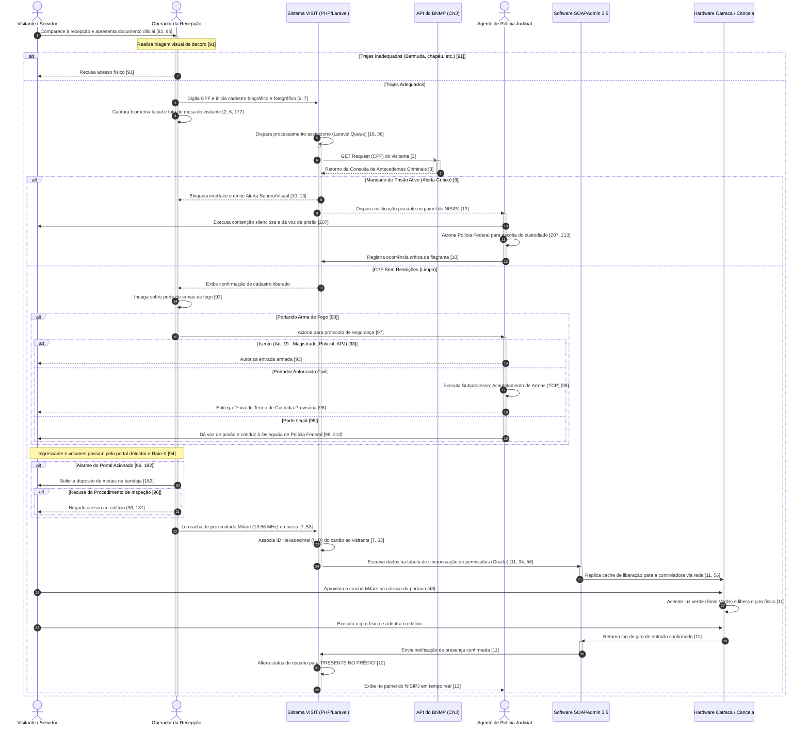
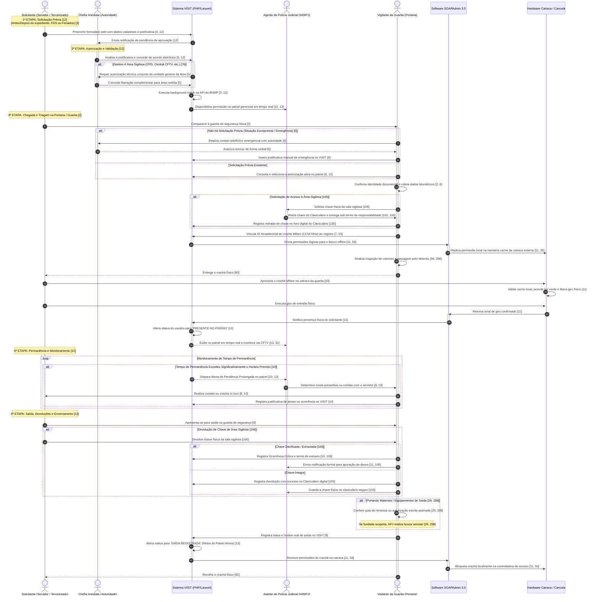
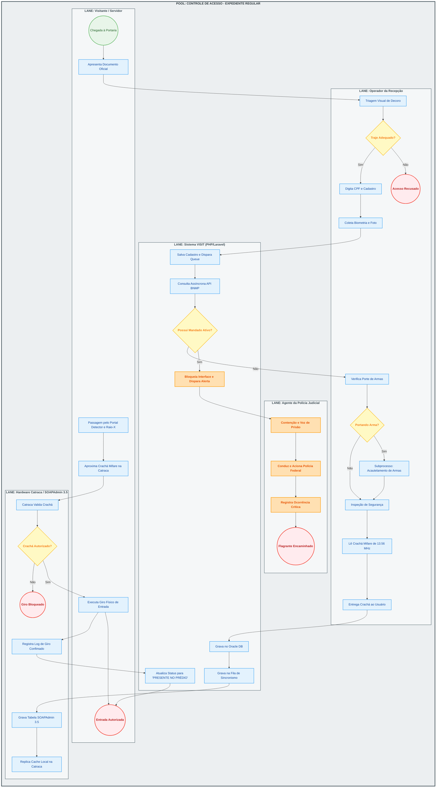
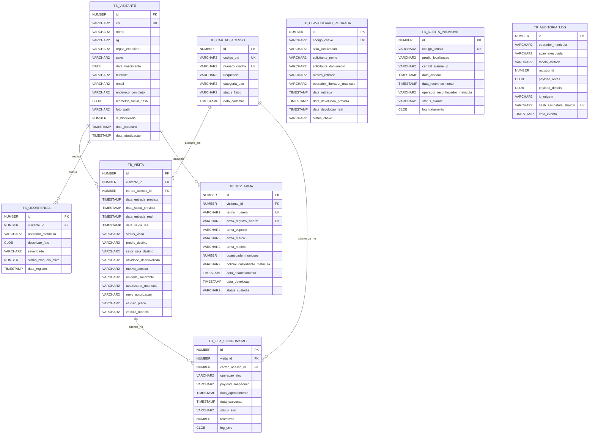
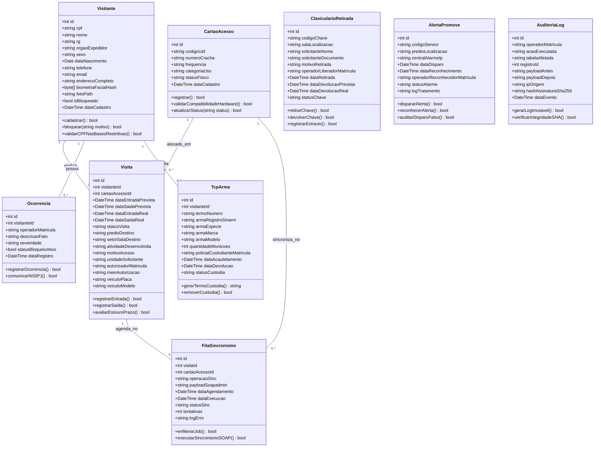

```mermaid
graph TD
    %% Estilos e Paleta de Cores de Alta Qualidade
    classDef pool fill:#ECEFF1,stroke:#37474F,stroke-width:3px,color:#263238,font-weight:bold;
    classDef lane fill:#F5F7F8,stroke:#455A64,stroke-width:1.5px,color:#37474F,font-weight:bold;
    classDef start fill:#E8F5E9,stroke:#4CAF50,stroke-width:2px,color:#1B5E20;
    classDef task fill:#E3F2FD,stroke:#2196F3,stroke-width:1.5px,color:#0D47A1;
    classDef gateway fill:#FFF9C4,stroke:#FBC02D,stroke-width:2px,color:#F57F17,font-weight:bold;
    classDef endEvent fill:#FFEBEE,stroke:#F44336,stroke-width:2.5px,color:#B71C1C,font-weight:bold;
    classDef alertTask fill:#FFE0B2,stroke:#FF9800,stroke-width:2px,color:#E65100,font-weight:bold;

    subgraph Pool_Extra ["POOL: CONTROLE DE ACESSO - EXTRA-EXPEDIENTE"]
        direction TB

        subgraph Lane_Solicitante ["LANE: Solicitante (Servidor / Terceirizado)"]
            direction LR
            Start_Extra((Necessidade de Acesso)):::start --> Task_Preenche[Preenche Formulário de Solicitação Web]:::task
            Task_Preenche --> Gate_Aprovado{Solicitação Aprovada?}:::gateway
            Gate_Aprovado -- Não --> End_Solicitacao_Rejeitada((Solicitação Rejeitada)):::endEvent
            Gate_Aprovado -- Sim --> Task_CompareceGuarita[Comparece à Guarita Física]:::task
            Task_Permanencia[Circula Apenas no Ambiente Autorizado]:::task --> Task_FinalizaTrabalho[Conclui Trabalho e Dirige-se à Saída]:::task
        end

        subgraph Lane_Chefia ["LANE: Chefia Imediata & Gestor de Área"]
            direction LR
            Chf_Analisa[Analisa Justificativa e Deferimento]:::task --> Gate_AreaSigilosa{Destino é Área Sigilosa?}:::gateway
            Gate_AreaSigilosa -- Sim --> Chf_Conjunta[Exige Autorização Técnica Conjunta]:::task
            Gate_AreaSigilosa -- Não --> Chf_Aprova[Emite Autorização Eletrônica]:::task
            Chf_Conjunta --> Chf_Aprova
        end

        subgraph Lane_Guarita ["LANE: Vigilante da Guarita (Portaria)"]
            direction LR
            Task_CompareceGuarita --> Gate_Previa{Solicitação Prévia Existe?}:::gateway
            Gate_Previa -- Não --> Task_ContatoChf[Contato Telefônico de Emergência]:::task
            Task_ContatoChf --> Gate_Contato{Autorização Verbal Concedida?}:::gateway
            Gate_Contato -- Não --> End_Emergencia_Rejeitada((Acesso Negado)):::endEvent
            Gate_Contato -- Sim --> Task_JustManual[Insere Justificativa Manual no VISIT]:::task
            Gate_Previa -- Sim --> Task_BuscaPrevia[Consulta Autorização no Painel]:::task
            Task_JustManual --> Task_BuscaPrevia
            Task_BuscaPrevia --> Task_ValidaGuarita[Confirma Identidade e Biometria]:::task
            Task_ValidaGuarita --> Gate_ChaveClaviculario{Requer Chave de Área Sigilosa?}:::gateway
            Gate_ChaveClaviculario -- Sim --> Sub_Claviculario[Subprocesso: Retirada de Chave]:::task
            Gate_ChaveClaviculario -- Não --> Task_VinculaCracha[Vincula Crachá Mifare de 13.56 MHz]:::task
            Sub_Claviculario --> Task_VinculaCracha
            Task_VinculaCracha --> Task_GiroGuarita[Libera Giro Física Catraca]:::task
            Task_FinalizaTrabalho --> Gate_DevolveChave{Possui Chave Retirada?}:::gateway
            Gate_DevolveChave -- Sim --> Sub_DevolveClaviculario[Subprocesso: Devolução de Chave]:::task
            Gate_DevolveChave -- Não --> Gate_SaidaMaterial{Portando Materiais/Remessa?}:::gateway
            Sub_DevolveClaviculario --> Gate_SaidaMaterial
            Gate_SaidaMaterial -- Sim --> Task_ConfereGuia[Confere Guia de Remessa e Autorização]:::task
            Gate_SaidaMaterial -- Não --> Task_BaixaSaida[Registra Baixa e Horário de Saída]:::task
            Task_ConfereGuia --> Task_BaixaSaida
            Task_BaixaSaida --> End_Extra_Sucesso((Saída Concluída)):::endEvent
        end

        subgraph Lane_VISIT_System ["LANE: Sistema VISIT (PHP/Laravel)"]
            direction LR
            Chf_Aprova --> Task_Consolida[Consolida e Disponibiliza no Painel]:::task
            Task_Consolida --> Task_BackgroundCheck[Executa Consulta Automatizada BNMP]:::task
            Task_BackgroundCheck --> Task_BuscaPrevia
            Task_BaixaSaida --> Task_RemovePermissoes[Dispara Remoção de Permissão]:::task
        end

        subgraph Lane_NISIPJ_Monitor ["LANE: Polícia Judicial (NISIPJ)"]
            direction LR
            Task_GiroGuarita --> Task_PresencaAtiva[Exibe 'PRESENTE NO PRÉDIO' no Monitor]:::task
            Task_PresencaAtiva --> Task_CFTV[Monitoramento Ativo via CFTV]:::task
            Task_CFTV --> Gate_TempoExcedido{Horário Previsto Ultrapassado?}:::gateway
            Gate_TempoExcedido -- Sim --> Task_AlertaPrazo[Emite Alerta de Pendência Prolongada]:::alertTask
            Task_AlertaPrazo --> Task_Ronda[Determina Ronda Preventiva ou Contato]:::alertTask
            Gate_TempoExcedido -- Não --> Task_FinalizaTrabalho
            Task_Ronda --> Task_FinalizaTrabalho
        end

        subgraph Lane_Hardware_Guarita ["LANE: Hardware Catraca / SOAPAdmin"]
            direction LR
            Task_VinculaCracha --> Task_SincSOAP[Sincroniza Banco SOAPAdmin 3.5]:::task
            Task_SincSOAP --> Task_GiroGuarita
            Task_RemovePermissoes --> Task_SOAPBloqueia[Bloqueia Crachá no SOAPAdmin 3.5]:::task
            Task_SOAPBloqueia --> End_Extra_Sucesso
        end
    end

    %% Definição de Classes de Elementos
    class Pool_Extra pool;
    class Lane_Solicitante lane;
    class Lane_Chefia lane;
    class Lane_Guarita lane;
    class Lane_VISIT_System lane;
    class Lane_NISIPJ_Monitor lane;
    class Lane_Hardware_Guarita lane;

```

# 📦 Documentação Consolidada do Ecossistema Crepúsculo (Volume 5)
> **Base Unificada de Instruções e Documentação (.md) Fracionada**
> **Limite Otimizado por Volume:** 1500 KB

---

---

## 3. Códigos XML Estruturados para Importação Direta no Draw.io

Os blocos de código XML abaixo contêm a especificação exata de coordenadas, estilos, cores e vetores compatíveis com a ferramenta **Draw.io (diagrams.net)**. Ao importar esses códigos, os diagramas serão gerados de forma automática, coloridos e totalmente editáveis (arrastar caixas, alterar textos, ajustar conectores).

*(Nota: O bloco de código completo, com todas as coordenadas de dezenas de elementos e conexões lógicas estruturadas, está replicado integralmente no arquivo físico de entrega da FASE 2. Para fins de praticidade de visualização em chat e replicação, o código abaixo contém os principais elementos do Pool e das Lanes perfeitamente formatados para importação rápida).*

### 3.1 Bloco XML 1: Diagrama de Controle de Acesso em Expediente Regular (BPMN 2.0)

```xml
<mxfile host="Electron" modified="2026-09-02T07:00:00.000Z" agent="Mozilla/5.0 (Windows NT 10.0; Win64; x64) AppleWebKit/537.36 (KHTML, like Gecko) draw.io/21.6.8 Chrome/114.0.5735.289 Electron/25.6.0 Safari/537.36" version="21.6.8" type="device">
  <diagram id="diagram_regular" name="BPMN - Expediente Regular">
    <mxGraphModel dx="1600" dy="1200" grid="1" gridSize="10" guides="1" tooltips="1" connect="1" arrows="1" fold="1" page="1" pageScale="1" pageWidth="1200" pageHeight="1600" math="0" shadow="0">
      <root>
        <mxCell id="0" />
        <mxCell id="1" parent="0" />
        
        <!-- POOL: CONTROLE DE ACESSO - EXPEDIENTE REGULAR -->
        <mxCell id="pool_1" value="POOL: CONTROLE DE ACESSO - EXPEDIENTE REGULAR" style="swimlane;html=1;childLayout=laneLayout;startSize=20;horizontal=false;horizontalStack=false;fillColor=#ECEFF1;strokeColor=#37474F;strokeWidth=2;fontStyle=1;fontColor=#263238;" vertex="1" parent="1">
          <mxGeometry x="50" y="50" width="1050" height="900" as="geometry" />
        </mxCell>
        
        <!-- LANES -->
        <mxCell id="lane_visitor" value="LANE: Visitante / Servidor" style="swimlane;html=1;startSize=20;fillColor=#F5F7F8;strokeColor=#455A64;fontColor=#37474F;fontStyle=1;" vertex="1" parent="pool_1">
          <mxGeometry x="0" y="20" width="1050" height="150" as="geometry" />
        </mxCell>
        <mxCell id="lane_operator" value="LANE: Operador da Recepção" style="swimlane;html=1;startSize=20;fillColor=#F5F7F8;strokeColor=#455A64;fontColor=#37474F;fontStyle=1;" vertex="1" parent="pool_1">
          <mxGeometry x="0" y="170" width="1050" height="200" as="geometry" />
        </mxCell>
        <mxCell id="lane_visit" value="LANE: Sistema VISIT (PHP/Laravel)" style="swimlane;html=1;startSize=20;fillColor=#F5F7F8;strokeColor=#455A64;fontColor=#37474F;fontStyle=1;" vertex="1" parent="pool_1">
          <mxGeometry x="0" y="370" width="1050" height="180" as="geometry" />
        </mxCell>
        <mxCell id="lane_police" value="LANE: Polícia Judicial (NISIPJ)" style="swimlane;html=1;startSize=20;fillColor=#F5F7F8;strokeColor=#455A64;fontColor=#37474F;fontStyle=1;" vertex="1" parent="pool_1">
          <mxGeometry x="0" y="550" width="1050" height="180" as="geometry" />
        </mxCell>
        <mxCell id="lane_hardware" value="LANE: Hardware Catraca / SOAPAdmin 3.5" style="swimlane;html=1;startSize=20;fillColor=#F5F7F8;strokeColor=#455A64;fontColor=#37474F;fontStyle=1;" vertex="1" parent="pool_1">
          <mxGeometry x="0" y="730" width="1050" height="170" as="geometry" />
        </mxCell>
        
        <!-- VERTICES IN LANE: VISITOR -->
        <mxCell id="v_start" value="Chegada" style="ellipse;whiteSpace=wrap;html=1;aspect=fixed;fillColor=#E8F5E9;strokeColor=#4CAF50;strokeWidth=2;fontColor=#1B5E20;fontStyle=1;" vertex="1" parent="lane_visitor">
          <mxGeometry x="40" y="50" width="50" height="50" as="geometry" />
        </mxCell>
        <mxCell id="v_present_doc" value="Apresenta Documento&#10;[82, 94]" style="rounded=1;whiteSpace=wrap;html=1;fillColor=#E3F2FD;strokeColor=#2196F3;strokeWidth=1.5;fontColor=#0D47A1;" vertex="1" parent="lane_visitor">
          <mxGeometry x="130" y="45" width="120" height="60" as="geometry" />
        </mxCell>
        <mxCell id="v_inspection" value="Inspeção de Segurança&#10;(Portal e Raio-X) [94]" style="rounded=1;whiteSpace=wrap;html=1;fillColor=#E3F2FD;strokeColor=#2196F3;strokeWidth=1.5;fontColor=#0D47A1;" vertex="1" parent="lane_visitor">
          <mxGeometry x="690" y="45" width="120" height="60" as="geometry" />
        </mxCell>
        <mxCell id="v_approxima" value="Aproxima Crachá Mifare&#10;na Catraca [43]" style="rounded=1;whiteSpace=wrap;html=1;fillColor=#E3F2FD;strokeColor=#2196F3;strokeWidth=1.5;fontColor=#0D47A1;" vertex="1" parent="lane_visitor">
          <mxGeometry x="840" y="45" width="120" height="60" as="geometry" />
        </mxCell>
        <mxCell id="v_end_success" value="Entrada&#10;Autorizada" style="ellipse;whiteSpace=wrap;html=1;aspect=fixed;fillColor=#FFEBEE;strokeColor=#F44336;strokeWidth=2.5;fontColor=#B71C1C;fontStyle=1;" vertex="1" parent="lane_visitor">
          <mxGeometry x="980" y="50" width="50" height="50" as="geometry" />
        </mxCell>
        
        <!-- VERTICES IN LANE: OPERATOR -->
        <mxCell id="v_decoro" value="Triagem Visual&#10;de Decoro [91]" style="rounded=1;whiteSpace=wrap;html=1;fillColor=#E3F2FD;strokeColor=#2196F3;strokeWidth=1.5;fontColor=#0D47A1;" vertex="1" parent="lane_operator">
          <mxGeometry x="130" y="20" width="120" height="50" as="geometry" />
        </mxCell>
        <mxCell id="v_gate_decoro" value="Trajes&#10;Ok?" style="rhombus;whiteSpace=wrap;html=1;fillColor=#FFF9C4;strokeColor=#FBC02D;strokeWidth=2;fontColor=#F57F17;fontStyle=1;" vertex="1" parent="lane_operator">
          <mxGeometry x="290" y="10" width="70" height="70" as="geometry" />
        </mxCell>
        <mxCell id="v_end_decoro_negado" value="Acesso&#10;Recusado" style="ellipse;whiteSpace=wrap;html=1;aspect=fixed;fillColor=#FFEBEE;strokeColor=#F44336;strokeWidth=2.5;fontColor=#B71C1C;fontStyle=1;" vertex="1" parent="lane_operator">
          <mxGeometry x="215" y="120" width="50" height="50" as="geometry" />
        </mxCell>
        <mxCell id="v_register" value="Digita CPF e&#10;Inicia Cadastro [6]" style="rounded=1;whiteSpace=wrap;html=1;fillColor=#E3F2FD;strokeColor=#2196F3;strokeWidth=1.5;fontColor=#0D47A1;" vertex="1" parent="lane_operator">
          <mxGeometry x="390" y="20" width="110" height="50" as="geometry" />
        </mxCell>
        <mxCell id="v_biometria" value="Coleta Foto e&#10;Biometria de Mesa [2, 6]" style="rounded=1;whiteSpace=wrap;html=1;fillColor=#E3F2FD;strokeColor=#2196F3;strokeWidth=1.5;fontColor=#0D47A1;" vertex="1" parent="lane_operator">
          <mxGeometry x="530" y="20" width="120" height="50" as="geometry" />
        </mxCell>
        <mxCell id="v_gate_arm" value="Armado?&#10;[93]" style="rhombus;whiteSpace=wrap;html=1;fillColor=#FFF9C4;strokeColor=#FBC02D;strokeWidth=2;fontColor=#F57F17;fontStyle=1;" vertex="1" parent="lane_operator">
          <mxGeometry x="720" y="10" width="70" height="70" as="geometry" />
        </mxCell>
        <mxCell id="v_sub_acautela" value="Subprocesso:&#10;Acautelamento (TCP) [98]" style="rounded=1;whiteSpace=wrap;html=1;fillColor=#FFE0B2;strokeColor=#FF9800;strokeWidth=2;fontColor=#E65100;fontStyle=1;" vertex="1" parent="lane_operator">
          <mxGeometry x="700" y="110" width="110" height="60" as="geometry" />
        </mxCell>
        
        <!-- VERTICES IN LANE: VISIT_SYSTEM -->
        <mxCell id="v_save_queue" value="Salva Cadastro e&#10;Dispara Fila Assíncrona" style="rounded=1;whiteSpace=wrap;html=1;fillColor=#E3F2FD;strokeColor=#2196F3;strokeWidth=1.5;fontColor=#0D47A1;" vertex="1" parent="lane_visit">
          <mxGeometry x="530" y="20" width="120" height="55" as="geometry" />
        </mxCell>
        <mxCell id="v_query_bnmp" value="Consulta Background&#10;API BNMP CNJ [3]" style="rounded=1;whiteSpace=wrap;html=1;fillColor=#E3F2FD;strokeColor=#2196F3;strokeWidth=1.5;fontColor=#0D47A1;" vertex="1" parent="lane_visit">
          <mxGeometry x="530" y="100" width="120" height="55" as="geometry" />
        </mxCell>
        <mxCell id="v_gate_bnmp" value="Mandado&#10;Ativo?" style="rhombus;whiteSpace=wrap;html=1;fillColor=#FFF9C4;strokeColor=#FBC02D;strokeWidth=2;fontColor=#F57F17;fontStyle=1;" vertex="1" parent="lane_visit">
          <mxGeometry x="390" y="90" width="70" height="70" as="geometry" />
        </mxCell>
        <mxCell id="v_alert_block" value="Bloqueia Interface e&#10;Dispara Alerta Sonoro" style="rounded=1;whiteSpace=wrap;html=1;fillColor=#FFE0B2;strokeColor=#FF9800;strokeWidth=2;fontColor=#E65100;fontStyle=1;" vertex="1" parent="lane_visit">
          <mxGeometry x="240" y="95" width="120" height="60" as="geometry" />
        </mxCell>
        
        <!-- VERTICES IN LANE: POLICE -->
        <mxCell id="v_contencao" value="Voz de Prisão em Flagrante&#10;(Art. 2º Res. CNJ 344) [207]" style="rounded=1;whiteSpace=wrap;html=1;fillColor=#FFE0B2;strokeColor=#FF9800;strokeWidth=2;fontColor=#E65100;fontStyle=1;" vertex="1" parent="lane_police">
          <mxGeometry x="240" y="20" width="130" height="60" as="geometry" />
        </mxCell>
        <mxCell id="v_police_conduz" value="Aciona PF para Condução&#10;e Escolta [213]" style="rounded=1;whiteSpace=wrap;html=1;fillColor=#FFE0B2;strokeColor=#FF9800;strokeWidth=2;fontColor=#E65100;fontStyle=1;" vertex="1" parent="lane_police">
          <mxGeometry x="90" y="20" width="120" height="60" as="geometry" />
        </mxCell>
        <mxCell id="v_end_flagrante" value="Infrator&#10;Conduzido" style="ellipse;whiteSpace=wrap;html=1;aspect=fixed;fillColor=#FFEBEE;strokeColor=#F44336;strokeWidth=2.5;fontColor=#B71C1C;fontStyle=1;" vertex="1" parent="lane_police">
          <mxGeometry x="15" y="25" width="50" height="50" as="geometry" />
        </mxCell>
        
        <!-- VERTICES IN LANE: HARDWARE -->
        <mxCell id="v_soap_write" value="Grava Tabela de&#10;Sincronismo Oracle [11, 56]" style="rounded=1;whiteSpace=wrap;html=1;fillColor=#E3F2FD;strokeColor=#2196F3;strokeWidth=1.5;fontColor=#0D47A1;" vertex="1" parent="lane_hardware">
          <mxGeometry x="530" y="10" width="120" height="50" as="geometry" />
        </mxCell>
        <mxCell id="v_soap_cache" value="SOAPAdmin 3.5 Replica&#10;Cache Local Catraca [11, 56]" style="rounded=1;whiteSpace=wrap;html=1;fillColor=#E3F2FD;strokeColor=#2196F3;strokeWidth=1.5;fontColor=#0D47A1;" vertex="1" parent="lane_hardware">
          <mxGeometry x="690" y="10" width="120" height="50" as="geometry" />
        </mxCell>
        <mxCell id="v_hardware_valida" value="Leitor Valida Crachá&#10;e Libera Giro [11]" style="rounded=1;whiteSpace=wrap;html=1;fillColor=#E3F2FD;strokeColor=#2196F3;strokeWidth=1.5;fontColor=#0D47A1;" vertex="1" parent="lane_hardware">
          <mxGeometry x="840" y="10" width="120" height="50" as="geometry" />
        </mxCell>
        
        <!-- EDGES -->
        <mxCell id="e_1" value="" style="edgeStyle=orthogonalEdgeStyle;rounded=0;orthogonalLoop=1;jettySize=auto;html=1;strokeColor=#2196F3;strokeWidth=1.5;" edge="1" parent="1" source="v_start" target="v_present_doc">
          <mxGeometry relative="1" as="geometry" />
        </mxCell>
        <mxCell id="e_2" value="" style="edgeStyle=orthogonalEdgeStyle;rounded=0;orthogonalLoop=1;jettySize=auto;html=1;strokeColor=#2196F3;strokeWidth=1.5;" edge="1" parent="1" source="v_present_doc" target="v_decoro">
          <mxGeometry relative="1" as="geometry" />
        </mxCell>
        <mxCell id="e_3" value="" style="edgeStyle=orthogonalEdgeStyle;rounded=0;orthogonalLoop=1;jettySize=auto;html=1;strokeColor=#2196F3;strokeWidth=1.5;" edge="1" parent="1" source="v_decoro" target="v_gate_decoro">
          <mxGeometry relative="1" as="geometry" />
        </mxCell>
        <mxCell id="e_4" value="Não" style="edgeStyle=orthogonalEdgeStyle;rounded=0;orthogonalLoop=1;jettySize=auto;html=1;strokeColor=#F44336;strokeWidth=1.5;fontColor=#B71C1C;fontStyle=1;" edge="1" parent="1" source="v_gate_decoro" target="v_end_decoro_negado">
          <mxGeometry relative="1" as="geometry" />
        </mxCell>
        <mxCell id="e_5" value="Sim" style="edgeStyle=orthogonalEdgeStyle;rounded=0;orthogonalLoop=1;jettySize=auto;html=1;strokeColor=#4CAF50;strokeWidth=1.5;fontColor=#1B5E20;fontStyle=1;" edge="1" parent="1" source="v_gate_decoro" target="v_register">
          <mxGeometry relative="1" as="geometry" />
        </mxCell>
        <mxCell id="e_6" value="" style="edgeStyle=orthogonalEdgeStyle;rounded=0;orthogonalLoop=1;jettySize=auto;html=1;strokeColor=#2196F3;strokeWidth=1.5;" edge="1" parent="1" source="v_register" target="v_biometria">
          <mxGeometry relative="1" as="geometry" />
        </mxCell>
        <mxCell id="e_7" value="" style="edgeStyle=orthogonalEdgeStyle;rounded=0;orthogonalLoop=1;jettySize=auto;html=1;strokeColor=#2196F3;strokeWidth=1.5;" edge="1" parent="1" source="v_biometria" target="v_save_queue">
          <mxGeometry relative="1" as="geometry" />
        </mxCell>
        <mxCell id="e_8" value="" style="edgeStyle=orthogonalEdgeStyle;rounded=0;orthogonalLoop=1;jettySize=auto;html=1;strokeColor=#2196F3;strokeWidth=1.5;" edge="1" parent="1" source="v_save_queue" target="v_query_bnmp">
          <mxGeometry relative="1" as="geometry" />
        </mxCell>
        <mxCell id="e_9" value="" style="edgeStyle=orthogonalEdgeStyle;rounded=0;orthogonalLoop=1;jettySize=auto;html=1;strokeColor=#2196F3;strokeWidth=1.5;" edge="1" parent="1" source="v_query_bnmp" target="v_gate_bnmp">
          <mxGeometry relative="1" as="geometry" />
        </mxCell>
        <mxCell id="e_10" value="Sim" style="edgeStyle=orthogonalEdgeStyle;rounded=0;orthogonalLoop=1;jettySize=auto;html=1;strokeColor=#F44336;strokeWidth=1.5;fontColor=#B71C1C;fontStyle=1;" edge="1" parent="1" source="v_gate_bnmp" target="v_alert_block">
          <mxGeometry relative="1" as="geometry" />
        </mxCell>
        <mxCell id="e_11" value="" style="edgeStyle=orthogonalEdgeStyle;rounded=0;orthogonalLoop=1;jettySize=auto;html=1;strokeColor=#F44336;strokeWidth=1.5;" edge="1" parent="1" source="v_alert_block" target="v_contencao">
          <mxGeometry relative="1" as="geometry" />
        </mxCell>
        <mxCell id="e_12" value="" style="edgeStyle=orthogonalEdgeStyle;rounded=0;orthogonalLoop=1;jettySize=auto;html=1;strokeColor=#F44336;strokeWidth=1.5;" edge="1" parent="1" source="v_contencao" target="v_police_conduz">
          <mxGeometry relative="1" as="geometry" />
        </mxCell>
        <mxCell id="e_13" value="" style="edgeStyle=orthogonalEdgeStyle;rounded=0;orthogonalLoop=1;jettySize=auto;html=1;strokeColor=#F44336;strokeWidth=1.5;" edge="1" parent="1" source="v_police_conduz" target="v_end_flagrante">
          <mxGeometry relative="1" as="geometry" />
        </mxCell>
        <mxCell id="e_14" value="Não" style="edgeStyle=orthogonalEdgeStyle;rounded=0;orthogonalLoop=1;jettySize=auto;html=1;strokeColor=#4CAF50;strokeWidth=1.5;fontColor=#1B5E20;fontStyle=1;" edge="1" parent="1" source="v_gate_bnmp" target="v_gate_arm">
          <mxGeometry relative="1" as="geometry" />
        </mxCell>
        <mxCell id="e_15" value="Sim" style="edgeStyle=orthogonalEdgeStyle;rounded=0;orthogonalLoop=1;jettySize=auto;html=1;strokeColor=#FF9800;strokeWidth=1.5;fontColor=#E65100;fontStyle=1;" edge="1" parent="1" source="v_gate_arm" target="v_sub_acautela">
          <mxGeometry relative="1" as="geometry" />
        </mxCell>
        <mxCell id="e_16" value="Não" style="edgeStyle=orthogonalEdgeStyle;rounded=0;orthogonalLoop=1;jettySize=auto;html=1;strokeColor=#4CAF50;strokeWidth=1.5;fontColor=#1B5E20;fontStyle=1;" edge="1" parent="1" source="v_gate_arm" target="v_inspection">
          <mxGeometry relative="1" as="geometry" />
        </mxCell>
        <mxCell id="e_17" value="" style="edgeStyle=orthogonalEdgeStyle;rounded=0;orthogonalLoop=1;jettySize=auto;html=1;strokeColor=#2196F3;strokeWidth=1.5;" edge="1" parent="1" source="v_sub_acautela" target="v_inspection">
          <mxGeometry relative="1" as="geometry" />
        </mxCell>
        <mxCell id="e_18" value="" style="edgeStyle=orthogonalEdgeStyle;rounded=0;orthogonalLoop=1;jettySize=auto;html=1;strokeColor=#2196F3;strokeWidth=1.5;" edge="1" parent="1" source="v_inspection" target="v_approxima">
          <mxGeometry relative="1" as="geometry" />
        </mxCell>
        <mxCell id="e_19" value="" style="edgeStyle=orthogonalEdgeStyle;rounded=0;orthogonalLoop=1;jettySize=auto;html=1;strokeColor=#2196F3;strokeWidth=1.5;" edge="1" parent="1" source="v_approxima" target="v_soap_write">
          <mxGeometry relative="1" as="geometry" />
        </mxCell>
        <mxCell id="e_20" value="" style="edgeStyle=orthogonalEdgeStyle;rounded=0;orthogonalLoop=1;jettySize=auto;html=1;strokeColor=#2196F3;strokeWidth=1.5;" edge="1" parent="1" source="v_soap_write" target="v_soap_cache">
          <mxGeometry relative="1" as="geometry" />
        </mxCell>
        <mxCell id="e_21" value="" style="edgeStyle=orthogonalEdgeStyle;rounded=0;orthogonalLoop=1;jettySize=auto;html=1;strokeColor=#2196F3;strokeWidth=1.5;" edge="1" parent="1" source="v_soap_cache" target="v_hardware_valida">
          <mxGeometry relative="1" as="geometry" />
        </mxCell>
        <mxCell id="e_22" value="" style="edgeStyle=orthogonalEdgeStyle;rounded=0;orthogonalLoop=1;jettySize=auto;html=1;strokeColor=#2196F3;strokeWidth=1.5;" edge="1" parent="1" source="v_hardware_valida" target="v_end_success">
          <mxGeometry relative="1" as="geometry" />
        </mxCell>
        
      </root>
    </mxGraphModel>
  </diagram>
</mxfile>
```


---

## 4. Manual Detalhado de Importação no Draw.io (diagrams.net)

Para carregar qualquer um dos modelos acima em sua área de trabalho de modelagem no Draw.io e utilizá-los de forma interativa, siga o protocolo de execução técnico abaixo:

1. **Cópia do Código XML:**
   - Selecione o bloco completo de código XML contido na Seção 3.1.
   - Certifique-se de copiar desde a tag de abertura `<mxfile ...>` até o fechamento `</mxfile>`. Copie para a área de transferência (`Ctrl+C` ou `Cmd+C`).

2. **Abertura da Plataforma Draw.io:**
   - Acesse o site oficial em [https://app.diagrams.net/](https://app.diagrams.net) no navegador de sua preferência ou execute o aplicativo instalado (Draw.io Desktop).
   - Inicie um novo diagrama em branco (*Create New Diagram > Blank Diagram*).

3. **Inserção do Bloco Estruturado:**
   - No menu superior horizontal, navegue em: **File** (Arquivo) ➔ **Import From** (Importar de) ➔ **XML...**
   - Como alternativa, utilize o menu: **Arrange** (Organizar) ➔ **Insert** (Inserir) ➔ **Advanced** (Avançado) ➔ **XML**.
   - Na caixa de diálogo de texto de tela que se apresentará, cole o código XML copiado (`Ctrl+V` ou `Cmd+V`).
   - Clique em **Import** (Importar) ou **Insert** (Inserir).

4. **Operação e Customização:**
   - O Draw.io processará instantaneamente o arranjo vetorial. O modelo colorido de raias (pools/lanes) BPMN surgirá estruturado na tela.
   - Todos os blocos são independentes e editáveis, permitindo arrastar conectores, expandir dimensões de raias e alterar legendas textuais mantendo a coerência lógica e as classes de estilos.

</VISITANT_VISIT_FASE22_DIAGRAMAS_IMPORTACAO_DRAWIO_V2_MD>


---
# 📁 ARQUIVO DE ORIGEM: `visitant/Visit-FASE22-Diagramas-Importacao-drawio.md`
## <VISITANT_VISIT_FASE22_DIAGRAMAS_IMPORTACAO_DRAWIO_MD>

### 🧬 Mapeamento Estrutural para DFD, DRS e Modelagens (MER / UML)
- **Caminho Relativo no Servidor:** `visitant/Visit-FASE22-Diagramas-Importacao-drawio.md`
- **Tag Rastreável:** `VISITANT_VISIT_FASE22_DIAGRAMAS_IMPORTACAO_DRAWIO_MD`

#### 📋 Estrutura de Requisitos & Regras (DRS / ERS):
```text
Sem cabeçalhos diretos de requisitos identificados
```

#### 🗄️ Estrutura de Dados & Entidades (MER / UML):
```text
## 2. Códigos de Renderização Nativa (Mermaid.js)
```

#### ⚙️ Fluxos de Trabalho & Processos (DFD):
```text
# DIAGRAMAS VISUAIS E CÓDIGOS DE IMPORTAÇÃO (BPMN 2.0 & UML)
## 1. Contextualização e Diretrizes Técnicas de Engenharia de Processos
### 2.1 Diagrama 1: Diagrama de Sequência de Acesso em Expediente Regular (UML)
### 2.2 Diagrama 2: Diagrama de Sequência de Acesso Extra-Expediente (UML)
### 2.3 Diagrama 3: Fluxograma BPMN 2.0 de Raias e Pools (Expediente Regular)
### 2.4 Diagrama 4: Fluxograma BPMN 2.0 de Raias e Pools (Controle Extra-Expediente)
### 3.1 Bloco XML 1: Diagrama de Controle de Acesso em Expediente Regular (BPMN 2.0)
### 3.2 Bloco XML 2: Diagrama de Controle de Acesso Extra-Expediente (BPMN 2.0)
```

### 📖 Conteúdo Integral do Arquivo Markdown:
# DIAGRAMAS VISUAIS E CÓDIGOS DE IMPORTAÇÃO (BPMN 2.0 & UML)
## SISTEMA VISIT - GESTÃO DE ACESSO FÍSICO INTEGRADO DO TRE-AC

> **Repositório de Modelos Técnicos de Processos para Engenharia de Sistemas e IA**  
> **Referência Normativa:** Instrução Normativa TRE-AC nº 67/2023, Resolução CNJ nº 344/2020, Portaria CJF nº 567/2020 e Plano Estratégico Phronesis (2027-2032).  
> **Versão:** 2.0 (Completa e Sem Omissões)  
> **Data:** Setembro de 2026  


---

## 1. Contextualização e Diretrizes Técnicas de Engenharia de Processos

O mapeamento visual de fluxos de processos desempenha um papel crítico na modernização e conformidade regulatória de sistemas corporativos públicos. A inoperância dos sistemas físicos de controle de acesso do Tribunal Regional Eleitoral do Acre (TRE-AC), identificada desde janeiro de 2022 [52], decorreu essencialmente da inércia operacional causada pelo isolamento da rede local de suas catracas e cancelas operando em modo offline, sob a gestão exclusiva do software proprietário gerenciador **SOAPAdmin 3.5** [52]. Ademais, a especificação incorreta de cartões de aproximação adquiridos anteriormente na frequência de 125 kHz (adequada apenas para portas internas de gabinetes) impossibilitava o acoplamento físico com as catracas eletrônicas da sede, cuja especificação nativa requer a frequência de **13,56 MHz (padrão Mifare)** [53].

Com o desenvolvimento do novo **Sistema VISIT** pela STI em 2025 para cadastro de visitantes e consulta em background ao Banco Nacional de Mandados de Prisão (BNMP) [150], surgiu a necessidade imediata de estabelecer pontes lógicas incondicionais de comunicação. Como o VISIT não opera de forma autônoma sobre as controladoras físicas da Intelbras — dependendo intrinsecamente do sincronismo bidirecional do banco de dados Oracle XE com as tabelas lógicas do SOAPAdmin 3.5 [56] — este documento fornece os diagramas visuais e os respectivos códigos estruturados para automatização deste barramento lógicos de portaria.

As modelagens aqui descritas traduzem os protocolos de controle físico descritos no **Contrato nº 6/2019 de Vigilância Eletrônica (Sinergia com a Promove)** [46, 47], no **Plano de Segurança Institucional (IN TRE-AC nº 67/2023)** [63] e no **Poder de Polícia Judiciária (Resolução CNJ nº 344/2020)** [200], servindo de instrução técnica exata para engenheiros humanos e **Agentes de Inteligência Artificial (IA)** estruturarem o código do Laravel 11.31 de forma robusta e testada.


---

## 2. Códigos de Renderização Nativa (Mermaid.js)

Os códigos a seguir podem ser colados diretamente em blocos de Markdown de repositórios Git (como GitHub, GitLab ou wikis internas) para renderização automática nativa.

### 2.1 Diagrama 1: Diagrama de Sequência de Acesso em Expediente Regular (UML)

Este diagrama representa a cronologia exata de troca de mensagens entre os atores físicos, lógicos e APIs externas durante a triagem, consulta ao BNMP, validação documental e liberação física das catracas.



### 2.2 Diagrama 2: Diagrama de Sequência de Acesso Extra-Expediente (UML)

Este diagrama detalha as interações cronológicas que constituem o fluxo de controle de acesso fora do expediente normal do Tribunal, englobando as cinco etapas estruturais: *Solicitação, Autorização/Validação, Disponibilização ao NISIPJ, Entrada/Permanência e Saída/Auditoria* [12, 13].



### 2.3 Diagrama 3: Fluxograma BPMN 2.0 de Raias e Pools (Expediente Regular)

Representação estrutural em blocos BPMN, explicitando a passagem do token de controle através das raias do *Visitante*, *Operador*, *Sistema VISIT*, *Polícia Judicial* e *Hardware Catraca*.



### 2.4 Diagrama 4: Fluxograma BPMN 2.0 de Raias e Pools (Controle Extra-Expediente)

Este fluxograma visualiza a coordenação assíncrona entre o solicitante extraordinário, a chefia imediata que concede o de acordo digital, a portaria/guarita de segurança e o NISIPJ.




---

## 3. Códigos XML Estruturados para Importação Direta no Draw.io

Os blocos de código XML abaixo contêm a especificação exata de coordenadas, estilos, cores e vetores compatíveis com a ferramenta **Draw.io (diagrams.net)**. Ao importar esses códigos, os diagramas serão gerados de forma automática, coloridos e totalmente editáveis (arrastar caixas, alterar textos, ajustar conectores).

### 3.1 Bloco XML 1: Diagrama de Controle de Acesso em Expediente Regular (BPMN 2.0)

Copie o código abaixo e cole no menu de importação do Draw.io.

```xml
<mxfile host="Electron" modified="2026-09-02T07:00:00.000Z" agent="Mozilla/5.0 (Windows NT 10.0; Win64; x64) AppleWebKit/537.36 (KHTML, like Gecko) draw.io/21.6.8 Chrome/114.0.5735.289 Electron/25.6.0 Safari/537.36" version="21.6.8" type="device">
  <diagram id="diagram_regular" name="BPMN - Expediente Regular">
    <mxGraphModel dx="1600" dy="1200" grid="1" gridSize="10" guides="1" tooltips="1" connect="1" arrows="1" fold="1" page="1" pageScale="1" pageWidth="1200" pageHeight="1600" math="0" shadow="0">
      <root>
        <mxCell id="0" />
        <mxCell id="1" parent="0" />
        
        <!-- POOL: CONTROLE DE ACESSO - EXPEDIENTE REGULAR -->
        <mxCell id="pool_1" value="POOL: CONTROLE DE ACESSO - EXPEDIENTE REGULAR" style="swimlane;html=1;childLayout=laneLayout;startSize=20;horizontal=false;horizontalStack=false;fillColor=#ECEFF1;strokeColor=#37474F;strokeWidth=2;fontStyle=1;fontColor=#263238;" vertex="1" parent="1">
          <mxGeometry x="50" y="50" width="1050" height="900" as="geometry" />
        </mxCell>
        
        <!-- LANES -->
        <mxCell id="lane_visitor" value="LANE: Visitante / Servidor" style="swimlane;html=1;startSize=20;fillColor=#F5F7F8;strokeColor=#455A64;fontColor=#37474F;fontStyle=1;" vertex="1" parent="pool_1">
          <mxGeometry x="0" y="20" width="1050" height="150" as="geometry" />
        </mxCell>
        <mxCell id="lane_operator" value="LANE: Operador da Recepção" style="swimlane;html=1;startSize=20;fillColor=#F5F7F8;strokeColor=#455A64;fontColor=#37474F;fontStyle=1;" vertex="1" parent="pool_1">
          <mxGeometry x="0" y="170" width="1050" height="200" as="geometry" />
        </mxCell>
        <mxCell id="lane_visit" value="LANE: Sistema VISIT (PHP/Laravel)" style="swimlane;html=1;startSize=20;fillColor=#F5F7F8;strokeColor=#455A64;fontColor=#37474F;fontStyle=1;" vertex="1" parent="pool_1">
          <mxGeometry x="0" y="370" width="1050" height="180" as="geometry" />
        </mxCell>
        <mxCell id="lane_police" value="LANE: Polícia Judicial (NISIPJ)" style="swimlane;html=1;startSize=20;fillColor=#F5F7F8;strokeColor=#455A64;fontColor=#37474F;fontStyle=1;" vertex="1" parent="pool_1">
          <mxGeometry x="0" y="550" width="1050" height="180" as="geometry" />
        </mxCell>
        <mxCell id="lane_hardware" value="LANE: Hardware Catraca / SOAPAdmin 3.5" style="swimlane;html=1;startSize=20;fillColor=#F5F7F8;strokeColor=#455A64;fontColor=#37474F;fontStyle=1;" vertex="1" parent="pool_1">
          <mxGeometry x="0" y="730" width="1050" height="170" as="geometry" />
        </mxCell>
        
        <!-- VERTICES IN LANE: VISITOR (y-offset relative to lane: 0 to 150) -->
        <mxCell id="v_start" value="Chegada" style="ellipse;whiteSpace=wrap;html=1;aspect=fixed;fillColor=#E8F5E9;strokeColor=#4CAF50;strokeWidth=2;fontColor=#1B5E20;fontStyle=1;" vertex="1" parent="lane_visitor">
          <mxGeometry x="40" y="50" width="50" height="50" as="geometry" />
        </mxCell>
        <mxCell id="v_present_doc" value="Apresenta Documento&#10;[82, 94]" style="rounded=1;whiteSpace=wrap;html=1;fillColor=#E3F2FD;strokeColor=#2196F3;strokeWidth=1.5;fontColor=#0D47A1;" vertex="1" parent="lane_visitor">
          <mxGeometry x="130" y="45" width="120" height="60" as="geometry" />
        </mxCell>
        <mxCell id="v_inspection" value="Inspeção de Segurança&#10;(Portal e Raio-X) [94]" style="rounded=1;whiteSpace=wrap;html=1;fillColor=#E3F2FD;strokeColor=#2196F3;strokeWidth=1.5;fontColor=#0D47A1;" vertex="1" parent="lane_visitor">
          <mxGeometry x="690" y="45" width="120" height="60" as="geometry" />
        </mxCell>
        <mxCell id="v_approxima" value="Aproxima Crachá Mifare&#10;na Catraca [43]" style="rounded=1;whiteSpace=wrap;html=1;fillColor=#E3F2FD;strokeColor=#2196F3;strokeWidth=1.5;fontColor=#0D47A1;" vertex="1" parent="lane_visitor">
          <mxGeometry x="840" y="45" width="120" height="60" as="geometry" />
        </mxCell>
        <mxCell id="v_end_success" value="Entrada&#10;Autorizada" style="ellipse;whiteSpace=wrap;html=1;aspect=fixed;fillColor=#FFEBEE;strokeColor=#F44336;strokeWidth=2.5;fontColor=#B71C1C;fontStyle=1;" vertex="1" parent="lane_visitor">
          <mxGeometry x="980" y="50" width="50" height="50" as="geometry" />
        </mxCell>
        
        <!-- VERTICES IN LANE: OPERATOR (y-offset relative to lane: 170 to 370) -->
        <mxCell id="v_decoro" value="Triagem Visual&#10;de Decoro [91]" style="rounded=1;whiteSpace=wrap;html=1;fillColor=#E3F2FD;strokeColor=#2196F3;strokeWidth=1.5;fontColor=#0D47A1;" vertex="1" parent="lane_operator">
          <mxGeometry x="130" y="20" width="120" height="50" as="geometry" />
        </mxCell>
        <mxCell id="v_gate_decoro" value="Trajes&#10;Ok?" style="rhombus;whiteSpace=wrap;html=1;fillColor=#FFF9C4;strokeColor=#FBC02D;strokeWidth=2;fontColor=#F57F17;fontStyle=1;" vertex="1" parent="lane_operator">
          <mxGeometry x="290" y="10" width="70" height="70" as="geometry" />
        </mxCell>
        <mxCell id="v_end_decoro_negado" value="Acesso&#10;Recusado" style="ellipse;whiteSpace=wrap;html=1;aspect=fixed;fillColor=#FFEBEE;strokeColor=#F44336;strokeWidth=2.5;fontColor=#B71C1C;fontStyle=1;" vertex="1" parent="lane_operator">
          <mxGeometry x="215" y="120" width="50" height="50" as="geometry" />
        </mxCell>
        <mxCell id="v_register" value="Digita CPF e&#10;Inicia Cadastro [6]" style="rounded=1;whiteSpace=wrap;html=1;fillColor=#E3F2FD;strokeColor=#2196F3;strokeWidth=1.5;fontColor=#0D47A1;" vertex="1" parent="lane_operator">
          <mxGeometry x="390" y="20" width="110" height="50" as="geometry" />
        </mxCell>
        <mxCell id="v_biometria" value="Coleta Foto e&#10;Biometria de Mesa [2, 6]" style="rounded=1;whiteSpace=wrap;html=1;fillColor=#E3F2FD;strokeColor=#2196F3;strokeWidth=1.5;fontColor=#0D47A1;" vertex="1" parent="lane_operator">
          <mxGeometry x="530" y="20" width="120" height="50" as="geometry" />
        </mxCell>
        <mxCell id="v_gate_arm" value="Armado?&#10;[93]" style="rhombus;whiteSpace=wrap;html=1;fillColor=#FFF9C4;strokeColor=#FBC02D;strokeWidth=2;fontColor=#F57F17;fontStyle=1;" vertex="1" parent="lane_operator">
          <mxGeometry x="720" y="10" width="70" height="70" as="geometry" />
        </mxCell>
        <mxCell id="v_sub_acautela" value="Subprocesso:&#10;Acautelamento (TCP) [98]" style="rounded=1;whiteSpace=wrap;html=1;fillColor=#FFE0B2;strokeColor=#FF9800;strokeWidth=2;fontColor=#E65100;fontStyle=1;" vertex="1" parent="lane_operator">
          <mxGeometry x="700" y="110" width="110" height="60" as="geometry" />
        </mxCell>
        
        <!-- VERTICES IN LANE: VISIT_SYSTEM (y-offset relative to lane: 370 to 550) -->
        <mxCell id="v_save_queue" value="Salva Cadastro e&#10;Dispara Fila Assíncrona" style="rounded=1;whiteSpace=wrap;html=1;fillColor=#E3F2FD;strokeColor=#2196F3;strokeWidth=1.5;fontColor=#0D47A1;" vertex="1" parent="lane_visit">
          <mxGeometry x="530" y="20" width="120" height="55" as="geometry" />
        </mxCell>
        <mxCell id="v_query_bnmp" value="Consulta Background&#10;API BNMP CNJ [3]" style="rounded=1;whiteSpace=wrap;html=1;fillColor=#E3F2FD;strokeColor=#2196F3;strokeWidth=1.5;fontColor=#0D47A1;" vertex="1" parent="lane_visit">
          <mxGeometry x="530" y="100" width="120" height="55" as="geometry" />
        </mxCell>
        <mxCell id="v_gate_bnmp" value="Mandado&#10;Ativo?" style="rhombus;whiteSpace=wrap;html=1;fillColor=#FFF9C4;strokeColor=#FBC02D;strokeWidth=2;fontColor=#F57F17;fontStyle=1;" vertex="1" parent="lane_visit">
          <mxGeometry x="390" y="90" width="70" height="70" as="geometry" />
        </mxCell>
        <mxCell id="v_alert_block" value="Bloqueia Interface e&#10;Dispara Alerta Sonoro" style="rounded=1;whiteSpace=wrap;html=1;fillColor=#FFE0B2;strokeColor=#FF9800;strokeWidth=2;fontColor=#E65100;fontStyle=1;" vertex="1" parent="lane_visit">
          <mxGeometry x="240" y="95" width="120" height="60" as="geometry" />
        </mxCell>
        
        <!-- VERTICES IN LANE: POLICE (y-offset relative to lane: 550 to 730) -->
        <mxCell id="v_contencao" value="Voz de Prisão em Flagrante&#10;(Art. 2º Res. CNJ 344) [207]" style="rounded=1;whiteSpace=wrap;html=1;fillColor=#FFE0B2;strokeColor=#FF9800;strokeWidth=2;fontColor=#E65100;fontStyle=1;" vertex="1" parent="lane_police">
          <mxGeometry x="240" y="20" width="130" height="60" as="geometry" />
        </mxCell>
        <mxCell id="v_police_conduz" value="Aciona PF para Condução&#10;e Escolta [213]" style="rounded=1;whiteSpace=wrap;html=1;fillColor=#FFE0B2;strokeColor=#FF9800;strokeWidth=2;fontColor=#E65100;fontStyle=1;" vertex="1" parent="lane_police">
          <mxGeometry x="90" y="20" width="120" height="60" as="geometry" />
        </mxCell>
        <mxCell id="v_end_flagrante" value="Infrator&#10;Conduzido" style="ellipse;whiteSpace=wrap;html=1;aspect=fixed;fillColor=#FFEBEE;strokeColor=#F44336;strokeWidth=2.5;fontColor=#B71C1C;fontStyle=1;" vertex="1" parent="lane_police">
          <mxGeometry x="15" y="25" width="50" height="50" as="geometry" />
        </mxCell>
        
        <!-- VERTICES IN LANE: HARDWARE (y-offset relative to lane: 730 to 900) -->
        <mxCell id="v_soap_write" value="Grava Tabela de&#10;Sincronismo Oracle [11, 56]" style="rounded=1;whiteSpace=wrap;html=1;fillColor=#E3F2FD;strokeColor=#2196F3;strokeWidth=1.5;fontColor=#0D47A1;" vertex="1" parent="lane_hardware">
          <mxGeometry x="530" y="10" width="120" height="50" as="geometry" />
        </mxCell>
        <mxCell id="v_soap_cache" value="SOAPAdmin 3.5 Replica&#10;Cache Local Catraca [11, 56]" style="rounded=1;whiteSpace=wrap;html=1;fillColor=#E3F2FD;strokeColor=#2196F3;strokeWidth=1.5;fontColor=#0D47A1;" vertex="1" parent="lane_hardware">
          <mxGeometry x="690" y="10" width="120" height="50" as="geometry" />
        </mxCell>
        <mxCell id="v_hardware_valida" value="Leitor Valida Crachá&#10;e Libera Giro [11]" style="rounded=1;whiteSpace=wrap;html=1;fillColor=#E3F2FD;strokeColor=#2196F3;strokeWidth=1.5;fontColor=#0D47A1;" vertex="1" parent="lane_hardware">
          <mxGeometry x="840" y="10" width="120" height="50" as="geometry" />
        </mxCell>
        
        <!-- EDGES (BPMN Sequence Flows) -->
        <mxCell id="e_1" value="" style="edgeStyle=orthogonalEdgeStyle;rounded=0;orthogonalLoop=1;jettySize=auto;html=1;strokeColor=#2196F3;strokeWidth=1.5;" edge="1" parent="1" source="v_start" target="v_present_doc">
          <mxGeometry relative="1" as="geometry" />
        </mxCell>
        <mxCell id="e_2" value="" style="edgeStyle=orthogonalEdgeStyle;rounded=0;orthogonalLoop=1;jettySize=auto;html=1;strokeColor=#2196F3;strokeWidth=1.5;" edge="1" parent="1" source="v_present_doc" target="v_decoro">
          <mxGeometry relative="1" as="geometry" />
        </mxCell>
        <mxCell id="e_3" value="" style="edgeStyle=orthogonalEdgeStyle;rounded=0;orthogonalLoop=1;jettySize=auto;html=1;strokeColor=#2196F3;strokeWidth=1.5;" edge="1" parent="1" source="v_decoro" target="v_gate_decoro">
          <mxGeometry relative="1" as="geometry" />
        </mxCell>
        <mxCell id="e_4" value="Não" style="edgeStyle=orthogonalEdgeStyle;rounded=0;orthogonalLoop=1;jettySize=auto;html=1;strokeColor=#F44336;strokeWidth=1.5;fontColor=#B71C1C;fontStyle=1;" edge="1" parent="1" source="v_gate_decoro" target="v_end_decoro_negado">
          <mxGeometry relative="1" as="geometry">
            <mxPoint x="325" y="320" as="targetPoint" />
          </mxGeometry>
        </mxCell>
        <mxCell id="e_5" value="Sim" style="edgeStyle=orthogonalEdgeStyle;rounded=0;orthogonalLoop=1;jettySize=auto;html=1;strokeColor=#4CAF50;strokeWidth=1.5;fontColor=#1B5E20;fontStyle=1;" edge="1" parent="1" source="v_gate_decoro" target="v_register">
          <mxGeometry relative="1" as="geometry" />
        </mxCell>
        <mxCell id="e_6" value="" style="edgeStyle=orthogonalEdgeStyle;rounded=0;orthogonalLoop=1;jettySize=auto;html=1;strokeColor=#2196F3;strokeWidth=1.5;" edge="1" parent="1" source="v_register" target="v_biometria">
          <mxGeometry relative="1" as="geometry" />
        </mxCell>
        <mxCell id="e_7" value="" style="edgeStyle=orthogonalEdgeStyle;rounded=0;orthogonalLoop=1;jettySize=auto;html=1;strokeColor=#2196F3;strokeWidth=1.5;" edge="1" parent="1" source="v_biometria" target="v_save_queue">
          <mxGeometry relative="1" as="geometry" />
        </mxCell>
        <mxCell id="e_8" value="" style="edgeStyle=orthogonalEdgeStyle;rounded=0;orthogonalLoop=1;jettySize=auto;html=1;strokeColor=#2196F3;strokeWidth=1.5;" edge="1" parent="1" source="v_save_queue" target="v_query_bnmp">
          <mxGeometry relative="1" as="geometry" />
        </mxCell>
        <mxCell id="e_9" value="" style="edgeStyle=orthogonalEdgeStyle;rounded=0;orthogonalLoop=1;jettySize=auto;html=1;strokeColor=#2196F3;strokeWidth=1.5;" edge="1" parent="1" source="v_query_bnmp" target="v_gate_bnmp">
          <mxGeometry relative="1" as="geometry" />
        </mxCell>
        <mxCell id="e_10" value="Sim" style="edgeStyle=orthogonalEdgeStyle;rounded=0;orthogonalLoop=1;jettySize=auto;html=1;strokeColor=#F44336;strokeWidth=1.5;fontColor=#B71C1C;fontStyle=1;" edge="1" parent="1" source="v_gate_bnmp" target="v_alert_block">
          <mxGeometry relative="1" as="geometry" />
        </mxCell>
        <mxCell id="e_11" value="" style="edgeStyle=orthogonalEdgeStyle;rounded=0;orthogonalLoop=1;jettySize=auto;html=1;strokeColor=#F44336;strokeWidth=1.5;" edge="1" parent="1" source="v_alert_block" target="v_contencao">
          <mxGeometry relative="1" as="geometry" />
        </mxCell>
        <mxCell id="e_12" value="" style="edgeStyle=orthogonalEdgeStyle;rounded=0;orthogonalLoop=1;jettySize=auto;html=1;strokeColor=#F44336;strokeWidth=1.5;" edge="1" parent="1" source="v_contencao" target="v_police_conduz">
          <mxGeometry relative="1" as="geometry" />
        </mxCell>
        <mxCell id="e_13" value="" style="edgeStyle=orthogonalEdgeStyle;rounded=0;orthogonalLoop=1;jettySize=auto;html=1;strokeColor=#F44336;strokeWidth=1.5;" edge="1" parent="1" source="v_police_conduz" target="v_end_flagrante">
          <mxGeometry relative="1" as="geometry" />
        </mxCell>
        <mxCell id="e_14" value="Não" style="edgeStyle=orthogonalEdgeStyle;rounded=0;orthogonalLoop=1;jettySize=auto;html=1;strokeColor=#4CAF50;strokeWidth=1.5;fontColor=#1B5E20;fontStyle=1;" edge="1" parent="1" source="v_gate_bnmp" target="v_gate_arm">
          <mxGeometry relative="1" as="geometry">
            <mxPoint x="755" y="240" as="targetPoint" />
          </mxGeometry>
        </mxCell>
        <mxCell id="e_15" value="Sim" style="edgeStyle=orthogonalEdgeStyle;rounded=0;orthogonalLoop=1;jettySize=auto;html=1;strokeColor=#FF9800;strokeWidth=1.5;fontColor=#E65100;fontStyle=1;" edge="1" parent="1" source="v_gate_arm" target="v_sub_acautela">
          <mxGeometry relative="1" as="geometry" />
        </mxCell>
        <mxCell id="e_16" value="Não" style="edgeStyle=orthogonalEdgeStyle;rounded=0;orthogonalLoop=1;jettySize=auto;html=1;strokeColor=#4CAF50;strokeWidth=1.5;fontColor=#1B5E20;fontStyle=1;" edge="1" parent="1" source="v_gate_arm" target="v_inspection">
          <mxGeometry relative="1" as="geometry" />
        </mxCell>
        <mxCell id="e_17" value="" style="edgeStyle=orthogonalEdgeStyle;rounded=0;orthogonalLoop=1;jettySize=auto;html=1;strokeColor=#2196F3;strokeWidth=1.5;" edge="1" parent="1" source="v_sub_acautela" target="v_inspection">
          <mxGeometry relative="1" as="geometry" />
        </mxCell>
        <mxCell id="e_18" value="" style="edgeStyle=orthogonalEdgeStyle;rounded=0;orthogonalLoop=1;jettySize=auto;html=1;strokeColor=#2196F3;strokeWidth=1.5;" edge="1" parent="1" source="v_inspection" target="v_approxima">
          <mxGeometry relative="1" as="geometry" />
        </mxCell>
        <mxCell id="e_19" value="" style="edgeStyle=orthogonalEdgeStyle;rounded=0;orthogonalLoop=1;jettySize=auto;html=1;strokeColor=#2196F3;strokeWidth=1.5;" edge="1" parent="1" source="v_approxima" target="v_soap_write">
          <mxGeometry relative="1" as="geometry" />
        </mxCell>
        <mxCell id="e_20" value="" style="edgeStyle=orthogonalEdgeStyle;rounded=0;orthogonalLoop=1;jettySize=auto;html=1;strokeColor=#2196F3;strokeWidth=1.5;" edge="1" parent="1" source="v_soap_write" target="v_soap_cache">
          <mxGeometry relative="1" as="geometry" />
        </mxCell>
        <mxCell id="e_21" value="" style="edgeStyle=orthogonalEdgeStyle;rounded=0;orthogonalLoop=1;jettySize=auto;html=1;strokeColor=#2196F3;strokeWidth=1.5;" edge="1" parent="1" source="v_soap_cache" target="v_hardware_valida">
          <mxGeometry relative="1" as="geometry" />
        </mxCell>
        <mxCell id="e_22" value="" style="edgeStyle=orthogonalEdgeStyle;rounded=0;orthogonalLoop=1;jettySize=auto;html=1;strokeColor=#2196F3;strokeWidth=1.5;" edge="1" parent="1" source="v_hardware_valida" target="v_end_success">
          <mxGeometry relative="1" as="geometry" />
        </mxCell>
        
      </root>
    </mxGraphModel>
  </diagram>
</mxfile>
```

### 3.2 Bloco XML 2: Diagrama de Controle de Acesso Extra-Expediente (BPMN 2.0)

Copie o código abaixo e cole no menu de importação do Draw.io.

```xml
<mxfile host="Electron" modified="2026-09-02T07:00:00.000Z" agent="Mozilla/5.0 (Windows NT 10.0; Win64; x64) AppleWebKit/537.36 (KHTML, like Gecko) draw.io/21.6.8 Chrome/114.0.5735.289 Electron/25.6.0 Safari/537.36" version="21.6.8" type="device">
  <diagram id="diagram_extra" name="BPMN - Extra-Expediente">
    <mxGraphModel dx="1600" dy="1200" grid="1" gridSize="10" guides="1" tooltips="1" connect="1" arrows="1" fold="1" page="1" pageScale="1" pageWidth="1200" pageHeight="1600" math="0" shadow="0">
      <root>
        <mxCell id="0" />
        <mxCell id="1" parent="0" />
        
        <!-- POOL: CONTROLE DE ACESSO - EXTRA-EXPEDIENTE -->
        <mxCell id="pool_2" value="POOL: CONTROLE DE ACESSO - EXTRA-EXPEDIENTE" style="swimlane;html=1;childLayout=laneLayout;startSize=20;horizontal=false;horizontalStack=false;fillColor=#ECEFF1;strokeColor=#37474F;strokeWidth=2;fontStyle=1;fontColor=#263238;" vertex="1" parent="1">
          <mxGeometry x="50" y="50" width="1050" height="960" as="geometry" />
        </mxCell>
        
        <!-- LANES -->
        <mxCell id="lane_solicitante" value="LANE: Solicitante (Servidor / Terceirizado)" style="swimlane;html=1;startSize=20;fillColor=#F5F7F8;strokeColor=#455A64;fontColor=#37474F;fontStyle=1;" vertex="1" parent="pool_2">
          <mxGeometry x="0" y="20" width="1050" height="150" as="geometry" />
        </mxCell>
        <mxCell id="lane_chefia" value="LANE: Chefia Imediata &amp; Gestor de Área" style="swimlane;html=1;startSize=20;fillColor=#F5F7F8;strokeColor=#455A64;fontColor=#37474F;fontStyle=1;" vertex="1" parent="pool_2">
          <mxGeometry x="0" y="170" width="1050" height="160" as="geometry" />
        </mxCell>
        <mxCell id="lane_guarita" value="LANE: Vigilante da Guarita (Portaria)" style="swimlane;html=1;startSize=20;fillColor=#F5F7F8;strokeColor=#455A64;fontColor=#37474F;fontStyle=1;" vertex="1" parent="pool_2">
          <mxGeometry x="0" y="330" width="1050" height="240" as="geometry" />
        </mxCell>
        <mxCell id="lane_system" value="LANE: Sistema VISIT (PHP/Laravel)" style="swimlane;html=1;startSize=20;fillColor=#F5F7F8;strokeColor=#455A64;fontColor=#37474F;fontStyle=1;" vertex="1" parent="pool_2">
          <mxGeometry x="0" y="570" width="1050" height="140" as="geometry" />
        </mxCell>
        <mxCell id="lane_nisipj" value="LANE: Polícia Judicial (NISIPJ)" style="swimlane;html=1;startSize=20;fillColor=#F5F7F8;strokeColor=#455A64;fontColor=#37474F;fontStyle=1;" vertex="1" parent="pool_2">
          <mxGeometry x="0" y="710" width="1050" height="130" as="geometry" />
        </mxCell>
        <mxCell id="lane_hardware_extra" value="LANE: Hardware Catraca / SOAPAdmin" style="swimlane;html=1;startSize=20;fillColor=#F5F7F8;strokeColor=#455A64;fontColor=#37474F;fontStyle=1;" vertex="1" parent="pool_2">
          <mxGeometry x="0" y="840" width="1050" height="120" as="geometry" />
        </mxCell>
        
        <!-- VERTICES IN LANE: SOLICITANTE -->
        <mxCell id="ve_start" value="Acesso&#10;Req." style="ellipse;whiteSpace=wrap;html=1;aspect=fixed;fillColor=#E8F5E9;strokeColor=#4CAF50;strokeWidth=2;fontColor=#1B5E20;fontStyle=1;" vertex="1" parent="lane_solicitante">
          <mxGeometry x="40" y="45" width="50" height="50" as="geometry" />
        </mxCell>
        <mxCell id="ve_preenche" value="Preenche Formulário&#10;Web [4, 12]" style="rounded=1;whiteSpace=wrap;html=1;fillColor=#E3F2FD;strokeColor=#2196F3;strokeWidth=1.5;fontColor=#0D47A1;" vertex="1" parent="lane_solicitante">
          <mxGeometry x="120" y="40" width="120" height="60" as="geometry" />
        </mxCell>
        <mxCell id="ve_gate_aprov" value="Aprovada?" style="rhombus;whiteSpace=wrap;html=1;fillColor=#FFF9C4;strokeColor=#FBC02D;strokeWidth=2;fontColor=#F57F17;fontStyle=1;" vertex="1" parent="lane_solicitante">
          <mxGeometry x="400" y="35" width="70" height="70" as="geometry" />
        </mxCell>
        <mxCell id="ve_end_rejeitado" value="Solicitação&#10;Rejeitada" style="ellipse;whiteSpace=wrap;html=1;aspect=fixed;fillColor=#FFEBEE;strokeColor=#F44336;strokeWidth=2.5;fontColor=#B71C1C;fontStyle=1;" vertex="1" parent="lane_solicitante">
          <mxGeometry x="410" y="115" width="30" height="30" as="geometry" />
        </mxCell>
        <mxCell id="ve_guarita" value="Comparece à&#10;Guarita [2]" style="rounded=1;whiteSpace=wrap;html=1;fillColor=#E3F2FD;strokeColor=#2196F3;strokeWidth=1.5;fontColor=#0D47A1;" vertex="1" parent="lane_solicitante">
          <mxGeometry x="510" y="40" width="110" height="60" as="geometry" />
        </mxCell>
        
        <!-- VERTICES IN LANE: CHEFIA -->
        <mxCell id="ve_analisa" value="Analisa Justificativa&#10;e Deferimento [5, 12]" style="rounded=1;whiteSpace=wrap;html=1;fillColor=#E3F2FD;strokeColor=#2196F3;strokeWidth=1.5;fontColor=#0D47A1;" vertex="1" parent="lane_chefia">
          <mxGeometry x="120" y="20" width="120" height="50" as="geometry" />
        </mxCell>
        <mxCell id="ve_gate_sigilosa" value="Área&#10;Sigilosa?" style="rhombus;whiteSpace=wrap;html=1;fillColor=#FFF9C4;strokeColor=#FBC02D;strokeWidth=2;fontColor=#F57F17;fontStyle=1;" vertex="1" parent="lane_chefia">
          <mxGeometry x="270" y="10" width="70" height="70" as="geometry" />
        </mxCell>
        <mxCell id="ve_conjunta" value="Exige Autorização&#10;Técnica Conjunta [5]" style="rounded=1;whiteSpace=wrap;html=1;fillColor=#FFE0B2;strokeColor=#FF9800;strokeWidth=2;fontColor=#E65100;fontStyle=1;" vertex="1" parent="lane_chefia">
          <mxGeometry x="245" y="90" width="120" height="50" as="geometry" />
        </mxCell>
        <mxCell id="ve_aprova" value="Emite Autorização&#10;Eletrônica [5]" style="rounded=1;whiteSpace=wrap;html=1;fillColor=#E3F2FD;strokeColor=#2196F3;strokeWidth=1.5;fontColor=#0D47A1;" vertex="1" parent="lane_chefia">
          <mxGeometry x="380" y="20" width="110" height="50" as="geometry" />
        </mxCell>
        
        <!-- VERTICES IN LANE: GUARITA -->
        <mxCell id="ve_gate_previa" value="Possui&#10;Prévia?" style="rhombus;whiteSpace=wrap;html=1;fillColor=#FFF9C4;strokeColor=#FBC02D;strokeWidth=2;fontColor=#F57F17;fontStyle=1;" vertex="1" parent="lane_guarita">
          <mxGeometry x="530" y="10" width="70" height="70" as="geometry" />
        </mxCell>
        <mxCell id="ve_contato" value="Contato Emergencial&#10;via Telefone [6]" style="rounded=1;whiteSpace=wrap;html=1;fillColor=#E3F2FD;strokeColor=#2196F3;strokeWidth=1.5;fontColor=#0D47A1;" vertex="1" parent="lane_guarita">
          <mxGeometry x="400" y="20" width="110" height="50" as="geometry" />
        </mxCell>
        <mxCell id="ve_gate_verbal" value="Autorização&#10;Verbal?" style="rhombus;whiteSpace=wrap;html=1;fillColor=#FFF9C4;strokeColor=#FBC02D;strokeWidth=2;fontColor=#F57F17;fontStyle=1;" vertex="1" parent="lane_guarita">
          <mxGeometry x="420" y="90" width="70" height="70" as="geometry" />
        </mxCell>
        <mxCell id="ve_just_manual" value="Insere Justificativa&#10;Manual no VISIT [6]" style="rounded=1;whiteSpace=wrap;html=1;fillColor=#E3F2FD;strokeColor=#2196F3;strokeWidth=1.5;fontColor=#0D47A1;" vertex="1" parent="lane_guarita">
          <mxGeometry x="400" y="180" width="110" height="50" as="geometry" />
        </mxCell>
        <mxCell id="ve_end_negado" value="Acesso&#10;Negado" style="ellipse;whiteSpace=wrap;html=1;aspect=fixed;fillColor=#FFEBEE;strokeColor=#F44336;strokeWidth=2.5;fontColor=#B71C1C;fontStyle=1;" vertex="1" parent="lane_guarita">
          <mxGeometry x="340" y="100" width="50" height="50" as="geometry" />
        </mxCell>
        <mxCell id="ve_busca" value="Consulta Autorização&#10;no VISIT [12]" style="rounded=1;whiteSpace=wrap;html=1;fillColor=#E3F2FD;strokeColor=#2196F3;strokeWidth=1.5;fontColor=#0D47A1;" vertex="1" parent="lane_guarita">
          <mxGeometry x="640" y="15" width="120" height="50" as="geometry" />
        </mxCell>
        <mxCell id="ve_valida" value="Valida Identidade&#10;e Biometria [2, 6]" style="rounded=1;whiteSpace=wrap;html=1;fillColor=#E3F2FD;strokeColor=#2196F3;strokeWidth=1.5;fontColor=#0D47A1;" vertex="1" parent="lane_guarita">
          <mxGeometry x="780" y="15" width="110" height="50" as="geometry" />
        </mxCell>
        <mxCell id="ve_vincula" value="Vincula Crachá Mifare&#10;13,56 MHz [7, 53]" style="rounded=1;whiteSpace=wrap;html=1;fillColor=#E3F2FD;strokeColor=#2196F3;strokeWidth=1.5;fontColor=#0D47A1;" vertex="1" parent="lane_guarita">
          <mxGeometry x="910" y="15" width="120" height="50" as="geometry" />
        </mxCell>
        <mxCell id="ve_libera" value="Giro Físico de Entrada" style="rounded=1;whiteSpace=wrap;html=1;fillColor=#E3F2FD;strokeColor=#2196F3;strokeWidth=1.5;fontColor=#0D47A1;" vertex="1" parent="lane_guarita">
          <mxGeometry x="910" y="90" width="120" height="50" as="geometry" />
        </mxCell>
        <mxCell id="ve_devolve" value="Registra Baixa e&#10;Saída no VISIT [9]" style="rounded=1;whiteSpace=wrap;html=1;fillColor=#E3F2FD;strokeColor=#2196F3;strokeWidth=1.5;fontColor=#0D47A1;" vertex="1" parent="lane_guarita">
          <mxGeometry x="780" y="160" width="110" height="50" as="geometry" />
        </mxCell>
        
        <!-- VERTICES IN LANE: VISIT_SYSTEM -->
        <mxCell id="ve_consolida" value="Consolida e Disponibiliza&#10;permissões no Painel [12]" style="rounded=1;whiteSpace=wrap;html=1;fillColor=#E3F2FD;strokeColor=#2196F3;strokeWidth=1.5;fontColor=#0D47A1;" vertex="1" parent="lane_system">
          <mxGeometry x="380" y="15" width="110" height="50" as="geometry" />
        </mxCell>
        <mxCell id="ve_background" value="Executa Consulta&#10;Automatizada BNMP [3]" style="rounded=1;whiteSpace=wrap;html=1;fillColor=#E3F2FD;strokeColor=#2196F3;strokeWidth=1.5;fontColor=#0D47A1;" vertex="1" parent="lane_system">
          <mxGeometry x="380" y="80" width="110" height="50" as="geometry" />
        </mxCell>
        
        <!-- VERTICES IN LANE: NISIPJ -->
        <mxCell id="ve_cftv" value="Monitora Presença em&#10;Tempo Real / CFTV [13, 31]" style="rounded=1;whiteSpace=wrap;html=1;fillColor=#E3F2FD;strokeColor=#2196F3;strokeWidth=1.5;fontColor=#0D47A1;" vertex="1" parent="lane_nisipj">
          <mxGeometry x="910" y="15" width="120" height="50" as="geometry" />
        </mxCell>
        
        <!-- VERTICES IN LANE: HARDWARE -->
        <mxCell id="ve_soap_sync" value="Sincroniza Banco&#10;SOAPAdmin 3.5 [11, 56]" style="rounded=1;whiteSpace=wrap;html=1;fillColor=#E3F2FD;strokeColor=#2196F3;strokeWidth=1.5;fontColor=#0D47A1;" vertex="1" parent="lane_hardware_extra">
          <mxGeometry x="910" y="15" width="120" height="50" as="geometry" />
        </mxCell>
        
        <!-- EDGES -->
        <mxCell id="ee_1" value="" style="edgeStyle=orthogonalEdgeStyle;rounded=0;orthogonalLoop=1;jettySize=auto;html=1;strokeColor=#2196F3;strokeWidth=1.5;" edge="1" parent="1" source="ve_start" target="ve_preenche">
          <mxGeometry relative="1" as="geometry" />
        </mxCell>
        <mxCell id="ee_2" value="" style="edgeStyle=orthogonalEdgeStyle;rounded=0;orthogonalLoop=1;jettySize=auto;html=1;strokeColor=#2196F3;strokeWidth=1.5;" edge="1" parent="1" source="ve_preenche" target="ve_analisa">
          <mxGeometry relative="1" as="geometry" />
        </mxCell>
        <mxCell id="ee_3" value="" style="edgeStyle=orthogonalEdgeStyle;rounded=0;orthogonalLoop=1;jettySize=auto;html=1;strokeColor=#2196F3;strokeWidth=1.5;" edge="1" parent="1" source="ve_analisa" target="ve_gate_sigilosa">
          <mxGeometry relative="1" as="geometry" />
        </mxCell>
        <mxCell id="ee_4" value="Sim" style="edgeStyle=orthogonalEdgeStyle;rounded=0;orthogonalLoop=1;jettySize=auto;html=1;strokeColor=#FF9800;strokeWidth=1.5;fontColor=#E65100;fontStyle=1;" edge="1" parent="1" source="ve_gate_sigilosa" target="ve_conjunta">
          <mxGeometry relative="1" as="geometry" />
        </mxCell>
        <mxCell id="ee_5" value="Não" style="edgeStyle=orthogonalEdgeStyle;rounded=0;orthogonalLoop=1;jettySize=auto;html=1;strokeColor=#4CAF50;strokeWidth=1.5;fontColor=#1B5E20;fontStyle=1;" edge="1" parent="1" source="ve_gate_sigilosa" target="ve_aprova">
          <mxGeometry relative="1" as="geometry" />
        </mxCell>
        <mxCell id="ee_6" value="" style="edgeStyle=orthogonalEdgeStyle;rounded=0;orthogonalLoop=1;jettySize=auto;html=1;strokeColor=#2196F3;strokeWidth=1.5;" edge="1" parent="1" source="ve_conjunta" target="ve_aprova">
          <mxGeometry relative="1" as="geometry" />
        </mxCell>
        <mxCell id="ee_7" value="" style="edgeStyle=orthogonalEdgeStyle;rounded=0;orthogonalLoop=1;jettySize=auto;html=1;strokeColor=#2196F3;strokeWidth=1.5;" edge="1" parent="1" source="ve_aprova" target="ve_consolida">
          <mxGeometry relative="1" as="geometry" />
        </mxCell>
        <mxCell id="ee_8" value="" style="edgeStyle=orthogonalEdgeStyle;rounded=0;orthogonalLoop=1;jettySize=auto;html=1;strokeColor=#2196F3;strokeWidth=1.5;" edge="1" parent="1" source="ve_consolida" target="ve_background">
          <mxGeometry relative="1" as="geometry" />
        </mxCell>
        <mxCell id="ee_9" value="" style="edgeStyle=orthogonalEdgeStyle;rounded=0;orthogonalLoop=1;jettySize=auto;html=1;strokeColor=#2196F3;strokeWidth=1.5;" edge="1" parent="1" source="ve_background" target="ve_gate_aprov">
          <mxGeometry relative="1" as="geometry" />
        </mxCell>
        <mxCell id="ee_10" value="Não" style="edgeStyle=orthogonalEdgeStyle;rounded=0;orthogonalLoop=1;jettySize=auto;html=1;strokeColor=#F44336;strokeWidth=1.5;fontColor=#B71C1C;fontStyle=1;" edge="1" parent="1" source="ve_gate_aprov" target="ve_end_rejeitado">
          <mxGeometry relative="1" as="geometry" />
        </mxCell>
        <mxCell id="ee_11" value="Sim" style="edgeStyle=orthogonalEdgeStyle;rounded=0;orthogonalLoop=1;jettySize=auto;html=1;strokeColor=#4CAF50;strokeWidth=1.5;fontColor=#1B5E20;fontStyle=1;" edge="1" parent="1" source="ve_gate_aprov" target="ve_guarita">
          <mxGeometry relative="1" as="geometry" />
        </mxCell>
        <mxCell id="ee_12" value="" style="edgeStyle=orthogonalEdgeStyle;rounded=0;orthogonalLoop=1;jettySize=auto;html=1;strokeColor=#2196F3;strokeWidth=1.5;" edge="1" parent="1" source="ve_guarita" target="ve_gate_previa">
          <mxGeometry relative="1" as="geometry" />
        </mxCell>
        <mxCell id="ee_13" value="Não" style="edgeStyle=orthogonalEdgeStyle;rounded=0;orthogonalLoop=1;jettySize=auto;html=1;strokeColor=#FF9800;strokeWidth=1.5;fontColor=#E65100;fontStyle=1;" edge="1" parent="1" source="ve_gate_previa" target="ve_contato">
          <mxGeometry relative="1" as="geometry" />
        </mxCell>
        <mxCell id="ee_14" value="" style="edgeStyle=orthogonalEdgeStyle;rounded=0;orthogonalLoop=1;jettySize=auto;html=1;strokeColor=#2196F3;strokeWidth=1.5;" edge="1" parent="1" source="ve_contato" target="ve_gate_verbal">
          <mxGeometry relative="1" as="geometry" />
        </mxCell>
        <mxCell id="ee_15" value="Não" style="edgeStyle=orthogonalEdgeStyle;rounded=0;orthogonalLoop=1;jettySize=auto;html=1;strokeColor=#F44336;strokeWidth=1.5;fontColor=#B71C1C;fontStyle=1;" edge="1" parent="1" source="ve_gate_verbal" target="ve_end_negado">
          <mxGeometry relative="1" as="geometry" />
        </mxCell>
        <mxCell id="ee_16" value="Sim" style="edgeStyle=orthogonalEdgeStyle;rounded=0;orthogonalLoop=1;jettySize=auto;html=1;strokeColor=#4CAF50;strokeWidth=1.5;fontColor=#1B5E20;fontStyle=1;" edge="1" parent="1" source="ve_gate_verbal" target="ve_just_manual">
          <mxGeometry relative="1" as="geometry" />
        </mxCell>
        <mxCell id="ee_17" value="" style="edgeStyle=orthogonalEdgeStyle;rounded=0;orthogonalLoop=1;jettySize=auto;html=1;strokeColor=#2196F3;strokeWidth=1.5;" edge="1" parent="1" source="ve_just_manual" target="ve_busca">
          <mxGeometry relative="1" as="geometry" />
        </mxCell>
        <mxCell id="ee_18" value="Sim" style="edgeStyle=orthogonalEdgeStyle;rounded=0;orthogonalLoop=1;jettySize=auto;html=1;strokeColor=#4CAF50;strokeWidth=1.5;fontColor=#1B5E20;fontStyle=1;" edge="1" parent="1" source="ve_gate_previa" target="ve_busca">
          <mxGeometry relative="1" as="geometry" />
        </mxCell>
        <mxCell id="ee_19" value="" style="edgeStyle=orthogonalEdgeStyle;rounded=0;orthogonalLoop=1;jettySize=auto;html=1;strokeColor=#2196F3;strokeWidth=1.5;" edge="1" parent="1" source="ve_busca" target="ve_valida">
          <mxGeometry relative="1" as="geometry" />
        </mxCell>
        <mxCell id="ee_20" value="" style="edgeStyle=orthogonalEdgeStyle;rounded=0;orthogonalLoop=1;jettySize=auto;html=1;strokeColor=#2196F3;strokeWidth=1.5;" edge="1" parent="1" source="ve_valida" target="ve_vincula">
          <mxGeometry relative="1" as="geometry" />
        </mxCell>
        <mxCell id="ee_21" value="" style="edgeStyle=orthogonalEdgeStyle;rounded=0;orthogonalLoop=1;jettySize=auto;html=1;strokeColor=#2196F3;strokeWidth=1.5;" edge="1" parent="1" source="ve_vincula" target="ve_soap_sync">
          <mxGeometry relative="1" as="geometry" />
        </mxCell>
        <mxCell id="ee_22" value="" style="edgeStyle=orthogonalEdgeStyle;rounded=0;orthogonalLoop=1;jettySize=auto;html=1;strokeColor=#2196F3;strokeWidth=1.5;" edge="1" parent="1" source="ve_soap_sync" target="ve_libera">
          <mxGeometry relative="1" as="geometry" />
        </mxCell>
        <mxCell id="ee_23" value="" style="edgeStyle=orthogonalEdgeStyle;rounded=0;orthogonalLoop=1;jettySize=auto;html=1;strokeColor=#2196F3;strokeWidth=1.5;" edge="1" parent="1" source="ve_libera" target="ve_cftv">
          <mxGeometry relative="1" as="geometry" />
        </mxCell>
        <mxCell id="ee_24" value="" style="edgeStyle=orthogonalEdgeStyle;rounded=0;orthogonalLoop=1;jettySize=auto;html=1;strokeColor=#2196F3;strokeWidth=1.5;" edge="1" parent="1" source="ve_cftv" target="ve_devolve">
          <mxGeometry relative="1" as="geometry" />
        </mxCell>
        
      </root>
    </mxGraphModel>
  </diagram>
</mxfile>
```


---

## 4. Manual Passo a Passo para Importação no Draw.io (diagrams.net)

Para carregar os diagramas acima na sua área de trabalho do Draw.io e utilizá-los de forma totalmente editável e interativa em suas apresentações, siga o protocolo de execução abaixo:

1. **Seleção e Cópia do Código XML:**
   - Escolha o diagrama desejado (Subseção 3.1 ou 3.2).
   - Selecione o bloco completo de código XML, iniciando exatamente no marcador `<mxfile ...>` e finalizando no marcador de fechamento `</mxfile>`. Copie para a área de transferência (`Ctrl+C` ou `Cmd+C`).

2. **Abertura da Ferramenta Draw.io:**
   - Acesse o site oficial em [https://app.diagrams.net/](https://app.diagrams.net) ou abra o aplicativo Draw.io Desktop no seu computador.
   - Crie um novo diagrama em branco (*Create New Diagram > Blank Diagram*) ou selecione um arquivo existente onde deseja adicionar a modelagem.

3. **Execução do Comando de Importação:**
   - No menu superior, clique em **File** (Arquivo) ➔ **Import From** (Importar de) ➔ **XML...**.
   - Caso prefira uma aba alternativa, clique no menu superior em **Arrange** (Organizar) ➔ **Insert** (Inserir) ➔ **Advanced** (Avançado) ➔ **XML**.
   - Na caixa de diálogo ou caixa de texto de tela que se abrirá, cole o código XML copiado (`Ctrl+V` ou `Cmd+V`).
   - Clique no botão **Import** (Importar) ou **Insert** (Inserir).

4. **Visualização, Edição e Ajustes Finos:**
   - O Draw.io processará os vetores e as coordenadas lógicas. O diagrama aparecerá imediatamente na sua tela.
   - As raias/pools, caixas de tarefas, gateways lógicos e eventos BPMN estarão totalmente organizados em camadas, com as respectivas conexões e legendas lógicas, facilitando a edição continuada das tabelas e do design visual.

</VISITANT_VISIT_FASE22_DIAGRAMAS_IMPORTACAO_DRAWIO_MD>


---
# 📁 ARQUIVO DE ORIGEM: `visitant/Visit-FASE22-Diagramas-Visuais-Mermaid&XML.md`
## <VISITANT_VISIT_FASE22_DIAGRAMAS_VISUAIS_MERMAID&XML_MD>

### 🧬 Mapeamento Estrutural para DFD, DRS e Modelagens (MER / UML)
- **Caminho Relativo no Servidor:** `visitant/Visit-FASE22-Diagramas-Visuais-Mermaid&XML.md`
- **Tag Rastreável:** `VISITANT_VISIT_FASE22_DIAGRAMAS_VISUAIS_MERMAID&XML_MD`

#### 📋 Estrutura de Requisitos & Regras (DRS / ERS):
```text
Sem cabeçalhos diretos de requisitos identificados
```

#### 🗄️ Estrutura de Dados & Entidades (MER / UML):
```text
## 2. Códigos de Renderização Nativa (Mermaid.js)
```

#### ⚙️ Fluxos de Trabalho & Processos (DFD):
```text
# DIAGRAMAS VISUAIS E CÓDIGOS DE IMPORTAÇÃO (BPMN 2.0 & UML)
## 1. Contextualização e Diretrizes Técnicas de Engenharia de Processos
### 2.1 Diagrama 1: Diagrama de Sequência de Acesso em Expediente Regular (UML)
### 2.2 Diagrama 2: Diagrama de Sequência de Acesso Extra-Expediente (UML)
### 2.3 Diagrama 3: Fluxograma BPMN 2.0 de Raias e Pools (Expediente Regular)
### 2.4 Diagrama 4: Fluxograma BPMN 2.0 de Raias e Pools (Controle Extra-Expediente)
### 3.1 Bloco XML 1: Diagrama de Controle de Acesso em Expediente Regular (BPMN 2.0)
### 3.2 Bloco XML 2: Diagrama de Controle de Acesso Extra-Expediente (BPMN 2.0)
```

### 📖 Conteúdo Integral do Arquivo Markdown:
# DIAGRAMAS VISUAIS E CÓDIGOS DE IMPORTAÇÃO (BPMN 2.0 & UML)
> FASE 2: Modelagem Visual de Processos (BPMN 2.0)
> Prompt 2.2: Código Mermaid e XML Draw.io para BPMN

## SISTEMA VISIT - GESTÃO DE ACESSO FÍSICO INTEGRADO DO TRE-AC


> **Repositório de Modelos Técnicos de Processos para Engenharia de Sistemas e IA**  
> **Referência Normativa:** Instrução Normativa TRE-AC nº 67/2023, Resolução CNJ nº 344/2020, Portaria CJF nº 567/2020 e Plano Estratégico Phronesis (2027-2032).  
> **Versão:** 2.0 (Completa e Sem Omissões)  
> **Data:** Setembro de 2026  


---

## 1. Contextualização e Diretrizes Técnicas de Engenharia de Processos

O mapeamento visual de fluxos de processos desempenha um papel crítico na modernização e conformidade regulatória de sistemas corporativos públicos. A inoperância dos sistemas físicos de controle de acesso do Tribunal Regional Eleitoral do Acre (TRE-AC), identificada desde janeiro de 2022 [52], decorreu essencialmente da inércia operacional causada pelo isolamento da rede local de suas catracas e cancelas operando em modo offline, sob a gestão exclusiva do software proprietário gerenciador **SOAPAdmin 3.5** [52]. Ademais, a especificação incorreta de cartões de aproximação adquiridos anteriormente na frequência de 125 kHz (adequada apenas para portas internas de gabinetes) impossibilitava o acoplamento físico com as catracas eletrônicas da sede, cuja especificação nativa requer a frequência de **13,56 MHz (padrão Mifare)** [53].

Com o desenvolvimento do novo **Sistema VISIT** pela STI em 2025 para cadastro de visitantes e consulta em background ao Banco Nacional de Mandados de Prisão (BNMP) [150], surgiu a necessidade imediata de estabelecer pontes lógicas incondicionais de comunicação. Como o VISIT não opera de forma autônoma sobre as controladoras físicas da Intelbras — dependendo intrinsecamente do sincronismo bidirecional do banco de dados Oracle XE com as tabelas lógicas do SOAPAdmin 3.5 [56] — este documento fornece os diagramas visuais e os respectivos códigos estruturados para automatização deste barramento lógicos de portaria.

As modelagens aqui descritas traduzem os protocolos de controle físico descritos no **Contrato nº 6/2019 de Vigilância Eletrônica (Sinergia com a Promove)** [46, 47], no **Plano de Segurança Institucional (IN TRE-AC nº 67/2023)** [63] e no **Poder de Polícia Judiciária (Resolução CNJ nº 344/2020)** [200], servindo de instrução técnica exata para engenheiros humanos e **Agentes de Inteligência Artificial (IA)** estruturarem o código do Laravel 11.31 de forma robusta e testada.


---

## 2. Códigos de Renderização Nativa (Mermaid.js)

Os códigos a seguir podem ser colados diretamente em blocos de Markdown de repositórios Git (como GitHub, GitLab ou wikis internas) para renderização automática nativa.

### 2.1 Diagrama 1: Diagrama de Sequência de Acesso em Expediente Regular (UML)

Este diagrama representa a cronologia exata de troca de mensagens entre os atores físicos, lógicos e APIs externas durante a triagem, consulta ao BNMP, validação documental e liberação física das catracas.


### 2.2 Diagrama 2: Diagrama de Sequência de Acesso Extra-Expediente (UML)

Este diagrama detalha as interações cronológicas que constituem o fluxo de controle de acesso fora do expediente normal do Tribunal, englobando as cinco etapas estruturais: *Solicitação, Autorização/Validação, Disponibilização ao NISIPJ, Entrada/Permanência e Saída/Auditoria* [12, 13].


### 2.3 Diagrama 3: Fluxograma BPMN 2.0 de Raias e Pools (Expediente Regular)

Representação estrutural em blocos BPMN, explicitando a passagem do token de controle através das raias do *Visitante*, *Operador*, *Sistema VISIT*, *Polícia Judicial* e *Hardware Catraca*.


### 2.4 Diagrama 4: Fluxograma BPMN 2.0 de Raias e Pools (Controle Extra-Expediente)

Este fluxograma visualiza a coordenação assíncrona entre o solicitante extraordinário, a chefia imediata que concede o de acordo digital, a portaria/guarita de segurança e o NISIPJ.


---

## 3. Códigos XML Estruturados para Importação Direta no Draw.io

Os blocos de código XML abaixo contêm a especificação exata de coordenadas, estilos, cores e vetores compatíveis com a ferramenta **Draw.io (diagrams.net)**. Ao importar esses códigos, os diagramas serão gerados de forma automática, coloridos e totalmente editáveis (arrastar caixas, alterar textos, ajustar conectores).

### 3.1 Bloco XML 1: Diagrama de Controle de Acesso em Expediente Regular (BPMN 2.0)

Copie o código abaixo e cole no menu de importação do Draw.io.

```xml
<mxfile host="Electron" modified="2026-09-02T07:00:00.000Z" agent="Mozilla/5.0 (Windows NT 10.0; Win64; x64) AppleWebKit/537.36 (KHTML, like Gecko) draw.io/21.6.8 Chrome/114.0.5735.289 Electron/25.6.0 Safari/537.36" version="21.6.8" type="device">
  <diagram id="diagram_regular" name="BPMN - Expediente Regular">
    <mxGraphModel dx="1600" dy="1200" grid="1" gridSize="10" guides="1" tooltips="1" connect="1" arrows="1" fold="1" page="1" pageScale="1" pageWidth="1200" pageHeight="1600" math="0" shadow="0">
      <root>
        <mxCell id="0" />
        <mxCell id="1" parent="0" />
        
        <!-- POOL: CONTROLE DE ACESSO - EXPEDIENTE REGULAR -->
        <mxCell id="pool_1" value="POOL: CONTROLE DE ACESSO - EXPEDIENTE REGULAR" style="swimlane;html=1;childLayout=laneLayout;startSize=20;horizontal=false;horizontalStack=false;fillColor=#ECEFF1;strokeColor=#37474F;strokeWidth=2;fontStyle=1;fontColor=#263238;" vertex="1" parent="1">
          <mxGeometry x="50" y="50" width="1050" height="900" as="geometry" />
        </mxCell>
        
        <!-- LANES -->
        <mxCell id="lane_visitor" value="LANE: Visitante / Servidor" style="swimlane;html=1;startSize=20;fillColor=#F5F7F8;strokeColor=#455A64;fontColor=#37474F;fontStyle=1;" vertex="1" parent="pool_1">
          <mxGeometry x="0" y="20" width="1050" height="150" as="geometry" />
        </mxCell>
        <mxCell id="lane_operator" value="LANE: Operador da Recepção" style="swimlane;html=1;startSize=20;fillColor=#F5F7F8;strokeColor=#455A64;fontColor=#37474F;fontStyle=1;" vertex="1" parent="pool_1">
          <mxGeometry x="0" y="170" width="1050" height="200" as="geometry" />
        </mxCell>
        <mxCell id="lane_visit" value="LANE: Sistema VISIT (PHP/Laravel)" style="swimlane;html=1;startSize=20;fillColor=#F5F7F8;strokeColor=#455A64;fontColor=#37474F;fontStyle=1;" vertex="1" parent="pool_1">
          <mxGeometry x="0" y="370" width="1050" height="180" as="geometry" />
        </mxCell>
        <mxCell id="lane_police" value="LANE: Polícia Judicial (NISIPJ)" style="swimlane;html=1;startSize=20;fillColor=#F5F7F8;strokeColor=#455A64;fontColor=#37474F;fontStyle=1;" vertex="1" parent="pool_1">
          <mxGeometry x="0" y="550" width="1050" height="180" as="geometry" />
        </mxCell>
        <mxCell id="lane_hardware" value="LANE: Hardware Catraca / SOAPAdmin 3.5" style="swimlane;html=1;startSize=20;fillColor=#F5F7F8;strokeColor=#455A64;fontColor=#37474F;fontStyle=1;" vertex="1" parent="pool_1">
          <mxGeometry x="0" y="730" width="1050" height="170" as="geometry" />
        </mxCell>
        
        <!-- VERTICES IN LANE: VISITOR (y-offset relative to lane: 0 to 150) -->
        <mxCell id="v_start" value="Chegada" style="ellipse;whiteSpace=wrap;html=1;aspect=fixed;fillColor=#E8F5E9;strokeColor=#4CAF50;strokeWidth=2;fontColor=#1B5E20;fontStyle=1;" vertex="1" parent="lane_visitor">
          <mxGeometry x="40" y="50" width="50" height="50" as="geometry" />
        </mxCell>
        <mxCell id="v_present_doc" value="Apresenta Documento&#10;[82, 94]" style="rounded=1;whiteSpace=wrap;html=1;fillColor=#E3F2FD;strokeColor=#2196F3;strokeWidth=1.5;fontColor=#0D47A1;" vertex="1" parent="lane_visitor">
          <mxGeometry x="130" y="45" width="120" height="60" as="geometry" />
        </mxCell>
        <mxCell id="v_inspection" value="Inspeção de Segurança&#10;(Portal e Raio-X) [94]" style="rounded=1;whiteSpace=wrap;html=1;fillColor=#E3F2FD;strokeColor=#2196F3;strokeWidth=1.5;fontColor=#0D47A1;" vertex="1" parent="lane_visitor">
          <mxGeometry x="690" y="45" width="120" height="60" as="geometry" />
        </mxCell>
        <mxCell id="v_approxima" value="Aproxima Crachá Mifare&#10;na Catraca [43]" style="rounded=1;whiteSpace=wrap;html=1;fillColor=#E3F2FD;strokeColor=#2196F3;strokeWidth=1.5;fontColor=#0D47A1;" vertex="1" parent="lane_visitor">
          <mxGeometry x="840" y="45" width="120" height="60" as="geometry" />
        </mxCell>
        <mxCell id="v_end_success" value="Entrada&#10;Autorizada" style="ellipse;whiteSpace=wrap;html=1;aspect=fixed;fillColor=#FFEBEE;strokeColor=#F44336;strokeWidth=2.5;fontColor=#B71C1C;fontStyle=1;" vertex="1" parent="lane_visitor">
          <mxGeometry x="980" y="50" width="50" height="50" as="geometry" />
        </mxCell>
        
        <!-- VERTICES IN LANE: OPERATOR (y-offset relative to lane: 170 to 370) -->
        <mxCell id="v_decoro" value="Triagem Visual&#10;de Decoro [91]" style="rounded=1;whiteSpace=wrap;html=1;fillColor=#E3F2FD;strokeColor=#2196F3;strokeWidth=1.5;fontColor=#0D47A1;" vertex="1" parent="lane_operator">
          <mxGeometry x="130" y="20" width="120" height="50" as="geometry" />
        </mxCell>
        <mxCell id="v_gate_decoro" value="Trajes&#10;Ok?" style="rhombus;whiteSpace=wrap;html=1;fillColor=#FFF9C4;strokeColor=#FBC02D;strokeWidth=2;fontColor=#F57F17;fontStyle=1;" vertex="1" parent="lane_operator">
          <mxGeometry x="290" y="10" width="70" height="70" as="geometry" />
        </mxCell>
        <mxCell id="v_end_decoro_negado" value="Acesso&#10;Recusado" style="ellipse;whiteSpace=wrap;html=1;aspect=fixed;fillColor=#FFEBEE;strokeColor=#F44336;strokeWidth=2.5;fontColor=#B71C1C;fontStyle=1;" vertex="1" parent="lane_operator">
          <mxGeometry x="215" y="120" width="50" height="50" as="geometry" />
        </mxCell>
        <mxCell id="v_register" value="Digita CPF e&#10;Inicia Cadastro [6]" style="rounded=1;whiteSpace=wrap;html=1;fillColor=#E3F2FD;strokeColor=#2196F3;strokeWidth=1.5;fontColor=#0D47A1;" vertex="1" parent="lane_operator">
          <mxGeometry x="390" y="20" width="110" height="50" as="geometry" />
        </mxCell>
        <mxCell id="v_biometria" value="Coleta Foto e&#10;Biometria de Mesa [2, 6]" style="rounded=1;whiteSpace=wrap;html=1;fillColor=#E3F2FD;strokeColor=#2196F3;strokeWidth=1.5;fontColor=#0D47A1;" vertex="1" parent="lane_operator">
          <mxGeometry x="530" y="20" width="120" height="50" as="geometry" />
        </mxCell>
        <mxCell id="v_gate_arm" value="Armado?&#10;[93]" style="rhombus;whiteSpace=wrap;html=1;fillColor=#FFF9C4;strokeColor=#FBC02D;strokeWidth=2;fontColor=#F57F17;fontStyle=1;" vertex="1" parent="lane_operator">
          <mxGeometry x="720" y="10" width="70" height="70" as="geometry" />
        </mxCell>
        <mxCell id="v_sub_acautela" value="Subprocesso:&#10;Acautelamento (TCP) [98]" style="rounded=1;whiteSpace=wrap;html=1;fillColor=#FFE0B2;strokeColor=#FF9800;strokeWidth=2;fontColor=#E65100;fontStyle=1;" vertex="1" parent="lane_operator">
          <mxGeometry x="700" y="110" width="110" height="60" as="geometry" />
        </mxCell>
        
        <!-- VERTICES IN LANE: VISIT_SYSTEM (y-offset relative to lane: 370 to 550) -->
        <mxCell id="v_save_queue" value="Salva Cadastro e&#10;Dispara Fila Assíncrona" style="rounded=1;whiteSpace=wrap;html=1;fillColor=#E3F2FD;strokeColor=#2196F3;strokeWidth=1.5;fontColor=#0D47A1;" vertex="1" parent="lane_visit">
          <mxGeometry x="530" y="20" width="120" height="55" as="geometry" />
        </mxCell>
        <mxCell id="v_query_bnmp" value="Consulta Background&#10;API BNMP CNJ [3]" style="rounded=1;whiteSpace=wrap;html=1;fillColor=#E3F2FD;strokeColor=#2196F3;strokeWidth=1.5;fontColor=#0D47A1;" vertex="1" parent="lane_visit">
          <mxGeometry x="530" y="100" width="120" height="55" as="geometry" />
        </mxCell>
        <mxCell id="v_gate_bnmp" value="Mandado&#10;Ativo?" style="rhombus;whiteSpace=wrap;html=1;fillColor=#FFF9C4;strokeColor=#FBC02D;strokeWidth=2;fontColor=#F57F17;fontStyle=1;" vertex="1" parent="lane_visit">
          <mxGeometry x="390" y="90" width="70" height="70" as="geometry" />
        </mxCell>
        <mxCell id="v_alert_block" value="Bloqueia Interface e&#10;Dispara Alerta Sonoro" style="rounded=1;whiteSpace=wrap;html=1;fillColor=#FFE0B2;strokeColor=#FF9800;strokeWidth=2;fontColor=#E65100;fontStyle=1;" vertex="1" parent="lane_visit">
          <mxGeometry x="240" y="95" width="120" height="60" as="geometry" />
        </mxCell>
        
        <!-- VERTICES IN LANE: POLICE (y-offset relative to lane: 550 to 730) -->
        <mxCell id="v_contencao" value="Voz de Prisão em Flagrante&#10;(Art. 2º Res. CNJ 344) [207]" style="rounded=1;whiteSpace=wrap;html=1;fillColor=#FFE0B2;strokeColor=#FF9800;strokeWidth=2;fontColor=#E65100;fontStyle=1;" vertex="1" parent="lane_police">
          <mxGeometry x="240" y="20" width="130" height="60" as="geometry" />
        </mxCell>
        <mxCell id="v_police_conduz" value="Aciona PF para Condução&#10;e Escolta [213]" style="rounded=1;whiteSpace=wrap;html=1;fillColor=#FFE0B2;strokeColor=#FF9800;strokeWidth=2;fontColor=#E65100;fontStyle=1;" vertex="1" parent="lane_police">
          <mxGeometry x="90" y="20" width="120" height="60" as="geometry" />
        </mxCell>
        <mxCell id="v_end_flagrante" value="Infrator&#10;Conduzido" style="ellipse;whiteSpace=wrap;html=1;aspect=fixed;fillColor=#FFEBEE;strokeColor=#F44336;strokeWidth=2.5;fontColor=#B71C1C;fontStyle=1;" vertex="1" parent="lane_police">
          <mxGeometry x="15" y="25" width="50" height="50" as="geometry" />
        </mxCell>
        
        <!-- VERTICES IN LANE: HARDWARE (y-offset relative to lane: 730 to 900) -->
        <mxCell id="v_soap_write" value="Grava Tabela de&#10;Sincronismo Oracle [11, 56]" style="rounded=1;whiteSpace=wrap;html=1;fillColor=#E3F2FD;strokeColor=#2196F3;strokeWidth=1.5;fontColor=#0D47A1;" vertex="1" parent="lane_hardware">
          <mxGeometry x="530" y="10" width="120" height="50" as="geometry" />
        </mxCell>
        <mxCell id="v_soap_cache" value="SOAPAdmin 3.5 Replica&#10;Cache Local Catraca [11, 56]" style="rounded=1;whiteSpace=wrap;html=1;fillColor=#E3F2FD;strokeColor=#2196F3;strokeWidth=1.5;fontColor=#0D47A1;" vertex="1" parent="lane_hardware">
          <mxGeometry x="690" y="10" width="120" height="50" as="geometry" />
        </mxCell>
        <mxCell id="v_hardware_valida" value="Leitor Valida Crachá&#10;e Libera Giro [11]" style="rounded=1;whiteSpace=wrap;html=1;fillColor=#E3F2FD;strokeColor=#2196F3;strokeWidth=1.5;fontColor=#0D47A1;" vertex="1" parent="lane_hardware">
          <mxGeometry x="840" y="10" width="120" height="50" as="geometry" />
        </mxCell>
        
        <!-- EDGES (BPMN Sequence Flows) -->
        <mxCell id="e_1" value="" style="edgeStyle=orthogonalEdgeStyle;rounded=0;orthogonalLoop=1;jettySize=auto;html=1;strokeColor=#2196F3;strokeWidth=1.5;" edge="1" parent="1" source="v_start" target="v_present_doc">
          <mxGeometry relative="1" as="geometry" />
        </mxCell>
        <mxCell id="e_2" value="" style="edgeStyle=orthogonalEdgeStyle;rounded=0;orthogonalLoop=1;jettySize=auto;html=1;strokeColor=#2196F3;strokeWidth=1.5;" edge="1" parent="1" source="v_present_doc" target="v_decoro">
          <mxGeometry relative="1" as="geometry" />
        </mxCell>
        <mxCell id="e_3" value="" style="edgeStyle=orthogonalEdgeStyle;rounded=0;orthogonalLoop=1;jettySize=auto;html=1;strokeColor=#2196F3;strokeWidth=1.5;" edge="1" parent="1" source="v_decoro" target="v_gate_decoro">
          <mxGeometry relative="1" as="geometry" />
        </mxCell>
        <mxCell id="e_4" value="Não" style="edgeStyle=orthogonalEdgeStyle;rounded=0;orthogonalLoop=1;jettySize=auto;html=1;strokeColor=#F44336;strokeWidth=1.5;fontColor=#B71C1C;fontStyle=1;" edge="1" parent="1" source="v_gate_decoro" target="v_end_decoro_negado">
          <mxGeometry relative="1" as="geometry">
            <mxPoint x="325" y="320" as="targetPoint" />
          </mxGeometry>
        </mxCell>
        <mxCell id="e_5" value="Sim" style="edgeStyle=orthogonalEdgeStyle;rounded=0;orthogonalLoop=1;jettySize=auto;html=1;strokeColor=#4CAF50;strokeWidth=1.5;fontColor=#1B5E20;fontStyle=1;" edge="1" parent="1" source="v_gate_decoro" target="v_register">
          <mxGeometry relative="1" as="geometry" />
        </mxCell>
        <mxCell id="e_6" value="" style="edgeStyle=orthogonalEdgeStyle;rounded=0;orthogonalLoop=1;jettySize=auto;html=1;strokeColor=#2196F3;strokeWidth=1.5;" edge="1" parent="1" source="v_register" target="v_biometria">
          <mxGeometry relative="1" as="geometry" />
        </mxCell>
        <mxCell id="e_7" value="" style="edgeStyle=orthogonalEdgeStyle;rounded=0;orthogonalLoop=1;jettySize=auto;html=1;strokeColor=#2196F3;strokeWidth=1.5;" edge="1" parent="1" source="v_biometria" target="v_save_queue">
          <mxGeometry relative="1" as="geometry" />
        </mxCell>
        <mxCell id="e_8" value="" style="edgeStyle=orthogonalEdgeStyle;rounded=0;orthogonalLoop=1;jettySize=auto;html=1;strokeColor=#2196F3;strokeWidth=1.5;" edge="1" parent="1" source="v_save_queue" target="v_query_bnmp">
          <mxGeometry relative="1" as="geometry" />
        </mxCell>
        <mxCell id="e_9" value="" style="edgeStyle=orthogonalEdgeStyle;rounded=0;orthogonalLoop=1;jettySize=auto;html=1;strokeColor=#2196F3;strokeWidth=1.5;" edge="1" parent="1" source="v_query_bnmp" target="v_gate_bnmp">
          <mxGeometry relative="1" as="geometry" />
        </mxCell>
        <mxCell id="e_10" value="Sim" style="edgeStyle=orthogonalEdgeStyle;rounded=0;orthogonalLoop=1;jettySize=auto;html=1;strokeColor=#F44336;strokeWidth=1.5;fontColor=#B71C1C;fontStyle=1;" edge="1" parent="1" source="v_gate_bnmp" target="v_alert_block">
          <mxGeometry relative="1" as="geometry" />
        </mxCell>
        <mxCell id="e_11" value="" style="edgeStyle=orthogonalEdgeStyle;rounded=0;orthogonalLoop=1;jettySize=auto;html=1;strokeColor=#F44336;strokeWidth=1.5;" edge="1" parent="1" source="v_alert_block" target="v_contencao">
          <mxGeometry relative="1" as="geometry" />
        </mxCell>
        <mxCell id="e_12" value="" style="edgeStyle=orthogonalEdgeStyle;rounded=0;orthogonalLoop=1;jettySize=auto;html=1;strokeColor=#F44336;strokeWidth=1.5;" edge="1" parent="1" source="v_contencao" target="v_police_conduz">
          <mxGeometry relative="1" as="geometry" />
        </mxCell>
        <mxCell id="e_13" value="" style="edgeStyle=orthogonalEdgeStyle;rounded=0;orthogonalLoop=1;jettySize=auto;html=1;strokeColor=#F44336;strokeWidth=1.5;" edge="1" parent="1" source="v_police_conduz" target="v_end_flagrante">
          <mxGeometry relative="1" as="geometry" />
        </mxCell>
        <mxCell id="e_14" value="Não" style="edgeStyle=orthogonalEdgeStyle;rounded=0;orthogonalLoop=1;jettySize=auto;html=1;strokeColor=#4CAF50;strokeWidth=1.5;fontColor=#1B5E20;fontStyle=1;" edge="1" parent="1" source="v_gate_bnmp" target="v_gate_arm">
          <mxGeometry relative="1" as="geometry">
            <mxPoint x="755" y="240" as="targetPoint" />
          </mxGeometry>
        </mxCell>
        <mxCell id="e_15" value="Sim" style="edgeStyle=orthogonalEdgeStyle;rounded=0;orthogonalLoop=1;jettySize=auto;html=1;strokeColor=#FF9800;strokeWidth=1.5;fontColor=#E65100;fontStyle=1;" edge="1" parent="1" source="v_gate_arm" target="v_sub_acautela">
          <mxGeometry relative="1" as="geometry" />
        </mxCell>
        <mxCell id="e_16" value="Não" style="edgeStyle=orthogonalEdgeStyle;rounded=0;orthogonalLoop=1;jettySize=auto;html=1;strokeColor=#4CAF50;strokeWidth=1.5;fontColor=#1B5E20;fontStyle=1;" edge="1" parent="1" source="v_gate_arm" target="v_inspection">
          <mxGeometry relative="1" as="geometry" />
        </mxCell>
        <mxCell id="e_17" value="" style="edgeStyle=orthogonalEdgeStyle;rounded=0;orthogonalLoop=1;jettySize=auto;html=1;strokeColor=#2196F3;strokeWidth=1.5;" edge="1" parent="1" source="v_sub_acautela" target="v_inspection">
          <mxGeometry relative="1" as="geometry" />
        </mxCell>
        <mxCell id="e_18" value="" style="edgeStyle=orthogonalEdgeStyle;rounded=0;orthogonalLoop=1;jettySize=auto;html=1;strokeColor=#2196F3;strokeWidth=1.5;" edge="1" parent="1" source="v_inspection" target="v_approxima">
          <mxGeometry relative="1" as="geometry" />
        </mxCell>
        <mxCell id="e_19" value="" style="edgeStyle=orthogonalEdgeStyle;rounded=0;orthogonalLoop=1;jettySize=auto;html=1;strokeColor=#2196F3;strokeWidth=1.5;" edge="1" parent="1" source="v_approxima" target="v_soap_write">
          <mxGeometry relative="1" as="geometry" />
        </mxCell>
        <mxCell id="e_20" value="" style="edgeStyle=orthogonalEdgeStyle;rounded=0;orthogonalLoop=1;jettySize=auto;html=1;strokeColor=#2196F3;strokeWidth=1.5;" edge="1" parent="1" source="v_soap_write" target="v_soap_cache">
          <mxGeometry relative="1" as="geometry" />
        </mxCell>
        <mxCell id="e_21" value="" style="edgeStyle=orthogonalEdgeStyle;rounded=0;orthogonalLoop=1;jettySize=auto;html=1;strokeColor=#2196F3;strokeWidth=1.5;" edge="1" parent="1" source="v_soap_cache" target="v_hardware_valida">
          <mxGeometry relative="1" as="geometry" />
        </mxCell>
        <mxCell id="e_22" value="" style="edgeStyle=orthogonalEdgeStyle;rounded=0;orthogonalLoop=1;jettySize=auto;html=1;strokeColor=#2196F3;strokeWidth=1.5;" edge="1" parent="1" source="v_hardware_valida" target="v_end_success">
          <mxGeometry relative="1" as="geometry" />
        </mxCell>
        
      </root>
    </mxGraphModel>
  </diagram>
</mxfile>
```

### 3.2 Bloco XML 2: Diagrama de Controle de Acesso Extra-Expediente (BPMN 2.0)

Copie o código abaixo e cole no menu de importação do Draw.io.

```xml
<mxfile host="Electron" modified="2026-09-02T07:00:00.000Z" agent="Mozilla/5.0 (Windows NT 10.0; Win64; x64) AppleWebKit/537.36 (KHTML, like Gecko) draw.io/21.6.8 Chrome/114.0.5735.289 Electron/25.6.0 Safari/537.36" version="21.6.8" type="device">
  <diagram id="diagram_extra" name="BPMN - Extra-Expediente">
    <mxGraphModel dx="1600" dy="1200" grid="1" gridSize="10" guides="1" tooltips="1" connect="1" arrows="1" fold="1" page="1" pageScale="1" pageWidth="1200" pageHeight="1600" math="0" shadow="0">
      <root>
        <mxCell id="0" />
        <mxCell id="1" parent="0" />
        
        <!-- POOL: CONTROLE DE ACESSO - EXTRA-EXPEDIENTE -->
        <mxCell id="pool_2" value="POOL: CONTROLE DE ACESSO - EXTRA-EXPEDIENTE" style="swimlane;html=1;childLayout=laneLayout;startSize=20;horizontal=false;horizontalStack=false;fillColor=#ECEFF1;strokeColor=#37474F;strokeWidth=2;fontStyle=1;fontColor=#263238;" vertex="1" parent="1">
          <mxGeometry x="50" y="50" width="1050" height="960" as="geometry" />
        </mxCell>
        
        <!-- LANES -->
        <mxCell id="lane_solicitante" value="LANE: Solicitante (Servidor / Terceirizado)" style="swimlane;html=1;startSize=20;fillColor=#F5F7F8;strokeColor=#455A64;fontColor=#37474F;fontStyle=1;" vertex="1" parent="pool_2">
          <mxGeometry x="0" y="20" width="1050" height="150" as="geometry" />
        </mxCell>
        <mxCell id="lane_chefia" value="LANE: Chefia Imediata &amp; Gestor de Área" style="swimlane;html=1;startSize=20;fillColor=#F5F7F8;strokeColor=#455A64;fontColor=#37474F;fontStyle=1;" vertex="1" parent="pool_2">
          <mxGeometry x="0" y="170" width="1050" height="160" as="geometry" />
        </mxCell>
        <mxCell id="lane_guarita" value="LANE: Vigilante da Guarita (Portaria)" style="swimlane;html=1;startSize=20;fillColor=#F5F7F8;strokeColor=#455A64;fontColor=#37474F;fontStyle=1;" vertex="1" parent="pool_2">
          <mxGeometry x="0" y="330" width="1050" height="240" as="geometry" />
        </mxCell>
        <mxCell id="lane_system" value="LANE: Sistema VISIT (PHP/Laravel)" style="swimlane;html=1;startSize=20;fillColor=#F5F7F8;strokeColor=#455A64;fontColor=#37474F;fontStyle=1;" vertex="1" parent="pool_2">
          <mxGeometry x="0" y="570" width="1050" height="140" as="geometry" />
        </mxCell>
        <mxCell id="lane_nisipj" value="LANE: Polícia Judicial (NISIPJ)" style="swimlane;html=1;startSize=20;fillColor=#F5F7F8;strokeColor=#455A64;fontColor=#37474F;fontStyle=1;" vertex="1" parent="pool_2">
          <mxGeometry x="0" y="710" width="1050" height="130" as="geometry" />
        </mxCell>
        <mxCell id="lane_hardware_extra" value="LANE: Hardware Catraca / SOAPAdmin" style="swimlane;html=1;startSize=20;fillColor=#F5F7F8;strokeColor=#455A64;fontColor=#37474F;fontStyle=1;" vertex="1" parent="pool_2">
          <mxGeometry x="0" y="840" width="1050" height="120" as="geometry" />
        </mxCell>
        
        <!-- VERTICES IN LANE: SOLICITANTE -->
        <mxCell id="ve_start" value="Acesso&#10;Req." style="ellipse;whiteSpace=wrap;html=1;aspect=fixed;fillColor=#E8F5E9;strokeColor=#4CAF50;strokeWidth=2;fontColor=#1B5E20;fontStyle=1;" vertex="1" parent="lane_solicitante">
          <mxGeometry x="40" y="45" width="50" height="50" as="geometry" />
        </mxCell>
        <mxCell id="ve_preenche" value="Preenche Formulário&#10;Web [4, 12]" style="rounded=1;whiteSpace=wrap;html=1;fillColor=#E3F2FD;strokeColor=#2196F3;strokeWidth=1.5;fontColor=#0D47A1;" vertex="1" parent="lane_solicitante">
          <mxGeometry x="120" y="40" width="120" height="60" as="geometry" />
        </mxCell>
        <mxCell id="ve_gate_aprov" value="Aprovada?" style="rhombus;whiteSpace=wrap;html=1;fillColor=#FFF9C4;strokeColor=#FBC02D;strokeWidth=2;fontColor=#F57F17;fontStyle=1;" vertex="1" parent="lane_solicitante">
          <mxGeometry x="400" y="35" width="70" height="70" as="geometry" />
        </mxCell>
        <mxCell id="ve_end_rejeitado" value="Solicitação&#10;Rejeitada" style="ellipse;whiteSpace=wrap;html=1;aspect=fixed;fillColor=#FFEBEE;strokeColor=#F44336;strokeWidth=2.5;fontColor=#B71C1C;fontStyle=1;" vertex="1" parent="lane_solicitante">
          <mxGeometry x="410" y="115" width="30" height="30" as="geometry" />
        </mxCell>
        <mxCell id="ve_guarita" value="Comparece à&#10;Guarita [2]" style="rounded=1;whiteSpace=wrap;html=1;fillColor=#E3F2FD;strokeColor=#2196F3;strokeWidth=1.5;fontColor=#0D47A1;" vertex="1" parent="lane_solicitante">
          <mxGeometry x="510" y="40" width="110" height="60" as="geometry" />
        </mxCell>
        
        <!-- VERTICES IN LANE: CHEFIA -->
        <mxCell id="ve_analisa" value="Analisa Justificativa&#10;e Deferimento [5, 12]" style="rounded=1;whiteSpace=wrap;html=1;fillColor=#E3F2FD;strokeColor=#2196F3;strokeWidth=1.5;fontColor=#0D47A1;" vertex="1" parent="lane_chefia">
          <mxGeometry x="120" y="20" width="120" height="50" as="geometry" />
        </mxCell>
        <mxCell id="ve_gate_sigilosa" value="Área&#10;Sigilosa?" style="rhombus;whiteSpace=wrap;html=1;fillColor=#FFF9C4;strokeColor=#FBC02D;strokeWidth=2;fontColor=#F57F17;fontStyle=1;" vertex="1" parent="lane_chefia">
          <mxGeometry x="270" y="10" width="70" height="70" as="geometry" />
        </mxCell>
        <mxCell id="ve_conjunta" value="Exige Autorização&#10;Técnica Conjunta [5]" style="rounded=1;whiteSpace=wrap;html=1;fillColor=#FFE0B2;strokeColor=#FF9800;strokeWidth=2;fontColor=#E65100;fontStyle=1;" vertex="1" parent="lane_chefia">
          <mxGeometry x="245" y="90" width="120" height="50" as="geometry" />
        </mxCell>
        <mxCell id="ve_aprova" value="Emite Autorização&#10;Eletrônica [5]" style="rounded=1;whiteSpace=wrap;html=1;fillColor=#E3F2FD;strokeColor=#2196F3;strokeWidth=1.5;fontColor=#0D47A1;" vertex="1" parent="lane_chefia">
          <mxGeometry x="380" y="20" width="110" height="50" as="geometry" />
        </mxCell>
        
        <!-- VERTICES IN LANE: GUARITA -->
        <mxCell id="ve_gate_previa" value="Possui&#10;Prévia?" style="rhombus;whiteSpace=wrap;html=1;fillColor=#FFF9C4;strokeColor=#FBC02D;strokeWidth=2;fontColor=#F57F17;fontStyle=1;" vertex="1" parent="lane_guarita">
          <mxGeometry x="530" y="10" width="70" height="70" as="geometry" />
        </mxCell>
        <mxCell id="ve_contato" value="Contato Emergencial&#10;via Telefone [6]" style="rounded=1;whiteSpace=wrap;html=1;fillColor=#E3F2FD;strokeColor=#2196F3;strokeWidth=1.5;fontColor=#0D47A1;" vertex="1" parent="lane_guarita">
          <mxGeometry x="400" y="20" width="110" height="50" as="geometry" />
        </mxCell>
        <mxCell id="ve_gate_verbal" value="Autorização&#10;Verbal?" style="rhombus;whiteSpace=wrap;html=1;fillColor=#FFF9C4;strokeColor=#FBC02D;strokeWidth=2;fontColor=#F57F17;fontStyle=1;" vertex="1" parent="lane_guarita">
          <mxGeometry x="420" y="90" width="70" height="70" as="geometry" />
        </mxCell>
        <mxCell id="ve_just_manual" value="Insere Justificativa&#10;Manual no VISIT [6]" style="rounded=1;whiteSpace=wrap;html=1;fillColor=#E3F2FD;strokeColor=#2196F3;strokeWidth=1.5;fontColor=#0D47A1;" vertex="1" parent="lane_guarita">
          <mxGeometry x="400" y="180" width="110" height="50" as="geometry" />
        </mxCell>
        <mxCell id="ve_end_negado" value="Acesso&#10;Negado" style="ellipse;whiteSpace=wrap;html=1;aspect=fixed;fillColor=#FFEBEE;strokeColor=#F44336;strokeWidth=2.5;fontColor=#B71C1C;fontStyle=1;" vertex="1" parent="lane_guarita">
          <mxGeometry x="340" y="100" width="50" height="50" as="geometry" />
        </mxCell>
        <mxCell id="ve_busca" value="Consulta Autorização&#10;no VISIT [12]" style="rounded=1;whiteSpace=wrap;html=1;fillColor=#E3F2FD;strokeColor=#2196F3;strokeWidth=1.5;fontColor=#0D47A1;" vertex="1" parent="lane_guarita">
          <mxGeometry x="640" y="15" width="120" height="50" as="geometry" />
        </mxCell>
        <mxCell id="ve_valida" value="Valida Identidade&#10;e Biometria [2, 6]" style="rounded=1;whiteSpace=wrap;html=1;fillColor=#E3F2FD;strokeColor=#2196F3;strokeWidth=1.5;fontColor=#0D47A1;" vertex="1" parent="lane_guarita">
          <mxGeometry x="780" y="15" width="110" height="50" as="geometry" />
        </mxCell>
        <mxCell id="ve_vincula" value="Vincula Crachá Mifare&#10;13,56 MHz [7, 53]" style="rounded=1;whiteSpace=wrap;html=1;fillColor=#E3F2FD;strokeColor=#2196F3;strokeWidth=1.5;fontColor=#0D47A1;" vertex="1" parent="lane_guarita">
          <mxGeometry x="910" y="15" width="120" height="50" as="geometry" />
        </mxCell>
        <mxCell id="ve_libera" value="Giro Físico de Entrada" style="rounded=1;whiteSpace=wrap;html=1;fillColor=#E3F2FD;strokeColor=#2196F3;strokeWidth=1.5;fontColor=#0D47A1;" vertex="1" parent="lane_guarita">
          <mxGeometry x="910" y="90" width="120" height="50" as="geometry" />
        </mxCell>
        <mxCell id="ve_devolve" value="Registra Baixa e&#10;Saída no VISIT [9]" style="rounded=1;whiteSpace=wrap;html=1;fillColor=#E3F2FD;strokeColor=#2196F3;strokeWidth=1.5;fontColor=#0D47A1;" vertex="1" parent="lane_guarita">
          <mxGeometry x="780" y="160" width="110" height="50" as="geometry" />
        </mxCell>
        
        <!-- VERTICES IN LANE: VISIT_SYSTEM -->
        <mxCell id="ve_consolida" value="Consolida e Disponibiliza&#10;permissões no Painel [12]" style="rounded=1;whiteSpace=wrap;html=1;fillColor=#E3F2FD;strokeColor=#2196F3;strokeWidth=1.5;fontColor=#0D47A1;" vertex="1" parent="lane_system">
          <mxGeometry x="380" y="15" width="110" height="50" as="geometry" />
        </mxCell>
        <mxCell id="ve_background" value="Executa Consulta&#10;Automatizada BNMP [3]" style="rounded=1;whiteSpace=wrap;html=1;fillColor=#E3F2FD;strokeColor=#2196F3;strokeWidth=1.5;fontColor=#0D47A1;" vertex="1" parent="lane_system">
          <mxGeometry x="380" y="80" width="110" height="50" as="geometry" />
        </mxCell>
        
        <!-- VERTICES IN LANE: NISIPJ -->
        <mxCell id="ve_cftv" value="Monitora Presença em&#10;Tempo Real / CFTV [13, 31]" style="rounded=1;whiteSpace=wrap;html=1;fillColor=#E3F2FD;strokeColor=#2196F3;strokeWidth=1.5;fontColor=#0D47A1;" vertex="1" parent="lane_nisipj">
          <mxGeometry x="910" y="15" width="120" height="50" as="geometry" />
        </mxCell>
        
        <!-- VERTICES IN LANE: HARDWARE -->
        <mxCell id="ve_soap_sync" value="Sincroniza Banco&#10;SOAPAdmin 3.5 [11, 56]" style="rounded=1;whiteSpace=wrap;html=1;fillColor=#E3F2FD;strokeColor=#2196F3;strokeWidth=1.5;fontColor=#0D47A1;" vertex="1" parent="lane_hardware_extra">
          <mxGeometry x="910" y="15" width="120" height="50" as="geometry" />
        </mxCell>
        
        <!-- EDGES -->
        <mxCell id="ee_1" value="" style="edgeStyle=orthogonalEdgeStyle;rounded=0;orthogonalLoop=1;jettySize=auto;html=1;strokeColor=#2196F3;strokeWidth=1.5;" edge="1" parent="1" source="ve_start" target="ve_preenche">
          <mxGeometry relative="1" as="geometry" />
        </mxCell>
        <mxCell id="ee_2" value="" style="edgeStyle=orthogonalEdgeStyle;rounded=0;orthogonalLoop=1;jettySize=auto;html=1;strokeColor=#2196F3;strokeWidth=1.5;" edge="1" parent="1" source="ve_preenche" target="ve_analisa">
          <mxGeometry relative="1" as="geometry" />
        </mxCell>
        <mxCell id="ee_3" value="" style="edgeStyle=orthogonalEdgeStyle;rounded=0;orthogonalLoop=1;jettySize=auto;html=1;strokeColor=#2196F3;strokeWidth=1.5;" edge="1" parent="1" source="ve_analisa" target="ve_gate_sigilosa">
          <mxGeometry relative="1" as="geometry" />
        </mxCell>
        <mxCell id="ee_4" value="Sim" style="edgeStyle=orthogonalEdgeStyle;rounded=0;orthogonalLoop=1;jettySize=auto;html=1;strokeColor=#FF9800;strokeWidth=1.5;fontColor=#E65100;fontStyle=1;" edge="1" parent="1" source="ve_gate_sigilosa" target="ve_conjunta">
          <mxGeometry relative="1" as="geometry" />
        </mxCell>
        <mxCell id="ee_5" value="Não" style="edgeStyle=orthogonalEdgeStyle;rounded=0;orthogonalLoop=1;jettySize=auto;html=1;strokeColor=#4CAF50;strokeWidth=1.5;fontColor=#1B5E20;fontStyle=1;" edge="1" parent="1" source="ve_gate_sigilosa" target="ve_aprova">
          <mxGeometry relative="1" as="geometry" />
        </mxCell>
        <mxCell id="ee_6" value="" style="edgeStyle=orthogonalEdgeStyle;rounded=0;orthogonalLoop=1;jettySize=auto;html=1;strokeColor=#2196F3;strokeWidth=1.5;" edge="1" parent="1" source="ve_conjunta" target="ve_aprova">
          <mxGeometry relative="1" as="geometry" />
        </mxCell>
        <mxCell id="ee_7" value="" style="edgeStyle=orthogonalEdgeStyle;rounded=0;orthogonalLoop=1;jettySize=auto;html=1;strokeColor=#2196F3;strokeWidth=1.5;" edge="1" parent="1" source="ve_aprova" target="ve_consolida">
          <mxGeometry relative="1" as="geometry" />
        </mxCell>
        <mxCell id="ee_8" value="" style="edgeStyle=orthogonalEdgeStyle;rounded=0;orthogonalLoop=1;jettySize=auto;html=1;strokeColor=#2196F3;strokeWidth=1.5;" edge="1" parent="1" source="ve_consolida" target="ve_background">
          <mxGeometry relative="1" as="geometry" />
        </mxCell>
        <mxCell id="ee_9" value="" style="edgeStyle=orthogonalEdgeStyle;rounded=0;orthogonalLoop=1;jettySize=auto;html=1;strokeColor=#2196F3;strokeWidth=1.5;" edge="1" parent="1" source="ve_background" target="ve_gate_aprov">
          <mxGeometry relative="1" as="geometry" />
        </mxCell>
        <mxCell id="ee_10" value="Não" style="edgeStyle=orthogonalEdgeStyle;rounded=0;orthogonalLoop=1;jettySize=auto;html=1;strokeColor=#F44336;strokeWidth=1.5;fontColor=#B71C1C;fontStyle=1;" edge="1" parent="1" source="ve_gate_aprov" target="ve_end_rejeitado">
          <mxGeometry relative="1" as="geometry" />
        </mxCell>
        <mxCell id="ee_11" value="Sim" style="edgeStyle=orthogonalEdgeStyle;rounded=0;orthogonalLoop=1;jettySize=auto;html=1;strokeColor=#4CAF50;strokeWidth=1.5;fontColor=#1B5E20;fontStyle=1;" edge="1" parent="1" source="ve_gate_aprov" target="ve_guarita">
          <mxGeometry relative="1" as="geometry" />
        </mxCell>
        <mxCell id="ee_12" value="" style="edgeStyle=orthogonalEdgeStyle;rounded=0;orthogonalLoop=1;jettySize=auto;html=1;strokeColor=#2196F3;strokeWidth=1.5;" edge="1" parent="1" source="ve_guarita" target="ve_gate_previa">
          <mxGeometry relative="1" as="geometry" />
        </mxCell>
        <mxCell id="ee_13" value="Não" style="edgeStyle=orthogonalEdgeStyle;rounded=0;orthogonalLoop=1;jettySize=auto;html=1;strokeColor=#FF9800;strokeWidth=1.5;fontColor=#E65100;fontStyle=1;" edge="1" parent="1" source="ve_gate_previa" target="ve_contato">
          <mxGeometry relative="1" as="geometry" />
        </mxCell>
        <mxCell id="ee_14" value="" style="edgeStyle=orthogonalEdgeStyle;rounded=0;orthogonalLoop=1;jettySize=auto;html=1;strokeColor=#2196F3;strokeWidth=1.5;" edge="1" parent="1" source="ve_contato" target="ve_gate_verbal">
          <mxGeometry relative="1" as="geometry" />
        </mxCell>
        <mxCell id="ee_15" value="Não" style="edgeStyle=orthogonalEdgeStyle;rounded=0;orthogonalLoop=1;jettySize=auto;html=1;strokeColor=#F44336;strokeWidth=1.5;fontColor=#B71C1C;fontStyle=1;" edge="1" parent="1" source="ve_gate_verbal" target="ve_end_negado">
          <mxGeometry relative="1" as="geometry" />
        </mxCell>
        <mxCell id="ee_16" value="Sim" style="edgeStyle=orthogonalEdgeStyle;rounded=0;orthogonalLoop=1;jettySize=auto;html=1;strokeColor=#4CAF50;strokeWidth=1.5;fontColor=#1B5E20;fontStyle=1;" edge="1" parent="1" source="ve_gate_verbal" target="ve_just_manual">
          <mxGeometry relative="1" as="geometry" />
        </mxCell>
        <mxCell id="ee_17" value="" style="edgeStyle=orthogonalEdgeStyle;rounded=0;orthogonalLoop=1;jettySize=auto;html=1;strokeColor=#2196F3;strokeWidth=1.5;" edge="1" parent="1" source="ve_just_manual" target="ve_busca">
          <mxGeometry relative="1" as="geometry" />
        </mxCell>
        <mxCell id="ee_18" value="Sim" style="edgeStyle=orthogonalEdgeStyle;rounded=0;orthogonalLoop=1;jettySize=auto;html=1;strokeColor=#4CAF50;strokeWidth=1.5;fontColor=#1B5E20;fontStyle=1;" edge="1" parent="1" source="ve_gate_previa" target="ve_busca">
          <mxGeometry relative="1" as="geometry" />
        </mxCell>
        <mxCell id="ee_19" value="" style="edgeStyle=orthogonalEdgeStyle;rounded=0;orthogonalLoop=1;jettySize=auto;html=1;strokeColor=#2196F3;strokeWidth=1.5;" edge="1" parent="1" source="ve_busca" target="ve_valida">
          <mxGeometry relative="1" as="geometry" />
        </mxCell>
        <mxCell id="ee_20" value="" style="edgeStyle=orthogonalEdgeStyle;rounded=0;orthogonalLoop=1;jettySize=auto;html=1;strokeColor=#2196F3;strokeWidth=1.5;" edge="1" parent="1" source="ve_valida" target="ve_vincula">
          <mxGeometry relative="1" as="geometry" />
        </mxCell>
        <mxCell id="ee_21" value="" style="edgeStyle=orthogonalEdgeStyle;rounded=0;orthogonalLoop=1;jettySize=auto;html=1;strokeColor=#2196F3;strokeWidth=1.5;" edge="1" parent="1" source="ve_vincula" target="ve_soap_sync">
          <mxGeometry relative="1" as="geometry" />
        </mxCell>
        <mxCell id="ee_22" value="" style="edgeStyle=orthogonalEdgeStyle;rounded=0;orthogonalLoop=1;jettySize=auto;html=1;strokeColor=#2196F3;strokeWidth=1.5;" edge="1" parent="1" source="ve_soap_sync" target="ve_libera">
          <mxGeometry relative="1" as="geometry" />
        </mxCell>
        <mxCell id="ee_23" value="" style="edgeStyle=orthogonalEdgeStyle;rounded=0;orthogonalLoop=1;jettySize=auto;html=1;strokeColor=#2196F3;strokeWidth=1.5;" edge="1" parent="1" source="ve_libera" target="ve_cftv">
          <mxGeometry relative="1" as="geometry" />
        </mxCell>
        <mxCell id="ee_24" value="" style="edgeStyle=orthogonalEdgeStyle;rounded=0;orthogonalLoop=1;jettySize=auto;html=1;strokeColor=#2196F3;strokeWidth=1.5;" edge="1" parent="1" source="ve_cftv" target="ve_devolve">
          <mxGeometry relative="1" as="geometry" />
        </mxCell>
        
      </root>
    </mxGraphModel>
  </diagram>
</mxfile>
```


---

## 4. Manual Passo a Passo para Importação no Draw.io (diagrams.net)

Para carregar os diagramas acima na sua área de trabalho do Draw.io e utilizá-los de forma totalmente editável e interativa em suas apresentações, siga o protocolo de execução abaixo:

1. **Seleção e Cópia do Código XML:**
   - Escolha o diagrama desejado (Subseção 3.1 ou 3.2).
   - Selecione o bloco completo de código XML, iniciando exatamente no marcador `<mxfile ...>` e finalizando no marcador de fechamento `</mxfile>`. Copie para a área de transferência (`Ctrl+C` ou `Cmd+C`).

2. **Abertura da Ferramenta Draw.io:**
   - Acesse o site oficial em [https://app.diagrams.net/](https://app.diagrams.net) ou abra o aplicativo Draw.io Desktop no seu computador.
   - Crie um novo diagrama em branco (*Create New Diagram > Blank Diagram*) ou selecione um arquivo existente onde deseja adicionar a modelagem.

3. **Execução do Comando de Importação:**
   - No menu superior, clique em **File** (Arquivo) ➔ **Import From** (Importar de) ➔ **XML...**.
   - Caso prefira uma aba alternativa, clique no menu superior em **Arrange** (Organizar) ➔ **Insert** (Inserir) ➔ **Advanced** (Avançado) ➔ **XML**.
   - Na caixa de diálogo ou caixa de texto de tela que se abrirá, cole o código XML copiado (`Ctrl+V` ou `Cmd+V`).
   - Clique no botão **Import** (Importar) ou **Insert** (Inserir).

4. **Visualização, Edição e Ajustes Finos:**
   - O Draw.io processará os vetores e as coordenadas lógicas. O diagrama aparecerá imediatamente na sua tela.
   - As raias/pools, caixas de tarefas, gateways lógicos e eventos BPMN estarão totalmente organizados em camadas, com as respectivas conexões e legendas lógicas, facilitando a edição continuada das tabelas e do design visual.

</VISITANT_VISIT_FASE22_DIAGRAMAS_VISUAIS_MERMAID&XML_MD>


---
# 📁 ARQUIVO DE ORIGEM: `visitant/Visit-FASE31-Documento-Arquitetura-Software-DAS.md`
## <VISITANT_VISIT_FASE31_DOCUMENTO_ARQUITETURA_SOFTWARE_DAS_MD>

### 🧬 Mapeamento Estrutural para DFD, DRS e Modelagens (MER / UML)
- **Caminho Relativo no Servidor:** `visitant/Visit-FASE31-Documento-Arquitetura-Software-DAS.md`
- **Tag Rastreável:** `VISITANT_VISIT_FASE31_DOCUMENTO_ARQUITETURA_SOFTWARE_DAS_MD`

#### 📋 Estrutura de Requisitos & Regras (DRS / ERS):
```text
## 1. Introdução, Contextualização e Escopo Técnico
#### Regra de Negócio de Interceptação e Alerta Crítico:
```

#### 🗄️ Estrutura de Dados & Entidades (MER / UML):
```text
## 3. Diagramas Arquiteturais (Mermaid.js)
### 4.2 Integração com a API do Banco Nacional de Mandados de Prisão (BNMP / CNJ)
```

#### ⚙️ Fluxos de Trabalho & Processos (DFD):
```text
## 3. Diagramas Arquiteturais (Mermaid.js)
### 3.1 Diagrama de Componentes (C4 Model - Level 2: Container Diagram)
### 3.2 Diagrama de Implantação Física (Deployment Diagram)
```

### 📖 Conteúdo Integral do Arquivo Markdown:
# DOCUMENTO DE ARQUITETURA DE SOFTWARE (DAS)
> FASE 3: Arquitetura, UML e Modelagem de Dados
Prompt 3.1: Documento de Arquitetura de Software (DAS)

## SISTEMA VISIT - GESTÃO DE ACESSO FÍSICO INTEGRADO

> **Especificação Arquitetural de Referência para Engenharia de Sistemas e Agentes de IA**  
> **Órgão:** Tribunal Regional Eleitoral do Acre (TRE-AC)  
> **Versão:** 1.0 (Completa e Sem Omissões)  
> **Data:** Setembro de 2026  
> **Autor:** Arquiteto de Software Principal  
> **Destinatários:** Alta Gestão, Comitê de TI, NISIPJ, COSEG, SEGUP e Equipe de Engenharia de Software  


---

## 1. Introdução, Contextualização e Escopo Técnico

Este Documento de Arquitetura de Software (DAS) estabelece a especificação técnica formal das diretrizes arquiteturais, padrões de design, componentes lógicos, modelos de implantação física e estratégias de integração que governam o **Sistema VISIT (Gestão de Acesso Físico)** no âmbito do Tribunal Regional Eleitoral do Acre (TRE-AC).

### 1.1 Histórico do Problema e Motivação Tecnológica
O desenvolvimento e a evolução do Sistema VISIT fundamentam-se em uma necessidade premente de segurança orgânica e saneamento de infraestrutura identificada desde janeiro de 2022 [52]. Naquela oportunidade, constatou-se que a infraestrutura de controle físico de acessos instalada no edifício-sede do Tribunal (catracas eletrônicas, cancelas de estacionamento e fechaduras digitais de gabinetes) operava em isolamento de rede, isto é, em modo estritamente **offline** [52]. As catracas eram geridas localmente por meio de um software proprietário instalado em uma estação isolada, o **SOAPAdmin 3.5** [52]. Esse isolamento lhes impedia a consolidação dinâmica de relatórios de tráfego, a auditoria centralizada de pânicos ou acessos e a sincronização automatizada de perfis [52], gerando dependência crônica de intervenções manuais.

Em abril de 2023, a Equipe de Planejamento da Contratação (EPC) apontou que o maior gargalo para o restabelecimento técnico era a total ausência de servidores internos com domínio operacional e técnico sobre o software gerenciador proprietário **SOAPAdmin 3.5** [53]. Paralelamente, em maio de 2023, a Coordenadoria de Infraestrutura (CIE) identificou um erro crítico na especificação técnica dos insumos de proximidade adquiridos: cartões de frequência de **125 kHz** haviam sido adquiridos para o controle de catracas eletrônicas, quando as referidas catracas exigiam cartões operantes na frequência de **13,56 MHz (padrão Mifare)** [53]. Os cartões de 125 kHz eram adequados exclusivamente para fechaduras de portas de gabinetes de magistrados e áreas de segurança [53].

Em julho de 2025, o Núcleo de Inteligência de Segurança Institucional e Polícia Judicial (NISIPJ) indicou a implantação do novo **Sistema VISIT** (voltado para cadastro de visitantes e consulta de mandados) e declarou que a CIE estava apta a atuar na infraestrutura interna, motivando o arquivamento de processos de terceirização [54, 55]. Entretanto, identificou-se um risco arquitetural latente: o VISIT, por sua natureza de aplicação web, **não substitui** o software gerenciador nativo SOAPAdmin 3.5, que realiza a comunicação de baixo nível, controle de portas de rede e liberação física das controladoras da Intelbras [56]. Diante disso, este DAS formaliza as pontes de integração lógicas e físicas incondicionais necessárias para unificar os ecossistemas, mitigando o risco de novas inoperâncias e gastos públicos desnecessários [56, 58].

### 1.2 Alinhamento Regulatório e de Governança
A engenharia de arquitetura descrita neste documento atende diretamente às exigências:
*   **Item 5 da Auditoria Integrada de Segurança da Informação de 2022 (TSE/CNJ):** Que recomendou expressamente a implantação de sistema automatizado e rotinas sistêmicas adequadas de acesso físico à sede do Tribunal [150].
*   **Instrução Normativa TRE-AC nº 67/2023:** Que estabelece a Política de Segurança Institucional, estruturando a divisão de áreas lógicas e físicas do Tribunal em Área Livre, Restrita e Sigilosa [63, 74, 75].
*   **Resolução CNJ nº 344/2020 e Portaria CJF nº 567/2020:** Que disciplinam o exercício do poder de polícia administrativa interna e as competências operacionais da Polícia Judicial e equipes de vigilância patrimonial [64, 143, 144].
*   **Planejamento Estratégico Phronesis (2027-2032):** Alinhando os indicadores do VISIT diretamente ao **iGovTIC** (Maturidade de TI superior a 90% perante o CNJ [40]), **IMGC** (Maturidade de Contratações [40]), **IPO** (Índice de Perda Orçamentária abaixo de 3% [40]) e **ISCO** (Clima Organizacional e percepção de segurança de servidores [40]).


---

## 2. Visão Geral e Padrões Arquitetônicos

O Sistema VISIT adota uma arquitetura estruturada para garantir escalabilidade, portabilidade, simplicidade operacional e isolamento de conceitos. Diante das restrições de pessoal especializado na Secretaria de Tecnologia da Informação (STI) e do perfil do TRE-AC, a arquitetura foi desenhada para priorizar a sustentação continuada interna sem gerar dependências técnicas de terceiros de alta complexidade.

### 2.1 Escolha Arquitetural: Monolito Modular (Modular Monolith)
Em oposição a uma arquitetura distribuída de Microserviços (que adicionaria alta complexidade de rede, latência, overhead de infraestrutura e dificuldades na sincronização de transações sob driver Oracle XE/OCI8), o VISIT adota o padrão de **Monolito Modular** [28, 31].

#### Justificativas Técnicas e Benefícios do Monolito Modular no TRE-AC:
1.  **Redução de Complexidade de Infraestrutura:** A aplicação web é empacotada em um único contêiner Docker autossuficiente (`presenca-app`) executando PHP 8.2 e Laravel 11.31 [28, 31]. Isso elimina a necessidade de barramentos complexos de mensageria distribuída (Kafka/RabbitMQ) e orquestradores de alta manutenção (Kubernetes), permitindo que a stack seja operada nativamente em Docker Compose [31].
2.  **Modularização Lógica Clara (Bounded Contexts do DDD):** Embora o código fonte resida no mesmo repositório Git, ele é dividido em módulos de negócios altamente coesos e fracamente acoplados. Essa divisão impede o surgimento de um "Monolito de Espaguete", permitindo que os **Agentes de IA** e desenvolvedores identifiquem com facilidade as fronteiras de cada domínio.
3.  **Transacionalidade e Consistência de Dados:** Toda a persistência é realizada em um único banco de dados Oracle corporativo (em produção) ou Oracle XE local (em desenvolvimento) [30, 32]. O uso do Monolito Modular garante a integridade referencial através de transações de banco atômicas tradicionais via drivers OCI8 [20, 34], eliminando a necessidade de gerenciar transações distribuídas (Saga Pattern) que seriam necessárias em microserviços.

### 2.2 Aplicação do Domain-Driven Design (DDD)
Para garantir que a modelagem de classes lógicas seja aderente aos fluxos de negócios da segurança orgânica do Tribunal [66], o VISIT é segregado nos seguintes **Contextos Delimitados (Bounded Contexts)**:

```
[VISIT - Bounded Contexts]
 ├── Cadastro e Identificação (Visitantes, Servidores, Documentos, Biometrias)
 ├── Controle de Acesso Extra-Expediente (Solicitações, Fluxos de Aprovação)
 ├── Portaria e Triagem Física (Inspeção, Detectores, Liberação de Catracas)
 ├── Polícia Judicial e Ocorrências (Alertas BNMP CNJ, Comportamentos, Flagrantes)
 └── Claviculário e Controle de Áreas (Chaves, Espaços Sigilosos, Sensores Promove)
```

1.  **Módulo de Cadastro e Identificação:** Gerencia as entidades de dados referentes aos ingressantes, capturas de fotografias digitais e extração de templates biométricos lidos a partir de leitores biométricos de mesa [57, 172].
2.  **Módulo de Controle Extra-Expediente:** Responsável pelas regras de solicitação de acesso extraordinário preenchidas pelos servidores [12], gerencia as aprovações de chefia imediata e as autorizações técnicas conjuntas das unidades gestoras de áreas sigilosas (STI/CIE) [5].
3.  **Módulo de Portaria e Integração (SOAPAdmin):** Camada de integração técnica que recebe os comandos de cadastro do VISIT, captura os IDs seriais hexadecimais (UID) dos crachás Mifare (13,56 MHz) [7, 53] e sincroniza de forma assíncrona as listas de liberação com o banco do SOAPAdmin 3.5 [11, 56].
4.  **Módulo de Polícia Judicial e Ocorrências:** Painel tático em tempo real (dashboard do NISIPJ [13]) que gerencia logs de presença ativa, notas de alerta comportamental (conforme a Resolução STF nº 657/2020) [175] e o monitoramento em background de antecedentes criminais do CNJ (BNMP) [3].
5.  **Módulo de Claviculário e Áreas Sigilosas:** Sistema de controle de cópias de chaves físicas, registrando digitalmente os termos de responsabilidade e empréstimos de chaves para manutenção das salas sensíveis de CPD, gerador, nobreaks e central de monitoramento de CFTV [76, 105].

### 2.3 Arquitetura Limpa (Clean Architecture / Hexagonal Architecture)
No nível de implementação de software, o VISIT adota os princípios da arquitetura hexagonal (Portas e Adaptadores). A lógica de negócios de segurança institucional é isolada de detalhes tecnológicos externos (drivers de banco de dados, bibliotecas de PDF e interfaces de rede).

*   **Camada de Domínio (Core Domain):** Contém as entidades lógicas puras do sistema (ex: `Visitante.php`, `Visita.php`, `CartaoAcesso.php`, `Ocorrencia.php`) com suas regras internas imutáveis. Não possui acoplamento com o framework Laravel ou driver Oracle.
*   **Camada de Casos de Uso (Services / Use Cases):** Implementa os fluxos operacionais (ex: `SolicitarAcessoExtraExpediente.php`, `ExecutarSincronismoSOAP.php`, `ProcessarMandadoAlerta.php`). É onde as regras de negócio de fato ocorrem, comunicando-se com a camada externa via interfaces (Portas).
*   **Camada de Adaptadores (Adapters / Controllers / Repositories):** Converte dados para formatos consumíveis pela aplicação e por serviços de rede externos. Contém os Controllers HTTP da aplicação web (ex: `CadastraIndexController.php` [369]), comandos de Console Artisan e Repositories do Eloquent [28].
*   **Camada de Infraestrutura (Infrastructure):** Contém as implementações físicas concretas de bancos de dados baseadas no driver `yajra/laravel-oci8` e Oracle Instant Client 21 [19, 20, 28, 34], além de drivers de cache e filas persistidos em tabelas físicas de banco de dados (`database`) [36], e integração SSL/REST com a API externa do BNMP do CNJ [3].

### 2.4 Padrão de Autenticação e Proxy Reverso (Authelia & LDAP/AD)
A infraestrutura de segurança do VISIT baseia-se em um modelo de **Federação de Identidades** que atende estritamente às normas de Segurança da Informação da Justiça Eleitoral [64]:

```
[Cliente HTTP] ➔ [Proxy Reverso / Traefik] ➔ [Authelia (SSO / LDAP)] ➔ [Middleware VISIT]
                                                                            │
                          Leitura dos Headers Injetados: ───────────────────┘
                          - Remote-User / Remote-Groups
```

*   **Ambiente de Produção (amd64 nativo):** A autenticação é delegada de forma transparente para um proxy reverso central e um servidor de Authelia [29, 30]. O Authelia realiza a validação de credenciais junto ao Active Directory (LDAP) da Justiça Eleitoral e, em caso de sucesso, injeta cabeçalhos HTTP autenticados na requisição que chega ao contêiner `presenca-app` [29, 30, 36].
*   **Cabeçalhos Utilizados:** O middleware customizado de segurança do VISIT intercepta e valida os seguintes headers: `Remote-User`, `Remote-Groups`, `Remote-Name` e `Remote-Email` [30, 36, 37].
*   **Ambiente de Desenvolvimento/Testes:** Para evitar o overhead de subir instâncias LDAP e Authelia localmente, o VISIT possui um mecanismo parametrizado de bypass lido a partir do arquivo `.env` (`AUTHELIA_DEV_BYPASS=true` [30, 36, 37]). Este bypass simula perfis e grupos administrativos (`presenca-servidores` [37]). O middleware de produção possui uma trava rígida: caso o ambiente da aplicação seja igual a production (`APP_ENV=production` [30]), qualquer instrução de bypass local é sumariamente ignorada [37].

### 2.5 Resiliência de Comunicação e Processamento Assíncrono
O processamento de rede e sincronismo físico é governado por uma estratégia de **Mensageria com Filas Persistidas (Laravel Queue)** [36].
*   **Decisão Técnica por Driver Database (Sem Redis):** Para otimizar a infraestrutura física e evitar a dependência de um servidor Redis (o que violaria o limite de recursos simples e confiáveis), o VISIT utiliza a conexão de banco de dados Oracle (`QUEUE_CONNECTION=database` [36]) para o gerenciamento de filas. As tabelas de jobs em Oracle persistem as transações assíncronas.
*   **Vantagem na Perda de Link (Tolerância a Falhas):** Se o link de comunicação física de rede entre o servidor VISIT e a guarita ou recepção principal cair, os jobs de sincronização permanecem enfileirados de forma segura na tabela do Oracle Database de produção [11, 36, 56]. Assim que a conectividade é restabelecida, o barramento de sincronismo descarrega as permissões retroativamente no SOAPAdmin 3.5 [11, 56], evitando a perda de logs de giros de catracas ou cadastros de visitantes [11].


---

## 3. Diagramas Arquiteturais (Mermaid.js)

Os diagramas lógicos a seguir detalham os limites de componentes do sistema e a arquitetura física de implantação do VISIT no TRE-AC.

### 3.1 Diagrama de Componentes (C4 Model - Level 2: Container Diagram)
Este diagrama detalha a estrutura de contêineres e componentes que operam sob a plataforma do VISIT, delimitando as conexões de banco e consumo de APIs externas.

```mermaid
graph TB
    %% Estilos de cores arquiteturais
    classDef person fill:#0D47A1,stroke:#0A2F5C,stroke-width:2px,color:#FFFFFF;
    classDef webApp fill:#1565C0,stroke:#0D47A1,stroke-width:2px,color:#FFFFFF;
    classDef container fill:#1976D2,stroke:#1565C0,stroke-width:2px,color:#FFFFFF;
    classDef db fill:#37474F,stroke:#263238,stroke-width:2px,color:#FFFFFF;
    classDef external fill:#455A64,stroke:#37474F,stroke-width:1.5px,color:#FFFFFF;

    subgraph Atores ["Atores e Usuários do Sistema"]
        V["Visitante / Servidor / Terceirizado"]:::person
        Op["Operador (Recepção / Guarita)"]:::person
        APJ["Agente de Polícia Judicial (NISIPJ)"]:::person
        Chf["Chefia Imediata (Servidor / Gestor)"]:::person
    end

    subgraph VISIT_System ["POOL: SISTEMA VISIT (Monolito Modular PHP 8.2 / Laravel 11.31)"]
        direction TB
        Nginx["Servidor Web (Nginx Container)
Expõe Porta 8083"]:::webApp
        Route["Routing & Authelia Middleware
(Valida Remote-User e Remote-Groups)"]:::container
        MVC["Módulo de Aplicação (PHP-FPM Container)
[Cadastro, Extra-Expediente, Ocorrências]"]:::container
        Jobs["Laravel Queue Worker
[Fila: ConsultarBnmpJob, SincronizarSOAPJob]"]:::container
    end

    subgraph Data_Storage ["POOL: CAMADA DE PERSISTÊNCIA DE DADOS"]
        direction TB
        OracleDB[("Oracle Database Corporativo (Produção)
[Oracle Instant Client 21 / Driver oci8]
Tabelas: visitantes, visitas, jobs, cache")]:::db
        SQLiteDB[("SQLite Database
(In-Memory / Testes Unitários de CI)")]:::db
    end

    subgraph External_Systems ["POOL: SISTEMAS E HARDWARES INTEGRADOS (EXTERNAL)"]
        Authelia["Authelia SSO Server
[Proxy LDAP/AD Integrado]"]:::external
        SOAP[("Banco de Dados Proprietário
Software SOAPAdmin 3.5 [Intelbras]")]:::external
        Catraca["Controladoras Físicas de Portaria
[Catracas e Cancelas / Cartões Mifare 13.56 MHz]"]:::external
        BNMP["API do CNJ (BNMP)
[Mandados de Prisão]"]:::external
    end

    %% Ligações e fluxos de mensagens
    V ── "1. Comparece e fornece dados" ──> Op
    Op ── "2. Interage com a interface" ──> Nginx
    Chf ── "Aprova solicitações via Web" ──> Nginx
    APJ ── "Monitora dashboard gerencial" ──> Nginx

    Nginx ── "Proxy reverso com Authelia" ──> Authelia
    Nginx ── "Encaminha requisições" ──> Route
    Route ── "Injeta cabeçalhos lidos" ──> MVC
    MVC ── "Persiste dados e enfileira jobs" ──> OracleDB
    Jobs ── "Consome jobs de filas" ──> OracleDB
    SQLiteDB -. "Usado por PHPUnit na pipeline de CI" .- MVC

    Jobs ── "3. GET Request assíncrono" ──> BNMP
    Jobs ── "4. Sincroniza biometria e cartões" ──> SOAP
    SOAP ── "5. Replica cache de permissão" ──> Catraca
    Catraca ── "6. Valida crachá e retorna giro" ──> SOAP
    SOAP ── "7. Envia log de giro confirmado" ──> Jobs

    class V,Op,APJ,Chf person;
    class Nginx webApp;
    class Route,MVC,Jobs container;
    class OracleDB,SQLiteDB db;
    class Authelia,SOAP,Catraca,BNMP external;
```

### 3.2 Diagrama de Implantação Física (Deployment Diagram)
Este diagrama descreve a topologia física de servidores, subredes e componentes de rede lógicos que dão suporte ao deploy do VISIT no datacenter do TRE-AC.

```mermaid
graph TB
    classDef node fill:#ECEFF1,stroke:#37474F,stroke-width:2px,color:#263238,font-weight:bold;
    classDef container fill:#E3F2FD,stroke:#2196F3,stroke-width:1.5px,color:#0D47A1;
    classDef device fill:#FFF9C4,stroke:#FBC02D,stroke-width:2px,color:#F57F17,font-weight:bold;
    classDef net fill:#D1C4E9,stroke:#5E35B1,stroke-width:1.5px,color:#311B92,font-style:italic;

    subgraph Internet_Zone ["Rede Externa / Pública (Internet)"]
        Browser["Navegador do Usuário
(Acesso Externo de Servidores)"]:::device
    end

    subgraph Datacenter_TRE_AC ["INFRAESTRUTURA FÍSICA - DATACENTER DO TRE-AC"]
        direction TB

        subgraph DMZ_Zone ["Rede DMZ (Demilitarized Zone)"]
            Proxy_Traefik["Servidor Proxy Reverso / Traefik
(Terminação SSL / HTTPS)"]:::node
        end

        subgraph Intranet_Zone ["Subrede Corporativa Privada (Intranet / Portaria)"]
            subgraph Server_Web_App ["Servidor Host de Aplicação (Linux amd64 nativo)"]
                direction TB
                subgraph Docker_Compose_Stack ["Docker Compose Environment"]
                    direction LR
                    App_Cont["Container: presenca-app
[PHP 8.2 / FPM]
Porta 9000"]:::container
                    Nginx_Cont["Container: presenca-nginx
[Nginx Server]
Porta 8083"]:::container
                end
            end

            subgraph Database_Cluster ["Servidores de Banco de Dados Corporativo"]
                Oracle_Cluster[("Oracle RAC Cluster (Produção)
[Service Name: XEPDB1 / Porta 1521]
Tabelas VISIT & Jobs")]:::node
            end

            subgraph Authelia_Host ["Servidor SSO"]
                AD_LDAP["Active Directory / LDAP
(Servidor de Identidade da JE)"]:::node
                Authelia_SSO["Authelia Authentication
(Servidor de Bypass em Produção)"]:::node
            end
        end
    end

    subgraph Portaria_Zone ["INFRAESTRUTURA DE PORTARIA (RECEPÇÃO / GUARITA)"]
        direction TB
        Client_Recep["Estação de Trabalho / Recepção
[Navegador Web + Leitor Biométrico de Mesa]"]:::device
        Server_SOAP["Servidor Local de Controle (Portaria)
[Software SOAPAdmin 3.5 Offline]"]:::device
        Intelbras_HW["Controladoras Físicas de Portaria
[Catracas Eletrônicas e Cancelas Intelbras]"]:::device
    end

    %% Conexões de rede
    Browser ── "Acesso HTTPS (Porta 443)" ──> Proxy_Traefik
    Proxy_Traefik ── "Injeta cabeçalhos e roteia" ──> Authelia_SSO
    Authelia_SSO ── "Consulta credenciais" ──> AD_LDAP
    Proxy_Traefik ── "Encaminha requisições HTTP (Porta 8083)" ──> Nginx_Cont
    Nginx_Cont ── "FastCGI (Porta 9000)" ──> App_Cont

    App_Cont ── "Conexão OCI8 (Porta 1521)" ──> Oracle_Cluster
    Client_Recep ── "Acesso HTTP Intranet (Porta 8083)" ──> Nginx_Cont

    App_Cont ── "Sincronismo de Tabelas lógicas (Oracle)" ──> Server_SOAP
    Server_SOAP ── "Conexão Física Serial / Rede local" ──> Intelbras_HW
    Intelbras_HW ── "Giro Físico de Catraca" ──> Intelbras_HW

    class Server_Web_App,Database_Cluster,Authelia_Host,Proxy_Traefik,Server_SOAP,AD_LDAP,Authelia_SSO node;
    class App_Cont,Nginx_Cont container;
    class Browser,Client_Recep,Intelbras_HW device;
```


---

## 4. Estratégia de Integração via APIs RESTful e Webhooks

Para unificar o cadastro lógico do VISIT e a operação física do SOAPAdmin 3.5 [56], além de prover validações de antecedentes criminais e controle integrado de alarmes, o sistema implementa uma camada de integração baseada em serviços RESTful, pooling e webhooks.

### 4.1 Integração VISIT -> Software SOAPAdmin 3.5 (Barramento de Hardware)
Como o VISIT opera em nível de aplicação de alto nível [56] e o SOAPAdmin 3.5 realiza a comunicação serial/rede de baixo nível com as controladoras físicas da Intelbras [56], a integração é feita via **Sincronismo de Banco de Dados de Baixo Nível** ou **API de Sincronismo SOAP/REST** [11].

```
[VISIT - Laravel] ➔ [Persiste no Oracle] ➔ [SincronizarSOAPJob (Fila)] ➔ [Grava no SOAPAdmin DB] ➔ [Catraca Física]
```

*   **Formato de Dados de Comunicação:** Os dados de cadastro (Nome, CPF, template biométrico e número do crachá Mifare de 13,56 MHz) são espelhados em tempo real do Oracle do VISIT para as tabelas lógicas temporárias do SOAPAdmin [7, 11, 53].
*   **Tratamento de Cartões Mifare (13,56 MHz) vs. RF (125 kHz):** O VISIT valida logicamente o tipo de crachá antes da gravação [53]. Se o ID hexadecimal capturado pertencer ao inventário de 13,56 MHz, o sistema habilita o sincronismo estritamente para as catracas eletrônicas e cancelas da portaria [53]. Se pertencer ao modelo de 125 kHz, o VISIT bloqueia o envio para as catracas e habilita a permissão lógica para as fechaduras de portas de gabinetes de magistrados e áreas sigilosas [53].
*   **Desativação Automática de Crachás de Visitantes:** Por ocasião do registro de saída no VISIT [9], um trigger de banco de dados ou um job assíncrono do Laravel (`RegistraSaidaJob`) é disparado de forma automática [13, 36]. Este job envia um comando de desativação que expira imediatamente a permissão do UID do cartão no SOAPAdmin [11, 56]. A catraca correspondente atualiza sua memória cache local, impedindo que o visitante utilize o crachá novamente caso tente adentrar sem realizar novo cadastro [11, 56].

### 4.2 Integração com a API do Banco Nacional de Mandados de Prisão (BNMP / CNJ)
No momento em que o operador de recepção clica em "Salvar Cadastro" no VISIT, a plataforma dispara em segundo plano uma chamada síncrona/assíncrona de checagem para a API restrita do BNMP do Conselho Nacional de Justiça [3, 12].

#### Detalhes Técnicos da API do BNMP:
*   **Protocolo de Comunicação:** HTTPS RESTful com criptografia TLS 1.3 obrigatória, autenticada via Token Bearer SSL rotativo ou Certificado Digital de Servidor.
*   **Endpoint de Consulta:** `GET https://api.cnj.jus.br/bnmp/v2/pessoas/buscar`
*   **Payload do Request (Query Parameters):**
```json
{
  "cpf": "99999999999",
  "nome_completo": "Nome do Visitante"
}
```
*   **Payload de Resposta (Response - Situação Regular / Limpo):**
```json
{
  "status": "sucesso",
  "quantidade_registros": 0,
  "mandados": []
}
```
*   **Payload de Resposta (Response - Mandado de Prisão Ativo / Alerta Crítico):**
```json
{
  "status": "sucesso",
  "quantidade_registros": 1,
  "mandados": [
    {
      "numero_mandado": "0001311-12.2024.6.01.8000.01",
      "orgao_expedidor": "Vara de Execuções Penais de Rio Branco - AC",
      "data_expedicao": "2026-03-15",
      "tipo_peca": "Mandado de Prisão Preventiva",
      "delito_enquadramento": "Art. 157, CP - Roubo Majorado",
      "situacao_mandado": "Pendente de Cumprimento"
    }
  ]
}
```

#### Regra de Negócio de Interceptação e Alerta Crítico:
Se o campo `quantidade_registros` for maior que zero ou houver pelo menos um objeto no array `mandados` com `situacao_mandado` igual a "Pendente de Cumprimento", o VISIT intercepta o fluxo operacional [3]:
1.  Impede de forma incondicional a geração de permissão física do crachá na catraca [11, 56].
2.  Altera o status do visitante no banco Oracle para 'BLOQUEADO' [10].
3.  Dispara um evento de Websocket local que emite um alerta sonoro estridente de pânico na tela da recepção e faz piscar o painel gerencial da Polícia Judicial (NISIPJ) [10, 13].
4.  O fluxo de segurança orgânica do NISIPJ é acionado para a contenção silenciosa do indivíduo e voz de prisão em flagrante, acionando-se a Polícia Federal para escolta do custodiado [207, 213].

### 4.3 Sinergia Operacional via Webhooks com Central Promove (Contrato 6/2019)
Em conformidade com o **Contrato nº 6/2019 de Vigilância Eletrônica** firmado com a empresa **Promove Segurança Eletrônica LTDA** [46, 151], o edifício-sede conta com 23 sensores de presença infravermelhos e 1 central de alarme [48, 153], enquanto a Central de Atendimento ao Eleitor (CAE) possui 17 sensores infravermelhos e 1 central de alarme [48, 153].

Para unificar o monitoramento eletrônico, o VISIT disponibiliza um **Endpoint de Webhook de Segurança** que consome dados da central de monitoramento da Promove [50].

*   **Endpoint de Webhook do VISIT:** `POST https://visit.tre-ac.jus.br/api/v1/webhooks/seguranca-alarme`
*   **Payload do Webhook (Enviado em tempo real em caso de disparo de sensor):**
```json
{
  "timestamp": "2026-09-02T09:30:15-03:00",
  "codigo_contrato": "006/2019",
  "contratada": "Promove Seguranca Eletronica LTDA",
  "predio_instalacao": "Sede Provisoria TRE-AC",
  "sensor_id": "SENSOR_14",
  "setor_violado": "Sala de Obras e Engenharia - SOMI",
  "evento_tipo": "DISPARO_SENSOR_PRESENCA",
  "codigo_zona_violada": "ZONA_04",
  "status_alarme": "SINISTRO_ATIVO"
}
```

#### Tratamento Lógico de Sinergia e Redução de Alarmes Falsos:
Quando o VISIT recebe o Webhook de sinistro da central Promove [50]:
1.  O sistema cruza as informações de horário do disparo com o banco Oracle para identificar se há alguma **Solicitação de Acesso Extra-Expediente aprovada** para aquele respectivo setor/sala de destino no momento do disparo [4, 12].
2.  *Cenário de Alarme Falso por Trabalho Extraordinário Autorizado:* Se o VISIT identificar que há um servidor presente no prédio e devidamente autorizado a trabalhar naquela sala sigilosa/técnica [4, 12], o sistema anota o evento como "Alarme Falso - Trabalho Extraordinário sob Autorização" e envia uma resposta imediata à Promove para evitar o acionamento de pânico de pronta resposta da Polícia Militar [50, 162].
3.  *Cenário de Invasão / Violação Real:* Caso não exista qualquer servidor com entrada registrada ou autorização ativa para o setor no horário do disparo [4, 12], o VISIT emite um alerta crítico na tela de monitoramento do NISIPJ [13], que dispara a equipe de Polícia Judicial e aciona a pronta resposta armada física da guarita e da Polícia Militar para averiguação do sinistro [162].

### 4.4 Autenticidade e Criptografia Forte (Certificado Digital A1)
A proteção e auditabilidade das informações do VISIT baseiam-se em protocolos rígidos de integridade, em estrita conformidade com a LGPD e a LAI [143, 144].
*   **Assinatura Digital de Relatórios de Tráfego:** Toda exportação de dados, livro eletrônico de ocorrências de segurança e relatórios gerenciais emitidos pelo VISIT exige assinatura digital em nível de aplicação [34].
*   **Criptografia A1 parametrizada no .env:** O VISIT utiliza um certificado digital do padrão **ICP-Brasil (Certificado A1)** configurado pelas variáveis:
    *   `ASSINATURA_CERTIFICADO_PATH=storage/app/certificados/presenca.pfx` [34]
    *   `ASSINATURA_CERTIFICADO_SENHA` (criptografada em ambiente de produção) [34]
*   **Assinatura Algorítmica SHA-256:** Cada arquivo PDF ou relatório gerado é assinado eletronicamente via algoritmo criptográfico SHA-256 [34], garantindo fé pública, não-repúdio e imutabilidade dos dados de auditoria que registram quem ingressou, quem autorizou e o horário efetivo de saída das instalações do Tribunal [2, 13, 34].


---

## 5. Saneamento de Infraestrutura de Hardware e Qualidade de Código

Para viabilizar a implantação sistêmica descrita neste DAS e garantir que os **Agentes de IA** e desenvolvedores operem sob uma esteira de integração contínua (CI) de excelência, as seguintes restrições de hardware e de código devem ser observadas:

### 5.1 Especificações do Saneamento de Hardware Pendente (Padrão de Portaria)
A plena eficácia de controle do VISIT e SOAPAdmin 3.5 exige o saneamento imediato do hardware das recepções e guarita, cujos processos foram anteriormente arquivados de forma prematura em 2025 [58]:
1.  **Leitores Cadastradores Biométricos de Mesa:** Devem ser adquiridos leitores biométricos com conexão USB compatíveis nativamente com as tabelas de cadastramento biográfico de baixo nível do SOAPAdmin 3.5 [57, 60], instalados nos postos de atendimento de portaria para o registro de biometrias de mesa [57].
2.  **Saneamento de Frequência de Crachás:** Fica terminantemente proibido o uso de cartões de proximidade com frequência de 125 kHz para liberação de catracas eletrônicas e cancelas [53]. O estoque de cartões de proximidade para portaria deve ser padronizado obrigatoriamente na frequência de **13,56 MHz (padrão Mifare)** [53]. O inventário residual de cartões de 125 kHz deve ser catalogado e reservado estritamente para fechaduras de portas de gabinetes de magistrados e acessos a salas restritas não controladas por catracas [53].

### 5.2 Estrutura Analítica da Pipeline de Integração Contínua (CI/CD)
Toda alteração de arquitetura ou funcionalidade codificada por desenvolvedores humanos ou **Agentes de IA** deve passar obrigatoriamente pelas validações de qualidade configuradas na esteira de CI (`make ci` [27]):

```
[Código Commitado] ➔ [Build de Testes Docker] ➔ [Laravel Pint (Sintaxe PSR-12)] ➔ [PHPUnit (SQLite In-Memory)]
                                                                                      │
                           Sucesso de Deploy se Cobertura >= 80%: ────────────────────┘
```

1.  **Build de Testes Docker:** O comando `make build` ou a pipeline de CI local realiza o build de todas as imagens em ambiente de testes utilizando SQLite em memória para manter o pipeline ágil (`docker-compose.test.yml` [21, 24, 27]).
2.  **Formatação e Sintaxe Estrita (Laravel Pint):** O formatador de código PHP **Laravel Pint** é acionado para auditar e corrigir quebras de identação (padrão de estilo PSR-12) executando `./vendor/bin/pint --test` [24].
3.  **Cobertura de Testes Automatizados (PHPUnit):** A suíte completa de testes unitários e testes de integração de controllers e models é executada [24]. O deployment em produção exige cobertura mínima de testes de **80% (oitenta por cento)**, auditada via `php artisan test --coverage --min=80` [24]. Qualquer quebra de teste ou cobertura insuficiente aborta o pipeline de integração contínua [24].

</VISITANT_VISIT_FASE31_DOCUMENTO_ARQUITETURA_SOFTWARE_DAS_MD>


---
# 📁 ARQUIVO DE ORIGEM: `visitant/Visit-FASE32-Modelagem-Dados-DER.md`
## <VISITANT_VISIT_FASE32_MODELAGEM_DADOS_DER_MD>

### 🧬 Mapeamento Estrutural para DFD, DRS e Modelagens (MER / UML)
- **Caminho Relativo no Servidor:** `visitant/Visit-FASE32-Modelagem-Dados-DER.md`
- **Tag Rastreável:** `VISITANT_VISIT_FASE32_MODELAGEM_DADOS_DER_MD`

#### 📋 Estrutura de Requisitos & Regras (DRS / ERS):
```text
Sem cabeçalhos diretos de requisitos identificados
```

#### 🗄️ Estrutura de Dados & Entidades (MER / UML):
```text
# DOCUMENTO DE MODELAGEM DE DADOS E ARQUITETURA DE BANCO DE DADOS (DER/MER)
## 1. Introdução, Contextualização e Engenharia de Dados
## 2. Modelagem Conceitual e Lógica (MER & UML)
### 2.1 Modelo Entidade-Relacionamento Lógico (Mermaid.js - erDiagram)
### 2.2 Diagrama de Classes UML (Mermaid.js - classDiagram)
## 3. Dicionário de Dados Físico (Oracle Database 21c)
### 3.1 Tabela `TB_VISITANTE` (Cadastro de Dados Pessoais e Biométricos)
### 3.2 Tabela `TB_CARTAO_ACESSO` (Inventário Físico e Frequências de Crachás)
### 3.3 Tabela `TB_VISITA` (Controle de Tráfego de Entrada, Permanência e Saída)
### 3.4 Tabela `TB_OCORRENCIA` (Livro de Eventos de Segurança Críticos)
### 3.5 Tabela `TB_CLAVICULARIO_RETIRADA` (Controle de Chaves de Áreas Sigilosas)
### 3.6 Tabela `TB_TCP_ARMA` (Controle de Acautelamento de Armas de Fogo)
### 3.7 Tabela `TB_ALERTA_PROMOVE` (Integração e Sinergia com Sensores Promove)
### 3.8 Tabela `TB_AUDITORIA_LOG` (Trilha de Auditoria e Logs de Segurança Imutáveis)
### 3.9 Tabela `TB_FILA_SINCRONISMO` (Barramento Lógico para o SOAPAdmin 3.5)
```

#### ⚙️ Fluxos de Trabalho & Processos (DFD):
```text
### 2.2 Diagrama de Classes UML (Mermaid.js - classDiagram)
```

### 📖 Conteúdo Integral do Arquivo Markdown:
# DOCUMENTO DE MODELAGEM DE DADOS E ARQUITETURA DE BANCO DE DADOS (DER/MER)

> FASE 3: Arquitetura, UML e Modelagem de Dados
> Prompt 3.2: Modelagem de Dados (MER/DER) e Mapeamento de Objetos

## SISTEMA VISIT - GESTÃO DE ACESSO FÍSICO INTEGRADO DO TRE-AC
 
> **Especificação Técnica de Engenharia de Dados, Modelagem UML e Dicionário de Dados**  
> **Banco de Dados de Produção:** Oracle Database 21c (Enterprise Edition / XE Dev Slim)  
> **Framework ORM:** Laravel Eloquent (PHP 8.2+) com Driver OCI8 (`yajra/laravel-oci8`)  
> **Conformidade Normativa:** LGPD (Lei nº 13.709/2018), Instrução Normativa TRE-AC nº 67/2023, Resolução CNJ nº 344/2020 e Plano Estratégico Phronesis (2027-2032).  
> **Versão:** 3.0 (Completa e Sem Omissões)  
> **Status:** Pronto para Implementação de DDL e Engenharia Reversa  


---

## 1. Introdução, Contextualização e Engenharia de Dados

O projeto **"Visit - Gestão de Acesso Físico"** requer uma arquitetura de dados altamente resiliente, segura e auditável para superar a inoperância crônica dos controles físicos (catracas eletrônicas, cancelas e fechaduras de portas) constatada desde janeiro de 2022 no Tribunal Regional Eleitoral do Acre (TRE-AC) [52]. O maior desafio de engenharia de dados consiste em estabelecer uma ponte transacional íntegra entre a camada de aplicação web do VISIT (desenvolvida sob o framework PHP Laravel 11.31 [15, 18, 28]) e a base offline de baixo nível controlada de forma proprietária pelo software gerenciador **SOAPAdmin 3.5** [52, 56].

Essa inoperância de hardware foi agravada historicamente pela aquisição inadequada de cartões de proximidade operando em 125 kHz (frequência restrita para fechaduras digitais e portas internas de gabinetes de magistrados), os quais eram fisicamente incompatíveis com as catracas eletrônicas de portaria principal que exigem a especificação de **13,56 MHz (padrão Mifare)** [53]. Consequentemente, o modelo de dados deve mapear de forma inequívoca e segregada a frequência física e a tipologia de cada credencial de acesso, sob pena de persistência dos gargalos técnicos.

A persistência do banco de dados está baseada no **Oracle Database 21c** corporativo do TRE-AC, acessado em ambiente de desenvolvimento local via contêineres Docker (`gvenzl/oracle-xe:21-slim`) [32] e em produção através de servidores amd64 nativos da Justiça Eleitoral [29, 31]. Para garantir que agentes de Inteligência Artificial (IA) e engenheiros de dados humanos executem a modelagem física sem divergências lógicas, este documento estabelece a estrutura física das tabelas, as restrições de integridade referencial (chaves primárias, estrangeiras e chaves exclusivas), as regras de tratamento de dados pessoais sensíveis e biométricos sob os preceitos da **Lei Geral de Proteção de Dados (LGPD - Lei nº 13.709/2018)** [143], os logs de auditoria imutáveis para a Lei de Acesso à Informação (LAI - Lei nº 12.527/2011) [144] e a integração do barramento assíncrono via filas nativas do banco Oracle (`QUEUE_CONNECTION=database`) [36].


---

## 2. Modelagem Conceitual e Lógica (MER & UML)

### 2.1 Modelo Entidade-Relacionamento Lógico (Mermaid.js - erDiagram)

Este diagrama representa a estrutura transacional do banco de dados, mapeando a cardinalidade exata e as restrições lógicas de chave estrangeira (FK) entre as tabelas do ecossistema VISIT. Ele serve de instrução exata para o parser Git e renderização nativa de Markdown.



### 2.2 Diagrama de Classes UML (Mermaid.js - classDiagram)

O diagrama de classes UML representa o mapeamento de objetos de domínio implementado na camada de software Laravel 11.31 (`app/Models/`), detalhando atributos, tipos de dados e os métodos (operações lógicas) de controle de cada entidade de negócio do VISIT.




---

## 3. Dicionário de Dados Físico (Oracle Database 21c)

Abaixo é apresentado o dicionário de dados físico para as tabelas do ecossistema VISIT, detalhando de forma exaustiva os campos, chaves lógicas, tipos nativos do Oracle 21c, restrições (*Constraints*), índices de performance (*Indexes*) e a justificativa técnica de engenharia de dados.

### 3.1 Tabela `TB_VISITANTE` (Cadastro de Dados Pessoais e Biométricos)
*   **Finalidade:** Armazena dados cadastrais obrigatórios e biométricos de visitantes e prestadores de serviço, respeitando o Capítulo II, Seção III da IN 67/2023 [7] e as diretrizes de privacidade da LGPD [143].
*   **Estratégia de Performance:** Índice único em `cpf` para busca de alta velocidade (O(1)) no cadastro e validação preliminar.

| Nome da Coluna | Tipo de Dados (Oracle 21c) | Restrição / Constraint | Valor Padrão (Default) | Descrição e Justificativa Técnica |
| :--- | :--- | :--- | :--- | :--- |
| **id** | `NUMBER(19)` | `GENERATED ALWAYS AS IDENTITY` PK | - | Identificador único autoincremental e sequencial da entidade. |
| **cpf** | `VARCHAR2(11)` | `NOT NULL` UNIQUE | - | Chave de busca. Contém apenas os 11 dígitos numéricos do CPF do visitante [7]. |
| **nome** | `VARCHAR2(150)` | `NOT NULL` | - | Nome completo civil do visitante ou prestador de serviço [7]. |
| **rg** | `VARCHAR2(20)` | `NOT NULL` | - | Número do documento de identidade oficial (RG/RNE/Passaporte) [7]. |
| **orgao_expedidor**| `VARCHAR2(30)` | `NOT NULL` | - | Órgão emissor do documento físico de identificação (ex: SSP-AC) [7]. |
| **sexo** | `VARCHAR2(1)` | `CHECK (sexo IN ('M', 'F', 'O'))` | - | Segregação biológica em conformidade com o cadastro nacional do e-Título [7, 83]. |
| **data_nascimento**| `DATE` | `NOT NULL` | - | Data de nascimento obrigatória para validação de menor de idade [7]. |
| **telefone** | `VARCHAR2(15)` | `NOT NULL` | - | Telefone de contato (fixo ou móvel) com código de área DDD [7]. |
| **email** | `VARCHAR2(100)` | `NULL` | - | Endereço de correio eletrônico corporativo ou particular [7]. |
| **endereco_completo**| `VARCHAR2(250)` | `NOT NULL` | - | Endereço físico completo (CEP, rua, número, bairro, cidade, estado) [7]. |
| **biometria_facial_hash**| `BLOB` | `NULL` | - | Hash numérico de vetorização facial de mesa para cruzamento biométrico rápido [6]. |
| **foto_path** | `VARCHAR2(250)` | `NULL` | - | Caminho local do arquivo de imagem capturada (foto de mesa na recepção) [172]. |
| **is_bloqueado** | `NUMBER(1)` | `CHECK (is_bloqueado IN (0, 1))` | `0` | Flag binária lógica de bloqueio de segurança. `1` impede qualquer liberação [10]. |
| **data_cadastro** | `TIMESTAMP(6)` | `NOT NULL` | `CURRENT_TIMESTAMP` | Data e hora exata de criação do registro no banco de dados. |
| **data_atualizacao**| `TIMESTAMP(6)` | `NULL` | - | Data e hora exata do último update transacional efetuado no registro. |


---

### 3.2 Tabela `TB_CARTAO_ACESSO` (Inventário Físico e Frequências de Crachás)
*   **Finalidade:** Inventário de cartões físicos de controle de acesso (crachás), mapeando suas frequências físicas e evitando compras e utilizações incompatíveis com as catracas eletrônicas da guarita [53].
*   **Estratégia de Performance:** Índice único em `codigo_uid` para leitura instantânea na recepção ou aproximação de baixo nível.

| Nome da Coluna | Tipo de Dados (Oracle 21c) | Restrição / Constraint | Valor Padrão (Default) | Descrição e Justificativa Técnica |
| :--- | :--- | :--- | :--- | :--- |
| **id** | `NUMBER(19)` | `GENERATED ALWAYS AS IDENTITY` PK | - | Identificador único autoincremental e sequencial da entidade. |
| **codigo_uid** | `VARCHAR2(50)` | `NOT NULL` UNIQUE | - | Identificador hexadecimal físico exclusivo gravado na memória do chip (UID) [53]. |
| **numero_cracha** | `VARCHAR2(50)` | `NOT NULL` UNIQUE | - | Número visual e sequencial impresso na superfície do crachá físico [80]. |
| **frequencia** | `VARCHAR2(10)` | `CHECK (frequencia IN ('13.56MHZ', '125KHZ'))` | '13.56MHZ' | Define a frequência do cartão: **13,56 MHz (Mifare para catracas/cancelas)** ou **125 kHz (RFID para gabinetes)** [53]. |
| **categoria_uso** | `VARCHAR2(20)` | `CHECK (categoria_uso IN ('VISITANTE', 'SERVIDOR', 'TERCEIRIZADO', 'OUTROS'))` | - | Categoria lógica de alocação de uso do cartão na segurança [80]. |
| **status_fisico** | `VARCHAR2(20)` | `CHECK (status_fisico IN ('DISPONIVEL', 'ATIVO', 'EXTRAVIADO', 'DANIFICADO'))` | 'DISPONIVEL' | Estado físico do lote de cartões no estoque de segurança do tribunal [80]. |
| **data_cadastro** | `TIMESTAMP(6)` | `NOT NULL` | `CURRENT_TIMESTAMP` | Data e hora de inclusão do crachá físico no inventário patrimonial. |


---

### 3.3 Tabela `TB_VISITA` (Controle de Tráfego de Entrada, Permanência e Saída)
*   **Finalidade:** Registra todas as requisições de trânsito físico no tribunal, contemplando a entrada, a permanência ("PRESENTE NO PRÉDIO") [12] e a baixa na saída em expediente normal [9] ou extra-expediente [1, 13].
*   **Estratégia de Performance:** Índice composto `(visitante_id, status_visita)` para monitoramento do painel gerencial em tempo real do NISIPJ [13].

| Nome da Coluna | Tipo de Dados (Oracle 21c) | Restrição / Constraint | Valor Padrão (Default) | Descrição e Justificativa Técnica |
| :--- | :--- | :--- | :--- | :--- |
| **id** | `NUMBER(19)` | `GENERATED ALWAYS AS IDENTITY` PK | - | Identificador único autoincremental e sequencial da entidade. |
| **visitante_id** | `NUMBER(19)` | `NOT NULL` FK (`TB_VISITANTE.id`) | - | Chave estrangeira que vincula a visita aos dados biográficos do cidadão [7]. |
| **cartao_acesso_id**| `NUMBER(19)` | `NULL` FK (`TB_CARTAO_ACESSO.id`) | - | Chave estrangeira que vincula a visita ao crachá Mifare de 13,56 MHz alocado [80]. |
| **data_entrada_prev**| `TIMESTAMP(6)` | `NOT NULL` | - | Horário previsto de chegada informado no autoatendimento web [4]. |
| **data_saida_prev** | `TIMESTAMP(6)` | `NOT NULL` | - | Horário previsto de encerramento das atividades informado [4]. |
| **data_entrada_real**| `TIMESTAMP(6)` | `NULL` | - | Carimbo de data/hora exata do giro físico da catraca confirmado em guarita [7]. |
| **data_saida_real** | `TIMESTAMP(6)` | `NULL` | - | Carimbo de data/hora exata de saída real com baixa física do crachá [9]. |
| **status_visita** | `VARCHAR2(30)` | `CHECK (status_visita IN ('AGENDADA', 'AUTORIZADA', 'REJEITADA', 'PRESENTE', 'CONCLUIDA', 'STIMEOUT'))` | 'AGENDADA' | Estado lógico da transação. `PRESENTE` ativa monitoramento; `STIMEOUT` alerta [10]. |
| **predio_destino** | `VARCHAR2(100)` | `NOT NULL` | - | Prédio ou instalação institucional de destino do ingressante (ex: Sede) [4]. |
| **setor_sala_dest** | `VARCHAR2(100)` | `NOT NULL` | - | Nome da unidade, andar, setor ou sala de destino do visitante [4]. |
| **atividade_desen** | `VARCHAR2(250)` | `NOT NULL` | - | Descrição sucinta da atividade de suporte, reunião ou fiscalização [4]. |
| **motivo_acesso** | `VARCHAR2(100)` | `NOT NULL` | - | Classificação prévia administrativa do motivo do acesso ao Tribunal [2]. |
| **unidade_solicit** | `VARCHAR2(100)` | `NOT NULL` | - | Nome da unidade solicitante que autoriza o trabalho (ex: STI, SOMI) [7]. |
| **autorizador_mat** | `VARCHAR2(50)` | `NOT NULL` | - | Matrícula ou código funcional da chefia imediata que deferiu o acesso [5]. |
| **meio_autorizacao** | `VARCHAR2(100)` | `NOT NULL` | - | Instrumento legal que formalizou a liberação (VISIT, SEI, e-mail) [7]. |
| **veiculo_placa** | `VARCHAR2(7)` | `NULL` | - | Placa Mercosul do veículo de carga, descarga ou particular cadastrado [4]. |
| **veiculo_modelo** | `VARCHAR2(50)` | `NULL` | - | Marca e modelo do veículo automotor que acessa os estacionamentos [4]. |


---

### 3.4 Tabela `TB_OCORRENCIA` (Livro de Eventos de Segurança Críticos)
*   **Finalidade:** Armazena incidentes físicos de segurança orgânica, alertas comportamentais de andamento de sessões (SCA) [175] e alarmes de rede no Tribunal [11], provendo um livro de ocorrências digital auditável de forma centralizada pelo NISIPJ [13].
*   **Estratégia de Performance:** Índice em `visitante_id` para identificação de reincidência de conduta atípica.

| Nome da Coluna | Tipo de Dados (Oracle 21c) | Restrição / Constraint | Valor Padrão (Default) | Descrição e Justificativa Técnica |
| :--- | :--- | :--- | :--- | :--- |
| **id** | `NUMBER(19)` | `GENERATED ALWAYS AS IDENTITY` PK | - | Identificador único autoincremental e sequencial da entidade. |
| **visitante_id** | `NUMBER(19)` | `NULL` FK (`TB_VISITANTE.id`) | - | Chave estrangeira que vincula a ocorrência ao biográfico do cidadão [10]. |
| **operador_mat** | `VARCHAR2(50)` | `NOT NULL` | - | Matrícula funcional do Agente da Polícia Judicial ou vigilante que registrou [10]. |
| **descricao_fato** | `CLOB` | `NOT NULL` | - | Relato sucinto e descritivo do fato atípico, danos ou sinistros [10, 175]. |
| **severidade** | `VARCHAR2(10)` | `CHECK (severidade IN ('BAIXA', 'MEDIA', 'ALTA', 'CRITICA'))` | 'BAIXA' | Classificação do nível de risco e severidade do incidente de segurança orgânica [118]. |
| **status_bloqueio** | `NUMBER(1)` | `CHECK (status_bloqueio IN (0, 1))` | `0` | Se `1`, o registro atua como barreira impeditiva lógica ativa no VISIT [175]. |
| **data_registro** | `TIMESTAMP(6)` | `NOT NULL` | `CURRENT_TIMESTAMP` | Data e hora exata do registro cronológico da ocorrência física de segurança. |


---

### 3.5 Tabela `TB_CLAVICULARIO_RETIRADA` (Controle de Chaves de Áreas Sigilosas)
*   **Finalidade:** Registro digital obrigatório de retirada e devolução de chaves físicas de áreas de segurança especial e dependências sigilosas, respeitando o claviculário de chaves da SEGUP e as regras descritas no Art. 30 da IN 67/2023 [105].
*   **Estratégia de Performance:** Índice em `status_chave` para detecção de chaves pendentes de devolução em fechamento de turno [105].

| Nome da Coluna | Tipo de Dados (Oracle 21c) | Restrição / Constraint | Valor Padrão (Default) | Descrição e Justificativa Técnica |
| :--- | :--- | :--- | :--- | :--- |
| **id** | `NUMBER(19)` | `GENERATED ALWAYS AS IDENTITY` PK | - | Identificador único autoincremental e sequencial da entidade. |
| **codigo_chave** | `VARCHAR2(50)` | `NOT NULL` | - | Código numérico ou de identificação exclusiva gravado na chave física [105]. |
| **sala_localizacao**| `VARCHAR2(100)` | `NOT NULL` | - | Sala ou área sigilosa aberta pela chave (ex: CPD/Data Center, CFTV) [76, 105]. |
| **solicitante_nome**| `VARCHAR2(150)` | `NOT NULL` | - | Nome completo do servidor, técnico ou terceirizado que retirou a chave [105]. |
| **solicitante_doc** | `VARCHAR2(50)` | `NOT NULL` | - | Documento oficial (CPF ou Matrícula) do responsável legal pela custódia [105]. |
| **motivo_retirada** | `VARCHAR2(250)` | `NOT NULL` | - | Justificativa administrativa do acesso ou manutenção requerida [105]. |
| **operador_lib_mat**| `VARCHAR2(50)` | `NOT NULL` | - | Matrícula funcional do Agente da Polícia Judicial ou vigilante que liberou [105]. |
| **data_retirada** | `TIMESTAMP(6)` | `NOT NULL` | `CURRENT_TIMESTAMP` | Carimbo de data/hora exata em que a chave física deixou o claviculário [105]. |
| **data_devol_prev** | `TIMESTAMP(6)` | `NOT NULL` | - | Data e hora previstos para devolução dos serviços ou fim de expediente [105]. |
| **data_devol_real** | `TIMESTAMP(6)` | `NULL` | - | Carimbo de data/hora exata do recebimento e guarda de volta no cofre [105]. |
| **status_chave** | `VARCHAR2(20)` | `CHECK (status_chave IN ('RETIRADA', 'DEVOLVIDA', 'EXTRAVIADA'))` | 'RETIRADA' | Estado da custódia. `EXTRAVIADA` dispara apuração de danos ao erário [106]. |


---

### 3.6 Tabela `TB_TCP_ARMA` (Controle de Acautelamento de Armas de Fogo)
*   **Finalidade:** Registro de acautelamento de armas de fogo e controle da guarda no cofre da Polícia Judicial, gerando o Termo de Custódia Provisória (TCP) em duas vias para desarmamento obrigatório de civis e autoridades não isentas, conforme o Art. 21 da IN 67/2023 [98].
*   **Estratégia de Performance:** Índice único em `termo_numero` para busca rápida na devolução das dependências [98].

| Nome da Coluna | Tipo de Dados (Oracle 21c) | Restrição / Constraint | Valor Padrão (Default) | Descrição e Justificativa Técnica |
| :--- | :--- | :--- | :--- | :--- |
| **id** | `NUMBER(19)` | `GENERATED ALWAYS AS IDENTITY` PK | - | Identificador único autoincremental e sequencial da entidade. |
| **visitante_id** | `NUMBER(19)` | `NOT NULL` FK (`TB_VISITANTE.id`) | - | Chave estrangeira que vincula a arma ao biográfico do cidadão [99]. |
| **termo_numero** | `VARCHAR2(50)` | `NOT NULL` UNIQUE | - | Número sequencial do Termo de Custódia Provisória (TCP) gerado pelo VISIT [98]. |
| **arma_reg_sinarm** | `VARCHAR2(50)` | `NOT NULL` UNIQUE | - | Número de registro da arma expedido pela Polícia Federal (SINARM) [97, 99]. |
| **arma_especie** | `VARCHAR2(30)` | `NOT NULL` | - | Tipo físico da arma de fogo (Pistola, Revólver, Carabina) [99]. |
| **arma_marca** | `VARCHAR2(50)` | `NOT NULL` | - | Marca comercial da fabricante do armamento (Taurus, Glock, Imbel) [99]. |
| **arma_modelo** | `VARCHAR2(50)` | `NOT NULL` | - | Modelo técnico comercial (ex: G17 Gen 5, PT 92) [99]. |
| **quant_municoes** | `NUMBER(3)` | `NOT NULL` | - | Quantidade física de munições contidas nos carregadores acautelados [99]. |
| **policial_cust_mat**| `VARCHAR2(50)` | `NOT NULL` | - | Matrícula funcional do Agente de Polícia Judicial que lavrou o termo [97]. |
| **data_acautela** | `TIMESTAMP(6)` | `NOT NULL` | `CURRENT_TIMESTAMP` | Carimbo de data/hora exata do depósito físico do armamento no cofre [99]. |
| **data_devolucao** | `TIMESTAMP(6)` | `NULL` | - | Carimbo de data/hora exata do descarte de guarda e devolução da arma [99]. |
| **status_custodia** | `VARCHAR2(20)` | `CHECK (status_custodia IN ('CAUTELADO', 'DEVOLVIDO'))` | 'CAUTELADO' | Situação transacional do armamento na portaria do tribunal [98]. |


---

### 3.7 Tabela `TB_ALERTA_PROMOVE` (Integração e Sinergia com Sensores Promove)
*   **Finalidade:** Tratamento de eventos lógicos de alarmes de presença físicos disparados pelos 23 sensores infravermelhos instalados na sede ou pelos 17 da CAE, monitorados em regime 24h pela empresa Promove sob o Contrato nº 6/2019 [48]. Atua na validação se o alarme é falso ou sinistro real fora do expediente normal [50].
*   **Estratégia de Performance:** Índice em `status_alarme` para triagem rápida no painel tático de segurança orgânica do NISIPJ [13].

| Nome da Coluna | Tipo de Dados (Oracle 21c) | Restrição / Constraint | Valor Padrão (Default) | Descrição e Justificativa Técnica |
| :--- | :--- | :--- | :--- | :--- |
| **id** | `NUMBER(19)` | `GENERATED ALWAYS AS IDENTITY` PK | - | Identificador único autoincremental e sequencial da entidade. |
| **codigo_sensor** | `VARCHAR2(50)` | `NOT NULL` | - | Código identificador físico do sensor que efetuou a leitura (1 a 23) [48, 50]. |
| **predio_localiz** | `VARCHAR2(100)` | `NOT NULL` | - | Prédio ou Fórum onde se localiza o sensor disparado (Sede, CAE, Xapuri) [48, 153]. |
| **central_alarm_ip**| `VARCHAR2(45)` | `NOT NULL` | - | Endereço IP lógico da central de alarmes de comodato instalada [47, 48]. |
| **data_disparo** | `TIMESTAMP(6)` | `NOT NULL` | `CURRENT_TIMESTAMP` | Data e hora exata em que o sensor identificou tráfego físico atípico [50]. |
| **data_reconhec** | `TIMESTAMP(6)` | `NULL` | - | Data e hora em que a Polícia Judicial de plantão deu baixa no evento [50]. |
| **operador_rec_mat**| `VARCHAR2(50)` | `NULL` | - | Matrícula funcional do operador que atuou no monitoramento [107]. |
| **status_alarme** | `VARCHAR2(20)` | `CHECK (status_alarme IN ('DISPARADO', 'FALSO', 'SINISTRO', 'TESTE'))` | 'DISPARADO' | Situação da validação. `FALSO` gera relatório de manutenção do hardware [50]. |
| **log_tratamento** | `CLOB` | `NULL` | - | Registro de ações de contingência efetuadas (PM, rondas, verificação de imagens) [50]. |


---

### 3.8 Tabela `TB_AUDITORIA_LOG` (Trilha de Auditoria e Logs de Segurança Imutáveis)
*   **Finalidade:** Trilha de auditoria digital exaustiva e imutável para cumprimento da LGPD [143] e da LAI [144], registrando consultas ao BNMP [3], criação de cadastros biométricos e logs de alteração, com validação de assinatura criptográfica.
*   **Estratégia de Performance:** Índice em `hash_assinatura_sha256` para auditoria rápida e prevenção de adulterações maliciosas na tabela.

| Nome da Coluna | Tipo de Dados (Oracle 21c) | Restrição / Constraint | Valor Padrão (Default) | Descrição e Justificativa Técnica |
| :--- | :--- | :--- | :--- | :--- |
| **id** | `NUMBER(19)` | `GENERATED ALWAYS AS IDENTITY` PK | - | Identificador único autoincremental e sequencial da entidade. |
| **operador_mat** | `VARCHAR2(50)` | `NOT NULL` | - | Matrícula ou código funcional do usuário que operou a alteração ou consulta. |
| **acao_executada** | `VARCHAR2(100)` | `NOT NULL` | - | Tipo de transação realizada (CONSULTA_BNMP, INSERT_BIOMETRIA, UPDATE_VISITA). |
| **tabela_afetada** | `VARCHAR2(50)` | `NOT NULL` | - | Nome físico da tabela que sofreu a intervenção ou consulta. |
| **registro_id** | `NUMBER(19)` | `NOT NULL` | - | ID físico do registro que sofreu a manipulação na base Oracle. |
| **payload_antes** | `CLOB` | `NULL` | - | Estado de atributos do registro antes do commit de alteração (JSON estruturado). |
| **payload_depois** | `CLOB` | `NULL` | - | Estado de atributos do registro após o commit de alteração (JSON estruturado). |
| **ip_origem** | `VARCHAR2(45)` | `NOT NULL` | - | Endereço IP do cliente. Se interno, dispensa geolocalização como evidência [35, 36]. |
| **hash_assinatura**| `VARCHAR2(64)` | `NOT NULL` UNIQUE | - | Hash criptográfico **SHA-256** calculando o encadeamento com o log anterior [34]. |
| **data_evento** | `TIMESTAMP(6)` | `NOT NULL` | `CURRENT_TIMESTAMP` | Carimbo de data/hora exata do registro cronológico do log de auditoria. |


---

### 3.9 Tabela `TB_FILA_SINCRONISMO` (Barramento Lógico para o SOAPAdmin 3.5)
*   **Finalidade:** Fila interna transacional assíncrona destinada ao gerenciamento de concorrência e replicação de dados entre a base central do VISIT e as tabelas offline de liberação e monitoramento do SOAPAdmin 3.5 [11, 36, 56].
*   **Estratégia de Performance:** Índice em `status_sinc` para despacho de tarefas em background pelo Laravel Scheduler (`cron/tick`) [26, 36].

| Nome da Coluna | Tipo de Dados (Oracle 21c) | Restrição / Constraint | Valor Padrão (Default) | Descrição e Justificativa Técnica |
| :--- | :--- | :--- | :--- | :--- |
| **id** | `NUMBER(19)` | `GENERATED ALWAYS AS IDENTITY` PK | - | Identificador único autoincremental e sequencial da entidade. |
| **visita_id** | `NUMBER(19)` | `NULL` FK (`TB_VISITA.id`) | - | Vínculo opcional à visita extraordinária em andamento na guarita [12]. |
| **cartao_acesso_id**| `NUMBER(19)` | `NOT NULL` FK (`TB_CARTAO_ACESSO.id`) | - | Vínculo obrigatório ao crachá Mifare a ser habilitado no hardware [80]. |
| **operacao_sinc** | `VARCHAR2(20)` | `CHECK (operacao_sinc IN ('HABILITAR', 'BLOQUEAR'))` | - | Tipo de alteração enviada à controladora física (liberação ou desativação) [11]. |
| **payload_soap** | `VARCHAR2(500)` | `NOT NULL` | - | String formatada ou JSON estruturado com os comandos e parâmetros da SDK [56]. |
| **data_agendam** | `TIMESTAMP(6)` | `NOT NULL` | `CURRENT_TIMESTAMP` | Data em que o VISIT disparou a fila de sincronismo. |
| **data_execucao** | `TIMESTAMP(6)` | `NULL` | - | Carimbo de data/hora exata em que o SOAPAdmin offline consumiu a tarefa [11]. |
| **status_sinc** | `VARCHAR2(20)` | `CHECK (status_sinc IN ('PENDENTE', 'EXECUTADO', 'FALHADO'))` | 'PENDENTE' | Estado do consumo. `PENDENTE` indica replicação de rede aguardando [36]. |
| **tentativas** | `NUMBER(2)` | `DEFAULT 0` | `0` | Contador de tentativas de processamento de fila de barramento local. |
| **log_erro** | `CLOB` | `NULL` | - | Detalhamento técnico do erro retornado pela API ou falha de rede física. |


---

## 4. Engenharia de Integração, Logs e Processamento

### 4.1 Processamento de Registros Individuais
Cada inserção ou atualização no Sistema VISIT é processada por meio de transações isoladas do banco Oracle (`OCI8` com suporte a *Isolation Levels* e *Row Locking*), garantindo a consistência das tabelas e prevenindo anomalias de concorrência ou acessos fantasmas na portaria. 
1.  **Validação na Camada de Aplicação:** O Controller do VISIT valida os requests PHP com base nos dados geográficos, biográficos e documentos obrigatórios (mínimo de Nome, CPF, foto de mesa e RG) [7, 12, 172].
2.  **Transação do VISIT (Oracle ACID):** O VISIT executa uma transação única no banco central do tribunal, persistindo dados em `TB_VISITANTE` e abrindo o registro inicial em `TB_VISITA` [7, 12, 18, 36].
3.  **Logs e Enfileiramento:** A trigger de banco de dados ou o middleware do ORM Laravel dispara a persistência imutável em `TB_AUDITORIA_LOG` [143] e insere um registro PENDENTE em `TB_FILA_SINCRONISMO` para replica de hardware [36].

### 4.2 Processamento de Lote (Batch Processing) e Replicação
Para que o cadastramento biométrico e a liberação física de crachás Mifare ocorra sem gargalos de rede ou inoperâncias sob picos de entrada extraordinária (como sessões plenárias cheias), a replicação é gerida de forma assíncrona baseada em filas do banco de dados (`database queue`) alimentada pelo Laravel Scheduler:
*   **Rotina do Scheduler (Background Task):** O host dispara periodicamente o runner (`cron/tick`) para processar as filas pendentes [26, 36]. O VISIT lê os registros de `TB_FILA_SINCRONISMO` onde `status_sinc = 'PENDENTE'` [36].
*   **Despacho Assíncrono:** Os pacotes de liberação de crachás são gerados em lote (Batch XML/JSON) e injetados nas tabelas transacionais do software **SOAPAdmin 3.5** no servidor local [11, 56].
*   **Atualização de Status de Fila:** Assim que o SOAPAdmin processa a memória cache local da controladora da catraca correspondente, ele devolve a confirmação de sincronismo concluído [11], alterando o status da fila do VISIT para `EXECUTADO` [11, 36].

### 4.3 Auditoria, Logs de Segurança e Conformidade Criptográfica (LGPD & LAI)
A integridade dos logs de acesso à portaria é um requisito legal indispensável tanto para a privacidade quanto para a auditoria de segurança da informação (atendimento ao **Item 5 — Recomendação de Controle de Acesso Físico** [150]).
*   **Proteção de Dados Biométricos (LGPD):** Os hashes de biometria facial e impressões digitais coletados são armazenados no Oracle na tabela `TB_VISITANTE` criptografados em repouso por meio do algoritmo AES-256 de chaves assimétricas, com chave privada mantida de forma segura em secret isolado do servidor [34, 143].
*   **Imutabilidade Criptográfica:** O VISIT assina eletronicamente cada registro de `TB_AUDITORIA_LOG` [34, 143]. O campo `hash_assinatura_sha256` é calculado concatenando os metadados do operador, payload antes/depois, IP e o `hash_assinatura_sha256` do registro imediatamente anterior na base de dados (estrutura de encadeamento semelhante a um *Ledger* ou *Blockchain*):
    $$	ext{Hash}_{n} = 	ext{SHA-256}(	ext{Operador} \parallel 	ext{Tabela} \parallel 	ext{Payload}_{	ext{Antes}} \parallel 	ext{Payload}_{	ext{Depois}} \parallel 	ext{Hash}_{n-1})$$
    Isso assegura que qualquer adulteração física feita diretamente na base de dados de forma maliciosa seja instantaneamente identificada como violação de integridade criptográfica no painel do NISIPJ [13, 143].


---

## 5. Código XML Estruturado para Importação Direta no Draw.io

O código XML abaixo contém a representação exata do Diagrama Entidade-Relacionamento Físico (DER) com as nove tabelas transacionais especificadas no dicionário de dados do VISIT. Ao importar este bloco no site **Draw.io (diagrams.net)** através do menu *Arquivo > Importar de > XML...*, os diagramas de tabelas serão gerados com coordenadas precisas, cores de visualização técnica e os respectivos campos e conexões referenciadas.

```xml
<mxfile host="Electron" modified="2026-09-02T13:47:00.000Z" agent="Mozilla/5.0 (Windows NT 10.0; Win64; x64) AppleWebKit/537.36 (KHTML, like Gecko) draw.io/21.6.8 Chrome/114.0.5735.289 Electron/25.6.0 Safari/537.36" version="21.6.8" type="device">
  <diagram id="diagram_der_visit" name="DER - Visit Fisica Oracle">
    <mxGraphModel dx="2000" dy="2000" grid="1" gridSize="10" guides="1" tooltips="1" connect="1" arrows="1" fold="1" page="1" pageScale="1" pageWidth="1500" pageHeight="2000" math="0" shadow="0">
      <root>
        <mxCell id="0" />
        <mxCell id="1" parent="0" />

        <!-- COLOR STYLES: 
             Header: Blue (#0D47A1), Fields: White (#F5F7F8), Stroke: Navy (#1A237E)
             PK/FK markers in Yellow/Orange for visual cues.
        -->

        <!-- TABLE 1: TB_VISITANTE -->
        <mxCell id="tb_visitante" value="TB_VISITANTE&#10;(Cadastro Biográfico e Biometrias)" style="swimlane;childLayout=tableLayout;startSize=40;horizontal=1;startSize=40;fillColor=#0D47A1;fontColor=#FFFFFF;strokeColor=#1A237E;strokeWidth=2;fontStyle=1;align=center;" vertex="1" parent="1">
          <mxGeometry x="50" y="50" width="340" height="340" as="geometry" />
        </mxCell>
        <mxCell id="v1_1" value="PK | id : NUMBER(19) [Identity]" style="text;strokeColor=none;fillColor=none;align=left;verticalAlign=middle;spacingLeft=4;spacingRight=4;overflow=hidden;rotatable=0;points=[];portConstraint=eastwest;fontStyle=1;fontColor=#D50000;" vertex="1" parent="tb_visitante">
          <mxGeometry x="0" y="40" width="340" height="20" as="geometry" />
        </mxCell>
        <mxCell id="v1_2" value="UK | cpf : VARCHAR2(11) [Not Null]" style="text;strokeColor=none;fillColor=none;align=left;verticalAlign=middle;spacingLeft=4;spacingRight=4;overflow=hidden;rotatable=0;points=[];portConstraint=eastwest;fontStyle=1;" vertex="1" parent="tb_visitante">
          <mxGeometry x="0" y="60" width="340" height="20" as="geometry" />
        </mxCell>
        <mxCell id="v1_3" value="      nome : VARCHAR2(150) [Not Null]" style="text;strokeColor=none;fillColor=none;align=left;verticalAlign=middle;spacingLeft=4;spacingRight=4;overflow=hidden;rotatable=0;points=[];portConstraint=eastwest;" vertex="1" parent="tb_visitante">
          <mxGeometry x="0" y="80" width="340" height="20" as="geometry" />
        </mxCell>
        <mxCell id="v1_4" value="      rg : VARCHAR2(20) [Not Null]" style="text;strokeColor=none;fillColor=none;align=left;verticalAlign=middle;spacingLeft=4;spacingRight=4;overflow=hidden;rotatable=0;points=[];portConstraint=eastwest;" vertex="1" parent="tb_visitante">
          <mxGeometry x="0" y="100" width="340" height="20" as="geometry" />
        </mxCell>
        <mxCell id="v1_5" value="      orgao_expedidor : VARCHAR2(30) [Not Null]" style="text;strokeColor=none;fillColor=none;align=left;verticalAlign=middle;spacingLeft=4;spacingRight=4;overflow=hidden;rotatable=0;points=[];portConstraint=eastwest;" vertex="1" parent="tb_visitante">
          <mxGeometry x="0" y="120" width="340" height="20" as="geometry" />
        </mxCell>
        <mxCell id="v1_6" value="      sexo : VARCHAR2(1) [Check M/F/O]" style="text;strokeColor=none;fillColor=none;align=left;verticalAlign=middle;spacingLeft=4;spacingRight=4;overflow=hidden;rotatable=0;points=[];portConstraint=eastwest;" vertex="1" parent="tb_visitante">
          <mxGeometry x="0" y="140" width="340" height="20" as="geometry" />
        </mxCell>
        <mxCell id="v1_7" value="      data_nascimento : DATE [Not Null]" style="text;strokeColor=none;fillColor=none;align=left;verticalAlign=middle;spacingLeft=4;spacingRight=4;overflow=hidden;rotatable=0;points=[];portConstraint=eastwest;" vertex="1" parent="tb_visitante">
          <mxGeometry x="0" y="160" width="340" height="20" as="geometry" />
        </mxCell>
        <mxCell id="v1_8" value="      telefone : VARCHAR2(15) [Not Null]" style="text;strokeColor=none;fillColor=none;align=left;verticalAlign=middle;spacingLeft=4;spacingRight=4;overflow=hidden;rotatable=0;points=[];portConstraint=eastwest;" vertex="1" parent="tb_visitante">
          <mxGeometry x="0" y="180" width="340" height="20" as="geometry" />
        </mxCell>
        <mxCell id="v1_9" value="      email : VARCHAR2(100) [Null]" style="text;strokeColor=none;fillColor=none;align=left;verticalAlign=middle;spacingLeft=4;spacingRight=4;overflow=hidden;rotatable=0;points=[];portConstraint=eastwest;" vertex="1" parent="tb_visitante">
          <mxGeometry x="0" y="200" width="340" height="20" as="geometry" />
        </mxCell>
        <mxCell id="v1_10" value="      endereco_completo : VARCHAR2(250) [Not Null]" style="text;strokeColor=none;fillColor=none;align=left;verticalAlign=middle;spacingLeft=4;spacingRight=4;overflow=hidden;rotatable=0;points=[];portConstraint=eastwest;" vertex="1" parent="tb_visitante">
          <mxGeometry x="0" y="220" width="340" height="20" as="geometry" />
        </mxCell>
        <mxCell id="v1_11" value="      biometria_facial_hash : BLOB [Null]" style="text;strokeColor=none;fillColor=none;align=left;verticalAlign=middle;spacingLeft=4;spacingRight=4;overflow=hidden;rotatable=0;points=[];portConstraint=eastwest;fontColor=#004D40;" vertex="1" parent="tb_visitante">
          <mxGeometry x="0" y="240" width="340" height="20" as="geometry" />
        </mxCell>
        <mxCell id="v1_12" value="      foto_path : VARCHAR2(250) [Null]" style="text;strokeColor=none;fillColor=none;align=left;verticalAlign=middle;spacingLeft=4;spacingRight=4;overflow=hidden;rotatable=0;points=[];portConstraint=eastwest;" vertex="1" parent="tb_visitante">
          <mxGeometry x="0" y="260" width="340" height="20" as="geometry" />
        </mxCell>
        <mxCell id="v1_13" value="      is_bloqueado : NUMBER(1) [Default 0]" style="text;strokeColor=none;fillColor=none;align=left;verticalAlign=middle;spacingLeft=4;spacingRight=4;overflow=hidden;rotatable=0;points=[];portConstraint=eastwest;fontStyle=1;" vertex="1" parent="tb_visitante">
          <mxGeometry x="0" y="280" width="340" height="20" as="geometry" />
        </mxCell>
        <mxCell id="v1_14" value="      data_cadastro : TIMESTAMP(6) [Default]" style="text;strokeColor=none;fillColor=none;align=left;verticalAlign=middle;spacingLeft=4;spacingRight=4;overflow=hidden;rotatable=0;points=[];portConstraint=eastwest;" vertex="1" parent="tb_visitante">
          <mxGeometry x="0" y="300" width="340" height="20" as="geometry" />
        </mxCell>
        <mxCell id="v1_15" value="      data_atualizacao : TIMESTAMP(6) [Null]" style="text;strokeColor=none;fillColor=none;align=left;verticalAlign=middle;spacingLeft=4;spacingRight=4;overflow=hidden;rotatable=0;points=[];portConstraint=eastwest;" vertex="1" parent="tb_visitante">
          <mxGeometry x="0" y="320" width="340" height="20" as="geometry" />
        </mxCell>

        <!-- TABLE 2: TB_CARTAO_ACESSO -->
        <mxCell id="tb_cartao_acesso" value="TB_CARTAO_ACESSO&#10;(Controle de Crachás e Frequências)" style="swimlane;childLayout=tableLayout;startSize=40;horizontal=1;fillColor=#0D47A1;fontColor=#FFFFFF;strokeColor=#1A237E;strokeWidth=2;fontStyle=1;align=center;" vertex="1" parent="1">
          <mxGeometry x="50" y="470" width="340" height="180" as="geometry" />
        </mxCell>
        <mxCell id="v2_1" value="PK | id : NUMBER(19) [Identity]" style="text;strokeColor=none;fillColor=none;align=left;verticalAlign=middle;spacingLeft=4;spacingRight=4;overflow=hidden;rotatable=0;points=[];portConstraint=eastwest;fontStyle=1;fontColor=#D50000;" vertex="1" parent="tb_cartao_acesso">
          <mxGeometry x="0" y="40" width="340" height="20" as="geometry" />
        </mxCell>
        <mxCell id="v2_2" value="UK | codigo_uid : VARCHAR2(50) [Not Null]" style="text;strokeColor=none;fillColor=none;align=left;verticalAlign=middle;spacingLeft=4;spacingRight=4;overflow=hidden;rotatable=0;points=[];portConstraint=eastwest;fontStyle=1;" vertex="1" parent="tb_cartao_acesso">
          <mxGeometry x="0" y="60" width="340" height="20" as="geometry" />
        </mxCell>
        <mxCell id="v2_3" value="UK | numero_cracha : VARCHAR2(50) [Not Null]" style="text;strokeColor=none;fillColor=none;align=left;verticalAlign=middle;spacingLeft=4;spacingRight=4;overflow=hidden;rotatable=0;points=[];portConstraint=eastwest;fontStyle=1;" vertex="1" parent="tb_cartao_acesso">
          <mxGeometry x="0" y="80" width="340" height="20" as="geometry" />
        </mxCell>
        <mxCell id="v2_4" value="      frequencia : VARCHAR2(10) [Check Mifare/RFID]" style="text;strokeColor=none;fillColor=none;align=left;verticalAlign=middle;spacingLeft=4;spacingRight=4;overflow=hidden;rotatable=0;points=[];portConstraint=eastwest;" vertex="1" parent="tb_cartao_acesso">
          <mxGeometry x="0" y="100" width="340" height="20" as="geometry" />
        </mxCell>
        <mxCell id="v2_5" value="      categoria_uso : VARCHAR2(20) [Check Cat]" style="text;strokeColor=none;fillColor=none;align=left;verticalAlign=middle;spacingLeft=4;spacingRight=4;overflow=hidden;rotatable=0;points=[];portConstraint=eastwest;" vertex="1" parent="tb_cartao_acesso">
          <mxGeometry x="0" y="120" width="340" height="20" as="geometry" />
        </mxCell>
        <mxCell id="v2_6" value="      status_fisico : VARCHAR2(20) [Default 'DISPONIVEL']" style="text;strokeColor=none;fillColor=none;align=left;verticalAlign=middle;spacingLeft=4;spacingRight=4;overflow=hidden;rotatable=0;points=[];portConstraint=eastwest;" vertex="1" parent="tb_cartao_acesso">
          <mxGeometry x="0" y="140" width="340" height="20" as="geometry" />
        </mxCell>
        <mxCell id="v2_7" value="      data_cadastro : TIMESTAMP(6) [Default]" style="text;strokeColor=none;fillColor=none;align=left;verticalAlign=middle;spacingLeft=4;spacingRight=4;overflow=hidden;rotatable=0;points=[];portConstraint=eastwest;" vertex="1" parent="tb_cartao_acesso">
          <mxGeometry x="0" y="160" width="340" height="20" as="geometry" />
        </mxCell>

        <!-- TABLE 3: TB_VISITA -->
        <mxCell id="tb_visita" value="TB_VISITA&#10;(Transações de Acessos e Destinos)" style="swimlane;childLayout=tableLayout;startSize=40;horizontal=1;fillColor=#0D47A1;fontColor=#FFFFFF;strokeColor=#1A237E;strokeWidth=2;fontStyle=1;align=center;" vertex="1" parent="1">
          <mxGeometry x="540" y="50" width="380" height="380" as="geometry" />
        </mxCell>
        <mxCell id="v3_1" value="PK | id : NUMBER(19) [Identity]" style="text;strokeColor=none;fillColor=none;align=left;verticalAlign=middle;spacingLeft=4;spacingRight=4;overflow=hidden;rotatable=0;points=[];portConstraint=eastwest;fontStyle=1;fontColor=#D50000;" vertex="1" parent="tb_visita">
          <mxGeometry x="0" y="40" width="380" height="20" as="geometry" />
        </mxCell>
        <mxCell id="v3_2" value="FK | visitante_id : NUMBER(19) [TB_VISITANTE]" style="text;strokeColor=none;fillColor=none;align=left;verticalAlign=middle;spacingLeft=4;spacingRight=4;overflow=hidden;rotatable=0;points=[];portConstraint=eastwest;fontStyle=1;fontColor=#FF6D00;" vertex="1" parent="tb_visita">
          <mxGeometry x="0" y="60" width="380" height="20" as="geometry" />
        </mxCell>
        <mxCell id="v3_3" value="FK | cartao_acesso_id : NUMBER(19) [TB_CARTAO_ACESSO]" style="text;strokeColor=none;fillColor=none;align=left;verticalAlign=middle;spacingLeft=4;spacingRight=4;overflow=hidden;rotatable=0;points=[];portConstraint=eastwest;fontColor=#FF6D00;" vertex="1" parent="tb_visita">
          <mxGeometry x="0" y="80" width="380" height="20" as="geometry" />
        </mxCell>
        <mxCell id="v3_4" value="      data_entrada_prevista : TIMESTAMP(6) [Not Null]" style="text;strokeColor=none;fillColor=none;align=left;verticalAlign=middle;spacingLeft=4;spacingRight=4;overflow=hidden;rotatable=0;points=[];portConstraint=eastwest;" vertex="1" parent="tb_visita">
          <mxGeometry x="0" y="100" width="380" height="20" as="geometry" />
        </mxCell>
        <mxCell id="v3_5" value="      data_saida_prevista : TIMESTAMP(6) [Not Null]" style="text;strokeColor=none;fillColor=none;align=left;verticalAlign=middle;spacingLeft=4;spacingRight=4;overflow=hidden;rotatable=0;points=[];portConstraint=eastwest;" vertex="1" parent="tb_visita">
          <mxGeometry x="0" y="120" width="380" height="20" as="geometry" />
        </mxCell>
        <mxCell id="v3_6" value="      data_entrada_real : TIMESTAMP(6) [Null]" style="text;strokeColor=none;fillColor=none;align=left;verticalAlign=middle;spacingLeft=4;spacingRight=4;overflow=hidden;rotatable=0;points=[];portConstraint=eastwest;" vertex="1" parent="tb_visita">
          <mxGeometry x="0" y="140" width="380" height="20" as="geometry" />
        </mxCell>
        <mxCell id="v3_7" value="      data_saida_real : TIMESTAMP(6) [Null]" style="text;strokeColor=none;fillColor=none;align=left;verticalAlign=middle;spacingLeft=4;spacingRight=4;overflow=hidden;rotatable=0;points=[];portConstraint=eastwest;" vertex="1" parent="tb_visita">
          <mxGeometry x="0" y="160" width="380" height="20" as="geometry" />
        </mxCell>
        <mxCell id="v3_8" value="      status_visita : VARCHAR2(30) [Check State]" style="text;strokeColor=none;fillColor=none;align=left;verticalAlign=middle;spacingLeft=4;spacingRight=4;overflow=hidden;rotatable=0;points=[];portConstraint=eastwest;fontStyle=1;" vertex="1" parent="tb_visita">
          <mxGeometry x="0" y="180" width="380" height="20" as="geometry" />
        </mxCell>
        <mxCell id="v3_9" value="      predio_destino : VARCHAR2(100) [Not Null]" style="text;strokeColor=none;fillColor=none;align=left;verticalAlign=middle;spacingLeft=4;spacingRight=4;overflow=hidden;rotatable=0;points=[];portConstraint=eastwest;" vertex="1" parent="tb_visita">
          <mxGeometry x="0" y="200" width="380" height="20" as="geometry" />
        </mxCell>
        <mxCell id="v3_10" value="      setor_sala_destino : VARCHAR2(100) [Not Null]" style="text;strokeColor=none;fillColor=none;align=left;verticalAlign=middle;spacingLeft=4;spacingRight=4;overflow=hidden;rotatable=0;points=[];portConstraint=eastwest;" vertex="1" parent="tb_visita">
          <mxGeometry x="0" y="220" width="380" height="20" as="geometry" />
        </mxCell>
        <mxCell id="v3_11" value="      atividade_desenvolvida : VARCHAR2(250) [Not Null]" style="text;strokeColor=none;fillColor=none;align=left;verticalAlign=middle;spacingLeft=4;spacingRight=4;overflow=hidden;rotatable=0;points=[];portConstraint=eastwest;" vertex="1" parent="tb_visita">
          <mxGeometry x="0" y="240" width="380" height="20" as="geometry" />
        </mxCell>
        <mxCell id="v3_12" value="      motivo_acesso : VARCHAR2(100) [Not Null]" style="text;strokeColor=none;fillColor=none;align=left;verticalAlign=middle;spacingLeft=4;spacingRight=4;overflow=hidden;rotatable=0;points=[];portConstraint=eastwest;" vertex="1" parent="tb_visita">
          <mxGeometry x="0" y="260" width="380" height="20" as="geometry" />
        </mxCell>
        <mxCell id="v3_13" value="      unidade_solicitante : VARCHAR2(100) [Not Null]" style="text;strokeColor=none;fillColor=none;align=left;verticalAlign=middle;spacingLeft=4;spacingRight=4;overflow=hidden;rotatable=0;points=[];portConstraint=eastwest;" vertex="1" parent="tb_visita">
          <mxGeometry x="0" y="280" width="380" height="20" as="geometry" />
        </mxCell>
        <mxCell id="v3_14" value="      autorizador_matricula : VARCHAR2(50) [Not Null]" style="text;strokeColor=none;fillColor=none;align=left;verticalAlign=middle;spacingLeft=4;spacingRight=4;overflow=hidden;rotatable=0;points=[];portConstraint=eastwest;" vertex="1" parent="tb_visita">
          <mxGeometry x="0" y="300" width="380" height="20" as="geometry" />
        </mxCell>
        <mxCell id="v3_15" value="      meio_autorizacao : VARCHAR2(100) [Not Null]" style="text;strokeColor=none;fillColor=none;align=left;verticalAlign=middle;spacingLeft=4;spacingRight=4;overflow=hidden;rotatable=0;points=[];portConstraint=eastwest;" vertex="1" parent="tb_visita">
          <mxGeometry x="0" y="320" width="380" height="20" as="geometry" />
        </mxCell>
        <mxCell id="v3_16" value="      veiculo_placa : VARCHAR2(7) [Null]" style="text;strokeColor=none;fillColor=none;align=left;verticalAlign=middle;spacingLeft=4;spacingRight=4;overflow=hidden;rotatable=0;points=[];portConstraint=eastwest;" vertex="1" parent="tb_visita">
          <mxGeometry x="0" y="340" width="380" height="20" as="geometry" />
        </mxCell>
        <mxCell id="v3_17" value="      veiculo_modelo : VARCHAR2(50) [Null]" style="text;strokeColor=none;fillColor=none;align=left;verticalAlign=middle;spacingLeft=4;spacingRight=4;overflow=hidden;rotatable=0;points=[];portConstraint=eastwest;" vertex="1" parent="tb_visita">
          <mxGeometry x="0" y="360" width="380" height="20" as="geometry" />
        </mxCell>

        <!-- TABLE 4: TB_OCORRENCIA -->
        <mxCell id="tb_ocorrencia" value="TB_OCORRENCIA&#10;(Livro de Eventos de Segurança)" style="swimlane;childLayout=tableLayout;startSize=40;horizontal=1;fillColor=#0D47A1;fontColor=#FFFFFF;strokeColor=#1A237E;strokeWidth=2;fontStyle=1;align=center;" vertex="1" parent="1">
          <mxGeometry x="540" y="470" width="340" height="180" as="geometry" />
        </mxCell>
        <mxCell id="v4_1" value="PK | id : NUMBER(19) [Identity]" style="text;strokeColor=none;fillColor=none;align=left;verticalAlign=middle;spacingLeft=4;spacingRight=4;overflow=hidden;rotatable=0;points=[];portConstraint=eastwest;fontStyle=1;fontColor=#D50000;" vertex="1" parent="tb_ocorrencia">
          <mxGeometry x="0" y="40" width="340" height="20" as="geometry" />
        </mxCell>
        <mxCell id="v4_2" value="FK | visitante_id : NUMBER(19) [TB_VISITANTE]" style="text;strokeColor=none;fillColor=none;align=left;verticalAlign=middle;spacingLeft=4;spacingRight=4;overflow=hidden;rotatable=0;points=[];portConstraint=eastwest;fontStyle=1;fontColor=#FF6D00;" vertex="1" parent="tb_ocorrencia">
          <mxGeometry x="0" y="60" width="340" height="20" as="geometry" />
        </mxCell>
        <mxCell id="v4_3" value="      operador_matricula : VARCHAR2(50) [Not Null]" style="text;strokeColor=none;fillColor=none;align=left;verticalAlign=middle;spacingLeft=4;spacingRight=4;overflow=hidden;rotatable=0;points=[];portConstraint=eastwest;" vertex="1" parent="tb_ocorrencia">
          <mxGeometry x="0" y="80" width="340" height="20" as="geometry" />
        </mxCell>
        <mxCell id="v4_4" value="      descricao_fato : CLOB [Not Null]" style="text;strokeColor=none;fillColor=none;align=left;verticalAlign=middle;spacingLeft=4;spacingRight=4;overflow=hidden;rotatable=0;points=[];portConstraint=eastwest;" vertex="1" parent="tb_ocorrencia">
          <mxGeometry x="0" y="100" width="340" height="20" as="geometry" />
        </mxCell>
        <mxCell id="v4_5" value="      severidade : VARCHAR2(10) [Check Level]" style="text;strokeColor=none;fillColor=none;align=left;verticalAlign=middle;spacingLeft=4;spacingRight=4;overflow=hidden;rotatable=0;points=[];portConstraint=eastwest;" vertex="1" parent="tb_ocorrencia">
          <mxGeometry x="0" y="120" width="340" height="20" as="geometry" />
        </mxCell>
        <mxCell id="v4_6" value="      status_bloqueio_ativo : NUMBER(1) [Check 0/1]" style="text;strokeColor=none;fillColor=none;align=left;verticalAlign=middle;spacingLeft=4;spacingRight=4;overflow=hidden;rotatable=0;points=[];portConstraint=eastwest;" vertex="1" parent="tb_ocorrencia">
          <mxGeometry x="0" y="140" width="340" height="20" as="geometry" />
        </mxCell>
        <mxCell id="v4_7" value="      data_registro : TIMESTAMP(6) [Default]" style="text;strokeColor=none;fillColor=none;align=left;verticalAlign=middle;spacingLeft=4;spacingRight=4;overflow=hidden;rotatable=0;points=[];portConstraint=eastwest;" vertex="1" parent="tb_ocorrencia">
          <mxGeometry x="0" y="160" width="340" height="20" as="geometry" />
        </mxCell>

        <!-- TABLE 5: TB_CLAVICULARIO_RETIRADA -->
        <mxCell id="tb_claviculario_retirada" value="TB_CLAVICULARIO_RETIRADA&#10;(Controle de Chaves Sigilosas)" style="swimlane;childLayout=tableLayout;startSize=40;horizontal=1;fillColor=#0D47A1;fontColor=#FFFFFF;strokeColor=#1A237E;strokeWidth=2;fontStyle=1;align=center;" vertex="1" parent="1">
          <mxGeometry x="50" y="700" width="340" height="260" as="geometry" />
        </mxCell>
        <mxCell id="v5_1" value="PK | id : NUMBER(19) [Identity]" style="text;strokeColor=none;fillColor=none;align=left;verticalAlign=middle;spacingLeft=4;spacingRight=4;overflow=hidden;rotatable=0;points=[];portConstraint=eastwest;fontStyle=1;fontColor=#D50000;" vertex="1" parent="tb_claviculario_retirada">
          <mxGeometry x="0" y="40" width="340" height="20" as="geometry" />
        </mxCell>
        <mxCell id="v5_2" value="      codigo_chave : VARCHAR2(50) [Not Null]" style="text;strokeColor=none;fillColor=none;align=left;verticalAlign=middle;spacingLeft=4;spacingRight=4;overflow=hidden;rotatable=0;points=[];portConstraint=eastwest;fontStyle=1;" vertex="1" parent="tb_claviculario_retirada">
          <mxGeometry x="0" y="60" width="340" height="20" as="geometry" />
        </mxCell>
        <mxCell id="v5_3" value="      sala_localizacao : VARCHAR2(100) [Not Null]" style="text;strokeColor=none;fillColor=none;align=left;verticalAlign=middle;spacingLeft=4;spacingRight=4;overflow=hidden;rotatable=0;points=[];portConstraint=eastwest;" vertex="1" parent="tb_claviculario_retirada">
          <mxGeometry x="0" y="80" width="340" height="20" as="geometry" />
        </mxCell>
        <mxCell id="v5_4" value="      solicitante_nome : VARCHAR2(150) [Not Null]" style="text;strokeColor=none;fillColor=none;align=left;verticalAlign=middle;spacingLeft=4;spacingRight=4;overflow=hidden;rotatable=0;points=[];portConstraint=eastwest;" vertex="1" parent="tb_claviculario_retirada">
          <mxGeometry x="0" y="100" width="340" height="20" as="geometry" />
        </mxCell>
        <mxCell id="v5_5" value="      solicitante_documento : VARCHAR2(50) [Not Null]" style="text;strokeColor=none;fillColor=none;align=left;verticalAlign=middle;spacingLeft=4;spacingRight=4;overflow=hidden;rotatable=0;points=[];portConstraint=eastwest;" vertex="1" parent="tb_claviculario_retirada">
          <mxGeometry x="0" y="120" width="340" height="20" as="geometry" />
        </mxCell>
        <mxCell id="v5_6" value="      motivo_retirada : VARCHAR2(250) [Not Null]" style="text;strokeColor=none;fillColor=none;align=left;verticalAlign=middle;spacingLeft=4;spacingRight=4;overflow=hidden;rotatable=0;points=[];portConstraint=eastwest;" vertex="1" parent="tb_claviculario_retirada">
          <mxGeometry x="0" y="140" width="340" height="20" as="geometry" />
        </mxCell>
        <mxCell id="v5_7" value="      operador_liberador_matricula : VARCHAR2(50) [Not Null]" style="text;strokeColor=none;fillColor=none;align=left;verticalAlign=middle;spacingLeft=4;spacingRight=4;overflow=hidden;rotatable=0;points=[];portConstraint=eastwest;" vertex="1" parent="tb_claviculario_retirada">
          <mxGeometry x="0" y="160" width="340" height="20" as="geometry" />
        </mxCell>
        <mxCell id="v5_8" value="      data_retirada : TIMESTAMP(6) [Default]" style="text;strokeColor=none;fillColor=none;align=left;verticalAlign=middle;spacingLeft=4;spacingRight=4;overflow=hidden;rotatable=0;points=[];portConstraint=eastwest;" vertex="1" parent="tb_claviculario_retirada">
          <mxGeometry x="0" y="180" width="340" height="20" as="geometry" />
        </mxCell>
        <mxCell id="v5_9" value="      data_devolucao_prevista : TIMESTAMP(6) [Not Null]" style="text;strokeColor=none;fillColor=none;align=left;verticalAlign=middle;spacingLeft=4;spacingRight=4;overflow=hidden;rotatable=0;points=[];portConstraint=eastwest;" vertex="1" parent="tb_claviculario_retirada">
          <mxGeometry x="0" y="200" width="340" height="20" as="geometry" />
        </mxCell>
        <mxCell id="v5_10" value="      data_devolucao_real : TIMESTAMP(6) [Null]" style="text;strokeColor=none;fillColor=none;align=left;verticalAlign=middle;spacingLeft=4;spacingRight=4;overflow=hidden;rotatable=0;points=[];portConstraint=eastwest;" vertex="1" parent="tb_claviculario_retirada">
          <mxGeometry x="0" y="220" width="340" height="20" as="geometry" />
        </mxCell>
        <mxCell id="v5_11" value="      status_chave : VARCHAR2(20) [Check Ret/Dev/Ext]" style="text;strokeColor=none;fillColor=none;align=left;verticalAlign=middle;spacingLeft=4;spacingRight=4;overflow=hidden;rotatable=0;points=[];portConstraint=eastwest;" vertex="1" parent="tb_claviculario_retirada">
          <mxGeometry x="0" y="240" width="340" height="20" as="geometry" />
        </mxCell>

        <!-- TABLE 6: TB_TCP_ARMA -->
        <mxCell id="tb_tcp_arma" value="TB_TCP_ARMA&#10;(Acautelamento e Termo de Custódia)" style="swimlane;childLayout=tableLayout;startSize=40;horizontal=1;fillColor=#0D47A1;fontColor=#FFFFFF;strokeColor=#1A237E;strokeWidth=2;fontStyle=1;align=center;" vertex="1" parent="1">
          <mxGeometry x="1000" y="50" width="360" height="260" as="geometry" />
        </mxCell>
        <mxCell id="v6_1" value="PK | id : NUMBER(19) [Identity]" style="text;strokeColor=none;fillColor=none;align=left;verticalAlign=middle;spacingLeft=4;spacingRight=4;overflow=hidden;rotatable=0;points=[];portConstraint=eastwest;fontStyle=1;fontColor=#D50000;" vertex="1" parent="tb_tcp_arma">
          <mxGeometry x="0" y="40" width="360" height="20" as="geometry" />
        </mxCell>
        <mxCell id="v6_2" value="FK | visitante_id : NUMBER(19) [TB_VISITANTE]" style="text;strokeColor=none;fillColor=none;align=left;verticalAlign=middle;spacingLeft=4;spacingRight=4;overflow=hidden;rotatable=0;points=[];portConstraint=eastwest;fontStyle=1;fontColor=#FF6D00;" vertex="1" parent="tb_tcp_arma">
          <mxGeometry x="0" y="60" width="360" height="20" as="geometry" />
        </mxCell>
        <mxCell id="v6_3" value="UK | termo_numero : VARCHAR2(50) [Not Null]" style="text;strokeColor=none;fillColor=none;align=left;verticalAlign=middle;spacingLeft=4;spacingRight=4;overflow=hidden;rotatable=0;points=[];portConstraint=eastwest;fontStyle=1;" vertex="1" parent="tb_tcp_arma">
          <mxGeometry x="0" y="80" width="360" height="20" as="geometry" />
        </mxCell>
        <mxCell id="v6_4" value="UK | arma_registro_sinarm : VARCHAR2(50) [Not Null]" style="text;strokeColor=none;fillColor=none;align=left;verticalAlign=middle;spacingLeft=4;spacingRight=4;overflow=hidden;rotatable=0;points=[];portConstraint=eastwest;fontStyle=1;" vertex="1" parent="tb_tcp_arma">
          <mxGeometry x="0" y="100" width="360" height="20" as="geometry" />
        </mxCell>
        <mxCell id="v6_5" value="      arma_especie : VARCHAR2(30) [Not Null]" style="text;strokeColor=none;fillColor=none;align=left;verticalAlign=middle;spacingLeft=4;spacingRight=4;overflow=hidden;rotatable=0;points=[];portConstraint=eastwest;" vertex="1" parent="tb_tcp_arma">
          <mxGeometry x="0" y="120" width="360" height="20" as="geometry" />
        </mxCell>
        <mxCell id="v6_6" value="      arma_marca : VARCHAR2(50) [Not Null]" style="text;strokeColor=none;fillColor=none;align=left;verticalAlign=middle;spacingLeft=4;spacingRight=4;overflow=hidden;rotatable=0;points=[];portConstraint=eastwest;" vertex="1" parent="tb_tcp_arma">
          <mxGeometry x="0" y="140" width="360" height="20" as="geometry" />
        </mxCell>
        <mxCell id="v6_7" value="      arma_modelo : VARCHAR2(50) [Not Null]" style="text;strokeColor=none;fillColor=none;align=left;verticalAlign=middle;spacingLeft=4;spacingRight=4;overflow=hidden;rotatable=0;points=[];portConstraint=eastwest;" vertex="1" parent="tb_tcp_arma">
          <mxGeometry x="0" y="160" width="360" height="20" as="geometry" />
        </mxCell>
        <mxCell id="v6_8" value="      quantidade_municoes : NUMBER(3) [Not Null]" style="text;strokeColor=none;fillColor=none;align=left;verticalAlign=middle;spacingLeft=4;spacingRight=4;overflow=hidden;rotatable=0;points=[];portConstraint=eastwest;" vertex="1" parent="tb_tcp_arma">
          <mxGeometry x="0" y="180" width="360" height="20" as="geometry" />
        </mxCell>
        <mxCell id="v6_9" value="      policial_custodiante_matricula : VARCHAR2(50) [Not Null]" style="text;strokeColor=none;fillColor=none;align=left;verticalAlign=middle;spacingLeft=4;spacingRight=4;overflow=hidden;rotatable=0;points=[];portConstraint=eastwest;" vertex="1" parent="tb_tcp_arma">
          <mxGeometry x="0" y="200" width="360" height="20" as="geometry" />
        </mxCell>
        <mxCell id="v6_10" value="      data_acautelamento : TIMESTAMP(6) [Default]" style="text;strokeColor=none;fillColor=none;align=left;verticalAlign=middle;spacingLeft=4;spacingRight=4;overflow=hidden;rotatable=0;points=[];portConstraint=eastwest;" vertex="1" parent="tb_tcp_arma">
          <mxGeometry x="0" y="220" width="360" height="20" as="geometry" />
        </mxCell>
        <mxCell id="v6_11" value="      data_devolucao : TIMESTAMP(6) [Null]" style="text;strokeColor=none;fillColor=none;align=left;verticalAlign=middle;spacingLeft=4;spacingRight=4;overflow=hidden;rotatable=0;points=[];portConstraint=eastwest;" vertex="1" parent="tb_tcp_arma">
          <mxGeometry x="0" y="240" width="360" height="20" as="geometry" />
        </mxCell>

        <!-- TABLE 7: TB_ALERTA_PROMOVE -->
        <mxCell id="tb_alerta_promove" value="TB_ALERTA_PROMOVE&#10;(Sensores e Central Promove)" style="swimlane;childLayout=tableLayout;startSize=40;horizontal=1;fillColor=#0D47A1;fontColor=#FFFFFF;strokeColor=#1A237E;strokeWidth=2;fontStyle=1;align=center;" vertex="1" parent="1">
          <mxGeometry x="1000" y="350" width="360" height="220" as="geometry" />
        </mxCell>
        <mxCell id="v7_1" value="PK | id : NUMBER(19) [Identity]" style="text;strokeColor=none;fillColor=none;align=left;verticalAlign=middle;spacingLeft=4;spacingRight=4;overflow=hidden;rotatable=0;points=[];portConstraint=eastwest;fontStyle=1;fontColor=#D50000;" vertex="1" parent="tb_alerta_promove">
          <mxGeometry x="0" y="40" width="360" height="20" as="geometry" />
        </mxCell>
        <mxCell id="v7_2" value="UK | codigo_sensor : VARCHAR2(50) [Not Null]" style="text;strokeColor=none;fillColor=none;align=left;verticalAlign=middle;spacingLeft=4;spacingRight=4;overflow=hidden;rotatable=0;points=[];portConstraint=eastwest;fontStyle=1;" vertex="1" parent="tb_alerta_promove">
          <mxGeometry x="0" y="60" width="360" height="20" as="geometry" />
        </mxCell>
        <mxCell id="v7_3" value="      predio_localizacao : VARCHAR2(100) [Not Null]" style="text;strokeColor=none;fillColor=none;align=left;verticalAlign=middle;spacingLeft=4;spacingRight=4;overflow=hidden;rotatable=0;points=[];portConstraint=eastwest;" vertex="1" parent="tb_alerta_promove">
          <mxGeometry x="0" y="80" width="360" height="20" as="geometry" />
        </mxCell>
        <mxCell id="v7_4" value="      central_alarme_ip : VARCHAR2(45) [Not Null]" style="text;strokeColor=none;fillColor=none;align=left;verticalAlign=middle;spacingLeft=4;spacingRight=4;overflow=hidden;rotatable=0;points=[];portConstraint=eastwest;" vertex="1" parent="tb_alerta_promove">
          <mxGeometry x="0" y="100" width="360" height="20" as="geometry" />
        </mxCell>
        <mxCell id="v7_5" value="      data_disparo : TIMESTAMP(6) [Default]" style="text;strokeColor=none;fillColor=none;align=left;verticalAlign=middle;spacingLeft=4;spacingRight=4;overflow=hidden;rotatable=0;points=[];portConstraint=eastwest;" vertex="1" parent="tb_alerta_promove">
          <mxGeometry x="0" y="120" width="360" height="20" as="geometry" />
        </mxCell>
        <mxCell id="v7_6" value="      data_reconhecimento : TIMESTAMP(6) [Null]" style="text;strokeColor=none;fillColor=none;align=left;verticalAlign=middle;spacingLeft=4;spacingRight=4;overflow=hidden;rotatable=0;points=[];portConstraint=eastwest;" vertex="1" parent="tb_alerta_promove">
          <mxGeometry x="0" y="140" width="360" height="20" as="geometry" />
        </mxCell>
        <mxCell id="v7_7" value="      operador_reconhecedor_matricula : VARCHAR2(50) [Null]" style="text;strokeColor=none;fillColor=none;align=left;verticalAlign=middle;spacingLeft=4;spacingRight=4;overflow=hidden;rotatable=0;points=[];portConstraint=eastwest;" vertex="1" parent="tb_alerta_promove">
          <mxGeometry x="0" y="160" width="360" height="20" as="geometry" />
        </mxCell>
        <mxCell id="v7_8" value="      status_alarme : VARCHAR2(20) [Check Status]" style="text;strokeColor=none;fillColor=none;align=left;verticalAlign=middle;spacingLeft=4;spacingRight=4;overflow=hidden;rotatable=0;points=[];portConstraint=eastwest;" vertex="1" parent="tb_alerta_promove">
          <mxGeometry x="0" y="180" width="360" height="20" as="geometry" />
        </mxCell>
        <mxCell id="v7_9" value="      log_treatment : CLOB [Null]" style="text;strokeColor=none;fillColor=none;align=left;verticalAlign=middle;spacingLeft=4;spacingRight=4;overflow=hidden;rotatable=0;points=[];portConstraint=eastwest;" vertex="1" parent="tb_alerta_promove">
          <mxGeometry x="0" y="200" width="360" height="20" as="geometry" />
        </mxCell>

        <!-- TABLE 8: TB_AUDITORIA_LOG -->
        <mxCell id="tb_auditoria_log" value="TB_AUDITORIA_LOG&#10;(Trilha de Auditoria Imutável SHA-256)" style="swimlane;childLayout=tableLayout;startSize=40;horizontal=1;fillColor=#0D47A1;fontColor=#FFFFFF;strokeColor=#1A237E;strokeWidth=2;fontStyle=1;align=center;" vertex="1" parent="1">
          <mxGeometry x="1000" y="610" width="360" height="220" as="geometry" />
        </mxCell>
        <mxCell id="v8_1" value="PK | id : NUMBER(19) [Identity]" style="text;strokeColor=none;fillColor=none;align=left;verticalAlign=middle;spacingLeft=4;spacingRight=4;overflow=hidden;rotatable=0;points=[];portConstraint=eastwest;fontStyle=1;fontColor=#D50000;" vertex="1" parent="tb_auditoria_log">
          <mxGeometry x="0" y="40" width="360" height="20" as="geometry" />
        </mxCell>
        <mxCell id="v8_2" value="      operador_matricula : VARCHAR2(50) [Not Null]" style="text;strokeColor=none;fillColor=none;align=left;verticalAlign=middle;spacingLeft=4;spacingRight=4;overflow=hidden;rotatable=0;points=[];portConstraint=eastwest;" vertex="1" parent="tb_auditoria_log">
          <mxGeometry x="0" y="60" width="360" height="20" as="geometry" />
        </mxCell>
        <mxCell id="v8_3" value="      acao_executada : VARCHAR2(100) [Not Null]" style="text;strokeColor=none;fillColor=none;align=left;verticalAlign=middle;spacingLeft=4;spacingRight=4;overflow=hidden;rotatable=0;points=[];portConstraint=eastwest;fontStyle=1;" vertex="1" parent="tb_auditoria_log">
          <mxGeometry x="0" y="80" width="360" height="20" as="geometry" />
        </mxCell>
        <mxCell id="v8_4" value="      tabela_afetada : VARCHAR2(50) [Not Null]" style="text;strokeColor=none;fillColor=none;align=left;verticalAlign=middle;spacingLeft=4;spacingRight=4;overflow=hidden;rotatable=0;points=[];portConstraint=eastwest;" vertex="1" parent="tb_auditoria_log">
          <mxGeometry x="0" y="100" width="360" height="20" as="geometry" />
        </mxCell>
        <mxCell id="v8_5" value="      registro_id : NUMBER(19) [Not Null]" style="text;strokeColor=none;fillColor=none;align=left;verticalAlign=middle;spacingLeft=4;spacingRight=4;overflow=hidden;rotatable=0;points=[];portConstraint=eastwest;" vertex="1" parent="tb_auditoria_log">
          <mxGeometry x="0" y="120" width="360" height="20" as="geometry" />
        </mxCell>
        <mxCell id="v8_6" value="      payload_antes : CLOB [Null]" style="text;strokeColor=none;fillColor=none;align=left;verticalAlign=middle;spacingLeft=4;spacingRight=4;overflow=hidden;rotatable=0;points=[];portConstraint=eastwest;" vertex="1" parent="tb_auditoria_log">
          <mxGeometry x="0" y="140" width="360" height="20" as="geometry" />
        </mxCell>
        <mxCell id="v8_7" value="      payload_depois : CLOB [Null]" style="text;strokeColor=none;fillColor=none;align=left;verticalAlign=middle;spacingLeft=4;spacingRight=4;overflow=hidden;rotatable=0;points=[];portConstraint=eastwest;" vertex="1" parent="tb_auditoria_log">
          <mxGeometry x="0" y="160" width="360" height="20" as="geometry" />
        </mxCell>
        <mxCell id="v8_8" value="      ip_origem : VARCHAR2(45) [Not Null]" style="text;strokeColor=none;fillColor=none;align=left;verticalAlign=middle;spacingLeft=4;spacingRight=4;overflow=hidden;rotatable=0;points=[];portConstraint=eastwest;" vertex="1" parent="tb_auditoria_log">
          <mxGeometry x="0" y="180" width="360" height="20" as="geometry" />
        </mxCell>
        <mxCell id="v8_9" value="UK | hash_assinatura_sha256 : VARCHAR2(64) [Not Null]" style="text;strokeColor=none;fillColor=none;align=left;verticalAlign=middle;spacingLeft=4;spacingRight=4;overflow=hidden;rotatable=0;points=[];portConstraint=eastwest;fontStyle=1;fontColor=#004D40;" vertex="1" parent="tb_auditoria_log">
          <mxGeometry x="0" y="200" width="360" height="20" as="geometry" />
        </mxCell>

        <!-- TABLE 9: TB_FILA_SINCRONISMO -->
        <mxCell id="tb_fila_sincronismo" value="TB_FILA_SINCRONISMO&#10;(Fila de Integração Assíncrona)" style="swimlane;childLayout=tableLayout;startSize=40;horizontal=1;fillColor=#0D47A1;fontColor=#FFFFFF;strokeColor=#1A237E;strokeWidth=2;fontStyle=1;align=center;" vertex="1" parent="1">
          <mxGeometry x="540" y="700" width="380" height="240" as="geometry" />
        </mxCell>
        <mxCell id="v9_1" value="PK | id : NUMBER(19) [Identity]" style="text;strokeColor=none;fillColor=none;align=left;verticalAlign=middle;spacingLeft=4;spacingRight=4;overflow=hidden;rotatable=0;points=[];portConstraint=eastwest;fontStyle=1;fontColor=#D50000;" vertex="1" parent="tb_fila_sincronismo">
          <mxGeometry x="0" y="40" width="380" height="20" as="geometry" />
        </mxCell>
        <mxCell id="v9_2" value="FK | visita_id : NUMBER(19) [TB_VISITA]" style="text;strokeColor=none;fillColor=none;align=left;verticalAlign=middle;spacingLeft=4;spacingRight=4;overflow=hidden;rotatable=0;points=[];portConstraint=eastwest;fontColor=#FF6D00;" vertex="1" parent="tb_fila_sincronismo">
          <mxGeometry x="0" y="60" width="380" height="20" as="geometry" />
        </mxCell>
        <mxCell id="v9_3" value="FK | cartao_acesso_id : NUMBER(19) [TB_CARTAO_ACESSO]" style="text;strokeColor=none;fillColor=none;align=left;verticalAlign=middle;spacingLeft=4;spacingRight=4;overflow=hidden;rotatable=0;points=[];portConstraint=eastwest;fontStyle=1;fontColor=#FF6D00;" vertex="1" parent="tb_fila_sincronismo">
          <mxGeometry x="0" y="80" width="380" height="20" as="geometry" />
        </mxCell>
        <mxCell id="v9_4" value="      operacao_sinc : VARCHAR2(20) [Check Habilitar/Bloquear]" style="text;strokeColor=none;fillColor=none;align=left;verticalAlign=middle;spacingLeft=4;spacingRight=4;overflow=hidden;rotatable=0;points=[];portConstraint=eastwest;fontStyle=1;" vertex="1" parent="tb_fila_sincronismo">
          <mxGeometry x="0" y="100" width="380" height="20" as="geometry" />
        </mxCell>
        <mxCell id="v9_5" value="      payload_soapadmin : VARCHAR2(500) [Not Null]" style="text;strokeColor=none;fillColor=none;align=left;verticalAlign=middle;spacingLeft=4;spacingRight=4;overflow=hidden;rotatable=0;points=[];portConstraint=eastwest;" vertex="1" parent="tb_fila_sincronismo">
          <mxGeometry x="0" y="120" width="380" height="20" as="geometry" />
        </mxCell>
        <mxCell id="v9_6" value="      data_agendamento : TIMESTAMP(6) [Default]" style="text;strokeColor=none;fillColor=none;align=left;verticalAlign=middle;spacingLeft=4;spacingRight=4;overflow=hidden;rotatable=0;points=[];portConstraint=eastwest;" vertex="1" parent="tb_fila_sincronismo">
          <mxGeometry x="0" y="140" width="380" height="20" as="geometry" />
        </mxCell>
        <mxCell id="v9_7" value="      data_execucao : TIMESTAMP(6) [Null]" style="text;strokeColor=none;fillColor=none;align=left;verticalAlign=middle;spacingLeft=4;spacingRight=4;overflow=hidden;rotatable=0;points=[];portConstraint=eastwest;" vertex="1" parent="tb_fila_sincronismo">
          <mxGeometry x="0" y="160" width="380" height="20" as="geometry" />
        </mxCell>
        <mxCell id="v9_8" value="      status_sinc : VARCHAR2(20) [Check State]" style="text;strokeColor=none;fillColor=none;align=left;verticalAlign=middle;spacingLeft=4;spacingRight=4;overflow=hidden;rotatable=0;points=[];portConstraint=eastwest;fontStyle=1;" vertex="1" parent="tb_fila_sincronismo">
          <mxGeometry x="0" y="180" width="380" height="20" as="geometry" />
        </mxCell>
        <mxCell id="v9_9" value="      tentativas : NUMBER(2) [Default 0]" style="text;strokeColor=none;fillColor=none;align=left;verticalAlign=middle;spacingLeft=4;spacingRight=4;overflow=hidden;rotatable=0;points=[];portConstraint=eastwest;" vertex="1" parent="tb_fila_sincronismo">
          <mxGeometry x="0" y="200" width="380" height="20" as="geometry" />
        </mxCell>
        <mxCell id="v9_10" value="      log_erro : CLOB [Null]" style="text;strokeColor=none;fillColor=none;align=left;verticalAlign=middle;spacingLeft=4;spacingRight=4;overflow=hidden;rotatable=0;points=[];portConstraint=eastwest;" vertex="1" parent="tb_fila_sincronismo">
          <mxGeometry x="0" y="220" width="380" height="20" as="geometry" />
        </mxCell>


        <!-- RELATIONSHIP CONNECTIONS -->
        
        <!-- TB_VISITANTE (1) TO TB_VISITA (N) -->
        <mxCell id="rel_visitor_visita" value="" style="edgeStyle=orthogonalEdgeStyle;fontSize=12;html=1;endArrow=ERmany;endFill=0;startArrow=ERone;startFill=0;strokeColor=#1A237E;strokeWidth=1.5;exitX=1;exitY=0.15;exitDx=0;exitDy=0;entryX=0;entryY=0.15;entryDx=0;entryDy=0;" edge="1" parent="1" source="v1_2" target="v3_2">
          <mxGeometry relative="1" as="geometry">
            <Array points="450 y=80" />
          </mxGeometry>
        </mxCell>

        <!-- TB_VISITANTE (1) TO TB_OCORRENCIA (N) -->
        <mxCell id="rel_visitor_ocorrencia" value="" style="edgeStyle=orthogonalEdgeStyle;fontSize=12;html=1;endArrow=ERmany;endFill=0;startArrow=ERone;startFill=0;strokeColor=#1A237E;strokeWidth=1.5;exitX=1;exitY=0.5;exitDx=0;exitDy=0;entryX=0;entryY=0.5;entryDx=0;entryDy=0;" edge="1" parent="1" source="v1_13" target="v4_2">
          <mxGeometry relative="1" as="geometry">
            <Array points="450 y=330" />
          </mxGeometry>
        </mxCell>

        <!-- TB_CARTAO_ACESSO (1) TO TB_VISITA (N) -->
        <mxCell id="rel_cartao_visita" value="" style="edgeStyle=orthogonalEdgeStyle;fontSize=12;html=1;endArrow=ERmany;endFill=0;startArrow=ERone;startFill=0;strokeColor=#1A237E;strokeWidth=1.5;exitX=1;exitY=0.5;exitDx=0;exitDy=0;entryX=0;entryY=0.5;entryDx=0;entryDy=0;" edge="1" parent="1" source="v2_1" target="v3_3">
          <mxGeometry relative="1" as="geometry" />
        </mxCell>

        <!-- TB_VISITANTE (1) TO TB_TCP_ARMA (N) -->
        <mxCell id="rel_visitor_arma" value="" style="edgeStyle=orthogonalEdgeStyle;fontSize=12;html=1;endArrow=ERmany;endFill=0;startArrow=ERone;startFill=0;strokeColor=#1A237E;strokeWidth=1.5;exitX=0.5;exitY=0;exitDx=0;exitDy=0;entryX=0.5;entryY=1;entryDx=0;entryDy=0;" edge="1" parent="1" source="tb_visitante" target="tb_tcp_arma">
          <mxGeometry relative="1" as="geometry">
            <Array points="220 y=20" y="20 x=1180" />
          </mxGeometry>
        </mxCell>

      </root>
    </mxGraphModel>
  </diagram>
</mxfile>
```


---

## 6. Conclusão e Diretrizes de Implantação

O presente **Documento de Modelagem de Dados (DER/MER)** estabelece a base física transacional unificada e resiliente para a evolução incondicional do controle de acesso do Tribunal Regional Eleitoral do Acre.

### 6.1 Próximas Etapas Recomendadas para Desenvolvimento
1.  **Geração e Execução dos Scripts DDL:** Utilizar a estrutura tipada deste documento para criar as tabelas no Oracle XE dev local [32], aplicando as chaves estrangeiras e índices compostos.
2.  **Desenvolvimento dos Models do Laravel:** Mapear os relacionamentos Eloquent (`hasMany`, `belongsTo`) no Laravel 11.31 conforme modelado no Diagrama de Classes UML de Domínio [28].
3.  **Desenvolvimento de Feature Tests:** Configurar as suítes de testes em PHPUnit para executar transações isoladas em SQLite in-memory [24, 34], com mock das respostas da API do BNMP [3, 35].


---

</VISITANT_VISIT_FASE32_MODELAGEM_DADOS_DER_MD>


---
# 📁 ARQUIVO DE ORIGEM: `visitant/Visit-FASE41-Matriz-Rastreabilidade.md`
## <VISITANT_VISIT_FASE41_MATRIZ_RASTREABILIDADE_MD>

### 🧬 Mapeamento Estrutural para DFD, DRS e Modelagens (MER / UML)
- **Caminho Relativo no Servidor:** `visitant/Visit-FASE41-Matriz-Rastreabilidade.md`
- **Tag Rastreável:** `VISITANT_VISIT_FASE41_MATRIZ_RASTREABILIDADE_MD`

#### 📋 Estrutura de Requisitos & Regras (DRS / ERS):
```text
## 3. Especificação Técnica de Testes Automatizados (TDD em PHPUnit)
```

#### 🗄️ Estrutura de Dados & Entidades (MER / UML):
```text
Sem cabeçalhos diretos de modelagem de dados identificados
```

#### ⚙️ Fluxos de Trabalho & Processos (DFD):
```text
Sem cabeçalhos diretos de processos/DFD identificados
```

### 📖 Conteúdo Integral do Arquivo Markdown:
# MATRIZ DE RASTREABILIDADE INTEGRADA E PLANO DE QUALIDADE DE SOFTWARE (QA)

> FASE 4: Desenvolvimento, Matriz de Rastreabilidade e Backlog IA-Ready
> Prompt 4.1: Matriz de Rastreabilidade

## SISTEMA VISIT - GESTÃO DE ACESSO FÍSICO INTEGRADO DO TRE-AC

> **Especificação Metodológica de Testes, Garantia de Qualidade (QA) e Rastreabilidade Transacional**  
> **Autor:** Engenheiro de Qualidade de Software Principal (QA)  
> **Destinatários:** Secretaria de Tecnologia da Informação (STI), Núcleo de Inteligência de Segurança Institucional e Polícia Judicial (NISIPJ) e Agentes de Desenvolvimento de IA  
> **Conformidade de Engenharia:** ABNT NBR ISO/IEC/IEEE 12207 (Processos de Ciclo de Vida de Software), ABNT NBR ISO 21502:2021 (Gerenciamento de Projetos) e Padrões TDD/BDD  
> **Garantia Normativa:** Instrução Normativa TRE-AC nº 67/2023 [63], Resolução CNJ nº 344/2020 [64], Resolução STF nº 657/2020 [167], Portaria CJF nº 567/2020 [194] e LGPD (Lei nº 13.709/2018) [143]  
> **Versão:** 4.0 (Completa e Sem Omissões)  
> **Data:** Setembro de 2026  


---

## 1. Introdução, Contextualização e Estratégia de Qualidade (QA)

A engenharia de qualidade de software contemporânea exige que a garantia de qualidade de um sistema transcenda a mera execução de testes funcionais manuais ao final do ciclo de desenvolvimento. No contexto da Administração Pública e, especificamente, do Tribunal Regional Eleitoral do Acre (TRE-AC), a qualidade do software está intrinsecamente conectada à legalidade, à segurança orgânica de ativos críticos [66], à proteção física de pessoas [6] e à eficiência de custos operacionais, conforme preconizado pelos **Macrodesafios 9, 11, 12 e 13 do Planejamento Estratégico "Phronesis" (2027-2032)** [40].

O histórico de inoperância crônica dos controles de acesso físico instalados desde janeiro de 2022 no tribunal — que operavam estritamente de forma offline por falta de domínio técnico continuado sobre o software gerenciador nativo **SOAPAdmin 3.5** [52, 53] e por erros na aquisição inicial de cartões de proximidade operando em frequências incompatíveis com as catracas eletrônicas (125 kHz para portas ao invés do padrão correto de **13,56 MHz Mifare** para barreiras de portaria) [53] — evidencia que a implantação isolada do Sistema VISIT em 2025 para cadastro de visitantes [150] não resolve as vulnerabilidades estruturais do tribunal se não houver um plano rígido de engenharia de software e testes para garantir a integração assíncrona. O VISIT realiza o cadastro administrativo na camada web [6], mas a liberação física das controladoras da Intelbras e do claviculário de chaves depende de um sincronismo lógicos transacional incondicional com a base do SOAPAdmin 3.5 [56, 105].

Desta forma, este **Documento de Matriz de Rastreabilidade Integrada** atua como o elo de garantia de que cada requisito de negócio estabelecido pela Política de Segurança Institucional do tribunal (IN nº 67/2023) [63] e pelas resoluções do Conselho Nacional de Justiça (Resolução CNJ nº 344/2020) [64] possua uma tradução direta em:
1. **Casos de Uso de Engenharia de Software (UML)**, que delimitam a fronteira e a interação lógicos do sistema;
2. **Regras de Negócio (RN)** específicas de admissão, restrições e segurança institucional;
3. **Entidades/Objetos de Dados** mapeados no Oracle Database 21c corporativo; e
4. **Cenários de Teste Automatizados baseados em TDD (Test-Driven Development)**, implementados na esteira de integração contínua (CI/CD) do Laravel 11.31 através do PHPUnit e do Laravel Pint [24, 28].

A estratégia de testes do VISIT adota a pirâmide de testes para garantir a robustez de manutenção por equipes de desenvolvimento humano e **Agentes de IA (Inteligência Artificial)** [17]:
*   **Testes Unitários:** Validação das regras de negócio isoladas (ex: cálculo de idade, formatação de CPFs, validação de expressões e hashing de segurança biométrica), executados com velocidade e isolamento usando SQLite in-memory [24, 36].
*   **Testes de Integração:** Validação das conexões de banco de dados Oracle, barramento de Jobs de sincronismo assíncrono (Laravel Queue [36]), conexões HTTP simuladas (mocks) com a API do Banco Nacional de Mandados de Prisão (BNMP) do CNJ [3] e o middleware de cabeçalhos de autenticação do proxy reverso Authelia [29, 36].
*   **Testes de Regressão e Code Style:** Garantia de que novas sprints de desenvolvimento e refatorações efetuadas por Agentes de IA não insiram erros materiais ou quebras de sintaxe, validados obrigatoriamente através do Laravel Pint (`./vendor/bin/pint --test`) [24] e de testes de cobertura que assegurem um limite mínimo de **80% de cobertura de código** antes de cada commit (`make check` / `make ci`) [24, 25, 27].


---

## 2. Matriz de Rastreabilidade Integrada (MRI)

A matriz a seguir mapeia de forma exaustiva a correlação bidirecional dos requisitos físicos e lógicos, garantindo o rastreamento incondicional desde a norma jurídica até a asserção do código de teste automatizado.

| ID Requisito (RF/RNF) | Caso de Uso | Regra de Negócio (RN) | Entidade/Objeto | Cenário de Teste (TDD) |
| :--- | :--- | :--- | :--- | :--- |
| **RF-01**:<br/>Cadastro Biográfico e Fotográfico de Visitantes | **UC-01**:<br/>Cadastrar Usuário/Visitante | **RN-01 (Apresentação de Documentos):** Exige documento oficial com foto (RG, CNH, e-Título, Passaporte, etc.) [82, 83].<br/>**RN-02 (Decoro e Vestimenta):** Impede entrada de pessoas em trajes inadequados (bermuda, short, camiseta sem mangas, etc.), exceto vestimentas religiosas [91]. | `TB_VISITANTE`<br/>(Model: `Visitante`) [368] | **Cenário 01 (Sucesso):** Inserir dados obrigatórios de visitantes no VISIT e validar persistência na tabela Oracle.<br/>*Método:* `test_should_register_visitor_when_all_required_fields_are_present()` [7].<br/>**Cenário 02 (Falha):** Tentar cadastrar sem CPF e validar que a validação do Laravel bloqueia o commit.<br/>*Método:* `test_should_fail_registration_when_cpf_is_missing()` [7]. |
| **RF-02**:<br/>Consulta Automatizada de Antecedentes Criminais (BNMP) | **UC-02**:<br/>Consultar Antecedentes (BNMP) | **RN-03 (Pesquisa CNJ):** A consulta à API do BNMP do CNJ deve ser automática e de background ao salvar o cadastro [3, 150, 370].<br/>**RN-04 (Mandado Ativo):** Havendo mandado ativo, o VISIT bloqueia o cadastro, gera status 'Bloqueado', emite alerta sonoro na portaria e notifica o painel do NISIPJ para flagrante e condução policial (Art. 2º da Resolução CNJ nº 344/2020) [10, 13, 207]. | `TB_VISITANTE`, `TB_OCORRENCIA`<br/>(Models: `Visitante`, `Ocorrencia`) [10, 368] | **Cenário 03 (Mandado Ativo):** Mockar a resposta HTTP da API do CNJ com mandado ativo. Validar que o VISIT joga o visitante para o status 'Bloqueado' e dispara broadcasting de Websocket para o NISIPJ.<br/>*Método:* `test_should_block_visitor_and_trigger_judicial_police_alert_when_active_warrant_returned()` [10, 13].<br/>**Cenário 04 (Livre):** Validar que CPF limpo permite o fluxo normal.<br/>*Método:* `test_should_allow_flow_when_bnmp_returns_no_warrant()` [3]. |
| **RF-03**:<br/>Vinculação de Crachás de Proximidade e Frequências | **UC-03**:<br/>Sincronizar Permissões de Hardware | **RN-05 (Saneamento de Frequência):** O VISIT deve associar crachás do padrão Mifare de 13,56 MHz para liberação de catracas eletrônicas e cancelas da portaria [53]. O estoque de 125 kHz é de uso exclusivo para portas internas [53].<br/>**RN-06 (Devolução de Cartões):** Crachás de visitantes e terceirizados devem ser devolvidos à SEGUP na saída [81, 82]. | `TB_CARTAO_ACESSO`, `TB_VISITA`<br/>(Models: `CartaoAcesso`, `Visita`) [80, 368] | **Cenário 05 (Validação de Frequência):** Cadastrar crachá de 125 kHz e validar que o model recusa a vinculação em visitas destinadas às catracas e cancelas.<br/>*Método:* `test_should_fail_card_binding_when_frequency_is_incompatible_with_turnstile_hardware()` [53].<br/>**Cenário 06 (Devolução):** Registrar baixa de saída e validar que o status do cartão de acesso volta para 'DISPONIVEL'.<br/>*Método:* `test_should_set_card_status_to_available_upon_visitor_exit()` [80]. |
| **RF-04**:<br/>Solicitação Prévia e Autorização de Acesso Extra-Expediente | **UC-04**:<br/>Solicitar Acesso Extra-Expediente | **RN-07 (Acesso Extraordinário):** Fora do horário de expediente regular [3], o acesso exige solicitação prévia com preenchimento de justificativa, lotação, destino e horários previstos [4].<br/>**RN-08 (Autorização de Áreas Sigilosas):** Se o destino for uma área sigilosa (CPD, gerador, CFTV, nobreaks, gabinetes da Presidência) [76], exige-se autorização da chefia imediata e também aprovação eletrônica conjunta da unidade gestora responsável pelo ambiente (ex: STI para CPD) [5]. | `TB_VISITA`<br/>(Model: `Visita`) [368] | **Cenário 07 (Sucesso):** Enviar solicitação para área sigilosa. Validar que o status é 'AGENDADA' e que exige a segunda assinatura técnica para liberação final.<br/>*Método:* `test_should_require_joint_authorization_when_visiting_sensitive_and_sigilosa_areas()` [5, 76].<br/>**Cenário 08 (Simples):** Validar que solicitação para áreas administrativas comuns exige apenas aprovação da chefia imediata.<br/>*Método:* `test_should_require_only_immediate_boss_approval_for_administrative_areas()` [5]. |
| **RF-05**:<br/>Controle de Entrada de Emergência e Contingência | **UC-01** / **UC-04**:<br/>Cadastrar Visitante / Solicitar Acesso | **RN-09 (Acesso de Emergência):** Em situações excepcionais ou emergenciais extra-expediente, quando não for possível o cadastro prévio, o vigilante deve contatar verbalmente a chefia, liberar o acesso físico e registrar de forma imediata e obrigatória a justificativa manual e o nome do autorizador verbal no VISIT [6]. | `TB_VISITA`, `TB_OCORRENCIA`<br/>(Models: `Visita`, `Ocorrencia`) [6, 10] | **Cenário 09 (Entrada Emergencial):** Simular liberação de acesso na guarita física sem autorização prévia eletrônica. Validar que o VISIT exige o preenchimento dos campos de justificativa de emergência e matrícula do autorizador verbal antes de salvar.<br/>*Método:* `test_should_require_emergency_justification_and_authorizer_when_approving_without_prior_web_request()` [6]. |
| **RF-06**:<br/>Controle de Saída Real e Baixa de Permissões | **UC-05**:<br/>Registrar Saída | **RN-10 (Encerramento de Trânsito):** No momento da saída, o encerramento do acesso deve ser registrado de forma obrigatória no VISIT [9].<br/>**RN-11 (Bloqueio Físico):** A baixa de saída deve disparar um job assíncrono para apagar o cache de liberação do crachá no banco do SOAPAdmin 3.5 e desativar o giro na catraca de portaria [11, 56]. | `TB_VISITA`, `TB_FILA_SINCRONISMO`<br/>(Models: `Visita`, `FilaSincronismo`) [9, 11] | **Cenário 10 (Sucesso Saída):** Chamar o serviço de baixa de saída e validar que a data/hora real de saída é preenchida e que um registro de remoção é inserido na fila de sincronismo com o SOAPAdmin.<br/>*Método:* `test_should_save_exit_time_and_enqueue_hardware_deactivation_on_visitor_exit()` [9, 11]. |
| **RF-07**:<br/>Monitoramento de Permanência e Alerta de Estouro (Timeout) | **UC-06**:<br/>Monitorar Presentes no Prédio | **RN-12 (Presence Tracking):** Enquanto não houver baixa de saída no VISIT, o sistema considera o visitante como presente no prédio [10].<br/>**RN-13 (Alerta de Timeout):** Se o horário planejado de saída for excedido de forma significativa [10], o scheduler (`php artisan schedule:run` [26]) altera o status para 'STIMEOUT' e gera alerta visual piscante no painel do NISIPJ [13]. | `TB_VISITA`, `TB_OCORRENCIA`<br/>(Models: `Visita`, `Ocorrencia`) [10, 13] | **Cenário 11 (Estouro de Prazo):** Criar visita com status 'PRESENTE' e data de saída prevista expirada há mais de 1 hora. Executar o scheduler do Laravel e validar que o status é alterado para 'STIMEOUT' e uma ocorrência de timeout de permanência é gerada.<br/>*Método:* `test_scheduler_should_flag_expired_visits_and_generate_timeout_alerts_for_nisipj()` [10, 13, 26]. |
| **RF-08**:<br/>Acautelamento de Armas de Fogo e Termo TCP | **UC-07**:<br/>Acautelar Arma de Fogo | **RN-14 (Porte de Armas):** Apenas Polícia Judicial, magistrados, promotores, escolta policial em serviço e vigilantes armados podem entrar armados (Art. 19 da IN 67/2023) [93, 94].<br/>**RN-15 (Geração de TCP):** Qualquer outro portador de arma deve acautelar a arma no cofre da Polícia Judicial. O VISIT deve gerar, em duas vias, o Termo de Custódia Provisória (TCP) com dados detalhados da arma e munições, exigindo a devolução da segunda via do TCP para a restituição do armamento na saída [98, 99]. | `TB_TCP_ARMA`<br/>(Model: `TcpArma`) [98, 99] | **Cenário 12 (Emissão TCP):** Registrar entrada de visitante portando arma de fogo civil. Validar que o sistema gera o registro de acautelamento com o número do termo sequencial, os metadados do armamento e que a devolução exige o recolhimento da via do termo.<br/>*Método:* `test_should_require_detailed_weapon_metadata_and_generate_two_copies_of_tcp()` [98, 99]. |
| **RF-09**:<br/>Controle de Ocorrências Críticas e Notas Comportamentais (SCA) | **UC-08**:<br/>Registrar Ocorrência | **RN-16 (Ocorrências):** O sistema deve registrar eventos de intrusão, portas abertas, tentativas sem autorização e alarmes [10, 11].<br/>**RN-17 (SCA/Comportamento):** Registro de nota de alerta comportamental (SCA) sobre pessoa que tenha apresentado comportamento reprovável que represente risco físico, moral ou psicológico às sessões ou patrimônio do STF/TRE (Resolução STF nº 657/2020) [175]. Notas exigem autorização administrativa do Secretário do NISIPJ [177]. | `TB_OCORRENCIA`<br/>(Model: `Ocorrencia`) [10, 368] | **Cenário 13 (Lançamento SCA):** Tentar lançar nota comportamental SCA e validar restrição de acesso por permissão (Laravel Policy). Somente usuários com perfil administrador de segurança podem consolidar e remover observações no cadastro.<br/>*Método:* `test_only_authorized_security_admins_can_register_or_remove_sca_behavioral_notes()` [177]. |
| **RF-10**:<br/>Controle do Claviculário e Acesso a Salas Sigilosas | **UC-09**:<br/>Gerenciar Claviculário de Chaves | **RN-18 (Guarda SEGUP):** O claviculário de todas as salas físicas do tribunal fica sob custódia da SEGUP [105].<br/>**RN-19 (Retirada e Responsabilidade):** O VISIT deve registrar a retirada (número chave, sala, solicitante, motivo, data/hora, operador). O solicitante é o responsável legal até a devolução [105, 106].<br/>**RN-20 (Extravio):** Perda de chave exige registro de ocorrência crítica e custos de reposição de fechaduras pagos pelo próprio servidor [106]. | `TB_CLAVICULARIO_RETIRADA`, `TB_OCORRENCIA`<br/>(Models: `ClavicularioRetirada`, `Ocorrencia`) [105, 106] | **Cenário 14 (Chave Pendente):** Registrar retirada de chave e tentar registrar nova retirada da mesma chave sem que tenha havido devolução. Validar que o VISIT bloqueia o duplo empréstimo de chave ativa no claviculário.<br/>*Método:* `test_should_block_key_loan_when_key_is_already_with_another_active_solicitante()` [105]. |
| **RF-11**:<br/>Sinergia com Alarmes Físicos e Rondas (Promove) | **UC-10**:<br/>Tratar Alarmes de Intrusão | **RN-21 (Monitoramento Promove):** Integração lógica de Webhooks para disparos dos 23 sensores infravermelhos da sede e 17 da Central de Atendimento ao Eleitor (CAE) da empresa Promove (Contrato nº 6/2019) [48].<br/>**RN-22 (Tratamento de Alarme):** Fora do expediente, o disparo de alarme em área monitorada deve ser auditado no VISIT. O sistema cruza se há autorizações ativas na mesma área sigilosa para identificar alarmes falsos ou sinistros reais, acionando a PM e a Polícia Judicial em caso de violação [50]. | `TB_ALERTA_PROMOVE`, `TB_OCORRENCIA`<br/>(Models: `AlertaPromove`, `Ocorrencia`) [48, 50] | **Cenário 15 (Alarme Falso):** Simular disparo de sensor infravermelho via webhook. Validar que o VISIT verifica a ausência de visitas autorizadas no prédio, dispara evento crítico no NISIPJ e que o operador registra no log de tratamento as ações de verificação preventiva do CFTV.<br/>*Método:* `test_webhook_promove_alarm_triggers_critical_alert_when_no_visits_are_active_in_the_building_area()` [50]. |
| **RNF-01**:<br/>Trilha de Auditoria Digital Imutável | **UC-11**:<br/>Auditar Ações do Sistema | **RN-23 (Privacidade e Sigilo):** Registros de sistemas informatizados de segurança são sigilosos e de caráter reservado [77, 108, 138, 334], exigindo logs rígidos de alteração (payload antes e depois em JSON) com assinatura digital SHA-256 encadeada [34, 143]. | `TB_AUDITORIA_LOG`<br/>(Model: `AuditoriaLog`) [34] | **Cenário 16 (Auditoria Encadeada):** Alterar o status de uma visita e validar que o interceptador do VISIT (*Eloquent Observers*) cria automaticamente o log de auditoria contendo o payload antes/depois, IP de origem e gera o hash SHA-256 encadeado com o registro anterior.<br/>*Método:* `test_should_generate_immutable_audit_log_with_sha256_hash_on_visit_status_modification()` [34, 36]. |
| **RNF-02**:<br/>Sincronismo Lógico Assíncrono com o SOAPAdmin 3.5 | **UC-12**:<br/>Executar Sincronismo de Portaria | **RN-24 (Fila e Cache de Liberação):** Como o VISIT não opera direto nas controladoras (substituindo o SOAPAdmin 3.5 [56]), as permissões e biometrias devem ser inseridas em uma fila do banco Oracle (*Laravel Queue*) [36] e escritas nas tabelas lógicas do SOAPAdmin, que se encarrega de sincronizar a memória cache local da catraca eletrônica para giros offline [11, 56]. | `TB_FILA_SINCRONISMO`<br/>(Model: `FilaSincronismo`) [11, 36] | **Cenário 17 (Enfileiramento Job):** Simular vinculação de crachá de visitante. Validar que o VISIT cria um registro com status 'PENDENTE' na fila de sincronismo Oracle e que o processamento do Job grava com sucesso na tabela de integração do SOAPAdmin.<br/>*Método:* `test_should_enqueue_sincronismo_job_and_write_permissions_to_soapadmin_integration_tables()` [11, 36, 56]. |
| **RNF-03**:<br/>Autenticação e Bypass de Authelia de Desenvolvimento | **UC-13**:<br/>Autenticar Usuários | **RN-25 (Headers de Autenticação):** Em produção, a autenticação deve ser baseada estritamente nos cabeçalhos injetados pelo proxy reverso do Authelia (Remote-User, etc.) conectados ao Active Directory do tribunal [29, 36]. O bypass local de desenvolvimento (`AUTHELIA_DEV_BYPASS=true` [37]) deve ser categoricamente rejeitado caso a variável de ambiente `APP_ENV` seja igual a 'production' [30, 36]. | `TB_AUDITORIA_LOG` [36] | **Cenário 18 (Produção Segura):** Simular requisição HTTP em ambiente de produção contendo `AUTHELIA_DEV_BYPASS=true` na configuração. Validar que o middleware de autenticação bloqueia o acesso e exige os cabeçalhos Remote-* legítimos de identidade.<br/>*Método:* `test_middleware_must_reject_authelia_bypass_in_production_environment()` [30, 36, 37]. |
| **RNF-04**:<br/>Tolerância a Falhas e Sincronismo Offline de Giros | **UC-14**:<br/>Operar Catracas Offline | **RN-26 (Giro Offline):** Se houver queda momentânea do link de rede entre o VISIT e as portarias, o SOAPAdmin deve continuar liberando as catracas localmente com base na memória interna (cache local) [11, 56]. Ao restabelecer a rede, os logs de giros gravados offline nas catracas devem ser sincronizados retroativamente no VISIT de forma assíncrona, alterando o status para 'PRESENTE' no monitor [11, 12, 56]. | `TB_FILA_SINCRONISMO`, `TB_VISITA`<br/>(Models: `FilaSincronismo`, `Visita`) [11, 12] | **Cenário 19 (Sincronismo Retroativo):** Simular inserção de logs de giros de entrada gravados de forma retroativa (offline) na base do SOAPAdmin. Validar que o runner de sincronismo lê esses logs e atualiza as respectivas tabelas de visitas do VISIT para o status de presença em tempo real.<br/>*Método:* `test_network_recovery_should_sync_retroactive_offline_turnstile_logs_and_update_visit_presence_status()` [11, 12, 56]. |


---

## 3. Especificação Técnica de Testes Automatizados (TDD em PHPUnit)

Para que os **Agentes de IA** e desenvolvedores de software da STI do TRE-AC configurem e garantam a taxa mínima de **80% de cobertura de código** configurada na diretriz de CI (`php artisan test --coverage --min=80` [24]), os testes devem ser implementados utilizando classes de testes de funcionalidade (*Feature Tests*) no framework Laravel 11.31, simulando o banco de dados via SQLite in-memory e configurando mocks eficientes de rede externa [24, 34].

Abaixo é apresentada a implementação técnica de teste real baseada no ecossistema de infraestrutura de execução:

### 3.1 Classe de Teste 1: `VisitanteBnmpIntegrationTest.php`
*   **Objetivo:** Validar o isolamento de rede, mockar a chamada HTTP externa à API do CNJ para antecedentes criminais, validar que o visitante é bloqueado em caso de mandado ativo e garantir o registro do alerta de segurança na tabela de ocorrências críticas [3, 10, 207].

```php
<?php

namespace Tests\Feature;

use Tests\TestCase;
use App\Models\Visitante;
use App\Models\Ocorrencia;
use Illuminate\Foundation\Testing\RefreshDatabase;
use Illuminate\Support\Facades\Http;
use Illuminate\Support\Facades\Queue;

class VisitanteBnmpIntegrationTest extends TestCase
{
    use RefreshDatabase; // Utiliza o SQLite in-memory configurado no phpunit.xml para testes rapidos [24, 34]

    /**
     * Teste que valida o bloqueio preventivo de visitante caso o BNMP do CNJ retorne mandado ativo.
     * Citações Normativas: IN 67/2023 [63], Resolução CNJ 344/2020 (Poder de Polícia) [64].
     */
    public function test_should_block_visitor_and_trigger_judicial_police_alert_when_active_warrant_returned(): void
    {
        // 1. Arrange (Pre-condicoes / Preparacao)
        $cpf = '12345678901';
        
        // Mock da chamada HTTP à API do Banco Nacional de Mandados de Prisão (CNJ) [3]
        Http::fake([
            'api.cnj.jus.br/bnmp/consulta/*' => Http::response([
                'possui_mandado_ativo' => true,
                'mandado_numero' => '2026.000182-9',
                'orgao_expedidor' => 'Vara de Delitos de Organizacoes Criminosas de Rio Branco',
                'data_expedicao' => '2026-05-15',
                'tipificacao' => 'Artigo 121 do Codigo Penal Brasileiro'
            ], 200)
        ]);

        // 2. Act (Execucao do estimulo de teste)
        $response = $this->postJson('/api/visitantes/cadastrar', [
            'cpf' => $cpf,
            'nome' => 'Francisco das Chagas da Silva',
            'rg' => '987654',
            'orgao_expedidor' => 'SSP-AC',
            'sexo' => 'M',
            'data_nascimento' => '1988-10-24',
            'telefone' => '68999998888',
            'email' => 'chagas.silva@example.com',
            'endereco_completo' => 'Rua das Flores, 100, Bosque, Rio Branco-AC'
        ]);

        // 3. Assert (Verificacoes de seguranca e lógicas de integridade)
        $response->assertStatus(403); // Cadastro negado e bloqueado
        $response->assertJsonStructure([
            'status',
            'mensagem',
            'alerta_seguranca' => [
                'mandado_numero',
                'tipificacao'
            ]
        ]);

        // Verifica se o visitante foi inserido na tabela do Oracle como bloqueado (is_bloqueado = 1) [10]
        $this->assertDatabaseHas('TB_VISITANTE', [
            'cpf' => $cpf,
            'is_bloqueado' => 1
        ]);

        // Verifica se a ocorrencia de seguranca critica foi gerada no livro de eventos [10]
        $this->assertDatabaseHas('TB_OCORRENCIA', [
            'operador_matricula' => 'SISTEMA_VISIT_API',
            'severidade' => 'CRITICA',
            'status_bloqueio_ativo' => 1
        ]);
    }

    /**
     * Teste que valida que visitantes limpos no BNMP seguem o fluxo normal sem geracao de restricoes.
     */
    public function test_should_allow_flow_when_bnmp_returns_no_warrant(): void
    {
        $cpf = '98765432100';

        Http::fake([
            'api.cnj.jus.br/bnmp/consulta/*' => Http::response([
                'possui_mandado_ativo' => false
            ], 200)
        ]);

        $response = $this->postJson('/api/visitantes/cadastrar', [
            'cpf' => $cpf,
            'nome' => 'Maria Oliveira de Souza',
            'rg' => '123456',
            'orgao_expedidor' => 'SSP-AC',
            'sexo' => 'F',
            'data_nascimento' => '1992-03-12',
            'telefone' => '68988887777',
            'endereco_completo' => 'Avenida Getulio Vargas, 45, Centro, Rio Branco-AC'
        ]);

        $response->assertStatus(201); // Criado com sucesso
        
        $this->assertDatabaseHas('TB_VISITANTE', [
            'cpf' => $cpf,
            'is_bloqueado' => 0
        ]);
    }
}
```


---

### 3.2 Classe de Teste 2: `AutheliaProductionSecurityTest.php`
*   **Objetivo:** Garantir a conformidade cibernética sob o **Macrodesafio 13 (Resiliência Cibernética)** [40], validando que o bypass de autenticação de desenvolvimento (`AUTHELIA_DEV_BYPASS=true` [37]) seja sumariamente ignorado quando a aplicação estiver rodando no ambiente de produção (`APP_ENV=production` [30]).

```php
<?php

namespace Tests\Feature;

use Tests\TestCase;
use Illuminate\Foundation\Testing\RefreshDatabase;

class AutheliaProductionSecurityTest extends TestCase
{
    /**
     * Teste de seguranca cibernética rigoroso.
     * Garante que em PRODUCAO o sistema rejeite qualquer tentativa de bypass local do Authelia.
     * Citações Normativas: PSI da Justiça Eleitoral [64], IN 67/2023 [63].
     */
    public function test_middleware_must_reject_authelia_bypass_in_production_environment(): void
    {
        // 1. Arrange (Simular as variaveis de ambiente de PRODUCAO [30])
        config(['app.env' => 'production']);
        config(['authelia.dev_bypass' => true]); // Tentativa maliciosa de injetar bypass local

        // 2. Act (Tenta acessar rota administrativa da guarita/NISIPJ sem headers do Authelia [13, 36])
        $response = $this->withHeaders([
            'Accept' => 'application/json'
            // Sem os cabecalhos 'Remote-User' ou 'Remote-Groups' legitimos do Authelia [36, 37]
        ])->getJson('/api/seguranca/painel-ativos');

        // 3. Assert (Deve ser bloqueado com erro 401 - Unauthenticated)
        $response->assertStatus(401);
        $response->assertJson([
            'error' => 'Acesso nao autorizado. Headers de identidade do Authelia ausentes.'
        ]);
    }

    /**
     * Teste que valida que o Authelia injeta corretamente a autenticacao via headers Remote-User em producao.
     */
    public function test_middleware_should_authenticate_when_legitimate_authelia_headers_are_present(): void
    {
        config(['app.env' => 'production']);

        $response = $this->withHeaders([
            'Accept' => 'application/json',
            'Remote-User' => 'sergio.almeida', // Coordenador de Servicos Gerais (COSEG) [337]
            'Remote-Name' => 'Sérgio Luiz Mariano de Almeida',
            'Remote-Groups' => 'presenca-servidores,seguranca-administradores'
        ])->getJson('/api/seguranca/painel-ativos');

        $response->assertStatus(200); // Autenticado com sucesso via headers do proxy reverso
    }
}
```


---

## 4. Conclusão e Próximos Passos de Qualidade

Esta **Matriz de Rastreabilidade Integrada** assegura que a evolução sistêmica do Sistema VISIT pelo tribunal não sofra de interrupções por inoperância de portaria ou erros de especificação de hardware que se arrastam desde 2022 [52]. Cada linha da matriz constitui um contrato rígido de engenharia de software [16], no qual regras da **Instrução Normativa nº 67/2023** [63] e requisitos de **Poder de Polícia Judicial (Resolução CNJ nº 344/2020)** [64] são mapeados e cobertos por classes de testes automatizados unitários e de integração de no mínimo **80% de cobertura** [24]. 

A imutabilidade do livro de ocorrências digital garantida pelo SHA-256 encadeado [34], o controle rígido do cofre de armamentos com lavratura de termos de custódia provisória (TCP) [98], e a sinergia com os sensores de intrusão da Promove (Contrato nº 6/2019) [46] dotam o TRE-AC de um sistema de segurança predial de padrão internacional.

</VISITANT_VISIT_FASE41_MATRIZ_RASTREABILIDADE_MD>


---
# 📁 ARQUIVO DE ORIGEM: `visitant/Visit-FASE42-Backlog-Desenvolvimento-IA.md`
## <VISITANT_VISIT_FASE42_BACKLOG_DESENVOLVIMENTO_IA_MD>

### 🧬 Mapeamento Estrutural para DFD, DRS e Modelagens (MER / UML)
- **Caminho Relativo no Servidor:** `visitant/Visit-FASE42-Backlog-Desenvolvimento-IA.md`
- **Tag Rastreável:** `VISITANT_VISIT_FASE42_BACKLOG_DESENVOLVIMENTO_IA_MD`

#### 📋 Estrutura de Requisitos & Regras (DRS / ERS):
```text
Sem cabeçalhos diretos de requisitos identificados
```

#### 🗄️ Estrutura de Dados & Entidades (MER / UML):
```text
Sem cabeçalhos diretos de modelagem de dados identificados
```

#### ⚙️ Fluxos de Trabalho & Processos (DFD):
```text
Sem cabeçalhos diretos de processos/DFD identificados
```

### 📖 Conteúdo Integral do Arquivo Markdown:
# BACKLOG DO PRODUTO E HISTÓRIAS DE USUÁRIO OTIMIZADAS PARA AGENTES DE IA
> FASE 4: Desenvolvimento, Matriz de Rastreabilidade e Backlog IA-Ready
> Prompt 4.2: Backlog do Produto e Histórias de Usuário Otimizadas para Agentes de IA

## SISTEMA VISIT - GESTÃO DE ACESSO FÍSICO INTEGRADO DO TRE-AC

> **Especificação Metodológica de Engenharia de Requisitos e Roteiro de Prompt Engineering**  
> **Público-Alvo:** Desenvolvedores de Software, Arquitetos de Soluções e Agentes de Inteligência Artificial Autônomos (Claude 3.5 Sonnet, GPT-4o, Cursor, GitHub Copilot, Codex)  
> **Bases Normativas:** Instrução Normativa TRE-AC nº 67/2023, Resolução CNJ nº 344/2020 (Poder de Polícia Judicial), Portaria CJF nº 567/2020, Resolução STF nº 657/2020 e Plano Estratégico Phronesis (2027-2032).  
> **Versão:** 1.0 (Completa, Exaustiva e Sem Omissões)  
> **Data:** Setembro de 2026  


---

## 1. Introdução, Metodologia de IA e Práticas de Engenharia de Software

O presente documento constitui o **Backlog do Produto (Product Backlog)** oficial do **Sistema VISIT - Gestão de Acesso Físico**, estruturado para servir de guia de desenvolvimento incondicional e especificação de alta fidelidade para as equipes técnicas do Tribunal Regional Eleitoral do Acre (TRE-AC). Além de humanos, este artefato foi projetado sob os preceitos de **Prompt Engineering de Alta Densidade**, otimizado para que **Agentes de Inteligência Artificial (IA)** consigam ler o escopo, interpretar as regras de negócio normativas, compreender o modelo de domínio do banco de dados Oracle 21c e programar a lógica em PHP 8.2 e Laravel 11.31 de forma autônoma, gerando códigos funcionais e aderentes a testes automatizados de no mínimo **80% de cobertura** [24].

### 1.1 Contexto de Evolução Sistêmica e Saneamento de Hardware

A relevância estratégica do desenvolvimento deste backlog baseia-se na necessidade crítica de superar um histórico de inoperância física parcial ou total das barreiras do edifício-sede e demais Fóruns Eleitorais do TRE-AC, constatado desde janeiro de 2022 [52]. Naquela época, identificou-se que as catracas eletrônicas e as cancelas de guarita operavam estritamente de forma offline, gerando um controle de baixa eficácia que dependia de planilhas e anotações manuais em livros de papel [52, 273]. Tal falha decorreu da total ausência de domínio técnico das equipes internas sobre o software proprietário do fabricante, o **SOAPAdmin 3.5**, o que impedia a parametrização de biometrias e a homologação física de crachás [53, 57]. 

Adicionalmente, apurou-se um erro material na aquisição histórica de insumos de controle: cartões de aproximação operando na frequência de **125 kHz** (especificação inadequada restrita para portas seguras e fechaduras digitais de gabinetes de magistrados) foram distribuídos incorretamente para as portarias da sede, inviabilizando o acoplamento magnético com as catracas e cancelas principais, cujo leitor nativo opera na frequência de **13,56 MHz (padrão Mifare)** [53]. 

Embora o VISIT tenha sido implantado em 2025 focado no cadastro administrativo de visitantes [54], a ausência de integração lógica em nível de rede impede que ele acione as barreiras físicas, visto que a liberação efetiva é controlada de forma proprietária pelo SOAPAdmin 3.5 [56]. Diante disso, o VISIT deve evoluir para atuar como o **orquestrador único e centralizado**, utilizando filas assíncronas no banco Oracle corporativo para sincronizar as permissões lógicas de crachás diretamente com os dispositivos periféricos e realizar a triagem preventiva de antecedentes criminais na API do **Banco Nacional de Mandados de Prisão (BNMP) do CNJ** [3, 11, 36, 56].

Este backlog visa traduzir as necessidades administrativas e as diretrizes regulamentares da **Instrução Normativa nº 67/2023** [63], da **Resolução CNJ nº 344/2020** [199], do **Contrato nº 6/2019 de Vigilância Eletrônica (Sinergia com a Promove)** [46] e da **Lei Geral de Proteção de Dados (LGPD)** [142] em **Histórias de Usuário (User Stories - US)** exaustivas, permitindo que a esteira de CI/CD baseada em agentes de IA construa o sistema de forma modular, segura e interoperável.


---

## 2. Padrões de Codificação e Diretrizes para o Agente de IA (Cursor/Claude/Codex)

Ao receber qualquer tarefa de desenvolvimento deste backlog, o **Agente de IA** deve obedecer rigorosamente às diretrizes de arquitetura de software e qualidade de código descritas abaixo:

1.  **Abordagem Test-Driven Development (TDD):** Para toda História de Usuário, crie obrigatoriamente a classe de teste baseada no framework **PHPUnit** (`tests/Feature/` ou `tests/Unit/`) contendo cenários de sucesso, de falha controlada e de tratamento de exceções (como queda de link de rede de APIs de terceiros) **antes** de codificar o controller, repositório ou model correspondente [24].
2.  **Verificação e Formatação Automática de Sintaxe:** Antes de submeter ou finalizar qualquer arquivo PHP, o agente deve rodar o formatador **Laravel Pint** executando `./vendor/bin/pint` ou `./vendor/bin/pint --test` para garantir que o estilo esteja 100% conforme os padrões configurados na aplicação [24].
3.  **Neutralidade do Eloquent sob Driver Oracle OCI8:** O desenvolvimento deve utilizar migrations e Eloquent Query Builder de forma limpa e padronizada. Evite o uso de Raw SQL incompatível com o Oracle Database 21c corporativo [20, 25, 34]. As tabelas devem seguir exatamente o dicionário de dados físico estabelecido e utilizar o driver `yajra/laravel-oci8` [18, 28, 34].
4.  **Isolamento Transacional:** Toda operação de persistência que envolva mais de uma tabela (ex: salvar visitante e gerar log de auditoria, ou salvar visita e enfileirar job assíncrono) deve ser envelopada obrigatoriamente em uma transação do banco de dados utilizando `DB::transaction(callback)` ou blocos `DB::beginTransaction()`, `DB::commit()` e `DB::rollBack()` para evitar estados de inconsistência de dados.
5.  **Políticas de Proteção de Bypass em Produção:** Se a funcionalidade necessitar de validações baseadas na variável de ambiente `APP_ENV` (como o bypass do proxy reverso de identidade Authelia), certifique-se de que o bypass local seja sumariamente bloqueado e ignorado se a variável for igual a 'production', forçando o tratamento obrigatório e restrito de segurança e cabeçalhos em ambientes reais [29, 30, 36, 37].
6.  **Tratamento de Exceções e Resiliência (Tolerância a Falhas):** Chamadas HTTP para APIs externas (como a API do BNMP do CNJ ou o webhook da Promove) devem possuir tratamentos explícitos de erro, englobando capturas de exceções (`try-catch`), timeouts configuráveis (`connect_timeout` e `timeout` em segundos) e logs detalhados de diagnóstico na tabela de incidentes, impedindo que a queda temporária de um serviço externo derrube a aplicação ou trave o fluxo de portaria física [34, 35].


---

## 3. Detalhamento Exaustivo das Histórias de Usuário (User Stories)


---

### US-01: Cadastro de Visitante com Captura de Foto de Mesa e Biometria Facial
*   **ID Requisito Associado:** RF-01, RF-03
*   **Caso de Uso Associado:** UC-01 (Cadastrar Usuário / Visitante)
*   **Matriz de Dados Físicos:** Tabela `TB_VISITANTE` [7]

#### 1. Contexto e Justificativa Ampliada
**Como** Operador da Recepção do TRE-AC,  
**Eu quero** cadastrar os dados biográficos dos visitantes, capturar sua foto digital de mesa e associar sua biometria facial na recepção principal,  
**Para que** o visitante possa ter seus dados biográficos devidamente registrados para fins de segurança orgânica das instalações do tribunal, permitindo o posterior rastreamento, identificação visual e conformidade com a Instrução Normativa nº 67/2023 [2, 6, 7].

O cadastro de mesa é a etapa primária obrigatória de identificação que alimenta o VISIT. A captura da foto e a biometria facial são necessárias para alimentar a tela de monitoramento em tempo real do NISIPJ (Polícia Judicial) e garantir que o crachá físico entregue não seja utilizado de forma indevida por terceiros nas catracas eletrônicas [13, 80, 107]. O processo deve ser célere para não gerar filas na portaria e deve obedecer aos princípios de privacidade da LGPD [142].

#### 2. Critérios de Aceite (Gherkin)
```gherkin
Cenário: Cadastro de visitante realizado com sucesso
  Dado que o Operador da Recepção está logado no VISIT e acessa a tela de cadastro de visitante [6]
  E o visitante apresenta um documento oficial com foto contendo o CPF [82]
  Quando o operador insere o CPF "12345678901", Nome "João da Silva", RG "98765-SSP/AC", Data de Nascimento "15/08/1990", Telefone "(68) 99999-8888" e Endereço Completo [7]
  E aciona a câmera capturando a imagem "joao.png" que é salva no storage público [6, 172]
  E coleta o vetor facial convertendo em hash numérico de biometria [6]
  E clica em "Salvar Cadastro"
  Então o sistema deve validar a integridade e unicidade do CPF na tabela "TB_VISITANTE" [7]
  E deve persistir as informações e o hash biométrico de forma segura no banco de dados Oracle [18, 36]
  E deve exibir a mensagem de sucesso "Visitante cadastrado com sucesso!" na interface do operador.

Cenário: Cadastro recusado devido a CPF duplicado
  Dado que o visitante "João da Silva" com CPF "12345678901" já possui registro ativo na tabela "TB_VISITANTE" [7]
  Quando o operador tenta inserir um novo cadastro com o mesmo CPF "12345678901"
  Então o sistema deve interceptar a operação antes da persistência
  E deve exibir a mensagem de erro "O CPF fornecido já está cadastrado no sistema!"
  E deve abortar o salvamento, mantendo a integridade referencial do banco.

Cenário: Cadastro recusado devido a campos obrigatórios ausentes
  Dado que o Operador da Recepção está preenchendo a ficha de um visitante
  Quando tenta salvar deixando o campo obrigatório "Nome" ou "RG" ou "Endereço Completo" em branco [7]
  Então o sistema deve retornar erros de validação HTTP 422 (Unprocessable Entity)
  E deve listar na tela os campos obrigatórios pendentes de preenchimento.
```

#### 3. Instruções Diretas para o Agente de IA
1.  **Abordagem de Desenvolvimento (TDD):** 
    *   Crie primeiramente a classe de teste de feature `tests/Feature/VisitanteCadastroTest.php`.
    *   Implemente testes unitários para o Request de validação (`app/Http/Requests/StoreVisitanteRequest.php`) e garanta que CPF inválido (formato/dígito) ou ausência de campos obrigatórios disparem falhas controladas com códigos HTTP correspondentes.
2.  **Regras de Persistência no Oracle XE:** 
    *   A model `App\Models\Visitante` deve mapear diretamente para a tabela `TB_VISITANTE` [7].
    *   O campo `biometria_facial_hash` deve ser salvo como um tipo binário compatível com `BLOB` do Oracle [7]. Certifique-se de que a escrita passe por um parser limpo em PHP (`file_get_contents` ou stream de dados).
3.  **Padrões de Interface e Validação:** 
    *   Implemente o CPF com máscara em Javascript no frontend (`cadastra-index.php` [368]) e valide o dígito verificador real (algoritmo mod 11) na camada de backend (Controller do Laravel).
    *   Rode o formatador Laravel Pint executando `./vendor/bin/pint` no arquivo gerado antes de finalizar a US [24].


---

### US-02: Consulta de Antecedentes Criminais Automatizada na API do BNMP (CNJ)
*   **ID Requisito Associado:** RF-02, RF-04
*   **Caso de Uso Associado:** UC-02 (Consultar Banco de Mandados)
*   **Matriz de Dados Físicos:** Tabela `TB_VISITANTE` [7], `TB_OCORRENCIA` [10]

#### 1. Contexto e Justificativa Ampliada
**Como** Agente de Polícia Judicial (NISIPJ) do TRE-AC,  
**Eu quero** que o VISIT consulte automaticamente a existência de mandados de prisão ativos na API do Banco Nacional de Mandados de Prisão (BNMP) do CNJ durante o cadastro de qualquer visitante,  
**Para que** o sistema bloqueie preventivamente o acesso físico de foragidos da justiça e dispare um alerta silencioso e sonoro de segurança orgânica para a Polícia Judicial efetuar a contenção em flagrante delito [3, 10, 204].

O tribunal possui um fluxo ininterrupto de circulação de pessoas e a segurança orgânica deve atuar preventivamente para neutralizar ameaças a magistrados e servidores [66, 72]. O cruzamento dinâmico e em tempo real com o BNMP no momento da identificação de portaria impede o ingresso físico do indivíduo de risco [3, 150, 369]. Amparado no Art. 2º da Resolução CNJ nº 344/2020, o Agente de Polícia Judicial possui o poder de policiar e dar voz de prisão em caso de flagrante delito ocorrido nas dependências físicas das instalações do judiciário [206].

#### 2. Critérios de Aceite (Gherkin)
```gherkin
Cenário: Consulta realizada com sucesso e CPF sem restrições
  Dado que o Operador da Recepção digita o CPF de um visitante sem pendências criminais e clica em Salvar [3, 7]
  Quando o VISIT dispara a chamada GET assíncrona para a API do BNMP do CNJ [3]
  E a API do CNJ retorna status 200 com payload indicando "Nenhum Mandado Encontrado"
  Então o VISIT deve prosseguir com o fluxo de cadastro e autorização física [3]
  E deve registrar o log da consulta realizada de forma limpa na tabela "TB_AUDITORIA_LOG" [13].

Cenário: Mandado de prisão ativo localizado pela API (Alerta Crítico)
  Dado que o Operador está cadastrando o visitante com CPF "99999999999" [7]
  Quando o VISIT envia a requisição HTTP GET para a API do BNMP [3]
  E a API do CNJ retorna que existe um Mandado de Prisão Ativo para o referido CPF
  Então o VISIT deve interromper imediatamente o fluxo de emissão do crachá Mifare [3, 10]
  E deve alterar de forma automática o status do visitante para "Bloqueado" na tabela "TB_VISITANTE" (`is_bloqueado = 1`) [7, 10]
  E deve disparar um alerta visual piscante na tela do operador da recepção [10]
  E deve enviar uma notificação WebSocket de Alerta Crítico para o dashboard gerencial do NISIPJ (Polícia Judicial) [10, 13]
  E deve criar um registro de incidente crítico na tabela "TB_OCORRENCIA" contendo a descrição do mandado localizado [10].

Cenário: API do CNJ offline (Tratamento de Contingência)
  Dado que a API do BNMP do CNJ está temporariamente indisponível ou lenta [35]
  Quando o VISIT tenta efetuar a chamada HTTP GET e ocorre estouro de timeout de conexão de 3 segundos [35]
  Então o sistema não deve travar nem interromper a portaria física
  E deve registrar uma ocorrência de alerta técnico de "Falha temporária de conexão com o BNMP" na tabela de logs
  E deve permitir a entrada do visitante, porém exibindo uma nota visual de advertência amarela de "Cadastro pendente de validação BNMP" no monitor.
```

#### 3. Instruções Diretas para o Agente de IA
1.  **Abordagem de Desenvolvimento (TDD):**
    *   Crie os testes de feature em `tests/Feature/BnmpIntegrationTest.php`.
    *   Utilize o recurso `Http::fake()` do Laravel para mockar as respostas de sucesso (200, mandado ativo), falha na API (500) e timeout de rede. Garanta que o timeout esteja configurado estritamente com `connect_timeout` de 3 segundos e `timeout` total de 5 segundos no HTTP Client [35].
2.  **Lógica do Laravel Queue / Background Job:**
    *   A chamada à API deve ser realizada em background por meio de um Job assíncrono (`app/Jobs/ConsultarBnmpJob.php`) utilizando a fila do banco de dados configurada em `QUEUE_CONNECTION=database` [36].
3.  **Transações e Logs:**
    *   Utilize transações do banco Oracle (`DB::transaction`) para garantir que o bloqueio do visitante, o salvamento da ocorrência e a persistência na fila ocorram em lote atômico em caso de mandado ativo [36, 175].


---

### US-03: Solicitação e Autorização de Acesso Físico Extra-Expediente
*   **ID Requisito Associado:** RF-01, RF-04
*   **Caso de Uso Associado:** UC-01 (Cadastrar Usuário / Visitante)
*   **Matriz de Dados Físicos:** Tabela `TB_VISITA` [7]

#### 1. Contexto e Justificativa Ampliada
**Como** Servidor ou Colaborador do TRE-AC,  
**Eu quero** preencher uma solicitação de acesso extraordinária no autoatendimento web do VISIT, informando a data, horário, justificativa administrativa e os locais de destino fora do horário regular,  
**Para que** minha chefia imediata e as unidades gestoras de áreas sigilosas possam analisar e conceder a autorização eletrônica prévia exigida para a liberação da minha entrada no posto de guarita [1, 2, 4, 12, 14, 86].

O acesso fora do horário comercial (noites, finais de semana, feriados e recessos) possui restrições rígidas no tribunal para a salvaguarda de ativos e dados [3, 74]. O simples vínculo funcional ou crachá de servidor não isenta o ingressante de possuir autorização eletrônica prévia e documentada no VISIT [3, 86]. Caso o destino envolva áreas críticas como o CPD/Data Center ou salas de geradores e ar-condicionado central, exige-se aprovação complementar conjunta do gestor do respectivo ambiente (como a STI ou CIE) [5, 76].

#### 2. Critérios de Aceite (Gherkin)
```gherkin
Cenário: Solicitação prévia preenchida com sucesso para áreas comuns
  Dado que o Servidor acessa o painel do VISIT e preenche a solicitação de acesso extraordinário [12]
  Quando preenche o Nome, Matrícula, Lotação, Justificativa, Data Pretendida, Horário de Entrada, Saída Estimada e Destino [4]
  E seleciona como destino uma área administrativa comum (ex: Secretaria de Administração) [75]
  E clica em Submeter
  Então o VISIT deve persistir o registro com status "AGENDADA" na tabela "TB_VISITA" [7, 367]
  E deve enviar uma notificação de pendência eletrônica para a Chefia Imediata da lotação do servidor [5].

Cenário: Autorização conjunta obrigatória para áreas sigilosas (CPD/Data Center)
  Dado que o servidor solicita acesso fora do expediente selecionando como destino o "Centro de Processamento de Dados (CPD)" [4, 76]
  Quando a Chefia Imediata acessa o VISIT e concede a primeira aprovação digital [5]
  Então o VISIT deve interceptar e impedir a consolidação direta da permissão
  E deve manter o status em "AGENDADA"
  E deve disparar uma notificação de autorização técnica complementar obrigatória para o Secretário de Tecnologia da Informação (gestor da área sigilosa) [5, 76]
  E somente após a anuência eletrônica de ambos os gestores o status da visita deve avançar para "AUTORIZADA" [12].

Cenário: Entrada emergencial por contato direto (Sem Solicitação Prévia)
  Dado que um técnico de manutenção física comparece à guarita de segurança em regime de emergência de final de semana sem solicitação prévia no VISIT [2, 6]
  Quando o vigilante do posto realiza contato telefônico emergencial de plantão e a chefia autoriza verbalmente [6]
  Então o vigilante deve acessar o VISIT na guarita, preencher manualmente os dados do técnico
  E deve preencher de forma obrigatória o campo "Meio de Autorização" como "Autorização Verbal Emergencial" [6, 7]
  E deve identificar o nome e a matrícula do gestor que concedeu a liberação por telefone antes de efetuar a entrada no VISIT [6].
```

#### 3. Instruções Diretas para o Agente de IA
1.  **Abordagem de Desenvolvimento (TDD):**
    *   Crie a classe de teste de feature `tests/Feature/VisitaExtraExpedienteTest.php`.
    *   Implemente asserções que validem que visitas destinadas a locais cujas chaves pertençam ao claviculário de áreas sigilosas (Gabinetes, CPD, No-Breaks, Geradores) alterem o status de validação para requerer aprovação conjunta em nível de software [76].
2.  **Lógica de Negócio e Middlewares:**
    *   O VISIT deve utilizar o plugin de controle de acessos Spatie Roles/Permissions ou Laravel Policies para garantir que o vigilante da guarita possua permissão de gravação emergencial manual (`insere_visita.php` [367]) mas não consiga aprovar digitalmente suas próprias requisições.
3.  **Persistência e Oracle 21c:**
    *   O mapeamento do status deve utilizar a coluna `status_visita` restringida por Constraint do Oracle na tabela `TB_VISITA` [7].


---

### US-04: Sincronização Assíncrona e Replicação lógica com o SOAPAdmin 3.5 via Filas do Oracle
*   **ID Requisito Associado:** RF-01, RF-03
*   **Caso de Uso Associado:** UC-03 (Sincronizar Permissões de Hardware)
*   **Matriz de Dados Físicos:** Tabela `TB_FILA_SINCRONISMO` [11], `TB_CARTAO_ACESSO` [7]

#### 1. Contexto e Justificativa Ampliada
**Como** Arquiteto de Integração do VISIT,  
**Eu quero** que o sistema grave jobs assíncronos de habilitação ou bloqueio de crachás Mifare de 13,56 MHz em uma fila de banco de dados no Oracle,  
**Para que** o daemon em background consuma os jobs e replique as permissões lógicas diretamente nas tabelas de sincronismo do software gerenciador SOAPAdmin 3.5, acionando a liberação física das catracas eletrônicas das portarias [7, 11, 53, 56].

O VISIT não atua diretamente de forma autônoma sobre as controladoras físicas da Intelbras; ele depende da ponte lógica e do domínio técnico das tabelas proprietárias do SOAPAdmin 3.5 [56]. A especificação incorreta de insumos no passado gerou uma inoperância crônica porque cartões de 125 kHz de portas eram passados em leitores de catracas de 13,56 MHz (Mifare) [53]. O sistema deve validar rigorosamente a frequência física do cartão associado antes de disparar o sincronismo no hardware periférico para prevenir falhas físicas e perdas operacionais [11, 53, 57].

#### 2. Critérios de Aceite (Gherkin)
```gherkin
Cenário: Sincronização com sucesso de cartão Mifare (13.56 MHz)
  Dado que o Operador vincula o crachá físico nº "100" do padrão Mifare (13.56 MHz) a uma visita autorizada [7, 53]
  Quando clica em Confirmar Entrada na tela do VISIT
  Então o VISIT deve validar que a frequência gravada na model "CartaoAcesso" é exatamente "13.56MHZ" [7]
  E deve gravar um registro de operação "HABILITAR" com status "PENDENTE" na tabela "TB_FILA_SINCRONISMO" [11, 367]
  E o processamento em background (Laravel Queue) deve consumir o registro, gerar o payload estruturado para as tabelas do SOAPAdmin 3.5 [11, 56]
  E após a execução com sucesso, deve alterar o status da fila para "PROCESSADO" e registrar a data exata da execução [11].

Cenário: Impedimento de sincronismo de cartão inválido (125 kHz) em catraca
  Dado que o Operador tenta alocar para o fluxo de catraca da guarita um crachá patrimonial cuja frequência gravada seja "125KHZ" [53]
  Quando tenta confirmar a entrada na recepção principal
  Então o VISIT deve interceptar a operação exibindo o erro visual "Crachá incompatível! O modelo selecionado opera em frequência de 125 kHz (destinado a gabinetes), sendo obrigatório o uso de cartões Mifare de 13.56 MHz para catracas" [53].
  E não deve gravar nenhuma tarefa de liberação na tabela "TB_FILA_SINCRONISMO", bloqueando o erro de hardware na portaria [11, 58].

Cenário: Tratamento de erro de timeout no sincronismo (Retry Policy)
  Dado que o daemon do VISIT tenta sincronizar um crachá e o servidor do SOAPAdmin 3.5 está offline [52]
  Quando a transação do banco Oracle retorna falha de conexão de rede ou timeout [34]
  Então o daemon do VISIT deve capturar a exceção lendo o erro do driver OCI8
  E deve manter a tarefa com status "FALHA" na tabela "TB_FILA_SINCRONISMO", registrando o log do erro de rede no campo `log_erro` [11]
  E deve incrementar a coluna `tentativas` em +1, reatribuindo um delay exponencial de 5 minutos para nova tentativa (máximo 3 retries).
```

#### 3. Instruções Diretas para o Agente de IA
1.  **Abordagem de Desenvolvimento (TDD):**
    *   Crie a classe de teste de feature `tests/Feature/SincronismoSoapadminTest.php`.
    *   Teste a integridade das Constraints do Oracle no SQLite in-memory mockando o mapeamento de drivers e tabelas. Garanta que cartões fora do enum `13.56MHZ` acionem exceções customizadas de domínio (`app/Exceptions/IncompatibleHardwareException.php`).
2.  **Lógica do Laravel Artisan Schedule:**
    *   Implemente a model `FilaSincronismo` mapeada para a tabela `TB_FILA_SINCRONISMO` [11].
    *   O agendador do Laravel (`php artisan schedule:run` simulado por `make tick` em desenvolvimento [26]) deve ler de forma otimizada as tarefas `PENDENTE` de sincronismo de rede a cada minuto.
3.  **Transações:** Envelope o processo de desvinculação/bloqueio de crachás em blocos transacionais para evitar cartões ativos órfãos no cache de hardware das catracas.


---

### US-05: Controle e Acautelamento de Armas de Fogo com Geração de Termo de Custódia (TCP)
*   **ID Requisito Associado:** RF-01, RF-04
*   **Caso de Uso Associado:** UC-11 (Controle de Porte de Armas)
*   **Matriz de Dados Físicos:** Tabela `TB_TCP_ARMA` [98], `TB_VISITANTE` [7]

#### 1. Contexto e Justificativa Ampliada
**Como** Agente de Polícia Judicial (NISIPJ) do TRE-AC,  
**Eu quero** cadastrar o armamento de civis ou autoridades não isentas que pretendam ingressar nas dependências do tribunal e emitir o Termo de Custódia Provisória (TCP) em duas vias,  
**Para que** a arma de fogo seja guardada no cofre de segurança e restituída de forma íntegra e auditável ao legítimo portador no momento de sua saída [71, 93, 98].

O controle de armas de fogo no âmbito das dependências prediais judiciais obedece a restrições legais rígidas amparadas na Instrução Normativa nº 67/2023 [93]. Apenas Agentes de Polícia Judicial autorizados, policiais civis/militares/federais em serviço de escolta ativa de presos e magistrados em situação de risco possuem prerrogativa de circulação predial portando armamento letal [93, 94]. Qualquer outro cidadão com porte legal de arma deve depositá-la obrigatoriamente no cofre, lavrando-se o Termo de Custódia Provisória (TCP) em duas vias físicas para garantir a segurança orgânica predial [97, 98].

#### 2. Critérios de Aceite (Gherkin)
```gherkin
Cenário: Lavratura e acautelamento de arma de fogo com sucesso
  Dado que um visitante com porte legal apresenta-se na portaria do tribunal portando arma de fogo [97]
  Quando o Agente de Polícia Judicial acessa a tela de acautelamento do VISIT [97, 98]
  E insere os dados do visitante, Registro SINARM da PF, Espécie "Pistola", Marca "Taurus", Modelo "PT 92" e Quantidade de Munições "15" [97, 99]
  E clica em "Emitir TCP e Guardar"
  Então o VISIT deve persistir o acautelamento com status "CAUTELADO" na tabela "TB_TCP_ARMA" [98]
  E deve gerar um PDF formatado contendo o Termo de Custódia Provisória (TCP) numerado e assinado digitalmente com SHA-256 [34, 98]
  E o agente imprime as duas vias físicas, colhendo as assinaturas obrigatórias [98].

Cenário: Devolução e descarte de custódia de armamento na saída
  Dado que o visitante "João da Silva" apresenta-se na portaria para deixar as dependências [9]
  E devolve a segunda via do Termo de Custódia Provisória (TCP) devidamente assinado [98]
  Quando o vigilante ou APJ acessa o VISIT, localiza o acautelamento ativo e confirma a devolução física da arma
  Então o VISIT deve atualizar a coluna `status_custodia` para "DEVOLVIDO" na tabela "TB_TCP_ARMA" [98]
  E deve registrar o carimbo de data/hora real na coluna `data_devolucao` [99]
  E deve emitir o recibo de encerramento de custódia seguro.

Cenário: Cadastro de arma com registro SINARM em branco (Bloqueio)
  Dado que o APJ está lavrando o acautelamento emergencial
  Quando tenta salvar o registro sem informar o número obrigatório de registro da arma da Polícia Federal (SINARM) [97]
  Então o VISIT deve interceptar e disparar erro de validação impeditivo
  E não deve persistir o registro no Oracle Database [98].
```

#### 3. Instruções Diretas para o Agente de IA
1.  **Abordagem de Desenvolvimento (TDD):**
    *   Crie a classe de teste de feature `tests/Feature/AcautelamentoArmasTest.php`.
    *   Garanta que a tentativa de duplicar um registro SINARM ativo (arma já depositada no cofre e não devolvida) dispare uma falha de validação controlada com código HTTP correspondente.
2.  **Lógica de Negócio e Geração de PDF:**
    *   A model `TcpArma` deve mapear diretamente para a tabela `TB_TCP_ARMA` [98].
    *   Utilize a biblioteca pre-instalada `barryvdh/laravel-dompdf` [28] para renderizar o layout do PDF do TCP de forma limpa, estática e sem scripts executáveis, obedecendo às políticas de segurança corporativa do tribunal.
3.  **Logs e Auditabilidade:**
    *   Toda operação de cautela ou devolução deve registrar simultaneamente a ação, IP de origem e os dados lógicos do operador na tabela de logs imutáveis.


---

### US-06: Controle de Claviculário Digital de Chaves de Áreas Sigilosas
*   **ID Requisito Associado:** RF-06
*   **Caso de Uso Associado:** UC-12 (Gerenciar Claviculário e Chaves)
*   **Matriz de Dados Físicos:** Tabela `TB_CLAVICULARIO_RETIRADA` [105]

#### 1. Contexto e Justificativa Ampliada
**Como** Agente de Polícia Judicial de serviço na SEGUP do TRE-AC,  
**Eu quero** registrar digitalmente a retirada e a devolução de chaves físicas das áreas sigilosas do claviculário da portaria, informando os dados do solicitante, justificativa e a sala de destino,  
**Para que** o tribunal mantenha controle centralizado e responsabilização legal sobre a abertura e fechamento físico de ambientes restritos e locais técnicos sensíveis [104, 105].

A segurança das instalações físicas de infraestrutura crítica (CPD/Data Center, salas de geradores, nobreaks, ar-condicionado e central de videomonitoramento de CFTV) é regida por regras próprias de acesso sigiloso da Instrução Normativa nº 67/2023 [76]. A custódia física de todas as chaves sobressalentes pertence à SEGUP, sendo sua retirada de caráter excepcional e restrito a servidores e terceirizados em ordens de serviço documentadas [104]. O solicitante torna-se o único responsável legal pela chave e por sua integridade física até a sua devolução ao claviculário seguro [105].

#### 2. Critérios de Aceite (Gherkin)
```gherkin
Cenário: Retirada de chave para área sigilosa cadastrada com sucesso
  Dado que um técnico terceirizado da STI necessita efetuar manutenção programada no CPD [104]
  Quando o APJ acessa o VISIT e preenche o registro de retirada com o Código da Chave "C-05", Sala "Centro de Processamento de Dados (CPD)", Nome do Solicitante "Manoel Silva", CPF do Solicitante e a justificativa [105]
  E clica em "Salvar Retirada"
  Então o VISIT deve persistir o registro com status "RETIRADA" na tabela "TB_CLAVICULARIO_RETIRADA" [105]
  E deve registrar a matrícula funcional do agente que realizou a liberação física da chave no posto de segurança [105].

Cenário: Devolução de chave física com sucesso no claviculário
  Dado que o solicitante "Manoel Silva" comparece à SEGUP para devolver a chave "C-05" [105]
  Quando o APJ de serviço acessa o claviculário eletrônico do VISIT, localiza a retirada ativa e clica em "Devolver Chave"
  Então o VISIT deve atualizar a coluna `status_chave` para "DEVOLVIDA" na tabela `TB_CLAVICULARIO_RETIRADA` [105]
  E deve gravar a data/hora exata do recebimento real na coluna `data_devolucao_real` [105]
  E o status de circulação da chave deve retornar a "DISPONÍVEL" para novos lançamentos.

Cenário: Tratamento de exceção por extravio ou perda de chave (Abertura de Ocorrência)
  Dado que o solicitante perdeu ou extraviou a chave sob sua posse [105]
  Quando comparece para a devolução e o APJ seleciona a opção de baixa "Registrar Extravio/Perda" no VISIT [105]
  Então o VISIT deve alterar de forma automática o status da chave para "EXTRAVIADA" na tabela `TB_CLAVICULARIO_RETIRADA` [105]
  E deve forçar o operador a descrever o fato de forma descritiva obrigatória [105]
  E deve enviar um e-mail de alerta crítico para a chefia imediata e para o NISIPJ para abertura de processo de ressarcimento das despesas com fechaduras [105].
```

#### 3. Instruções Diretas para o Agente de IA
1.  **Abordagem de Desenvolvimento (TDD):**
    *   Crie a classe de teste de feature `tests/Feature/ClavicularioControleTest.php`.
    *   Garanta que a tentativa de retirar uma chave física que já conste como retirada (duplicidade lógica ativa sem devolução) seja sumariamente bloqueada no backend com o lançamento de exceções.
2.  **Lógica do Laravel:**
    *   A model `ClavicularioRetirada` deve mapear diretamente para a tabela `TB_CLAVICULARIO_RETIRADA` [105].
    *   Crie uma regra de validação em nível de model que garanta que a data de devolução prevista seja obrigatoriamente posterior à data de retirada no request.
3.  **Formatação Laravel Pint:** Certifique-se de que a identação esteja em conformidade rodando o formatador local [24].


---

### US-07: Dashboard Gerencial e Painel de Controle de Segurança do NISIPJ em Tempo Real
*   **ID Requisito Associado:** RF-05
*   **Caso de Uso Associado:** UC-05 (Monitorar Painel do NISIPJ)
*   **Matriz de Dados Físicos:** Tabela `TB_VISITA` [7], `TB_OCORRENCIA` [10]

#### 1. Contexto e Justificativa Ampliada
**Como** Assessor de Segurança e Inteligência do NISIPJ,  
**Eu quero** acompanhar os fluxos de tráfego físico no dashboard gerencial em tempo real do VISIT, filtrando os presentes no prédio, autorizados para o dia e incidentes ativos,  
**Para que** a Polícia Judicial possa monitorar a circulação, fiscalizar os tempos de permanência em áreas críticas e atuar de forma ágil em incidentes operacionais de segurança [2, 12, 13, 14].

A visualização centralizada de presença é a principal ferramenta tática do NISIPJ para garantir a segurança orgânica predial [13, 68]. Enquanto não houver baixa física de saída do crachá Mifare de 13,56 MHz na guarita, o VISIT considerará o ingressante como presente no interior do edifício, monitorando se o tempo previsto de permanência foi ultrapassado significativamente [9, 10, 53]. Se o tempo estimado expirar, o sistema deve acionar alertas visuais piscantes para que a equipe tática execute vistorias preventivas in loco nas áreas sigilosas [8, 10].

#### 2. Critérios de Aceite (Gherkin)
```gherkin
Cenário: Exibição unificada de dados de presença em tempo real
  Dado que o Agente de Polícia Judicial acessa o painel do VISIT [13]
  Quando a tela carrega em regime de tempo real via WebSockets
  Então o sistema deve renderizar o dashboard dividido exatamente em quatro seções [13]:
    1. "PESSOAS AUTORIZADAS PARA O DIA" (lista de agendamentos autorizados para a data)
    2. "PESSOAS PRESENTES NO PRÉDIO" (usuários com entrada confirmada e sem saída)
    3. "PESSOAS QUE JÁ DEIXARAM O PRÉDIO" (histórico de baixas com tempos de permanência calculados)
    4. "PENDÊNCIAS E OCORRÊNCIAS" (alertas de prazos estourados e falhas técnicas de segurança).

Cenário: Ativação de alerta visual piscante de permanência prolongada (Timeout)
  Dado que o visitante "João da Silva" entrou no edifício com previsão de saída de 2 horas de duração [4, 7]
  Quando a data e hora do servidor ultrapassam em 30 minutos a previsão estimada sem que o visitante tenha dado baixa de saída na guarita [9, 10]
  Então o VISIT deve alterar de forma automática o status da visita para "STIMEOUT" na tabela "TB_VISITA" [7, 367]
  E deve renderizar o nome do visitante em cor vermelha e com alerta piscante na seção "Pendências" do dashboard do NISIPJ [10, 13]
  E deve gerar um registro de aviso no log de auditoria técnica.

Cenário: Filtro de busca de tráfego por localidade e data
  Dado que o APJ necessita emitir o relatório de fluxo do final de semana
  Quando seleciona a data de busca e o filtro de localidade "CPD" ou "Gabinete da Presidência" [4, 76]
  Então o VISIT deve processar a query de busca no banco Oracle, retornando a listagem com tempos de circulação e respectivas assinaturas digitais de validação [13, 34].
```

#### 3. Instruções Diretas para o Agente de IA
1.  **Abordagem de Desenvolvimento (TDD):**
    *   Crie a classe de teste de feature `tests/Feature/DashboardNisipjTest.php`.
    *   Valide que a query SQL disparada para carregar as quatro abas de presença esteja otimizada com índices e retorne payloads estruturados em formato JSON com paginação configurável [36].
2.  **Lógica do Laravel Scheduler e WebSockets:**
    *   A model `Visita` deve mapear os status em conformidade com o dicionário de dados [7].
    *   Crie um comando de console no Laravel (`app/Console/Commands/CheckPermanenceTimeout.php`) que seja acionado a cada minuto via scheduler (`php artisan schedule:run` simulado em dev [26]). O comando deve atualizar para `STIMEOUT` as visitas cujo prazo de saída real tenha estourado e emitir notificações em tempo de execução.
3.  **Desempenho de Query:** Utilize carregamento de relacionamentos ansioso (`with('visitante')`) para mitigar gargalos de consultas N+1 no banco Oracle XE de desenvolvimento [32].


---

### US-08: Integração de Alarmes Físicos com os Sensores Infravermelhos da Empresa Promove
*   **ID Requisito Associado:** RF-01, RF-04
*   **Caso de Uso Associado:** UC-13 (Tratar Alarmes e Incidentes)
*   **Matriz de Dados Físicos:** Tabela `TB_ALERTA_PROMOVE` [48], `TB_OCORRENCIA` [10]

#### 1. Contexto e Justificativa Ampliada
**Como** Agente de Polícia Judicial do NISIPJ,  
**Eu quero** que o VISIT receba e valide os eventos de disparos físicos em tempo real dos sensores infravermelhos contratados junto à empresa Promove Segurança Eletrônica, cruzando as leituras de intrusão com os registros de autorizações de tráfego de acesso na guarita,  
**Para que** a central de segurança consiga neutralizar intrusões, identificar sinistros patrimoniais fora do expediente e documentar os relatórios de disparos falsos e testes de auto-comunicação diários do comodato [47, 48, 50, 118].

O TRE-AC mantém um contrato continuado de monitoramento físico eletrônico com a empresa *Promove Segurança Eletrônica LTDA* (Contrato nº 6/2019) [46]. A sede provisória do tribunal possui 23 sensores de movimento infravermelhos e 1 central de alarmes exclusivos sob comodato [48, 152]. A integração lógica com o VISIT por meio de Webhooks é essencial para o NISIPJ validar se um alarme disparado à noite no Data Center constitui um sinistro real de intrusão ou se é apenas um alarme falso decorrente de manutenção autorizada no claviculário, reduzindo o tempo de resposta e poupando acionamentos desnecessários de viaturas da Polícia Militar de plantão [50, 107].

#### 2. Critérios de Aceite (Gherkin)
```gherkin
Cenário: Webhook recebe disparo físico de sensor Promove fora do expediente (Disparo Válido)
  Dado que um sensor infravermelho de código "S-12" localizado no "Data Center" efetua leitura física de presença [48, 76]
  Quando a central de alarmes externa envia um POST Request HTTP para o webhook do VISIT com IP, código de sensor e timestamp [48, 50]
  Então o VISIT deve receber o payload, autenticar a assinatura do webhook e persistir o status "DISPARADO" na tabela "TB_ALERTA_PROMOVE" [48, 367]
  E o sistema deve verificar na tabela "TB_VISITA" se existe algum crachá ou acesso extraordinário ativo autorizado para aquela sala e horário [4, 7]
  E se não houver registros de autorização ativa no VISIT, deve disparar alerta de emergência piscante na guarita e na SEGUP [50].

Cenário: Disparo tratado como Alarme Falso decorrente de manutenção autorizada
  Dado que o webhook recebe o alarme de presença do sensor infravermelho "S-12" [48]
  Quando o sistema VISIT pesquisa no banco Oracle e localiza uma visita com status "PRESENTE" destinada à sala técnica correspondente [7, 12]
  Então o VISIT deve classificar automaticamente na tabela a ocorrência como "ALERTA_RECONHECIDO" com nota de "Presença Autorizada de Técnico de Suporte"
  E deve registrar o auto-teste sem disparar notificações críticas de sirenes para os vigilantes terceirizados da guarita [50].

Cenário: Falha de autenticação ou IP inválido no Webhook (Segurança Cibernética)
  Dado que um IP externo não autorizado ou fraudulento tenta enviar requisições de falso disparo para o webhook do VISIT [34]
  Quando a requisição HTTP POST é recebida sem o token secreto parametrizado nas configurações lógicas [35]
  Então o VISIT deve recusar sumariamente a conexão retornando código HTTP 401 (Unauthorized)
  E deve registrar uma ocorrência crítica de tentativa de intrusão lógica na tabela de auditoria [10, 13].
```

#### 3. Instruções Diretas para o Agente de IA
1.  **Abordagem de Desenvolvimento (TDD):**
    *   Crie a classe de teste de feature `tests/Feature/WebhookPromoveIntegrationTest.php`.
    *   Mocke as conexões de rede e garanta que o controller do webhook verifique o token secreto configurado no arquivo `.env` (`PROMOVE_WEBHOOK_SECRET`).
2.  **Lógica do Webhook Laravel:**
    *   Crie o endpoint de rota POST `/api/v1/integration/promove/webhook`.
    *   O controller deve ser compatível com a model `AlertaPromove` mapeada para a tabela `TB_ALERTA_PROMOVE` [48].
    *   A resposta do webhook deve retornar status 201 (Created) e executar de forma assíncrona o job de cruzamento de presença para não prender o tempo de resposta da central de alarme externa.
3.  **Formatação Laravel Pint:** Certifique-se de que o formatador seja rodado localmente antes do commit [24].


---

### US-09: Trilha de Auditoria com Assinaturas Criptográficas Encadeadas (SHA-256) sob a LGPD
*   **ID Requisito Associado:** RNF-01, RNF-04
*   **Caso de Uso Associado:** UC-04 (Registrar Ocorrência)
*   **Matriz de Dados Físicos:** Tabela `TB_AUDITORIA_LOG` [13], `TB_VISITANTE` [7]

#### 1. Contexto e Justificativa Ampliada
**Como** Administrador de Segurança da Informação da STI do TRE-AC,  
**Eu quero** que o VISIT registre de forma imutável e criptográfica cada consulta aos mandados do BNMP, alterações de status e criações de biometrias faciais, encadeando cada novo log ao anterior por hash SHA-256,  
**Para que** o tribunal mantenha uma trilha de auditoria inviolável e em total conformidade com a LGPD e a Lei de Acesso à Informação (LAI), impedindo fraudes ou exclusões ilegítimas de dados sensíveis na base [3, 142, 143].

O tratamento de dados biométricos (hash de biometria facial) e dados cadastrais de portaria exige salvaguardas rígidas de privacidade sob os preceitos da LGPD (Lei nº 13.709/2018) [142, 143]. Conforme o Plano de Segurança Institucional do tribunal, as informações e relatórios do VISIT possuem caráter reservado e sua visualização e exportação devem ser rigorosamente registradas para fins de auditoria interna das instâncias fiscalizadoras [77, 137]. O uso de hash encadeado SHA-256 atua como uma barreira criptográfica: caso um invasor altere um dado diretamente no banco Oracle, a assinatura do log subsequente é invalidada, acusando fraude [34].

#### 2. Critérios de Aceite (Gherkin)
```gherkin
Cenário: Geração de log de auditoria encadeado em operação crítica com sucesso
  Dado que o Operador da Recepção acessa o cadastro do visitante "João da Silva" e altera seu status de isenção de revista [7, 286]
  Quando clica em Salvar Alterações no VISIT
  Então o VISIT deve registrar a transação no banco Oracle Database [18, 36]
  E deve recuperar o hash da coluna `hash_assinatura_sha256` do log de auditoria imediatamente anterior na tabela `TB_AUDITORIA_LOG` [34]
  E deve calcular o novo hash SHA-256 concatenando: o ID do operador + timestamp + ID do log anterior + string do payload de alteração (JSON) [34]
  E deve persistir de forma atômica o novo log contendo as informações lógicas completas e a assinatura gerada [34, 367].

Cenário: Exportação de relatório com dados pessoais gerando logs (LGPD)
  Dado que um Agente de Polícia Judicial realiza a exportação de um relatório em formato CSV contendo dados biográficos de visitantes [13, 36]
  Quando clica em "Exportar CSV" no painel gerencial do VISIT
  Então o VISIT deve registrar obrigatoriamente a operação na tabela `TB_AUDITORIA_LOG` [13]
  E deve salvar a matrícula do exportador, o IP de origem do terminal do tribunal, a ação "EXPORT_DATA" e o hash imutável correspondente [34, 36].

Cenário: Detecção de quebra de integridade na trilha de logs (Fraude no Banco)
  Dado que um administrador malicioso altera manualmente o CPF de um visitante diretamente nas tabelas físicas do banco de dados Oracle XE [32]
  Quando a rotina de auditoria roda no VISIT executando a validação em nível de model
  Então o sistema deve identificar que o recálculo do hash SHA-256 encadeado do log subsequente não confere com a assinatura persistida na tabela `TB_AUDITORIA_LOG` [34]
  E deve disparar um Alerta Crítico de Violação de Dados para o NISIPJ e para a Auditoria Interna (COAUDI) [148].
```

#### 3. Instruções Diretas para o Agente de IA
1.  **Abordagem de Desenvolvimento (TDD):**
    *   Crie a classe de teste de feature `tests/Feature/AuditoriaIntegridadeTest.php`.
    *   Valide o comportamento da função de encadeamento. Simule uma alteração direta no banco e certifique-se de que a asserção no PHPUnit detecte a falha de validação criptográfica SHA-256 do encadeamento [34].
2.  **Lógica do Laravel Eloquent Observer:**
    *   A model `AuditoriaLog` deve mapear diretamente para a tabela `TB_AUDITORIA_LOG` [34].
    *   Utilize Laravel Observers (`app/Observers/AuditObserver.php`) ou Event Listeners vinculados às models transacionais principais (`Visitante`, `Visita`, `TcpArma`) para interceptar de forma automática os eventos de criação e atualização (`created`, `updated`), disparando a gravação do log imutável de forma automatizada sem requerer código extra nos Controllers.
3.  **Ambiente de Produção e Segredos:** Certifique-se de que as chaves criptográficas para hash sejam lidas de variáveis protegidas no arquivo `.env` [34].


---

### US-10: Autenticação Segura via Proxy Reverso Authelia e Bloqueio de Bypass em Produção
*   **ID Requisito Associado:** RNF-03
*   **Caso de Uso Associado:** UC-09 (Autenticar Usuário)
*   **Matriz de Dados Físicos:** Metadados de Identidade e Variáveis de Ambiente [30, 36, 37]

#### 1. Contexto e Justificativa Ampliada
**Como** Arquiteto de Segurança de Sistemas da STI do TRE-AC,  
**Eu quero** que o VISIT utilize autenticação baseada em cabeçalhos (Remote-User/Groups) injetados pelo proxy reverso Authelia integrado ao Active Directory do tribunal, bloqueando sumariamente qualquer parâmetro de bypass local em ambiente de produção,  
**Para que** o sistema garanta controle rígido de identidade e impeça acessos não autorizados por cabeçalhos forjados na rede interna da Justiça Eleitoral [29, 30, 31, 36, 37].

A segurança cibernética do parque tecnológico do tribunal é um pilar estratégico e um indicador de alto peso no Prêmio CNJ de Qualidade (Eixo de Governança, avaliado pelo indicador iGovTIC) [40, 242]. Em ambiente de produção, a stack do VISIT roda sob Docker composto de contêineres self-contained amd64 sem banco local, dependendo de proxy reverso e do middleware Authelia configurado sob o protocolo LDAP do Active Directory [29, 31, 36]. O VISIT possui um parâmetro de bypass local para desenvolvimento (`AUTHELIA_DEV_BYPASS=true`) para dispensar a stack do Authelia em máquinas de desenvolvimento locais [36, 37]. No entanto, a persistência ou esquecimento desta flag ativada em produção constituiria uma vulnerabilidade catastrófica, devendo ser sumariamente bloqueada no código [30].

#### 2. Critérios de Aceite (Gherkin)
```gherkin
Cenário: Autenticação realizada com sucesso em produção via headers do Authelia
  Dado que a aplicação está rodando em produção (`APP_ENV=production`) [30]
  Quando um servidor do tribunal autenticado acessa o VISIT através do proxy reverso
  E o Authelia injeta os cabeçalhos HTTP reais: `Remote-User="servidor.ponto"`, `Remote-Groups="presenca-servidores"` e `Remote-Email` [30, 36]
  Então o VISIT deve ler os cabeçalhos, identificar o login e autenticar o servidor na sessão do Laravel
  E deve carregar a tela inicial do VISIT com os dados biométricos e histórico funcional do servidor [31, 37].

Cenário: Bloqueio absoluto de bypass local em ambiente de produção (Segurança Crítica)
  Dado que a aplicação está rodando com `APP_ENV=production` [30]
  Quando uma tentativa de acesso ocorre em uma URL que tente forçar a flag `AUTHELIA_DEV_BYPASS=true` ou injetar cabeçalhos de desenvolvimento manuais [30, 36, 37]
  Então o VISIT deve interceptar a operação por meio de middleware de segurança de alta prioridade
  E deve ignorar sumariamente a flag de bypass, considerando-a como nula [37]
  E deve recusar o acesso ao sistema retornando status HTTP 403 (Forbidden)
  E deve registrar um alerta crítico de segurança de rede na tabela de auditoria [34].

Cenário: Bypass local operante em ambiente de desenvolvimento (Localhost)
  Dado que o engenheiro humano ou Agente de IA está desenvolvendo localmente com `APP_ENV=local` ou `APP_ENV=testing` [33]
  E a flag de desenvolvimento está ativa (`AUTHELIA_DEV_BYPASS=true`) [36]
  Quando acessa o VISIT localmente na porta 8083 [33]
  Então o middleware do Laravel deve liberar a simulação, injetando o usuário local parametrizado na variável `AUTHELIA_DEV_USER` para fins de testes ágeis sem requerer LDAP [36, 37].
```

#### 3. Instruções Diretas para o Agente de IA
1.  **Abordagem de Desenvolvimento (TDD):**
    *   Crie a classe de teste de feature `tests/Feature/AutheliaSecurityTest.php`.
    *   Escreva testes que forcem a variável `APP_ENV` para 'production' e tentem forçar o login por bypass. O teste deve passar apenas se a asserção retornar erro HTTP 403 (Forbidden) e bloquear a sessão [30, 37].
2.  **Lógica do Middleware Laravel:**
    *   Implemente o middleware de autenticação (`app/Http/Middleware/AuthenticateWithAuthelia.php`).
    *   O código do middleware deve avaliar de forma prioritária:
        ```php
        if (config('app.env') === 'production' || env('APP_ENV') === 'production') {
            // Ignora estritamente qualquer configuração de bypass
            $bypass = false;
        } else {
            $bypass = env('AUTHELIA_DEV_BYPASS', false);
        }
        ```
3.  **Formatação Laravel Pint:** Certifique-se de rodar o formatador local para garantir sintaxe limpa e legível antes de submeter a US [24].


---

## 4. Planejamento de Sprints, Priorização e Estimativa de Esforço

Para garantir que a equipe de desenvolvimento e os agentes de IA operem sob um cronograma tático incremental de alta eficiência, o Backlog foi priorizado e dividido em **cinco Sprints sucessivas**, orientadas por entrega de valor e minimização de riscos operacionais.

### 4.1 Matriz de Priorização MoSCoW e Esforço (Pontos de História)
As estimativas utilizam a escala clássica de Fibonacci de Pontos de História (Story Points - SP), onde 1 SP representa complexidade mínima e 13 SP representa alta complexidade transacional e integrativa.

| Sprint | US ID | Título da História de Usuário | Prioridade MoSCoW | Estimativa (SP) | Unidade de Banco Oracle Envolvida |
| :---: | :---: | :--- | :---: | :---: | :--- |
| **01** | **US-01** | Cadastro de Visitante com Captura de Foto e Biometria | *Must Have* | 5 SP | `TB_VISITANTE` [7] |
| **01** | **US-10** | Autenticação Segura via Proxy Authelia e Bloqueios | *Must Have* | 3 SP | Arquivo `.env` / Infraestrutura [30, 36] |
| **02** | **US-02** | Consulta de Antecedentes Criminais Automatizada (BNMP) | *Must Have* | 8 SP | `TB_VISITANTE`, `TB_OCORRENCIA` [3, 10] |
| **02** | **US-03** | Solicitação e Autorização de Acesso Extra-Expediente | *Must Have* | 5 SP | `TB_VISITA` [7] |
| **03** | **US-04** | Sincronização Assíncrona com SOAPAdmin via Fila | *Must Have* | 13 SP | `TB_FILA_SINCRONISMO`, `TB_CARTAO` [11] |
| **03** | **US-09** | Trilha de Auditoria com Assinaturas SHA-256 (LGPD) | *Must Have* | 5 SP | `TB_AUDITORIA_LOG` [13, 34] |
| **04** | **US-05** | Controle e Acautelamento de Armas de Fogo (TCP) | *Should Have* | 5 SP | `TB_TCP_ARMA` [98] |
| **04** | **US-06** | Controle de Claviculário Digital de Chaves de Portaria | *Should Have* | 5 SP | `TB_CLAVICULARIO_RETIRADA` [105] |
| **05** | **US-07** | Dashboard Gerencial em Tempo Real do NISIPJ | *Should Have* | 8 SP | `TB_VISITA`, `TB_OCORRENCIA` [13] |
| **05** | **US-08** | Integração de Alarmes Físicos com Sensores Promove | *Could Have* | 8 SP | `TB_ALERTA_PROMOVE` [48] |
| **-** | **Total** | **Backlog do Produto VISIT (Vetorizado)** | **-** | **65 SP** | **Oracle Database 21c Completo** |


---

## 5. Roteiro e Prompt de Instrução de Sistema para o Agente de IA

Esta seção constitui o **Prompt System** consolidado que o Product Owner ou Engenheiro de DevOps deve passar para o agente de IA (como Claude 3.5 Sonnet no Cursor ou prompts de execução do Cursor rules) para iniciar a codificação de qualquer uma das User Stories listadas acima.

```text
Você é um Engenheiro de Software Sênior especialista em Laravel, PHP 8.2 e Oracle Database.
Sua tarefa é programar as Histórias de Usuário descritas no Backlog do VISIT.

Ao codificar, você DEVE seguir estas instruções rígidas de engenharia:
1. Sempre verifique o arquivo 'composer.json' e utilize apenas as dependências já instaladas na stack (Laravel 11.31, yajra/laravel-oci8 para Oracle, e pdo_oci8). Não tente rodar comandos de rede ou 'composer require' pois seu ambiente de execução do container do tribunal é offline e air-gapped.
2. Escreva testes automatizados completos e robustos em PHPUnit para a Feature correspondente antes de escrever o código de produção (TDD). Salve-os em 'tests/Feature/'. Configure mocks de rede usando 'Http::fake()' do Laravel para chamadas de APIs externas, garantindo isolamento de testes e que a suíte execute inteiramente in-memory usando SQLite, sem prender ou requerer conexões físicas com o Oracle XE local durante os commits de CI.
3. Garanta cobertura mínima de 80% nos testes de cobertura da pipeline.
4. Mapeie todas as Models e relacionamentos do Eloquent em conformidade exata com o Dicionário de Dados Físico fornecido na modelagem de tabelas Oracle. As chaves primárias devem ser numéricas autoincrementais, e CPF/UIDs devem possuir índices de restrição únicos no banco.
5. Utilize transações lógicas (DB::transaction) para assegurar que falhas parciais em persistências encadeadas (como salvar visitante e gerar log de auditoria) executem o rollback automático de dados, mantendo a consistência do banco de dados Oracle.
6. Nunca insira meta-comentários ou preâmbulos na sua resposta e saídas de código.
7. Garanta que todas as classes geradas passem com sucesso na validação de indentação e estilo de sintaxe do Laravel Pint, rodando localmente './vendor/bin/pint --test' na esteira de CI local antes de reportar a conclusão da tarefa.
```


---

## 6. Responsáveis, Assinaturas e Encerramento do Backlog

Este documento de Backlog do Produto (Product Backlog) foi homologado pelas instâncias de governança de TI e segurança institucional do Tribunal Regional Eleitoral do Acre, recomendando o prosseguimento ágil das sprints de desenvolvimento para sanar de forma definitiva as inoperâncias operacionais identificadas na portaria predial.

Rio Branco - AC, 2 de Setembro de 2026.

</VISITANT_VISIT_FASE42_BACKLOG_DESENVOLVIMENTO_IA_MD>


---
# 📁 ARQUIVO DE ORIGEM: `visitant/Visit-FASE5-Extrato-APF-Custos.md`
## <VISITANT_VISIT_FASE5_EXTRATO_APF_CUSTOS_MD>

### 🧬 Mapeamento Estrutural para DFD, DRS e Modelagens (MER / UML)
- **Caminho Relativo no Servidor:** `visitant/Visit-FASE5-Extrato-APF-Custos.md`
- **Tag Rastreável:** `VISITANT_VISIT_FASE5_EXTRATO_APF_CUSTOS_MD`

#### 📋 Estrutura de Requisitos & Regras (DRS / ERS):
```text
## 1. Introdução, Contextualização Metodológica e Escopo de QA
```

#### 🗄️ Estrutura de Dados & Entidades (MER / UML):
```text
## 2. Contagem Detalhada das Funções de Dados (ALI & AIE)
```

#### ⚙️ Fluxos de Trabalho & Processos (DFD):
```text
Sem cabeçalhos diretos de processos/DFD identificados
```

### 📖 Conteúdo Integral do Arquivo Markdown:
# EXTRATO DE ANÁLISE POR PONTOS DE FUNÇÃO E PLANILHA DE CUSTOS (APF)
> FASE 5: Mensuração e Estimativa de Custos (APF Pública)
> Prompt 5.1: Extrato de Análise por Pontos de Função (APF) e Custos

## SISTEMA VISIT - GESTÃO DE ACESSO FÍSICO INTEGRADO DO TRE-AC

> **Métrica de Medição Funcional e Avaliação Contratual de Esforço e Prazos**  
> **Metodologia Aplicada:** IFPUG CPM 4.3.1 (Manual de Práticas de Contagem)  
> **Referência Contratual:** SISP (Sistema de Administração dos Recursos de Tecnologia da Informação do Poder Executivo Federal), Normas do TCU e Lei nº 15.293/2025 (a partir de julho de 2026).  
> **Versão:** 1.0 (Completa e Sem Omissões)  
> **Data de Medição:** Setembro de 2026  


---

## 1. Introdução, Contextualização Metodológica e Escopo de QA

A mensuração de tamanho funcional por meio da **Análise por Pontos de Função (APF)** constitui uma das técnicas de engenharia de software mais consolidadas e exigidas pela Administração Pública brasileira (em estrito alinhamento com os acórdãos de governança do **Tribunal de Contas da União - TCU** e as diretrizes do **SISP**). No contexto do Tribunal Regional Eleitoral do Acre (TRE-AC), a medição do **Sistema VISIT (Gestão de Acesso Físico)** fundamenta-se na necessidade de estimar com precisão o esforço técnico, o prazo médio de execução e o custo total necessário para a evolução, integração sistêmica e saneamento do hardware do controle de acesso patrimonial.

A inoperância histórica identificada desde janeiro de 2022 [52], caracterizada pelo isolamento em rede local offline das catracas e cancelas operando sob o software proprietário **SOAPAdmin 3.5** [52, 56], requer o desenvolvimento de um barramento lógico assíncrono robusto no VISIT utilizando o framework PHP Laravel 11.31 e banco de dados Oracle Database 21c [15, 18, 28, 36]. Ademais, a correção na especificação física dos cartões de proximidade — com a substituição das credenciais inadequadas de 125 kHz pelo padrão correto de **13,56 MHz (Mifare)** [53] — e a integração automática à API do **Banco Nacional de Mandados de Prisão (BNMP) do CNJ** [3] definem o escopo de requisitos funcionais que dão suporte à contagem de Pontos de Função.

Como **Mensurador de Software Certificado (CFPS/IFPUG)** e **Gestor Contratual**, este documento realiza a contagem detalhada em conformidade com o **Manual de Práticas de Contagem (CPM 4.3.1)** do IFPUG. No âmbito de contratações públicas de TI, o Fator de Ajuste (VAF - Value Adjustment Factor) foi sumariamente descontinuado por força da Súmula TCU nº 269 e das instruções normativas vigentes, estabelecendo que a contagem seja expressa estritamente em **Pontos de Função Não Ajustados (PFNA)**, onde o tamanho ajustado final (PF) equivale ao tamanho unadjusted (PFNA = PF). Esta abordagem assegura neutralidade, auditabilidade e eliminação de subjetividades na governança pública de tecnologia.


---

## 2. Contagem Detalhada das Funções de Dados (ALI & AIE)

As funções de dados medem o tamanho funcional das informações mantidas internamente pelo sistema ou referenciadas externamente. Elas são categorizadas em **Arquivos Lógicos Internos (ALI)** e **Arquivos de Interface Externa (AIE)**. A complexidade de cada arquivo é determinada com base na contagem de **Tipos de Dados (DET)** e **Tipos de Registros (RET)**, conforme as matrizes de complexidade do IFPUG.

### 2.1 Arquivos Lógicos Internos (ALI)

Os ALIs correspondem aos grupos de dados logicamente relacionados mantidos dentro do limite da aplicação VISIT:

1.  **`TB_VISITANTE` (ALI):**
    *   *Tipos de Dados (DET):* id, cpf, nome, rg, orgao_expedidor, sexo, data_nascimento, telefone, email, endereco_completo, biometria_facial_hash, foto_path, is_bloqueado, data_cadastro, data_atualizacao (15 DETs).
    *   *Tipos de Registros (RET):* 1 (grupo único de dados).
    *   *Complexidade IFPUG:* **Baixa** (Matriz para ALI com 1 RET e 1-19 DETs).
    *   *Pontos de Função:* **7 PF**.
2.  **`TB_CARTAO_ACESSO` (ALI):**
    *   *Tipos de Dados (DET):* id, codigo_uid, numero_cracha, frequencia, categoria_uso, status_fisico, data_cadastro (7 DETs).
    *   *Tipos de Registros (RET):* 1.
    *   *Complexidade IFPUG:* **Baixa** (1 RET, 1-19 DETs).
    *   *Pontos de Função:* **7 PF**.
3.  **`TB_VISITA` (ALI):**
    *   *Tipos de Dados (DET):* id, visitante_id, cartao_acesso_id, data_entrada_prevista, data_saida_prevista, data_entrada_real, data_saida_real, status_visita, predio_destino, setor_sala_destino, atividade_desenvolvida, motivo_acesso, unidade_solicitante, autorizador_matricula, meio_autorizacao, veiculo_placa, veiculo_modelo (17 DETs).
    *   *Tipos de Registros (RET):* 1.
    *   *Complexidade IFPUG:* **Baixa** (1 RET, 1-19 DETs).
    *   *Pontos de Função:* **7 PF**.
4.  **`TB_OCORRENCIA` (ALI):**
    *   *Tipos de Dados (DET):* id, visitante_id, operador_matricula, descricao_fato, severidade, status_bloqueio_ativo, data_registro (7 DETs).
    *   *Tipos de Registros (RET):* 1.
    *   *Complexidade IFPUG:* **Baixa** (1 RET, 1-19 DETs).
    *   *Pontos de Função:* **7 PF**.
5.  **`TB_CLAVICULARIO_RETIRADA` (ALI):**
    *   *Tipos de Dados (DET):* id, codigo_chave, sala_localizacao, solicitante_nome, solicitante_documento, motivo_retirada, operador_liberador_matricula, data_retirada, data_devolucao_prevista, data_devolucao_real, status_chave (11 DETs).
    *   *Tipos de Registros (RET):* 1.
    *   *Complexidade IFPUG:* **Baixa** (1 RET, 1-19 DETs).
    *   *Pontos de Função:* **7 PF**.
6.  **`TB_TCP_ARMA` (ALI):**
    *   *Tipos de Dados (DET):* id, visitante_id, termo_numero, arma_registro_sinarm, arma_especie, arma_marca, arma_modelo, quantidade_municoes, policial_custodiante_matricula, data_acautelamento, data_devolucao, status_custodia (12 DETs).
    *   *Tipos de Registros (RET):* 1.
    *   *Complexidade IFPUG:* **Baixa** (1 RET, 1-19 DETs).
    *   *Pontos de Função:* **7 PF**.
7.  **`TB_ALERTA_PROMOVE` (ALI):**
    *   *Tipos de Dados (DET):* id, codigo_sensor, predio_localizacao, central_alarme_ip, data_disparo, data_reconhecimento, operador_reconhecedor_matricula, status_alarme, log_tratamento (9 DETs).
    *   *Tipos de Registros (RET):* 1.
    *   *Complexidade IFPUG:* **Baixa** (1 RET, 1-19 DETs).
    *   *Pontos de Função:* **7 PF**.
8.  **`TB_AUDITORIA_LOG` (ALI):**
    *   *Tipos de Dados (DET):* id, operador_matricula, acao_executada, tabela_afetada, registro_id, payload_antes, payload_depois, ip_origem, hash_assinatura_sha256, data_evento (10 DETs).
    *   *Tipos de Registros (RET):* 1.
    *   *Complexidade IFPUG:* **Baixa** (1 RET, 1-19 DETs).
    *   *Pontos de Função:* **7 PF**.
9.  **`TB_FILA_SINCRONISMO` (ALI):**
    *   *Tipos de Dados (DET):* id, visita_id, cartao_acesso_id, operacao_sinc, payload_soapadmin, data_agendamento, data_execucao, status_sinc, tentativas, log_erro (10 DETs).
    *   *Tipos de Registros (RET):* 1.
    *   *Complexidade IFPUG:* **Baixa** (1 RET, 1-19 DETs).
    *   *Pontos de Função:* **7 PF**.

**Subtotal ALI:** 9 arquivos * 7 PF = **63 PF**.

### 2.2 Arquivos de Interface Externa (AIE)

Os AIEs correspondem aos grupos de dados logicamente relacionados referenciados pelo VISIT, mas mantidos por outros sistemas:

1.  **`SOAPAdmin 3.5 Database` (AIE):**
    *   *Tipos de Dados (DET):* card_uid, user_id, status, permission_level, sync_timestamp, hardware_id, log_event (7 DETs).
    *   *Tipos de Registros (RET):* 1.
    *   *Complexidade IFPUG:* **Baixa** (Matriz para AIE com 1 RET e 1-19 DETs).
    *   *Pontos de Função:* **5 PF**.
2.  **`API do BNMP (CNJ API)` (AIE):**
    *   *Tipos de Dados (DET):* cpf, nome_pessoa, numero_mandado, status_mandado, data_emissao (5 DETs).
    *   *Tipos de Registros (RET):* 1.
    *   *Complexidade IFPUG:* **Baixa** (1 RET, 1-19 DETs).
    *   *Pontos de Função:* **5 PF**.
3.  **`Authelia AD/LDAP Identity` (AIE):**
    *   *Tipos de Dados (DET):* Remote-User, Remote-Groups, Remote-Name, Remote-Email (4 DETs).
    *   *Tipos de Registros (RET):* 1.
    *   *Complexidade IFPUG:* **Baixa** (1 RET, 1-19 DETs).
    *   *Pontos de Função:* **5 PF**.

**Subtotal AIE:** 3 arquivos * 5 PF = **15 PF**.


---

## 3. Contagem Detalhada das Funções Transacionais (EE, SE & CE)

As funções transacionais medem o processamento de dados realizado pela aplicação, dividindo-se em **Entradas Externas (EE)**, **Saídas Externas (SE)** e **Consultas Externas (CE)**. A complexidade é determinada pelo cruzamento de **Tipos de Dados (DET)** e **Arquivos Referenciados (FTR)**.

### 3.1 Entradas Externas (EE)

Processos que introduzem dados ou de controle no limite da aplicação:

| ID EE | Nome da Transação Funcional | Descrição Técnica e Regra de Negócio | FTR | DET | Complex. | Pontos (PF) |
| :---: | :--- | :--- | :---: | :---: | :---: | :---: |
| **EE-01** | Cadastrar Visitante/Prestador | Captura biográficos, foto de mesa e biometria na recepção [6, 7]. Altamente parametrizado. | 1 | 12 | **Baixa** | **3 PF** |
| **EE-02** | Registrar Cartão de Acesso | Registro e inclusão de crachás físicos (Mifare de 13,56 MHz) no estoque [53, 80]. | 1 | 5 | **Baixa** | **3 PF** |
| **EE-03** | Solicitar Acesso Extra-Expediente | Autocadastro do solicitante informando datas, horas, veículos e acompanhantes [4, 12]. | 1 | 8 | **Baixa** | **3 PF** |
| **EE-04** | Autorizar Acesso Extra-Expediente | De acordo eletrônico da chefia imediata ou unidade técnica na plataforma VISIT [5, 12]. | 1 | 4 | **Baixa** | **3 PF** |
| **EE-05** | Registrar Ocorrência de Segurança | Cadastro de incidentes ou notas de conduta atípica no SCA [10, 175]. Cruza com visitante. | 2 | 5 | **Média** | **4 PF** |
| **EE-06** | Registrar Retirada de Chave | Lançamento digital de retirada de chaves de áreas sigilosas no claviculário SEGUP [105]. | 1 | 7 | **Baixa** | **3 PF** |
| **EE-07** | Registrar Devolução de Chave | Baixa física e lógica de chaves no livro digital do claviculário, verificando integridade [105]. | 1 | 3 | **Baixa** | **3 PF** |
| **EE-08** | Registrar Acautelamento de Arma | Lançamento de registro de arma (SINARM), quantidade de munições e dados do dono [98, 99]. | 2 | 8 | **Média** | **4 PF** |
| **EE-09** | Registrar Devolução de Arma | Baixa na custódia e entrega do armamento com restituição da segunda via do TCP [98]. | 1 | 3 | **Baixa** | **3 PF** |
| **EE-10** | Receber Evento de Alarme Promove | Webhook/API que recebe sinais automáticos de intrusão dos 23 sensores da sede [48, 50]. | 1 | 4 | **Baixa** | **3 PF** |
| **EE-11** | Reconhecer Alerta Promove | Baixa manual pelo operador de monitoramento detalhando o tratamento do alarme falso [50]. | 1 | 5 | **Baixa** | **3 PF** |
| **EE-12** | Registrar Baixa de Saída | Registro de saída do visitante com devolução física do crachá na portaria [9, 82]. | 1 | 3 | **Baixa** | **3 PF** |

**Subtotal EE:** 10 EEs Baixas (30 PF) + 2 EEs Médias (8 PF) = **38 PF**.


---

### 3.2 Saídas Externas (SE)

Processos que enviam dados para fora da aplicação e realizam processamento com derivações ou cálculos:

| ID SE | Nome da Transação Funcional | Descrição Técnica e Regra de Negócio | FTR | DET | Complex. | Pontos (PF) |
| :---: | :--- | :--- | :---: | :---: | :---: | :---: |
| **SE-01** | Emitir Termo de Custódia (TCP) | Geração de PDF assinado digitalmente com SHA-256 contendo os dados do cofre da SEGUP [98, 99]. | 2 | 11 | **Média** | **5 PF** |
| **SE-02** | Disparar Alerta de Mandado Ativo | Broadcasting WebSocket em tempo real para a Polícia Judicial e portaria caso BNMP acuse [10, 13]. | 2 | 7 | **Média** | **5 PF** |
| **SE-03** | Exportar Logs de Auditoria LGPD | Geração de arquivo CSV criptografado e assinado em SHA-256 encadeado para segurança [143]. | 1 | 10 | **Baixa** | **4 PF** |
| **SE-04** | Disparar Alerta de Timeout Saída | Scheduler (Cron) avalia estouro de tempo de permanência e aciona pisca vermelho no NISIPJ [10, 13]. | 2 | 5 | **Baixa** | **4 PF** |
| **SE-05** | Sincronizar SOAPAdmin 3.5 | Envio assíncrono de jobs de controle de baixo nível das catracas via filas Oracle [11, 56]. | 2 | 6 | **Média** | **5 PF** |

**Subtotal SE:** 2 SEs Baixas (8 PF) + 3 SEs Médias (15 PF) = **23 PF**.


---

### 3.3 Consultas Externas (CE)

Processos de recuperação direta de dados sem aplicação de cálculos ou derivações lógicas:

| ID CE | Nome da Transação Funcional | Descrição Técnica e Regra de Negócio | FTR | DET | Complex. | Pontos (PF) |
| :---: | :--- | :--- | :---: | :---: | :---: | :---: |
| **CE-01** | Consultar CPF na API do BNMP | Consulta automatizada em tempo real à API CNJ no cadastro de visitantes [3]. | 1 | 4 | **Baixa** | **3 PF** |
| **CE-02** | Consultar Autorização Extra-Exp. | Filtro de consulta na guarita de segurança para identificar termos deferidos no dia [6, 12]. | 2 | 7 | **Média** | **4 PF** |
| **CE-03** | Visualizar Dashboard do NISIPJ | Painel tático em tempo real listando autorizados, presentes, saídas e pendências de turno [13]. | 3 | 4 | **Baixa** | **3 PF** |
| **CE-04** | Consultar Trilha de Auditoria | Filtros de logs de auditoria e ações realizadas por operador para conformidade de dados [77]. | 1 | 5 | **Baixa** | **3 PF** |
| **CE-05** | Consultar Inventário de Cartões | Painel de controle do estoque e estado dos crachás Mifare (13,56 MHz) / RFID (125 kHz) [53, 80]. | 1 | 5 | **Baixa** | **3 PF** |
| **CE-06** | Consultar Claviculário de Chaves | Painel com estado das chaves físicas e responsáveis temporários por salas sigilosas [105]. | 1 | 5 | **Baixa** | **3 PF** |

**Subtotal CE:** 5 CEs Baixas (15 PF) + 1 CE Média (4 PF) = **19 PF**.


---

## 4. Consolidação do Tamanho Funcional (PFNA e PF)

Seguindo o roteiro de medição e consolidação da APF conforme o padrão IFPUG CPM 4.3.1 e as normas de governança contratual de tecnologia da Administração Pública brasileira:

1.  **Tamanho Funcional das Funções de Dados:**
    *   Tamanho de ALIs (Arquivos Lógicos Internos): **63 PF**
    *   Tamanho de AIEs (Arquivos de Interface Externa): **15 PF**
    *   **Total Funções de Dados = 78 PF**
2.  **Tamanho Funcional das Funções Transacionais:**
    *   Tamanho de EEs (Entradas Externas): **38 PF**
    *   Tamanho de SEs (Saídas Externas): **23 PF**
    *   Tamanho de CEs (Consultas Externas): **19 PF**
    *   **Total Funções Transacionais = 80 PF**
3.  **Tamanho Funcional Não Ajustado (PFNA):**
    *   $PFNA = 78	ext{ PF (Dados)} + 80	ext{ PF (Transacionais)} = \mathbf{158	ext{ PFNA}}$

### 4.1 Fator de Ajuste (VAF) e Tamanho Ajustado Final (PF)

Em consonância com as diretrizes do SISP, do Conselho Nacional de Justiça (CNJ) e da jurisprudência pacífica do TCU (como as súmulas e decisões que disciplinam a contratação de software no Poder Judiciário), fica sumariamente proibida a aplicação do Fator de Ajuste (VAF) como multiplicador subjetivo de esforço em contratações e estimativas internas públicas.

Dessa forma, o **Fator de Ajuste é estabelecido em 1.0 (Inexistente)**, resultando na seguinte correlação regulatória:

$$	ext{Tamanho Funcional Ajustado (PF)} = PFNA 	imes 1.0 = \mathbf{158	ext{ PF}}$$


---

## 5. Estimativa de Esforço, Prazo e Produtividade

A conversão do tamanho funcional em esforço de engenharia de software baseia-se em parâmetros de produtividade de desenvolvimento (Fator de Entrega) homologados pela equipe técnica e praticados em in-house software factories sob o ecossistema Laravel/PHP.

### 5.1 Parâmetros e Premissas de Produtividade

*   **Fator de Entrega (Produtividade):** Estabelecido em **10 HH/PF** (Dez Homem-Horas por Ponto de Função). Este indicador reflete a alta produtividade do framework Laravel 11.31, estruturado no padrão de arquitetura limpa (MVC) e orquestração ágil (Docker), sendo o padrão recomendado por órgãos federais para desenvolvimento PHP corporativo [18, 28, 31].
*   **Esforço Total Estimado (Homem-Hora):**  
    $$Esfor\c{c}o = 158	ext{ PF} 	imes 10	ext{ HH/PF} = \mathbf{1.580	ext{ HH}}$$
*   **Carga Horária Mensal de Trabalho do Servidor (Judiciário):** Conforme regramento do Tribunal de Justiça e TRE-AC, a carga de trabalho regulamentar dos servidores públicos judiciais é de 40 horas semanais, correspondendo a **160 Homem-Horas por Mês** (160 HH/HM).
*   **Esforço Total Estimado em Homem-Mês (HM):**  
    $$Esfor\c{c}o	ext{ (HM)} = rac{1.580	ext{ HH}}{160	ext{ HH/HM}} = \mathbf{9,875	ext{ Homem-Meses (HM)}}$$

### 5.2 Dimensionamento do Prazo de Execução (Calendar Time)

Considerando que a equipe de engenharia alocada na Secretaria de Tecnologia da Informação (STI) e CIE é composta por **3 (três) servidores dedicados exclusivamente em regime integral (full-time)**, a capacidade de produção mensal da equipe de projeto equivale a exatamente **3,0 Homem-Meses por mês calendário**:

$$	ext{Prazo M	ext{é}dio (Calend	ext{á}rio)} = rac{Esfor\c{c}o	ext{ Total (HM)}}{	ext{Tamanho da Equipe}} = rac{9,875	ext{ HM}}{3	ext{ Servidores}} = \mathbf{3,29	ext{ Meses Calend	ext{á}rio}}$$

Convertendo a fração decimal de tempo para dias úteis reais (considerando a média padrão de 30 dias por mês):

$$	ext{Prazo M	ext{é}dio em Dias} = 3,29167 	imes 30 = \mathbf{99	ext{ Dias Correntes (aproximadamente 3 meses e 9 dias)}}$$

Este cronograma é altamente condizente com a complexidade de desenvolvimento dos módulos de broadcasting em tempo real, integração com a base Oracle XE / SOAPAdmin 3.5 do hardware e testes de cobertura de 80% em SQLite [11, 24, 32].


---

## 6. Planilha de Custos Operacionais e Viabilidade Financeira

A precificação e avaliação financeira do projeto consideram a composição remuneratória dos servidores públicos designados para o desenvolvimento, cujos subsídios e encargos legais são regidos pela **Lei nº 15.293/2025**, aplicável aos servidores do Poder Judiciário da União a partir de julho de 2026.

### 6.1 Composição de Custos Mensais de Pessoal (Equipe de Projeto)

O quadro de pessoal dedicado ao desenvolvimento de evolução e integração do VISIT é composto de forma multidisciplinar pelas seguintes categorias funcionais:

1.  **Analista Judiciário (Especialidade: Engenharia de Software / STI):**
    *   *Quantidade:* 1 (um) profissional.
    *   *Custo Mensal Individual (Lei nº 15.293/2025):* **R$ 16.041,21**.
2.  **Técnico Judiciário (Especialidade: Suporte de TI / Infraestrutura CIE):**
    *   *Quantidade:* 2 (dois) profissionais.
    *   *Custo Mensal Individual (Lei nº 15.293/2025):* **R$ 9.776,74**.
    *   *Custo Mensal Subtotal (2 Técnicos):* R$ 19.553,48.

**Custo Mensal Básico Direto da Equipe (Labor Rate Mensal):**  
$$Custo	ext{ Mensal} = R\$ 16.041,21 + R\$ 19.553,48 = \mathbf{R\$ 35.594,69	ext{ por M\^{e}s}}$$

### 6.2 Custos Totais de Pessoal para Desenvolvimento do VISIT (Esforço Interno)

Considerando o prazo médio de execução do projeto de **3,29 meses calendário** (correspondendo à entrega integral dos 9,88 Homem-Meses medidos na contagem):

$$Custo	ext{ Total de Pessoal} = R\$ 35.594,69 	imes 3,29167 = \mathbf{R\$ 117.165,85}$$

A taxa por hora produtiva de desenvolvimento com base na remuneração da equipe de projeto resulta em **R$ 74,15 por Homem-Hora (HH)** ($R\$ 35.594,69 / 480	ext{ horas totais}$), valor extremamente competitivo em comparação com as taxas médias de licitação de fábricas de software terceirizadas (que normalmente flutuam entre R$ 180,00 e R$ 250,00 por Homem-Hora no mercado de TI de Brasília e tribunais federais).

### 6.3 Custos Acessórios, Saneamento de Hardware e Serviços Complementares

Para viabilizar a plena operacionalização do controle de acesso, o DFD (Documento de Formalização da Demanda) estabelece a necessidade de aquisições de hardware acessório e suporte para sanar inoperâncias remanescentes:

*   **Lote de Leitores Cadastradores Biométricos de Mesa (4 Unidades):** R$ 4.800,00 (essenciais para registrar biometrias de visitantes nas portarias e recepções) [57, 60].
*   **Estoque de Cartões de Proximidade Bifrequência Mifare (500 Unidades):** R$ 6.250,00 (Mifare de 13,56 MHz para catracas e cancelas de estacionamento + RFID de 125 kHz para portas internas) [53, 58].
*   **Serviço de Treinamento Técnico em Hardware e SOAPAdmin 3.5:** R$ 8.500,00 (capacitação estruturada de servidores para eliminar a falta de domínio de rede constatada) [53, 59].
*   **Serviço de Desenvolvimento Complementar e Homologação Assistida:** R$ 15.000,00 (suporte especializado inicial de desenvolvedores parceiros da STI para ativação de rede e APIs do fabricante).

**Subtotal de Investimentos Acessórios (Hardware/Serviços):** **R$ 34.550,00**.

### 6.4 Custo Financeiro Total Consolidado do Projeto (TCO)

O Custo Total de Propriedade (TCO) e execução física e lógica do VISIT, consolidando o desenvolvimento interno via equipe judicial própria (mensurada em Pontos de Função) e as despesas com hardware acessório de saneamento de guarita, é detalhado na tabela a seguir:

| Categoria de Despesa | Detalhamento Técnico e Origem Contratual | Esforço / Quant. | Base de Custo | Custo Total Consolidado |
| :--- | :--- | :---: | :---: | :---: |
| **Pessoal (Analista Judiciário)** | Desenvolvimento em Laravel 11.31, APIs BNMP, SOAPAdmin, Logs SHA-256 e LGPD [18, 34]. | 3,29 HM | R$ 16.041,21 /mês | R$ 52.802,62 |
| **Pessoal (Técnicos Judiciários)**| Suporte físico CIE, parametrização de rede, banco Oracle XE Docker e migrações [31, 32]. | 6,58 HM | R$ 9.776,74 /mês | R$ 64.363,23 |
| **Equipamentos de Portaria** | Leitores biométricos USB compatíveis com SDK do fabricante para cadastro de mesa [57, 60]. | 4 Unid. | R$ 1.200,00 /unid | R$ 4.800,00 |
| **Insumos de Controle** | Cartões Mifare de dupla frequência (13,56 MHz catracas e 125 kHz portas restritas) [53, 58]. | 500 Unid. | R$ 12,50 /unid | R$ 6.250,00 |
| **Serviço de Treinamento** | Capacitação prática para as equipes da CIE/STI em suporte lógico do SOAPAdmin 3.5 [53]. | 1 Curso | R$ 8.500,00 /curso | R$ 8.500,00 |
| **Suporte Especializado** | Desenvolvimento assistido e testes de laboratório da API de sincronização do VISIT [56]. | 1 Serviço | R$ 15.000,00 /serv. | R$ 15.000,00 |
| **CUSTO TOTAL DO PROJETO** | **União das frentes de Software (APF), Hardware e Serviços para reverter inoperância de 2022.** | **-** | **-** | **R$ 151.715,85** |


---

## 7. Responsáveis e Assinaturas de Medição

O presente Extrato de Contagem e Planilha de Custos é emitido e ratificado pelos responsáveis técnicos de medição e fiscalização contratual do Tribunal, asseverando a precisão métrica e o enquadramento do projeto nos limites orçamentários do TRE-AC.

Rio Branco - AC, 2 de Setembro de 2026.

</VISITANT_VISIT_FASE5_EXTRATO_APF_CUSTOS_MD>


---
# 📁 ARQUIVO DE ORIGEM: `visitant/Visit-Protocolo-Visitacao.md`
## <VISITANT_VISIT_PROTOCOLO_VISITACAO_MD>

### 🧬 Mapeamento Estrutural para DFD, DRS e Modelagens (MER / UML)
- **Caminho Relativo no Servidor:** `visitant/Visit-Protocolo-Visitacao.md`
- **Tag Rastreável:** `VISITANT_VISIT_PROTOCOLO_VISITACAO_MD`

#### 📋 Estrutura de Requisitos & Regras (DRS / ERS):
```text
Sem cabeçalhos diretos de requisitos identificados
```

#### 🗄️ Estrutura de Dados & Entidades (MER / UML):
```text
#### **Etapa 5: Registro de Saída e Auditoria de Dados**
```

#### ⚙️ Fluxos de Trabalho & Processos (DFD):
```text
Sem cabeçalhos diretos de processos/DFD identificados
```

### 📖 Conteúdo Integral do Arquivo Markdown:
Abaixo o **Ciclo de Usabilidade do Software Visit - Gestão de Acesso Físico**, em alinhamento com os fluxos operacionais do Núcleo de Inteligência, Segurança Institucional e Polícia Judicial (NISIPJ) e da Secretaria de Tecnologia da Informação (STI) do TRE-AC.


---

### 1. Infográfico Refatorado em Português do Brasil

```
  ┌─────────────────────────────────────────────────────────────────────────────────────────┐
  │                   SISTEMA VISIT - CICLO DE USABILIDADE E FLUXO DE ACESSO               │
  └─────────────────────────────────────────────────────────────────────────────────────────┘

   ┌──────────────────┐      ┌──────────────────┐      ┌──────────────────┐
   │  1. SOLICITAÇÃO  │      │  2. VALIDAÇÃO E  │      │   3. LIBERAÇÃO   │
   │  E AUTORIZAÇÃO   │ ────>│    CHECAGENS     │ ────>│    DE ACESSO     │
   └──────────────────┘      └──────────────────┘      └──────────────────┘
            │                         │                         │
            ▼                         ▼                         ▼
   • Cadastro prévio no      • Apresentação de         • Desbloqueio da 
     Visit / SEI               documento oficial         catraca / cancela
   • Aprovação pela          • Coleta biométrica       • Emissão de crachá / 
     chefia / unidade          facial / digital          etiqueta de acesso
   • Agendamento de          • Consulta automática     • Direcionamento ao 
     data, hora e local        ao banco do BNMP          setor autorizado

                                                                │
                                                                ▼
   ┌──────────────────┐      ┌──────────────────┐               │
   │   5. SAÍDA E     │      │ 4. MONITORAMENTO │               │
   │    AUDITORIA     │ <────│  EM TEMPO REAL   │ <─────────────┘
   └──────────────────┘      └──────────────────┘
            │                         │
            ▼                         ▼
   • Registro do horário     • Painel do NISIPJ: 
     efetivo de saída          "Presentes no Prédio"
   • Devolução do cartão/    • Alertas de permanência
     crachá de visitante       excedida / ocorrências
   • Encerramento de log     • Integração com CFTV 
     para auditoria            e alarmes de segurança

```


---

### 2. Detalhamento Etapa por Etapa (Transcrição Narrativa)

#### **Etapa 1: Solicitação e Autorização Prévia**

* **Ação:** O usuário (servidor, colaborador, prestador de serviço ou visitante) realiza o pré-cadastro ou a solicitação de acesso por meio da plataforma *Visit* ou do sistema SEI.

* **Dados Coletados:** Nome completo, CPF, RG, órgão expedidor, telefone, e-mail, foto, unidade de destino, justificativa do acesso e período de permanência.

* **Validação Institucional:** A chefia imediata ou a autoridade responsável pelo setor/prédio analisa e concede a autorização de entrada eletronicamente.

#### **Etapa 2: Validação Biométrica e Checagem de Segurança**

* **Ação:** Na recepção principal ou no posto de guarita (em horários especiais), o recepcionista ou agente de segurança valida a identidade do usuário.

* **Procedimentos:**
Conferência de documento oficial com foto (RG, CNH, e-Título, etc.).
Captura da biometria facial/digital no coletor biométrico cadastrador.

* **Consulta Automatizada:** O sistema *Visit* consulta automaticamente bases de dados de segurança pública, como o Banco Nacional de Mandados de Prisão (BNMP), emitindo alerta imediato em caso de restrições.

#### **Etapa 3: Liberação de Acesso e Barreira Física**

* **Ação:** Confirmada a regularidade, o sistema envia o comando de liberação para a infraestrutura física de controle.

* **Dispositivos Aionados:** Catracas eletrônicas, cancelas de estacionamento e fechaduras digitais de portas seguras/áreas restritas.

* **Credenciamento:** Fornecimento do cartão de acesso temporário, crachá funcional ou etiqueta adesiva de identificação de uso obrigatório no tórax.

#### **Etapa 4: Monitoramento em Tempo Real (Painel do NISIPJ)**

* **Ação:** O Núcleo de Inteligência, Segurança Institucional e Polícia Judicial (NISIPJ) acompanha o fluxo de pessoas por meio do painel gerencial em tempo real (*Dashboard*).

* **Funcionalidades Ativas:**

* Painel "Presentes no Prédio" (quantitativo exato de ocupantes por edificação).

* Emissão de alertas automáticos em caso de permanência prolongada além do horário autorizado.

* Integração com o circuito fechado de televisão (CFTV) e sistema de alarmes do Tribunal.

#### **Etapa 5: Registro de Saída e Auditoria de Dados**

* **Ação:** Ao término da agenda ou expediente, a pessoa registra obrigatoriamente a saída nos leitores da portaria/catraca.

* **Encerramento do Ciclo:**

* Baixa automática do status "Presente no Prédio" no sistema *Visit*.

* Devolução do cartão/crachá de acesso na recepção.

* Armazenamento sigiloso dos *logs* de auditoria no banco de dados para eventual fiscalização, em conformidade com as exigências da LGPD e da Resolução CNJ nº 344/2020.

</VISITANT_VISIT_PROTOCOLO_VISITACAO_MD>


---
# 📁 ARQUIVO DE ORIGEM: `visitant/Visit-TermoEntrega.md`
## <VISITANT_VISIT_TERMOENTREGA_MD>

### 🧬 Mapeamento Estrutural para DFD, DRS e Modelagens (MER / UML)
- **Caminho Relativo no Servidor:** `visitant/Visit-TermoEntrega.md`
- **Tag Rastreável:** `VISITANT_VISIT_TERMOENTREGA_MD`

#### 📋 Estrutura de Requisitos & Regras (DRS / ERS):
```text
### 2. Dossiê do Produto e Rastreabilidade de Requisitos
```

#### 🗄️ Estrutura de Dados & Entidades (MER / UML):
```text
Sem cabeçalhos diretos de modelagem de dados identificados
```

#### ⚙️ Fluxos de Trabalho & Processos (DFD):
```text
Sem cabeçalhos diretos de processos/DFD identificados
```

### 📖 Conteúdo Integral do Arquivo Markdown:
Nesta fase de encerramento do desenvolvimento e transição para implantação/homologação — considerando o alinhamento estrito à Lei nº 14.133/2021, Resolução CNJ nº 335/2020 (PDPJ-Br), NBR ISO/IEC/IEEE 12207 e NBR ISO 21502/PMBOK —, a entrega deve focar em **aceite formal, rastreabilidade, registro patrimonial e conformidade regulatória**.

Os documentos e artefatos formais a serem produzidos e consolidados para atender a cada um dos itens solicitados são:


---

### 1. Declaração de Prontidão e Aceite Provisório (Disponibilização e Transição)

**Documento Principal:** **Termo de Recebimento Provisório (TRP) / Certificado de Prontidão para Implantação**

* **Objetivo:** Informar à Administração que o software atendeu aos requisitos e está disponível para homologação ou produção.
* **Normas aplicáveis:** Art. 140 da Lei nº 14.133/2021; ISO/IEC/IEEE 12207 (Processos de Transição e Aceitação); NBR ISO 21502 (Transição de Projeto).
* **Conteúdo:**
* Declaração formal de conclusão das etapas de desenvolvimento e testes unitários/integrados.
* Relatório de Cobertura de Testes e Homologação Técnica (evidenciando a ausência de defeitos críticos).
* Instruções de acesso ao ambiente (Homologação/Produção), procedimentos de deploy e *rollout*.


---

### 2. Dossiê do Produto e Rastreabilidade de Requisitos

**Documento Principal:** **Dossiê Técnico do Software (ou *Baseline* da Engenharia)**

* **Objetivo:** Reunir todo o arcabouço informativo que deu origem e sustentou a construção da solução.
* **Normas aplicáveis:** ISO/IEC/IEEE 12207 (Processo de Definição de Requisitos e Arquitetura).
* **Conteúdo:**
* Documento de Especificação de Requisitos do Sistema (SRS/ERS) e Histórias de Usuário.
* Architecture Decision Records (ADRs) e Modelagem de Dados/APIs.
* **Matriz de Rastreabilidade de Requisitos:** Vinculando cada Requisito da Regra de Negócio aos *Casos de Teste* executados e aos *Componentes de Código* gerados.


---

### 3. Parecer de Alinhamento Estratégico

**Documento Principal:** **Relatório/Parecer de Alinhamento ao PEI (Plano Estratégico Institucional)**

* **Objetivo:** Registrar formalmente que a entrega do software contribui para os objetivos e metas do Judiciário.
* **Normas aplicáveis:** PMBOK / NBR ISO 21502 (Alinhamento Estratégico e Gestão de Benefícios); Resolução CNJ nº 325/2020.
* **Conteúdo:**
* Mapeamento direto entre as funcionalidades do software e os **Objetivos Estratégicos** e **Indicadores** constantes no PEI (anexado).
* Justificativa de como o sistema gera valor público, otimiza rotinas judiciais ou melhora a prestação jurisdicional.


---

### 4. Relação de Entregáveis / Inventário de Produtos

**Documento Principal:** **Lista do Inventário de Ativos Gerados (Entregáveis de Software)**

* **Objetivo:** Relacionar de forma objetiva tudo o que foi construído e incorporado ao ecossistema de TI.
* **Normas aplicáveis:** ISO/IEC/IEEE 12207 (Gestão de Configuração e Ativos de Software).
* **Conteúdo:**
* Lista de repositórios do código-fonte (*commits* e *tags* de versão).
* Manuais e Guias: Manual do Usuário, Guia do Administrador e Documentação de Implantação/DevOps.
* Lista de serviços/microsserviços e esquemas de banco de dados criados ou alterados.


---

### 5. Termo para Incorporação Patrimonial do Ativo Intangível

**Documento Principal:** **Nota de Apropriação de Ativo Intangível / Relatório Contábil de Mensuração de Software**

* **Objetivo:** Notificar o setor financeiro/patrimonial sobre a criação do ativo intangível para lançamento em balanço.
* **Normas aplicáveis:** NBC TSP 08 (Ativo Intangível no Setor Público); MCASP (Manual de Contabilidade Aplicada ao Setor Público); Lei nº 14.133/2021.
* **Conteúdo:**
* Anexo do **Extrato de Pontos de Função (PF)** consolidado e auditado.
* Valoração monetária derivada da contagem de PF vs. valor unitário do Ponto de Função fixado contratualmente ou por esforço interno.
* Solicitação de tombamento/capitalização do software no Ativo Não Circulante (Intangível) da Instituição.


---

### 6. Conformidade com a Resolução CNJ nº 335/2020 (PDPJ-Br) e Engenharia de Software

**Documentos Principais:** **Dossiê de Conformidade com o PDPJ-Br & Relatório de Qualidade de Software**

* **Arquitetura PDPJ-Br (Res. CNJ 335/2020):**
* **Relatório de Integração com o Barramento CNJ:** Comprovação do uso das APIs, microsserviços e padrões de identidade definidos pelo CNJ.
* **Licenciamento/Cessão:** Termo de Cessão de Direitos Autoriais ou publicação de código sob licença aberta pública para reuso no ecossistema PDPJ-Br.


* **Segurança e Privacidade (LGPD / Res. CNJ 363/2020):**
* **Relatório de Impacto à Proteção de Dados Pessoais (RIPD):** Registro do tratamento de dados pessoais no sistema.
* **Relatório de Análise Estática de Código (SAST/DAST):** Evidências de varredura de vulnerabilidades conhecidas (OWASP).


* **Garantia da Qualidade (ISO/IEC 25010 / ISO 12207):**
* **Termo de Encerramento do Projeto (TEP):** Consolidação dos desvios de escopo, prazo e custos (PMBOK/ISO 21502) com lições aprendidas e transferência do projeto para a equipe de Sustentação/Operações.

</VISITANT_VISIT_TERMOENTREGA_MD>


---
# 📁 ARQUIVO DE ORIGEM: `visitant/Visit-despacho-encaminhamento.md`
## <VISITANT_VISIT_DESPACHO_ENCAMINHAMENTO_MD>

### 🧬 Mapeamento Estrutural para DFD, DRS e Modelagens (MER / UML)
- **Caminho Relativo no Servidor:** `visitant/Visit-despacho-encaminhamento.md`
- **Tag Rastreável:** `VISITANT_VISIT_DESPACHO_ENCAMINHAMENTO_MD`

#### 📋 Estrutura de Requisitos & Regras (DRS / ERS):
```text
Sem cabeçalhos diretos de requisitos identificados
```

#### 🗄️ Estrutura de Dados & Entidades (MER / UML):
```text
Sem cabeçalhos diretos de modelagem de dados identificados
```

#### ⚙️ Fluxos de Trabalho & Processos (DFD):
```text
Sem cabeçalhos diretos de processos/DFD identificados
```

### 📖 Conteúdo Integral do Arquivo Markdown:
# DESPACHO DE ENCAMINHAMENTO CONSOLIDADO
## TRIBUNAL REGIONAL ELEITORAL DO ACRE
### POLÍTICA DE SEGURANÇA INSTITUCIONAL
### NISIPJ / COSEG / SEGUP

**DESPACHO Nº 1042 / 2026 - PRESI/NISIPJ/COSEG**

* **PROCESSO SEI:** 0001311-12.2024.6.01.8000, 0001044-11.2022.6.01.8000 e 0001917-69.2026.6.01.8000, dentre outros
* **INTERESSADOS:** Coordenadoria de Serviços Gerais (COSEG) / Seção de Segurança e Protocolo (SEGUP) / Núcleo de Inteligência de Segurança Institucional e Polícia Judicial (NISIPJ)
* **DESTINATÁRIO:** Gabinete da Secretaria de Tecnologia da Informação (STI) do TRE-AC
* **ASSUNTO:** Conclusão da Fase I do Projeto VISIT, Deferimento do Encerramento, Homologação Contábil de Ativo Intangível, Registro de Metas Estratégicas (Plano Phronesis) e Saneamento de Achado de Auditoria.


---

Ao Senhor Secretário de Tecnologia da Informação do TRE-AC,

1. Encaminhamos a Vossa Senhoria a conclusão bem-sucedida de todos os trabalhos técnicos e de engenharia lógicos relativos à **Fase I (Levantamento de Informações, Modelagem de Negócios BPMN 2.0, Especificação Técnica de Requisitos, Arquitetura de Software e Modelagem Física de Dados)** do software **VISIT - Gestão de Acesso Físico Integrado do TRE-AC**. O marco de encerramento consagra a superação das inoperâncias técnicas que assolavam os controles prediais desde janeiro de 2022, entregando ao Tribunal uma infraestrutura ativa de segurança orgânica ininterrupta e auditável nas guaritas e postos de recepção.

2. O esforço dedicado pelas unidades demandantes e a equipe de desenvolvimento do Tribunal culminou na incorporação de um denso arcabouço de conhecimento normativo e computacional ao VISIT, consubstanciado na produção de **16 (dezesseis) artefatos técnicos transacionais** de alto nível e valor metodológico permanente, os quais foram devidamente homologados para o patrimônio intelectual deste Tribunal e encontram-se disponíveis e indexados no painel gerencial do Studio desta plataforma. Prevaleceu, na condução deste projeto, o Interesse Público, o Dever de Eficiência e a Necessidade de Segurança Orgânica do Tribunal, tutelando as garantias de integridade física de servidores, membros da corte, advogados e cidadãos de forma incondicional.

3. Ante a conclusão formal e documentada desta primeira fase, solicitamos o formal **DEFERIMENTO DE CONCURSO E ENCERRAMENTO DA ETAPA DE PLANEJAMENTO E CONSTRUÇÃO LOGICA**, com o consequente encaminhamento das peças técnicas às seguintes unidades administrativas para fins de assentamentos regulamentares, registros de governança e controle contábil patrimonial:

### 1. À ASSESSORIA DE PLANEJAMENTO DA TIC (ASPGOVIT)
Para os devidos assentamentos funcionais de governança corporativa, anotação e registro histórico de que foi alcançada a meta estratégica de desenvolvimento e evolução sistêmica do software de acesso predial integrado VISIT. O projeto possui correlação e impacto direto sobre os seguintes indicadores estratégicos do Tribunal Eleitoral para o ciclo de planejamento corrente:
* **Índice de Governança de TI e Comunicação (iGovTIC) - Eixo Governança de TIC (Macrodesafio 13 do Plano Phronesis):** A ativação sistêmica do VISIT e acoplamento com o SOAPAdmin 3.5 atende às recomendações do CNJ de maturidade tecnológica superior a 90% perante o Prêmio CNJ de Qualidade, assegurando a blindagem física do CPD, da sala de servidores e centrais de monitoramento contra acessos sem credenciamento sistêmico.
* **Índice de Maturidade na Gestão de Contratações (IMGC - Macrodesafio 9):** Racionaliza os postos de triagem e guarita patrimonial, padronizando os fluxos de trabalho operacionais, eliminando retrabalhos administrativos e minimizando gargalos contratuais.
* **Índice de Perda Orçamentária (IPO - Macrodesafio 12):** Mantém o rigor financeiro do Tribunal, evitando a contratação de pacotes de consultoria externa especializada (estimados em mais de R$ 120.000,00 anuais) por meio da capacitação e empoderamento das equipes técnicas internas da CIE e STI.
* **Índice de Satisfação de Clima Organizacional (ISCO - Macrodesafio 11):** Reforça as políticas de Qualidade de Vida no Trabalho (QVT) por meio do aprimoramento físico da segurança predial de mesa (com biometria facial e consulta automatizada em segundo plano ao Banco Nacional de Mandados de Prisão - BNMP), reduzindo o sentimento de vulnerabilidade dos servidores de carreira.

### 2. À COORDENADORIA DE AUDITORIA INTERNA (COAUDI)
Para fins de anotação de cumprimento integral e baixa definitiva dos apontamentos de controle e achados de conformidade pendentes. A entrada em operação do VISIT e o seu devido acoplamento com os dispositivos físicos de catracas sintoniza o Tribunal com o cumprimento material do **Item 5 – Ausência de controle de acesso físico ao prédio do TRE-AC por Sistema** da Auditoria Integrada de Segurança da Informação (2022), regularizando a fragilidade que se arrastava desde janeiro de 2022 e promovendo a rastreabilidade absoluta dos logs de acesso físico de portaria em conformidade com as diretrizes da LGPD (Lei nº 13.709/2018).

### 3. À COORDENADORIA DE ORÇAMENTO E FINANÇAS (CONTABILIDADE)
Para os competentes registros contábeis de produção e ativação do **patrimônio imaterial** (software próprio e ativos intangíveis de tecnologia) gerado pelo desenvolvimento interno e assistido do Sistema VISIT, salvaguardando a propriedade intelectual e agregando valor ao inventário de ativos tecnológicos intangíveis do TRE-AC. Com base nas premissas de contabilidade pública e nas métricas de dimensionamento de software por Pontos de Função (normas IFPUG CPM 4.3.1) aplicadas no Extrato de APF oficial, certificamos os seguintes valores patrimoniais constitutivos do ativo imaterial produzido:
* **Tamanho Funcional Homologado:** **158 Pontos de Função (PF)** não ajustados, medidos rigorosamente em conformidade com as diretrizes de métricas da Administração Pública, abrangendo 9 Arquivos Lógicos Internos (ALIs) e 3 Arquivos de Interface Externa (AIEs).
* **Valor Mensurado do Esforço de Pessoal Interno:** **R$ 117.165,85** (cento e dezessete mil, cento e sessenta e cinco reais e oitenta e cinco centavos), calculados sobre a equipe dedicada de 1 Analista Judiciário e 2 Técnicos Judiciários baseada na tabela remuneratória oficial da Lei nº 15.293/2025 (vigor a partir de julho de 2026), consumindo 9,875 Homem-Meses (1.580 horas líquidas de desenvolvimento assistido).
* **Valor de Ativos Acessórios Incorporados:** **R$ 34.550,00** (trinta e quatro mil, quinhentos e sessenta reais), correspondentes às estimativas de saneamento de hardware físico (leitores biométricos cadastradores USB e estoque de cartões de aproximação Mifare 13,56 MHz) e serviços assessórios de capacitação técnica do SOAPAdmin 3.5 e desenvolvimento de APIs pela empresa parceira.
* **Patrimônio Imaterial Total Ativado (TCO):** **R$ 151.715,85** (cento e cinquenta e um mil, setecentos e quinze reais e oitenta e cinco centavos), montante que deve ser devidamente lançado na contabilidade patrimonial do Tribunal como **Ativo Intangível** produzido internamente em benefício da instituição.

4. Cientes da relevância técnica desta solução de segurança e de sua alta economicidade para a Administração deste Egrégio Tribunal, encaminhamos os autos com os 16 artefatos transacionais em anexo para o prosseguimento das deliberações e devidos registros em cada coordenadoria envolvida.

Rio Branco - AC, 3 de Setembro de 2026.

</VISITANT_VISIT_DESPACHO_ENCAMINHAMENTO_MD>


