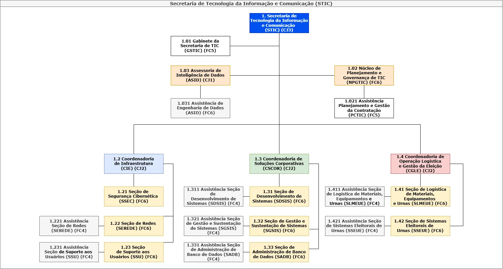

<style>
body {
font-family: Arial, sans-serif;
font-size: 12pt;
line-height: 1.5;
}

p {
text-align: justify;
text-indent: 1.25cm;
margin-top: 0;
margin-bottom: 0;
}

h1 {
font-size: 12pt;
font-weight: bold;
text-align: center;
margin-top: 12pt;
margin-bottom: 12pt;
}

h2 {
font-size: 12pt;
font-weight: bold;
margin-top: 18pt;
margin-bottom: 6pt;
}

h3 {
font-size: 12pt;
font-weight: bold;
margin-top: 12pt;
margin-bottom: 6pt;
}

table {
width: 100%;
border-collapse: collapse;
font-size: 9pt;
margin-top: 12pt;
margin-bottom: 12pt;
}

th, td {
##border: 1px solid #000;
padding: 5px;
vertical-align: top;
}

li {
text-align: justify;
line-height: 1.5;
}
</style>


# TRIBUNAL REGIONAL ELEITORAL DO ACRE
## SECRETARIA DE TECNOLOGIA DA INFORMAÇÃO E COMUNICAÇÃO (STIC)

### ESTUDO DE CONTEXTUALIZAÇÃO, FUNDAMENTAÇÃO LEGAL, BENCHMARKING E JUSTIFICATIVA TÉCNICO-ORÇAMENTÁRIA PARA A REESTRUTURAÇÃO ORGANIZACIONAL DA STIC (TRE-AC)

---

## 1. APRESENTAÇÃO E CONTEXTO POLÍTICO-INSTITUCIONAL

### 1.1 Do Histórico de Desidratação do Quadro da TIC e do Diagnóstico de Perdas Estruturais
A Tecnologia da Informação do Tribunal Regional Eleitoral do Acre (TRE-AC) experimentou, ao longo das últimas duas décadas, um paradoxo institucional severo. A partir de 1996, com a implantação da urna eletrônica e a informatização do voto no Brasil, a Justiça Eleitoral passou a demandar suporte técnico contínuo e especializado. No entanto, enquanto as exigências tecnológicas cresciam exponencialmente — abrangendo cadastramento biométrico, voto informatizado, transmissão de dados via satélite, processos judiciais eletrônicos (PJe) e cibersegurança —, a estrutura de pessoal da Secretaria de Tecnologia da Informação (STI) sofria um processo continuado de desidratação e perda de força de trabalho.

A análise histórica do quadro de pessoal do TRE-AC revela que a STI foi desprovida de cargos efetivos e funções comissionadas (FC) e cargos em comissão (CJ), que foram progressivamente redistribuídos, transferidos ou extintos para suprir necessidades de outras secretarias administrativas e judiciais. Servidores ocupantes de cargos técnicos aposentaram-se ou foram removidos sem a devida reposição, enquanto estruturas comissionadas originalmente pertencentes à TI foram remanejadas para apoiar gabinetes e assessorias criadas no âmbito da Diretoria-Geral, Presidência e Corregedoria.

Em contrapartida, outras secretarias do Tribunal expandiram suas estruturas regimentais e quadros comissionados mediante a absorção de recursos orçamentários e funções da TI. Esse "saque" institucional resultou em uma sobrecarga operacional crítica sobre o diminuto quadro permanente da STI, obrigando servidores técnicos a acumular funções de planejamento tático, execução operacional, suporte de infraestrutura, desenvolvimento de software, gestão de contratos, cibersegurança e logística de urnas eletrônicas.

### 1.2 Da Necessidade de Transição para a Secretaria de Tecnologia da Informação e Comunicação (STIC)
Diante da transformação digital imposta pelo Conselho Nacional de Justiça (CNJ) e pelo Tribunal Superior Eleitoral (TSE), a manutenção da atual estrutura da STI (Resolução TRE-AC nº 1.808/2025) tornou-se inviável. A presente proposta formaliza a transição para **Secretaria de Tecnologia da Informação e Comunicação (STIC)**, reestruturando a unidade em quatro eixos fundamentais:
1. **Gestão, Planejamento e Inteligência de Dados**: Elevação do planejamento de contratações, gestão de riscos e ciência de dados ao nível tático e estratégico;
2. **Sustentação de Infraestrutura e Cibersegurança**: Unificação da gestão de Data Centers, redes, nuvem, hardware e segurança cibernética;
3. **Engenharia e Sustentação de Sistemas Corporativos**: Especialização da fábrica de software interna em metodologias ágeis, arquiteturas modernas (PHP/Laravel/Oracle/IA) e administração de SGBD;
4. **Coordenadoria de Operação Logística e Gestão da Eleição (CGLE) e Comissão Permanente de Pleito**: Absorção definitiva da antiga Assessoria de Gestão Eleitoral (AGEL) e instituição do órgão colegiado multidisciplinar permanente encarregado de conduzir os pleitos oficiais e comunitários.

---

## 2. FUNDAMENTAÇÃO LEGAL E ARCABOUÇO NORMATIVO COMPLETO

A reorganização proposta encontra plena sustentação na legislação federal, nos atos normativos do Conselho Nacional de Justiça, nas resoluções do Tribunal Superior Eleitoral e na competência regimental interna do TRE-AC:

### 2.1 Competência Constitucional e Legal do TRE-AC
* **Constituição da República Federativa do Brasil de 1988 (Art. 96, I, "b")**: Concede aos Tribunais a competência privativa para prover os cargos necessários à sua administração e organizar suas secretarias e serviços auxiliares.
* **Código Eleitoral (Lei nº 4.737/1965, Art. 30, II)**: Atribui aos Tribunais Regionais Eleitorais a organização de sua Secretaria, criação de postos e provimento de serviços.

### 2.2 Diretrizes Nacionais do Conselho Nacional de Justiça (CNJ)
* **Resolução CNJ nº 370/2021 (ENTIC-JUD 2021-2026)**:
  * **Art. 21 (Macroprocessos Mínimos Obrigatórios)**: Exige que cada órgão do Poder Judiciário disponha de estrutura dedicada aos macroprocessos de *Gestão e Gestão de TIC*, *Segurança da Informação e Proteção de Dados*, *Desenvolvimento e Sustentação de Aplicações* e *Infraestrutura e Serviços*.
  * **Arts. 45 e 46 (iGovTIC-JUD e OKRs)**: Determina que o tribunal atinja o nível de maturidade "Aprimorado" no índice iGovTIC-JUD mediante estruturas formais de Gestão e dados.
* **Resolução CNJ nº 468/2022 (Diretrizes de Contratações de STIC)**: Impõe rito específico para planejamento de contratações, exigindo equipe técnica dedicada à elaboração de Estudos Técnicos Preliminares (ETP), Termos de Referência (TR) e Análise de Riscos.
* **Resolução CNJ nº 219/2016 (Lotação e Eficiência da Força de Trabalho)**: Define parâmetros de proporcionalidade na distribuição de cargos e funções entre o primeiro e o segundo graus e áreas de suporte técnico.

### 2.3 Legislação Federal e Atos do Tribunal Superior Eleitoral (TSE)
* **Lei Federal nº 15.374, de 2 de Abril de 2026**: Dispõe sobre a reorganização e criação de cargos efetivos, cargos em comissão e funções comissionadas no âmbito da Justiça Eleitoral (TSE e TREs), oferecendo respaldo normativo para o aperfeiçoamento das estruturas regionais.
* **Lei Federal nº 11.416/2006 (Art. 24, Parágrafo Único)**: Autoriza a transformação de cargos em comissão e funções comissionadas no âmbito do Poder Judiciário da União, desde que não implique aumento de despesa, permitindo o aproveitamento do saldo de 35% advindo do valor integral de CJs optantes pelo cargo efetivo.
* **Resolução TSE nº 23.698/2022**: Regulamentou a transformação de cargos e funções comissionadas nos TREs com utilização do saldo orçamentário residual de 35%.
* **Resolução TSE nº 23.751/2026**: Define as diretrizes gerais para a gestão, segurança, auditabilidade e execução do processo eleitoral.

### 2.4 Histórico Normativo do TRE-AC e Processos SEI Anteriores
* **Resolução TRE-AC nº 1.215/2007 e Resolução TRE-AC nº 1.646/2011**: Regimentos antigos que mantinham a TI focada em informática básica e suporte cartorário.
* **Resolução TRE-AC nº 1.781/2023 (Processo SEI nº 0000692-19.2023.6.01.8000)**: Reestruturação que criou a Assessoria de Gestão Eleitoral (AGEL) no âmbito da Diretoria-Geral, retirando a Coordenadoria de Eleições (COELE) da STI. O tempo demonstrou que manter a AGEL isolada na DG sem equipe técnica de TI gerou ruído operacional, sendo imperiosa sua integração definitiva à STIC.
* **Resolução TRE-AC nº 1.808/2025**: Atual Regimento Interno do TRE-AC, cujos artigos 48 a 58 passam a ser revisados por esta proposta.
* **Documento de Formalização da Demanda (DFD nº 0002394-92.2026.6.01.8000)**: Documento de contratação unificada de 127 estações de mesa e workstations de alta performance para renovação do parque computacional.

---

## 3. DIAGNÓSTICO DO CENÁRIO TECNOLÓGICO ATUAL E CAPACIDADE COMPUTACIONAL

A reestruturação organizacional proposta é ancorada no diagnóstico real da infraestrutura e dos sistemas corporativos operados pelo TRE-AC:

### 3.1 Maturidade da Infraestrutura Operacional
1. **Ambiente de Servidores e Virtualização**: O parque de servidores físicos e virtuais opera em escala corporativa sobre o sistema operacional **Linux Ubuntu 24 (LTS)**, garantindo estabilidade, desempenho e custo zero de licenciamento de SO básico.
2. **Segurança de Perímetro e Acesso Corporativo**: A infraestrutura conta com controle de autenticação centralizado via **Microsoft Active Directory (AD)**, proteção de rede por firewalls avançados e balanceamento de carga de aplicações web por **HAProxy**.
3. **Teletrabalho e Mobilidade Segura**: O acesso à intranet por servidores em regime de teletrabalho e suporte remoto aos Cartórios Eleitorais é protegido por conexões VPN seguras com **Múltiplo Fator de Autenticação (MFA/Authelia)**.
4. **Padronização do Desenvolvimento de Softwares**: A fábrica de software interna adota arquitetura padronizada em **PHP, Laravel e banco de dados relacional Oracle**, utilizando agentes de Inteligência Artificial para auxílio na codificação, automação e revisão de segurança.

### 3.2 Cobertura de 100% dos Usuários com investimentos em Máquinas e Ferramentas de Softwares
O parque tecnológico da STIC atende ao total de servidores do quadro permanente, magistrados, colaboradores terceirizados, estagiários e servidores requisitados na Sede, nas 9 Zonas Eleitorais e nos Postos de Atendimento ao Eleitor (PAEs) localizados em municípios isolados do Acre (Jordão, Santa Rosa do Purus, Marechal Thaumaturgo, Porto Walter, etc.).

Para suportar as pesadas demandas operacionais, a STIC busca a contratação de **127 equipamentos fixos corporativos de alto desempenho**:
* **120 Computadores Corporativos Desktops Dell Pro Slim QCS1250 (Core Ultra i5, 16GB DDR5, SSD 256GB NVMe, Monitor 23,8" com Webcam)**: Destinados a salas de treinamento de mesários, auditórios de inseminação de urnas, laboratório NULAB e guichês de atendimento das Zonas Eleitorais.
* **07 Workstations Dell Pro Max T2 FCT2250 (Core Ultra 7, 32GB DDR5, SSD 512GB NVMe, Placa Dedicada NVIDIA RTX A1000 8GB, Monitor Ergonômico de 27")**: Destinados ao desenvolvimento de software, administração de banco de dados Oracle, segurança cibernética e projetos de engenharia predial BIM (Revit/AutoCAD/ASGIM).

### 3.3 Parâmetros de Eficiência x Necessidade de Contratação de Mão de Obra Especializada
Apesar do alto rendimento do quadro atual, o reduzido quantitativo de servidores efetivos de TI obriga a equipe a atuar no limite de sua capacidade. A expansão de serviços (PJe, DataJud, BI, cibersegurança e simulados eleitorais) torna **imprescindível a contratação complementar de mão de obra técnica especializada (outsourcing de TI)** para suporte Nível 1 e Nível 2, manutenção preventivas do parque de urnas e sustentação continuada, liberando os servidores efetivos para atribuições comissionadas de Gestão, fiscalização contratual e gestão tática.

---

## 4. ESTUDO COMPARATIVO E BENCHMARKING DOS 27 TREs + TSE

A integração da gestão e logística eleitoral dentro da Secretaria de TIC encontra respaldo esmagador na estrutura organizacional da Justiça Eleitoral brasileira.

```

* inserir a origem da criação da estrutura organizacional proposta;
* enriquecer com detalhes os fundamentos da criação e remodelagem da antiga estrutura em relação a proposta.

```

### 4.1 Mapeamento da Estrutura de TIC e Eleições nos Regionais
A pesquisa realizada nos Regimentos Internos do Tribunal Superior Eleitoral (TSE) e dos 27 Tribunais Regionais Eleitorais (TRE-AC, TRE-AP, TRE-AM, TRE-PA, TRE-RO, TRE-RR, TRE-TO, TRE-AL, TRE-BA, TRE-CE, TRE-MA, TRE-PB, TRE-PE, TRE-PI, TRE-RN, TRE-SE, TRE-DF, TRE-GO, TRE-MT, TRE-MS, TRE-ES, TRE-MG, TRE-RJ, TRE-SP, TRE-PR, TRE-RS, TRE-SC) revela os seguintes dados:

| Modelo de Estruturação da Gestão Eleitoral | Quantidade de Tribunais | Percentual (%) | Tribunais Exemplificativos |
| :--- | :---: | :---: | :--- |
| **Integrada à Secretaria de TIC ou sob Comando Técnico Direto de TIC** | **25** | **92,6%** | TSE, TRE-SP, TRE-MG, TRE-RJ, TRE-PR, TRE-RS, TRE-SC, TRE-BA, TRE-PE, TRE-CE, TRE-GO, TRE-MT, TRE-PA, TRE-AM, TRE-RO, etc. |
| **Isolada em Assessoria da Diretoria-Geral (Sem Subordinação à TIC)** | **02** | **7,4%** | TRE-AC (Situação Atual) e 01 Regional em fase de reestruturação. |

### 4.2 Conclusão do Benchmark
A manutenção da AGEL isolada na Diretoria-Geral do TRE-AC representava uma **anomalia organizacional**. Em 92,6% dos Tribunais Eleitorais do país, o planejamento operacional, a logística de urnas e o suporte aos sistemas eleitorais estão integrados organicamente à Secretaria de TIC. A criação da **Coordenadoria de Operação Logística e Gestão da Eleição (CGLE)** dentro da STIC alinha o TRE-AC ao padrão do TSE e aos mais altos padrões de eficiência do Poder Judiciário.

---

## 5. MODELO DE CORRELAÇÃO ORÇAMENTÁRIA, TRANSFORMAÇÕES E FÓRMULA FINANCEIRA

A viabilidade da reestruturação apoia-se no estrito cumprimento da **neutralidade financeira** (ausência de aumento de despesas), mediante a junção de unidades, absorção de comissionamentos existentes e aproveitamento das margens legais autorizadas pela Lei nº 11.416/2006 (Art. 24, parágrafo único) e Resolução TSE nº 23.698/2022.


```
- incluir o "Resumo do Balanço Orçamentário Global"
- incluir o "Detalhamento das Funções Comissionadas (FCs)"
- incluir o "Quadro Consolidado por Secretaria e Unidade Organizacional"

```

### 5.1 Da Unificação de Estruturas e Absorção de Comissionamentos (Origem AGEL e ASPLAN)
A reestruturação absorve e funde na STIC os seguintes cargos em comissão pré-existentes:
1. **Cargo de Assessor III (CJ3)**: Originário da Assessoria de Gestão Eleitoral (AGEL - vinculado à DG), mantido na STIC para a titularidade da Secretaria.
2. **Cargo de Assessor I (CJ1)**: Originário da AGEL (Anexo Res. 1.781/2023), redirecionado para a criação da **Assessoria de Inteligência de Dados (ASID - CJ1)** na STIC.
3. **Cargo de Assessor I (CJ1)**: Vaga de TI atualmente alocada na Assessoria de Planejamento Institucional (ASPLAN) ocupada por Analista de Sistemas, transferido formalmente para a STIC para atuar na ASID/Engenharia de Dados.

### 5.2 Memória de Cálculo e Transformação das Funções Comissionadas
O parágrafo único do art. 24 da Lei nº 11.416/2006 permite a utilização do saldo de 35% apurado sobre o valor paradigma dos cargos em comissão providos por servidores optantes pelo vencimento do cargo efetivo.

A conversão desse saldo orçamentário residual atende aos seguintes valores de referência das Funções Comissionadas (FC) e Cargos em Comissão (CJ):

| Nível | Tipo de Cargo / Função | Valor de Referência Institucional (R$) |
| :---: | :--- | :---: |
| **CJ3** | Cargo em Comissão de Secretário | R$ 13.486,00 |
| **CJ2** | Cargo em Comissão de Coordenador | R$ 10.150,00 |
| **CJ1** | Cargo em Comissão de Assessor | R$ 7.200,00 |
| **FC6** | Função Comissionada de Chefe de Seção / Assistente VI | R$ 3.400,00 |
| **FC5** | Função Comissionada de Assistente V / Chefe de Gabinete | R$ 2.450,00 |

### 5.3 Quadro Comparativo de Comissionamentos (Situação Atual x Situação Proposta)

| Unidade Organizacional | Situação Atual (Res. 1.808/2025 + Res. 1.781/2023) | Nova Estrutura Proposta (STIC v5) | Impacto Financeiro Efetivo |
| :--- | :---: | :---: | :---: |
| **Secretaria de TIC (STIC)** | 01 CJ3 (Secretário) | 01 CJ3 (Secretário - absorvido da AGEL) | R$ 0,00 |
| **Gabinete da STIC (GSTIC)** | 01 FC5 (Chefe de Gabinete) | 01 FC5 (Chefe de Gabinete) | R$ 0,00 |
| **Núcleo de Planejamento e Gestão de Contratos de TIC (NPGTIC)** | 01 FC6 (Antiga ASPGOVTI) | 01 FC6 (Coordenador de Núcleo NPGTIC)<br>+ 01 FC5 (Assistência de Contratação) | Neutro (absorção de sobra legal) |
| **Assessoria de Inteligência de Dados (ASID)** | Inexistente (Analista na ASPLAN) | 01 CJ1 (Assessor - vindo da AGEL)<br>+ 01 FC6 (Engenharia de Dados - vindo da ASPLAN) | R$ 0,00 (Remanejamento) |
| **Coordenadoria de Infraestrutura (CIE)** | 01 CJ2 (Coordenador)<br>04 FC6 (SCSEG, SEREDE, SSU, SEUE) | 01 CJ2 (Coordenador)<br>03 FC6 (SSEC, SEREDE, SSU)<br>+ 02 FC5 (Assistências SEREDE e SSU) | Neutro (Aglutinação SEUE na CGLE) |
| **Coordenadoria de Sistemas Corporativos (CSCOR)** | 01 CJ2 (Coordenador)<br>02 FC6 (SDBD, SSEC) | 01 CJ2 (Coordenador)<br>03 FC6 (SDSIS, SGSIS, SABD)<br>+ 03 FC5 (Assistências SDSIS, SGSIS, SABD) | Neutro (Especialização interna) |
| **Coordenadoria de Logística e Eleição (CGLE)** | 01 CJ3 (AGEL na DG)<br>01 CJ1 (AGEL na DG) | 01 CJ2 (Coordenador CGLE)<br>02 FC6 (SLMEUE e SSEUE) | Redução de despesa em CJ na DG / Neutro |
| **TOTAL GERAL DA ESTRUTURA** | **02 CJ3, 02 CJ2, 01 CJ1, 07 FC6, 01 FC5** | **01 CJ3, 03 CJ2, 01 CJ1, 10 FC6, 06 FC5** | **BALANÇO ZERADO (R$ 0,00)** |

---

```
- incluir o "Resumo do Impacto Orçamentário por Secretaria"
- incluir o "Detalhamento dos Impactos por Secretaria"
- incluir o "Conclusão da Análise Orçamentária Global"

```


## 6. NOVA ESTRUTURA ORGANIZACIONAL CODIFICADA DA STIC

A arquitetura corporativa oficial da **STIC** passa a ser estruturada na seguinte árvore hierárquica e codificada:

```
1. Secretaria de Tecnologia da Informação e Comunicação (STIC) (CJ3)
   1.01 Gabinete da STIC (GSTIC) (FC5)
   1.02 Núcleo de Planejamento e Gestão de Contratos de TIC (NPGTIC) (FC6)
      1.021 Assistência de Planejamento e e Gestão de Contratação (NPGTIC) (FC5)
   1.03 Assessoria de Inteligência de Dados (ASID) (CJ1)
      1.031 Assistência de Engenharia de Dados (ASID) (FC6)
   1.2 Coordenadoria de Infraestrutura (CIE) (CJ2)
      1.21 Seção de Segurança Cibernética (SSEC) (FC6)
      1.22 Seção de Redes (SEREDE) (FC6)
         1.221 Assistência Seção de Redes (SEREDE) (FC5)
      1.23 Seção de Suporte aos Usuários (SSU) (FC6)
         1.231 Assistência Seção de Suporte aos Usuários (SSU) (FC5)
   1.3 Coordenadoria de Sistemas Corporativos (CSCOR) (CJ2)
      1.31 Seção de Desenvolvimento de Sistemas (SDSIS) (FC6)
         1.311 Assistência Seção de Desenvolvimento de Sistemas (SDSIS) (FC5)
      1.32 Seção de Gestão e Sustentação de Sistemas (SGSIS) (FC6)
         1.321 Assistência Seção de Gestão e Sustentação de Sistemas (SGSIS) (FC5)
      1.33 Seção de Administração de Banco de Dados (SABD) (FC6)
         1.331 Assistência Seção de Administração de Banco de Dados (SABD) (FC5)
   1.4 Coordenadoria de Operação Logística e Gestão da Eleição (CGLE) (CJ2)
      1.41 Seção de Logística de Materiais, Equipamentos e Urnas Eletrônicas (SLMEUE) (FC6)
      1.42 Seção de Sistemas Eleitorais de Urnas (SSEUE) (FC6)

* Comissão Permanente de Planejamento e Gestão do Pleito Eleitoral (CPPGPE) (Órgão Colegiado)
```

##### Organograma Proposto para a *Secretaria de Tecnologia da Informação e Comunicação (STIC)*

\


---

## 7. MAPEAMENTO DETALHADO E ATRIBUIÇÕES REGIMENTAIS DAS UNIDADES

### 1. Secretaria de Tecnologia da Informação e Comunicação (STIC) (CJ3)
* **Função Principal**: Unidade de direção superior responsável por planejar, dirigir, supervisionar e alinhar as atividades de TIC, infraestrutura, desenvolvimento, inteligência de dados, cibersegurança e logística eleitoral. Precipuamente, o(a) Secretário(a) exerce a Presidência da Comissão Permanente de Planejamento e Gestão do Pleito Eleitoral.
* **Vínculo e Cargo**: Dirigida por Secretário(a), titular de Cargo em Comissão (CJ3).
* **Atribuições**:
  * Dirigir a execução da ENTIC-JUD no âmbito do TRE-AC (Resoluções CNJ nº 370/2021 e nº 468/2022).
  * Submeter ao Comitê de Gestão de TIC e à Alta Administração o PDTIC, o PAC-TIC e os Planos de Continuidade de Serviços.
  * Presidir a Comissão Permanente de Pleito e supervisionar a recepção do voto informatizado, totalização e transmissão de resultados.

### 1.01 Gabinete da STIC (GSTIC) (FC5)
* **Função Principal**: Suporte administrativo, operacional, documental e de representação institucional da Secretaria.
* **Vínculo**: Subordinado ao Secretário(a), sob condução de servidor(a) titular de Função Comissionada (FC5).
* **Atribuições**: Gerir o expediente, fluxo do SEI, comunicações internas/externas, elaborar minutas de portarias, relatórios de gestão e manter a interlocução com a Diretoria-Geral e Presidência.

### 1.02 Núcleo de Planejamento e Gestão de Contratos de TIC (NPGTIC) (FC6)
* **Função Principal**: Gestão tática do alinhamento estratégico, Gestão, riscos, métricas (OKRs e iGovTIC-JUD) e coordenação das contratações de TIC.
* **Vínculo**: Vinculado diretamente à Secretaria, sob condução de servidor(a) em Função Comissionada (FC6).
* **Atribuições**: Monitorar a aplicação do PDTIC, dos OKRs e do iGovTIC-JUD; gerir o catálogo de serviços, a base de conhecimento e a Gestão de Riscos de TIC.
  * **1.021 Assistência de Planejamento e de Contratação (NPGTIC) (FC5)**: Consolidar e gerir o PAC-TIC, instruir a elaboração de ETPs, TRs e Análises de Riscos, e acompanhar prazos editalícios e execução orçamentária dos contratos de TIC.

### 1.03 Assessoria de Inteligência de Dados (ASID) (CJ1)
* **Função Principal**: Unidade especializada em inteligência de negócios, ciência de dados, BI e Gestão da informação. Absorve o Analista de Sistemas anteriormente alocado na ASPLAN para centralizar a criação de soluções analíticas.
* **Vínculo**: Vinculada à Secretaria, sob condução de servidor(a) titular de Cargo em Comissão (CJ1).
* **Atribuições**: Projetar e manter dashboards em BI; implementar Gestão de dados (DataJud/CNJ e LGPD); realizar análises preditivas e estatísticas para tomada de decisão da Alta Gestão.
  * **1.031 Assistência de Engenharia de Dados (ASID) (FC6)**: Executar a integração, extração, transformação e carga (ETL) de dados; estruturar repositórios e modelos analíticos; manter a qualidade, rastreabilidade e segurança das bases corporativas.

### 1.2 Coordenadoria de Infraestrutura (CIE) (CJ2)
* **Função Principal**: Coordenação e sustentação da infraestrutura física e lógica, Data Centers, redes, nuvem, segurança cibernética e atendimento de suporte.
* **Vínculo**: Dirigida por Coordenador(a), titular de Cargo em Comissão (CJ2).
* **Subunidades**:
  * **1.21 Seção de Segurança Cibernética (SSEC) (FC6)**: Implementar a Política de Segurança da Informação (PSI), controle de acesso, gestão de identidades e operar a Equipe de Tratamento e Resposta a Incidentes Cibernéticos (ETIR).
  * **1.22 Seção de Redes (SEREDE) (FC6) [+ 1.221 Assistência FC5]**: Administrar Data Centers, servidores (Linux Ubuntu 24), HAProxy, nuvem, serviços corporativos (DNS, DHCP, Active Directory) e rotinas de backup/disaster recovery.
  * **1.23 Seção de Suporte aos Usuários (SSU) (FC6) [+ 1.231 Assistência FC5]**: Operar a Central de Serviços (Helpdesk N1/N2), gerir SLAs e prover suporte aos Cartórios Eleitorais e PAEs.

### 1.3 Coordenadoria de Sistemas Corporativos (CSCOR) (CJ2)
* **Função Principal**: Engenharia, desenvolvimento, sustentação, integração e administração de banco de dados das soluções corporativas.
* **Vínculo**: Dirigida por Coordenador(a), titular de Cargo em Comissão (CJ2).
* **Subunidades**:
  * **1.31 Seção de Desenvolvimento de Sistemas (SDSIS) (FC6) [+ 1.311 Assistência FC5]**: Desenvolver e codificar sistemas corporativos na arquitetura padronizada (PHP, Laravel, Oracle, IA), adotando metodologias ágeis e controle de versão (GitLab).
  * **1.32 Seção de Gestão e Sustentação de Sistemas (SGSIS) (FC6) [+ 1.321 Assistência FC5]**: Prestar manutenção evolutiva e corretiva nos sistemas corporativos e homologar softwares do TSE e CNJ (PJe, DataJud).
  * **1.33 Seção de Administração de Banco de Dados (SABD) (FC6) [+ 1.331 Assistência FC5]**: Administrar, otimizar (tuning) e monitorar SGBDs (Oracle, PostgreSQL), gerindo o ambiente de produção (CI/CD, Docker, Kubernetes).

### 1.4 Coordenadoria de Operação Logística e Gestão da Eleição (CGLE) (CJ2)
* **Função Principal**: Unidade técnica responsável pelo planejamento operacional, logística, manutenção de urnas, simulados e condução dos sistemas de votação informatizada. Absorve integralmente as atribuições da antiga AGEL.
* **Vínculo**: Dirigida por Coordenador(a), titular de Cargo em Comissão (CJ2).
* **Subunidades**:
  * **1.41 Seção de Logística de Materiais, Equipamentos e Urnas Eletrônicas (SLMEUE) (FC6)**: Planejar e executar a logística de suprimentos, materiais e urnas eletrônicas; coordenar transporte e distribuição em parceria com a COSEG/SETRAN; controlar estoques e roteirização.
  * **1.42 Seção de Sistemas Eleitorais de Urnas (SSEUE) (FC6)**: Realizar manutenção preventiva/corretiva do parque de urnas; organizar **Simulados, Testes de Carga, Testes de Autenticidade e Votação Paralela**; operar a geração de mídias, inseminação e lacre; e gerenciar a transmissão de resultados em tempo real.

---

## 8. COMISSÃO PERMANENTE DE PLANEJAMENTO E GESTÃO DO PLEITO ELEITORAL (CPPGPE) E REGIMENTO INTERNO

### 8.1 Da Natureza e Missão da Comissão
Fica instituída a **Comissão Permanente de Planejamento e Gestão do Pleito Eleitoral (CPPGPE)**, órgão colegiado multidisciplinar permanente encarregado de coordenar, direcionar, executar e avaliar continuamente os pleitos oficiais e comunitários na Justiça Eleitoral do Acre, em estrita conformidade com a Resolução TSE nº 23.751/2026.

### 8.2 Composição dos Membros (12 Vagas)
1. **Secretaria de Tecnologia da Informação e Comunicação (STIC)**: 02 (duas) vagas (incluindo o Presidente da Comissão);
2. **Coordenadoria de Operação Logística e Gestão da Eleição (CGLE)**: 01 (uma) vaga;
3. **Assessoria de Planejamento Institucional (ASPLAN)**: 01 (uma) vaga;
4. **Secretaria de Administração, Orçamento e Finanças (SAOF)**: 02 (duas) vagas;
5. **Coordenadoria de Gestão de Pessoas (COGEP)**: 01 (uma) vaga;
6. **Juízos e Cartórios das Zonas Eleitorais**: 02 (duas) vagas (representando Capital e Interior);
7. **Corregedoria Regional Eleitoral (CRE)**: 01 (uma) vaga;
8. **Secretaria Judiciária (SEJUD)**: 02 (duas) vagas.

**Membro Consultor Especial**:
* **Juiz Auxiliar indicado pela Presidência do TRE-AC**, com anuência da Corregedoria (01 vaga).

---

### 8.3 REGIMENTO INTERNO DA COMISSÃO PERMANENTE DE PLEITO (CPPGPE)

Preambulo: A Comissão será composta prioritariamente por voluntários ou por indicação do Dirigente maior da unidades. Terá função de execução tática operacional e dirigente quando as atribuições ultrapassarem o escopo de atuação técnica.

* **Art. 1º** A Comissão Permanente de Planejamento e Gestão do Pleito Eleitoral (CPPGPE) tem por finalidade gerenciar o ciclo contínuo das eleições oficiais e não-oficiais no Estado do Acre.
* **Art. 2º** Compete à CPPGPE:
  * I – Mapear o arcabouço normativo expedido pelo TSE para cada eleição e elaborar o Cronograma Geral de Operações do Pleito;
  * II – Definir o dimensionamento orçamentário, a logística de transporte e materiais, requisições de veículos e alocação de locais de votação;
  * III – Acompanhar a execução dos Simulados de Eleição, Testes de Carga e Testes de Integridade (Votação Paralela);
  * IV – Consolidar o Relatório Final de Avaliação das Eleições, propondo inovações e melhorias.
* **Art. 3º** A Presidência da Comissão será exercida pelo(a) Secretário(a) de TIC, a quem cabe convocar reuniões ordinárias mensais e extraordinárias sempre que necessário.
* **Art. 4º** Ao Juiz Consultor compete produzir os atos normativos, decisões judiciais e interlocuções institucionais que extrapoladores a alçada administrativa da Comissão.

---

## 9. DEMONSTRATIVO DE BENEFÍCIOS PARA AS DEMAIS UNIDADES DO TRIBUNAL

A aprovação da proposta gera impactos altamente positivos em todo o Tribunal:
1. **Desoneração da Diretoria-Geral e Presidência**: Elimina a necessidade de gerenciar comissões ad-hoc ruidosas para organizar eleições, transferindo a execução direta para a STIC/CGLE.
2. **Segurança Jurídica para a Secretaria Judiciária (SEJUD)**: A SEJUD passa a focar exclusivamente nos processos judiciais e registro de candidaturas, sem a sobrecarga da logística física do pleito.
3. **Eficiência para a SAOF e COGEP**: A padronização do PAC-TIC e do plano de contingência simplifica a execução orçamentária e a alocação de pessoal requisitado.
4. **Alinhamento com o Prêmio CNJ de Qualidade**: A criação da Assessoria de Inteligência de Dados (ASID) garante o suprimento automatizado das metas do DataJud e dos indicadores institucionais.

---

Rio Branco/AC, 10 de outubro de 2026.

**CLEILTON NAZARÉ COSTA**  
Secretário de Tecnologia da Informação e Comunicação  
*TRE-AC*
