# TRIBUNAL REGIONAL ELEITORAL DO ACRE

## MINUTA DE RESOLUÇÃO ADMINISTRATIVA Nº ____ / 2026

**PROCESSO SEI Nº:** 0002850-42.2026.6.01.8000  
**INTERESSADO:** Tribunal Regional Eleitoral do Acre (TRE-AC) / Secretaria de Tecnologia da Informação e Comunicação (STIC)  
**ASSUNTO:** Reestruturação Organizacional da Secretaria de Tecnologia da Informação e Comunicação (STIC), absorção das atribuições de Gestão Eleitoral (origem AGEL e ASPLAN), instituição da Comissão Permanente de Planejamento e Gestão do Pleito Eleitoral (CPPGPE), redistribuição sem aumento de despesas de Cargos em Comissão e Funções Comissionadas, e dá outras providências.

---

> **Dispõe sobre a reestruturação da Secretaria de Tecnologia da Informação do Tribunal Regional Eleitoral do Acre, alterando sua denominação para Secretaria de Tecnologia da Informação e Comunicação (STIC), extinguindo a Assessoria de Gestão Eleitoral (AGEL) na Diretoria-Geral e incorporando suas atribuições à Coordenadoria de Operação Logística e Gestão da Eleição (CGLE), criando a Comissão Permanente de Planejamento e Gestão do Pleito Eleitoral (CPPGPE), reorganizando o quadro de Cargos em Comissão e Funções Comissionadas sem aumento de despesas, e alterando as Resoluções TRE-AC nº 1.770/2021, nº 1.781/2023 e nº 1.808/2025.**

---

**O TRIBUNAL REGIONAL ELEITORAL DO ACRE**, no uso das atribuições que lhe são conferidas pelo art. 96, inciso I, alínea "b", da Constituição da República Federativa do Brasil, pelo art. 30, inciso II, do Código Eleitoral (Lei Federal nº 4.737/1965), e pelo art. 17, inciso IV, da Resolução TRE-AC nº 1.720/2017 (Regimento Interno do Tribunal);

**CONSIDERANDO** a necessidade imperiosa de modernizar a governança tecnológica do Tribunal Regional Eleitoral do Acre, elevando a unidade de Tecnologia da Informação ao patamar estipulado pelas diretrizes nacionais de Transformação Digital do Poder Judiciário;

**CONSIDERANDO** as disposições da Resolução CNJ nº 370/2021, que institui a Estratégia Nacional de Tecnologia da Informação e Comunicação do Poder Judiciário (ENTIC-JUD 2021-2026), e fixa a obrigatoriedade da estruturação dos macroprocessos de Governança, Segurança da Informação, Engenharia de Software, Infraestrutura, Inteligência de Dados e Serviços de TIC;

**CONSIDERANDO** as diretrizes da Resolução CNJ nº 468/2022, que regulamenta as contratações de Soluções de Tecnologia da Informação e Comunicação no âmbito do Poder Judiciário, exigindo governança centralizada no Planejamento de Contratações;

**CONSIDERANDO** a Resolução CNJ nº 219/2016, que estabelece diretrizes para a distribuição de força de trabalho e adequação de estruturas organizacionais no primeiro e segundo graus de jurisdição;

**CONSIDERANDO** a autorização legal contida no art. 24, parágrafo único, da Lei Federal nº 11.416/2006, que faculta aos Tribunais a transformação e remanejamento de cargos em comissão e funções comissionadas de seus quadros de pessoal, desde que sem aumento de despesa e dentro dos limites orçamentários fixados;

**CONSIDERANDO** a Resolução TSE nº 23.698/2022 e a Resolução TSE nº 23.751/2026, que dispõem sobre as diretrizes organizacionais do processo eleitoral e a utilização de saldos residuais na transformação de cargos comissionados nos Tribunais Eleitorais;

**CONSIDERANDO** os ditames da Lei Federal nº 15.374, de 2 de abril de 2026, que dispõe sobre o quadro de pessoal e diretrizes de estruturação da Justiça Eleitoral;

**CONSIDERANDO** a constatação histórica de que 92,6% dos Tribunais Regionais Eleitorais do Brasil e o próprio Tribunal Superior Eleitoral possuem a gestão logística, a manutenção de urnas e a sustentação dos sistemas eleitorais integradas organicamente à estrutura da Secretaria de TIC;

**CONSIDERANDO** a necessidade de eliminar a sobrecarga histórica sobre a Secretaria de TIC, unificando a execução técnica à gestão do pleito eleitoral e desonerando as unidades administrativas da Presidência, Diretoria-Geral e Secretaria Judiciária;

**CONSIDERANDO** as premissas do Documento de Formalização da Demanda (DFD) nº 0002394-92.2026.6.01.8000 e os autos do Processo SEI nº 0002850-42.2026.6.01.8000, demonstrando a perfeita viabilidade jurídica, técnica, operacional e a estrita neutralidade orçamentária do projeto;

---

### RESOLVE:

---

### CAPÍTULO I
#### DAS DISPOSIÇÕES PRELIMINARES E DA ALTERAÇÃO DA DENOMINAÇÃO

**Art. 1º** Fica aprovada a reestruturação organizacional da área de Tecnologia da Informação do Tribunal Regional Eleitoral do Acre, cuja unidade de direção superior passa a ser denominada **Secretaria de Tecnologia da Informação e Comunicação (STIC)**.

**Art. 2º** Fica extinta a Assessoria de Gestão Eleitoral (AGEL), unidade de assessoria vinculada à Diretoria-Geral criada pela Resolução TRE-AC nº 1.781/2023, sendo suas atribuições, competências, acervo documental e de projetos integralmente absorvidos pela Secretaria de Tecnologia da Informação e Comunicação (STIC).

**Parágrafo único.** O cargo em comissão de Assessor III (CJ3) e a vaga de Assessor I (CJ1) da antiga AGEL ficam remanejados e incorporados à estrutura da STIC, na forma do Anexo II desta Resolução.

**Art. 3º** Fica remanejada para a STIC 01 (uma) vaga de Assessor I (CJ1) proveniente da Assessoria de Planejamento Institucional (ASPLAN), destinada ao provimento e liderança da área de Inteligência de Dados do Tribunal.

---

### CAPÍTULO II
#### DA ESTRUTURA ORGÂNICA DA SECRETARIA DE TECNOLOGIA DA INFORMAÇÃO E COMUNICAÇÃO (STIC)

**Art. 4º** A Secretaria de Tecnologia da Informação e Comunicação (STIC) passa a ser composta pelas seguintes unidades organizacionais e subunidades codificadas:

**1. Secretaria de Tecnologia da Informação e Comunicação (STIC)** (CJ3)  
   **1.01 Gabinete da STIC (GSTIC)** (FC5)  
   **1.02 Núcleo de Planejamento e Governança de TIC (NPGTIC)** (FC6)  
      **1.021 Assistência de Planejamento e de Contratação (NPGTIC)** (FC5)  
   **1.03 Assessoria de Inteligência de Dados (ASID)** (CJ1)  
      **1.031 Assistência de Engenharia de Dados (ASID)** (FC6)  
   **1.2 Coordenadoria de Infraestrutura (CIE)** (CJ2)  
      **1.21 Seção de Segurança Cibernética (SSEC)** (FC6)  
      **1.22 Seção de Redes (SEREDE)** (FC6)  
         **1.221 Assistência Seção de Redes (SEREDE)** (FC5)  
      **1.23 Seção de Suporte aos Usuários (SSU)** (FC6)  
         **1.231 Assistência Seção de Suporte aos Usuários (SSU)** (FC5)  
   **1.3 Coordenadoria de Sistemas Corporativos (CSCOR)** (CJ2)  
      **1.31 Seção de Desenvolvimento de Sistemas (SDSIS)** (FC6)  
         **1.311 Assistência Seção de Desenvolvimento de Sistemas (SDSIS)** (FC5)  
      **1.32 Seção de Gestão e Sustentação de Sistemas (SGSIS)** (FC6)  
         **1.321 Assistência Seção de Gestão e Sustentação de Sistemas (SGSIS)** (FC5)  
      **1.33 Seção de Administração de Banco de Dados (SABD)** (FC6)  
         **1.331 Assistência Seção de Administração de Banco de Dados (SABD)** (FC5)  
   **1.4 Coordenadoria de Operação Logística e Gestão da Eleição (CGLE)** (CJ2)  
      **1.41 Seção de Logística de Materiais, Equipamentos e Urnas Eletrônicas (SLMEUE)** (FC6)  
      **1.42 Seção de Sistemas Eleitorais de Urnas (SSEUE)** (FC6)  

---

### CAPÍTULO III
#### DA COMISSÃO PERMANENTE DE PLANEJAMENTO E GESTÃO DO PLEITO ELEITORAL (CPPGPE)

**Art. 5º** Fica instituída a **Comissão Permanente de Planejamento e Gestão do Pleito Eleitoral (CPPGPE)**, órgão colegiado multidisciplinar responsável pela direção, acompanhamento, coordenação técnica e avaliação continuada da organização das eleições oficiais e comunitárias no Estado do Acre.

**§ 1º** A Comissão Permanente de Pleito possui caráter permanente e atua em consonância com a Resolução TSE nº 23.751/2026 e atos normativos correlatos da Justiça Eleitoral.

**§ 2º** A Presidência da Comissão Permanente de Pleito será exercida pelo(a) titular da **Secretaria de Tecnologia da Informação e Comunicação (STIC)**.

**Art. 6º** A Comissão Permanente de Planejamento e Gestão do Pleito Eleitoral será composta por 12 (doze) membros titulares, na seguinte conformidade:

I – 02 (dois) representantes da Secretaria de Tecnologia da Informação e Comunicação (STIC), sendo um deles o Presidente da Comissão;  
II – 01 (um) representante da Coordenadoria de Operação Logística e Gestão da Eleição (CGLE);  
III – 01 (um) representante da Assessoria de Planejamento Institucional (ASPLAN);  
IV – 02 (dois) representantes da Secretaria de Administração, Orçamento e Finanças (SAOF);  
V – 01 (um) representante da Coordenadoria de Gestão de Pessoas (COGEP);  
VI – 02 (dois) representantes dos Juízos e Cartórios Eleitorais (sendo 1 da Capital e 1 do Interior);  
VII – 01 (um) representante da Corregedoria Regional Eleitoral (CRE);  
VIII – 02 (dois) representantes da Secretaria Judiciária (SEJUD).  

**§ 1º** Atuará como Membro Consultor da Comissão 01 (um) Juiz Auxiliar indicado pela Presidência do Tribunal, com a anuência da Corregedoria Regional Eleitoral.

**§ 2º** Caberá ao Juiz Auxiliar Consultor a emissão de pareceres institucionais, expedição de atos normativos e interlocuções que exorbitem a alçada estritamente administrativa da Comissão.

**Art. 7º** Compete à Comissão Permanente de Planejamento e Gestão do Pleito Eleitoral:

I – Mapear o regramento legal e normativo expedido pelo TSE para cada eleição, elaborando o Plano Integrado das Eleições;  
II – Definir o Cronograma Geral de Operações do Pleito, fixando prazos, metas e necessidades de contratações, transporte e requisição de pessoal;  
III – Articular convênios, cessão de prédios públicos e logística de transporte terrestre, fluvial e aéreo para locais de votação de difícil acesso;  
IV – Consolidar o Relatório Final de Avaliação do Pleito, propondo inovações tecnológicas e organizacionais para as eleições subsequentes;  
V – Deliberar sobre os planos de contingência e segurança no dia da votação.

---

### CAPÍTULO IV
#### DA REORGANIZAÇÃO DOS CARGOS EM COMISSÃO E FUNÇÕES COMISSIONADAS

**Art. 8º** Em cumprimento ao disposto no art. 24, parágrafo único, da Lei Federal nº 11.416/2006, fica aprovada a reorganização dos Cargos em Comissão (CJ) e Funções Comissionadas (FC) da STIC, mediante aproveitamento de saldos de transformação, sem qualquer acréscimo de despesas para o Tribunal.

**Art. 9º** Os Cargos em Comissão (CJ) da STIC ficam estruturados na seguinte conformidade:

I – 01 (um) Cargo em Comissão de Secretário, nível CJ3, atribuído ao titular da Secretaria de Tecnologia da Informação e Comunicação (STIC), decorrente do remanejamento do CJ3 da antiga AGEL;  
II – 03 (três) Cargos em Comissão de Coordenador, nível CJ2, destinados à titularidade da Coordenadoria de Infraestrutura (CIE), Coordenadoria de Sistemas Corporativos (CSCOR) e Coordenadoria de Operação Logística e Gestão da Eleição (CGLE);  
III – 01 (um) Cargo em Comissão de Assessor, nível CJ1, destinado à titularidade da Assessoria de Inteligência de Dados (ASID), proveniente do remanejamento da AGEL/ASPLAN.

**Art. 10.** As Funções Comissionadas (FC) da STIC ficam fixadas e distribuídas na seguinte forma:

I – 01 (uma) Função Comissionada de Chefe de Gabinete, nível FC5, vinculada ao Gabinete da STIC (GSTIC);  
II – 01 (uma) Função Comissionada de Chefe de Núcleo, nível FC6, vinculada ao Núcleo de Planejamento e Governança de TIC (NPGTIC);  
III – 01 (uma) Função Comissionada de Assistente, nível FC5, dedicada à Assistência de Planejamento e de Contratação (NPGTIC);  
IV – 01 (uma) Função Comissionada de Assistente, nível FC6, dedicada à Assistência de Engenharia de Dados (ASID);  
V – 03 (três) Funções Comissionadas de Chefe de Seção, nível FC6, destinadas às Seções da Infraestrutura: Seção de Segurança Cibernética (SSEC), Seção de Redes (SEREDE) e Seção de Suporte aos Usuários (SSU);  
VI – 02 (duas) Funções Comissionadas de Assistente, nível FC5, destinadas às Assistências das Seções SEREDE e SSU;  
VII – 03 (três) Funções Comissionadas de Chefe de Seção, nível FC6, destinadas às Seções da Sistemas Corporativos: Seção de Desenvolvimento de Sistemas (SDSIS), Seção de Gestão e Sustentação de Sistemas (SGSIS) e Seção de Administração de Banco de Dados (SABD);  
VIII – 03 (três) Funções Comissionadas de Assistente, nível FC5, destinadas às Assistências das Seções SDSIS, SGSIS e SABD;  
IX – 02 (duas) Funções Comissionadas de Chefe de Seção, nível FC6, destinadas às Seções da Gestão Eleitoral: Seção de Logística de Materiais, Equipamentos e Urnas Eletrônicas (SLMEUE) e Seção de Sistemas Eleitorais de Urnas (SSEUE).

**Art. 11.** O provimento dos Cargos em Comissão e Funções Comissionadas criados ou reestruturados por esta Resolução observará estritamente os percentuais mínimos de reserva legal para servidores ocupantes de cargo efetivo da União, nos termos do art. 5º da Lei nº 11.416/2006 e resoluções do CNJ e TSE.

---

### CAPÍTULO V
#### DAS COMPETÊNCIAS REGIMENTAIS UNIFICADAS

**Art. 12.** À Secretaria de Tecnologia da Informação e Comunicação (STIC) e às suas unidades subordinadas competem as atribuições gerais descritas nesta Resolução e o detalhamento regimental a ser aprovado no Regulamento da Secretaria.

**§ 1º** A STIC exercera a gestão centralizada dos ativos digitais, infraestrutura física e lógica, redes corporativas, Data Centers, segurança da informação, engenharia de software, inteligência de dados, logística de urnas eletrônicas e operação dos sistemas eleitorais do Tribunal.

**§ 2º** O titular da STIC apresentará ao Comitê de Governança de TIC e à Alta Administração as propostas do Plano Diretor de TIC (PDTIC), Plano Anual de Contratações de TIC (PAC-TIC) e Plano de Continuidade de Negócios de TIC.

**Art. 13.** O Regulamento da Secretaria do Tribunal Regional Eleitoral do Acre deverá ser atualizado no prazo de 90 (noventa) dias a contar da publicação desta Resolução, adequando os regimentos internos das unidades às novas atribuições.

---

### CAPÍTULO VI
#### DAS DISPOSIÇÕES FINAIS E TRANSITÓRIAS

**Art. 14.** A Diretoria-Geral, a Secretaria de Administração, Orçamento e Finanças (SAOF) e a Coordenadoria de Gestão de Pessoas (COGEP) adotarão as providências administrativas e orçamentárias necessárias ao cumprimento desta Resolução nos sistemas SEI, SGRH e folha de pagamento.

**Art. 15.** Ficam revogadas as disposições em contrário, especialmente as normas da Resolução TRE-AC nº 1.781/2023 relativas à AGEL e os dispositivos da Resolução TRE-AC nº 1.808/2025 incompatíveis com esta Resolução.

**Art. 16.** Esta Resolução entra em vigor na data de sua publicação.

**Plenário do Tribunal Regional Eleitoral do Acre**, em Rio Branco - AC, ____ de _________________ de 2026.

---

**DESEMBARGADOR PRESIDENTE**  
Presidente do Tribunal Regional Eleitoral do Acre  

**DESEMBARGADOR VICE-PRESIDENTE E CORREGEDOR**  
Corregedor Regional Eleitoral  

*(Demais assinaturas dos Juízes Membros da Corte Eleitoral)*

---

## ANEXO I DA RESOLUÇÃO ADMINISTRATIVA Nº ____ / 2026

### ESTRUTURA ORGANIZACIONAL CODIFICADA E ORGANOGRAMA DA STIC

```mermaid
graph TD
    classDef secretaria fill:#1e3a8a,stroke:#1e40af,stroke-width:2px,color:#ffffff,font-weight:bold;
    classDef gabinete fill:#0d9488,stroke:#0f766e,stroke-width:2px,color:#ffffff,font-weight:bold;
    classDef assessoria fill:#6b21a8,stroke:#7e22ce,stroke-width:2px,color:#ffffff,font-weight:bold;
    classDef coordenadoria fill:#0369a1,stroke:#0284c7,stroke-width:2px,color:#ffffff,font-weight:bold;
    classDef secao fill:#f8fafc,stroke:#64748b,stroke-width:1px,color:#0f172a;
    classDef assistencia fill:#f1f5f9,stroke:#94a3b8,stroke-width:1px,color:#1e293b;
    classDef eleicao fill:#d97706,stroke:#b45309,stroke-width:2px,color:#ffffff,font-weight:bold;
    classDef eleicaosecao fill:#fffbeb,stroke:#f59e0b,stroke-width:1px,color:#78350f;
    classDef comissao fill:#047857,stroke:#059669,stroke-width:2px,color:#ffffff,font-weight:bold;

    STIC["1. Secretaria de Tecnologia da Informação e Comunicação (STIC) (CJ3)"]:::secretaria

    GAB["1.01 Gabinete da STIC (GSTIC) (FC5)"]:::gabinete
    NPGTIC["1.02 Núcleo de Planejamento e Governança de TIC (NPGTIC) (FC6)"]:::gabinete
    APCTIC["1.021 Assistência de Planejamento e de Contratação (FC5)"]:::assistencia

    ASID["1.03 Assessoria de Inteligência de Dados (ASID) (CJ1)"]:::assessoraria
    ENGDATA["1.031 Assistência de Engenharia de Dados (FC6)"]:::assistencia

    CIE["1.2 Coordenadoria de Infraestrutura (CIE) (CJ2)"]:::coordenadoria
    SSEC["1.21 Seção de Segurança Cibernética (SSEC) (FC6)"]:::secao
    SEREDE["1.22 Seção de Redes (SEREDE) (FC6)"]:::secao
    ASS_SEREDE["1.221 Assistência Seção de Redes (FC5)"]:::assistencia
    SSU["1.23 Seção de Suporte aos Usuários (SSU) (FC6)"]:::secao
    ASS_SSU["1.231 Assistência Seção de Suporte aos Usuários (FC5)"]:::assistencia

    CSCOR["1.3 Coordenadoria de Sistemas Corporativos (CSCOR) (CJ2)"]:::coordenadoria
    SDSIS["1.31 Seção de Desenvolvimento de Sistemas (SDSIS) (FC6)"]:::secao
    ASS_SDSIS["1.311 Assistência Desenvolvimento de Sistemas (FC5)"]:::assistencia
    SGSIS["1.32 Seção de Gestão e Sustentação de Sistemas (SGSIS) (FC6)"]:::secao
    ASS_SGSIS["1.321 Assistência Sustentação de Sistemas (FC5)"]:::assistencia
    SABD["1.33 Seção de Administração de Banco de Dados (SABD) (FC6)"]:::secao
    ASS_SABD["1.331 Assistência Administração Banco de Dados (FC5)"]:::assistencia

    CGLE["1.4 Coordenadoria de Operação Logística e Gestão da Eleição (CGLE) (CJ2)"]:::eleicao
    SLMEUE["1.41 Seção de Logística de Materiais, Equipamentos e Urnas (FC6)"]:::eleicaosecao
    SSEUE["1.42 Seção de Sistemas Eleitorais de Urnas (SSEUE) (FC6)"]:::eleicaosecao

    CPPGPE["* Comissão Permanente de Planejamento e Gestão do Pleito Eleitoral (Órgão Colegiado)"]:::comissao

    STIC --> GAB
    STIC --> NPGTIC
    NPGTIC --> APCTIC

    STIC --> ASID
    ASID --> ENGDATA

    STIC --> CIE
    CIE --> SSEC
    CIE --> SEREDE
    SEREDE --> ASS_SEREDE
    CIE --> SSU
    SSU --> ASS_SSU

    STIC --> CSCOR
    CSCOR --> SDSIS
    SDSIS --> ASS_SDSIS
    CSCOR --> SGSIS
    SGSIS --> ASS_SGSIS
    CSCOR --> SABD
    SABD --> ASS_SABD

    STIC --> CGLE
    CGLE --> SLMEUE
    CGLE --> SSEUE

    STIC -.- CPPGPE
```

---

## ANEXO II DA RESOLUÇÃO ADMINISTRATIVA Nº ____ / 2026

### TABELA DE CARGOS EM COMISSÃO (CJ) DA STIC

| Código | Unidade Organizacional / Cargo em Comissão | Nível do Cargo | Origem / Situação da Vaga | Quantitativo |
| :---: | :--- | :---: | :--- | :---: |
| **1.0** | **Secretário(a) de Tecnologia da Informação e Comunicação** | **CJ3** | Remanejado da AGEL (Res. 1.781/2023) | 01 |
| **1.03** | **Assessor(a) de Inteligência de Dados (ASID)** | **CJ1** | Remanejado da AGEL / ASPLAN | 01 |
| **1.2** | **Coordenador(a) de Infraestrutura (CIE)** | **CJ2** | Mantido da Estrutura Vigente (Res. 1.808/2025) | 01 |
| **1.3** | **Coordenador(a) de Sistemas Corporativos (CSCOR)** | **CJ2** | Mantido da Estrutura Vigente (Res. 1.808/2025) | 01 |
| **1.4** | **Coordenador(a) de Operação Logística e Gestão da Eleição (CGLE)** | **CJ2** | Remanejado da Antiga COELE / Soluções | 01 |
| **TOTAL** | **CARGOS EM COMISSÃO DA STIC** | — | — | **05** |

---

## ANEXO III DA RESOLUÇÃO ADMINISTRATIVA Nº ____ / 2026

### TABELA DE FUNÇÕES COMISSIONADAS (FC) DA STIC

| Código | Unidade / Subunidade Organizacional | Denominação da Função | Nível | Quantitativo |
| :---: | :--- | :--- | :---: | :---: |
| **1.01** | Gabinete da STIC (GSTIC) | Chefe de Gabinete | **FC5** | 01 |
| **1.02** | Núcleo de Planejamento e Governança de TIC (NPGTIC) | Chefe de Núcleo | **FC6** | 01 |
| **1.021** | Assistência de Planejamento e de Contratação (NPGTIC) | Assistente de Contratações | **FC5** | 01 |
| **1.031** | Assistência de Engenharia de Dados (ASID) | Assistente de Engenharia de Dados | **FC6** | 01 |
| **1.21** | Seção de Segurança Cibernética (SSEC) | Chefe de Seção | **FC6** | 01 |
| **1.22** | Seção de Redes (SEREDE) | Chefe de Seção | **FC6** | 01 |
| **1.221** | Assistência Seção de Redes (SEREDE) | Assistente Técnico de Redes | **FC5** | 01 |
| **1.23** | Seção de Suporte aos Usuários (SSU) | Chefe de Seção | **FC6** | 01 |
| **1.231** | Assistência Seção de Suporte aos Usuários (SSU) | Assistente Técnico de Suporte | **FC5** | 01 |
| **1.31** | Seção de Desenvolvimento de Sistemas (SDSIS) | Chefe de Seção | **FC6** | 01 |
| **1.311** | Assistência Desenvolvimento de Sistemas (SDSIS) | Assistente Técnico de Sistemas | **FC5** | 01 |
| **1.32** | Seção de Gestão e Sustentação de Sistemas (SGSIS) | Chefe de Seção | **FC6** | 01 |
| **1.321** | Assistência Sustentação de Sistemas (SGSIS) | Assistente Técnico de Sustentação | **FC5** | 01 |
| **1.33** | Seção de Administração de Banco de Dados (SABD) | Chefe de Seção | **FC6** | 01 |
| **1.331** | Assistência Administração de Banco de Dados (SABD) | Assistente Técnico de Banco de Dados | **FC5** | 01 |
| **1.41** | Seção de Logística de Materiais e Urnas (SLMEUE) | Chefe de Seção | **FC6** | 01 |
| **1.42** | Seção de Sistemas Eleitorais de Urnas (SSEUE) | Chefe de Seção | **FC6** | 01 |
| **TOTAL** | **FUNÇÕES COMISSIONADAS DA STIC** | — | — | **16** |

---

## ANEXO IV DA RESOLUÇÃO ADMINISTRATIVA Nº ____ / 2026

### DEMONSTRATIVO DE EQUIVALÊNCIA ORÇAMENTÁRIA E NEUTRALIDADE FINANCEIRA

| Categoria do Comissionamento | Estrutura Anterior (Res. 1.808/2025 + AGEL) | Nova Estrutura Proposta (STIC) | Variação Quantitativa | Impacto Orçamentário Mensal (R$) |
| :--- | :---: | :---: | :---: | :---: |
| **Cargo em Comissão CJ3** | 02 (01 STI + 01 AGEL/DG) | 01 (STIC) | -1 na DG | - R$ 13.486,00 (Economia na DG) |
| **Cargo em Comissão CJ2** | 02 (CIE + CSCOR) | 03 (CIE + CSCOR + CGLE) | +1 | + R$ 10.150,00 |
| **Cargo em Comissão CJ1** | 01 (AGEL/DG) | 01 (ASID/STIC) | 0 (Transferência) | R$ 0,00 |
| **Função Comissionada FC6** | 07 (Seções STI) | 10 (Chefe de Seção / Núcleo) | +3 | + R$ 10.200,00 |
| **Função Comissionada FC5** | 01 (GSTI) | 06 (Gabinete + Assistências) | +5 | + R$ 12.250,00 |
| **Utilização do Saldo Lei 11.416/06 (35%)** | Saldo Apurado | Compensação Financeira | Absorção | **BALANÇO FINANCEIRO ZERADO (R$ 0,00)** |

---
