# ORGANOGRAMA GRÁFICO GLOBAL SUGERIDO PARA O TRIBUNAL REGIONAL ELEITORAL DO ACRE (TRE-AC)

## 1. CÓDIGO MERMAID.JS COMPLETO DA NOVA ESTRUTURA ORGANIZACIONAL GLOBAL

Abaixo encontra-se o código Mermaid.js completo que representa a arquitetura corporativa transformada do **Tribunal Regional Eleitoral do Acre (TRE-AC)**, integrando a Alta Gestão, Secretarias, Coordenadorias, Seções e Colegiados Especiais:

```mermaid
graph TD
    %% Estilização das Classes CSS
    classDef altaCorte fill:#0f172a,stroke:#1e293b,stroke-width:2px,color:#ffffff,font-weight:bold;
    classDef presidencia fill:#1e3a8a,stroke:#1d4ed8,stroke-width:2px,color:#ffffff,font-weight:bold;
    classDef diretoria fill:#0369a1,stroke:#0284c7,stroke-width:2px,color:#ffffff,font-weight:bold;
    classDef secretaria fill:#0d9488,stroke:#0f766e,stroke-width:2px,color:#ffffff,font-weight:bold;
    classDef coordenadoria fill:#0284c7,stroke:#0369a1,stroke-width:1px,color:#ffffff,font-weight:bold;
    classDef secao fill:#f8fafc,stroke:#64748b,stroke-width:1px,color:#0f172a;
    classDef colegiado fill:#d97706,stroke:#b45309,stroke-width:2px,color:#ffffff,font-weight:bold;

    %% Nível 0: Alta Corte
    PLENO["Pleno do Tribunal Regional Eleitoral do Acre (TRE-AC)"]:::altaCorte

    %% Nível 1: Presidência e Vice-Presidência/Corregedoria
    PRESI["Presidência (PRESI)"]:::presidencia
    VICE_CRE["Vice-Presidência e Corregedoria Regional Eleitoral (VICE/CRE)"]:::presidencia

    PLENO --> PRESI
    PLENO --> VICE_CRE

    %% Assessoramentos e Órgãos Especiais da Presidência
    EJE["Escola Judiciária Eleitoral (EJE)"]:::secao
    OUV["Ouvidoria Eleitoral"]:::secao
    GAB_MEMBROS["Gabinetes dos Juízes Membros da Corte"]:::secao
    SIND["Núcleo de Segurança Institucional"]:::secao
    NUGEQ["Núcleo de Gestão da Qualidade"]:::secao

    PRESI --> EJE
    PRESI --> OUV
    PRESI --> GAB_MEMBROS
    PRESI --> SIND
    PRESI --> NUGEQ

    %% Nível 2: Diretoria-Geral (Secretaria do Tribunal)
    DG["Diretoria-Geral / Secretaria do Tribunal (DG - CJ4)"]:::diretoria
    PRESI --> DG

    ASJUR["Assessoria Jurídica (ASJUR - CJ2/CJ1)"]:::secao
    ASSAI["Assistência de Sustentabilidade, Acessibilidade e Inclusão (ASSAI)"]:::secao
    CPPGPE["Comissão Permanente de Planejamento e Gestão do Pleito Eleitoral (CPPGPE)"]:::colegiado

    DG --> ASJUR
    DG --> ASSAI
    DG --> CPPGPE

    %% Controle Interno
    COAUDI["Coordenadoria de Auditoria Interna (COAUDI / COCIN - CJ2)"]:::coordenadoria
    DG --> COAUDI

    %% Nível 3: As Quatro Secretarias Específicas
    STIC["1. Secretaria de Tecnologia da Informação e Comunicação (STIC - CJ3)"]:::secretaria
    SGP["2. Secretaria de Gestão de Pessoas (SGP - CJ3)"]:::secretaria
    SAOF["3. Secretaria de Administração, Orçamento e Finanças (SAOF - CJ3)"]:::secretaria
    SEJUD["4. Secretaria Judiciária (SEJUD - CJ3)"]:::secretaria

    DG --> STIC
    DG --> SGP
    DG --> SAOF
    DG --> SEJUD

    %% Estrutura da STIC
    GSTIC["1.01 Gabinete da STIC (GSTIC)"]:::secao
    NPGTIC["1.02 Núcleo de Planejamento e Governança de TIC (NPGTIC)"]:::secao
    ASID["1.03 Assessoria de Inteligência de Dados (ASID - CJ1)"]:::secao
    CIE["1.2 Coordenadoria de Infraestrutura (CIE - CJ2)"]:::coordenadoria
    CSCOR["1.3 Coordenadoria de Sistemas Corporativos (CSCOR - CJ2)"]:::coordenadoria
    CGLE["1.4 Coordenadoria de Gestão da Logística e da Eleição (CGLE - CJ2)"]:::coordenadoria

    STIC --> GSTIC
    STIC --> NPGTIC
    STIC --> ASID
    STIC --> CIE
    STIC --> CSCOR
    STIC --> CGLE

    %% Subunidades da STIC
    CIE --> SSEC_STIC["1.21 Seção de Segurança Cibernética (SSEC)"]:::secao
    CIE --> SEREDE_STIC["1.22 Seção de Redes (SEREDE)"]:::secao
    CIE --> SSU_STIC["1.23 Seção de Suporte aos Usuários (SSU)"]:::secao

    CSCOR --> SDSIS_STIC["1.31 Seção de Desenvolvimento de Sistemas (SDSIS)"]:::secao
    CSCOR --> SGSIS_STIC["1.32 Seção de Gestão e Sustentação de Sistemas (SGSIS)"]:::secao
    CSCOR --> SABD_STIC["1.33 Seção de Adm. de Banco de Dados (SABD)"]:::secao

    CGLE --> SLMEUE_STIC["1.41 Seção de Logística de Materiais e Urnas (SLMEUE)"]:::secao
    CGLE --> SSEUE_STIC["1.42 Seção de Sistemas Eleitorais de Urnas (SSEUE)"]:::secao

    %% Estrutura da SGP
    GASGP["Gabinete da SGP"]:::secao
    COAPE["Coordenadoria de Administração de Pessoas (COAPE - CJ2)"]:::coordenadoria
    CODES["Coordenadoria de Desenvolv., Saúde e Qualidade (CODES - CJ2)"]:::coordenadoria

    SGP --> GASGP
    SGP --> COAPE
    SGP --> CODES

    COAPE --> SECAD["Seção de Cadastro"]:::secao
    COAPE --> SEFRE["Seção de Frequência"]:::secao
    COAPE --> SAREMI["Seção de Inativos e Magistrados"]:::secao
    COAPE --> SCRF["Seção de Direitos e Deveres"]:::secao
    COAPE --> SEPAG["Seção de Pagamento"]:::secao

    CODES --> SEDEN["Seção de Desempenho"]:::secao
    CODES --> SCAP["Seção de Capacitação"]:::secao
    CODES --> SESAU["Seção de Saúde"]:::secao
    CODES --> SEBEN["Seção de Benefícios"]:::secao

    %% Estrutura da SAOF
    GASAOF["Gabinete da SAOF"]:::secao
    PREGAO["Agente de Contratação / Pregão (CJ2)"]:::secao
    COMAP["Coordenadoria de Material e Patrimônio (COMAP - CJ2)"]:::coordenadoria
    COFIN["Coordenadoria de Orçamento e Finanças (COFIN - CJ2)"]:::coordenadoria
    COSEG["Coordenadoria de Serviços Gerais (COSEG - CJ2)"]:::coordenadoria

    SAOF --> GASAOF
    SAOF --> PREGAO
    SAOF --> COMAP
    SAOF --> COFIN
    SAOF --> COSEG

    COMAP --> SEADM["Seção de Aquisições"]:::secao
    COMAP --> SGEC["Seção de Gestão de Contratos"]:::secao
    COMAP --> SEPAT["Seção de Patrimônio"]:::secao

    COFIN --> SEOF["Seção de Orçamento"]:::secao
    COFIN --> SECONT["Seção de Contabilidade"]:::secao
    COFIN --> SEPEC["Seção de Execução Financeira"]:::secao

    COSEG --> SETRAN["Seção de Transportes"]:::secao
    COSEG --> SEENG["Seção de Engenharia e Arquitetura"]:::secao
    COSEG --> SEMAIS["Seção de Serviços Gerais"]:::secao

    %% Estrutura da SEJUD
    GASEJUD["Gabinete da SEJUD"]:::secao
    CRIP["Coordenadoria de Registros e Inf. Processuais (CRIP - CJ2)"]:::coordenadoria
    COSAC["Coordenadoria das Sessões (COSAC - CJ2)"]:::coordenadoria

    SEJUD --> GASEJUD
    SEJUD --> CRIP
    SEJUD --> COSAC

    CRIP --> SRDP["Seção de Autuação e Distribuição"]:::secao
    CRIP --> SECAP["Seção de Processamento"]:::secao
    CRIP --> SJIP["Seção de Jurisprudência e Informações"]:::secao
    CRIP --> SRJAR["Seção de Registros Partidários"]:::secao

    COSAC --> SEANT["Seção de Atas e Notas Taquigráficas"]:::secao
    COSAC --> SLDAG["Seção de Gestão Documental e Memória"]:::secao

    %% 1º Grau / Cartórios Eleitorais
    CARTORIOS["Juízos Eleitorais (1ª à 9ª Zonas) e Postos de Atendimento (PAEs)"]:::secao
    VICE_CRE -. Orientação Corregedora .-> CARTORIOS
```

---

## 2. GUIA DE IMPORTAÇÃO E EDIÇÃO NO DRAW.IO E MERMAID LIVE EDITOR

Para converter o código Mermaid.js em um diagrama vetorial editável:

1. Acesse o editor do Draw.io ou Mermaid Live.
2. Selecione **Organizar (Arrange)** > **Inserir (Insert)** > **Avançado (Advanced)** > **Mermaid**.
3. Cole o bloco de código acima e clique em **Inserir**.
4. O diagrama será gerado mantendo a hierarquia, agrupamentos de secretarias e padrão visual de cores.
