# TRIBUNAL REGIONAL ELEITORAL DO ACRE
## SECRETARIA DE TECNOLOGIA DA INFORMAÇÃO E COMUNICAÇÃO (STIC)

# PROPOSTA DE REESTRUTURAÇÃO ORGANIZACIONAL DA SECRETARIA DE TECNOLOGIA DA INFORMAÇÃO E COMUNICAÇÃO (STIC)
### DOCUMENTO CONSOLIDADO FINAL: CONTEXTUALIZAÇÃO, FUNDAMENTAÇÃO LEGAL, BENCHMARKING, ANÁLISE ORÇAMENTÁRIA, DISTRIBUIÇÃO DE FC/CJ, ORGANOGRAMA GRÁFICO E MAPEAMENTO REGIMENTAL

---

## 1. APRESENTAÇÃO E CONTEXTO POLÍTICO-INSTITUCIONAL

### 1.1 Do Histórico de Desidratação do Quadro da TIC e do Diagnóstico de Perdas Estruturais
A Tecnologia da Informação do Tribunal Regional Eleitoral do Acre (TRE-AC) experimentou, ao longo das últimas duas décadas, um paradoxo institucional severo. A partir de 1996, com a implantação da urna eletrônica e a informatização do voto no Brasil, a Justiça Eleitoral passou a demandar suporte técnico contínuo e especializado. No entanto, enquanto as exigências tecnológicas cresciam exponencialmente — abrangendo cadastramento biométrico, voto informatizado, transmissão de dados via satélite, processos judiciais eletrônicos (PJe) e cibersegurança —, a estrutura de pessoal da Secretaria de Tecnologia da Informação (STI) sofria um processo continuado de desidratação e perda de força de trabalho.

A análise histórica do quadro de pessoal do TRE-AC revela que a STI foi desprovida de cargos efetivos e funções comissionadas (FC) e cargos em comissão (CJ), que foram progressivamente redistribuídos, transferidos ou extintos para suprir necessidades de outras secretarias administrativas e judiciais. Servidores ocupantes de cargos técnicos aposentaram-se ou foram removidos sem a devida reposição, enquanto estruturas comissionadas originalmente pertencentes à TI foram remanejadas para apoiar gabinetes e assessorias criadas no âmbito da Diretoria-Geral, Presidência e Corregedoria.

Em contrapartida, outras secretarias do Tribunal expandiram suas estruturas regimentais e quadros comissionados mediante a absorção de recursos orçamentários e funções da TI. Esse "saque" institucional resultou em uma sobrecarga operacional crítica sobre o diminuto quadro permanente da STI, obrigando servidores técnicos a acumular funções de planejamento tático, execução operacional, suporte de infraestrutura, desenvolvimento de software, gestão de contratos, cibersegurança e logística de urnas eletrônicas.

### 1.2 Da Necessidade de Transição para a Secretaria de Tecnologia da Informação e Comunicação (STIC)
Diante da transformação digital imposta pelo Conselho Nacional de Justiça (CNJ) e pelo Tribunal Superior Eleitoral (TSE), a manutenção da atual estrutura da STI (Resolução TRE-AC nº 1.808/2025) tornou-se inviável. A presente proposta formaliza a transição para **Secretaria de Tecnologia da Informação e Comunicação (STIC)**, reestruturando a unidade em quatro eixos fundamentais:
1. **Governança, Planejamento e Inteligência de Dados**: Elevação do planejamento de contratações, gestão de riscos e ciência de dados ao nível tático e estratégico;
2. **Sustentação de Infraestrutura e Cibersegurança**: Unificação da gestão de Data Centers, redes, nuvem, hardware e segurança cibernética;
3. **Engenharia e Sustentação de Sistemas Corporativos**: Especialização da fábrica de software interna em metodologias ágeis, arquiteturas modernas (PHP/Laravel/Oracle/IA) e administração de SGBD;
4. **Coordenadoria de Operação Logística e Gestão da Eleição (CGLE) e Comissão Permanente de Pleito**: Absorção definitiva da antiga Assessoria de Gestão Eleitoral (AGEL) e instituição do órgão colegiado multidisciplinar permanente encarregado de conduzir os pleitos oficiais e comunitários.

---

## 2. FUNDAMENTAÇÃO LEGAL E ARCABOUÇO NORMATIVO COMPLETO

A reorganização proposta encontra plena sustentação na legislação federal, nos atos normativos do Conselho Nacional de Justiça, nas resoluções do Tribunal Superior Eleitoral e na competência regimental interna do TRE-AC:

### 2.1 Competência Constitucional e Legal do TRE-AC
* **Constituição da República Federativa do Brasil de 1988 (Art. 96, I, "b")**: Concede aos Tribunais a competência privativa para prover os cargos necessários à sua administração e organizar suas secretarias e serviços auxiliares.
* **Código Eleitoral (Lei nº 4.737/1965, Art. 30, II)**: Atribui aos Tribunais Regionais Eleitorais a organização de sua Secretaria, criação de postos e provimento de serviços.

### 2.2 Diretrizes Nacionais do Conselho Nacional de Justiça (CNJ)
* **Resolução CNJ nº 370/2021 (ENTIC-JUD 2021-2026)**:
  * **Art. 21 (Macroprocessos Mínimos Obrigatórios)**: Exige que cada órgão do Poder Judiciário disponha de estrutura dedicada aos macroprocessos de *Governança e Gestão de TIC*, *Segurança da Informação e Proteção de Dados*, *Desenvolvimento e Sustentação de Aplicações* e *Infraestrutura e Serviços*.
  * **Arts. 45 e 46 (iGovTIC-JUD e OKRs)**: Determina que o tribunal atinja o nível de maturidade "Aprimorado" no índice iGovTIC-JUD mediante estruturas formais de governança e dados.
* **Resolução CNJ nº 468/2022 (Diretrizes de Contratações de STIC)**: Impõe rito específico para planejamento de contratações, exigindo equipe técnica dedicada à elaboração de Estudos Técnicos Preliminares (ETP), Termos de Referência (TR) e Análise de Riscos.
* **Resolução CNJ nº 219/2016 (Lotação e Eficiência da Força de Trabalho)**: Define parâmetros de proporcionalidade na distribuição de cargos e funções entre o primeiro e o segundo graus e áreas de suporte técnico.

### 2.3 Legislação Federal e Atos do Tribunal Superior Eleitoral (TSE)
* **Lei Federal nº 15.374, de 2 de Abril de 2026**: Dispõe sobre a reorganização e criação de cargos efetivos, cargos em comissão e funções comissionadas no âmbito da Justiça Eleitoral (TSE e TREs), oferecendo respaldo normativo para o aperfeiçoamento das estruturas regionais.
* **Lei Federal nº 11.416/2006 (Art. 24, Parágrafo Único)**: Autoriza a transformação de cargos em comissão e funções comissionadas no âmbito do Poder Judiciário da União, desde que não implique aumento de despesa, permitindo o aproveitamento do saldo de 35% advindo do valor integral de CJs optantes pelo cargo efetivo.
* **Resolução TSE nº 23.698/2022**: Regulamentou a transformação de cargos e funções comissionadas nos TREs com utilização do saldo orçamentário residual de 35%.
* **Resolução TSE nº 23.751/2026**: Define as diretrizes gerais para a gestão, segurança, auditabilidade e execução do processo eleitoral.

### 2.4 Histórico Normativo do TRE-AC e Processos SEI Anteriores
* **Resolução TRE-AC nº 1.215/2007 e Resolução TRE-AC nº 1.646/2011**: Regimentos antigos que mantinham a TI focada em informática básica e suporte cartorário.
* **Resolução TRE-AC nº 1.781/2023 (Processo SEI nº 0000692-19.2023.6.01.8000)**: Reestruturação que criou a Assessoria de Gestão Eleitoral (AGEL) no âmbito da Diretoria-Geral, retirando a Coordenadoria de Eleições (COELE) da STI. O tempo demonstrou que manter a AGEL isolada na DG sem equipe técnica de TI gerou ruído operacional, sendo imperiosa sua integração definitiva à STIC.
* **Resolução TRE-AC nº 1.808/2025**: Atual Regimento Interno do TRE-AC, cujos artigos 48 a 58 passam a ser revisados por esta proposta.
* **Documento de Formalização da Demanda (DFD nº 0002394-92.2026.6.01.8000)**: Documento de contratação unificada de 127 estações de mesa e workstations de alta performance para renovação do parque computacional.

---

## 3. DIAGNÓSTICO DO CENÁRIO TECNOLÓGICO ATUAL E CAPACIDADE COMPUTACIONAL

A reestruturação organizacional proposta é ancorada no diagnóstico real da infraestrutura e dos sistemas corporativos operados pelo TRE-AC:

### 3.1 Maturidade da Infraestrutura Operacional
1. **Ambiente de Servidores e Virtualização**: O parque de servidores físicos e virtuais opera em escala corporativa sobre o sistema operacional **Linux Ubuntu 24 (LTS)**, garantindo estabilidade, desempenho e custo zero de licenciamento de SO básico.
2. **Segurança de Perímetro e Acesso Corporativo**: A infraestrutura conta com controle de autenticação centralizado via **Microsoft Active Directory (AD)**, proteção de rede por firewalls avançados e balanceamento de carga de aplicações web por **HAProxy**.
3. **Teletrabalho e Mobilidade Segura**: O acesso à intranet por servidores em regime de teletrabalho e suporte remoto aos Cartórios Eleitorais é protegido por conexões VPN seguras com **Múltiplo Fator de Autenticação (MFA/Authelia)**.
4. **Padronização do Desenvolvimento de Softwares**: A fábrica de software interna adota arquitetura padronizada em **PHP, Laravel e banco de dados relacional Oracle**, utilizando agentes de Inteligência Artificial para auxílio na codificação, automação e revisão de segurança.

### 3.2 Cobertura de 100% dos Usuários e Provimento do DFD nº 0002394-92.2026.6.01.8000
O parque tecnológico da STIC atende ao total de servidores do quadro permanente, magistrados, colaboradores terceirizados, estagiários e servidores requisitados na Sede, nas 9 Zonas Eleitorais e nos Postos de Atendimento ao Eleitor (PAEs) localizados em municípios isolados do Acre (Jordão, Santa Rosa do Purus, Marechal Thaumaturgo, Porto Walter, etc.).

Para suportar as pesadas demandas operacionais, a STIC formulou o **DFD nº 0002394-92.2026.6.01.8000**, contemplando a aquisição de **127 equipamentos fixos corporativos de alto desempenho**:
* **120 Computadores Corporativos Desktops Dell Pro Slim QCS1250 (Core Ultra i5, 16GB DDR5, SSD 256GB NVMe, Monitor 23,8" com Webcam)**: Destinados a salas de treinamento de mesários, auditórios de inseminação de urnas, laboratório NULAB e guichês de atendimento das Zonas Eleitorais.
* **07 Workstations Dell Pro Max T2 FCT2250 (Core Ultra 7, 32GB DDR5, SSD 512GB NVMe, Placa Dedicada NVIDIA RTX A1000 8GB, Monitor Ergonômico de 27")**: Destinados ao desenvolvimento de software, administração de banco de dados Oracle, segurança cibernética e projetos de engenharia predial BIM (Revit/AutoCAD/ASGIM).

### 3.3 Parâmetros de Eficiência x Necessidade de Contratação de Mão de Obra Especializada
Apesar do alto rendimento do quadro atual, o reduzido quantitativo de servidores efetivos de TI obriga a equipe a atuar no limite de sua capacidade. A expansão de serviços (PJe, DataJud, BI, cibersegurança e simulados eleitorais) torna **imprescindível a contratação complementar de mão de obra técnica especializada (outsourcing de TI)** para suporte Nível 1 e Nível 2, manutenção preventivas do parque de urnas e sustentação continuada, liberando os servidores efetivos para atribuições comissionadas de governança, fiscalização contratual e gestão tática.

---

## 4. ESTUDO COMPARATIVO E BENCHMARKING DOS 27 TREs + TSE

A integração da gestão e logística eleitoral dentro da Secretaria de TIC encontra respaldo esmagador na estrutura organizacional da Justiça Eleitoral brasileira.

### 4.1 Mapeamento da Estrutura de TIC e Eleições nos Regionais
A pesquisa realizada nos Regimentos Internos do Tribunal Superior Eleitoral (TSE) e dos 27 Tribunais Regionais Eleitorais (TRE-AC, TRE-AP, TRE-AM, TRE-PA, TRE-RO, TRE-RR, TRE-TO, TRE-AL, TRE-BA, TRE-CE, TRE-MA, TRE-PB, TRE-PE, TRE-PI, TRE-RN, TRE-SE, TRE-DF, TRE-GO, TRE-MT, TRE-MS, TRE-ES, TRE-MG, TRE-RJ, TRE-SP, TRE-PR, TRE-RS, TRE-SC) revela os seguintes dados:

| Modelo de Estruturação da Gestão Eleitoral | Quantidade de Tribunais | Percentual (%) | Tribunais Exemplificativos |
| :--- | :---: | :---: | :--- |
| **Integrada à Secretaria de TIC ou sob Comando Técnico Direto de TIC** | **25** | **92,6%** | TSE, TRE-SP, TRE-MG, TRE-RJ, TRE-PR, TRE-RS, TRE-SC, TRE-BA, TRE-PE, TRE-CE, TRE-GO, TRE-MT, TRE-PA, TRE-AM, TRE-RO, etc. |
| **Isolada em Assessoria da Diretoria-Geral (Sem Subordinação à TIC)** | **02** | **7,4%** | TRE-AC (Situação Atual) e 01 Regional em fase de reestruturação. |

### 4.2 Conclusão do Benchmark
A manutenção da AGEL isolada na Diretoria-Geral do TRE-AC representava uma **anomalia organizacional**. Em 92,6% dos Tribunais Eleitorais do país, o planejamento operacional, a logística de urnas e o suporte aos sistemas eleitorais estão integrados organicamente à Secretaria de TIC. A criação da **Coordenadoria de Operação Logística e Gestão da Eleição (CGLE)** dentro da STIC alinha o TRE-AC ao padrão do TSE e aos mais altos padrões de eficiência do Poder Judiciário.

---


## 5. ANÁLISE FINANCEIRA, RE-CÁLCULO E QUADROS DE DISTRIBUIÇÃO DE FC E CJ

### 5.1 Premissas Regimentais e Unificação de Estruturas (Origem AGEL e ASPLAN)

O presente estudo formaliza a reestruturação e o re-cálculo da distribuição de **Cargos em Comissão (CJs)** e **Funções Comissionadas (FCs)** no âmbito do Tribunal Regional Eleitoral do Acre (TRE-AC), atendendo rigorosamente às diretrizes do arquivo `DistribuicaoFuncao_Cargos_emComissao.md`.

A proposta considera a criação da **Secretaria de Gestão de Pessoas (SGP)** e a reestruturação da **Secretaria de Tecnologia da Informação e Comunicação (STIC)**, observando o princípio da **neutralidade financeira (ausência de aumento de despesas)**, fundamentado no art. 24, parágrafo único, da Lei Federal nº 11.416/2006, na Lei Federal nº 15.374/2026, nas Resoluções TSE nº 22.138/2005, 23.698/2022 e 23.761/2026, e nas Resoluções TRE-AC nº 1.781/2023 e 1.808/2025.

### Premissas e Exigências Primárias Obrigatórias:
1. **01 Diretor(a)-Geral (CJ-4)**: Titularidade da Secretaria do Tribunal.
2. **04 Secretários(as) (CJ-3)**: STIC, SAOF, SEJUD e SGP.
3. **16 Unidades de Nível Coordenadoria / Alta Assessoria (CJ-2)**:
   - 12 Coordenadorias de Linha: CIE, CSCOR, CGLE, COMAP, COFIN, COSEG, COPRI, COSAC, COAPE, CODES, COAUDI, VICE/CRE;
   - 03 Assessorias Jurídicas de Alta Gestão: Presidência, Corregedoria e Diretoria-Geral;
   - 01 Agente de Contratação / Pregoeiro (SAOF).
4. **03 Chefias de Gabinete de Alta Gestão (FC-6)**: Presidência, Corregedoria e Diretoria-Geral.
5. **38 Chefias de Seção Operacionais (FC-6)**: Cobertura integral das seções técnicas da STIC (8), SAOF (8), SEJUD (6), SGP (9), CRE (3), COCIN (3) e Ouvidoria (1).
6. **03 Unidades do Tipo Núcleo (FC-6)**: Núcleo de Segurança Institucional, Núcleo de Gestão da Qualidade e Núcleo NPGTIC.
7. **09 Assistências Especiais e de Assessoria (FC-6)**: EJE, ASSAI, Ouvidoria, 5 Gabinetes de Juízes Membros, APCTIC e Engenharia de Dados (ASID).
8. **09 Gabinetes de Secretaria e Suporte Técnico (FC-5)**: Gabinetes GSTIC, GASAOF, GASEJUD, GASGP + 5 Assistências de Seção na STIC.
9. **Manutenção da Força de Trabalho**: Manutenção do exato contingente de servidores do quadro permanente e requisitados já nomeados.

---

### 5.2 Valores Remuneratórios de Referência (Tabela de Julho/2026 — Lei nº 15.293/2025 e Lei nº 15.374/2026)

Em conformidade com a Lei Federal nº 15.293/2025 e a Lei Federal nº 15.374/2026, os valores unitários e tetos aplicados para a apuração da igualdade orçamentária são:

| Nível / Código | Descrição da Função / Cargo | Valor Remuneratório Unitário (R$) |
| :---: | :--- | :---: |
| **CJ-4** | Cargo em Comissão de Diretor-Geral | R$ 18.812,93 |
| **CJ-3** | Cargo em Comissão de Secretário | R$ 16.665,13 |
| **CJ-2** | Cargo em Comissão de Coordenador / Assessor II / Pregoeiro | R$ 14.659,71 |
| **CJ-1** | Cargo em Comissão de Assessor I | R$ 11.870,00 |
| **FC-6** | Função Comissionada de Chefe de Seção / Chefia de Gabinete / Núcleo | R$ 3.956,81 |
| **FC-5** | Função Comissionada de Assistente V / Suporte de Gabinete | R$ 2.870,00 |
| **FC-4** | Função Comissionada de Assistente IV | R$ 2.500,00 |
| **FC-3** | Função Comissionada de Assistente III | R$ 1.775,00 |
| **FC-2** | Função Comissionada de Assistente II | R$ 1.525,00 |
| **FC-1** | Função Comissionada de Assistente I | R$ 1.312,57 |

- **Teto Orçamentário Máximo do TRE-AC para CJs**: **R$ 465.494,17 / mês**
- **Teto Orçamentário Máximo do TRE-AC para FCs**: **R$ 245.230,51 / mês**
- **TETO ORÇAMENTÁRIO GLOBAL MENSAL (CJ + FC)**: **R$ 710.724,68 / mês**

---

### 5.3 Quadro 1: Distribuição das Exigências Primárias por Unidade e Apuração de Sobras

Abaixo apresenta-se o mapeamento minucioso das atribuições primárias obrigatórias, suas unidades de destino, quantitativos e custos mensais associados:

| Ordem | Setor / Unidade de Destino | Cargo / Função Atribuída | Código | Qtd | Valor Unitário (R$) | Valor Total Mensal (R$) |
| :---: | :--- | :--- | :---: | :---: | :---: | :---: |
| **1** | **Diretoria-Geral (Secretaria do Tribunal)** | Diretor-Geral | **CJ-4** | 1 | R$ 18.812,93 | R$ 18.812,93 |
| **2** | **Secretaria de TIC e Comunicação (STIC)** | Secretário de TIC | **CJ-3** | 1 | R$ 16.665,13 | R$ 16.665,13 |
| **3** | **Secretaria de Adm., Orçamento e Finanças (SAOF)** | Secretário de Administração | **CJ-3** | 1 | R$ 16.665,13 | R$ 16.665,13 |
| **4** | **Secretaria Judiciária (SEJUD)** | Secretário Judiciário | **CJ-3** | 1 | R$ 16.665,13 | R$ 16.665,13 |
| **5** | **Secretaria de Gestão de Pessoas (SGP)** | Secretário de Gestão de Pessoas | **CJ-3** | 1 | R$ 16.665,13 | R$ 16.665,13 |
| **6** | **Presidência (PRESI)** | Assessoria Jurídica da Presidência | **CJ-2** | 1 | R$ 14.659,71 | R$ 14.659,71 |
| **7** | **Vice-Presidência e Corregedoria (VICE/CRE)** | Assessoria da CRE | **CJ-2** | 1 | R$ 14.659,71 | R$ 14.659,71 |
| **8** | **Vice-Presidência e Corregedoria (VICE/CRE)** | Coordenadoria da CRE | **CJ-2** | 1 | R$ 14.659,71 | R$ 14.659,71 |
| **9** | **Diretoria-Geral (DG)** | Assessoria Jurídica da DG | **CJ-2** | 1 | R$ 14.659,71 | R$ 14.659,71 |
| **10**| **STIC** | Coordenadoria de Infraestrutura (CIE) | **CJ-2** | 1 | R$ 14.659,71 | R$ 14.659,71 |
| **11**| **STIC** | Coordenadoria de Sistemas Corporativos (CSCOR) | **CJ-2** | 1 | R$ 14.659,71 | R$ 14.659,71 |
| **12**| **STIC** | Coordenadoria de Gestão da Logística e Eleição (CGLE) | **CJ-2** | 1 | R$ 14.659,71 | R$ 14.659,71 |
| **13**| **SAOF** | Coordenadoria de Material e Patrimônio (COMAP) | **CJ-2** | 1 | R$ 14.659,71 | R$ 14.659,71 |
| **14**| **SAOF** | Coordenadoria de Orçamento e Finanças (COFIN) | **CJ-2** | 1 | R$ 14.659,71 | R$ 14.659,71 |
| **15**| **SAOF** | Coordenadoria de Serviços Gerais (COSEG) | **CJ-2** | 1 | R$ 14.659,71 | R$ 14.659,71 |
| **16**| **SAOF** | Agente de Contratação / Pregoeiro | **CJ-2** | 1 | R$ 14.659,71 | R$ 14.659,71 |
| **17**| **SEJUD** | Coordenadoria de Registros e Inf. Processuais (COPRI) | **CJ-2** | 1 | R$ 14.659,71 | R$ 14.659,71 |
| **18**| **SEJUD** | Coordenadoria das Sessões (COSAC) | **CJ-2** | 1 | R$ 14.659,71 | R$ 14.659,71 |
| **19**| **SGP** | Coordenadoria de Administração de Pessoas (COAPE) | **CJ-2** | 1 | R$ 14.659,71 | R$ 14.659,71 |
| **20**| **SGP** | Coordenadoria de Desenvolv., Saúde e Qualidade (CODES) | **CJ-2** | 1 | R$ 14.659,71 | R$ 14.659,71 |
| **21**| **COCIN / COAUDI** | Coordenadoria de Auditoria Interna | **CJ-2** | 1 | R$ 14.659,71 | R$ 14.659,71 |
| **22**| **Presidência (PRESI)** | Chefe de Gabinete da Presidência | **FC-6** | 1 | R$ 3.956,81 | R$ 3.956,81 |
| **23**| **Presidência (PRESI)** | Núcleo de Segurança Institucional | **FC-6** | 1 | R$ 3.956,81 | R$ 3.956,81 |
| **24**| **Presidência (PRESI)** | Núcleo de Gestão da Qualidade | **FC-6** | 1 | R$ 3.956,81 | R$ 3.956,81 |
| **25**| **Vice-Presidência e Corregedoria (VICE/CRE)** | Chefe de Gabinete da Corregedoria | **FC-6** | 1 | R$ 3.956,81 | R$ 3.956,81 |
| **26**| **Vice-Presidência e Corregedoria (VICE/CRE)** | Chefias de Seção da CRE (SCPE, SDP, SOC) | **FC-6** | 3 | R$ 3.956,81 | R$ 11.870,43 |
| **27**| **Diretoria-Geral (DG)** | Chefe de Gabinete da Diretoria-Geral | **FC-6** | 1 | R$ 3.956,81 | R$ 3.956,81 |
| **28**| **Diretoria-Geral (DG)** | Assistência ASSAI (Sustentabilidade/Acessibilidade) | **FC-6** | 1 | R$ 3.956,81 | R$ 3.956,81 |
| **29**| **Escola Judiciária Eleitoral (EJE)** | Assistência da Escola Judiciária Eleitoral | **FC-6** | 1 | R$ 3.956,81 | R$ 3.956,81 |
| **30**| **Ouvidoria Eleitoral** | Responsável Administrativo da Ouvidoria | **FC-6** | 1 | R$ 3.956,81 | R$ 3.956,81 |
| **31**| **Juízes Membros da Corte** | Assistência aos Gabinetes de Juízes Membros | **FC-6** | 5 | R$ 3.956,81 | R$ 19.784,05 |
| **32**| **STIC** | Chefias de Seção (SSEC, SEREDE, SSU, SDSIS, SGSIS, SABD, SLMEUE, SSEUE) | **FC-6** | 8 | R$ 3.956,81 | R$ 31.654,48 |
| **33**| **STIC** | Núcleo de Planejamento e Governança (NPGTIC) | **FC-6** | 1 | R$ 3.956,81 | R$ 3.956,81 |
| **34**| **STIC** | Assistências Especiais (APCTIC e Eng. Dados) | **FC-6** | 2 | R$ 3.956,81 | R$ 7.913,62 |
| **35**| **SAOF** | Chefias de Seção da SAOF | **FC-6** | 8 | R$ 3.956,81 | R$ 31.654,48 |
| **36**| **SEJUD** | Chefias de Seção da SEJUD | **FC-6** | 6 | R$ 3.956,81 | R$ 23.740,86 |
| **37**| **SGP** | Chefias de Seção da SGP | **FC-6** | 9 | R$ 3.956,81 | R$ 35.611,29 |
| **38**| **COCIN / COAUDI** | Chefias de Seção de Auditoria | **FC-6** | 3 | R$ 3.956,81 | R$ 11.870,43 |
| **39**| **Gabinetes de Secretaria e Suporte STIC** | Suporte de Gabinete (GSTIC, GASAOF, GASEJUD, GASGP) + 5 Assistências de Seção STIC | **FC-5** | 9 | R$ 2.870,00 | R$ 25.830,00 |
| **—** | **TOTAL EXIGÊNCIAS PRIMÁRIAS** | **CJs (21) + FCs (62)** | **—** | **83** | **—** | **R$ 555.569,74** |

### Apuração dos Valores de Sobra das Exigências Primárias:

1. **Cargos em Comissão (CJ)**:
   - Teto Orçamentário Disponível: **R$ 465.494,17**
   - Custo Mínimo Obrigatório (1 CJ4 + 4 CJ3 + 16 CJ2 = 21 CJs): **R$ 320.028,81**
   - **Sobra Financeira Disponível para CJs**: **R$ 145.465,36**
   - **Quantidade Máxima de CJ-1 Criada com a Sobra**: **12 CJ-1** (Custo: R$ 142.440,00)
   - **Sobra Residual em Reais de CJ**: **R$ 3.025,36**

2. **Funções Comissionadas (FC)**:
   - Teto Orçamentário Disponível: **R$ 245.230,51**
   - Custo Mínimo Obrigatório (53 FC6 + 9 FC5 = 62 FCs): **R$ 235.540,93**
   - **Sobra Financeira Disponível para FCs**: **R$ 9.689,58**

---

### 5.4 Quadro 2: Re-Cálculo Comparativo dos Máximos por Nível de FC

Caso o saldo residual de **R$ 9.689,58** seja destinado integralmente para maximizar apenas um único nível específico de Função Comissionada, o quadro comparativo de teto absoluto por nível apresenta o seguinte resultado:

| Nível Avaliado | Descrição da Função | Valor Unitário (R$) | Quantidade Máxima Possível | Custo Total das Novas Funções (R$) | Sobra Residual do Teto em Reais (R$) |
| :---: | :--- | :---: | :---: | :---: | :---: |
| **Máximo de FC-5** | Assistente V / Suporte | R$ 2.870,00 | **3 funções** | R$ 8.610,00 | **R$ 1.079,58** |
| **Máximo de FC-4** | Assistente IV | R$ 2.500,00 | **3 funções** | R$ 7.500,00 | **R$ 2.189,58** |
| **Máximo de FC-3** | Assistente III | R$ 1.775,00 | **5 funções** | R$ 8.875,00 | **R$ 814,58** |
| **Máximo de FC-2** | Assistente II | R$ 1.525,00 | **6 funções** | R$ 9.150,00 | **R$ 539,58** |
| **Máximo de FC-1** | Assistente I | R$ 1.312,57 | **7 funções** | R$ 9.187,99 | **R$ 501,59** |

---

### 5.5 Quadro 3: Melhor Distribuição Otimizada com Sobra Quase Zero

Buscando a **eficiência orçamentária máxima com o menor valor de sobra (apenas R$ 2,01 em FC)**, a sobra de R$ 9.689,58 foi convertida em uma solução combinada de **6 novas Funções Comissionadas** (3 FC-3 + 2 FC-2 + 1 FC-1) alocadas estrategicamente para apoio cartorário e reforço operacional.

Abaixo consolida-se o quadro definitivo da reestruturação:

| Código | Descrição da Função / Cargo | Quantidade Total | Valor Unitário (R$) | Custo Total Mensal (R$) | Destino das Unidades / Observações |
| :---: | :--- | :---: | :---: | :---: | :--- |
| **CJ-4** | Diretor-Geral | 1 | R$ 18.812,93 | R$ 18.812,93 | Diretoria-Geral do Tribunal |
| **CJ-3** | Secretários de Tribunal | 4 | R$ 16.665,13 | R$ 66.660,52 | Titulares das Secretarias: STIC, SAOF, SEJUD e SGP |
| **CJ-2** | Coordenadores e Assessorias de Alta Gestão | 16 | R$ 14.659,71 | R$ 234.555,36 | 12 Coordenadorias + Assejur Presi, CRE, DG + Pregoeiro |
| **CJ-1** | Assessores Especializados | 12 | R$ 11.870,00 | R$ 142.440,00 | Assessorias técnicas da STIC, SGP, SAOF, SEJUD, ASPLAN e DG |
| **FC-6** | Chefias de Seção, Gabinetes e Núcleos | 53 | R$ 3.956,81 | R$ 209.710,93 | Chefias de Seção (38), Gabinetes (3), Núcleos (3), Assistências (9) |
| **FC-5** | Gabinetes de Secretaria e Suporte STIC | 9 | R$ 2.870,00 | R$ 25.830,00 | Gabinetes GSTIC, GASAOF, GASEJUD, GASGP + 5 Assistências STIC |
| **FC-3** | Assistências Operacionais de Cartório | **3** | R$ 1.775,00 | R$ 5.325,00 | **Nova distribuição otimizada para suporte cartorário** |
| **FC-2** | Assistências Intermediárias | **2** | R$ 1.525,00 | R$ 3.050,00 | **Nova distribuição otimizada para apoio administrativo** |
| **FC-1** | Assistência Técnica de Seção | **1** | R$ 1.312,57 | R$ 1.312,57 | **Nova distribuição otimizada para reforço de expediente** |
| **TOTAL**| **QUADRO DEFINITIVO OTIMIZADO** | **101** | **—** | **R$ 707.697,31** | **Atendimento de 100% das demandas com sobra de R$ 2,01 em FC** |

---

### 5.6 Balanço Financeiro Final, Quadro Comparativo "Situação Atual x Proposta" e Margem Legal

```
========================================================================================
DEMONSTRATIVO FINANCEIRO DA REESTRUTURAÇÃO (VALORES MENSAIS)
========================================================================================
1. CARGOS EM COMISSÃO (CJ):
   - Teto Limite Permitido (Lei 15.374/2026):              R$ 465.494,17
   - Custo dos Cargos Propostos (1 CJ4, 4 CJ3, 16 CJ2, 12 CJ1): R$ 462.468,81
   - Sobra Residual em CJs:                                R$   3.025,36

2. FUNÇÕES COMISSIONADAS (FC):
   - Teto Limite Permitido (Lei 15.374/2026):              R$ 245.230,51
   - Custo das Funções Propostas (53 FC6, 9 FC5, 3 FC3, 2 FC2, 1 FC1): R$ 245.228,50
   - Sobra Residual em FCs (MÍNIMO ABSOLUTO ALCANÇADO):     R$       2,01

========================================================================================
3. BALANÇO MENSAL GLOBAL (CJ + FC):
   - TETO ORÇAMENTÁRIO TOTAL PERMITIDO:                   R$ 710.724,68
   - CUSTO TOTAL DA ESTRUTURA PROPOSTA:                    R$ 707.697,31
   - MARGEM FINANCEIRA POSITIVA (NEUTRALIDADE ORÇAMENTÁRIA): R$   3.027,37
========================================================================================
```

---

## 6. NOVA ESTRUTURA ORGANIZACIONAL CODIFICADA E ORGANOGRAMA GRÁFICO DA STIC


A arquitetura corporativa oficial da **STIC** passa a ser estruturada na seguinte árvore hierárquica e codificada:

```
1. Secretaria de Tecnologia da Informação e Comunicação (STIC) (CJ3)
   1.01 Gabinete da STIC (GSTIC) (FC5)
   1.02 Núcleo de Planejamento e Governança de TIC (NPGTIC) (FC6)
      1.021 Assistência de Planejamento e de Contratação (NPGTIC) (FC5)
   1.03 Assessoria de Inteligência de Dados (ASID) (CJ1)
      1.031 Assistência de Engenharia de Dados (ASID) (FC6)
   1.2 Coordenadoria de Infraestrutura (CIE) (CJ2)
      1.21 Seção de Segurança Cibernética (SSEC) (FC6)
      1.22 Seção de Redes (SEREDE) (FC6)
         1.221 Assistência Seção de Redes (SEREDE) (FC5)
      1.23 Seção de Suporte aos Usuários (SSU) (FC6)
         1.231 Assistência Seção de Suporte aos Usuários (SSU) (FC5)
   1.3 Coordenadoria de Sistemas Corporativos (CSCOR) (CJ2)
      1.31 Seção de Desenvolvimento de Sistemas (SDSIS) (FC6)
         1.311 Assistência Seção de Desenvolvimento de Sistemas (SDSIS) (FC5)
      1.32 Seção de Gestão e Sustentação de Sistemas (SGSIS) (FC6)
         1.321 Assistência Seção de Gestão e Sustentação de Sistemas (SGSIS) (FC5)
      1.33 Seção de Administração de Banco de Dados (SABD) (FC6)
         1.331 Assistência Seção de Administração de Banco de Dados (SABD) (FC5)
   1.4 Coordenadoria de Operação Logística e Gestão da Eleição (CGLE) (CJ2)
      1.41 Seção de Logística de Materiais, Equipamentos e Urnas Eletrônicas (SLMEUE) (FC6)
      1.42 Seção de Sistemas Eleitorais de Urnas (SSEUE) (FC6)

* Comissão Permanente de Planejamento e Gestão do Pleito Eleitoral (CPPGPE) (Órgão Colegiado)
```

---

### 6.1 Código Mermaid.js Completo do Organograma Gráfico

Abaixo encontra-se o código Mermaid.js atualizado que representa rigorosamente a hierarquia, codificação, comissão permanente e distribuição das unidades da **Secretaria de Tecnologia da Informação e Comunicação (STIC)** do TRE-AC [47]:

```mermaid
graph TD
    %% Estilização de Classes CSS
    classDef secretaria fill:#1e3a8a,stroke:#1e40af,stroke-width:2px,color:#ffffff,font-weight:bold;
    classDef gabinete fill:#0d9488,stroke:#0f766e,stroke-width:2px,color:#ffffff,font-weight:bold;
    classDef nucleo fill:#0284c7,stroke:#0369a1,stroke-width:2px,color:#ffffff,font-weight:bold;
    classDef coordenadoria fill:#0369a1,stroke:#0284c7,stroke-width:2px,color:#ffffff,font-weight:bold;
    classDef secao fill:#f8fafc,stroke:#64748b,stroke-width:1px,color:#0f172a;
    classDef eleicao fill:#d97706,stroke:#b45309,stroke-width:2px,color:#ffffff,font-weight:bold;
    classDef eleicaosecao fill:#fffbeb,stroke:#f59e0b,stroke-width:1px,color:#78350f;
    classDef comissao fill:#7c3aed,stroke:#6d28d9,stroke-width:2px,color:#ffffff,font-weight:bold;

    %% Topo - Secretaria
    STIC["1. Secretaria de Tecnologia da Informação e Comunicação (STIC)"]:::secretaria

    %% Gabinete e Assessoria de Dados
    GAB["1.01 Gabinete da STIC (GSTIC)"]:::gabinete
    AIDTIC["1.03 Assessoria de Inteligência de Dados (AIDTIC)"]:::gabinete

    STIC --> GAB
    STIC --> AIDTIC

    %% Comissão Permanente (Ligada à Presidência do Secretário)
    COMISSAO["* Comissão Permanente de Planejamento e Gestão do Pleito Eleitoral"]:::comissao
    STIC -. Preside .- COMISSAO

    %% 1.02 Núcleo de Planejamento de TIC
    NPTIC["1.02 Núcleo de Planejamento de TIC (NPTIC)"]:::nucleo
    AGTIC["1.021 Assistência de Governança de TIC (AGTIC)"]:::secao
    APCTIC["1.022 Assistência de Planejamento e de Contratação (APCTIC)"]:::secao

    STIC --> NPTIC
    NPTIC --> AGTIC
    NPTIC --> APCTIC

    %% 1.2 Coordenadoria de Infraestrutura
    CIE["1.2 Coordenadoria de Infraestrutura (CIE)"]:::coordenadoria
    SEC_SEG["1.21 Seção de Segurança e Inovação Tecnológica"]:::secao
    SEC_INFRA["1.22 Seção de Infraestrutura e Serviços"]:::secao
    SEC_SUPORTE["1.23 Seção de Suporte aos Usuários"]:::secao

    STIC --> CIE
    CIE --> SEC_SEG
    CIE --> SEC_INFRA
    CIE --> SEC_SUPORTE

    %% 1.3 Coordenadoria de Sistemas Corporativos
    CSCOR["1.3 Coordenadoria de Sistemas Corporativos (CSCOR)"]:::coordenadoria
    SEC_DEV["1.31 Seção de Desenvolvimento de Sistemas"]:::secao
    SEC_SUST_SIST["1.32 Seção de Sustentação e Manutenção Sistêmica"]:::secao
    SEC_BD["1.33 Seção de Sustentação e Banco de Dados"]:::secao

    STIC --> CSCOR
    CSCOR --> SEC_DEV
    CSCOR --> SEC_SUST_SIST
    CSCOR --> SEC_BD

    %% 1.4 Coordenadoria de Gestão da Logística e da Eleição
    CGLE["1.4 Coordenadoria de Gestão da Logística e da Eleição (CGLE)"]:::eleicao
    SEC_LOG["1.41 Seção de Logística de Materiais e Urnas Eletrônicas"]:::eleicaosecao
    SEC_MANUT["1.42 Seção de Manutenção e Simulados de Urnas"]:::eleicaosecao
    SEC_ELEIT["1.43 Seção de Sistemas Eleitorais"]:::eleicaosecao

    STIC --> CGLE
    CGLE --> SEC_LOG
    CGLE --> SEC_MANUT
    CGLE --> SEC_ELEIT
```



---

### 6.2 Guia de Importação e Edição no Draw.io

Para converter o código Mermaid.js acima em um diagrama vetorial e editável dentro do **Draw.io (diagrams.net)**, siga as instruções abaixo [48]:

### Passo a Passo para Importação no Draw.io:
1. Acesse o [Draw.io](https://app.diagrams.net/).
2. Crie um novo diagrama em branco (*Blank Diagram*).
3. No menu superior, clique em **Organizar (Arrange)** > **Inserir (Insert)** > **Avançado (Advanced)** > **Mermaid**.
4. Na janela de texto que se abrirá, cole integralmente o código bloco `mermaid` acima.
5. Clique no botão **Inserir (Insert)**.
6. O Draw.io gerará automaticamente a estrutura visual do organograma, mantendo a hierarquia, codificação e diferenciação de cores das unidades.

### Vantagens do Diagrama Gerado:
- **100% Editável**: Todos os blocos, textos, cores e conectores podem ser reposicionados ou reformatados.
- **Exportação em Múltiplos Formatos**: É possível exportar o organograma em PDF de alta resolução, PNG transparente, SVG vetorial ou arquivo `.drawio`.
- **Inclusão em Documentos Oficiais**: Perfeito para instrução de Processos Administrativos no SEI e publicação no Regimento Interno do TRE-AC.


## 7. MAPEAMENTO DETALHADO E ATRIBUIÇÕES REGIMENTAIS DAS UNIDADES

### 1. Secretaria de Tecnologia da Informação e Comunicação (STIC) (CJ3)
* **Função Principal**: Unidade de direção superior responsável por planejar, dirigir, supervisionar e alinhar as atividades de TIC, infraestrutura, desenvolvimento, inteligência de dados, cibersegurança e logística eleitoral. Precipuamente, o(a) Secretário(a) exerce a Presidência da Comissão Permanente de Planejamento e Gestão do Pleito Eleitoral.
* **Vínculo e Cargo**: Dirigida por Secretário(a), titular de Cargo em Comissão (CJ3).
* **Atribuições**:
  * Dirigir a execução da ENTIC-JUD no âmbito do TRE-AC (Resoluções CNJ nº 370/2021 e nº 468/2022).
  * Submeter ao Comitê de Governança de TIC e à Alta Administração o PDTIC, o PAC-TIC e os Planos de Continuidade de Serviços.
  * Presidir a Comissão Permanente de Pleito e supervisionar a recepção do voto informatizado, totalização e transmissão de resultados.

### 1.01 Gabinete da STIC (GSTIC) (FC5)
* **Função Principal**: Suporte administrativo, operacional, documental e de representação institucional da Secretaria.
* **Vínculo**: Subordinado ao Secretário(a), sob condução de servidor(a) titular de Função Comissionada (FC5).
* **Atribuições**: Gerir o expediente, fluxo do SEI, comunicações internas/externas, elaborar minutas de portarias, relatórios de gestão e manter a interlocução com a Diretoria-Geral e Presidência.

### 1.02 Núcleo de Planejamento e Governança de TIC (NPGTIC) (FC6)
* **Função Principal**: Gestão tática do alinhamento estratégico, governança, riscos, métricas (OKRs e iGovTIC-JUD) e coordenação das contratações de TIC.
* **Vínculo**: Vinculado diretamente à Secretaria, sob condução de servidor(a) em Função Comissionada (FC6).
* **Atribuições**: Monitorar a aplicação do PDTIC, dos OKRs e do iGovTIC-JUD; gerir o catálogo de serviços, a base de conhecimento e a Gestão de Riscos de TIC.
  * **1.021 Assistência de Planejamento e de Contratação (NPGTIC) (FC5)**: Consolidar e gerir o PAC-TIC, instruir a elaboração de ETPs, TRs e Análises de Riscos, e acompanhar prazos editalícios e execução orçamentária dos contratos de TIC.

### 1.03 Assessoria de Inteligência de Dados (ASID) (CJ1)
* **Função Principal**: Unidade especializada em inteligência de negócios, ciência de dados, BI e governança da informação. Absorve o Analista de Sistemas anteriormente alocado na ASPLAN para centralizar a criação de soluções analíticas.
* **Vínculo**: Vinculada à Secretaria, sob condução de servidor(a) titular de Cargo em Comissão (CJ1).
* **Atribuições**: Projetar e manter dashboards em BI; implementar governança de dados (DataJud/CNJ e LGPD); realizar análises preditivas e estatísticas para tomada de decisão da Alta Gestão.
  * **1.031 Assistência de Engenharia de Dados (ASID) (FC6)**: Executar a integração, extração, transformação e carga (ETL) de dados; estruturar repositórios e modelos analíticos; manter a qualidade, rastreabilidade e segurança das bases corporativas.

### 1.2 Coordenadoria de Infraestrutura (CIE) (CJ2)
* **Função Principal**: Coordenação e sustentação da infraestrutura física e lógica, Data Centers, redes, nuvem, segurança cibernética e atendimento de suporte.
* **Vínculo**: Dirigida por Coordenador(a), titular de Cargo em Comissão (CJ2).
* **Subunidades**:
  * **1.21 Seção de Segurança Cibernética (SSEC) (FC6)**: Implementar a Política de Segurança da Informação (PSI), controle de acesso, gestão de identidades e operar a Equipe de Tratamento e Resposta a Incidentes Cibernéticos (ETIR).
  * **1.22 Seção de Redes (SEREDE) (FC6) [+ 1.221 Assistência FC5]**: Administrar Data Centers, servidores (Linux Ubuntu 24), HAProxy, nuvem, serviços corporativos (DNS, DHCP, Active Directory) e rotinas de backup/disaster recovery.
  * **1.23 Seção de Suporte aos Usuários (SSU) (FC6) [+ 1.231 Assistência FC5]**: Operar a Central de Serviços (Helpdesk N1/N2), gerir SLAs e prover suporte aos Cartórios Eleitorais e PAEs.

### 1.3 Coordenadoria de Sistemas Corporativos (CSCOR) (CJ2)
* **Função Principal**: Engenharia, desenvolvimento, sustentação, integração e administração de banco de dados das soluções corporativas.
* **Vínculo**: Dirigida por Coordenador(a), titular de Cargo em Comissão (CJ2).
* **Subunidades**:
  * **1.31 Seção de Desenvolvimento de Sistemas (SDSIS) (FC6) [+ 1.311 Assistência FC5]**: Desenvolver e codificar sistemas corporativos na arquitetura padronizada (PHP, Laravel, Oracle, IA), adotando metodologias ágeis e controle de versão (GitLab).
  * **1.32 Seção de Gestão e Sustentação de Sistemas (SGSIS) (FC6) [+ 1.321 Assistência FC5]**: Prestar manutenção evolutiva e corretiva nos sistemas corporativos e homologar softwares do TSE e CNJ (PJe, DataJud).
  * **1.33 Seção de Administração de Banco de Dados (SABD) (FC6) [+ 1.331 Assistência FC5]**: Administrar, otimizar (tuning) e monitorar SGBDs (Oracle, PostgreSQL), gerindo o ambiente de produção (CI/CD, Docker, Kubernetes).

### 1.4 Coordenadoria de Operação Logística e Gestão da Eleição (CGLE) (CJ2)
* **Função Principal**: Unidade técnica responsável pelo planejamento operacional, logística, manutenção de urnas, simulados e condução dos sistemas de votação informatizada. Absorve integralmente as atribuições da antiga AGEL.
* **Vínculo**: Dirigida por Coordenador(a), titular de Cargo em Comissão (CJ2).
* **Subunidades**:
  * **1.41 Seção de Logística de Materiais, Equipamentos e Urnas Eletrônicas (SLMEUE) (FC6)**: Planejar e executar a logística de suprimentos, materiais e urnas eletrônicas; coordenar transporte e distribuição em parceria com a COSEG/SETRAN; controlar estoques e roteirização.
  * **1.42 Seção de Sistemas Eleitorais de Urnas (SSEUE) (FC6)**: Realizar manutenção preventiva/corretiva do parque de urnas; organizar **Simulados, Testes de Carga, Testes de Autenticidade e Votação Paralela**; operar a geração de mídias, inseminação e lacre; e gerenciar a transmissão de resultados em tempo real.

---

## 8. COMISSÃO PERMANENTE DE PLANEJAMENTO E GESTÃO DO PLEITO ELEITORAL (CPPGPE) E REGIMENTO INTERNO

### 8.1 Da Natureza e Missão da Comissão
Fica instituída a **Comissão Permanente de Planejamento e Gestão do Pleito Eleitoral (CPPGPE)**, órgão colegiado multidisciplinar permanente encarregado de coordenar, direcionar, executar e avaliar continuamente os pleitos oficiais e comunitários na Justiça Eleitoral do Acre, em estrita conformidade com a Resolução TSE nº 23.751/2026.

### 8.2 Composição dos Membros (12 Vagas)
1. **Secretaria de Tecnologia da Informação e Comunicação (STIC)**: 02 (duas) vagas (incluindo o Presidente da Comissão);
2. **Coordenadoria de Operação Logística e Gestão da Eleição (CGLE)**: 01 (uma) vaga;
3. **Assessoria de Planejamento Institucional (ASPLAN)**: 01 (uma) vaga;
4. **Secretaria de Administração, Orçamento e Finanças (SAOF)**: 02 (duas) vagas;
5. **Coordenadoria de Gestão de Pessoas (COGEP)**: 01 (uma) vaga;
6. **Juízos e Cartórios das Zonas Eleitorais**: 02 (duas) vagas (representando Capital e Interior);
7. **Corregedoria Regional Eleitoral (CRE)**: 01 (uma) vaga;
8. **Secretaria Judiciária (SEJUD)**: 02 (duas) vagas.

**Membro Consultor Especial**:
* **Juiz Auxiliar indicado pela Presidência do TRE-AC**, com anuência da Corregedoria (01 vaga).

---

### 8.3 REGIMENTO INTERNO DA COMISSÃO PERMANENTE DE PLEITO (CPPGPE)

* **Art. 1º** A Comissão Permanente de Planejamento e Gestão do Pleito Eleitoral (CPPGPE) tem por finalidade gerenciar o ciclo contínuo das eleições oficiais e não-oficiais no Estado do Acre.
* **Art. 2º** Compete à CPPGPE:
  * I – Mapear o arcabouço normativo expedido pelo TSE para cada eleição e elaborar o Cronograma Geral de Operações do Pleito;
  * II – Definir o dimensionamento orçamentário, a logística de transporte, requisições de veículos e locais de votação;
  * III – Acompanhar a execução dos Simulados de Eleição, Testes de Carga e Testes de Integridade (Votação Paralela);
  * IV – Consolidar o Relatório Final de Avaliação das Eleições, propondo inovações e melhorias.
* **Art. 3º** A Presidência da Comissão será exercida pelo(a) Secretário(a) de TIC, a quem cabe convocar reuniões ordinárias mensais e extraordinárias sempre que necessário.
* **Art. 4º** Ao Juiz Consultor compete produzir os atos normativos, decisões judiciais e interlocuções institucionais que extrapoladores a alçada administrativa da Comissão.

---

## 9. DEMONSTRATIVO DE BENEFÍCIOS PARA AS DEMAIS UNIDADES DO TRIBUNAL

A aprovação da proposta gera impactos altamente positivos em todo o Tribunal:
1. **Desoneração da Diretoria-Geral e Presidência**: Elimina a necessidade de gerenciar comissões ad-hoc ruidosas para organizar eleições, transferindo a execução direta para a STIC/CGLE.
2. **Segurança Jurídica para a Secretaria Judiciária (SEJUD)**: A SEJUD passa a focar exclusivamente nos processos judiciais e registro de candidaturas, sem a sobrecarga da logística física do pleito.
3. **Eficiência para a SAOF e COGEP**: A padronização do PAC-TIC e do plano de contingência simplifica a execução orçamentária e a alocação de pessoal requisitado.
4. **Alinhamento com o Prêmio CNJ de Qualidade**: A criação da Assessoria de Inteligência de Dados (ASID) garante o suprimento automatizado das metas do DataJud e dos indicadores institucionais.

---

Rio Branco/AC, 10 de outubro de 2026.

**CLEILTON NAZARÉ COSTA**  
Secretário de Tecnologia da Informação e Comunicação  
*TRE-AC*
