# CODIFICAÇÃO MERMAID.JS E INSTRUÇÕES DRAW.IO PARA O ORGANOGRAMA DA STIC (TRE-AC) - REVISADO

## 1. CÓDIGO MERMAID.JS COMPLETO DA NOVA ESTRUTURA ORGANIZACIONAL REVISADA (STIC)

Abaixo encontra-se o código Mermaid.js completo que representa rigorosamente a hierarquia, codificação e distribuição das unidades da **Secretaria de Tecnologia da Informação e Comunicação (STIC)** do TRE-AC conforme as alterações aplicadas [47]:

```mermaid
graph TD
    %% Estilização de Classes CSS
    classDef secretaria fill:#1e3a8a,stroke:#1e40af,stroke-width:2px,color:#ffffff,font-weight:bold;
    classDef gabinete fill:#0d9488,stroke:#0f766e,stroke-width:2px,color:#ffffff,font-weight:bold;
    classDef nucleo fill:#4338ca,stroke:#3730a3,stroke-width:2px,color:#ffffff,font-weight:bold;
    classDef coordenadoria fill:#0369a1,stroke:#0284c7,stroke-width:2px,color:#ffffff,font-weight:bold;
    classDef secao fill:#f8fafc,stroke:#64748b,stroke-width:1px,color:#0f172a;
    classDef eleicao fill:#d97706,stroke:#b45309,stroke-width:2px,color:#ffffff,font-weight:bold;
    classDef eleicaosecao fill:#fffbeb,stroke:#f59e0b,stroke-width:1px,color:#78350f;

    %% Nível Topo - Secretaria
    STIC["1. Secretaria de Tecnologia da Informação e Comunicação (STIC)"]:::secretaria

    %% Unidades de Assessoramento Direto e Inteligência de Dados
    GAB["1.01 Gabinete da STIC"]:::gabinete
    INTEL["1.03 Assessoria de Inteligência de Dados"]:::secao

    STIC --> GAB
    STIC --> INTEL

    %% 1.02 Núcleo de Planejamento de TIC
    NUC_PLAN["1.02 Núcleo de Planejamento de TIC"]:::nucleo
    ASS_GOV["1.021 Assistência de Governança de TIC"]:::secao
    ASS_CONTRAT["1.022 Assistência de Planejamento e de Contratação"]:::secao

    STIC --> NUC_PLAN
    NUC_PLAN --> ASS_GOV
    NUC_PLAN --> ASS_CONTRAT

    %% 1.2 Coordenadoria de Infraestrutura
    COORD_INFRA["1.2 Coordenadoria de Infraestrutura"]:::coordenadoria
    SEC_SEG["1.21 Seção de Segurança e Inovação Tecnológica"]:::secao
    SEC_HW["1.22 Seção de Engenharia de Hardware"]:::secao
    SEC_PROV["1.23 Seção Provedor de Serviços"]:::secao
    SEC_SUPORTE["1.24 Seção de Suporte aos Usuários"]:::secao

    STIC --> COORD_INFRA
    COORD_INFRA --> SEC_SEG
    COORD_INFRA --> SEC_HW
    COORD_INFRA --> SEC_PROV
    COORD_INFRA --> SEC_SUPORTE

    %% 1.3 Coordenadoria de Sistemas Corporativos
    COORD_SIST["1.3 Coordenadoria de Sistemas Corporativos"]:::coordenadoria
    SEC_DEV["1.31 Seção de Desenvolvimento de Sistemas"]:::secao
    SEC_SUST_SIST["1.32 Seção de Sustentação e Manutenção Sistêmica"]:::secao
    SEC_BD["1.33 Seção de Sustentação e Banco de Dados"]:::secao

    STIC --> COORD_SIST
    COORD_SIST --> SEC_DEV
    COORD_SIST --> SEC_SUST_SIST
    COORD_SIST --> SEC_BD

    %% 1.4 Coordenadoria de Gestão e Logística de Eleição (Nova Unidade Integrada - Absorção da AGEL)
    COORD_ELEICAO["1.4 Coordenadoria de Gestão e Logística de Eleição"]:::eleicao
    SEC_LOG_ELEIT["1.41 Seção de Logística de Materiais e Urnas Eletrônicas"]:::eleicaosecao
    SEC_SIMULADOS["1.42 Seção de Manutenção e Simulados de Urnas"]:::eleicaosecao
    SEC_SIST_ELEIT["1.43 Seção de Sistemas Eleitorais"]:::eleicaosecao

    STIC --> COORD_ELEICAO
    COORD_ELEICAO --> SEC_LOG_ELEIT
    COORD_ELEICAO --> SEC_SIMULADOS
    COORD_ELEICAO --> SEC_SIST_ELEIT
```

---

## 2. GUIA DE IMPORTAÇÃO E EDIÇÃO NO DRAW.IO

Para converter o código Mermaid.js acima em um diagrama vetorial e editável dentro do **Draw.io (diagrams.net)**, siga as instruções abaixo [48]:

### Passo a Passo para Importação no Draw.io:
1. Acesse o [Draw.io](https://app.diagrams.net/).
2. Crie um novo diagrama em branco (*Blank Diagram*).
3. No menu superior, clique em **Organizar (Arrange)** > **Inserir (Insert)** > **Avançado (Advanced)** > **Mermaid**.
4. Na janela de texto que se abrirá, cole integralmente o código bloco `mermaid` acima.
5. Clique no botão **Inserir (Insert)**.
6. O Draw.io gerará automaticamente a estrutura visual do organograma, mantendo a hierarquia, codificação e diferenciação de cores das unidades.

### Vantagens do Diagrama Gerado:
- **100% Editável**: Todos os blocos, textos, cores e conectores podem ser reposicionados ou reformatados.
- **Exportação em Múltiplos Formatos**: É possível exportar o organograma em PDF de alta resolução, PNG transparente, SVG vetorial ou arquivo `.drawio`.
- **Inclusão em Documentos Oficiais**: Perfeito para instrução de Processos Administrativos no SEI e publicação no Regimento Interno do TRE-AC.
